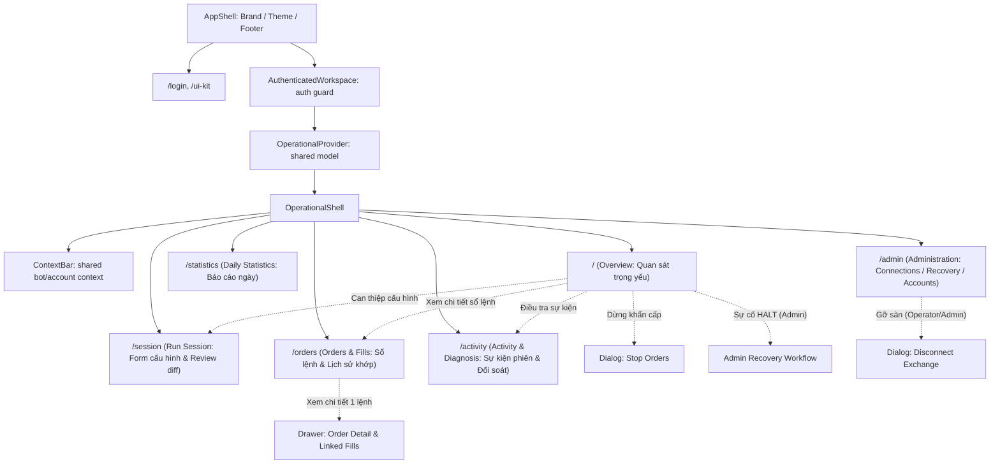
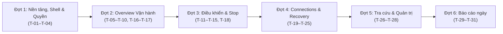

# Kế hoạch cấu trúc màn hình và cây component — LIFE MM Dashboard
> **Tài liệu đối ứng cho:** [`docs/LOGIC-HANDOFF.md`](LOGIC-HANDOFF.md)
> **Tuân thủ quy ước:** [`docs/COORDINATION.md`](COORDINATION.md), [`dashboard/TODO.md`](../TODO.md), [`docs/frontend-requirements.md`](../../docs/frontend-requirements.md), [`docs/fe-integration.md`](../../docs/fe-integration.md)
> **Phiên bản:** 1.3.0 (Phạm vi, bàn giao và nghiệm thu đủ sáu đợt triển khai)

---

## 1. Nguyên tắc cốt lõi & Phân định trách nhiệm

Để bảo đảm tính tinh gọn, đúng ranh giới kiến trúc đã quy định tại [`COORDINATION.md`](COORDINATION.md):

* **Trách nhiệm của Logic/Hệ thống:**
  - Tính toán và quyết định quyền hạn (`permissions`, `capabilities`, `actions`).
  - Quản lý tính mới/cũ của dữ liệu (`freshness`, `stale`).
  - Vòng đời thao tác: khởi tạo mutation, cấp phát `Idempotency-Key`, kiểm tra version (`expected_version`, `expected_catalogue_hash`), polling receipt, xử lý timeout/retry an toàn và lưu trữ bền vững (persistence metadata).
  - Bàn giao dữ liệu, DTOs đã map, trạng thái nguồn độc lập, các cờ điều kiện thao tác, callbacks và bộ fixtures theo từng workflow cho UI.
* **Trách nhiệm của UI:**
  - Bố cục màn hình (desktop/mobile), phân cấp thị giác (visual hierarchy).
  - Component trình bày, tái sử dụng các primitive của Design System.
  - Ngôn ngữ hiển thị (copywriting), nhãn giải thích (*next action*, *blocked reasons*).
  - Tương tác người dùng (forms, validation inline, dialogs, drawers, keyboard navigation, focus trap).
  - Nhận ý định người dùng qua các sự kiện và chuyển tiếp cho logic qua callbacks. UI **không tự thiết kế lại** cơ chế persistence, polling timers hay sinh key idempotency.

---

## 2. Mục tiêu sản phẩm & 4 Câu hỏi vận hành cốt lõi

Dashboard được thiết kế để người vận hành (Operator) trả lời tức thì 4 câu hỏi nghiệp vụ theo thứ tự ưu tiên:

1. **Bot đang thực hiện nhiệm vụ gì?**
   *Profile nào đang chạy (Fixed hay Random)? Thị trường nào (Spot, Perp hay cả hai)? Thời hạn còn bao lâu (hay Until stopped)? Cấu hình ghim (pinned configuration) hiện tại là gì?*
2. **Tình trạng thực tế có đáp ứng nhiệm vụ không?**
   *Thực tế trên sàn có đủ working orders 2 phía BUY và SELL không? Giá, khối lượng còn lại, own spread, own notional? Tỷ lệ đáp ứng mục tiêu (sampled two-sided coverage 30m $\ge 99\%$, hoặc trạng thái "chưa đủ thời gian đánh giá")? Vốn khả dụng và vị thế held exposure?*
3. **Nếu có vấn đề, nguyên nhân và hành động tiếp theo là gì?**
   *Vấn đề là gì? Phía/thị trường nào bị ảnh hưởng? Lý do có bằng chứng (thiếu số dư, lệch tồn kho, chạm quote guard, tạm dừng biến động)? Hành động tiếp theo rõ ràng (chờ, nạp vốn thủ công, chuyển profile, hay liên hệ kỹ thuật)?*
4. **Sau can thiệp hoặc Stop, kết quả và tài sản/vị thế còn lại ra sao?**
   *Lệnh dừng đã hoàn tất chưa? Các working orders đã hủy hết chưa? Vị thế perpetual còn giữ nguyên ra sao (positions remain open)? Số dư spot còn lại là bao nhiêu? Kết quả đối soát (reconciliation) với sàn thế nào?*

---

## 3. Sơ đồ màn hình và điều hướng (Navigation & Screen Architecture)

### 3.1. Phân cấp hiển thị

Khung public và workspace có hai vòng đời khác nhau. `AppShell` ở root giữ thương hiệu, theme và footer cho cả route công khai lẫn đăng nhập. Route được bảo vệ mới đi vào workspace:

```text
AppShell
└── AuthenticatedWorkspace (auth guard)
    └── OperationalProvider
        └── OperationalShell
            ├── ContextBar (ngữ cảnh dùng chung)
            └── Outlet → các trang nghiệp vụ
```

Provider/controller nạp context một lần tại workspace. ContextBar và các page tiêu thụ model hoặc props đã bàn giao; `HomePage` chỉ compose nội dung Overview. Login/UI Kit ở ngoài provider nên không khởi động polling vận hành. StopControl thuộc workflow điều khiển riêng; sơ đồ component này không bổ sung mutation Stop.



| Cấp độ | Thành phần / Route | Đối tượng truy cập | Trách nhiệm hiển thị & Hành vi |
| :--- | :--- | :---: | :--- |
| **Root shell** | [`AppShell`](../src/app/AppShell.tsx) | Tất cả | Thương hiệu, theme và footer; không fetch dữ liệu vận hành. |
| **Workspace dùng chung** | `AuthenticatedWorkspace` → `OperationalProvider` → `OperationalShell` | Chỉ route đã xác thực | Mount context/polling một lần; có ContextBar và outlet. ContextBar trình bày ngữ cảnh bot/tài khoản/quyền. Điều khiển như Stop thuộc workflow riêng; khả năng thao tác vẫn theo logic/capability backend. |
| **Trang riêng (Dedicated Pages)** | **`/` Overview** | Tất cả | Màn hình mặc định. Quan sát tập trung sức khỏe bot, lệnh hai phía, cảnh báo vận hành, số dư và vị thế. |
| | **`/session` Run Session** | Tất cả (Thao tác: Operator/Admin) | Thiết lập phiên MM hoặc chuyển phiên (`Switch`). Review sự khác biệt giữa cấu hình đang ghim (Pinned) và cấu hình mới trước khi gửi. |
| | **`/orders` Orders & Fills** | Tất cả | Tra cứu sổ lệnh bot đang mở (`Open`, `Partially filled`) và lịch sử khớp lệnh (`Fills`, phí giao dịch). |
| | **`/activity` Activity & Diagnosis** | Tất cả (Thao tác Check: Operator/Admin) | Dòng thời gian sự kiện phiên (`events`), lịch sử lệnh điều khiển (`commands`), và công cụ Đối soát chỉ đọc (`Reconciliation`). |
| | **`/statistics` Daily Statistics** | Tất cả | Thống kê theo ngày: khối lượng mua/bán, phí trả, funding nhận/trả, số dư tài khoản theo múi giờ báo cáo (`Asia/Ho_Chi_Minh`). |
| | **`/admin` Administration** | Phân quyền theo tab | Khu vực quản trị hệ thống:<br>1. **Connections (Khóa sàn)**: **Operator và Admin** theo `manage_credentials` và backend availability để Set, Disconnect, Repair key.<br>2. **Recovery (Phục hồi HALT)**: **Admin** (`manage_recovery`).<br>3. **Accounts (Tài khoản Google)**: **Admin** (`manage_accounts`).<br>4. **Audit (Nhật ký)**: các role có quyền đọc theo backend. Không đặt guard Admin ở route cha làm mất truy cập Connections/Audit hợp lệ. |
| **Drawer (Bảng trượt cạnh phải)** | `OrderDetailDrawer` | Tất cả | Xem chi tiết 1 order: timeline trạng thái, nguyên nhân hủy/từ chối, danh sách partial fills liên quan. |
| | `TechnicalDiagnosticsDrawer` | Tất cả | Xem chi tiết kỹ thuật: mã lỗi raw, sanitized exceptions, version metadata khi cần chuyển kỹ thuật viên. |
| **Dialog (Hộp thoại xác nhận)** | `StopConfirmationDialog` | Operator / Admin | Xác nhận dừng khẩn cấp: *"Stop MM; positions remain open"* (dừng đặt lệnh, hủy lệnh chờ, GIỮ NGUYÊN vị thế). |
| | `DisconnectConfirmationDialog` | Operator / Admin | Xác nhận gỡ kết nối sàn: Cảnh báo đóng vị thế perpetual tại giá thị trường (có thể trượt giá/phí), spot giữ nguyên. |
| | `RecoveryResetDialog` | Admin | Admin xác nhận áp dụng bản sửa đổi (Reset) khi điều kiện recovery hợp lệ và có confirmation token. |

---

## 4. Cây component cấp chức năng & Bố cục Responsive

### 4.1. Thứ tự ưu tiên thị giác & Bố cục Desktop / Mobile

#### A. Trên Desktop ($\ge 1024\text{px}$)
* **Top Bar cố định:** Header trải ngang với logo, nhận diện môi trường, trạng thái phiên, user badge và nút **Stop Orders** màu nổi bật ở góc phải.
* **Layout 2 cột song song cho thị trường:**
  - Cột trái: Spot Liquidity (Working bid/ask, spread, notional, order count).
  - Cột phải: Perpetual Liquidity (Working bid/ask, spread, notional, order count).
* **Khối Tài sản & Rủi ro:** Đặt ngay dưới Working Orders, phân tách Shared Cash/Equity với Perpetual Positions (không cộng trùng ví).

#### B. Trên Mobile / Tablet nhỏ ($< 1024\text{px}$)
* **Header tinh gọn:** Rút gọn text nhãn (chỉ hiện icon + badge), nút Stop chuyển thành action nổi bật dễ chạm (touch target $\ge 44\text{px}$). Menu điều hướng đưa vào Mobile Hamburger drawer.
* **Thứ tự ưu tiên ngăn xếp (Single-Column Priority Stack):**
  1. `OperatorAttentionBanner`: Luôn ở trên cùng nếu có cảnh báo cần xử lý.
  2. `SessionSummaryCard`: Trạng thái phiên & countdown thời gian.
  3. `WorkingOrdersSection`: Xếp chồng Spot trước, Perp sau.
  4. `OperatingTargetsCard`: Tỷ lệ coverage.
  5. `SharedBalancesCard` & `HeldPositionsCard`: Số dư và vị thế.
  6. `RiskGuardsCard`: Giới hạn rủi ro.

### 4.2. Bảng component cấp chức năng

| Khối Component | Câu hỏi cần trả lời | Dữ liệu hiển thị | Quyền thao tác | TODO liên quan | Trạng thái tái sử dụng |
| :--- | :--- | :--- | :---: | :--- | :--- |
| **`ContextBar`** (trong OperationalShell) | Tôi đang ở bot/môi trường nào? Tài khoản và người dùng nào? Dữ liệu mới đến đâu? | Bot/account/môi trường đã xác minh theo model; identity/role/permissions; freshness và mismatch | Chỉ trình bày context. StopControl thuộc workflow riêng và nhận capability từ logic | T-02, T-03, T-04 | **Tạo trong feature UI**, đọc consumer hook/props; `AppShell` vẫn là root shell public. |
| **`OperatorAttentionBanner`** | Hệ thống có vấn đề gì khẩn cấp không? Tôi cần làm gì ngay bây giờ? | Tiêu đề cảnh báo, phía/thị trường bị ảnh hưởng, nguyên nhân có bằng chứng (`operator.label/detail`), hướng xử lý (`next_action`). | Viewer xem / Operator & Admin can thiệp | T-06, T-08, T-15 | **Tạo mới**, dùng [`Banner.tsx`](../src/shared/components/Banner.tsx). |
| **`SessionSummaryCard`** | Bot được giao nhiệm vụ gì? Còn chạy bao lâu? Cấu hình đang ghim là gì? | Profile đang chạy (Fixed/Random), Thị trường (Spot/Perp/Both), Countdown thời gian còn lại (hoặc nhãn `Until stopped`), Requested vs Observed state. | Bấm chuyển cấu hình (dẫn sang `/session`) | T-05, T-10, T-11 | **Tạo mới**, dùng [`Surface.tsx`](../src/shared/components/Surface.tsx). |
| **`WorkingOrdersSection`** | Bot có đang đặt lệnh mua/bán thực tế trên sàn không? Giá và lượng bao nhiêu? | Cột Spot và Perp riêng: Giá Bid/Ask, Volume còn lại, Own notional, Own spread, Lệnh pending đặt/hủy, Nguyên nhân nếu thiếu lệnh (`diagnosis`). | Mở `OrderDetailDrawer` | T-07, T-08 | **Tạo mới**, dùng [`Badge.tsx`](../src/shared/components/Badge.tsx). |
| **`OperatingTargetsCard`** | Tỷ lệ cung cấp thanh khoản có đạt chuẩn $\ge 99\%$ không? | % Sampled two-sided coverage 30m, Tổng thời gian phiên, Thời gian bị giới hạn (restricted), Thời gian không xác định (unknown), Cảnh báo vắng lệnh > 20s / 60s, **Trạng thái "Chưa đủ thời gian đánh giá"** khi phiên mới chạy < 30 phút. | Chỉ quan sát | T-09 | **Tạo mới**. |
| **`SharedBalancesCard`** | Tài sản thực tế còn bao nhiêu? Allocation khác số dư thế nào? | Cash, Available Cash, Equity, Available Equity cho USDT và LIFE. Phân tách rõ ràng, không cộng trùng ví Spot/Perp. | Hướng dẫn ngoài app | T-16 | **Tạo mới**. |
| **`HeldPositionsCard`** | Vị thế Perpetual còn giữ là gì? Rủi ro thanh lý ra sao? | Chiều vị thế (LONG / SHORT riêng), Ký quỹ (Margin), Giá thanh lý ước tính, PnL tạm tính kèm nhãn nguồn tính. | Xem chi tiết | T-16, T-14 | **Tạo mới**. |
| **`RiskGuardsCard`** | Có giới hạn rủi ro nào đang bị chạm hay chuẩn bị kích hoạt không? | Trạng thái Quote guard (độ lệch giá), Drawdown controller hiện tại vs Limit trần, Hạn mức Spot Outflow còn lại. | Xem chi tiết policy | T-17 | **Tạo mới**. |
| **`SessionConfigForm` & `DiffReview`** | Tôi muốn đổi phiên: Đổi được gì? Cấu hình mới khác gì cấu hình cũ? | Form chọn Market, Profile/Random, Duration mode. Bảng so sánh 2 cột: Cấu hình ghim hiện tại vs Cấu hình đề xuất mới. Managed settings chỉ đọc. | Operator / Admin | T-11, T-12, T-13 | **Tạo mới**, dùng [`Input.tsx`](../src/shared/components/Input.tsx), [`Button.tsx`](../src/shared/components/Button.tsx). |
| **`StopConfirmationDialog`** | Dừng bot sẽ tác động gì tới tài sản? Lệnh và vị thế ra sao? | Session ID, thị trường ảnh hưởng, thông điệp cam kết rõ ràng: **"Stop MM; positions remain open"**. Trạng thái pending cancel. | Operator / Admin | T-14, T-15 | **Tạo mới**, dùng [`Dialog.tsx`](../src/shared/components/Dialog.tsx). |
| **`OrdersAndFillsView` & `Drawer`** | Quá khứ bot đã đặt và khớp những gì? Có lệnh nào bị kẹt không? | Bộ lọc thị trường/thời gian. Danh sách Orders có cursor pagination (`recorded_remaining_amount`). Danh sách Fills. Drawer chi tiết timeline. | Tất cả | T-26 | **Tạo mới**. |
| **`ReconciliationPanel`** | Dữ liệu bot ghi nhận có khớp với thực tế trên sàn OKX không? | Trạng thái: `not_checked`, `checking`, `matched`, `mismatch`, `incomplete`. Bảng kê sai lệch (nếu có). Thời điểm check. | Operator / Admin (Check) | T-18 | **Tạo mới**. |
| **`ManagedCredentialsView` & `DisconnectDialog`** | Kết nối sàn có an toàn không? Gỡ kết nối thì xử lý thế nào? | Trạng thái slot OKX, nguồn cấu hình (`environment` hay `postgres_kms`), credential version. Form nhập key mới. Modal xác nhận Disconnect. | **Operator & Admin** (theo quyền `manage_credentials` & availability) | T-19, T-20, T-21 | **Tạo mới**, tuân thủ Disconnect UX. |
| **`AdminRecoveryView`** | Bot bị HALT kỹ thuật, làm sao phục hồi an toàn? | Trạng thái HALT, Blocker list, Bảng preview Before/After, Verification counts, Thời hạn hiệu lực token (5 phút). | **Chỉ Admin** (`manage_recovery`) | T-22, T-23, T-24, T-25 | **Tạo mới**. |
| **`AccountsManagementView`** | Ai có quyền vào hệ thống? Làm sao thêm người mới mà không mất quyền Admin? | Bảng danh sách Google accounts, Role (`read`, `write`, `admin`), trạng thái bound/active, cảnh báo bảo vệ Last bound Admin. | **Chỉ Admin** | T-28 | **Tạo mới**. |

---

## 5. Trạng thái, Tương tác & Định dạng dữ liệu

### 5.1. Phân biệt rạch ròi 4 tầng trạng thái hệ thống
* **Service Health:** Tiến trình backend có phản hồi không, có đang cập nhật schema (`migrating`) hay không.
* **Connection Status:** Khóa sàn OKX đã nạp hợp lệ chưa (`Connected`, `Not configured`, `Checking`, `Disconnecting`, `Action required`, `Disconnected`). `Connected` chỉ xác nhận khóa hợp lệ, KHÔNG có nghĩa là bot đang chạy MM.
* **Session Readiness:** Phiên MM đã được phê duyệt và khởi chạy chưa (`preparing`, `running`, `idle`, `stopped`, `expired`, `halted`).
* **Working Orders:** Thực tế trên sàn có lệnh mua và bán hợp lệ không (`orders_working`, `one_sided`, `no_quotes`, `unavailable`, `idle`).

### 5.2. Trạng thái thao tác theo từng Workflow (Không dùng quy tắc đóng form chung)
Mỗi nghiệp vụ có vòng đời và kết quả kết thúc riêng do logic bàn giao; UI **không áp dụng quy tắc chung "succeeded $\rightarrow$ đóng form $\rightarrow$ chuyển về Overview"**:

1. **Workflow Run Session (Start / Switch):**
   - Khi receipt `succeeded`: Giữ form ở trạng thái hoàn tất, hiển thị kết quả xác nhận và kích hoạt đọc lại quan sát phiên mới (`/status`, `/balances`). Người dùng có thể chủ động bấm quay lại Overview hoặc ở lại theo dõi.
2. **Workflow Admin Recovery:**
   - Khi bước Check recovery hoàn tất:
     + Nếu `stage=review_required` và `can_recover=true`: Chuyển sang bước **Review Preview** để hiển thị bảng diff Before/After của vị thế/lệnh cần sửa và đếm ngược thời hạn confirmation token (5 phút). Cho phép bấm xác nhận Reset.
     + Nếu `stage=blocked` và `can_recover=false`: Hiển thị danh sách blockers cùng hướng dẫn xử lý (`next_action`); khóa hoàn toàn thao tác xác nhận Reset.
   - Chỉ khi bước Reset recovery hoàn tất với `status=succeeded` và `stage=recovered`, màn hình mới chuyển sang trạng thái *"Recovery hoàn tất — Bot đang ở trạng thái Dừng (Stopped)"*.
3. **Workflow Reconciliation (Đối soát):**
   - Khi receipt kiểm tra đối soát `succeeded`: Giữ nguyên màn hình Reconciliation để hiển thị báo cáo chi tiết. Báo cáo này có thể mang trạng thái `matched` (khớp hoàn toàn), hoặc `mismatch` (có sai lệch), hoặc `incomplete` (chưa kiểm tra hết phạm vi). Người dùng cần ở lại để đối chiếu các dòng lệnh/fill bị lệch.
4. **Workflow Disconnect Exchange:**
   - Theo dõi xuyên suốt qua các stage (`cancelling_orders` $\rightarrow$ `closing_positions` $\rightarrow$ `verifying` $\rightarrow$ `detaching`). Khi `succeeded` và đạt đủ 4 final proofs, hiển thị trạng thái `Disconnected` rõ ràng ngay tại tab Connections.

### 5.3. Định dạng số liệu (Number Formatting) theo đơn vị từng Field
UI nhận chuỗi Decimal string từ logic và format hiển thị thân thiện, tuyệt đối không dùng `Number()` để tính toán làm mất độ chính xác. **Đơn vị và cơ sở hiển thị theo đúng contract do phía Logic bàn giao**:

| Loại số liệu | Ví dụ dữ liệu thô | Quy tắc format hiển thị | Ghi chú |
| :--- | :--- | :--- | :--- |
| **Tiền định giá (USDT)** | `"1234.5678"` | `1,234.57 USDT` | Làm tròn 2 số thập phân, có dấu phẩy phân cách hàng nghìn. |
| **Token cơ sở (LIFE)** | `"98765.43219"` | `98,765.4322 LIFE` | Làm tròn 4 số thập phân. |
| **Tỷ lệ / Phần trăm (Spread, Drawdown, Coverage)** | Phụ thuộc contract bàn giao | Theo đơn vị logic bàn giao | Không mặc định nhân 100; dùng đơn vị do logic chỉ định (nếu đã là fraction thì format `%`, nếu đã là bps/percent string thì giữ nguyên nhãn tương ứng). |
| **Giá đặt lệnh (Prices)** | `"0.045230"` | Theo **tick size thực tế** | Không giới hạn cứng 4–6 chữ số; format linh hoạt theo quy chuẩn bước giá của cặp giao dịch do sàn quy định. |
| **Số lượng lệnh / Fills** | `12` | `12` | Số nguyên không có phần thập phân. |
| **Dữ liệu chưa có / Missing** | `null` / `undefined` | `—` hoặc `Chưa có` | **Tuyệt đối không hiển thị thành `0` hay `0.00`**. |

### 5.4. Trạng thái tỷ lệ thanh khoản (Coverage Target)
Khối `OperatingTargetsCard` hỗ trợ 3 trạng thái rõ ràng:
1. **Đạt chỉ tiêu:** $\ge 99.0\%$ sampled two-sided coverage trên cửa sổ 30 phút.
2. **Dưới chỉ tiêu:** $< 99.0\%$, hiển thị cảnh báo và bóc tách thời gian vắng lệnh (*unexpected absence*).
3. **Chưa đủ thời gian đánh giá:** Khi phiên giao dịch mới khởi chạy chưa đủ 30 phút hoặc số mẫu quan sát chưa đủ để đưa ra kết luận thống kê tin cậy (tránh vội vàng kết luận đạt/không đạt từ mẫu quan sát quá ngắn).

### 5.5. Khả dụng & Hành vi Bàn phím (Keyboard & Focus Accessibility)
* **Nút Stop Orders:** Nằm ở vị trí đầu tiên trong chuỗi tab navigation khẩn cấp; viền focus (`:focus-visible`) sắc nét với độ tương phản cao; hỗ trợ phím Enter/Space để kích hoạt ngay.
* **Hộp thoại xác nhận (Dialogs / Modals):**
  - Áp dụng focus trap (người dùng nhấn `Tab` chỉ xoay vòng bên trong modal).
  - Tự động focus vào nút an toàn nhất (ví dụ nút "Hủy bỏ") khi mở hộp thoại.
  - Phím `Escape` đóng modal ngay lập tức (trừ khi đang trong quá trình submit mutation quan trọng).
  - Khôi phục focus (`focus restoration`) về đúng nút bấm đã kích hoạt mở modal trước đó sau khi đóng.
* **Không cướp Focus (No focus stealing):** Các cập nhật dữ liệu tự động từ polling hoặc toast thông báo tự đóng tuyệt đối không làm mất tiêu điểm bàn phím của người vận hành đang nhập liệu.

---

## 6. Khớp nối Đợt 1 (T-01–T-04)

UI dùng model, props, callbacks và fixtures từ [LOGIC-HANDOFF](LOGIC-HANDOFF.md); không khai báo lại quyền hay suy diễn field:

- Logic sở hữu `useOperationalController`, `OperationalProvider`, model và consumer hook `useOperationalContext`.
- UI sở hữu ContextBar, `OperationalShell` presentation và các feature View. Những component này không gọi API/auth/config trực tiếp.
- Người tích hợp lắp `AuthenticatedWorkspace` dưới root `AppShell`, rồi bọc `OperationalProvider` quanh `OperationalShell` và protected outlet. Không đặt ContextBar trong `HomePage`.
- Provider chỉ mount cho protected routes; `/login` và `/ui-kit` không khởi động query polling của workspace.
- TanStack Query giữ server state; provider chỉ derive shared context, không copy vào Zustand/global store thứ hai.
- Bàn giao phải giữ các tình huống: unauthenticated/public route; role/permissions; unknown/mismatch; một hoặc nhiều account; failure status/balances độc lập; stale owner; permission refresh; re-login receipt. Mỗi bên thêm test đúng tầng của mình và người tích hợp kiểm chứng route lifecycle.

---

## 7. Lộ trình triển khai tổng thể



*Phía Logic sẽ lần lượt bàn giao interface, fixtures và điều kiện hoàn tất từng workflow. Đội UI bám sát tài liệu này để hiện thực hóa bố cục, component, copy và tương tác.*

### 7.1. Quy tắc triển khai và bàn giao

Sáu đợt bao phủ toàn bộ phạm vi T-01–31; T-32–37 thực hiện xuyên suốt và đóng bằng chứng phát hành. [Bàn giao logic theo đợt](LOGIC-HANDOFF.md#bàn-giao-logic-theo-đợt-triển-khai) quy định nguồn dữ liệu, callbacks, fixture và điều kiện logic. Mỗi đợt gồm bàn giao logic, View, tích hợp và kiểm tra; hoàn tất một bên chưa đủ đóng TODO.

Logic sở hữu controller/hooks, mapping/validation, quyền, freshness và vòng đời operation. UI sở hữu View, input/dialog/tab, copy, responsive và keyboard/focus. Người tích hợp được ghi cụ thể cùng file page/shell/provider trước khi bắt đầu workflow theo COORDINATION.md. Props và fixtures được chốt cho workflow sắp triển khai, không cần khóa trước toàn bộ TypeScript của các đợt sau.

Các tên component dưới đây là khối chức năng dự kiến; có thể ghép/tách theo kiến trúc hiện có. Không yêu cầu thêm thư viện hoặc framework state mới. View đợt sau có thể làm song song khi đã có interface/fixture; việc tích hợp mutation phụ thuộc ngữ cảnh/quyền và quan sát đúng từ đợt trước. Connections/Accounts có thể ưu tiên sớm khi onboarding cần.

### 7.2. Đợt 1 — Nền tảng, Shell và quyền (T-01–04)

- **Kết quả:** nhận diện đúng người dùng, bot, markets, Demo/Live và tài khoản; truy cập đúng quyền.
- **UI:** `OperationalContextView`, header/navigation/role badge, unknown/mismatch và lý do chặn thao tác; kết nối login/deep link trên nền auth có sẵn. Vị trí Stop được xác định trong shell; workflow gửi Stop hoàn thiện ở Đợt 3.
- **Logic bàn giao:** model, callbacks và chín nhóm fixture tại mục 6; trạng thái status/balances và account observations độc lập.
- **Tích hợp/phụ thuộc:** dùng auth/API foundation; nối controller vào View và shell/page, không tạo lại provider hoặc suy môi trường từ URL.
- **Nghiệm thu:** render đúng nhiều/thiếu account, môi trường chưa xác minh, lỗi/stale từng nguồn; Viewer/Operator/Admin có khả năng phù hợp. 401/403/logout/relogin không giữ quyền/cache sai hoặc tự replay thao tác. Component tests và browser login/context/navigation là bằng chứng riêng; Google thật thuộc T-37.
- **Trạng thái:** T-01–04 hoàn tất local/mock; bằng chứng tại [TODO](../TODO.md). Môi trường thật giữ mở tại T-37; Đợt 2 cần phân tích và chốt riêng.

### 7.3. Đợt 2 — Overview, vốn và rủi ro (T-05–10, T-16–17)

- **Kết quả:** trả lời bot được giao gì, đang cung cấp lệnh thế nào, chênh lệch/nguyên nhân nào có bằng chứng và vốn/rủi ro còn lại.
- **UI trên `/`:** `OperatorAttentionBanner`, `SessionSummaryCard`, `WorkingOrdersSection`, `OperatingTargetsCard`, `SharedBalancesCard`, `HeldPositionsCard`, `RiskGuardsCard`; bố cục tại mục 4. Hiển thị market/side riêng; market không hoạt động có trạng thái rõ ràng. Link tới session, orders và activity; route chưa triển khai không được thành link chết.
- **Logic bàn giao:** requested/observed session, pinned configuration, own quotes/pending/diagnosis, coverage từng market và vốn/risk có basis/đơn vị/timestamp theo LOGIC-HANDOFF. Số nhỏ cần xem được giá trị chính xác; không biến thành zero do format.
- **Trạng thái/tương tác:** loading, empty, ready, lỗi và last-good stale từng nguồn; running/no_quotes, one-sided, unavailable/idle; đủ/chưa đủ cửa sổ coverage, eligible bằng 0 và unknown/restricted. Refresh từng nguồn và mở chi tiết; không tự restart/nới guard/nạp vốn.
- **Tích hợp/phụ thuộc:** context và quyền Đợt 1; reuse query/cache/polling. Thao tác điều khiển thật nối tại Đợt 3; không giả lập runtime để làm đầy màn hình.
- **Nghiệm thu:** kiểm tra running nhưng không có lệnh, partial fill/pending, guard/inventory, stale/mismatch, thiếu valuation và ví chung. Không cộng trùng tài sản; LONG/SHORT riêng; không báo đạt 99% từ mẫu ngắn. Lỗi liquidity/balances/positions vẫn giữ status và khả năng Stop hợp lệ khi đã nối Đợt 3. Browser xác minh thứ tự ưu tiên desktop/mobile và dữ liệu thiếu không thành zero.

### 7.4. Đợt 3 — Run Session, Stop và đối soát (T-11–15, T-18)

- **Kết quả:** người dùng review, gửi Start/Switch/Stop và theo dõi đến kết quả quan sát; biết phần chưa xác minh.
- **UI trên `/session`:** `SessionConfigForm`, `ManagedSettingsPreview`, `SessionDiffReview`, `CommandReceiptTracker`. Fixed/Random, markets, timed/until-stopped theo catalogue; cấu hình ghim và catalogue mới tách riêng. Shell có `StopConfirmationDialog`; `/activity` dựng `ReconciliationPanel` trước, history đầy đủ ở Đợt 5.
- **Logic bàn giao:** validation, availability/lý do chặn, reviewed version/session/hash, submit/retry/track callbacks và receipt state. Timeout giữ unknown; command có superseded; reconciliation có kết quả riêng khỏi receipt.
- **Trạng thái/tương tác:** form draft/review, submitting, accepted/applying, succeeded/failed/superseded; conflict cần review lại, lỗi field inline, tiến trình vẫn xem được sau toast. Stop sẵn khi được phép dù Start/Switch pending; xác nhận nêu markets/session và positions remain open. Sau Stop giữ cancellation progress và residual exposure trên Overview. Reconciliation giữ matched/mismatch/incomplete/unavailable cùng thời điểm/phạm vi.
- **Tích hợp/phụ thuộc:** dữ liệu/khả năng từ Đợt 1–2; hook gửi và tracking do logic sở hữu. Receipt terminal kích hoạt đọc lại đúng status/quotes/balances/positions cần thiết; không kết luận hiện trạng chỉ từ receipt cũ.
- **Nghiệm thu:** browser review → submit → receipt → observed state, Switch bị supersede, Stop khi pending và còn exposure; timeout trước/sau ID, cùng key retry, duplicate, 409/422, concurrent operators, reload/relogin và response cũ. Không tự replay mutation hoặc báo stopped/flat khi outcome chưa rõ. Reconciliation success không tự báo matched.

### 7.5. Đợt 4 — Connections, cleanup và Recovery (T-19–25)

- **Kết quả:** cấu hình kết nối hoặc xử lý sự cố có kiểm chứng, phân biệt Stop, Disconnect và recovery.
- **UI trên `/admin`:** `ManagedCredentialsView`, `DisconnectDialog`, `AdminRecoveryView`, `RecoveryResetDialog`; tab Connections cho quyền phù hợp, Recovery cho Admin. Set theo input names; xóa secret input sau gửi. Disconnect xác nhận bot-wide stop/cancel, đóng managed perpetual exposure ở market với phí/slippage, spot giữ nguyên; key tại sàn chưa bị revoke.
- **Logic bàn giao:** source environment/managed và actions, Stop acknowledgement, credential/root operation và các version; blocked/retry/repair; recovery preconditions/check/preview/confirm, hết hạn/drift và final proofs. Token/secret không dùng làm nội dung hiển thị hoặc browser persistence.
- **Trạng thái/tương tác:** environment chỉ đọc, chưa cấu hình/checking/connected/action required; saved key chưa đủ kết luận connected. Cleanup pending/blocked/unknown cho xem stage và next action, retry/repair theo callback. Recovery gồm no recovery needed, checking, blocked, review, resetting, failed/unknown/recovered; chỉ review hợp lệ mới xác nhận, hết hạn cần check mới. Countdown dùng hạn backend.
- **Tích hợp/phụ thuộc:** Stop Đợt 3 và context/fresh observations; operation receipts riêng từng loại. Không dùng một success handler cho Set/Disconnect/check/reset. Lỗi/unknown không xóa dấu vết thao tác đang theo dõi.
- **Nghiệm thu:** Operator thực hiện được credential workflow hợp lệ; non-Admin không vào recovery. Test Set không Start, partial cleanup/repair đúng account/root/version, mất mạng/reload, blocked check, preview hết hạn/drift và reset recovered. Chỉ báo Disconnected khi đủ proofs; recovered vẫn stopped. Browser kiểm tra copy xác nhận, focus và secret không còn trong form/storage/log.

### 7.6. Đợt 5 — Orders, Activity và quản trị (T-26–28)

- **Kết quả:** tra cứu được phiên/lệnh/fills/thao tác để điều tra và bàn giao; quản lý account theo quyền.
- **UI:** `/orders` có `OrderFiltersBar`, `WorkingOrdersTable`, `RecordedOrdersTable`, `FillsTable`, `OrderDetailDrawer`; `/activity` có `SessionEventsTimeline`, `CommandHistoryList` và liên kết tới receipt/configuration. `/admin` tách `AccountsManagementView` và `SecurityAuditView`, không chặn audit bằng guard Admin của Accounts.
- **Logic bàn giao:** filters/cursor/reset và on-demand detail, linked fills, recorded progress/basis, scope/history limitations và actor/audit mapping; account permissions/version/last-admin protection.
- **Trạng thái/tương tác:** loading/empty/error từng table/detail, lịch sử không đầy đủ và actor chưa biết; đổi filter reset cursor, response cũ không đổi kết quả mới. Accounts có invite/role/active, conflict review và last-admin blocked; invitation không được ghi đã login. Audit chỉ đọc cho role có quyền backend.
- **Tích hợp/phụ thuộc:** receipt tracking Đợt 3–4 và context scope; nối các link chi tiết từ Overview. Không poll mọi cursor page hoặc fetch per-row; history không được thay bằng YAML hiện tại.
- **Nghiệm thu:** filter/pagination/detail/linked fills, lịch sử thiếu, lỗi detail độc lập, tìm pending/failed operation sau reload; account conflict/403/last-admin và audit theo quyền đọc. Browser kiểm tra drawer mở/đóng trả focus, keyboard bảng và mobile không che hành động. Recorded orders không được gọi là toàn bộ order book sàn.

### 7.7. Đợt 6 — Báo cáo ngày (T-29–31)

- **Kết quả:** đọc volume, phí/rebate, funding và số dư theo ngày, biết phạm vi và khoảng thiếu dữ liệu.
- **UI trên `/statistics`:** `DailySummaryMetrics`, `DailyVolumeChart`, `DailyFundingChart`, `DailyBalancesChart`, bộ lọc ngày và reporting timezone hiển thị rõ; controller performance ở phần phụ có basis. Chart chỉ dựng khi contract có series tương ứng; thiếu nguồn ghi unavailable, không tạo lịch sử giả.
- **Logic bàn giao:** range validation/from inclusive–to exclusive, reporting timezone/buckets, market series, decimal/đơn vị và conversion coverage, freshness/retry hints và performance scope.
- **Trạng thái/tương tác:** loading, empty, range invalid, unavailable, error và HTTP 200 stale với “Statistics updating”; giữ timestamp gốc. Missing days/funding chưa quan sát thành gaps/null; zero thật vẫn là zero. Đổi filter/timezone không nhận nhầm response cũ hoặc đổi nhãn persisted bucket.
- **Tích hợp/phụ thuộc:** auth/context và dữ liệu tài chính Đợt 2; báo cáo tải/lỗi độc lập với status/Stop. Có thể dựng View bằng fixtures trước khi tích hợp các đợt điều khiển hoàn tất.
- **Nghiệm thu:** browser đổi range/filter, timezone, missing/zero, stale/retry phục hồi, currency/conversion coverage thiếu và số decimal nhỏ/lớn. Shared balances chỉ một lần; funding tách perpetual; chart numbers không thay authoritative amounts. Không dựng OHLCV hoặc benchmark đầu tư từ fills/daily stats.

### 7.8. Kiểm thử xuyên suốt và điều kiện kết thúc (T-32–37)

Trước khi thêm test, đối chiếu test hiện có theo workflow. Mỗi đợt có case matrix gồm success/empty, validation/permission, transient/persistent failure, retry/recovery, timeout unknown, idempotency/duplicates, ordering, concurrency, reload/restart và side effects độc lập khi liên quan; case không áp dụng ghi lý do. Kiểm tra cả light/dark, mobile, keyboard/focus, reduced motion và feedback không lặp.

Người tích hợp thu bằng chứng từ `dashboard/`: `pnpm run api:check`, `pnpm run check`, `pnpm run test:e2e`, `pnpm run test:a11y`; visual chỉ sau khi baseline được tạo/review/commit. Ghi từng check PASS/FAIL/SKIP, command, branch/commit/runtime và phạm vi; SKIP không tính PASS. Dependency chặn cần exact verbose rerun command giữ selector/flags/environment/timeout. Component fixture và mocked HTTP không thay browser integration hoặc Google/backend/exchange thật.

T-36–37 xác minh hosted deep link/reload/assets, CI/deploy/rollback độc lập backend, Google/gateway/CORS/IAM và đúng bot/account/Demo–Live. Thao tác môi trường thật theo phạm vi được cấp quyền. Không gọi bản triển khai sẵn sàng vận hành chỉ từ build hoặc mock test.

Đóng mỗi đợt khi phần UI và logic đã nối, tiêu chí của đợt và các TODO liên quan đạt, test có bằng chứng và giới hạn được ghi rõ. Bản đầy đủ kết thúc sau sáu đợt cùng bằng chứng T-32–37; không cần xin duyệt lại cho bước local có thể đảo ngược trong phạm vi đã giao. Thiếu API hoặc quyết định thay đổi phạm vi phải ghi thành blocker/đầu việc riêng trước phần phụ thuộc, không tự lấp bằng dữ liệu giả.
