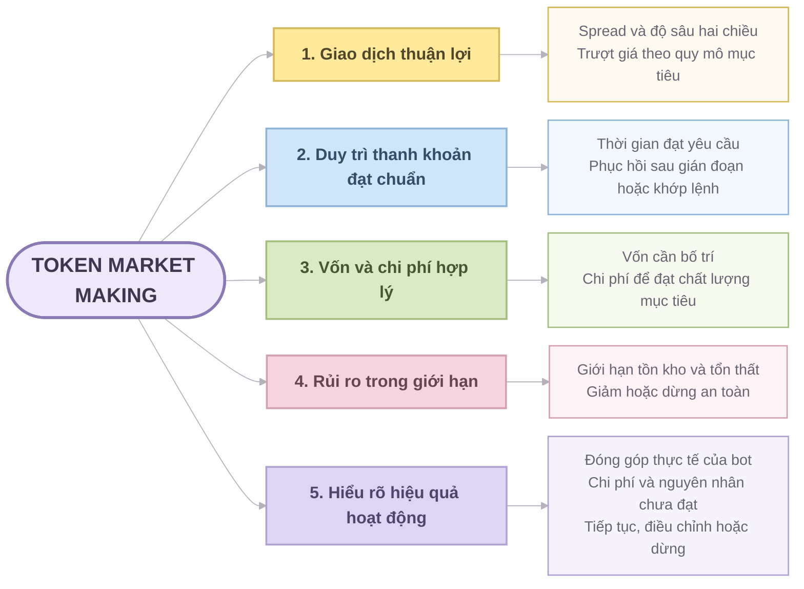

# LIFE Token Market Making

## Mục tiêu

Giúp Foundation thiết lập, vận hành và giám sát hoạt động tạo lập thị trường cho LIFE trên sàn giao dịch tập trung (CEX), đạt chất lượng thị trường mong muốn trong ngân sách và giới hạn rủi ro đã định.

Foundation cấp vốn, xác định mục tiêu và giới hạn. Bot duy trì lệnh mua/bán theo chính sách đó. Giao diện điều hành giúp Foundation biết chất lượng thị trường có đạt yêu cầu, vì sao chưa đạt và cần điều chỉnh gì.

Foundation là đơn vị sử dụng và ra quyết định điều hành. Chất lượng thanh khoản được đánh giá theo khả năng mua/bán LIFE ở quy mô mục tiêu với chi phí giao dịch chấp nhận được.

## Phạm vi

- Tạo lập thị trường cho duy nhất token LIFE trên CEX. Tài sản ghép cặp được xác định theo thị trường triển khai.
- Chất lượng thị trường được đánh giá qua chênh lệch giá mua–bán (spread), độ sâu sổ lệnh hai chiều, trượt giá theo quy mô giao dịch và thời gian duy trì lệnh đạt yêu cầu.
- Quản lý chính sách đặt lệnh, vốn bằng LIFE và tài sản ghép cặp, tồn kho, chi phí và rủi ro; theo dõi kết quả để quyết định tiếp tục, điều chỉnh hoặc dừng.
- Thiết kế công dụng token, kích cầu sử dụng và nhu cầu riêng của holder nằm ngoài phạm vi này.

## Năm giá trị cốt lõi

## Các câu hỏi sản phẩm phải trả lời cho Foundation

Sản phẩm phải cung cấp thông tin để Foundation xác định mức độ đạt mục tiêu và lựa chọn hành động điều hành. Mỗi câu trả lời cần có mục tiêu đối chiếu, kết quả thực tế, thời điểm hoặc khoảng thời gian đo và giới hạn dữ liệu.

| Câu hỏi của Foundation | Thông tin cần có | Quyết định cần hỗ trợ |
|---|---|---|
| Bot được giao mục tiêu, vốn và giới hạn nào? | Sàn/cặp, mục tiêu thanh khoản, chính sách thực tế áp dụng, thời hạn, vốn phân bổ và giới hạn rủi ro. | Xác nhận nhiệm vụ trước khi chạy; thay đổi mục tiêu, chính sách hoặc vốn khi cần. |
| Yêu cầu vận hành đã được thực hiện đến đâu? | Yêu cầu chạy/dừng/thay đổi, kết quả thực hiện, phiên và trạng thái thực tế, lệnh đang hoạt động hoặc còn chưa xác định được trạng thái. | Chờ xử lý, xử lý lỗi hoặc can thiệp; xác nhận trạng thái thực tế trước khi thao tác tiếp. |
| Bot có cung cấp đúng mức thanh khoản đã giao không? | Spread, độ sâu riêng mỗi phía tại các khoảng giá và trượt giá ước tính theo quy mô đã thống nhất; phân biệt phần bot cung cấp với toàn thị trường. | Giữ nguyên hoặc xem xét điều chỉnh giá, lượng lệnh, vốn hay mức thanh khoản yêu cầu. |
| Trong thời gian được giao, bot duy trì yêu cầu đến mức nào; khi không đạt thì vì sao? | Tỷ lệ thời gian đồng thời đạt spread, độ sâu và hai chiều; các khoảng không đạt, thiếu dữ liệu, thời gian phục hồi sau khớp lệnh và nguyên nhân gián đoạn. | Cân bằng lại LIFE và tài sản ghép cặp, cải thiện bổ sung lệnh hoặc xử lý lỗi vận hành; điều chỉnh mục tiêu nếu nguồn lực không đủ. |
| Vốn đang được dùng thế nào, chi phí phát sinh ở đâu và rủi ro còn trong giới hạn không? | Vốn cấp và nạp/rút, tài sản còn lại và đang dành cho lệnh, tồn kho/vị thế, phí, kết quả giao dịch và mức sử dụng giới hạn. Phân biệt ảnh hưởng biến động giá của các tài sản với hiệu quả tạo lập. | Bổ sung hoặc thu hồi vốn, cân bằng tài sản, điều chỉnh chính sách; giảm hoặc dừng khi chạm giới hạn. |
| Cần tiếp tục, điều chỉnh hay dừng; nếu điều chỉnh thì điều chỉnh gì? | Tổng hợp mức đạt mục tiêu, chi phí và rủi ro theo phiên/chính sách, bằng chứng về nguyên nhân và phần chưa đủ dữ liệu để kết luận. | Chọn thay đổi vốn, chính sách hoặc hệ thống; kiểm chứng tác động của thay đổi trong giai đoạn tiếp theo. |

### Trách nhiệm chung của backend và frontend

- Backend cung cấp dữ liệu và cách tính nhất quán, phân biệt yêu cầu với trạng thái thực tế; lưu kết quả, cấu hình áp dụng và các thay đổi cần thiết để giải thích diễn biến. Nêu rõ dữ liệu thiếu, cũ hoặc chỉ được đo theo mẫu.
- Frontend trình bày mục tiêu cạnh kết quả thực tế, cho thấy phần chênh lệch, nguyên nhân đã biết và hành động được phép. Phân biệt rõ trạng thái bot, kết quả thanh khoản và rủi ro để Foundation ra quyết định.
- Backend và frontend sử dụng chung định nghĩa chỉ số, cửa sổ đo và tiêu chí đạt. Mỗi tính năng phải xác định câu hỏi sản phẩm và quyết định điều hành được hỗ trợ.
- Kết luận về nguyên nhân phải có bằng chứng; giả thuyết và giới hạn phân tích phải được thể hiện rõ. Foundation quyết định trong phạm vi quyền hạn và giới hạn đã đặt.

## Đánh giá năm mục tiêu

| Mục tiêu | Kết quả cần đánh giá |
|---|---|
| Giao dịch thuận lợi | Có thể mua và bán LIFE ở quy mô mục tiêu với spread và trượt giá chấp nhận được. Đo độ sâu riêng từng phía tại các khoảng cách giá đã định; trượt giá từ sổ lệnh là ước tính, không bảo đảm kết quả khớp thực tế. |
| Duy trì thanh khoản đạt chuẩn | Tỷ lệ thời gian đồng thời đạt yêu cầu về spread, độ sâu và hai chiều trong cửa sổ đo đã thống nhất. Theo dõi thêm thời gian bổ sung thanh khoản sau khớp lệnh, thời lượng gián đoạn và điều kiện phục hồi. |
| Vốn và chi phí hợp lý | Chất lượng thanh khoản đạt được tương xứng với vốn cần bố trí, mức sử dụng vốn, phí giao dịch và chi phí cân bằng tồn kho. Phân biệt vốn được cấp với chi phí hoặc tổn thất thực tế. |
| Rủi ro trong giới hạn | Tồn kho, vị thế và tổn thất nằm trong giới hạn. Có thể giảm hoặc dừng an toàn khi dữ liệu giá không đáng tin cậy, sàn gián đoạn hoặc trạng thái lệnh không rõ; chỉ phục hồi khi đủ điều kiện. |
| Hiểu rõ hiệu quả hoạt động | Nhìn riêng chất lượng thị trường tổng thể và phần thanh khoản do bot cung cấp trên từng sàn/cặp. Giải thích kết quả bằng lệnh, giao dịch, vốn và chi phí thực tế; so sánh hiệu quả với việc giữ nguyên tài sản ban đầu, có điều chỉnh nạp/rút vốn. |

## Nguyên tắc

- Giới hạn vốn và rủi ro được ưu tiên hơn mục tiêu thanh khoản; có thể phải giảm hoặc dừng một phía hay toàn bộ hoạt động.
- Thời gian dừng để bảo vệ vốn vẫn được ghi nhận trong báo cáo thanh khoản, kèm lý do; phân biệt với gián đoạn do lỗi vận hành. Dữ liệu thiếu không được mặc định là đạt yêu cầu.
- Volume lớn hay bot đang chạy chưa chứng minh thanh khoản tốt. Cần nhìn vào lệnh thực tế và chất lượng giao dịch.
- Sổ lệnh toàn thị trường tốt chưa chứng minh bot đóng góp hiệu quả. Biến động giá trị danh mục cũng chưa phản ánh riêng kết quả tạo lập vì còn chịu ảnh hưởng của biến động giá các tài sản.
- Tạo thanh khoản không bảo đảm lợi nhuận hoặc giữ giá LIFE.
- Các mục tiêu, ngưỡng và chính sách phải được Foundation xác định; yêu cầu thanh khoản của CEX là đầu vào nếu có.

## Nguyên tắc phát triển và nghiệm thu

[Yêu cầu frontend vận hành](frontend-requirements.md) xác định phạm vi phase hiện tại, ưu tiên chức năng, mức hỗ trợ backend và tiêu chí nghiệm thu phục vụ vận hành.

Các luồng nghiệp vụ được trình bày trong [Use case LIFE Token Market Making](usecase.md), gồm 10 nhóm use case cốt lõi và các tình huống chi tiết gắn với năm mục tiêu.

Yêu cầu và tính năng được tổ chức theo năm mục tiêu, với trình tự xác định:

**Muốn đạt gì → đo bằng gì → thế nào là đạt → cần làm gì.**

Mỗi tính năng cần gắn với một trong năm mục tiêu và chỉ rõ câu hỏi của Foundation, bằng chứng trả lời và quyết định được hỗ trợ. Nghiệm thu backend/frontend theo khả năng trả lời trọn vẹn các câu hỏi đó, với ngưỡng vận hành được xác định cho từng sàn/cặp và chính sách.
