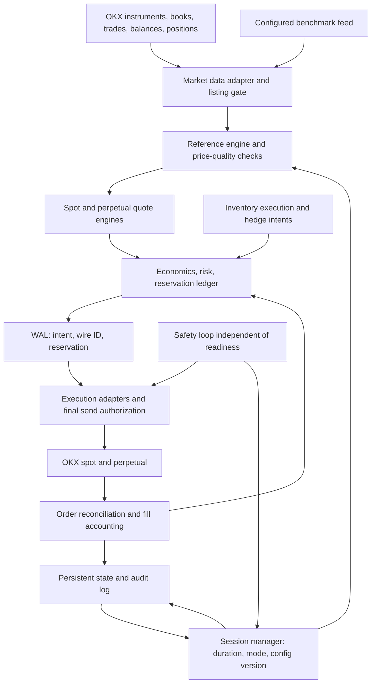

# LIFE–USDT on OKX: TDD Implementation Plan

**PG3 native hedge checkpoint (2026-10-17, base `be18f304f`):** versioned targets, actual-position/depth/fee/funding planning, atomic shared/carry/SWAP preparation and native partial/terminal settlement are implemented. Refused/retried children retain identities and conservative costs; installed-policy gates block unbalanced SPOT and generic SWAP bypass. **43 final native hedge tests pass** after correcting failed-market reuse, local-revocation admission and repeated-prefix proof work. **47 final migration, 212 focused File/DTO and 173 native backward-compatibility tests also pass**. These are overlapping functional selections, not full-product or performance acceptance. See [hedge qualification](LIFE_POSTGRES_CLOUD_RUN_IMPLEMENTATION_PLAN_TDD.md#pg3-native-hedge-qualification-2026-10-17). Configured cancellation/source/runner/final SWAP transport, direct pending/risk/control and other listed PG3 work remain open; configured PostgreSQL stays denied.

**PG3 signed source-only joint repair (2026-10-17, base `4ea0b596c`):** a privileged Ed25519 RECOVER approval can replace the final account/funding sources of an immutable pending batch. Original fills/fees/cashflows remain unchanged; native causal accounting still rejects wrong money. An append-only resolution link preserves the raw pending receipt, other pending parents, HALT, claims and gross spending; no activation or configured backend is granted. **32 native repair tests, 46 migration tests and 50 contract tests pass** (overlapping selections). See [repair qualification](LIFE_POSTGRES_CLOUD_RUN_IMPLEMENTATION_PLAN_TDD.md#pg3-signed-joint-source-repair-qualification-2026-10-17). Direct native pending resolution, interrupted legacy import, collateral, hedge/control and complete configured source/runner/final-send assembly remain PG3 work.

**PG3 coupled batch / claim retirement checkpoint (2026-10-17, base `5d0d51dcd`):** original SPOT/SWAP fills, approved cashflows and settled funding now apply in one native account transaction against the unchanged final source. Causal financing, gross costs and permanent member identities survive failures and cold replay; complete source/NAV/terminal/claim retirement compose without double application or refund. **28 batch cases pass**, plus **20 release cases**, **44 migration cases** and **11 batch DTO cases** (overlapping scopes). See [joint qualification](LIFE_POSTGRES_CLOUD_RUN_IMPLEMENTATION_PLAN_TDD.md#pg3-native-joint-financial-batch-qualification-2026-10-17) and [retirement qualification](LIFE_POSTGRES_CLOUD_RUN_IMPLEMENTATION_PLAN_TDD.md#pg3-native-shared-claim-retirement-qualification-2026-10-17). Signed pending repair, actual collateral/liability reconciliation, legacy interrupted import, hedge/risk/control and complete configured source/controller/runner/recorder/final SWAP sender remain implementation work. The subsequent original-context fix qualifies **15 capital/carry/SWAP substitution cases**. Current affected-product coverage has **373 unique passing IDs across the recorded partitions**, with the original stopped/failed runs retained; it is not a single full passing invocation. See [current receipt/context qualification](LIFE_POSTGRES_CLOUD_RUN_IMPLEMENTATION_PLAN_TDD.md#pg3-product-receipt-context-correction-2026-10-17). **PG3 remains open; configured PostgreSQL remains refused.**


**PG3 SWAP terminal checkpoint (2026-10-17, base `2326eee9e`):** original order/ACK, complete native fills and a current financial/NAV source cut now gate terminal bookkeeping. Invalid or still-pending source facts remain pending/HALT; late fills cannot silently rewrite terminal history. **22 native terminal cases have passing coverage** (21-case suite plus an additional actual-expiry case); **42 migration, 29 focused DTO and 300 affected-domain cases pass** (overlapping counts). Claims remain held. See [qualification](LIFE_POSTGRES_CLOUD_RUN_IMPLEMENTATION_PLAN_TDD.md#pg3-native-swap-terminal-qualification-2026-10-17). Shared release/coupled joint recovery, collateral reconciliation, hedge/pending/control and configured full services remain required; **PG3 is not closed**.


**PG3 portfolio checkpoint (2026-10-17, base `c1c323acb`):** native NAV now binds settled money, original leg basis, approved external-flow values and independently qualified native sources to each original version cut. High-water survives fills/funding/transfers; drawdown retains HALT; stale physical COMMIT cannot publish a valuation. **37 native, 41 migration and 50 focused contract/startup cases pass** (overlapping qualification). Claims remain held, and collateral is not counted as a second wallet. See [portfolio qualification](LIFE_POSTGRES_CLOUD_RUN_IMPLEMENTATION_PLAN_TDD.md#pg3-native-portfolio-qualification-2026-10-17). Coupled financial batches, collateral reconciliation, terminal/release/joint recovery, hedge/control/pending and configured full services remain required; **PG3 is not closed**.


**PG3 paid-funding checkpoint (2026-10-17, base `ba7168374`):** native settled bill accounting now applies actual cash once, keeps opening-cut and gross cost identities, retains failed source facts/HALT and requires current account/carry bill coverage. **22 native, 39 migration and 123 focused File/DTO tests pass**; two additional receipt-context cases also pass. The final affected fill/funding suite passes **51 cases** and the broader domain selector passes **347 cases** (overlapping counts). Full-current-source regression remains required; prior stopped full runs are recorded as failures. See [funding qualification](LIFE_POSTGRES_CLOUD_RUN_IMPLEMENTATION_PLAN_TDD.md#pg3-native-paid-funding-qualification-2026-10-17) and [functional I/O limits](LIFE_POSTGRES_CLOUD_RUN_IMPLEMENTATION_PLAN_TDD.md#pg3-functional-io-qualification-limits-2026-10-17). Native coupled portfolio NAV/terminal/release/joint recovery and full configured services remain required; **full PG3 is not closed**.

**PG3 native SWAP fill checkpoint (2026-10-17, base `d5e9a2910`):** complete original cumulative fills now atomically publish signed fees/realized PnL and gross loss budgets, preserve basis/identity across retry, and retain invalid/unpayable facts as pending/HALT without partial money writes. Zero-fee position changes revoke stale risk snapshots. **27 native cases pass**, including actual process/backend COMMIT loss, partial fills and profitable close. Claims stay held and SPOT-only NAV is refused for a SWAP account. See [qualification](LIFE_POSTGRES_CLOUD_RUN_IMPLEMENTATION_PLAN_TDD.md#pg3-native-swap-fill-qualification-2026-10-17). Native funding/portfolio/joint/hedge/pending/control and configured full assembly remain open; **full PG3 is not closed**.

**PG3 causal SWAP arithmetic checkpoint (2026-10-17, base `99cfcb704`):** the private SQL replay validates exact trade/payment units, identities, same-millisecond sequence, long/short basis, close PnL, fees and paid funding. File replay now owns its existing decimal28 half-even context. **33 native arithmetic, 242 focused File and 37 migration cases pass**. This kernel has no runtime grant or wallet/release effect; native joint financial application and full PG3 remain open. See [qualification](LIFE_POSTGRES_CLOUD_RUN_IMPLEMENTATION_PLAN_TDD.md#pg3-causal-swap-arithmetic-qualification-2026-10-17).

Created: 2026-10-01 (Asia/Ho_Chi_Minh)

Source revision reviewed: `9af100d68`

**PG3 current offline qualification (2026-10-17, implementation `aa6be95fc`):** all **1,194 current native test IDs** have passing coverage across recorded partitions/checkpoints, with zero missing IDs; this is **not** a single full-HEAD invocation. The final 14-module remainder passes **356 cases**; **215 File cases**, **37 migration cases**, source-revocation and precision gates pass. See [exact qualification and scope](LIFE_POSTGRES_CLOUD_RUN_IMPLEMENTATION_PLAN_TDD.md#pg3-current-offline-qualification-coverage-2026-10-17). Carry evidence, shared capital and SWAP intent storage are implemented; causal SWAP/funding/hedge/joint recovery, approved pending/risk/control and complete configured source/service/final-send remain required. **Full PG3 is not closed; configured PostgreSQL remains rejected.**

**PG3 carry precision checkpoint (2026-10-17, base `b38cf60ba`):** File carry funding/capital evaluation now has a fixed local precision matching native SQL legal-unit arithmetic. **Two native parity cases** cover caller precision 6/28; **215 File carry/shared-capital/joint/product cases pass**, including an independent exact-rational forecast test. See [qualification](LIFE_POSTGRES_CLOUD_RUN_IMPLEMENTATION_PLAN_TDD.md#pg3-carry-precision-qualification-2026-10-17). This does not change funding/payment identities or qualify the remaining full PG3 integration.

**PG3 source-revocation checkpoint (2026-10-17, base `6eeb2d97b`):** cancelled/failed/malformed or natively rejected account refresh now revokes the original local runtime so a previous ready decision cannot admit more risk. Diagnostic observation/readback cannot heal it or allocate a new claim; existing SQL ownership/expiry checks remain mandatory. **172 affected native cases and nine final source cases pass**. See [qualification](LIFE_POSTGRES_CLOUD_RUN_IMPLEMENTATION_PLAN_TDD.md#pg3-product-source-revocation-qualification-2026-10-17). The frozen full native regression is a separate result; **full PG3 remains open** for the listed product/source/service ports.

**PG3 SWAP intent checkpoint (2026-10-17, base `c6eb833bd`):** native PostgreSQL now stores exact SWAP preparations, irreversible arm and late ACK, retaining shared claims and LIFE/contracts units. Native SPOT/SWAP coexistence, budget/age/corruption, six process exits and six backend terminations cover this storage slice. **50 focused native SWAP, 160 File and 37 migration cases pass**; integration regression additionally restored the latest SPOT action/reporting proof, with **22 ACK and 37 quote-arm cases passing**. Complete current-source regression remains required. See [qualification](LIFE_POSTGRES_CLOUD_RUN_IMPLEMENTATION_PLAN_TDD.md#pg3-native-swap-intent-qualification-2026-10-17). Final SWAP wire/HTTP authorization is explicitly denied; causal fills/funding/hedge/joint recovery, approved pending/risk/control and configured source/service remain required. **Full PG3 remains open.**

**PG3 carry checkpoint (2026-10-17, base `6961e4a2b`):** native PostgreSQL now retains independent carry streams and permanent settled funding evidence, computes dynamic funding forecast plus fee/tier risk, and gates SPOT prepare/arm on current carry readiness. Failed feeds persist denial; late ACK remains recordable without new-risk permission. **52 native carry, 36 migration and 157 focused File/validation tests pass**. See [qualification](LIFE_POSTGRES_CLOUD_RUN_IMPLEMENTATION_PLAN_TDD.md#pg3-native-carry-qualification-2026-10-17). This closes the carry evidence/evaluation slice; SWAP sending/cash accounting, hedge/joint recovery, pending/control/risk and configured full source/service remain required. **Full PG3 remains open.**

**PG3 shared-capital checkpoint (2026-10-17, base `2e71fe8e5`):** native PostgreSQL allocation now serializes SPOT/SWAP cash, collateral and independent fill stress under permanent original claims. Native SPOT prepare/arm enforces claim/config/risk/fee coverage; replay never renews a grant or releases a shared claim. Exact final margin rounding is shared with File. **63 final native, 833 File product/recovery and 35 migration tests pass after the SELL base-fee correction**. The preceding full PostgreSQL gate passed 1,079 tests before that correction. See [qualification](LIFE_POSTGRES_CLOUD_RUN_IMPLEMENTATION_PLAN_TDD.md#pg3-native-shared-capital-qualification-2026-10-17). SWAP accounting/sending, joint release/recovery, pending/control/risk and configured source/service composition remain required; **full PG3 is not closed**.

**PG3 explicit connector ingress checkpoint (2026-10-17, base `616d1a266`):** actual OKX callbacks now compose PostgreSQL reporting, signed whole-account collection, durable decoded responses and mandatory native financially qualified SDK dedup. Callback values grant no financial authority. Stop/timeout/cancel retain owned work and holds; actual lost-COMMIT recovery accounts a second fill once without resending or poisoning SDK caches. **105 selected PostgreSQL tests** pass, including **22 new cases**. See [qualification](LIFE_POSTGRES_CLOUD_RUN_IMPLEMENTATION_PLAN_TDD.md#pg3-explicit-spot-connector-ingress-qualification-2026-10-17). Complete configured controller/service/source, approved financial pending resolution, risk/probes/stress and shared SPOT/SWAP/hedge/carry/EXIT ports remain open; **full PG3 is not closed**.

**PG3 provider diagnostics checkpoint (2026-10-17, base `621313817`):** the signed SPOT reader now commits each admitted decoded provider page before parsing/accounting. Immutable bounded collection history, cold discovery, exact replay, corruption/role guards and actual lost-COMMIT cases qualify this handoff. **173 selected PostgreSQL tests** and **34 migration tests** pass. See [qualification](LIFE_POSTGRES_CLOUD_RUN_IMPLEMENTATION_PLAN_TDD.md#pg3-decoded-provider-diagnostics-qualification-2026-10-17). Diagnostics are not financial facts, HTTP wire bytes or a completeness/readiness grant. Configured service/source, approved pending resolution, risk and shared-product ports remain open; **full PG3 is not closed**.

**PG3 recovery/admission checkpoint (2026-10-17, base `559874d50`):** signed observation-only recovery reads are separated from quote eligibility; connection admission uses one uncached primary statement and rejects TEMP catalog/search-path substitution. Capture time denials now have precise static reasons with unchanged thresholds. **19 final focused tests** pass; earlier broader selector **295 tests** passed before catalog hardening. **33 migration tests** and **972 frozen full PostgreSQL tests** pass (zero failure/error/skip), on `effa2b63c`. See [qualification](LIFE_POSTGRES_CLOUD_RUN_IMPLEMENTATION_PLAN_TDD.md#pg3-recovery-source-and-admission-qualification-2026-10-17). Configured full source/service, pending resolution, risk/probes/stress and shared products remain open; **full PG3 is not closed**.

**PG3 markout checkpoint (2026-10-17, base `df1aa6f54`):** standalone immutable SPOT horizon observations, exact BUY/SELL arithmetic, bounded cohort diagnostics and crash/readback guards pass **50 focused PostgreSQL tests**. **32 migration tests** pass; the later 972-case full gate on `effa2b63c` also qualifies this port. This grants no trading permission; configured risk/probe/stress, complete source/service, pending resolution and shared products remain open. See [markout qualification](LIFE_POSTGRES_CLOUD_RUN_IMPLEMENTATION_PLAN_TDD.md#pg3-standalone-markout-qualification-2026-10-17). **Full PG3 is not closed.**

**PG3 current source checkpoint (2026-10-17, base `8562b08a0`):** standalone SPOT inventory/subsidy settlement now computes exact costs from original terminal/fill/fee facts. Cycles must net-flat LIFE including fees; one transaction moves original holds into actual spend without crediting wallets or gross execution loss. Permanent identities, fresh original cut/owner, COMMIT checks and corruption proofs apply. **903 full PostgreSQL tests** and **31 migration tests** pass, including **37 settlement cases** and actual file/PG parity. See [settlement qualification](LIFE_POSTGRES_CLOUD_RUN_IMPLEMENTATION_PLAN_TDD.md#pg3-standalone-inventory-settlement-qualification-2026-10-17). Configured complete source/service, remaining markout/stress/pending resolution and shared products remain open; **full PG3 is not closed**.

**PG3 original intake checkpoint (2026-10-17, base `c42421175`):** original typed FILL/CASHFLOW intake now persists before monetary application, retains chosen values and covering receipts, and blocks new risk while pending. Diagnostic progress detects missing ACK/financial intake. **792 full PostgreSQL tests**, **30 migration tests** and **52 focused financial-intake cases** pass. See the [current PG3 checklist](LIFE_POSTGRES_CLOUD_RUN_IMPLEMENTATION_PLAN_TDD.md#pg3--financial-authority-and-durable-send-attempts) and [intake qualification](LIFE_POSTGRES_CLOUD_RUN_IMPLEMENTATION_PLAN_TDD.md#pg3-original-financial-intake-qualification-2026-10-17). Authenticated raw provider collection, full configured source/controller/service composition, settlement/pending resolution and shared SPOT/SWAP ports remain open. Configured PostgreSQL stays denied; **full PG3 is not closed**.

**PG3 configuration audit checkpoint (2026-10-16, base `402dddcba`):** `000017` and `PgConfigurationRepository` add registered-body configuration reports, ordered atomic delivery, cold repair and explicit history limits. Rejection/startup/manual kills latch HALT; no report clears it or activates trading. File/backend isolation and shared executor/configuration streams are tested. See [configuration qualification](LIFE_POSTGRES_CLOUD_RUN_IMPLEMENTATION_PLAN_TDD.md#pg3-standalone-configuration-audit-qualification-2026-10-16): 34 configuration, 39 executor, 66 file/contract and 24 migration cases pass. PG3 remains open for the unchanged remaining checklist.

**PG3 standalone executor outbox checkpoint (2026-10-16, base `f9a02e711`):** `000016` and `PgRecorderRepository` add original-bound initial/progress reports, atomic ordered delivery, corruption/readback checks and explicit row/byte read limits. Pending reports block new risk while allowing late accounting; replay never sends an order or regresses a later report. See [outbox qualification](LIFE_POSTGRES_CLOUD_RUN_IMPLEMENTATION_PLAN_TDD.md#pg3-standalone-executor-outbox-qualification-2026-10-16). Full regression passes 554 cases; the final bounded adapter passes 39 focused cases and migrations pass 23. **PG3 remains open** for actual service/source composition, other reporting streams, settlement/approvals, successor/shared SPOT/SWAP and remaining fault/integrity parity gates. Configured PostgreSQL remains denied.

**PG3 signed account/policy source checkpoint (2026-10-16, base `994c374e1`):** `PgQuoteAccountSource` binds signed UID collection and order requests to the same pinned credential/endpoint, reads exact imported PostgreSQL age limits, and rechecks identity/freshness immediately before HTTP. Bounded TTL/single-flight UID collection avoids an account read per quote. Migration `000015` detects inconsistent PREPARE receipts at current-state/readback/COMMIT boundaries and preserves existing snapshot ACLs on upgrade. See [account-source qualification](LIFE_POSTGRES_CLOUD_RUN_IMPLEMENTATION_PLAN_TDD.md#pg3-signed-account-and-policy-source-qualification-2026-10-16). **PG3 remains open** for complete runner/planner/reference/book/fee provenance and controller/service/recorder/product composition; configured PostgreSQL remains denied.

**PG3 explicit final HTTP boundary checkpoint (2026-10-16, base `340ce99ff`):** an optional immutable post-auth request guard binds PostgreSQL arm to the exact UTF-8 bytes passed to HTTP, followed by a synchronous one-use freshness/revocation check. Redirects and automatic resend are denied; scoped ACKs are awaited in PostgreSQL. Qualification uses the actual OKX/auth/REST chain with fake HTTP and synthetic source/runner facts. See [transport qualification](LIFE_POSTGRES_CLOUD_RUN_IMPLEMENTATION_PLAN_TDD.md#pg3-explicit-final-http-boundary-qualification-2026-10-16). **PG3 remains open** for authenticated source/UID/policy composition and complete controller/service/recorder integration; configured PostgreSQL and native runner submit remain denied.

**PG3 captured-request arming checkpoint (2026-10-16, base `269c4d714`):** `ArmQuoteAction`/migration `000014` bind exact captured OKX request JSON and fresh compatible admission to one atomic PREPARED → SEND_UNKNOWN boundary. Current economic cost may use a larger existing subsidy hold without refund; insufficient holds deny. Readback/restart never rearms. The runner journal can record this boundary only after its own successful preparation; its actual submit hook remains denied. See [arming qualification](LIFE_POSTGRES_CLOUD_RUN_IMPLEMENTATION_PLAN_TDD.md#pg3-captured-request-arming-qualification-2026-10-16). Authenticated source capture, actual REST/final-byte/ACK assembly and full PG3 remain open.

**PG3 explicit V2 runner-journal checkpoint (2026-10-16, base `08c4a94e9`):** `PgQuoteRunnerJournal` binds bounded captured CreateExecutorActions to the PostgreSQL journal and awaits durable runner acceptance before allowing one financial preparation attempt. Unknown creation/acceptance, cancellation and mutated IDs revoke the original local identity and retain claims for explicit reconciliation. A mandatory submit-denial hook prevents OrderExecutor from falling back to strategy.buy/sell. See [runner qualification](LIFE_POSTGRES_CLOUD_RUN_IMPLEMENTATION_PLAN_TDD.md#pg3-explicit-v2-runner-journal-qualification-2026-10-16). Authenticated source/final transport, configured backend selection and full PG3 remain open.

**PG3 unprepared dispatch retirement checkpoint (2026-10-16, base `1393e8e6b`):** `AbandonQuoteAction`/`000013` explicitly retire a DISPATCHED action only with fresh complete post-dispatch runner absence, original-writer qualification and no financial attempt/hold. The account-locked race with prepare has one outcome: accepted finance retains its claim, or retirement permanently blocks old-ID preparation. See [retirement qualification](LIFE_POSTGRES_CLOUD_RUN_IMPLEMENTATION_PLAN_TDD.md#pg3-unprepared-dispatch-retirement-qualification-2026-10-16). Standard dispatch rejection stays forbidden; actual runner/source/transport assembly and full PG3 remain open.

**PG3 terminal action reconciliation checkpoint (2026-10-16, base `38b97e942`):** `000012` permits PREPARED → RECONCILED only after proven unsent abort or qualified financial terminal closure, zero remaining order holds and fresh complete post-closure runner absence. Slot reuse retains permanent intent/wire identities and all original monetary spending; no refund occurs. See [reconciliation qualification](LIFE_POSTGRES_CLOUD_RUN_IMPLEMENTATION_PLAN_TDD.md#pg3-terminal-action-reconciliation-qualification-2026-10-16). Unprepared dispatch retirement, actual runner/transport, successor/shared products and full PG3 remain open.

**PG3 action-bound financial preparation checkpoint (2026-10-16, base `f78ae4991`):** `000011` adds mandatory imported quote-admission limits and atomically binds a captured DISPATCHED LIMIT_MAKER action to its principal, fees, subsidy and immutable prepare receipt. SQL rechecks payload/rules/book/fees/economics and freshness at COMMIT. Qualified pending actions no longer corrupt late ACK/fill accounting. See [preparation qualification](LIFE_POSTGRES_CLOUD_RUN_IMPLEMENTATION_PLAN_TDD.md#pg3-action-bound-preparation-qualification-2026-10-16). Actual runner/final transport, action terminal reconciliation and full PG3 remain open.

**PostgreSQL quote-publication journal checkpoint (2026-10-16, base `a7bc3ee50`):** [PG3 journal qualification](LIFE_POSTGRES_CLOUD_RUN_IMPLEMENTATION_PLAN_TDD.md#pg3-quote-publication-journal-qualification-2026-10-16) adds atomic batch claims, exact captured identity/payload, dispatch bookkeeping and qualified original-writer rejection. Migration `000010` adds mandatory imported limits, immutable descriptors/events and an account-wide active-slot index. Retry/crash preserves unresolved slots and permanent IDs without creating an executor, attempt or financial hold. The action-to-prepare/runner and terminal-reconciliation bridge remains open; pending actions retain the existing financial barrier. PG3, PostgreSQL backend selection, O.8 and deployment/demo/live gates remain open. No evidence file is added.

**PostgreSQL order-lifecycle checkpoint (2026-10-16, base `69d585f70`):** [PG3 lifecycle qualification](LIFE_POSTGRES_CLOUD_RUN_IMPLEMENTATION_PLAN_TDD.md#pg3-spot-order-lifecycle-qualification-2026-10-16) adds atomic proven-unsent abort, cancel intent/retry and qualified terminal storage commands. Migration `000009` requires imported order limits and opening capital for terminal reconciliation. Order holds/zero-fill subsidy release once; filled subsidy and gross losses remain. COMMIT guards and cold original-command recovery apply. Quote actions, successor/shared products, settlement and provider integration remain open. Backend selection, O.8 and deployment/demo/live gates stay open; no evidence file is added.

**PostgreSQL primary-session checkpoint (2026-10-16, base `08a61f192`):** [PG3 session qualification](LIFE_POSTGRES_CLOUD_RUN_IMPLEMENTATION_PLAN_TDD.md#pg3-primary-session-safety-qualification-2026-10-16) covers atomic primary pause/resume/expiry, persistent observed-clock rollback and original-command recovery. Migration `000008` adds empty session policy/progress/event tables; mandatory imports and entry/COMMIT guards prevent preparation/arm while paused or unverified. Financial holds persist. Successor activation, abort/cancel/terminal and quote-action ports remain open, together with full PG3, backend selection, performance and external eligibility gates. No new evidence file is created.

**PostgreSQL approved cashflow/capital checkpoint (2026-10-16, base `2d48d70c8`):** [PG3 capital qualification](LIFE_POSTGRES_CLOUD_RUN_IMPLEMENTATION_PLAN_TDD.md#pg3-approved-spot-cashflows-and-capital-qualification-2026-10-16) covers immutable approved bill identity, atomic wallet/cashflow receipts, causal cashflow/fill replay, adjusted NAV/highwater and retained spending/holds. Impossible facts persist pending with reasons and HALT; later funding cannot finance earlier fills or silently clear pending state. **155 actual PG tests**, **21 migration tests** and **191 focused file/contract tests** pass, including actual file/PG parity and process/COMMIT faults. Provider ingress, signature-verifying approval import, full lifecycle/products/markout/settlement/pending resolution and scale/release qualification remain open. PostgreSQL backend selection and O.8/demo/live eligibility remain unchanged; no new evidence file is created.

**PostgreSQL PG2 local artifact/recorder checkpoint (2026-10-16, base `e588c8ae3`):** the [PG plan](LIFE_POSTGRES_CLOUD_RUN_IMPLEMENTATION_PLAN_TDD.md#pg2-local-recorder-and-linux-qualification-2026-10-16) separates completed local qualification from pending deployed release/identity and durability proofs. Numbered migration `000006` installs isolated legacy reporting tables; recorder startup validates schema without DDL, metadata stamping or SQLite fallback. The full Linux ARM64 artifact builds and passes source/import checks and **13 in-image recorder tests**. **121 actual PostgreSQL tests**, **21 migration tests** and **169 SQLite/file regression tests** pass. Full LIFE recorder/outbox integration remains PG5, financial backend selection remains unsupported, and no O.8/demo/live eligibility changes. No configured DB, exchange account, deployment or new evidence file is used.

**PostgreSQL SPOT observation checkpoint (2026-10-16, base `ce9eacf9a`):** [PG3 observation qualification](LIFE_POSTGRES_CLOUD_RUN_IMPLEMENTATION_PLAN_TDD.md#pg3-spot-observation-and-accounting-qualification-2026-10-16) covers atomic original-identity ACK/fill/fee accounting, qualified late facts after stop/expiry, gross loss/subsidy floors and retained holds. Negative-wallet facts become durable pending with HALT instead of silently disappearing or reporting APPLIED. **108 real PG tests**, **21 migration tests** and **160 focused unit/file tests** pass, including cold commit-fault/process-exit and BUY/SELL × fee-currency parity. Full cashflow/NAV, products, lifecycle, provider/outbox, terminal/pending recovery and integrity/performance gates remain open. PostgreSQL backend selection and demo/live eligibility are unchanged.

**PostgreSQL PG3 preparation checkpoint (2026-10-16, base `deb9b25d8`):** the [PG plan](LIFE_POSTGRES_CLOUD_RUN_IMPLEMENTATION_PLAN_TDD.md#pg3-standalone-spot-preparation-qualification-2026-10-16) records standalone SPOT read/prepare/arm ports, atomic principal/fee/subsidy holds and durable `SEND_UNKNOWN`. **76 actual PostgreSQL tests**, **21 migration tests** and **92 focused unit/file tests** pass, including BUY/SELL preparation parity and real process-exit/lost-COMMIT readback. Full lifecycle/actions/shared capital, ACK/fill/accounting, other products, sender/outbox/release and integrity parity remain open. Backend selection stays unsupported; no O.8, deployment, demo or live gate closes.

**PostgreSQL PG2 checkpoint (2026-10-16, base `4e2bdcdf2`):** PG1 file-service closure is committed. The [PG plan](LIFE_POSTGRES_CLOUD_RUN_IMPLEMENTATION_PLAN_TDD.md#pg2-offline-foundation-and-qualification-2026-10-16) now records typed empty financial migrations, account-scoped roles/RLS, guarded atomic allocation/readback and bounded async command/safety pools. **45 actual PostgreSQL tests**, **21 migration tests** and **2,358 file/runtime regression tests** pass. The allocation primitive is not a trading/send port; PostgreSQL backend selection remains unsupported pending PG3. PG2 release image/recorder/deployed identity and external durability, O.8 and demo/live gates remain open. No configured DB, exchange account, deployment or new evidence file is used.

Status (2026-10-11): **Offline acceptance reopened for the declared MVP scope; O.8 review remediation is in progress (O.8.1/.2/.3/.5/.6 implemented and verified; O.8.4/.7 open) and must close before demo**. Production order creation remains disabled. The [2026-10-10 full offline evidence](LIFE_OKX_O7_FULL_OFFLINE_EVIDENCE_2026-10-10.md) records the earlier O.1–O.7 checkpoint; it does not cover the six confirmed integration/performance findings in O.8. No demo or real-account proof is claimed.

Architecture and economics reviewed on 2026-10-01. Review findings are mapped to implementation checklists and acceptance cases in Section 2.1. Checked subitems identify implemented offline contracts or adapters; unchecked subitems and parent requirements remain open in their stated scope. A passing fake-exchange test is not evidence of OKX demo or production behavior.

**Current file-backend status (2026-10-16): PG1 is complete in the [PostgreSQL/service plan](LIFE_POSTGRES_CLOUD_RUN_IMPLEMENTATION_PLAN_TDD.md#pg1-c3c4-file-closure-and-qualification-2026-10-16).** The final source adds durable signed target import with actual approved duration/reference/quote use, retained financial/native/reporting ancestry, supported exact frozen-source archive/native repair and cold/cancelled publication recovery. Target startup stays RECOVERY_ONLY/unarmed and needs a separate fresh ACTIVATE. The complete C1–C4 selector passes **2,343 tests**, zero failures/errors/skips, 22 existing-category warnings in 377.64 seconds; changed-file hooks and diff checks pass. Dated PG1 checkpoints below are historical and are superseded by this closure. The next implementation phase is PG2. **O.8, PostgreSQL authority, deployment, provider/demo and live gates remain open.** No evidence file is added.

**Controller/storage boundary checkpoint (2026-10-15):** PG1-C1 and PG1.2 in the [PostgreSQL/service plan](LIFE_POSTGRES_CLOUD_RUN_IMPLEMENTATION_PLAN_TDD.md#pg1-current-closure-ledger) are qualified for the declared offline file-service scope. Public application ports replace controller access to runtime internals; native file installation/proofs are isolated and worker-guarded, including probe/markout/telemetry entry points. Native unsigned rearm/reconciliation cannot bypass the repository. Managed source-factory contexts join after service/worker cleanup. The checkpoint regression passes **2,087 tests**, zero failures/errors/skips. Remaining PG1 work is tracked in the current closure ledger.

**Recovery composition checkpoint (2026-10-16):** PG1-C2 is qualified by the [recovery matrix](LIFE_POSTGRES_CLOUD_RUN_IMPLEMENTATION_PLAN_TDD.md#pg1-c2-recovery-matrix-and-qualification-2026-10-16). Original cancel/abort, terminal and inventory-settlement operations compose with new qualified SPOT/SWAP activity and approved LIFE/USDT transfers. Cold replay retains original IDs/values, pending holds and budget spending without duplicate money, resend or activation. The final expanded regression passes **2,172 tests**, zero failures/errors/skips, with 24 warnings in 277.96 seconds; all changed-file hooks pass. PG1 remains open for C3 approved financial configuration/lineage/archive transitions and C4 complete file-runtime acceptance. PostgreSQL authority, O.8, deployment, demo and live gates remain open. No evidence file is added.

**Approved configuration staging checkpoint (2026-10-16, base `799c648fe`):** C3.1 in the [service plan](LIFE_POSTGRES_CLOUD_RUN_IMPLEMENTATION_PLAN_TDD.md#pg1-c31-signed-configuration-staging-and-qualification-2026-10-16) now supports signed next-session duration/reference-lookback/quote revisions and append-only discard. A stage drains admission while retaining the active configuration, original session deadline, balances, spent budgets, holds and permanent identities. Cold readback never applies or activates the candidate; discard also requires a separate activation to resume the old configuration. The expanded regression passes **2,204 tests**, zero failures/errors/skips, 25 warnings in 348.04 seconds; hooks pass. **C3 remains open** for actual policy/lineage handoff and supported archive/import/repair, followed by C4 acceptance. No evidence file is added.

**Handoff source preparation checkpoint (2026-10-16):** the file control application can capture and revalidate immutable `CORE_SPOT` source bytes using independent fresh facts, preserving all original core money/history/IDs. The targeted regression passes **296 tests**, zero failures/errors/skips, six existing Pydantic warnings in 42.20 seconds; hooks pass. The [service plan](LIFE_POSTGRES_CLOUD_RUN_IMPLEMENTATION_PLAN_TDD.md#pg1-c32-core-spot-source-capture-checkpoint-2026-10-16) states the scope: ancillary product/action journals and recorder SQL, signed target/session authorization, source retirement, target import and actual revision use remain required. Admission stays closed; inspection does not apply or activate a candidate. C3.2 and PG1 remain open.

**Configured source composition checkpoint (2026-10-16):** `FILE_SERVICE_SCOPED` now captures installed ordinary-file quote/risk/probe/SWAP/shared/hedge/carry origins and scoped SQLite reporting with original schema/primary keys. Inventory/exit histories and their original budgets remain in core. Explicit byte/row limits, audited reporting origins, missing/tampered/foreign source denial, fresh complete-image revalidation and cold/cancelled-reader behavior are covered in the [service plan](LIFE_POSTGRES_CLOUD_RUN_IMPLEMENTATION_PLAN_TDD.md#pg1-c32-configured-source-composition-checkpoint-2026-10-16). The latest expanded regression passes **2,255 tests**, zero failures/errors/skips, 25 existing-category warnings in 295.07 seconds; final hooks pass. The core-only checkpoint above is historical; ancillary capture is now implemented for this declared format. Signed target/session authorization, fenced source retirement, durable import and actual revision use remain C3.2; archived origins remain C3.3. No activation or PG1 closure is inferred.

**Signed source-freeze checkpoint (2026-10-16):** C3.2 now binds the exact staged revision/source image to a distinct HANDOFF approval, same-account target lineage and successor session/epoch. An immutable bounded runtime image precedes atomic source freeze; worker execution fences queued writes. Cold maintenance supports verified readback and separately signed cancellation, preserving money, spending, original expiry and DRAINING admission. Open orders/proposals/reserved principal/shared claims and derivative exposure deny freeze. The [service checkpoint](LIFE_POSTGRES_CLOUD_RUN_IMPLEMENTATION_PLAN_TDD.md#pg1-c32-signed-target-reservation-and-source-freeze-checkpoint-2026-10-16) qualifies **25 new cases** and a final expanded regression of **2,280 passed**, zero failures/errors/skips, 24 existing-category warnings in 313.83 seconds; hooks pass. This supersedes the earlier unsigned-source-only remaining list. Final source retirement, target consumption/import with cancellation exclusion, cold recovery and actual candidate use remain C3.2; C3.3/C4/PG1 and PostgreSQL/demo/live gates remain open. No evidence file is added.

**Proposed storage/deployment extension (2026-10-11):** the [PostgreSQL and Cloud Run TDD plan](LIFE_POSTGRES_CLOUD_RUN_IMPLEMENTATION_PLAN_TDD.md) defines a portable PostgreSQL backend, migration/recovery, generation-bound sender handoff and conditional Worker Pool deployment. Recommendation: qualify PostgreSQL on a single VM/container first, then adopt Cloud Run only if measured operations/economics and external sender exclusion justify it. This separate proposed work does not close O.8, authorize production orders, or waive the existing single-host MVP/acceptance requirements.

**Local PostgreSQL feasibility checkpoint (2026-10-12):** the [spot spike evidence](LIFE_POSTGRES_SPIKE_EVIDENCE_2026-10-12.md) records real transactional current-state/index access with synthetic transport: 27 functional and three 0/1k/10k scale cases pass, with 18 authority SQL statements/10 returned rows per successful send. At 10k, maximum measured send is 254.9 ms, loop lag 21.6 ms and spike watchdog cancel start 7.1 ms. This smaller prototype supports the state-model direction; it does not replace full O.8 history/integrity/financial/production-watchdog acceptance. O.8.4/O.8.7 and PG0.3 parents remain open.

**Extended PostgreSQL spot assembly (2026-10-12):** the [runner/OKX/recorder evidence](LIFE_POSTGRES_ASSEMBLY_EVIDENCE_2026-10-12.md) adds actual tick/queue/orchestrator/executor, optional awaited post-throttler authorization and actual SQLite recorder projection with synthetic HTTP. 282 regressions and 13 functional + three enlarged scale cases pass; corresponding terminal histories exist in both stores. PG authority queries/returned rows stay 24/14 per send; at 10k, send maximum is 53.5 ms, lag 1.1 ms and cancel start 14.8 ms. This assembly is test-only and does not migrate the production LIFE controller or establish financial/ownership/integrity equivalence. Existing O.8 and PG parent gates remain open.

**PostgreSQL migration infrastructure (2026-10-12):** the [central migration guide](../../migrations/life_liquidity/README.md) provides `make life-migration-status` and `make life-migrate` with version/checksum history, serialized execution and per-script transactions. Root `.env.example` documents shared migration settings; the gitignored `.env` defaults to `LIFE_AUTO_MIGRATE=false`. Enabling it awaits migrations before application construction and blocks startup on failure. The first migration creates storage lineage metadata only. Application PostgreSQL financial state/recorder integration and Cloud Run deployment remain open in the separate PG plan; O.8 and demo/live gates are unchanged.

**PostgreSQL contracts checkpoint (2026-10-12):** the [storage contracts guide](../../hummingbot/strategy_v2/life_liquidity/storage/README.md) documents immutable binding/cut/owner/snapshot DTOs, async repository/UoW protocols and a bounded file adapter using the existing `PolicyState` primitive. Its atomic scope is one checkpoint; existing separate financial journals are not combined or migrated. The PG plan records offline assumptions and completed contract subitems; financial-domain ports, controller integration, actual PG authority and O.8 release gates remain open.

**Spot financial storage contracts (2026-10-12):** the [storage guide](../../hummingbot/strategy_v2/life_liquidity/storage/README.md) adds typed Decimal spot/session/balance/budget/reservation/attempt ports and an explicit legacy preparation adapter over actual journals. Its recoverable saga keeps principal, subsidy and LIFE/USDT fee claims through partial/unknown operations; cold opens require rearm and no transport runs. Completed PG subitems identify only this slice; ACK/fill/fee/bill/release/recovery commands, controller integration, PostgreSQL financial authority and existing O.8/demo/live gates remain open.

**Spot ACK observation storage (2026-10-12):** typed account/session/wire-bound ACK commands and permanent operation readback now record actual WAL ACKED with a recoverable ACKING barrier. Late same-writer ACKs preserve principal/fees/subsidy without rearming expired or draining sessions. Completed storage tests cover duplicate/conflicting identities, concurrent observations, cancellation and killed-process readback. This extends the preparation checkpoint above; authenticated connector/recovery integration, fill/fee/cashflow accounting, qualified release and PostgreSQL financial tables remain open in the [PG plan](LIFE_POSTGRES_CLOUD_RUN_IMPLEMENTATION_PLAN_TDD.md). No O.8/demo/live gate is closed.

**Spot fill/fee storage extension (2026-10-12):** complete cumulative trade/fee snapshots now update the actual reservation ledger, execution-loss ledger and subsidy fill floor behind a recoverable FILLING barrier. Paid fees consume matching LIFE/USDT buffers; fee overruns close new-risk admission and filled quantity alone releases no terminal holds. Explicit independent valuation/skew, immutable identities, replay/cold readback and actual killed-process cases are covered in the [PG plan](LIFE_POSTGRES_CLOUD_RUN_IMPLEMENTATION_PLAN_TDD.md). Cashflows/full NAV, qualified terminal/recovery, authenticated bridge/controller integration, PostgreSQL financial schema and O.8 remain open.

**Spot cashflow/NAV storage checkpoint (2026-10-12):** bound opening capital and immutable bill approvals now support replayable signed LIFE/USDT transfers, existing causal CapitalLedger projection, net-cashflow-adjusted NAV and recorded highwater. Transfers preserve loss/subsidy spending; partial cashflow writes retain funds and recovery barriers. Independent prices/bills remain caller-supplied facts requiring the authenticated bridge; controller/recovery/terminal integration, PostgreSQL schema and O.8/demo/live gates remain open in the [PG plan](LIFE_POSTGRES_CLOUD_RUN_IMPLEMENTATION_PLAN_TDD.md).

**Spot terminal/exact-resume storage (2026-10-12):** an explicit complete order/account/fill/fee/bill/runner observation cut now qualifies offline terminal release. Native partial release remains behind a durable principal overlay and retained fee claims until final receipt; zero-fill subsidy settles to verified 0 while filled subsidy/loss remains for inventory/exit economics. Exact terminal recovery can complete one pending saga with fresh facts and the original bound writer, including cold read-only stores, without rearm/resend. General recovery, authenticated controller/gateway/history/ownership integration, filled economic settlement, PostgreSQL transactions and existing O.8/demo/live gates remain open in the [PG plan](LIFE_POSTGRES_CLOUD_RUN_IMPLEMENTATION_PLAN_TDD.md).

**Exact financial recovery storage (2026-10-12):** the [PG plan](LIFE_POSTGRES_CLOUD_RUN_IMPLEMENTATION_PLAN_TDD.md) now records exact pending FILLING/CASHFLOWING resume with immutable original command/writer/valuation facts and fresh account qualification. Actual native-subset and final expected accounting projections reject unmatched activity; native checkpoints, fees, loss and subsidy are deduplicated across restart without rearm/resend or refunds. General prepare/arm/ACK recovery, control-plane repair/import, filled inventory/exit settlement, authenticated controller/gateway integration and PostgreSQL/O.8 gates remain open.

**Exact pending ACK recovery storage (2026-10-12):** `resume_ack()` now requires the original durable ACK/writer and fresh account/order facts matching wire, exchange ID, side, quantity, price and already accounted fills. Native capital, fee, loss and subsidy projections gate WAL ACK and receipt publication; failed/cancelled/killed operations retain recovery barriers. FILLED/CANCELED observations release no holds, and cold completion grants no trading permission. Prepare/arm recovery, filled inventory/exit settlement, authenticated bridge/controller integration, PostgreSQL financial authority and O.8/demo/live gates remain open in the [PG plan](LIFE_POSTGRES_CLOUD_RUN_IMPLEMENTATION_PLAN_TDD.md).

**Exact pending preparation/arm recovery (2026-10-12):** missing WAL/principal/subsidy and unknown-send checkpoints can now complete using original request cut/writer fingerprints and fresh complete account facts. Existing holds deduplicate in their original UTC buckets; cold or expired completion remains unarmed. Native no-ops, foreign scope and older partial formats without provenance deny completion. This closes another file-storage subitem, while PG1 settlement/product/control-plane/controller/runner integration, PostgreSQL authority and O.8/demo/live gates remain open in the [PG plan](LIFE_POSTGRES_CLOUD_RUN_IMPLEMENTATION_PLAN_TDD.md).

**Further PG1 offline work (2026-10-12):** closed inventory-cycle subsidy settlement now verifies terminal fills/fees and net-flat LIFE, retains pending budget overlays and preserves execution-loss spending. Signed Ed25519 lifecycle/approval and supported import services retain only public verifier keys at runtime; cold readback never activates. Opt-in bounded V2 create dispatch and awaited spot/SWAP final checks, plus typed actual-controller runtime binding/UID/owner/local fences, have offline tests. The PG plan keeps remaining product/recorder ports, legacy Path/proof removal, full application/observation migration and all O.8/demo/live gates open; no full PG1 closure is claimed.

**PG1 session-successor application (2026-10-15):** SPOT/joint watchdogs now publish qualified successor decisions on the financial worker, wait for outstanding quote proposals and recollect account scope after cancellation. Exact original pending session decisions recover before cold product assembly. An expired original parent may collect a verified quiescent successor only for a new signed grant; old sender/allocation authority stays off. Observation deadlines retain the configured absolute expiry without extending admission, and waiting for a grant no longer causes premature expiry or an unresumable pause. Expanded regression: **1,829 passed**, zero failures/errors/skips, 25 existing-category warnings in 148.03 seconds; changed-file hooks pass. The [PG plan](LIFE_POSTGRES_CLOUD_RUN_IMPLEMENTATION_PLAN_TDD.md) records red/green tests and the remaining cold-initiation, exit/probe, mixed-recovery, policy/archive/config/launch and parity work. Synthetic market/source fixtures do not establish production qualification; PG1 remains open.

**PG1 configured risk/inventory/control follow-up (2026-10-15):** worker-owned risk/markout and signed bounded inventory now share the repository wallet/fills/budgets, with cache-only post-wait risk fences and no second financial writer. The controller net-flat settlement path releases only qualified unused subsidy, preserves execution loss and repairs cold native-before/native-after interruptions once. Externally signed startup/control retains public keys only; signed activation separately proves native joint rearm and never clears HALT. Original missing preparation/arm bookkeeping remains conservative until full joint proof. A shutdown fix retains physical account exclusion until the worker drains. Expanded regression: **1,808 passed**, zero failures/errors/skips, 24 warnings in 140.69 seconds; changed-file hooks passed. The [PG1 closure sequence](LIFE_POSTGRES_CLOUD_RUN_IMPLEMENTATION_PLAN_TDD.md) still requires separate exit/recovery-probe/session-successor routes, other mixed partial/unadmitted-transfer recovery, broader policy/lineage/archive/config/headless integration and complete coupled parity. Synthetic source/listing/feed fixtures do not qualify production permissions. No O.8/PostgreSQL/provider/deployment/demo/live gate is closed.

**PG1 lost prepared receipt and joint money (2026-10-15):** fully published original SPOT holds with a lost PREPARING completion can now join newer funding, SWAP fees and independently valued SPOT fills in one qualified cash/receipt saga. Cold repair preserves original identity/value/budget terms and creates no send grant. Actual configured runner/executor interruption and cold service recovery use original recorder outbox/SQL plus native unsent provenance through the worker-backed runtime port; missing/corrupted provenance denies accounting/release. The [PG plan](LIFE_POSTGRES_CLOUD_RUN_IMPLEMENTATION_PLAN_TDD.md) still keeps missing native preparation/arm checkpoints, other simultaneous partial families, product/control/import/config lifecycle and full parity open. No provider, deployment, O.8 or live gate is closed.

**PG1 shared SPOT/quote/carry follow-up (2026-10-15):** configured service now couples original SPOT shared claims, WAL, principal/fee/subsidy preparation and original-hold cold recovery on one worker. Actual runner/REST fixtures cover configured market quotes, native own-depth/reference/fee/rule checks, unchanged manual admission, conservative fee buffers and both `profit_mm` and `liquidity_service` subsidy semantics. Immutable typed action captures preserve subclass order terms and UTC timestamps; dispatch/rejection publication stays off the event loop. Native carry and typed product ports reject incomplete independent streams without changing money. The [PG plan](LIFE_POSTGRES_CLOUD_RUN_IMPLEMENTATION_PLAN_TDD.md) retains a finite remaining closure sequence: inventory/exit/markout/risk application, mixed partial-prepare recovery, configured signed control/import/archive/config/launch lifecycle and full coupled parity. PG1 parents and every provider/performance/live gate remain open.

**Configured PG1 hedge service and joint recovery (2026-10-15):** the [PG plan](LIFE_POSTGRES_CLOUD_RUN_IMPLEMENTATION_PLAN_TDD.md) records strict YAML/controller/runner assembly, one worker for hedge children and SWAP financial state, bounded joint watchdog/recovery and immutable runner hints. Fake REST proves successful ACK, stop before transport and original late ACK after service stop. Reporting/arm commands capture and apply cuts on one worker turn; reporting can qualify SWAP wires before progress arrives and remains observational after stop. Pending ACK/fill/approved LIFE-USDT cashflow and unsent release compose with SWAP settlement without duplicate money or cold activation. The expanded selector passes **1,560 tests**, zero failures/errors/skips, 25 warnings in 115.26 seconds. PG1 stays open for complete configured SPOT/shared-capital preparation and quote/product/control/import/config lifecycles. O.8 performance, PostgreSQL, deployment and D/R/C gates are unchanged.

**PG1 bounded recovery-probe follow-up (2026-10-15):** configured recovery probes now share the repository lifecycle and native cumulative fill capacity, quote reference/economic proofs and actual runner/REST held-permit fences. The explicit campaign cap and native resume size/stability must agree; cold readback never resets consumption or activation. SWAP, hedge and inventory remain NORMAL-only. Independent markout-bootstrap probes and separate exit application/budgets remain open in the [PG1 closure sequence](LIFE_POSTGRES_CLOUD_RUN_IMPLEMENTATION_PLAN_TDD.md); no performance, PostgreSQL or provider/live gate is closed.

**Source-consumption checkpoint (2026-10-16):** the [service plan](LIFE_POSTGRES_CLOUD_RUN_IMPLEMENTATION_PLAN_TDD.md#pg1-c32-source-consumption-checkpoint-2026-10-16) now records separately signed irreversible source consumption. The source cannot be cancelled or consumed again for another target manifest, including racing commands, cold retries and lost root replies. Fresh scope/account facts, retained artifact/native hashes and approval/target expiry gate publication. Money, spending, sessions and permanent IDs remain unchanged. The final expanded regression passes **2,296 tests**, zero failures/errors/skips, 24 existing-category warnings in 322.06 seconds; hooks pass. A signed manifest digest does not validate or install a target. C3.2 target import/actual candidate use, C3.3 archive/repair and C4 acceptance still prevent PG1 closure. No evidence file is added.

## 1. Objectives and Scope

**PG1 explicit headless process (2026-10-15):** `make life-run` now starts the validated file-service graph with explicit source factory/timing/watchdog settings, awaiting optional central migrations before factory construction. Native Clock and tracked OKX shutdown, SIGTERM/SIGINT, cancellation, blocked-worker account exclusion and real subprocess cold restart pass the **34-test** host/service/runner selector. No UI, automatic activation, exchange transport, configured database or deployment is used in those tests. Qualified production source/client lifetimes, config reporting/hot reload, broader recovery/import/lineage parity and PG7 termination calibration remain open in the [PG plan](LIFE_POSTGRES_CLOUD_RUN_IMPLEMENTATION_PLAN_TDD.md).

**PG1 bounded exit/probes/cold successor and runner follow-up (2026-10-15):** the file service now assembles a separate native exit budget over its single wallet/loss writer, bounded exit planning/actual terminal cost settlement and independent markout-bootstrap probes. Explicit signed cold successor observations are process-scoped, expire at locked publication, preserve manual rearm and require a separate ACTIVATE; original recorded decisions can recover without renewed permission. A concrete repository runner fixes ready-tick abstract calls and UI-dependent clock start, and joins owned controller tasks on close. Expanded regression: **1,984 passed**, zero failures/errors/skips, 23 existing-category warnings in 184.17 seconds. After a further joint/session freshness-policy correction, the focused cold/session/repository/risk/runner selector passed **68 tests**; native ControllerBase separately passed **34 tests**. These overlapping results are not additive. The [PG1 closure sequence](LIFE_POSTGRES_CLOUD_RUN_IMPLEMENTATION_PLAN_TDD.md) still requires broader partial-family/transfer composition, policy/lineage/archive transitions, configuration reporting/hot reload, process launch lifecycle and full coupled parity. PG1, O.8, PostgreSQL and deployment/demo/live gates remain open.

**Coupled PG1 spot assembly (2026-10-12):** repository-owned prepare/arm/async ACK, complete fill/bill/wallet observation and durable abort/cancel attempts now run through the actual controller/executor/OKX REST chain with fake transport. Independent checks after throttler waits reject stop, expiry and configuration changes. Cancel receipts never release money; interrupted attempts retain retry timing and holds. This remains an opt-in quote slice: legacy session ticks are rejected to prevent writes outside the coordinator, and full session/watchdog/recovery/product/recorder assembly remains open in the [PG plan](LIFE_POSTGRES_CLOUD_RUN_IMPLEMENTATION_PLAN_TDD.md). Production trading remains disabled.

**PG1 session/control/recovery follow-up (2026-10-12):** session ticks now use the repository coordinator and the actual controller watchdog delegates a bounded async cycle. Expiry persists without resetting deadlines, then cancels/reconciles and records actual fill costs. Native session target publication supports exact cold completion; logical successors require fresh complete facts and a separate signed activation before admission deadlines change. Runner hints are checked against independent source data before booking, then against the ledger, removing the circular fill precondition. A source-bound control application and typed original pending commands support cold recovery without reprice/resend. Final regression: **1,180 passed**, six existing Pydantic warnings. PG1 parents remain open for newer-activity recovery batches, full product/recorder assembly, legacy controller access migration and supported archive/policy/lineage transitions; see the explicit remaining checklist in the [PG plan](LIFE_POSTGRES_CLOUD_RUN_IMPLEMENTATION_PLAN_TDD.md).

**PG1 held-position reporting (2026-10-13):** sequenced exact position snapshots now feed the actual opted-in orchestrator through the owning worker, with recoverable SQL outbox, concurrent writer exclusion and cold restoration of Decimal aggregates/order IDs. Shutdown retains children/positions until receipts and preserves exposure added while reporting waits. Unknown SQL outcomes, missing/tampered/unscoped rows, stale provenance and invalid capture close admission; no reporting receipt releases financial holds or activates trading. The qualified PG1 selector passes **1,272 tests** with six existing warnings. SWAP/product application, remaining legacy controller access, raw market-event reporting, full startup factory and broader import/policy/lineage work remain open in the [PG plan](LIFE_POSTGRES_CLOUD_RUN_IMPLEMENTATION_PLAN_TDD.md).

**PG1 event reporting/startup (2026-10-13):** immutable order/fill/status/SWAP-funding reports now use worker-owned SQLite transactions and recoverable outbox readback. Actual forwarders avoid loop SQL and update connector caches after receipt; raw events never book money or release holds. File recorder bootstrap/schema/history/cleanup runs on the owning worker, including cancelled startup, and the actual V2 constructor supports explicitly preassembled repositories/controllers/connectors with declared dispatch/shutdown budgets. The expanded qualified selector passes **1,341 tests** (24 warnings, including legacy strategy mocks). Full SWAP/product accounting, remaining controller file access/config reporting/hot reload, configured CLI/service startup and broader import/policy/lineage work remain open in the [PG plan](LIFE_POSTGRES_CLOUD_RUN_IMPLEMENTATION_PLAN_TDD.md).

**PG1 joint worker ports (2026-10-13):** native joint recovery now runs financial checkpoints, qualified shared-capital release and bounded cancellation checkpoints on the owning file worker; transport stays asynchronous. Typed views distinguish LIFE positions, contract quantities, USDT margin/collateral and signed funding with millisecond timestamps. Cold restart and expiry disable native sends; cancelling an awaiter retains the physical worker and cannot publish late eligibility. Invalid hedge targets now fail before a saga barrier. Expanded regression: **1,407 passed**, zero failures/errors/skips, 25 existing-category warnings. PG1 remains open: joint settlement must be coupled to `LegacySpotStore` projections, followed by SWAP send/ACK, hedge retry application, controller migration and configured service/control/import integration. No O.8 or live gate is closed; see the [PG plan](LIFE_POSTGRES_CLOUD_RUN_IMPLEMENTATION_PLAN_TDD.md).

**PG1 joint settled cash (2026-10-13):** explicit cash coupling now publishes qualified signed funding and SWAP PnL/fees into the actual spot store wallet and execution-loss ledger through a recoverable saga. Original-command cold repair handles wallet/loss/receipt interruption without duplicate fees, resend or rearm. NAV includes settled cash once and external cashflows stay separate. Cash history identity and Decimal scale regression tests pass. A single batch combining SPOT fills/fees/subsidy with SWAP settlement remains disabled and open, as do SWAP send/ACK, hedge application, controller migration and configured startup/control/import services. This closes only the settled-cash slice of [PG1](LIFE_POSTGRES_CLOUD_RUN_IMPLEMENTATION_PLAN_TDD.md).

**PG1 coupled fill batch (2026-10-13):** the spot store now books independently valued spot fills, LIFE/USDT fees/rebates, loss/subsidy floors and SWAP cash under one recoverable accounting barrier. Explicit native spot coupling requires complete fresh account facts and immutable fill-time references; missing or changed sources fail closed. Partial orders retain holds, while qualified terminal/zero-fill and multiple-order proofs use repository terminalization before shared-capital release. Cold wallet/loss/floor/receipt/terminal/capital recovery and later activity preserve original values without resending. Expanded regression: **1,463 passed**, zero failures/errors/skips, 25 existing-category warnings. The checked batch/terminal slice is complete; SWAP send/ACK, hedge application, unsent/cross-family recovery, controller migration and configured startup/control/import remain open in [PG1](LIFE_POSTGRES_CLOUD_RUN_IMPLEMENTATION_PLAN_TDD.md).

Build a market-making system for LIFE–USDT on OKX that can be tested before LIFE is listed. Support spot and linear perpetual swaps when OKX opens each market for trading. Session duration is configurable; four hours is only an example.

| ID | Capability | Expected outcome |
|---|---|---|
| R01 | Spot market making | Place genuine buy/sell orders and manage spread, depth, and LIFE/USDT inventory |
| R02 | Perpetual market making | Manage positions, margin, funding, and exposure for linear SWAP contracts |
| R03 | External market references | Configure BTC, ETH, or another pair with a supported data source; normalize units and validate benchmark suitability |
| R04 | Time-limited sessions | Accept `30m`, `2h`, `4h`, `12h`, etc.; keep session duration separate from the signal lookback window |
| R05 | Mode transitions | On expiry, stop quoting or transition to a qualified LIFE market reference |
| R06 | Inventory execution | Buy/sell a specified quantity within capital, execution, and market-impact limits |
| R07 | Spot/perpetual hedging | Adjust hedges using actual holdings and shared risk limits |
| R08 | Protection under adverse conditions | Limit stale quotes, concentrated fills, faulty data, and unresolved orders |
| R09 | Recovery and auditability | Preserve session deadlines, order identity, and partially filled exposure across restarts |
| R10 | Testing before listing | Simulate LIFE and test connector behavior with suitable fixtures/demo instruments |
| R11 | Economic viability | Check expected edge after costs before orders; distinguish profit-seeking MM from budgeted liquidity provision |
| R12 | Capital protection | Measure capital drawdown, exit costs, margin risk, and cumulative losses alongside net inventory |

**Scope limits:** no deliberate price pushing, matched trades to manufacture volume, deceptive orders, or enforcement of a predetermined chart. Inventory sales must reduce actual holdings within impact limits. A target such as “make LIFE fall X%” is not an acceptance criterion.

A benchmark is an input to the quoting model. It does not imply that LIFE will follow the source token's price. Historical price-path experiments belong in simulation. Live benchmark use requires a qualified LIFE valuation, model-divergence checks, and risk limits. Membership in the same ecosystem does not establish correlation.

**PG1 protected SWAP application (2026-10-15):** explicit file assembly now moves preparation/shared-capital hold, WAL arm, request charge and asynchronous ACK onto the existing owning worker. Exact cold prepare/arm/ACK readback preserves original commands and holds without restoring send permission. Actual executor hooks and fake HTTP through the real REST throttler reject changed local gates and stale qualifications; unknown attempts retain bounded dispatch capacity. This closes the isolated worker/application slice. Configured controller/service startup, hedge child/retry and remaining cross-family/control/import application still keep [PG1](LIFE_POSTGRES_CLOUD_RUN_IMPLEMENTATION_PLAN_TDD.md) open.

**PG1 configuration application (2026-10-15):** the configured file service now owns sequenced controller reporting/outbox recovery, bounded operational reload and SIGHUP. Invalid config retains the prior state and blocks actual post-throttler sends; rejection requires a later valid report and fresh signed activation, while kill remains latched across clear-field/replay/restart. Only `manual_kill_switch` is operationally updatable. Nested financial strategy/duration/reference changes remain in the approved policy/lineage transition contract. The existing `Controllers` SQL table is reused; no evidence file or new migration is created. PG1 remains open for the explicit remaining contracts in the [PostgreSQL/service plan](LIFE_POSTGRES_CLOUD_RUN_IMPLEMENTATION_PLAN_TDD.md).

**PG1 recovery composition (2026-10-15):** typed configured joint inputs now admit previously unadmitted approved LIFE/USDT transfer observations alongside an original pending ACK or fill and newer SPOT/SWAP activity. Native intent and financial saga retain original transfer-time values across cold restart; complete independent account facts still gate money. Targeted crash/replay/denial and configured service cases pass **46 tests** with six existing Pydantic warnings. This closes the named composition slice only. Other simultaneous pending families, full parity, policy/lineage and production source qualification remain open in the [service plan](LIFE_POSTGRES_CLOUD_RUN_IMPLEMENTATION_PLAN_TDD.md).

## 2. Existing Components and Gaps

| Reviewed component | Reusable capabilities | Required work or limitation |
|---|---|---|
| [OKX spot connector](../../hummingbot/connector/exchange/okx/okx_exchange.py) | Order book, limit/maker orders, balances, tick/lot sizes | Add listing-phase checks; the current instrument filter does not check `state` |
| [OKX perpetual connector](../../hummingbot/connector/derivative/okx_perpetual/okx_perpetual_derivative.py) | Positions, contract sizes, modes, maker orders | Currently selects live linear SWAPs; dated futures and inverse contracts are outside this scope |
| [V2 controller base](../../hummingbot/strategy_v2/controllers/controller_base.py) | Configuration, market data, executor actions | Add coordination across both markets and shared limits |
| [V2 runner base](../../hummingbot/strategy/strategy_v2_base.py) | Multiple connectors/controllers within one bot | Test perpetual connector bootstrap and independent market shutdown |
| [Order executor](../../hummingbot/strategy_v2/executors/order_executor/order_executor.py) | Order tracking, retries, remaining exposure | Prove cancel/replace, idempotency, reservations, and authorization on every send |
| [TWAP configuration](../../hummingbot/strategy_v2/executors/twap_executor/data_types.py) | Execution over time | Defaults to TAKER; MAKER mode uses LIMIT and does not itself guarantee post-only behavior; do not reuse these defaults for LIFE |
| [Hedge controller](../../controllers/generic/hedge_asset.py) | Example hedge-ratio calculation | `update_markets` hard-codes the spot pair `asset-USDC`; adapt it for LIFE–USDT and configure leverage explicitly |
| [External price delegate](../../hummingbot/strategy/order_book_asset_price_delegate.pyx) | Prices from another pair | Returns the raw absolute price; does not convert a BTC price into a LIFE valuation |
| [Custom API feed](../../hummingbot/data_feed/custom_api_data_feed.py) | API price ingestion | Initializes price to zero and retains cached prices on fetch failure; add timestamps and quality checks |
| [Dynamic PMM](../../controllers/market_making/pmm_dynamic.py) | Example volatility-based spread adjustment | Requires candle history, which may be unavailable at listing |
| [Kill switch](../../hummingbot/core/utils/kill_switch.py) | Stop on a PnL threshold | Its current loop is approximately ten seconds; checks before individual orders are still required |

Mandatory integration work identified by the review:

- `ControllerBase.control_task()` depends on `MarketDataProvider.ready`, which combines readiness across connectors and candle feeds. Loss of readiness can prevent the controller from requesting cancellations. Use an independent safety loop and readiness per market.
- `OrderExecutor` can resubmit after cancellation/failure. Controller approval does not cover every send. Enforce a final authorization check for submissions and retries, including after waiting for the throttler.
- `_update_trading_fees()` is currently `pass` in both OKX connectors. Repository fee defaults are not verified account fee rates.
- The baseline perpetual connector hard-coded `tdMode=cross`/`mgnMode=cross`, omitted ONEWAY `reduceOnly`, and derived position quantity from `notionalUsd / avgPx` with rounding. The ONEWAY wire and contract-count position slices are now fixed offline under P6.2/P6.3; account-mode, margin, and shared-risk validation remain open.
- The [V2 performance report](../../hummingbot/strategy_v2/executors/executor_orchestrator.py) divides `global_pnl_pct` by turnover. Capital drawdown requires a separate calculation.

These findings come from source inspection. They do not establish successful operation against OKX or LIFE.

### 2.1. Review-to-Implementation Traceability

Each review finding below is addressed in this specification. Completion is tracked by the checked subitems and the stage gates in Section 6; editing the plan does not close a delivery checklist.

| Review finding | Required control | Implementation checklist | Acceptance cases |
|---|---|---|---|
| 1. Missing net-edge gate | Account fees, costs by side/size, objective-specific economics and exit policy | P2.10, P4.11–P4.12 | A21–A22 |
| 2. Retries bypass controller approval | Revalidate permits immediately before every send | P4.13 | A23 |
| 3. Feed readiness blocks safety actions | Independent safety scheduling, cancellation priority, watchdog | P2.9, P4.15, P8.5 | A24, A36 |
| 4. Slow or net-flat losses evade caps | Markouts, cumulative loss budgets, hysteresis, bounded recovery | P4.9, P4.18, P5.10 | A27–A28 |
| 5. Weak or self-referential pricing | Reference-quality checks, divergence limits, own-order depth subtraction, separate benchmark validation | P3.11–P3.13, P5.13, P9.12, P6.14 | A25–A26 |
| 6. Incomplete capital/margin accounting | NAV and cashflow accounting, conservative exit value, joint stress | P4.7, P4.16–P4.17, P6.13 | A29–A30, A33 |
| 7. Perpetual connector assumptions | Position conversion and exchange-enforced close semantics | P0.7, P6.2–P6.3 | A31–A32 |
| 8. Missing economic release criteria | Separate evaluation data, objective-specific gates, staged capital deployment | P0.6–P0.8, P9.10–P9.13 | A38 |
| 9. Hedge churn and residual carry | Hedge batching within exposure deadlines; dynamic funding monitoring | P6.10–P6.12 | A34 |
| 10. Persistence introduced too late | Write-ahead order identity/reservations and one authorized sender | P4.14, P5.12, P8.3 | A35, A39 |
| 11. Overreliance on participation/STP/timers | Independent size/impact/loss limits and outage stress | P7.3, P4.15–P4.16, P8.5–P8.6 | A30, A36–A37 |

**2026-10-11 implementation review:** six additional findings were reproduced against revision `3a2e33aad`. O.8 tracks their Red → Green work and acceptance in the delivery order. They concern ACTIVE joint reconciliation, bounded OPEN hedge permission during a hedge-related pause, pending maker orders, history-dependent blocking work, cancellation across products, and same-millisecond fill ordering. The earlier review table and checked evidence remain valid for their named test scopes; aggregate offline readiness now also requires O.8.

## 3. Proposed Architecture

Use **one V2 runner with one coordinating controller** for the MVP. It manages the enabled `okx` and `okx_perpetual` markets. The spot and perpetual quote engines have separate state and share an economics/risk engine, reservation ledger, and session store. Spot can run independently when perpetual trading is disabled or unavailable under the configured hedge policy.

The shared coordinator prevents separate engines from allocating the same capital or submitting orders that conflict with hedge targets. A future deployment across processes would require shared reservations and enforceable ownership of order submission; that extension is outside the MVP.

Safety, session deadlines, and reconciliation run independently of market-data readiness and the quote-creation queue. Feed failures revoke permission to increase risk while cancellation and reconciliation remain active. A single submission path revalidates permission after queues/throttling; executor retries must use that path. Watchdogs and exchange cancellation timers support process-failure handling. Outstanding quotes must remain within the capital budget for the configured outage scenarios.



### Module Boundaries

These are the target module responsibilities. Some paths already exist; the remaining responsibilities are tracked in the phase checklists:

| Path | Responsibility |
|---|---|
| `controllers/generic/life_liquidity.py` | CLI-discoverable entry point/configuration class, intent generation, and status reporting |
| `hummingbot/strategy_v2/life_liquidity/config.py` | Schema, units, validation, migration, and hot-reload policy |
| `hummingbot/strategy_v2/life_liquidity/market_data.py` | Timestamped snapshots, data quality, and listing status |
| `hummingbot/strategy_v2/life_liquidity/reference.py` | Qualified LIFE valuation, benchmark signals, confidence, and rejection reasons |
| `hummingbot/strategy_v2/life_liquidity/session.py` | State machine, deadlines, transitions, and resume behavior |
| `hummingbot/strategy_v2/life_liquidity/risk.py` | Limits, reservations, and allow/reduce/block decisions |
| `hummingbot/strategy_v2/life_liquidity/economics.py` | Actual fees, expected net edge, liquidity budgets, and PnL attribution |
| `hummingbot/strategy_v2/life_liquidity/safety.py` | Independent safety loop, expiring send permissions, watchdog, and cancellation priority |
| `hummingbot/strategy_v2/life_liquidity/quotes.py` | Pure quote-intent calculation; no direct API submission |
| `hummingbot/strategy_v2/life_liquidity/execution.py` | Executor coordination, inventory execution, and hedging |
| `hummingbot/strategy_v2/life_liquidity/state.py` | Sessions, intents, reservations, and reconciliation checkpoints |
| `hummingbot/strategy_v2/life_liquidity/telemetry.py` | Metrics, decision audit, and alerts |
| `scripts/life_liquidity_runner.py` | Dedicated runner if the generic loader cannot meet connector bootstrap/shutdown requirements; a distinct name avoids CLI confusion with the controller |

Reuse existing executors and storage where their behavior satisfies the contracts. Changes to shared code require regression tests demonstrating the need. Each new adapter needs contract tests against the repository's actual executor implementation.

### Data Contracts

- `MarketSnapshot`: instrument, exchange timestamp, monotonic receive time, bid/ask, depth, market state, and data source.
- `ReferenceDecision`: price in USDT per LIFE or `unavailable`, source/model version, confidence, age, and reason code. Zero is not a fallback price.
- `OrderIntent`: market, side, base quantity, limit price, purpose (`quote/inventory/hedge`), session/config version, and stable ID.
- `RiskDecision`: allow/reduce/block, permitted quantity, reservation ID, and reason code.
- `ExecutionEvent`: client/exchange order IDs, cumulative fill, deduplicated incremental fill, fees, cancellation state, and remaining exposure.
- `FeeSnapshot`: account/instrument, maker/taker rates with normalized signs, currency, timestamp, schema/version, and confidence.
- `EconomicDecision`: expected net edge by side/size, hedge/holding assumptions, uncertainty, cost breakdown, remaining budget, and reason code.
- `AccountRiskSnapshot`: capital and cashflows, NAV/high-water mark, shared assets, positions, margin, conservative exit value, and data-quality flags.
- `SendPermit`: intent/wire client order ID, reservation, session/config/risk epoch, expiry, and quantized price/quantity. Validate it on every send; reconcile ambiguous request outcomes before retrying.

## 4. Configuration and Time Rules

The names below describe the intended schema and configuration contracts. P1 has implemented the offline validation subset; this table is not a runnable configuration or a source of live defaults.

| Field | Rule |
|---|---|
| `execution_mode` | `simulation`, `shadow`, `demo`, or `live`; default to `simulation` |
| `spot.enabled`, `perpetual.enabled` | Enable independently; block perpetual trading if the instrument does not exist |
| `session.duration` | Required for a timed session; accept `s/m/h/d`; finite and positive; `4h` is only an example |
| `session.start_policy` | `when_ready` or an explicit UTC time; `when_ready` starts only after the required data and listing gates pass |
| `session.on_expiry` | `pause_quotes` or `switch_to_market_reference`; default to `pause_quotes` |
| `session.successor_duration` | Required for switching; finite duration for the successor market-reference session, measured from the original deadline; no automatic infinite chain |
| `reference.mode` | `market`, `bounded_benchmark`, or `bootstrap_simulation`; bootstrap is simulation-only |
| `reference.sources[]` | Connector/feed, pair, quote currency, and weights; at most one optional benchmark in the MVP; baskets require separate validation |
| `reference.lookback` | Signal data window, independent of `session.duration` |
| `reference.influence` | Bounded benchmark influence; not a profit or chart-movement target |
| `reference.max_age`, `reference.max_deviation_bps` | Reject stale sources and divergence beyond validated model limits |
| `reference.transition_duration` | Transition time when both sources remain valid; smoothing must not prolong use of a failed source |
| `quotes.spreads_bps`, `quotes.sizes_base` | Explicit units and matching level counts; quantities remain within balances and limits |
| `risk.*` | Inventory, gross/net exposure, rolling fills, capital drawdown, margin, reference quality, and latency |
| `economics.objective` | Explicitly choose `profit_mm` or `liquidity_service`; never switch automatically to excuse losses |
| `economics.min_net_edge_bps`, `economics.uncertainty_buffer_bps` | Apply after rounding and costs; calibrate from evidence; no invented live defaults |
| `economics.subsidy_budget_quote` | Session/day/campaign budgets for `liquidity_service`; negative expected edge is allowed only within its assigned budget |
| `economics.fee_max_age`, `economics.holding_horizon` | Fee TTL and position-holding assumption; session duration does not determine position lifetime |
| `risk.markout_horizons`, `risk.markout_min_samples` | Configurable horizons and sample requirements, separated by side/size; missing samples do not prove safety |
| `risk.stress_loss_budget_quote`, `risk.execution_loss_budget_quote` | Separate stress and execution-loss budgets, distinct from price changes in starting inventory |
| `risk.resume_policy` | Hysteresis, stable-data period, small recovery quotes, and authority to clear HALT; no budget reset |
| `hedge.deadband_base`, `hedge.max_unhedged_base`, `hedge.max_unhedged_duration` | Batch within limits; exposure/time caps take priority over fee savings |
| `hedge.max_slippage_bps`, `hedge.basis_limit_bps`, `hedge.funding_budget_quote` | Evaluate executable quantity and residual positions; breaches block additional risk |
| `inventory.target_base`, `inventory.deadline` | Target holdings and execution deadline; no target for depressing market price |
| `inventory.price_limit`, `inventory.max_participation` | Execution constraints; do not relax them automatically to complete quantity |
| `perpetual.leverage`, `perpetual.position_mode`, `perpetual.margin_mode` | Explicit live values; do not inherit example leverage of 20; reject modes not verified by the adapter |

Use `Decimal` for prices and quantities. Keep basis points, percentages, and fractions distinct; `100 bps = 1% = 0.01` is a mandatory test. Strategy configuration must use the existing credential storage mechanism rather than embed API keys.

Persist start/expiry timestamps in UTC. Measure in-process intervals/timeouts with a monotonic clock. On restart, validate the wall clock before allowing new orders. Downtime counts toward session duration. Restart, reconnect, and hot reload do not reset anchors or implicitly start a new session.

Apply hot reload as one validated configuration version. Recalculate a changed duration from the original `started_at`; shortening it past the current time triggers expiry handling. Hot reload cannot revive a completed session. Benchmark changes require an explicit transition/version; the MVP permits them only while paused. Perpetual account/position modes may change only when no conflicting orders or positions remain.

**P3 offline benchmark research model (not a live valuation approval).** Freeze an independently qualified LIFE/USDT anchor `L0` and each source's USDT anchor `Si0` in the durable session journal. For a source quoted in currency `Qi`, first convert its current price to USDT using a qualified contemporaneous `Qi/USDT` rate, then calculate its dimensionless return `Ri = Si(now, USDT) / Si0`. A research basket gives `B = L0 × Σ(wi × Ri)` with positive weights summing exactly to one. The tentative LIFE reference is `C = (1 − α) × M + α × B`, where `M` is the current independent two-sided LIFE/USDT book midpoint and `α` is bounded by an explicitly supplied research policy. The configured MVP uses one source with weight one; basket arithmetic is tested only as an extension. An absolute BTC, ETH, or AVAX price never becomes a LIFE price. Missing conversion or a changed anchor makes this model unavailable. Failed source liquidity or correlation evidence removes its influence and may use qualified `M`; excessive deviation from `M` blocks the candidate. No trade, fill, or candle is synthesized. A hypothetical `L0` is labeled simulation-only. Market depth must exclude the bot's own orders; if separation is unknown, `M` is unqualified. Correlation evidence must predate the decision and be fresh. Synthetic test thresholds are not live defaults. Before any live benchmark use, the market-data owner must supply qualified LIFE history, freeze the model and thresholds on a calibration set, then compare against a market-only baseline on a disjoint time-ordered evaluation set. Missing or unrepresentative LIFE evidence yields insufficient evidence.

Expiry always revokes the old session/epoch's send permissions. `pause_quotes` leaves it `EXPIRED`. `switch_to_market_reference` may create one successor session/epoch under the configured policy: persist the transition with a stable identity, cancel/reconcile old orders, and recheck reference/risk/economics before new quotes. The successor starts at the original `expires_at` and ends after `successor_duration`; downtime does not extend this window. Restart must not duplicate the successor, revive an old epoch, or reset daily/campaign budgets. An expired successor or unqualified LIFE reference cannot quote.

### 4.1. Economic Contract Before Every Order

1. **Objective:** `profit_mm` requires conservative expected edge after costs to meet its threshold. `liquidity_service` has explicit spread/depth/uptime KPIs and a cost budget; report that spending as liquidity-service expense. Neither mode assumes guaranteed profit.
2. **Calculate by side and size:** measure the proposed quote against a qualified LIFE valuation or executable hedge/exit price. Deduct maker fees, hedge/exit fees, impact, carry/funding, inventory risk, and model uncertainty as applicable. Do not assume both sides will fill. If executable VWAP already includes impact, do not charge the same impact twice. Do not duplicate adverse-selection adjustments already included in the forecast.
3. **Authorize the final order:** recalculate after tick/lot rounding, size changes, and immediately before submission. If the objective's gate fails, block, reduce size, or widen within policy. Quotes outside liquidity KPIs must be reported as unmet service. Subsidy mode reserves expected spending and reconciles actual costs while retaining every hard risk limit.
4. **Risk reduction:** inventory exits and urgent hedges have a separate price/slippage/exit-loss policy so the profit gate cannot trap inventory. They must not silently remove limits or reverse a position under a risk-reduction label.
5. **Fees and carry:** use account/instrument fees with a TTL. Missing fees require an explicitly approved conservative fee ceiling or a pause. Reconcile actual fill fees/rebates by currency. Funding uses the current settlement schedule and includes positions remaining after session expiry.

The cost model must define units and signs. For a single candidate fill, a testable form is `net_edge_per_base = side_sign × (qualified_exit_or_value_price − quote_price) − applicable_costs_per_base`, with `side_sign=+1` for a buy and `−1` for a sell. Convert using `net_edge_quote = net_edge_per_base × base_quantity` and `net_edge_bps = 10000 × net_edge_quote / reference_notional_quote`, with a documented positive reference notional. The valuation/exit assumption and cost components must match the execution policy. A model valuation is not a guaranteed executable exit. Normalize charges as positive costs and confirmed rebates as negative costs; uncertain rebates cannot be assumed earned.

Illustrative arithmetic fixture, **not an OKX fee schedule**: a buy/sell round trip earning gross edge of 0.12 USDT with total costs of 0.18 USDT loses 0.06 USDT. `profit_mm` must reject that expected outcome; more turnover would increase losses. This round-trip fixture does not permit the production gate to assume both sides fill.

OKX distinguishes fees/rebates by sign and documents the `feeGroup` schema; verify instrument applicability and the current schema during implementation. Funding may settle every 1/2/4/8 hours and the schedule can change. [Fee API](https://www.okx.com/docs-v5/en/#trading-account-rest-api-get-fee-rates), [funding FAQ](https://www.okx.com/en-us/help/funding-fees-for-perpetual-contracts-faq), [funding interval changes](https://www.okx.com/en-au/help/okx-to-enable-automatic-updates-for-funding-fee-settlement-period).

### 4.2. Economic Risk Measurement and Adverse-Flow Response

- **Three distinct measurements:** capital equity/drawdown adjusted for deposits/withdrawals; execution performance and MM costs; conservative exit value from executable depth. Accounting and performance measurements use qualified independently observed LIFE prices or conservative executable exit valuations. Benchmark-adjusted quote-model forecasts are tracked separately and cannot establish their own economic success. Missing observations remain unavailable and invoke the conservative risk policy. Do not use `PnL / turnover` for capital drawdown or near-zero issuer acquisition cost to claim profitable MM. A LIFE rally can conceal repeated sales at unfavorable prices.
- **Markouts:** for `s=+1` on buys and `s=−1` on sells, measure `s × (observed_LIFE_reference_at_fill_plus_horizon − fill_price) × filled_base`. A negative value indicates an adverse fill relative to the later independent observation. Use qualified observed prices and separate horizons/sides/sizes. Multiple horizons for the same fill are not additive realized losses. Markout is diagnostic and must not be added again to mark-to-market PnL. Unavailable future observations remain unavailable, and may only enter decisions after their observation time.
- **Fast and slow responses:** stale feeds or large divergence trigger immediate block/cancel actions; delayed markout statistics add evidence. `NORMAL → DEGRADED → PAUSED` uses hysteresis, cumulative loss limits, and small recovery quotes. Clearing a hard HALT requires separate authority. New sessions/restarts do not reset active daily/campaign budgets or unresolved reconciliation state.
- **Qualified valuation:** freshness alone is insufficient. Exclude known own quotes where feasible; otherwise reduce confidence. A tiny trade or transient depth level must not automatically re-anchor valuation. Displayed liquidity may disappear before a hedge executes; use conservative depth haircuts/stress and independent sources where available. An unqualified listing-time reference requires a pause.
- **Stress before orders:** model all same-side levels filling during delayed cancellation, hedge outages, disappearing depth, LIFE/benchmark divergence, basis/funding/mark shocks, and maintenance-margin tier changes. Zero net delta can still leave insufficient collateral. Bound quantity and reservations by capital available for the selected scenarios; the stress budget is not a guarantee against every price gap.
- **Observation limits:** the counterparty's identity is generally unavailable and unnecessary for these controls. Public volume does not establish independent demand. Participation limits must be combined with hard quantity, notional, slippage, and loss budgets.

Measure margin separately using exchange data. Mark price and maintenance margin affect liquidation risk. [OKX liquidation FAQ](https://www.okx.com/en-us/help/liquidation-faq).

## 5. TDD Workflow and Shared Definition of Done

Implement each behavior in a small cycle:

1. **Red:** write a Given/When/Then test, run it in isolation, and retain the failure demonstrating the missing behavior. Import failures or an incomplete environment do not count as a valid Red result.
2. **Green:** implement the minimum code needed to pass; do not add unrequested strategy branches.
3. **Refactor:** separate pure calculations from I/O, keep tests green, and preserve behavior outside the change.
4. **Regression:** run tests around the changed code and any affected contracts.
5. **Evidence:** record the command, commit, result, test ID, and remaining limitations in the progress table.

Unit tests use a fake clock, `Decimal`, fixed snapshots, and fixed seeds; they must not sleep, access the network, or require API keys. Integration tests use connector/executor fakes that preserve real event contracts, with REST/WS stubs where needed. Default test runs must never start demo or live trading.

[CONTRIBUTING.md](../../CONTRIBUTING.md) requires at least 80% unit coverage for changes. Apply a >=80% diff-coverage gate to changed code and require passing tests for every mandatory risk scenario in this plan; coverage does not replace behavioral verification.

A phase may be marked complete only when:

- [ ] New behaviors have documented Red → Green evidence.
- [ ] Relevant acceptance and regression tests pass; difficult tests are not skipped to satisfy a gate.
- [ ] Deliverables exist and can be read or validated.
- [ ] No real orders are generated outside explicitly enabled trading tests.
- [ ] Configuration, units, reason codes, and behavior changes are documented.
- [ ] A reviewer can reproduce results using the recorded commands; known failures have classified causes.

For a requirement that spans pure logic, a fake-exchange runner, OKX demo, and production, track those scopes as separate nested checkboxes. An `[x]` means only the named scope passed. Parent P4/P5/P8 requirements may remain `[ ]` after **Spot Offline Complete** because demo and real-account proof are tracked later. Close the offline milestone using its own checklist in Section 6, with explicit evidence for each required spot behavior; do not mark a full parent requirement complete merely to make the offline milestone appear closed. Synthetic fixtures never count as live calibration or exchange evidence.

## 6. Roadmap and Status

### Delivery order and stage gates

Keep P0–P9 as stable requirement IDs; the stage checklists below are the delivery order. First declare the feature scope, then **close every offline requirement for that scope**, demonstrate it with isolated OKX demo credentials, integrate read-only production-account evidence, and only then consider a separately approved budgeted live canary. The first deliverable is explicitly spot-only; if the deliverable includes perpetual hedging/MM or P7 inventory execution, its offline extension gate must close before its demo. To claim the entire planned product is offline complete, close all declared P6/P7 offline cases and the O.8 review remediation gate as well. O.8's history/performance and cancellation requirements also apply to the affected spot paths. A demo using a supported non-LIFE instrument proves connector behavior for that instrument; fake LIFE replay proves LIFE strategy logic. Neither is a live LIFE execution test. The production controller remains unable to create orders until the real-account and release gates pass.

```text
O(scope): Offline Complete → D(scope): Demo Proven → R(scope): Real-Account Ready → C(scope): Live Canary Review
                               ↘ if LIFE is absent in demo: connector demo + synthetic LIFE proof remain separate
```

| Gate | Scope and exit evidence | Status | Next dependency |
|---|---|---|---|
| O — Offline Complete for declared scope | Spot: O.1–O.6 and applicable O.8 cases; full offline adds O.7/P6/P7 and every O.8 case | **Reopened (2026-10-11)**; earlier O.1–O.7 evidence retained | O.8.1–O.8.7; then demo assembly |
| D — Demo Proven for declared scope | P9.1–P9.6 with demo REST/WS, isolated demo credentials, supported instruments, full session/restart/cancel evidence | Not started | Matching O scope closed |
| R — Real-Account Ready | Read-only account/instrument/history/fee validation, verified opening balances and bill anchor, numeric budgets and qualified LIFE reference; P9.7 and P9.9–P9.12 | Not started | D closed; actual listing/data may still be unavailable |
| C — Live Canary Review | Concrete operator evidence report and P9.13 canary plan; separate explicit decision before any production order | Not authorized | R closed |

**O — Offline Complete for the declared scope.** O.1–O.6 and applicable O.8 cases close the spot offline milestone. Every unchecked O item is actionable without a LIFE listing or production credentials; detailed D/R/C items retain their environment dependencies. Tests use synthetic values labeled as such. An offline gate may close while a detailed parent P4/P5/P8 remains open for demo/production evidence. At the O review, classify each unchecked detailed item as an offline gap or a D/R/C proof with a reason and owner; no unclassified item may be silently skipped.

**Review reopening rule:** the O.1–O.7 checkmarks below preserve the dated passing evidence, including isolated components and manually sequenced replays. They do not waive later confirmed defects. O.8 is the current offline backlog and controls the next completion decision. Passing the existing O.7 audit alone cannot close O.8 or establish current demo eligibility.

- [x] O.1: P0–P3 spot foundations, validation, listing-state replay, reference qualification, and configurable sessions pass offline.
- [x] O.2: Bind the P4 spot capital, loss, risk-priority, markout, fee, and final-send contracts to the actual V2 action queue and fake connector. Exercise queued/retried orders, stale inputs, HALT, partial fills, and restart without overriding the safety gate in the acceptance replay (P4.1–P4.18; A06–A09, A21–A24, A27–A30, A35–A36).
  The slices below retain checkpoint history. Their statements about unfinished O.2 work describe those earlier checkpoints; the **O.2 spot offline closure** checklist below is the current verdict.

  - [x] Offline opt-in runtime safety slice: a typed, explicitly aged `SafetyObservation` drives queue rejection, session pause/cancel scheduling, and a renewed final wire check after the OKX throttler. Invalid observations reset recovery hysteresis; `DEGRADED` remains blocked until bounded probe execution exists. Synthetic limits/observations only (`test_runtime_risk_binding.py`, `test_risk_priority.py`). Qualified production capital, markout, fee inputs, and the full O.2 replay remain open.
  - [x] Offline opt-in execution-loss slice: a policy-bound durable ledger is reverified at V2 queue and final send, and the quote snapshot must match its current status. Exhaustion, changed history, or missing journal blocks new risk; a legacy journal requires explicit migration (`test_runtime_loss_binding.py`, `test_loss_budget.py`). Losses in this replay are synthetic; the subsequent reconciled-fill slice covers only USDT fees and synthetic independent values. Qualified live values and complete capital accounting remain open.
  - [x] Offline opt-in reconciled-fill attribution slice: fake OKX authenticated partial fills carry exchange `fillTime` and USDT fee into the persisted reservation, then an independent fill-time LIFE value drives a replayable capital balance and session/day/campaign execution-loss event. Missing fee/value, mismatched or changed journals, and a crash between attribution and loss writes block new creates or terminal release until explicit recovery. An attributed loss at the synthetic limit blocks the V2 create gate (`test_reconciled_fill_attribution.py`). The later LIFE-fee slice below extends currency handling; a qualified market-data provider and the full O.2 replay remain open.
  - [x] Offline approved-USDT-cashflow slice: the account bill scan commits approved deposits/withdrawals to reservations, then an opt-in callback copies exact bill IDs and amounts to the capital journal. A missing/mismatched approval, LIFE transfer without independent transfer-time value, journal failure, or stale journal blocks reconciliation/new risk; restart and a repeated bill scan do not duplicate the cashflow. A fill/fee/bill replay preserves the execution-loss total (`test_reconciled_cashflow_attribution.py`). LIFE transfers, qualified live values, funding, and the full O.2 replay remain open.
  - [x] Offline independent-NAV/high-water slice: a policy-bound journal restores cash-flow-adjusted high-water NAV across restart and rejects stale/model-only LIFE values, clock rollback, stale writers, and ambiguous writes. An opt-in controller binding replaces the synthetic drawdown field with this measurement at the V2 queue and final wire check; a breach latches `HALTED` (`test_capital_risk_binding.py`). The value callback uses synthetic test observations; a qualified provider, LIFE transfers, funding, the 100x-turnover replay, and full O.2 acceptance remain open.
  - [x] Offline reconciled-markout slice: only durable attributed fills enter a separate journal of independently observed LIFE horizon prices. Explicit recent side/size/horizon cohorts block new risk on pending/missing observations, insufficient samples, stale history, or an adverse mean; a fresh adverse fill revokes a queued final wire check. Restart, corrupt/stale journals, future observations, and net-flat adverse buy/sell fills are replayed without adding markout to NAV or the execution-loss budget (`test_markout_runtime_binding.py`). Synthetic observation callbacks and thresholds are not live defaults. A qualified provider, calibrated probe policy, fee/funding extensions, and the full O.2 replay remain open.
  - [x] Offline markout bootstrap slice: an explicit, immutable policy journal caps each probe and cumulative filled volume against the durable reservation ledger. Only a missing-sample cohort may receive one quote action at a time; pending/missing horizon data, adverse cohorts, other unresolved reservations, cap exhaustion, or a changed probe policy block the V2 queue and protected final send. An empty WAL can be durably anchored before the first quote. This synthetic replay does not enable the separate `DEGRADED` safety recovery probe or supply qualified live observations (`test_markout_runtime_binding.py`, `test_wal.py`). The full O.2 scenario and production calibration remain open.
  - [x] Offline integrated queue slice: one deterministic fake OKX/V2 runner path combines explicit safety recovery, an empty-WAL bounded probe, durable queue claim, protected final send, reservation-matched partial fill and USDT fee, loss attribution, independent NAV, pending then adverse markout, queued-create rejection, safety-tick cancellation on an unknown order status, latched drawdown HALT, and journal restore. The unknown order retains its reservation (`test_o2_integrated_replay.py`). This is one path; actual executor retry/renewal, complete account-fee/subsidy binding, runner-level 100x-turnover replay, and the remaining O.2 acceptance cases are still open.
  - [x] Integrated fee/service extension: the same fake OKX/V2 runner suite checks an account-bound maker-fee increase at the protected final wire boundary, rejection of a previously issued service action after a durable subsidy change, and a service partial fill with USDT fee that raises both attributed execution loss and the subsidy cost floor. It then rejects the stale subsidy snapshot, blocks an actual executor resend under drawdown HALT, and restores the journals (`test_o2_integrated_replay.py`). The real `allow_create_executor_actions` method is used; the synthetic harness still substitutes spot-feed readiness. Complete fee/subsidy account inputs, filled-inventory settlement, and turnover replay remain open.
  - [x] Already-queued cross-batch stop slice: the async V2 listener drains the batches already waiting in its queue before dispatch, so a LIFE stop in a later batch suppresses an earlier LIFE create. It dispatches the stop even if rejecting the create claim fails to persist or a malformed earlier batch raises. The unresolved claim stays held for recovery; normal per-batch dispatch remains for other controllers (`test_quote_action_dispatch.py`). Stops arriving after a create has already dispatched still rely on the safety callback and protected send gate; queue saturation and bounded exchange cancellation remain open.
  - [x] Manual-HALT queue slice: an operator-triggered runtime HALT persists the safety latch, rejects an already proposed LIFE create at the V2 dispatch filter, and schedules cancel/reconciliation even when its checkpoint raises in the current process (`test_runtime_risk_binding.py`). A durable restart after an unavailable storage device and shared-account cancellation capacity still need separate proof.
  - [x] Offline opt-in fee quote slice: the V2 planner binds an exact account/connector/SPOT instrument and fee group to its configured fee policy and age limit. A fresh account rate or explicit positive conservative ceiling must cover both maker and taker-exit cost in the quote; stale/missing data, an incorrect account, malformed snapshot, breached ceiling, or understated cost blocks planning. The same binding is rechecked at final send, where an increased fee or changed configuration revokes a queued order without releasing its unknown reservation (`test_fee_quote_binding.py`). Synthetic fee snapshots and ceilings are not production calibration; authenticated periodic retrieval, actual-currency conversion, actual subsidy reconciliation, and full O.2 acceptance remain open.
  - [x] Offline opt-in subsidy send slice: an explicit session/day/campaign policy is bound to a durable journal and the quote snapshot at V2 planning. The protected sender reserves the exact expected negative edge before gateway submission; final send rechecks that reservation and current budget. Changed limits, optimistic snapshots, missing/changed journals, and unknown sends block new risk or retain the hold. Proven no-send aborts may release the hold after both WAL and reservation journals agree (`test_subsidy_runtime_binding.py`, `test_subsidy_budget.py`). Synthetic costs only; terminal subsidy settlement, qualified live valuation, and full O.2 acceptance remain open.
  - [x] Offline reconciled subsidy fill slice: only reservation-matched, independently valued fills with USDT fees increase a durable per-intent cost floor. Partial-fill overages consume session/day/campaign budget without releasing the unfilled quote hold; duplicate fills, stale writers, phantom floors, and a crash between loss and subsidy writes fail closed or replay once. A service-mode controller requires the same subsidy ledger for fill attribution and quote planning; a protected service send, partial fill, snapshot revocation, and journal restore share one synthetic replay (`test_reconciled_fill_attribution.py`, `test_subsidy_budget.py`, `test_subsidy_runtime_binding.py`). This is conservative fill-time mark-to-market loss, not a completed round-trip PnL or a release of unused subsidy. The later LIFE-fee slice extends the currency scope; terminal filled-inventory settlement, qualified live values, and full O.2 acceptance remain open.
  - [x] Offline zero-fill subsidy release slice: a terminal quote can release its unused service hold only after restored WAL and reservation journals agree on the exact session/epoch and zero fill. The service-mode controller installs a gateway callback after fill attribution; incomplete account scope keeps the hold, and a settlement failure keeps `trade_events_reconciled` false until retry. A recorded fill floor prevents release; repeated settlement is idempotent (`test_subsidy_runtime_binding.py`). Settlement of filled inventory remains open.
  - [x] Offline LIFE-fee attribution slice: authenticated-style fake OKX fills with a signed LIFE fee pass through the spot gateway, reservation match, durable attribution, independent fill-time conversion, physical LIFE/USDT capital balances, execution-loss budget and service subsidy floor. Missing independent value blocks attribution, and legacy USDT-fee journals restore without a silent schema reset (`test_reconciled_fill_attribution.py`, `test_accounting.py`). Account-tier fee retrieval, filled-inventory subsidy settlement, runner-level turnover, and qualified live values remain open.
  - [x] Closed-inventory subsidy settlement: the controller requeries complete exchange/account and runner scope before an explicitly selected group of terminal, fully attributed intents can release unused holds. Physical LIFE flows, including LIFE fees, must sum exactly to zero. The settled charge is the larger of realized USDT cash loss and the existing independent per-fill loss floors; gains never refund those floors. Additional inventory loss is charged to the closing intent. One atomic subsidy commit records every member and a recomputable fill/identity proof; changed session identity, reused members, changed proofs/costs, incomplete scope, and uncertain writes block release or new risk. Restart and duplicate settlement are idempotent (`test_inventory_subsidy_settlement.py`). Residual inventory retains its hold; no automatic lot matching or exit execution is implemented. Subsidy entries retain their original reservation UTC day/session; execution-loss events separately use fill UTC day.
  - [x] A29 V2 turnover replay: two actual `OrderExecutor` orders pass the V2 queue and protected final check, then reconcile one versus 100 equal-size matched partial-fill pairs, giving exactly 100 times filled volume. Both finish at synthetic adjusted NAV 19.99 USDT, 5 bps drawdown, 0.01 USDT execution loss and 0.01 USDT settled subsidy; both latch HALT at a synthetic 4 bps threshold (`test_o2_turnover_replay.py`). This tests repeated fills within two orders, not 200 successive order placements or performance at that order rate.
  - [x] Data-gated queue/retry acceptance: the integrated O.2 suite and turnover replay now evaluate the real listing, continuous-trading, snapshot-age, local order-book and WS continuity gates using synthetic exchange observations. Only the production release switch is replaced in the harness. A separate actual-V2/executor matrix revokes queued actions and final-wire checks on disconnection, resync, stale book/risk data, HALT, rejected configuration changes and quote/session expiry; even a healthy unknown send cannot be blindly retried (`test_o2_integrated_replay.py`, `test_o2_revocation_replay.py`, `offline_market.py`). The safety gate and `allow_create_executor_actions` are not overridden. Dedicated watchdog/throttler tests remain separate evidence.

  **O.2 spot offline closure (2026-10-09).** These completed contracts use explicitly installed adapters, synthetic observations and the actual V2/executor/protected-send boundaries. The real safety and spot-data gates run; only the production release switch is replaced in acceptance fixtures. Production installation, account/reference qualification and numeric live calibration remain D/R work. O.4–O.7 are separate open gates.

  - [x] P4.5: rolling capacity is rebuilt from independently attributed durable fill times, adds unresolved same-side quantity and rechecks replenishment/final send. Opposing orders, cooldown, restart and clock rollback cannot clear capacity (`test_spot_risk_binding.py`, `test_o2_integrated_replay.py`).
  - [x] P4.16 spot: one-sided stress uses the actual reservation inventory and pending orders, fresh independent synthetic exit/depth values, maker/exit fees and collateral. Missing depth, stale/model values or a failed stress cap revoke permission (`test_spot_risk_binding.py`, `test_o2_integrated_replay.py`). SWAP basis/funding/hedge acceptance stays O.7.
  - [x] P4.12/P4.10: explicit bounded post-only SELL exits use a separate policy/action journal and session/day/campaign exit budget, authoritative cancellation/account proof, a no-reversal reservation path and protected final checks. Actual converted fill fees update only the exit cost floor; capital/execution-loss accounting still includes them once. Terminal proof can settle unused capacity; unknown exposure stays held. Profit/service thresholds cannot obstruct an otherwise valid exit, HALT outranks exits, and blocked exits report residual risk (`test_protected_exit.py`). This does not promise a fill or implement an urgent market-liquidation policy.
  - [x] P4.18: opt-in `DEGRADED` recovery clips quote size, issues one probe at a time and checks durable cumulative filled/pending campaign capacity at queue/final send. Restart, changed policy and missing journals cannot reset capacity; HALT never automatically clears (`test_recovery_probe_binding.py`).
  - [x] P4.7/P4.11: an exact authenticated-style OKX fee source has explicit periodic refresh, in-flight invalidation, failure and clock handling. LIFE transfers require approved exchange bill times and independent transfer-time values; chronological capital replay preserves physical balances and cash-flow-adjusted NAV across restart without booking transfers as execution PnL (`test_fee_refresh.py`, `test_life_cashflow_value.py`). Qualified production observations and calibration stay R; perpetual funding stays O.7.
  - [x] P4.10/P4.15: a stop after dispatch synchronously revokes the old final-send permit, including when its checkpoint fails in the current process. The combined runner matrix retains pending one-sided exposure through lost cancel ACKs and exhausted account request capacity, while fee, markout, capital/loss and stress gates remain active across restart. Independent watchdog/throttler and cross-batch stop tests complete the cancellation evidence (`test_o2_integrated_replay.py`, `test_o2_revocation_replay.py`, `test_quote_action_dispatch.py`, `test_safety_watchdog.py`).
  - [x] Final review: all P4 spot offline requirements and applicable A06–A09, A21–A24, A27–A30, A35–A36 are mapped to executable evidence in the [O.2 closure matrix](LIFE_OKX_OFFLINE_EVIDENCE_2026-10-09.md#o2-spot-offline-closure). No production credentials or listing is required for this scope.

- [x] O.3: Complete the P5 spot lifecycle in one reproducible fake-exchange session: quote, ACK/lost ACK, cancel/replace, fills/fees, expiry, successor decision, inventory residual, and restart. Account-wide regular/algo pending-order and completed-fill scopes must fail closed on missing, paginated, or foreign evidence (P5.1–P5.13; A04, A08–A09, A23, A25). The synthetic runner replay covers these offline criteria; production controller installation and real exchange/account proof remain D/R gates.
  - [x] Lost-ACK replacement slice: the V2 runner sends one protected quote, the terminal exchange/account scope releases its reservation only after the executor is stopped, and a new intent receives a different wire ID. The original unknown send is never retried (`test_spot_session_replay.py`). Combined fill/fee, expiry, successor, and restart evidence remains open.
  - [x] Partial-fill expiry/restart slice: the V2 runner sends a spot quote and requests cancel on expiry after a 0.4 LIFE partial fill. A foreign pending algo order and then a missing fee each prevent terminal reconciliation. Once the fake exchange supplies the USDT fee and matching cash balance, the WAL becomes terminal, the remaining reservation is released, and fresh journal instances restore the residual LIFE/USDT, trade ID, fee and expired session without another send (`test_spot_session_replay.py`). The combined successor replay below completes the O.3 offline session.
  - [x] Successor replay: an actual V2 runner and fake OKX send a primary-session quote without an ACK, reconcile a partial fill and USDT fee through expiry/cancel, and reject missing/foreign regular orders, foreign pending algo orders, an unavailable second page of account-wide completed-fill history, and a foreign completed fill. Absent, non-finite, unready, or book-mismatched anchors keep `TRANSITIONING`. The final anchor is requalified against the own-depth-separated LIFE book before the persisted successor activates. Its new quote has a different intent/wire ID and gains an exchange-status ACK; restored journals retain the old fill, fee, and successor reservation (`test_spot_session_replay.py`, `test_quote_reference_binding.py`). Synthetic fixtures override the production trading/spot-readiness switch; this offline proof does not authorize demo or live orders.
- [x] O.4: Finish P8 spot fault injection around remaining recorder commit boundaries, journal failures, clock faults, kill switch/reload, and cancel/replace; assert no unknown send is retried blindly and no reservation is released without proof (P8.1–P8.4; A03, A14, A18, A35, A39). A13's real exchange timer is D/R evidence. The current spot closure is summarized below; earlier slice descriptions retain checkpoint history.
  - [x] Runtime fault extension: the actual spot V2 runner retains a `SEND_UNKNOWN` reservation through a timed-out cancel and releases it only after later terminal exchange/account proof. A runner clock rollback pauses quoting without extending the session deadline and requests cancellation. An operator HALT latches across reload, starts the same cancel path, and blocks queued creates; an in-process checkpoint error still blocks and schedules cancellation, and a repeated command retries persistence. A child process killed just after HALT journal replacement restores a latched HALT (`test_crash_recovery_replay.py`, `test_spot_session_replay.py`, `test_runtime_risk_binding.py`). The later safety-journal slice covers missing/clear-journal restart; the completed combined recorder/journal matrix is recorded below. Physical power-loss durability is a separate operating assumption.
  - [x] Safety-journal recovery slice: first initialization is an explicit durable creation; standalone safety evaluation and strict recovery reject a missing or corrupt journal. The opt-in controller requires a verified journal at queue and protected final send; deletion after approval revokes the request while retaining `SEND_UNKNOWN` and its reservation. A drawdown HALT now latches in memory before its checkpoint. A recovered clear journal requires explicit operator rearm after reconciliation, covering a HALT whose prior write failed before replacement; a fresh V2 queue remains blocked until rearm and recovery hysteresis (`test_risk_priority.py`, `test_runtime_risk_binding.py`). The authoritative rearm binding and completed recorder/action/cashflow matrix are recorded below.
  - [x] Runner/cashflow fault slice: after an actual V2/fake OKX protected send, a cashflow attribution checkpoint fails either before its write or after atomic replacement. The restored reservation and attribution journals replay the approved transfer exactly once; a still-live exchange order remains `SEND_UNKNOWN`/reconciling with its reservation retained and no second send (`test_o4_cashflow_runner_replay.py`). The closure below completes the combined recorder/action/cashflow matrix.

  **O.4 spot offline closure (2026-10-09).**

  - [x] Recorder boundaries: eight killed-child cases cover before/after executor INSERT or UPDATE and before/after their SQLite commits. Reopened rows reflect rollback or committed state; a live order remains reserved and only complete terminal account proof permits release (`test_recorder_cold_restart.py`).
  - [x] Combined commit matrix: 16 actual V2/fake OKX cases combine before-write/after-replacement action dispatch, before/after SQLite commit, before-write/after-replacement cashflow attribution and action retirement. Restarts retain unknown exposure, reject a foreign algo scope, deduplicate the approved transfer and retire claims only after WAL/reservations are terminal (`test_o4_commit_matrix.py`). Real spot-data and safety gates run before the original send; only the production release switch is replaced.
  - [x] Authoritative rearm: controller-bound safety gates reject caller-attested `reconciled=True`. `manual_rearm(operator_id=...)` requires a held account lock, fresh authenticated UID, actual runner/recorder scope, account-wide regular/algo/fill/bill history, matching balances, durable journals and complete terminal proof for every scope. Missing/corrupt/changed state, HALT, expiry/clock rollback, timeout/cancellation, lost ownership or changed config during fetch cannot rearm. Success resets hysteresis; it does not clear HALT, extend the session or enable production orders (`test_o4_manual_rearm.py`, `test_runtime_risk_binding.py`).
  - [x] P8.1–P8.4 / A03,A14,A18,A35,A39 spot evidence is mapped in the [O.4 closure matrix](LIFE_OKX_OFFLINE_EVIDENCE_2026-10-09.md#o4-spot-offline-closure). Physical power loss, real history completeness, deployed ownership and exchange cancellation timer behavior remain explicit R/D assumptions. SWAP recovery stays O.7.
- [x] O.5: Run P8.7–P8.13 spot telemetry and adversarial simulation with recorded seeds, cost assumptions, queue/latency models, and reason codes. Report insufficient evidence rather than synthesizing fills, liquidity, profitability, or missing values (A04, A27–A30, A38).
  - [x] Offline queue/latency fixture: a seeded queue-ahead model consumes only qualifying external prints after ACK and before cancel confirmation; candle touches, wrong aggressors, and unqualified volume never become fills. The result records the seed, assumptions, event inputs, outcomes, fee estimate, and explicit reason code (`test_queue_latency_simulation.py`). This primitive is complemented by the integrated O.5 closure below; neither is calibrated to LIFE.
  - [x] Opt-in bounded telemetry records units/quality, scoped session/config/intent/wire identities, gate outcomes and quote inputs. Actual converted fees, fill-time edge, independently valued NAV, starting-inventory PnL, persisted drawdown, physical spot liquidation estimate, pending reservations, markouts and budgets remain distinct. Missing values are null; spot margin/funding/hedge are not applicable. Candidate-plan costs remain bound to their exact snapshot.
  - [x] Fourteen risk scenarios and fourteen queue/fill cases at frozen seeds 7/19 exercise actual V2/executor/protected-send, reservation, attribution and reconciliation code. They include independent LIFE fallback with zero stale BTC influence, lost confirmation, cancellation-window adverse fills and restart retention. Net-flat one-versus-100 fill-pair replays preserve NAV/loss/subsidy despite 100x turnover.
  - [x] Event-to-final-block/request/account-proof deltas are compared against explicit **synthetic** 5/10/50 ms budgets; delayed confirmation breaches its budget and missing proof stays unknown. Cancellation uses memory-only diagnostics and does not wait for telemetry disk writes. An unhealthy installed recorder blocks additional risk.
  - [x] The committed [current replay bundle](evidence/life_o5_spot_replay_v2.json) regenerates identically; the [original O.5 bundle](evidence/life_o5_spot_replay.json) remains historical evidence. O.8 financial sampling occurs at explicit `SNAPSHOT` events; permission/queue/send events retain their decision inputs, gates and explicit missing financial metrics. The current bundle regenerates identically after documented random-ID normalization (`test_o5_system_scenarios.py`). [O.5 evidence](LIFE_OKX_OFFLINE_EVIDENCE_2026-10-09.md#o5-spot-offline-closure) maps P8.7–P8.13 and A04,A27–A30,A38. Economic viability remains insufficient evidence. O.6 acceptance/coverage closes in the 2026-10-10 report below; O.7 extensions and D/R real timing/calibration stay open.
- [x] O.6: Pass the offline portions of applicable spot A01–A39 cases, changed-code coverage and affected connector/executor regression, document Red → Green evidence and remaining exchange-only assumptions, and review a replayable offline evidence report that maps open detailed items to O/D/R/C. No demo or production order is required to close O.
  - [x] **Spot closure (2026-10-10):** the [O.6 evidence report](LIFE_OKX_OFFLINE_EVIDENCE_2026-10-10.md) and [executable manifest](evidence/life_o6_acceptance_manifest.json) map all 39 acceptance cases and every unchecked detailed P requirement (including anonymous children). The runnable audit verifies executed, non-skipped evidence, pinned full-feature/recent changed-line coverage, and affected runner/connector/executor regressions. **29 cases have verified offline spot portions; 10 cases are explicitly deferred**, not passed. Production permission remains disabled. The older checkpoints below are historical; O.7 and D/R/C remain open.
  - [x] Scoped regression/coverage checkpoint (2026-10-09): LIFE, V2 strategy base, OKX spot, OKX perpetual, and executor orchestrator suites pass together (1,066 tests). Instrumented coverage on the same scope, with NumPy/Pandas loaded before tracing to avoid a local Python 3.13 import conflict, gives 88% changed-line coverage against the present `origin/dev` base (1,478 changed lines, 176 missed). This is a checkpoint, not the complete A01–A39 scenario/evidence review; O.6 remains open.
  - [x] O.2 replay extension regression (2026-10-09): the same five suites pass with 1,070 tests after the fee/service queue additions. Changed-line coverage was not rerun for this checkpoint; O.6 stays open.
  - [x] O.3 successor replay regression (2026-10-09): the same five suites pass with 1,071 tests after binding the explicit successor anchor and account-wide bill/fill-history checks. Changed-line coverage and the complete acceptance review have not been rerun; O.6 stays open.
  - [x] O.2 queued-stop regression (2026-10-09): the same five suites pass with 1,075 tests after adding cross-batch LIFE stop priority. Changed-line coverage and the complete acceptance review have not been rerun; O.6 stays open.
  - [x] O.3 lifecycle and O.4 fault extension regression (2026-10-09): the same five suites pass with 1,082 tests after book-bound successor qualification, account-history failure cases, operator HALT, cancel timeout, clock rollback, and post-replacement HALT restart. Changed-line coverage was not rerun; O.6 stays open.
  - [x] O.2 LIFE-fee and O.4 safety-journal regression (2026-10-09): the same five suites pass with 1,092 tests after gateway LIFE-fee attribution, standalone/controller journal checks (including a stale gate after another gate's HALT), and in-memory HALT latching before a failing checkpoint. Changed-line coverage and the complete acceptance review were not rerun; O.2, O.4, and O.6 remain open.
  - [x] O.4 runner/cashflow checkpoint regression (2026-10-09): the same five suites pass with 1,094 tests after adding both pre-write and post-replacement cashflow interruption cases following a real V2/fake OKX send. Changed-line coverage and the remaining acceptance matrix were not rerun; O.4 remains open.
  - [x] O.4 manual-rearm regression (2026-10-09): the same five suites pass with 1,096 tests after requiring explicit rearm for a restored clear safety journal, including a failed HALT write before replacement. Account reconciliation is still caller-attested in the offline contract; O.4 remains open until bound to verified gateway evidence and the combined fault matrix.
  - [x] O.2 inventory-settlement and data-gated replay regression (2026-10-09): the same five suites pass with **1,126 tests** (27 warnings). New evidence covers closed-inventory service settlement, session-budget identity, preservation of fill-loss floors despite cycle gains, 100x filled volume with invariant NAV/loss/subsidy, and 16 queued/final-wire/retry revocation cases. The integrated O.2 suite now uses actual spot data gates against synthetic observations. Changed-line coverage was not rerun; O.2 and O.6 remain open for their explicitly listed remainders.
  - [x] O.2 closure regression (2026-10-09): the same five suites pass with **1,168 tests** (28 warnings), including the six former offline remainders and the P4/A-case evidence map. Pre-commit checks pass. Changed-line coverage was not rerun; O.4–O.7 remain open and O.6 owns the broader coverage/review gate.
  - [x] O.4 closure regression (2026-10-09): LIFE, V2 strategy base, OKX spot, OKX perpetual, executor orchestrator and MarketsRecorder suites pass together with **1,232 tests** (28 warnings). The eight recorder process boundaries, 16 combined interruptions and 22 verified-rearm cases complete O.4 spot offline acceptance. Pre-commit checks pass; changed-line coverage and the broader acceptance review remain O.6.
  - [x] O.5 closure regression (2026-10-09): LIFE, V2 strategy base, OKX spot, OKX perpetual, executor orchestrator and MarketsRecorder suites pass together with **1,277 tests** (27 warnings), including 45 new telemetry/replay tests and a fresh comparison with the committed bundle. Pre-commit checks pass. Changed-line coverage and complete acceptance review remain O.6; SWAP/inventory extensions remain O.7.
  - [x] Evidence checkpoint: [LIFE_OKX_OFFLINE_EVIDENCE_2026-10-09.md](LIFE_OKX_OFFLINE_EVIDENCE_2026-10-09.md) records current Red → Green cases, replay assumptions, measured regression/coverage, and stage classification for the remaining detailed groups. O.2–O.5 spot were offline complete at this historical checkpoint. The 2026-10-10 O.6 report supersedes its spot verdict; O.7 remains open.

- [x] O.7 (only when declared): complete P6 perpetual/hedge and/or P7 inventory-execution fake-contract, shared-risk, and recovery acceptance cases for each enabled extension. Record the exact included features. O.7 is mandatory before demo of an included extension; it does not block a declared spot-only O/D milestone.
  - [x] O.7.1 — Protected SWAP send boundary (2026-10-10): explicitly installed, account-bound post-only OPEN/CLOSE intents pass through the actual V2 filter, OrderExecutor, OKX scheduler and REST throttler. Durable action/WAL identity, final account/mode/leverage/contract checks, close-position caps, runtime safety/config/stop revocation and request-budget checks are covered offline. ACK and uncertain sends retain claims; restoration cannot retry them. This is the isolated send contract, with synthetic account observations and an injected reservation-authority contract; it does not establish shared capital, hedge execution or recovery. See [O.7 SWAP send evidence](LIFE_OKX_O7_SWAP_SEND_EVIDENCE_2026-10-10.md).
  - [x] O.7.2 — Shared capital authority (2026-10-10): one durable account-UID pool atomically allocates protected spot/SWAP intents, evaluates all independent pending-fill endpoints, and counts account collateral once. Whole-notional maintenance/initial-margin tiers, pending purchase principal, fees, basis/directional/funding stress and explicit stress/buffer limits gate both final sends. Threads/processes, stale writers, ambiguous checkpoints, restart and snapshot identity faults are covered. Scope: account mode 2, USDT collateral, cross margin, ONEWAY/HEDGE; portfolio margin and implicit USD/USDT conversion are rejected. Claims receive no inferred fill/ACK/cancel release. Hedge coordination and dynamic carry qualification are recorded in O.7.3/O.7.4; joint settlement/recovery remains O.7.5 and authenticated assembly remains D/R. See [O.7.2 evidence](LIFE_OKX_O7_SHARED_CAPITAL_EVIDENCE_2026-10-10.md) (P6.4/P6.7/P6.13, A10/A33).
  - [x] O.7.3 — Hedge execution coordinator (2026-10-10): an opt-in durable coordinator reads verified spot balances and the qualified shared account snapshot, closes opposing SWAP positions before opening a bounded LIFE hedge, and serializes spot cancellation with hedge issuance. Target updates use idempotency IDs and expected versions. Complete qualified fill sets plus terminal WAL evidence unlock bounded residual retries; ACK/timeout never do. Depth/VWAP, basis, fee/funding, net-edge and cumulative cost checks bind final sends. The explicit urgent policy pauses/cancels spot risk and attempts only a permitted bounded maker hedge; minimum lots, capital limits and costs stay binding. Dynamic carry and post-expiry observations are recorded in O.7.4; capital release/restart rearm remain O.7.5 and authenticated feed assembly remains D/R. See [O.7.3 evidence](LIFE_OKX_O7_HEDGE_COORDINATOR_EVIDENCE_2026-10-10.md) (P6.6–P6.11/P6.14, A11/A16/A34).
  - [x] O.7.4 — Carry monitoring (2026-10-10): the opt-in durable `CarryMonitor` qualifies separate account, mark, index, funding and fee/tier streams with explicit identity, age, skew, sequence and settlement-coverage checks. Dynamic cadence and adverse signed rates reserve stressed gross actual/pending exposure; funding receipts cannot refund gross spending budgets. Settled funding is already included in account collateral; known unpaid liability and future stress are separately held. Both executor routes recheck prospective/final risk, and hedge campaign cost includes the qualified carry floor. The readiness-independent safety tick continues funding/margin observation after quote-session expiry. Synthetic contracts only; authenticated assembly, joint capital settlement/recovery and full extension acceptance remain O.7.5/O.7.7 and D/R. See [O.7.4 evidence](LIFE_OKX_O7_CARRY_EVIDENCE_2026-10-10.md) (P6.5/P6.12/P6.13, A33/A34).
  - [x] O.7.5 — Joint recovery (2026-10-10): the opt-in durable `JointRecovery` verifies complete normalized order/fill/bill/account and runner scope for both products before terminal capital release. Lost ACK, partial closes, disconnects, allocation gaps and fresh-object restart preserve unresolved holds and hedge budgets. One atomic wallet checkpoint applies signed spot/SWAP fees, realized PnL and funding; independent NAV includes remaining SWAP PnL without adding collateral again. Both creation routes and spot successors require fresh joint proof; restoration additionally requires explicit operator rearm. Stop retains account ownership until both reconciliation tasks finish. Injected synthetic source contracts only; authenticated collection/normalization stays D/R, and full extension acceptance stays O.7.7. See [O.7.5 evidence](LIFE_OKX_O7_JOINT_RECOVERY_EVIDENCE_2026-10-10.md) (P6.2/P6.3/P6.15/P8, A03/A14/A16/A18/A35/A39).
  - [x] O.7.6 — Inventory execution (2026-10-10): the opt-in durable inventory coordinator routes bounded BUY/SELL maker children through the actual V2 filter, executor and protected spot boundary. Complete normalized fill/fee/account and runner proof releases canceled remainders; fixed benchmark, gross exit budgets, quantity/notional/depth/participation limits and absolute deadlines survive restore. MM and SWAP final sends are fenced through MM → inventory → MM, reconciliation and operator return; inventory also blocks parent successor/reference changes. Synthetic contracts only; authenticated collection/assembly remains D/R, and combined extension acceptance remains O.7.7. See [O.7.6 evidence](LIFE_OKX_O7_INVENTORY_EVIDENCE_2026-10-10.md) (P7.1–P7.8, A12/A37).
  - [x] O.7.7 — Extension acceptance checkpoint (2026-10-10): the actual coordinating controller, V2 filter, executors and protected boundaries pass the combined spot/SWAP/hedge/carry/inventory replay and final-send revocation matrix. Joint telemetry distinguishes NAV, fees, funding, realized/unrealized PnL, collateral and gross hedge cost holds; missing joint proof produces null values. The [full manifest](evidence/life_o7_acceptance_manifest.json) classifies all 39 A-cases and 118 unchecked detailed requirements; 37 applicable offline portions are verified, A13 needs an actual exchange timer, and A17 baskets are excluded from the single-benchmark MVP. The runnable full audit checks every mapped variant plus mandatory extension suites, both pinned changed-line coverage bases, and regression. The [evidence report](LIFE_OKX_O7_FULL_OFFLINE_EVIDENCE_2026-10-10.md), [combined replay bundle](evidence/life_o7_combined_replay.json) and [regression archive](evidence/life_o7_full_offline_regression.json) record that checkpoint. The 2026-10-11 review found that manual halts and direct coordinator calls omitted normal sustained ACTIVE scheduling; O.8 adds the missing offline requirements. Production permission stays false.

- [ ] O.8 — Offline review remediation (opened 2026-10-11): fix the six confirmed findings and prove continuous runner/safety operation before re-closing the declared offline scope. No listing, demo account, production credentials, or real order is needed. Owner: strategy/executor maintainer; review by the risk/accounting maintainer for permissions, chronology and reservation release. O.8.1–O.8.5 are priority P1 findings; O.8.6 is P2. These priority labels are separate from the P0–P9 requirement IDs.

  **TDD and delivery order:** first turn each local reproduction into a committed regression that fails on `3a2e33aad`; record the failure, implement the smallest correction, then run its focused regressions. Fix O.8.1–O.8.3 together as the permission/liveness sequence, O.8.5 as cancellation isolation, O.8.4 as bounded processing, and O.8.6 as replay ordering; close O.8.7 last. A checkbox closes only when its own Red → Green evidence and required negative cases exist.

  - [x] O.8.1 — Preserve healthy ACTIVE joint reconciliation (P5.7/P6.15/P8; A03/A23/A35/A39).
    - [x] Red: actual `on_runner_safety_tick()` and watchdog scheduling across multiple healthy poll intervals, first with zero executors and then with live owned spot/SWAP executors, must not produce `JOINT_RUNNER_SCOPE_UNVERIFIED` or require operator rearm. Include a healthy account refresh that awaits I/O while another safety tick runs.
    - [x] Green: separate active order ownership/provenance checks from terminal-intent and quiescent checks used for release, successor activation and rearm. Under an explicit refresh policy, healthy periodic collection may retain the last still-fresh committed proof only while account sequence, observed fills/cancels, ownership and risk/config epochs remain unchanged. Stale, changed or invalid evidence blocks new risk and starts the required safety response.
    - [x] Verify: missing/foreign executor provenance, tracker/recorder disagreement, invalid scope, expired proof and failed collection still deny sends and retain unresolved claims. Healthy operation does not require a manual halt or resetting `_runner_halt_ok` in the test.

  - [x] O.8.2 — Authorize a bounded OPEN hedge during a hedge-related spot pause (P4.10/P6.6–P6.11; A16/A23/A33/A34).
    - [x] Red: a real protected spot partial fill causes residual exposure requiring a BUY OPEN or SELL OPEN hedge; run the normal safety tick before proposing and dispatching it. The permitted hedge must reach the final protected boundary rather than remain stuck as `PREPARING` with `HEDGE_COORDINATOR_UNAVAILABLE`.
    - [x] Green: pause spot risk increases while issuing a purpose-bound permission for a hedge that reduces qualified joint residual exposure within policy. Evaluate actual positions and pending-fill stress; `PositionAction.OPEN` alone does not establish that total account risk increases.
    - [x] Verify: capital, cost, depth/slippage, carry, position mode, session/config/risk epoch and final-wire checks remain binding. Preserve HALT, manual-stop, expiry and unknown-position constraints; exercise revocation between proposal, queue and throttled send. No blanket session-permission bypass or automatic rearm is introduced.

  - [x] O.8.3 — Keep affordable owned pending makers compatible with balanced MM (P5/P6.10/P6.13; A08/A10/A30/A34/A39).
    - [x] Red: send an actual protected maker order, publish its owned pending claim in a fresh account snapshot with unchanged balanced holdings, then run repeated runner/safety ticks. The pending maker alone must not produce `HEDGE_PAUSE_SPOT` or cancellation churn.
    - [x] Green: distinguish owned spot quotes already covered by shared pending-fill stress from unresolved hedge execution and unknown/foreign orders. Re-evaluate all one-sided fill endpoints before authorizing additional risk.
    - [x] Verify: both maker sides, multiple levels, partial fills, simultaneous hedge work and restart. Unaffordable worst-case exposure, missing ownership and unknown account orders still block; a residual that actually requires hedging enters the O.8.2 flow.

  - [ ] O.8.4 — Bound history-dependent work and event-loop delay (P4.14–P4.15/P8.7/P8.11; A24/A35/A36).
    - [x] Red: commit reproducible scale fixtures with 0/1,000/10,000 completed intents and fills, plus 100/500 fills within one order. Measure ledger restore, joint qualification, actual propose/filter/final-send work and watchdog/cancel-request delay while that work runs; retain the environment and dataset sizes.
    - [ ] Green: aggregate fills by intent in one pass and encode each order once with indexed immutable trade comparison. Reduce repeated full-history reads/writes using explicitly versioned verified state and a bounded checkpoint/archive policy where needed; preserve deduplication evidence and ownership across restore.
    - [ ] Verify: retain WAL-before-send, required fsync, stale-writer detection, ambiguous-write locking, clock fences, immutable trade history and killed-process recovery. Repeated permission checks must not reintroduce quadratic historical scans. Run the real safety coroutine alongside growing-history work.
    - [x] Before Green, the maintainer freezes numeric **offline-only** limits in milliseconds for authorization/tick duration, maximum event-loop lag and healthy-product cancel-request delay on the named environment. Record median, p95, maximum and scaling with history, with explicit CI headroom. An unresolved limit keeps this item open; a faster microbenchmark alone does not prove safety scheduling or set a live latency default.

  - [x] O.8.5 — Isolate bounded cancellation across products (P4.15/P6.15/P8; A09/A24/A35/A36).
    - [x] Red: a never-returning, delayed or failing SWAP cancel callback must not prevent an owned spot cancel request, including cold recovery without a local live executor. Repeat with spot blocked and SWAP healthy; exercise queue saturation and request-budget exhaustion.
    - [x] Green: bound each product's cancel/collection attempt with explicit deadlines and schedule healthy-product cancellation independently. Persist attempt identity and revocation before transport; reserve cancellation request capacity and retry within policy. A slow product cannot hold the other product's cancellation path behind joint collection or a shared asynchronous mutex.
    - [x] Verify: timeout, task cancellation and lost ACK retain WAL/reservation/shared-capital claims. Release and successor/rearm still require complete joint exchange/account/runner proof. Record cancellation-start deltas against frozen numeric **synthetic** budgets; confirm no leaked background tasks, duplicate sends or unbudgeted retry loops.

  - [x] O.8.6 — Replay causally ordered fills with timestamp ties (P6.2/P8.3/P8.13; A08/A16/A35).
    - [x] Red: CLOSE trade `"9"` followed by OPEN `"10"` at the same millisecond must preserve the qualified weighted entry, realized PnL and ending NAV. Changing opaque ID formatting to `"09"` must not change the economics.
    - [x] Green: define and persist a source-qualified causal ordering contract per relevant product/position, including timestamp ties and pagination. Use trade IDs for immutable identity; lexicographic ID order cannot establish chronology. Missing or conflicting ordering evidence produces an explicit reason and retains claims.
    - [x] Verify: CLOSE→OPEN and OPEN→CLOSE, partial fills, reversed page arrival, duplicate history and restart reproduce the same weighted entry, realized/unrealized PnL, balances and release decision. Ambiguous evidence is never given an invented execution order.

  - [ ] O.8.7 — Re-close continuous offline acceptance after all six fixes (P4–P8; the existing A01–A39 matrix plus O.8 cases).
    - [x] Run the actual V2 runner and independent watchdog over multiple account refresh intervals: balanced idle → owned pending makers → partial fills → required OPEN/CLOSE hedge → reconciliation → resumed MM, then expiry/restart, carry failure and inventory mode/return. Explicit operator halts are tested as events; routine progression must use the runner's own transitions without per-step manual halts, `_runner_halt_ok` assignments or safety-gate overrides. The complete assembly reopens its durable components after expiry and runs a new V2 runner/watchdog; expiry and restore/rearm latches remain binding and no wire is sent. This does not claim automatic rearm or a live restart.
    - [x] Extend the executable acceptance gate with mandatory O.8 test selectors and closure checks; any unresolved O.8 item prevents an `OFFLINE_COMPLETE` verdict. Preserve the existing A-case IDs and prior mapped tests, and map every new test to O.8 and the affected P/A requirements. The earlier O.7 audit remains baseline evidence until this extension exists.
    - [ ] All six Red reproductions pass, applicable negative/fault cases pass, affected LIFE/runner/connector/executor/recorder regressions pass without hidden skips, and changed-line coverage meets the recorded gate against both pinned bases (or an explicitly justified replacement).
    - [x] Publish a new offline evidence report with revision, commands, per-item Red → Green results, continuous-run trace, chronology fixtures, scale/latency measurements and remaining D/R/C assumptions. Close each O.8 item separately; update the current verdict only after every required item passes. Production order permission remains false.

  **Remediation checkpoint (2026-10-11):** [current evidence](LIFE_OKX_O8_REMEDIATION_EVIDENCE_2026-10-11.md) and the [O.8 manifest](evidence/life_o8_acceptance_manifest.json) retain every O.7 mapping and add mandatory review selectors. O.8.1/.2/.3/.5/.6 are verified against focused and retained fault suites. The actual V2 tick/filter/dispatch plus independent production watchdog now exercise both maker sides, pending claims, partial fills, CLOSE/OPEN hedge, MM resumption, explicit inventory enter/return, carry failure and expiry, without per-step manual halts. Only the production release switch is replaced for fake exchange execution.

  **O.8.4 follow-up (2026-10-11):** [settled-history checkpoint](LIFE_OKX_O8_HISTORY_EVIDENCE_2026-10-11.md) adds complete WAL/reservation/fill/fee/attribution/loss/shared-capital/action/stored-executor histories at 0/1k/10k. The actual protected sender runs with the independent production watchdog and a heartbeat that covers qualification, sending and cancellation. Historical terminal orders are requalified without rewriting already committed financial checkpoints; `APPLYING` cuts still replay every required checkpoint. Runner scope uses one indexed wire union; loss checks are batched. Exact-byte verified immutable views reduce repeated decoding, copying and hash work. Cancellation transports start before full joint qualification. No financial or deduplication history is removed.

  **Remaining O.8.4 work:** the complete 10k dataset still breaches the unchanged [offline budgets](evidence/life_o8_offline_budgets.json); the mandatory new scale test is intentionally Red and is included in the O.8 acceptance manifest. O.8.4 remains open. Implement and verify the following before Green:
    - [x] **PolicyState archive foundation:** explicitly migrate schema-1 checkpoints to schema-2 manifests and immutable content-addressed segments, with caller-supplied segment/active/archive capacities. Shared-capital settled tombstones and joint order history support this format and explicit cold restore; no controller or live default enables it. Unchanged branches reuse their segments and independently verified immutable views. Segment/file/directory fsync precedes manifest publication. This completes the storage foundation only, not the complete campaign working-set requirement below.
    - [x] **Foundation fault proof:** test interrupted and killed-process migration before/after manifest publication, warm/cold missing/corrupted/duplicate segment evidence, policy mismatch, stale writers, capacity refusal, protected send/cancel and cold rearm denial. Orphan capacity overflow denies new risk while old verified cuts remain readable and existing orders remain cancelable. No archive segment is deleted.
    - [x] **Indexed identity/read queries:** reuse a verified immutable WAL wire-ID index instead of scanning every historical record per lookup. Invalidate the index when its record cut changes and reject duplicate wire IDs. Carry evaluation and reconciliation-due queries use verified read-only views; cancel clock updates use shallow checkpoints.
    - [x] **Combined capital ownership/financial admission:** verify required active claims in the hedge gate's final capital check under the same verified writer lock, removing a separate claims read. Preserve exact WAL identity/status checks, post-market-callback ownership revocation, independent final-send checks and fresh recovery/account/policy/clock/integrity validation. No permission context or cached decision crosses calls or awaits. This closes only the duplicate ownership-read mechanism; the remaining bounded-history and scheduling requirements below stay open.
    - [x] **Single-intent order telemetry:** use the existing locked reservation point query for order-hook inputs instead of constructing every historical reservation. Preserve current price/quantity/remaining/side, historical intent queries, telemetry-error final-send revocation and cancellation/ACK/confirmation isolation. Explicit financial SNAPSHOT metrics and complete audit APIs remain available. This removes the incidental order-hook history scan only; whole-campaign RAM, integrity reads and parent performance gates remain open.
    - [x] **Single-ID reservation admission:** check the proposed intent's membership under the reservation ledger lock instead of constructing the complete historical ID set. Include active and terminal identities in legacy and archived journals; this query grants no integrity or send authority. Preserve journal agreement, current financial checks and independent final-send revocation. This closes only the incidental admission enumeration; parent latency, scheduling and retention gates remain open.
    - [x] **Quote joint admission:** the normal spot sender uses the fresh joint check within full controller admission instead of repeating it immediately beforehand. Risk-reduction and inventory routes retain explicit joint checks. Initial and connector-boundary admissions remain independent; an earlier successful check cannot authorize a later request.
    - [x] **Serialized receipt/snapshot scopes:** qualify capital observations and advancing joint receipts within one existing shallow writer scope. Advancing capital observations call `PolicyState._verified` once at scope entry instead of twice; advancing joint clocks call it once instead of three times. Keep unchanged-cut writes at zero, return immutable receipts, preserve clock persistence before later receipt refusal, and retain callback read-only boundaries. Recheck exact bounded root bytes, memory, policy and uncertainty after callbacks. Archive publication validates the resulting segments; a late segment fault can conservatively advance clock bookkeeping before fencing the writer, without granting permission or releasing claims. This closes duplicate lock-phase verification only; whole-history integrity, scheduling and parent performance gates remain open.
    - [x] **Read-only worker foundation:** explicit `HistoryWorkerPolicy` bounds order/trade counts, snapshot bytes and task deadlines. One persistent thread or explicitly started spawn process accepts one job at a time, with no waiting-job queue. Detached history encoding/freezing/digest computation and cold reservation decoding run without controller, connector or writer objects. Exact disk bytes and financial memory still fence reservation-cache publication; joint results recheck journal bytes, account snapshot, runner scope, session/config/risk context, freshness and clock before qualification/settlement. Timeout, cancellation, late results, saturation, worker death and stop cannot release claims or rearm a restored session. Process startup is measured separately before eligibility, with no history prequalification outside the measured cycle. The mandatory worker suite maps to A24/A35/A36; this closes the worker mechanism only.
    - [x] **WAL/reservation disk partitions:** explicit per-journal migration and cold restore separate terminal intent/wire tombstones and terminal reservations/fills/fees/cash-flow deduplication from pending intent state. Byte-bounded active manifests bind caller-supplied archive policies; immutable segment publication retains every historical identity. Legacy and archived stale writers are fenced, including legacy reservation writes after migration. Runtime verification carries the selected policy and reuses sealed decoded evidence only after exact current manifest/segment reads. Warm permission checks do not cold-decode unchanged journals; disabling/rebinding archive verification is rejected. The worker's legacy decoder cannot publish a manifest-only cache. Test interrupted/killed migration, corruption with unchanged timestamps, duplicate/misclassified partitions, capacity refusal, and actual protected send/cancel with and without a worker. At the disk-partition checkpoint, restore still materialized all retained history. The lazy-journal follow-up below removes that retained decoded image for WAL/reservations; exact integrity checks still read all referenced bytes. There is no controller/YAML auto-migration, cross-journal atomic migration or future-settlement headroom guarantee.
    - [x] **Lazy WAL/reservation terminal reads and pending checkpoints:** restore terminal maps one segment at a time, retaining sorted segment ranges, fixed-size wire membership filters and at most one decoded chunk per terminal branch. Exact rows, not filters, establish wire identity. Disposable disk indexes validate cold duplicate wires and financial fill sums without per-row RAM indexes; pending rows remain under the explicit active-byte capacity. Preserve historical turnover in previews and check terminal IDs for duplicate proposals. WAL pending updates and reservation cancel/unknown checkpoints preserve terminal descriptors without enumerating terminal rows, with atomic root fsync/CAS and uncertain-writer locking. Attribution caches retain immutable lazy financial views and recheck segment bytes before cache reuse. Test 0/1k/10k retained caches, cold deduplication, rehashed invalid evidence, stale roots, ambiguous pending publication and protected sender/cancel regressions. This completes these read/cancel paths only: full audit APIs, financial settlement/new-reservation writes and other journals can still materialize history; exact integrity reads remain synchronous and proportional to history. See the [lazy-journal evidence](LIFE_OKX_O8_LAZY_JOURNAL_EVIDENCE_2026-10-11.md); parent latency/completion boxes stay open.
    - [ ] A versioned checkpoint format separates immutable settled financial/provenance/deduplication evidence from bounded active intent state. Configure working-set and archive bounds explicitly; synthetic test capacities cannot become live defaults. Keep old schema restoration and policy binding explicit.
      - The foundations above cover capital/joint branches and WAL/reservation disk partitions (including terminal fills/fees/cash-flow deduplication). WAL/reservation terminal read caches now have explicit segment bounds. Whole-campaign bounded RAM/verification still requires coordination with capital/joint history, attribution, loss/subsidy/exit budgets and action/executor ownership, including transient allocations during financial writes. Legacy remains the default; segmentation alone does not make permission checks independent of total history or reserve space for every future settlement.
    - [ ] Atomic manifest publication follows segment and directory fsync. Restore verifies segment identities/digests, coverage and immutable ownership before using cached indexes; duplicates, missing segments, corruption and stale writers fail closed. Archive rotation cannot erase fee/loss budgets, opening capital/cash-flow evidence, intent/wire tombstones or fill chronology.
    - [ ] Move the remaining complete-history validation into bounded cooperative work without holding file locks over an `await`. The read-only worker above covers encoding and cold reservation decoding; cross-journal financial/provenance qualification, disk integrity reads, snapshot capture/IPC, commits and protected final-send checks still need a bounded active set. Before applying a result, recheck the captured journal versions, account/runner cut, session/config/risk epoch, freshness and clock fences. Cancellation remains independently schedulable. Over-capacity handling denies new risk and retains outstanding claims and recovery evidence.
    - [ ] Re-run full-history send, heartbeat and watchdog-triggered cancel gates at every frozen history size, plus killed-process/checkpoint migration and cold restore/deduplication tests. Do not substitute the earlier pre-dispatch rejection fixture, a warm read microbenchmark, a raised timing ceiling or a forced rejection for an affordable 10k-history final send.

  **Archive foundation checkpoint (2026-10-11):** [archive evidence](LIFE_OKX_O8_ARCHIVE_EVIDENCE_2026-10-11.md) records explicit synthetic capacities, migration/restore/fault tests and both legacy/segmented scale variants. The acceptance manifest requires the new archive suite. Complete 10k histories remain Red; segment verification still reads historical bytes synchronously. O.8.4/O.8.7 and the current offline verdict remain open.

  **Worker foundation checkpoint (2026-10-11):** [worker evidence](LIFE_OKX_O8_WORKER_EVIDENCE_2026-10-11.md) records bounded thread/process admission, explicit process startup, immutable transfers, exact-byte cache publication, stale-result rejection, watchdog cancellation and cold-rearm denial. Scale coverage retains both existing formats and adds segmented thread/process variants at every frozen history size. Worker precomputation is not a replacement for final financial or integrity checks; no latency ceiling or live permission changes. O.8.4/O.8.7 stay open until all mandatory variants pass.

  **Journal partition checkpoint (2026-10-11):** [journal evidence](LIFE_OKX_O8_JOURNAL_EVIDENCE_2026-10-11.md) records per-journal WAL/reservation migration, explicit restore policies, financial/identity deduplication and fault proofs. The mandatory scale matrix retains all earlier variants and adds `segmented-journals` at 0/1k/10k. The active manifest is byte bounded, but logical maps still materialize history, segment reads and qualification remain proportional to retained evidence, and settlement capacity is not pre-reserved. O.8.4/O.8.7 remain open; no latency ceiling changes.

  **Lazy-journal checkpoint (2026-10-11):** [lazy-journal evidence](LIFE_OKX_O8_LAZY_JOURNAL_EVIDENCE_2026-10-11.md) supersedes the journal checkpoint's full decoded WAL/reservation restore. It adds lazy terminal point lookups, cold financial validation with disposable disk scratch space, compact verified comparisons and pending/cancel root updates. These mechanisms preserve exact-byte corruption checks and identity/financial deduplication. They do not establish a bounded whole-campaign working set or passing latency gates; O.8.4/O.8.7 remain open, with no timing-budget or production-permission change.

  **Profile checkpoint (2026-10-11):** [baseline and hot-path diagnosis](LIFE_OKX_O8_PROFILE_EVIDENCE_2026-10-11.md) records ten sequential fresh-process timing/profile runs with unchanged production source hashes and frozen budgets. At 10k, one filter/dispatch/final-send stage materializes WAL history 35 times; 30 calls come from hedge snapshot equality and pending-maker ownership checks. Historical tuple materialization costs about half of the profiled stage; fsync is a small measured component. Worker timeouts occur during cold reservation preparation while synchronous watchdog work blocks the event loop. Profile timings include diagnostic overhead and do not replace acceptance measurements. Use the measured remediation order below; parent boxes remain open.
    - [x] Freeze the prior candidate/budget/source baseline and retain all seven failures as historical evidence.
    - [x] Profile the actual sender, permissions, heartbeat and watchdog cancellation at 0/1k/10k, with separate fixture setup and timing/profile modes; diagnose both 10k worker backends.
    - [x] TDD the redundant hedge historical reads: verified immutable WAL comparison plus exact pending-intent lookups, retaining corruption/account/session/risk denial. The [hedge WAL checkpoint](LIFE_OKX_O8_HEDGE_WAL_EVIDENCE_2026-10-11.md) records 14 valid Red cases, 34 new regression cases and 307 focused passes. It also binds pending WAL session/epoch to the capital claim. Six fresh-process diagnostic runs confirm sender `all_records()` calls fall from 35 to 5, with no hedge coordinator caller. The complete scale matrix remains Red (8 pass / 8 fail); this subitem does not close parent latency, memory/storage or completion gates.
    - [x] Bind the complete WAL/reservation ownership/terminal consistency proof to independently verified immutable cuts before replacing quote/executor journal scans. The [spot journal proof checkpoint](LIFE_OKX_O8_SPOT_PROOF_EVIDENCE_2026-10-11.md) records 21 Red failures, 49 new regression cases and 396 focused passes. Archived settled pairs use a complete streaming key-union proof and recheck active rows on every call; legacy cut changes and cold restore revalidate complete coverage. Historical identity, orphan/missing reservation, terminal/aborted coverage, disk/memory and stale-writer checks remain binding. Sender `all_records()` calls fall from 5 to 0 at 0/1k/10k; proposal action/runner history, financial validation/writes, byte integrity reads and full latency/memory/storage gates remain separate work.
    - [x] Admit new zero-fill spot reservations through the archived active root without copying settled financial rows or reloading financial state. Preserve balances, partial active fills/fees, derived filled totals, terminal descriptors and duplicate identities. Independently verify disk and memory before publication; retain writer locks, capacity admission, root CAS/fsync, uncertain-write denial and explicit cold recovery. TDD includes 17 valid Red failures, 46 final new cases and 489 focused passes. This closes archived new-hold admission only; legacy admission, fill/fee/cash-flow/terminal financial writes, attribution and the parent performance/completion gates remain open. See the [active reservation evidence](LIFE_OKX_O8_ACTIVE_RESERVATION_EVIDENCE_2026-10-11.md).
    - [x] Reuse complete financial attribution validation across nonfinancial archived order updates. Every use independently verifies disk/memory and binds settled cuts, financial maps, policy, approvals and budgets; filled active intents retain WAL/reservation provenance. Zero-fill holds and ACK/cancel/unknown fields cannot themselves force historical replay. Changed financial/provenance/settled cuts and legacy journals still fully revalidate. Freeze mutable inputs before and after cache-miss replay, and detach nested policy timestamps. The [attribution proof evidence](LIFE_OKX_O8_ATTRIBUTION_PROOF_EVIDENCE_2026-10-11.md) records 17 baseline Red failures, four publication-race Red failures, 56 final new cases and 613 focused passes. This closes proof reuse only; exact historical-byte reads, cold/changed replay, financial writes, campaign RAM/storage and full latency/completion gates remain open.
    - [x] Reuse eager policy checkpoint hash proofs only after independently reading identical current segment bytes with the same path/index and complete descriptor. Cold/changed segments still hash and validate fully; root re-read, coverage/capacity, disk/memory, stale/uncertain writer and protected final-send fences remain. The [checkpoint byte-proof evidence](LIFE_OKX_O8_CHECKPOINT_BYTE_PROOF_EVIDENCE_2026-10-11.md) records seven baseline Red failures, 22 final new cases and 707 focused passes. Sender checkpoint hash calls fall from 2,540 to zero at 10k; lazy journal hashes and all historical reads remain. The unchanged full scale matrix records 8 pass / 8 fail, retaining every timeout/latency breach; parent performance, memory/storage and completion gates remain open.
    - [ ] Complete financial-write/whole-campaign memory and future-settlement storage work, then bounded watchdog/worker scheduling with version fences and no writer lock across awaits.
    - [ ] Resolve the retained full-run carry timeout without widening its deadline; pass the unchanged full scale matrix and O.8.7 regression/coverage/completion gates.

  **Hedge WAL checkpoint (2026-10-11):** the [targeted evidence](LIFE_OKX_O8_HEDGE_WAL_EVIDENCE_2026-10-11.md) and [machine results](evidence/life_o8_hedge_wal_results.json) retain all six timing/profile samples and sixteen scale outcomes. Only hedge permission changes among the profiled production sources: exact verified cuts replace tuple equality, and exact pending lookups replace a historical dictionary. Quote/executor complete-history coverage, repeated attribution/financial validation and byte integrity reads remain. At 10k, the mandatory journal matrix still records 8.46-second propose-to-final-send and 8.64-second maximum loop lag; both 10k worker variants still time out. No ceiling or worker deadline changed. O.8.4/O.8.7 remain open; next work follows the verified settled relationship/financial-state proof item above.

  **Spot journal proof checkpoint (2026-10-11):** the [targeted report](LIFE_OKX_O8_SPOT_PROOF_EVIDENCE_2026-10-11.md) and [machine results](evidence/life_o8_spot_proof_results.json) supersede the previous checkpoint's five sender WAL materializations. One disposable shared proof slot binds complete WAL/reservation ownership to verified cuts; it is never restart or send authority. Every use still independently verifies disk bytes and financial memory. Pending lookup replaces sender tuple search; historical session/epoch/side conflicts now also deny this local gate. All six fresh-process timing/profile reports and all sixteen scale outcomes are retained. The unchanged scale matrix is still **8 pass / 8 fail / 0 skip**: journal 10k propose-to-final-send is **5,916.0 ms** and maximum loop lag **6,084.9 ms**, while both 10k worker variants time out. The separate timing diagnostic records **5,867.4 ms** send and **6,051.3 ms** lag; it does not replace the matrix. No budget, worker deadline, live default or production permission changed. Next work is verified financial/attribution state reuse and financial writes, followed by bounded watchdog scheduling and the retained completion gates. O.8.4/O.8.7 remain open.

  **Archived reservation admission checkpoint (2026-10-11):** the [targeted report](LIFE_OKX_O8_ACTIVE_RESERVATION_EVIDENCE_2026-10-11.md) and [machine results](evidence/life_o8_active_reservation_results.json) close only zero-fill new-hold admission for archived reservation journals. Verified active publication preserves settled financial maps and existing active fills/fees; memory verification now fences the derived filled total. There are 17 recorded Red failures, 46 final new cases and 489 focused passes. Six fresh-process diagnostics show financial reload calls fall from two to zero at every history size; profiled 10k `reserve()` cumulative time is **48.24 ms** versus the prior **2,408.95 ms** observation. Exact historical-byte reads remain required. The unchanged full scale matrix remains **8 pass / 8 fail / 0 skip**, with journal 10k send **4,582.0 ms**, loop lag **4,751.7 ms** and both 10k worker timeouts retained. Single-sample host variation prevents a causal end-to-end speedup claim. Next work is attribution/financial state reuse, remaining financial writes and bounded watchdog scheduling; legacy admission, campaign RAM/storage and full completion gates remain open. No budget or production permission changes; O.8.4/O.8.7 remain open.

  **Financial attribution proof checkpoint (2026-10-11):** the [targeted report](LIFE_OKX_O8_ATTRIBUTION_PROOF_EVIDENCE_2026-10-11.md) and [machine results](evidence/life_o8_attribution_proof_results.json) close archived financial readiness reuse across nonfinancial order transitions only. Independent disk/memory checks remain on every call; cold/financial/provenance/settled-cut changes still replay complete history. Nested timestamp aliases and mutable-input changes during proof construction are now rejected. TDD records 17 baseline Red failures, four publication-race Red failures, 56 final new cases and 613 focused passes. Six fresh-process diagnostics show sender full source/capital replays fall from two to zero; profiled 10k `ready()` cumulative time falls from **3,180.25 ms to 210.19 ms** across seven calls, and WAL decode calls from **20,002 to 2**. The unchanged full scale matrix is **10 pass / 6 fail / 0 skip**: journal 10k send **2,916.1 ms**, loop lag **3,089.3 ms**, and both 10k worker timeouts remain Red. Single-sample host variation prevents a causal end-to-end speedup claim. Next work is remaining financial writes and bounded cross-journal capture/verification/scheduling, followed by the retained RAM/storage, full candidate, coverage and completion gates. No budget, worker deadline or production permission changes; O.8.4/O.8.7 remain open.

  **Exact-byte checkpoint proof checkpoint (2026-10-11):** the [targeted report](LIFE_OKX_O8_CHECKPOINT_BYTE_PROOF_EVIDENCE_2026-10-11.md) and [machine results](evidence/life_o8_checkpoint_byte_proof_results.json) close redundant eager checkpoint hashing only. Every referenced file is still read and compared against independently verified bytes; descriptors, capacities, root/memory and writer fences remain binding. Seven baseline Red cases become Green; 707 focused regressions pass. Six final fresh-process diagnostics show sender checkpoint hashes fall from 254/2,540 to zero at 1k/10k, with no added retained history cache. At 10k the sender still reads 969.7 MiB; lazy segment hashing, financial writes and synchronous scheduling remain. The unchanged full matrix records **8 pass / 8 fail / 0 skip**, including both 10k worker timeouts and additional low-history lag breaches. Journal 10k send is **2,354.5 ms** and lag **2,561.2 ms**; passing diagnostics cannot replace failed matrix samples or establish stable scheduling. No budget, worker deadline or permission changes; O.8.4/O.8.7 remain open.

  **Combined capital admission checkpoint (2026-10-11):** the [targeted report](LIFE_OKX_O8_CAPITAL_PERMISSION_READ_EVIDENCE_2026-10-11.md) and [machine results](evidence/life_o8_capital_permission_read_results.json) close one duplicate ownership read per hedge permission. Ownership is verified within the existing final financial check after market callbacks. TDD records 28 baseline failures, 32 final new cases, 469 focused passes and 136 scoped coverage passes with all changed executable production lines covered. Six fresh-process diagnostics retain every outcome: sender capital claims reads fall from 18 to 8, while all ten capital financial checks remain. At 10k, returned bytes fall from 969.7 to 931.8 MiB; no stable end-to-end speedup is claimed. The unchanged matrix records **10 pass / 6 fail / 0 skip**: journal 10k send is **2,739.3 ms**, loop lag **2,868.2 ms**, and both 10k worker timeouts remain. The 1k process lag breach also remains. No budget, worker deadline, retention or permission change; O.8.4/O.8.7 stay open.

  **Reservation point-query checkpoint (2026-10-11):** the [targeted report](LIFE_OKX_O8_RESERVATION_QUERIES_EVIDENCE_2026-10-11.md) and [machine results](evidence/life_o8_reservation_queries_results.json) close incidental full reservation snapshots in telemetry and complete ID-set construction in sender admission. Existing locked point reads preserve current telemetry, terminal identity, error revocation and independent financial/final-send checks. TDD records 18 telemetry baseline failures and 16 membership baseline failures; 269 focused and 64 scoped coverage cases pass, covering all changed executable production lines. Six final fresh-process diagnostics show sender reservation decodes fall from 10,000 to zero and lazy chunk-image calls from 40 to zero; all 116 lazy integrity checks and 143 PolicyState verifications remain. At 10k, returned bytes remain 927.5 MiB. No stable end-to-end latency gain is claimed. The unchanged full matrix records **11 pass / 5 fail / 0 skip**: journal 10k proposal/filter/send is **2,164.0 ms**, loop lag **3,065.0 ms**, and both 10k worker timeouts remain. The intermediate telemetry-only candidate's **8 pass / 8 fail** matrix is retained separately. No budget, deadline, retention or permission change; bounded whole-history work and O.8.4/O.8.7 remain open.

  **Serialized qualification checkpoint (2026-10-11):** the [targeted report](LIFE_OKX_O8_SINGLE_SCOPE_EVIDENCE_2026-10-11.md) and [machine results](evidence/life_o8_single_scope_results.json) close immediate duplicate joint quote admission and duplicate advancing capital/joint lock phases only. Initial/final admission remain independent; exits retain explicit joint checks. Callback endpoint fences preserve root/memory/policy/uncertainty checks and read-only boundaries; late publication faults may persist conservative clock bookkeeping while denying qualification and retaining claims. The three new suites contain 119 cases; 690 focused and 181 scoped coverage cases pass, covering changed executable production lines. Six final diagnostics show sender scope-entry verification calls fall from 143 to 139 and lazy integrity checks from 116 to 112. At 10k, returned bytes fall from 927.5 to 896.3 MiB and one sender profile records 1,787.6 ms versus 2,477.1 ms; low-history profile times increase, and no stable end-to-end improvement is claimed. The complete unchanged matrix is **7 pass / 9 fail / 0 skip**, worse than the preceding 11/5 sample: journal 10k send is **3,550.5 ms** and loop lag **4,690.3 ms**; both 10k workers and the 1k thread worker time out. The overlapping profile/interrupted partial matrix are retained separately; final profiling and scale ran sequentially. No budget, deadline, retention or permission change; O.8.4/O.8.7 remain open.

  **Immutable history comparison checkpoint (2026-10-12):** the [targeted report](LIFE_OKX_O8_IMMUTABLE_HISTORY_EVIDENCE_2026-10-12.md) and [machine results](evidence/life_o8_immutable_history_results.json) remove repeated equality walks over the same immutable checkpoint, settlement map, archive branch and joint bundle. Different objects retain complete validation; independent disk reads, policies, observations and final admission remain. TDD records 11 corrected baseline failures and 24 final new cases; 509 focused and 201 scoped coverage cases pass. At 10k, capital decode cumulative time falls **61.38 → 17.12 ms** across the same 98 calls. Sender reads remain **896.3 MiB**; all 139 scope-entry and 112 lazy integrity checks remain. Six diagnostics retain every outcome. The unchanged full matrix records **9 pass / 7 fail / 0 skip**: journal 10k send is **2,313.5 ms**, loop lag **2,526.5 ms**, and both 10k workers time out. Single profiles do not establish stable end-to-end improvement. No budget, timeout, retention or permission change; O.8.4/O.8.7 remain open.

  **Joint/capital allocation checkpoint (2026-10-12):** the [targeted report](LIFE_OKX_O8_JOINT_CAPITAL_SCOPE_EVIDENCE_2026-10-12.md) and [machine results](evidence/life_o8_joint_capital_scope_results.json) remove one separate capital qualification per allocation within a synchronous joint → capital scope. Read-only observers run before full capital verification; callback segment corruption, rebinding, joint revocation and post-publication hold retention remain covered. No scope crosses an await or grants reusable permission. TDD records 15 baseline failures and two intermediate callback failures; 780 regressions and corrected scoped coverage of 249 + 1 cases pass, covering changed executable production lines. The invalid recursive coverage driver and its two timeouts remain separately recorded. Sender 10k reads fall **896.3 → 847.3 MiB (~5.5%)**, scope-entry verifications **139 → 126**, while endpoint fences increase **108 → 160**. All sender profiles are slower than baseline under higher recorded host load; an overall latency improvement is not established or attributed solely to the host. The unchanged matrix is **6 pass / 10 fail / 0 skip**, worse than the preceding 9/7 sample; journal 10k send is **5,950.9 ms**, lag **6,263.5 ms**, with both 10k workers and the 1k thread worker timing out. Added endpoint fence costs, legacy root size, remaining integrity/financial work and bounded scheduling require further work. No budget, timeout, retention or permission change; O.8.4/O.8.7 remain open.

  **Remaining O.8.7 work:** the continuous full-assembly cold restart now passes for both maker sides, preserving financial journals, expiry and restore/rearm latches. Close O.8.4 and run the completion gate before closing the O.8.7 parent. The executable O.8 auditor rejects completion while any review row or O.8 parent is open; `--candidate` runs regression/coverage but records `offline_complete: false`. Old O.7 completion evidence cannot substitute for this check. The final lazy-journal candidate retains one additional unresolved full-run carry REST-throttler gather timeout (2 seconds); both standalone variants pass, which does not establish its cause or close the full-assembly requirement. Retain this failure until a complete run proves resolution; do not widen its deadline to obtain Green.

  **Review baseline (2026-10-11, not closure evidence):** the existing combined replay, joint recovery and hedge coordinator suites pass **126 tests** with six warnings. Separate local reproductions expose the ACTIVE poll fault, blocked OPEN hedge, pending-maker pause and blocked cross-product cancel. Valid synthetic histories demonstrate quadratic ledger restoration (approximately 4–5.4 seconds at 10,000 completed intents/fills on the review machine) and repeated full-order trade serialization; the same-ms financial replay rejects a valid CLOSE→OPEN history with `JOINT_CLOSE_PNL_INVALID`. These local measurements are diagnostic, not production latency estimates. They predate the remediation checkpoint above.

**Full offline scope:** if the declared deliverable includes all R01–R12 capabilities, O is not complete until O.1–O.8 and every P6/P7 offline acceptance case pass. A current spot-only completion also requires its applicable O.8 performance/cancellation cases and evidence; it cannot waive a defect merely because it was discovered during extension review.

**Current verdict (2026-10-12): Offline acceptance reopened; O.8 open.** The included scope remains explicitly installed LIFE-USDT spot, one optional benchmark, linear LIFE-USDT-SWAP, shared USDT capital, bounded hedge/carry, joint recovery and bounded inventory execution. The 2026-10-10 O.7.7 report/manifest and its completion verdict are historical evidence; this review supersedes that readiness decision while retaining the recorded results. Existing unchecked detailed roots keep their fingerprinted D/R/C classifications, with the newly identified offline work tracked explicitly in O.8. A13 exchange timer proof remains D/R; A17 baskets, cross-asset hedges, portfolio margin and multi-host senders remain excluded. Next work: **finish O.8.4 growing settled-history/retention proof and run the O.8.7 completion gate**. Demo follows only after that gate closes; authenticated assembly, empirical profitability and actual OKX behavior remain unverified.

**Offline evidence checkpoint (2026-10-08):** the LIFE, OKX spot, and OKX perpetual suites passed together (**870 tests**). Coverage for the three directly changed gateway/connector modules in that checkpoint was **85.75% combined** under a scoped run; this was not changed-line coverage or a full O.6 result. The configured `origin/development` comparison ref was absent locally. Later 2026-10-09 evidence closes O.3 for synthetic spot lifecycle only; O.2 and O.4–O.7 still require their own acceptance evidence.

**D — Demo Proven.** Close only after the matching O scope is complete. Use isolated demo endpoints and credentials; keep production keys and order routes unavailable to the demo runner. If LIFE is missing in demo, pair connector tests on a supported instrument with the frozen synthetic LIFE scenario and record both limitations. Complete a configured session, pause/expiry, restart, disconnect, cancel, fill/fee, and residual-inventory reconciliation; retain actual demo API responses and an evidence report (P9.1–P9.6). Demo outcomes cannot calibrate LIFE liquidity, fee tiers, economics, or live loss limits by themselves.

**R — Real-Account Ready.** After D, use read-only production access first to verify the account UID/mode, instrument state, opening LIFE/USDT balances, bill anchor and retention coverage, actual fees, funding/margin when enabled, pending regular/algo orders, manual/out-of-scope activity, and independent LIFE reference quality. Freeze numeric capital, subsidy, execution-loss, stress, KPI, latency, and stop thresholds with owners and evidence (P0.6/P4.7/P5.7/P9.7/P9.9–P9.12). Missing LIFE history or an unresolved account event keeps R open. Wiring the production controller's send path is reviewed and tested under those gates; D does not enable it automatically.

**C — Live Canary Review.** Present the R evidence, rollback procedure, and P9.13 spot canary budget/duration/stop criteria to the operator. Any production order requires a separate explicit decision. Perpetual hedging, dual-market MM, and P7 inventory execution require independent offline, demo, real-account, and canary reviews before activation or capital increase.

| Phase | Main deliverable | Detailed status | Stage mapping |
|---|---|---|---|
| P0 | Behavioral specification, baseline, and test harness | Complete for offline scope | O; live values remain R |
| P1 | Schema, units, and configuration validation | Complete for offline/CLI scope; trading remains disabled | O; live config R |
| P2 | Market data and listing gate | Complete for offline scope | O; actual LIFE data R |
| P3 | Reference engine and configurable sessions | Complete for offline scope | O; qualified LIFE evidence R |
| P4 | Economics, risk, reservations, safety loop, and WAL | O.2 evidence retained; cancellation isolation verified; complete growing-history latency/retention proof remains O.8.4 | O.8.4/O.8.5; D/R open |
| P5 | Spot MM and order lifecycle | O.3 evidence retained; continuous joint/pending-maker operation verified; full-assembly expiry/restart verified; completion depends on O.8.4 | O.8.7; D/R open |
| P6 | Perpetuals, hedging, and shared risk | Protected SWAP/shared-capital/hedge/carry runners exist; ACTIVE permissions, tied replay and cancellation verified; full-assembly expiry/restart verified; growing-history gate remains | O.8.4/O.8.7; then D/R |
| P7 | Inventory execution and mode transitions | Protected execution and MM-return runner verified in O.7.6; continuous joint-mode replay verified; completion depends on O.8.4 | O.8.7; then D/R |
| P8 | Recovery, telemetry, and system tests | Spot and joint evidence retained; continuous safety, bounded processing/cancel and tied-fill replay need O.8 | O.8.1/O.8.4–O.8.7; timers/actual latency D/R |
| P9 | Demo proof and later release decisions | Not started | P9.1–P9.6 D; P9.7–P9.13 R/C |

### P0 — Define behavioral contracts and establish the baseline

**Goal:** define the implementation scope and create LIFE fixtures that do not depend on an actual listing.

**Red first:** tests prove that the fake exchange cannot generate fills merely because the bot places/cancels quotes; the fake clock controls deadlines; duplicate fill callbacks cannot credit assets twice.

**Implementation:** create the harness under `test/hummingbot/strategy_v2/life_liquidity/`, reusable fixtures, a balance ledger, and a fake exchange. Record baseline results for relevant connector/executor suites before changing code.

- [x] P0.1: Map R01–R12 to test IDs, modules, and completion phases.
- [x] P0.2: Define `CREATED`, `WAITING_READY`, `ACTIVE`, `TRANSITIONING`, `PAUSED`, `EXPIRED`, `HALTED`, and `RECONCILING`, including order permissions in each state.
- [x] P0.3: Provide fixtures for an empty book, no trades, a one-sided book, partial fills, pending cancellation, and restart.
- [x] P0.4: Verify the Conda/Cython/pytest environment; record baseline passes/failures and distinguish environment failures from strategy defects.
- [x] P0.5: Document unknowns: listing phases, a valid LIFE reference price, budgets, risk thresholds, account mode, actual fees, and OKX market-maker obligations.
- [x] P0.6: Select `profit_mm` or `liquidity_service`; define starting-capital/cash-flow accounting, subsidy/execution-loss/stress budgets, and liquidity KPIs. Specify units, owners, and calibration methods. Label synthetic test values explicitly and track unresolved live values in the decision register. Every live threshold needs a numeric value and supporting rationale before P9 live eligibility; unresolved live inputs do not block offline implementation and cannot become implicit live defaults. The technical measurement contract and live `liquidity_service` objective are recorded below; numeric owner approvals remain P9 release gates.
- [x] P0.7: Audit actual connectors for account fees, position quantity, margin/position modes, exchange-enforced closing semantics, and the final send path. Track spot and perpetual blockers separately; a working demo does not clear accounting blockers.
- [x] P0.8: Define calibration/evaluation dataset requirements and separation, a no-trading baseline, and an MM baseline using only a qualified LIFE reference. Track unavailable LIFE datasets as unresolved evidence; synthetic fixtures permit offline development but do not satisfy live economic validation. Freeze numeric acceptance thresholds before evaluation. Do not use future data to make current pricing decisions.

**Done when:** fixtures produce repeatable offline results, and unresolved assumptions are not silently replaced with live defaults.

#### P0 implementation evidence and remaining decisions (2026-10-01)

The offline harness is in [fakes.py](../../test/hummingbot/strategy_v2/life_liquidity/fakes.py) with behavior tests in [test_fakes.py](../../test/hummingbot/strategy_v2/life_liquidity/test_fakes.py). It uses `Decimal`, a manual UTC/monotonic clock, explicit fill injection, fill ID deduplication, pending cancel states, and JSON-compatible checkpoints. Empty and one-sided books never manufacture trades. Exchange-level balance changes occur only on injected fills; order reservations, fees, and connector event contracts belong to later phases.

| Evidence | Command / result |
|---|---|
| Red | `python3 -m unittest -v test.hummingbot.strategy_v2.life_liquidity.test_fakes`: 8 behavior tests failed at deliberate `NotImplementedError` stubs; imports and test environment worked. |
| Green | `python3 -m unittest -q test.hummingbot.strategy_v2.life_liquidity.test_fakes`: 9 tests passed, including a JSON checkpoint and fill/cancel ACK race. |
| Repository baseline | Initial `python3 -m unittest -q` against `test_terminal_exposure`, OKX spot, and OKX perpetual modules stopped at import due to missing `pandas` or `aioresponses`; source revision `34432aadf`. After installing the full source environment, `pytest -q` on those same three modules passed **110 tests**. |
| Runtime scope | No exchange connector, credential, network call, or order sender is imported by the new harness. |

**P0.1 historical traceability baseline.** The table records the original planned modules. Current executable spot acceptance is mapped by the 2026-10-10 O.6 manifest; P6/P7 remain O.7.

| Requirement | Acceptance IDs | Planned module / completion phase |
|---|---|---|
| R01 | A04, A07–A08, A21 | `quotes.py`, `execution.py`; P4–P5 |
| R02 | A16, A31–A34 | perpetual adapter, `risk.py`; P6 |
| R03 | A05, A17, A25–A26 | `reference.py`; P3/P5/P9 |
| R04 | A02–A03 | `config.py`, `session.py`; P1/P3 |
| R05 | A03, A11, A23 | `session.py`, `safety.py`; P3–P5 |
| R06 | A12, A37 | `execution.py`; P7 |
| R07 | A10, A34 | `execution.py`, `risk.py`; P6 |
| R08 | A06–A08, A23–A24, A27, A30 | `market_data.py`, `risk.py`, `safety.py`; P2–P5 |
| R09 | A03, A09, A13, A35 | `state.py`, `execution.py`; P4/P5/P8 |
| R10 | A01, A19–A20 | `market_data.py`, `config.py`; P0–P2 |
| R11 | A21–A22, A38 | `economics.py`; P2/P4/P9 |
| R12 | A29–A30, A33 | `risk.py`, `economics.py`; P4/P6 |

**P0.2 session permissions.** These original design contracts now have P3/P4 spot implementations and O.6 evidence; production permission stays disabled.

| State | New risk-increasing orders | Required safety behavior |
|---|---|---|
| `CREATED` | No | Load persisted state and reconcile before readiness checks |
| `WAITING_READY` | No | Continue listing/data checks; reconcile any pre-existing orders |
| `ACTIVE` | Only with current reference, economics, risk, and final-send permit | Monitor fills, deadlines, and feed quality |
| `TRANSITIONING` | No orders under the old epoch | Revoke old permits, cancel/reconcile, persist successor before its first quote |
| `PAUSED` | No new quotes | Cancel and reconcile; exposure reduction requires its own policy and limits |
| `EXPIRED` | No orders under the expired epoch | Reconcile; at most one valid successor may activate under P3.9 |
| `HALTED` | No new risk; no automatic resume | Cancel/reconcile; separately authorized exposure reduction retains price limits |
| `RECONCILING` | No | Query unresolved orders/positions and retain reservations until confirmed |

**P0.6 measurement contract.** This table specifies P4 accounting and P9 release evidence. P4 spot ledger implementations and their runner binding are verified under O.2/O.6; this specification is not a live approval.

- **Capital basis:** record the capital allocated to this strategy, its opening balances, and independently qualified, conservative LIFE exit value in USDT at the campaign anchor. A shared account needs a strategy subledger reconciled to the exchange account, so unrelated assets and trades do not enter strategy NAV. Maintain an immutable, timestamped external deposit/withdrawal ledger; value non-USDT flows at a qualified conversion rate when they occur. `NAV_USDT` is net allocated equity including spot assets, perpetual positions, liabilities, fees, and funding exactly once. The adapter must document which components its equity snapshot already includes and convert OKX's USD-denominated account fields to USDT explicitly; `totalEq`, `adjEq`, and available equity have different meanings in the [OKX account balance API](https://www.okx.com/docs-v5/en/#trading-account-rest-api-get-balance). Calculate `adjusted_NAV_USDT = NAV_USDT − cumulative_external_net_inflows_USDT`; drawdown is `max(0, adjusted_high_water_mark_USDT − adjusted_NAV_USDT)` and its percentage uses the positive adjusted high-water mark. A deposit cannot erase a loss. If LIFE cannot be valued independently, report NAV/drawdown as unavailable and block additional risk rather than using the bot's own target quote as a mark.
- **Performance attribution:** report (a) market-price contribution on inventory actually held over each observation interval, with opening inventory shown separately, (b) execution contribution from fills relative to the qualified contemporaneous valuation or executable exit, and (c) actual fees, funding, hedging, and exit costs. Reconcile their sum with cashflow-adjusted NAV change; never count markouts at multiple horizons as additional realized PnL. Track gross and net spot/perpetual exposure together, while keeping product-level attribution.
- **Budget units and use:** all monetary budgets, reservations, consumption, and NAV use USDT; quote width uses bps, order depth uses LIFE and USDT, availability uses a fraction of eligible time. For `liquidity_service`, reserve the conservative expected negative net edge of all simultaneously fillable open quotes against session/day/campaign subsidy caps. Reconcile reservations to actual realized execution and costs after fills; unresolved orders retain reservations. Execution-loss, stress-loss, and risk-reduction exit-loss caps are distinct hard limits and cannot be replenished by a new session, restart, a favorable benchmark mark, or unused subsidy. The session/day/campaign identifiers and UTC boundaries are persisted. A simultaneous-fill and impaired-exit scenario must remain within the approved stress cap before each order.
- **Liquidity KPIs:** define two-sided quoting availability as time with both valid bid and ask divided by independently eligible continuous-trading time; also report availability over the full configured session so pauses cannot disappear from reports. Measure quoted spread in bps at a defined LIFE size and bid/ask executable depth in LIFE and USDT after minimum size, own-balance, and order-state checks. Report accepted/canceled order rates, response latency, and fill quality separately; displayed quote volume is not traded volume. The owner must set numeric targets, quote size, measurement window, minimum eligible sample, and exclusions before evaluation.
- **Calibration:** the market-data owner supplies qualified LIFE observations and depth; the account operator supplies fee/funding and cashflow evidence; the risk owner proposes loss/stress caps from adverse-fill, latency, liquidity-withdrawal, and margin scenarios; the project owner selects the objective, capital allocation, subsidy affordability, and liquidity target. Freeze values and rationale before the separate evaluation set. Missing or sparse observations cannot be treated as passing data. An offline fixture may use arbitrary labeled values to test arithmetic but cannot populate live configuration.

**P0.5–P0.6 decision register.** Offline fixtures use 100 LIFE and 1,000 USDT as **synthetic test balances**, not a funded live allocation. `profit_mm` is a provisional **offline test objective**. On 2026-10-01 the requester chose `liquidity_service` as the **intended live objective for implementation**; project-owner sign-off remains a P9 release decision. P0.6 is complete as an offline specification. Funded starting capital, monetary limits, and measurable service targets remain open P9 release decisions. A numeric live limit needs a recorded rationale and evidence before P9; an unresolved value has no implicit default.

| P0.6 live decision | Unit / owner | Calibration evidence and acceptance record | Current value |
|---|---|---|---|
| Objective | `profit_mm` or `liquidity_service` / project owner | Requester choice recorded in this conversation, 2026-10-01; project-owner release sign-off pending | `liquidity_service` for implementation |
| Funded starting balances | LIFE and USDT / project owner | Funding source, allocation, and account snapshot | **TBD** |
| Session/day/campaign subsidy caps | USDT per UTC window / project owner and risk owner | Affordable service expense under adverse fill and fee scenarios; required only for `liquidity_service` | **TBD** |
| Execution-loss and risk-reduction exit-loss caps | USDT per session/day/campaign / risk owner | Calibrated adverse markouts, executable exit depth, and allowed cash loss | **TBD** |
| Joint stress-loss and capital drawdown caps | USDT and drawdown % / risk owner | All-open-orders fill, delayed cancel, impaired exit, basis/margin shocks, and funded capital tolerance | **TBD** |
| Two-sided availability, spread, and depth targets | % of eligible/full session, bps, LIFE and USDT at specified size / project owner and market-data owner | Continuous-market samples, documented windows/exclusions, minimum sample size | **TBD** |
| Fee, funding, and valuation assumptions | USDT, bps, TTL, source timestamps / account operator and market-data owner | Account-specific exchange snapshot and qualified independent LIFE observations | **TBD** |
| Risk event to block / cancel request / terminal account proof | milliseconds / risk and operator owners | Observed order/feed timing and loss tolerance; O.5 uses synthetic 5/10/50 ms budgets solely for replay assertions | **TBD** |
| Book snapshot maximum age | milliseconds / market-data and risk owners | Observed OKX book update cadence, REST latency, and adverse-fill tolerance; the 2,000 ms P2.4 fixture is synthetic only | **TBD** |
| Book feed maximum silence | seconds / market-data and risk owners | Observe OKX WebSocket heartbeat cadence and network jitter; the 65-second P2.5 fixture is synthetic only | **TBD** |

| Open live input | Owner / evidence needed | Gate |
|---|---|---|
| Listing stage, actual spot/SWAP instruments and MM obligations | Operator/OKX account information and instrument metadata | P2/P9 |
| Qualified independent LIFE valuation and benchmark suitability | Market data owner; post-listing order book/trades and model evaluation | P3/P9 |
| Account fee tier, fee currency, funding schedule, position/margin modes | Account operator; exchange account/API snapshots | P2/P6/P9 |
| Starting capital, deposits/withdrawals, subsidy/exit/stress budgets and liquidity KPIs | Project owner and risk owner; quote-currency amounts and measurement window | P1/P4/P9 |
| Response latency, source age, markout horizons, resume policy | Risk owner; measured feed/order timing and calibrated loss tolerance | P1/P4/P9 |

**P0.7 connector audit.** The table records the baseline inspection; see the phase checklists for current offline fixes. Remaining live blockers still require their own evidence.

| Scope | Baseline inspected behavior | Required before live |
|---|---|---|
| Spot | `OKXExchange._update_trading_fees()` is `pass`; trading rules parse size increments but require a listing-state gate. | P2 account-specific fee snapshot and continuous-trading validation |
| Perpetual | `_update_trading_fees()` is `pass`; the baseline position parser used `notionalUsd / avgPx` with rounding, and `_place_order()` hard-coded cross margin without ONEWAY `reduceOnly`. The parser and ONEWAY wire slices are now fixed offline under P6.2/P6.3. | P2 fee snapshot; P6 account-mode, margin, shared-risk, and exchange close contract tests |
| Shared submission | `OrderExecutor.control_order()` can place an order when `_order` is absent, including after failure/cancel; controller approval alone is insufficient. | P4 final-send gate on every send/retry/renewal |
| Safety | `ControllerBase.control_task()` requires global provider readiness and an executor update event. | P2 callback scheduling and P4 independent safety-loop contract tests |

**P0.8 evaluation protocol.** Capture timestamped, independently observed LIFE order book/trade data; account fees/funding, order acknowledgments, fills, cancel latency, and cashflows. Keep calibration and evaluation periods disjoint and time ordered. Freeze numerical thresholds and model version before evaluation; do not tune on the evaluation period or use future observations to price current orders. Compare equal initial capital, inventory, horizon, and risk constraints against (1) holding the starting inventory with no trading and (2) spot MM using a qualified LIFE reference without a benchmark. The current fixtures are synthetic; no LIFE dataset or economic result has been certified for live use.

**P0 status:** complete for the offline behavioral specification and baseline. The fixtures are repeatable, the P0.6 measurement contract and objective are recorded, and the selected connector/executor baseline now passes. Unresolved listing data and numerical live decisions remain later-phase/P9 gates.

### P1 — Schema and validation

**Tests first:** `test_config.py`, `test_duration.py`, `test_config_update.py`.

- [x] P1.1: Parse `30m`, `4h`, and `12h` correctly; reject zero, negative, infinite, NaN, and malformed durations or units.
- [x] P1.2: Changing `lookback` does not change session duration, and vice versa.
- [x] P1.3: Prices/quantities use `Decimal`; bps/percent/fraction conversions have separate tests.
- [x] P1.4: Reject invalid benchmark weights, currencies without conversion paths, unknown fields, and missing live limits.
- [x] P1.5: An invalid configuration update preserves the previous configuration, records a reason code, and generates no orders. The real CLI rolls back invalid nested edits; the V2 loader reports failed YAML to the LIFE controller, which retains its active config, records `CONFIG_LOAD_FAILED`, and blocks queued `CreateExecutorAction` at the runner listener. Network send/retry validation remains P4.13.
- [x] P1.6: Provide `simulation.yml.example` and a JSON/schema export; examples contain no credentials and cannot automatically start live trading.
- [x] P1.7: The real `hbot create` CLI discovers `life_liquidity`, writes a validated nested controller config, and accepts a dotted nested setting. `hbot config` validates and rolls back invalid file edits. Nested strategy values are not live-updatable in P1 and take effect after restart; in-process V2 runner loading is tested.
- [x] P1.8: Reject live configurations missing an objective, fee policy, or cost/loss/stress budgets. Subsidies require an explicit allocation and cannot disable hard limits.
- [x] P1.9: Reject margin modes unsupported by the adapter; feature-gate benchmark baskets and perpetual quotes until each has separate evidence.

**Done when:** all validation cases pass and example files parse/round-trip without losing precision or changing units.

#### P1 implementation evidence and boundaries (2026-10-01)

The pure Pydantic schema in [config.py](../../hummingbot/strategy_v2/life_liquidity/config.py) validates explicit duration units, `Decimal` quote prices/sizes/spreads, source weights/currency, account mode restrictions, expiry successor duration, bounded subsidy windows, inventory/hedge limits, markout horizons, and economic/risk fields. Nested models reject unknown fields and use immutable tuples for quote levels. Hot reload constructs and validates one new config version; the old version is preserved on failure. Live mode remains disabled at this phase even if the currently defined numeric fields are supplied. The [simulation example](../examples/life_liquidity/simulation.yml.example) and [generated JSON Schema](../examples/life_liquidity/config.schema.json) are checked for round-trip and structural schema consistency.

| Evidence | Command / result |
|---|---|
| Red | Isolated `pytest` against the initial permissive config: 32 behavior failures and one pass; failures came from missing parsing/validation/update behavior. A later nested-mutation test failed on a mutable list before tuple conversion. |
| Green | `/tmp/life-p1-venv/bin/python -m pytest -q test/hummingbot/strategy_v2/life_liquidity`: 53 passed, including P0 harness tests, with Pydantic 2.13.5 and pytest 9.1.1 in a temporary environment. |
| Coverage | `COVERAGE_FILE=/tmp/life-p1-coverage /tmp/life-p1-venv/bin/python -m coverage run --rcfile=/dev/null --include='*/hummingbot/strategy_v2/life_liquidity/config.py' -m pytest -q test/hummingbot/strategy_v2/life_liquidity`, followed by `coverage report --rcfile=/dev/null -m` with the same `COVERAGE_FILE`: 89% line coverage of `config.py`. This is isolated module coverage, not the repository's CI diff-coverage gate. |
| Example/schema | YAML validates in simulation mode, survives JSON round-trip, and equals `StrategyConfig.model_json_schema()`; no API credentials or order sender is configured. |
| P1.7 isolated adapter | Red: 4 adapter tests errored while the module was absent. Green: `controllers/generic/life_liquidity.py` exposes one V2 config/controller pair. Isolated tests cover V2 class selection, nested YAML/JSON round-trip, nested validation failure, inert actions, rejected hot reload, and the synthetic `controller.simulation.yml.example`. |
| Full source environment | `make install` completed on macOS arm64 after replacing the removed `conda develop` step with a source `.pth` link. The source environment includes compiled extensions and the real CLI/controller/runner imports. |
| Real CLI and runner | `test_runtime_integration.py` uses the real `hbot create` and `hbot config` Typer commands, config loader/editor, `ControllerBase`, `StrategyV2ConfigBase.load_controller_configs()` and class discovery, `StrategyV2Base.update_controllers_configs()`, and `listen_to_executor_actions()`. Invalid nested CLI edits restore the YAML; invalid YAML in the runner preserves the controller config, records `CONFIG_LOAD_FAILED`, and drops an already queued create action. Script-owned create actions retain their existing path. |
| Green / regression | LIFE suite: **73 passed**. LIFE + V2 runner/controller + CLI config/create suites: **208 passed**. Selected OKX spot/perpetual and order executor baseline: **110 passed**. `flake8` on the changed LIFE Python files passed. The repository-wide suite and a daemon-process smoke test are not claimed. |

P1.5 uses `ConfigUpdateState`: rejected updates preserve the active config/version, record `CONFIG_VALIDATION_FAILED`, `CONFIG_UPDATE_UNSUPPORTED`, or `CONFIG_LOAD_FAILED`, and latch `order_permission()` false. The TDD red run had 3 failing new core tests before the state class, another failing test before the load-failure method, and adapter tests before controller hooks existed. The real V2 loader now reports malformed YAML through the LIFE fail-closed hook. The runner rechecks controller permission after dequeuing actions and drops blocked create actions. The LIFE controller remains inert until later strategy gates, and the final connector send/retry gate belongs to P4.13. P1.7 uses the real CLI for creation, nested dotted edits, validation, and rollback; the interactive client prompt traversal still does not descend into `StrategyConfig`. Nested strategy values are not live-updatable in P1, so a valid file edit applies after restart. The full bot daemon and real exchange order path remain outside P1 acceptance.

### P2 — Market data and listing gate

**Tests first:** `test_market_data.py`, `test_listing_gate.py`; add regression tests to OKX connector suites when modifying a connector.

- [x] P2.1: LIFE absent from instruments → `WAITING_READY`, zero order submissions, and refresh with backoff. Implemented with public OKX instrument polling through the existing connector, exact `SPOT`/`LIFE-USDT` match, monotonic capped retries, and fail-closed error handling; instrument presence alone does not enable trading.
- [x] P2.2: Missing `tickSz/lotSz/minSz`, an unready book, or a suspended market prevents order creation. Parse positive finite decimal rules from the exact instrument; require `state=live` and a connected, nonempty two-sided book. The controller and queued-action filter fail closed. Continuous-trading phase, timestamp freshness, and feed resynchronization remain P2.3–P2.5.
- [x] P2.3: Distinguish auction/pre-open from continuous trading; do not rely solely on the local clock or `state=live`. Require OKX server time to reach `contTdSwTime` for `call_auction`/`pre_quote`, or `listTime` for ordinary openings, while instrument state remains `live`. Missing or inconsistent phase metadata or server time fails closed; the controller revokes queued create permission on refresh failure. Book freshness and sequence continuity remain P2.4–P2.5.
- [x] P2.4: Adapters preserve exchange and receipt timestamps; reject stale, out-of-order, NaN, nonpositive-price, and crossed-book snapshots outside phases that permit them. The OKX REST snapshot adapter retains full five-level depth, exchange millisecond time, monotonic receipt time, market state, source, and sequence ID. A quality gate rejects malformed/decreasing/conflicting timestamps, invalid depth, crossed continuous books, and snapshots older than the **synthetic offline 2,000 ms** limit. Queued create permission expires between controller ticks; the live age limit remains a separate P9 decision. WS sequence continuity and resynchronization remain P2.5.
- [x] P2.5: Disconnections or sequence gaps require resynchronization; an old cached snapshot is not an acceptable substitute. The OKX books WebSocket tracks `seqId/prevSeqId` per pair and reconnects after a gap or malformed sequence; disconnect revokes synchronization. After a new WebSocket snapshot, the controller requires a fresh REST request started after that snapshot, a valid REST sequence ID, and a REST exchange timestamp no older than the WebSocket snapshot. Queued create permission checks the current feed epoch, connection, and **synthetic offline 65-second** silence limit. Live silence calibration remains a P9 decision; market subscription/bootstrap is P2.9.
- [x] P2.6: Spot can become ready independently when LIFE spot exists but its SWAP does not; do not simulate a missing perpetual as a real available contract. The controller polls exact `LIFE-USDT` SPOT and `LIFE-USDT-SWAP` SWAP metadata separately. `spot_market_data_ready` does not depend on SWAP presence or metadata fetch success; `perpetual_contract_listed` remains false for a missing or failed SWAP lookup, and `perpetual_quote_ready` stays false pending P2.7/P6.
- [x] P2.7: Reject inverse and dated futures; convert contract quantities into LIFE correctly using instrument metadata. An exact `SWAP`/`LIFE-USDT-SWAP` linear contract must report `ctValCcy=LIFE`, `settleCcy=USDT`, positive finite `ctVal`, and valid price/contract-size increments. `ctVal` is LIFE per contract, while `lotSz` and `minSz` are contract counts. Decimal conversions preserve signed exposure and reject inexact reverse conversion. Because the existing OKX perpetual connector converts with `ctVal` alone, `ctMult` must be exactly `1`; other values fail closed pending coordinated connector and ledger support. The controller clears stale contract metadata on failed refresh and exposes separate contract-listing, metadata, and quote-readiness states. [OKX instrument fields and order-size units](https://www.okx.com/docs-v5/en/#public-data-rest-api-get-instruments).
- [x] P2.8: Benchmarks may come from another connector; a duplicate source name cannot overwrite a trading connector. A validated source becomes an immutable `connector:pair` route. Resolution uses `MarketDataProvider.get_connector_with_fallback`: another exchange gets a public-data connector, while a benchmark sharing a trading connector name reuses that exact registered object. A mismatch or unavailable connector fails closed. The route never writes to the trading connector map or `update_markets`; benchmark feed startup and price-quality checks remain P3.
- [x] P2.9: An unlisted or slow SWAP metadata response does not block spot readiness; safety callbacks remain scheduled when feed/executor readiness fails. After exact live SPOT metadata is found, the controller initializes only the LIFE spot book through the public-data provider, waits for a nonempty book, and retries failed bootstrap with bounded backoff. A lost tracked spot book revokes queued-create permission immediately, even if the connector still returns a cached book, and triggers bootstrap retry. SWAP metadata polling runs independently with one in-flight task, bounded refresh retries, and no SWAP book bootstrap; it never gates `spot_market_data_ready`. The real runner calls the LIFE safety callback stub before connector readiness checks on every tick, regardless of provider readiness or the executor update event; one callback failure does not skip others. This is scheduling proof only: actual expiry, cancellation, reconciliation, watchdog, and order-capable live connector registration remain P4.15/P5/P9.
- [x] P2.10: Fee adapters include account/instrument, timestamp, and currency. `fees.py` requests authenticated, account-specific rates for exact SPOT `instId` or SWAP `instFamily`, selects the instrument's exact `groupId` from `feeGroup`, and rejects missing, duplicate, mismatched, or malformed groups instead of using deprecated top-level rates or repository defaults. A positive OKX rate is a potential rebate and a negative rate is a charge; conservative pre-fill costs never credit an unconfirmed rebate. Fee-rate snapshots carry account, connector, instrument, notional currency, exchange timestamp, and an explicitly unknown fee currency because the rate endpoint does not supply it; stale or future-dated snapshots are unusable. Actual fill fees use `fee`/`feeCcy`, reverse OKX's amount sign into signed costs, and reconcile once per account/product/instrument/trade ID. Cross-currency variance remains unresolved until a qualified conversion is available. Offline adapters and tests are complete; account binding, periodic live retrieval, cost conversion, and order-time economic enforcement remain P4.11/P9. Repository defaults are not account fee data. [OKX fee-rate and fill API](https://www.okx.com/docs-v5/en/#trading-account-rest-api-get-fee-rates).
- [x] P2.11: Balance/position/account snapshots carry quality and freshness metadata. `account_data.py` reads authenticated `account/config`, scoped `account/balance`, and exact SWAP `account/positions` responses from registered connectors. The configuration `uid` must match the expected account on both connectors; account and position modes must agree. Each validated snapshot carries its source, exchange timestamp, receipt monotonic time, and whether the exchange time was an update or an observation. Freshness checks use both clocks and reject future timestamps. Missing LIFE/USDT balance rows, absent position rows, malformed amounts, wrong modes, or failed refreshes remain unavailable, never implicit zero. A zero position is accepted only when explicitly returned. Failed or stale refreshes revoke the prior snapshot, and an older in-flight response cannot revive it. One unified account view chooses a single verified balance snapshot for equity/collateral and detects same-time conflicts; spot and perpetual views of the same `uid` are never summed. These are read-only offline adapters and tests; live UID/credential binding, calibrated TTLs, and order-time use remain P4/P9. [OKX balance, positions, and account configuration API](https://www.okx.com/docs-v5/en/#trading-account-rest-api-get-balance).

OKX exposes a continuous-trading start time for some listings; verify metadata and applicable listing rules during implementation. [OKX instruments](https://www.okx.com/docs-v5/en/#public-data-rest-api-get-instruments).

**Done when:** replaying the full pre-listing/post-listing lifecycle produces the correct decision in every state, without requiring a real LIFE listing on OKX. The synthetic P2 replay covers unlisted → auction → continuous trading → feed disconnect → resynchronization → recovery → stale book, with an unlisted SWAP throughout; no executor action is sent. The offline account snapshot suite separately covers absent and explicit-zero positions, stale/invalid balances, UID/mode mismatch, and same-account collateral deduplication. These tests do not establish live trading eligibility; production thresholds and order-time gates remain P4/P9.

**P2 verification (offline):** `conda run -n hummingbot --no-capture-output python -m pytest -q --disable-warnings test/hummingbot/strategy_v2/life_liquidity test/hummingbot/data_feed/test_market_data_provider.py test/hummingbot/strategy/test_strategy_v2_base.py test/hummingbot/connector/exchange/okx test/hummingbot/connector/derivative/okx_perpetual` → **498 passed**. `flake8` on the new P2.11 adapter/tests and changed spot connector constants, plus `git diff --check`, passed. The existing runner/connector suites emitted dependency deprecation and `AsyncMock` runtime warnings; there were no test failures.

### P3 — Reference prices and configurable session duration

**Tests first:** `test_reference.py`, `test_session.py`, `test_reference_transition.py`.

**Implementation:** a reference engine returns a LIFE price or unavailable, with a separate session manager. Specify the valuation model in P0 before implementing `bounded_benchmark`; membership in the AVAX ecosystem alone cannot determine a LIFE price.

- [x] P3.1: Normalize source-token units through the specified model; test that an absolute BTC price cannot become a LIFE quote.
- [x] P3.2: A single source or source basket produces deterministic results for identical inputs; a missing quote-currency conversion returns unavailable.
- [x] P3.3: Zero benchmark influence leaves the qualified LIFE reference unchanged. Exceeding influence/deviation limits makes the research reference unavailable; the reference engine cannot increase budgets to maintain a price path. Actual quote blocking is P4.13/P5.1.
- [x] P3.4: An empty LIFE book without a validated valuation basis produces no live-eligible reference; simulation may use an explicitly labeled hypothetical anchor. Actual live quote gating is P4.13/P5.1.
- [x] P3.5: No new trades means the reference engine creates no synthetic fills, volume, or candles; it returns a price only while the reference remains qualified. Actual quote lifecycle is P5.
- [x] P3.6: Persist `session_id`, `started_at`, `expires_at`, anchors, and model/config versions before granting a session quote permit; restart must not select a new anchor. Persisting real order intents before network send is P4.14.
- [x] P3.7: At or after the deadline, the old session/epoch cannot grant a quote permit. Downtime across the deadline still revokes old permits. With `pause_quotes`, restart enters `EXPIRED`; switching follows P3.9. Enforcing this at the actual connector send path is P4.13.
- [x] P3.8: Duration updates use the original start time; shortening the deadline into the past triggers expiry and cannot revive a completed session.
- [x] P3.9: In offline tests, `switch_to_market_reference` persists old-epoch revocation before a fake-gateway cancel request, requires scoped and fresh order/fill reconciliation before activating at most one successor, and retains the original start/deadline across restart. The successor requires a qualified LIFE market reference and all gates on each quote-permission check. Real executor/OKX cancellation, reconciliation, and final-send enforcement are P4.13–P4.15 and P5.7–P5.8/P5.13.

  `SessionManager` enters `TRANSITIONING` before a cancel request; `advance_successor` uses the `OldOrderGateway` contract. Open, pending-cancel, unknown, and unreconciled-fill states block activation. The reconciliation age limit is explicit; tests use a synthetic 1,000 ms value, not a live default. Restart rejects a missing reconciliation record or an altered successor deadline/epoch. `test_successor_transition.py` covers cancellation, pending orders, failure, restart, and gate loss with a fake gateway. The controller still sends no orders, and the real gateway is a P5 gate.
- [x] P3.10: Provide an offline shadow/simulation evaluation path for the frozen benchmark model; reject demo/live use of the research model. Automatic selection of the fastest-rising token is outside the MVP. Run on actual LIFE observations under P9.2/P9.12.
- [x] P3.11: Offline reference quality rejects self-only or insufficient two-sided depth; unknown own-depth separation makes LIFE pricing unavailable, and a small isolated trade cannot qualify it. Implement actual own-order subtraction from connector data under P5.13.
- [x] P3.12: If LIFE falls while its benchmark rises, correlation falls below its threshold, or source liquidity disappears, the offline engine disables benchmark influence or makes the reference unavailable. Actual order cancellation/blocking is P4.6/P5.7; no policy may keep buying to preserve a price relationship.
- [x] P3.13: The offline evaluator compares a frozen bounded-benchmark model with a no-benchmark baseline on a separate, time-ordered synthetic dataset and returns insufficient evidence for missing/unqualified LIFE observations. Actual independent LIFE evaluation and release judgment remain P9.10/P9.12; shared AVAX ecosystem membership cannot replace validation.

**Done when:** fake-clock tests cover complete short/long sessions, restart during a session, duration changes, and source changes; every decision has a reason code. Unit tests do not require waiting four real hours.

**P3 offline scope complete:** the pure reference engine, frozen-anchor checks, research-only benchmark mode, fake-clock session journal, scoped successor transition coordinator, and separate-dataset evaluator are implemented. Actual cancellation/reconciliation/send gating, own-order depth subtraction, and LIFE shadow/evaluation evidence are explicit P4/P5/P9 gates below. No P3 reference/session permission is wired into the trading controller yet; its executor actions remain disabled. All numerical P3 test thresholds are synthetic and must be calibrated before P9.

**P3 verification (offline):** `conda run -n hummingbot --no-capture-output python -m pytest -q --disable-warnings test/hummingbot/strategy_v2/life_liquidity test/hummingbot/data_feed/test_market_data_provider.py test/hummingbot/strategy/test_strategy_v2_base.py test/hummingbot/connector/exchange/okx test/hummingbot/connector/derivative/okx_perpetual` → **541 passed** (26 dependency/runtime warnings). `flake8` on the P3 transition implementation/tests and `git diff --check` passed. These results do not establish actual LIFE benchmark correlation, economic benefit, or live eligibility.

### P4 — Economics, risk engine, safety, and shared reservations

**Tests first:** existing `test_risk.py`, `test_reservations.py`, `test_risk_priority.py`, `test_economics.py`, `test_accounting.py`, `test_final_send_gate.py`, `test_safety_callback_integration.py`, and `test_order_gateway.py`; add runner safety-loop tests for the unchecked P4.15 work.

Run risk checks before creating/replacing orders, after every fill event, and at the final send boundary. Evaluate economics per side/size. Include submitted but unacknowledged orders; do not assume opposing orders will both fill and offset. Controller approval alone cannot protect executor retries.

- [ ] P4.1: Reject orders that would exceed available spot balances, target inventory bounds, gross exposure, or worst-case net exposure.
  - [x] Offline: `ReservationLedger` checks spot balances and independent inventory/gross/worst-case-net bounds (`test_reservations.py`).
  - [x] Offline runner: reconciled balances, pending-order reservations and replacements share the protected sender (`test_spot_session_replay.py`, `test_executor_protected_send.py`).
  - [ ] D/R: qualify real account balances and production sender installation.
- [ ] P4.2: Concurrent intents competing for the same budget cannot reserve more than the shared limit.
  - [x] Offline: concurrent spot reservations share a locked ledger; competing threads cannot oversubscribe (`test_reservations.py`).
  - [x] Offline spot: all protected quote/exit sends share one reservation ledger; local account ownership and competing reservations are tested (`test_account_lock.py`, `test_reservations.py`, `test_protected_exit.py`).
  - [ ] D/R: prove deployed account ownership; spot/SWAP aggregation remains O.7/P6.
- [ ] P4.3: Retain reservations until cancellation is confirmed; partial fills convert reservations to exposure exactly once.
  - [x] Offline: partial-fill trade IDs are deduplicated; pending cancellation retains the remainder, including after journal restore (`test_reservations.py`, `test_reservation_persistence.py`).
  - [x] Spot adapter: P5.7 applies reconciled fills and releases the remainder only after terminal exchange status (`test_order_gateway.py`).
  - [x] Offline runner: actual event adapters/fake authenticated fill/cancel/account proof retain and restore capacity (`test_runner_fill_events.py`, `test_spot_session_replay.py`).
  - [ ] D/R: repeat with actual exchange/account events.
- [ ] P4.4: Unknown order states retain conservative reservations and enter reconciliation; a timeout is not proof that an order failed.
  - [x] Offline/spot adapter: lost ACK and unknown states retain WAL identity and reservation; direct OKX query is required for terminal proof (`test_wal.py`, `test_order_gateway.py`).
  - [x] Offline runner/restart: recovered wire identities, account/history scope and unknown reservations block unsafe retries (`test_crash_recovery_replay.py`, `test_o2_revocation_replay.py`).
  - [ ] D/R: validate actual account history completeness and retention.
- [ ] P4.5: Exceeding a rolling fill limit prevents replenishment on the side that increases risk; cooldown does not clear fill counters.
  - [x] Offline: side-specific rolling fill limiter blocks repeated risk-increasing fills (`test_risk.py`).
  - [x] Offline runner: durable reconciled fill times and unresolved same-side capacity gate replenishment and final send across restart/cooldown (`test_spot_risk_binding.py`, `test_o2_integrated_replay.py`).
  - [ ] R: calibrate and document live rolling-window capacity.
- [ ] P4.6: Stale data, excessive latency, lost balance/position feeds, or model divergence block new quotes and request cancellation of existing orders.
  - [x] Offline: `SafetyGate` returns pause, block, and cancel decisions for invalid inputs (`test_risk_priority.py`).
  - [x] Offline runner slice: an explicitly installed risk observer blocks stale and unavailable inputs at the V2 queue/final send and pauses the session to schedule cancellation (`test_runtime_risk_binding.py`).
  - [ ] D/R: connect qualified live feed/account/latency/model observations and validate actual cancellation/reconciliation.
- [ ] P4.7: A separate NAV/cash-flow/high-water-mark ledger accounts for realized/unrealized PnL, fees/funding, and deposits/withdrawals. Value LIFE using qualified independently observed market/exit values, not the benchmark-adjusted quote model's own forecasts. The same loss with 100 times the turnover triggers the same capital drawdown; unavailable valuation data blocks additional risk. Do not use V2 `global_pnl_pct` for capital drawdown.
  - [x] Offline: `CapitalLedger` calculates cash-flow-adjusted NAV, high-water drawdown, fill/fee/funding attribution, and rejects model-only valuation (`test_accounting.py`).
  - [x] Offline A29 ledger invariant: one adverse round trip and 100 equal-size round trips with 100 times the volume but the same total loss produce the same adjusted NAV and drawdown (`test_accounting.py`). The later O.2 A29 runner replay completes the spot offline proof; qualified account inputs remain R.
  - [x] Offline runner slice: an opt-in, journaled bridge rebuilds LIFE/USDT balances from authenticated, reservation-matched fills with USDT fees and an independent fill-time value; missing values revoke create permission across restart (`test_reconciled_fill_attribution.py`).
  - [x] Offline account-bill slice: approved USDT deposits/withdrawals are replayed once into cash-flow-adjusted capital and checked against durable reservation bill IDs; an unvalued LIFE transfer fails closed (`test_reconciled_cashflow_attribution.py`).
  - [x] Offline runner slice: independently valued adjusted NAV uses a persisted high-water mark, survives restart, and supplies drawdown to the queue/final-send `SafetyGate`. Unavailable/stale valuation pauses; a breach latches HALT despite a green synthetic observer (`test_capital_risk_binding.py`).
  - [x] Offline runner: persisted independent capital/high-water, USDT/LIFE cashflows and the A29 100x-fill replay pass (`test_capital_risk_binding.py`, `test_life_cashflow_value.py`, `test_o2_turnover_replay.py`).
  - [ ] D/R: qualify actual LIFE values and exchange cashflows; perpetual funding remains O.7.
- [ ] P4.8: Drawdown/margin breaches enter a latched `HALTED` state; configuration reloads or the runner cannot automatically reactivate trading.
  - [x] Offline: `SafetyGate` persists HALT and reload cannot clear it (`test_risk_priority.py`).
  - [x] Offline runner slice: a synthetic drawdown HALT revokes a queued quote at the actual post-throttler network boundary; the claim and reservation remain unresolved for recovery (`test_runtime_risk_binding.py`).
  - [x] Offline capital-bound slice: a persisted independent-NAV drawdown overrides the observer's supplied zero drawdown and revokes the final wire check; restart retains the HALT latch (`test_capital_risk_binding.py`).
  - [x] Offline runner: journaled NAV, reload/restart, queued and retried sends retain HALT (`test_capital_risk_binding.py`, `test_o2_revocation_replay.py`).
  - [ ] D/R: qualify live drawdown/margin inputs.
- [ ] P4.9: Implement multi-horizon markout as defined in Section 4.2, with minimum samples and separate side/size cohorts. Evaluate fills against qualified independently observed LIFE market/exit references at each horizon, not benchmark-adjusted forecasts; missing observations remain unavailable and invoke conservative risk policy. Test alternating buys/sells that remain net flat while losing money, and small fills below volume thresholds that still exhaust a loss budget. Insufficient samples cannot automatically resume quoting.
  - [x] Offline: `MarkoutTracker` supports delayed independent observations, multiple horizons, minimum samples, and side/size cohorts; alternating adverse buy/sell case passes (`test_markout.py`).
  - [x] Offline: separate persistent execution-loss budget counts repeated small losses (`test_loss_budget.py`).
  - [x] Offline runner slice: persisted execution-loss status gates queued/final spot sends, and a changed journal cannot silently relax policy or overwrite newer loss history (`test_runtime_loss_binding.py`, `test_loss_budget.py`).
  - [x] Offline fill-loss slice: reservation-matched partial fills with exchange time, USDT fee, and a synthetic independent LIFE value create idempotent loss events with the fill's UTC day; exhaustion blocks further creates and interrupted writes replay once (`test_reconciled_fill_attribution.py`).
  - [x] Offline runner slice: a journaled markout monitor replays fully attributed spot fills, independent horizon observations, and recent side/size cohorts after restart. Missing, future, model-only, late, or too few observations block creates; a new adverse fill revokes the protected final wire check without double-counting NAV/execution loss (`test_markout_runtime_binding.py`).
  - [x] Offline bounded-bootstrap slice: missing samples may issue at most one explicit probe action while a policy-bound durable campaign cap, per-quote size, independent cohort, fill attribution, all other safety gates, and protected final send remain valid. An adverse cohort outranks another cohort's sample shortage; pending or unavailable horizons never authorize a new probe (`test_markout_runtime_binding.py`).
  - [x] Offline runner: markout/cohort/probe capacity and restart compose with fee, NAV, stress and loss checks (`test_o2_integrated_replay.py`, `test_markout_runtime_binding.py`).
  - [ ] D/R: capture qualified fill/horizon values and calibrate cohorts/probes.
- [ ] P4.10: Enforce priority: HALT > block additional risk > cancel orders > permitted exposure reduction > new quotes. Risk-reducing intents retain price limits and cannot reverse a position.
  - [x] Offline LIFE runner batch slice: when a stop and a new create appear in the same synchronous tick or async V2 action batch, discard the create, persist its rejected quote-action claim, and dispatch the stop. If claim persistence fails, dispatch the stop and leave the unresolved claim for recovery. Other controllers retain their existing action semantics (`test_quote_action_dispatch.py`). A later offline slice covers separate batches already queued. Bounded exits and full P4.10 acceptance replay remain open.
  - [x] Offline: safety decisions block new quotes and request cancel; exit policy has bounded prices and cannot reverse (`test_risk_priority.py`, `test_economics.py`).
  - [x] Offline runner: stop priority, late final-send revocation, cancellation saturation/failure and separately bounded exits pass (`test_quote_action_dispatch.py`, `test_o2_integrated_replay.py`, `test_protected_exit.py`).
  - [ ] D/R: repeat against exchange behavior and shared API headroom.
- [ ] P4.11: Positive spread with negative net edge is blocked in `profit_mm`; subsidy mode reserves/reconciles a separate budget. Test fees/rebates, rounding, minimum order size, carry, quote-currency-to-bps conversion, and prevention of double-counted costs.
  - [x] Offline: per-order economics and persisted subsidy reserve/reconcile cover the listed units and cost cases (`test_economics.py`, `test_subsidy_budget.py`).
  - [x] Offline opt-in fee runner slice: an exact account/SPOT fee snapshot is checked against quote costs at planning and final send; stale, wrong-account, increased, or above-ceiling rates revoke quote permission. A configured ceiling can provide a conservative fallback, but malformed identity data cannot (`test_fee_quote_binding.py`).
  - [x] Offline runner: authenticated-style fee refresh, LIFE/USDT fill costs, independent conversion and subsidy reserve/fill/terminal reconciliation bind final sends (`test_fee_refresh.py`, `test_reconciled_fill_attribution.py`, `test_inventory_subsidy_settlement.py`).
  - [ ] D/R: validate actual account tiers, currency behavior and calibrated costs.
- [ ] P4.12: Risk-reducing exits use a separate policy/budget. Test that profit thresholds do not block an otherwise valid exit, while an exit exceeding its price/slippage budget remains blocked and raises a residual-risk alert.
  - [x] Offline: independent exit loss/slippage/position checks do not require profit-mode net edge (`test_economics.py`).
  - [x] Offline runner: explicit post-only SELL exits reserve/reconcile separate durable cost capacity, retain unknown exposure and report blocked residuals in both objectives (`test_protected_exit.py`).
  - [ ] D/R: install and calibrate the production exit policy; market liquidation is not part of this route.
- [ ] P4.13: Expiry/HALT/configuration changes/stale feeds between approval and send produce zero risk-increasing requests under invalidated permits. Cover action queues, executor retries/renewals, and requests waiting on throttlers, with contract tests of the actual connector send path. Bind every permit to `session_id`/`epoch`; a valid successor requires a new permit, and no queued or retried send under the old epoch may pass after P3.9 revocation.
  - [x] Offline/connector contract: immutable permit validates session/config/risk epoch and order values; opt-in OKX protected send rechecks after throttling before REST (`test_final_send_gate.py`, `test_protected_okx_send.py`).
  - [x] Runner dispatch: both queued and direct `on_tick` create actions recheck the controller permission immediately before executor dispatch; the LIFE controller still denies all creates (`test_runtime_integration.py`, `test_runner_order_scope.py`).
  - [x] Executor send contract: `OrderExecutor` routes a LIFE request through an explicitly installed protected sender; the default LIFE controller rejects it. The sender checks controller permission, session/config/risk epoch, a matching unfilled reservation, and a supplied policy observer before submit and again after the OKX throttler. Synthetic runner, REST ACK, pause, canceled intent, and throttler tests exercise the route (`test_executor_protected_send.py`). The live observer and quote-permit issuer are not installed.
  - [x] Opt-in quote recheck: when the quote-action planner is installed, the protected sender rechecks the current short-lived session snapshot, post-only crossing, economics and exact quote values both before enqueue and after the actual OKX throttler. It previews risk with only its own matching full, unfilled reservation excluded, so already-reserved exposure is neither ignored nor double-counted. A stale snapshot, shifted reference/book, adverse cost, or reduced account budget blocks REST while WAL and reservation remain unresolved (`test_final_quote_send.py`).
  - [x] Offline runner: real spot/safety gates, actual queue/executor and protected connector contracts reject stale/HALT/config/expiry/old-epoch permits (`test_o2_revocation_replay.py`, `test_final_quote_send.py`, `test_spot_session_replay.py`).
  - [ ] D/R: arm production only after qualified live gates and the P9 decision.
- [ ] P4.14: Commit the intent, wire client order ID, reservation, `session_id`, and epoch to the WAL before network send. Define the ID allocator; if connector APIs allocate IDs internally, add a tested hook. Crashes during allocation/WAL/send/ACK cannot duplicate orders or lose reservations. The persisted identity must let P5.7 find all old-epoch orders after restart.
  - [x] Offline/connector contract: protected spot gateway allocates an OKX-compatible wire ID and persists intent/reservation ID/session/epoch before enqueue; WAL failure blocks send and lost ACK stays unresolved (`test_wal.py`, `test_protected_okx_send.py`).
  - [x] Spot adapter: P5.7 finds old-epoch wire IDs after restart and the reservation journal restores pending exposure (`test_order_gateway.py`, `test_reservation_persistence.py`).
  - [x] Executor route contract: a LIFE executor requires a file-backed reservation ledger, allocates a wire ID and durably records `PREPARED` before reserving risk, then durably records `SEND_UNKNOWN` before protected connector enqueue. The same wire ID reaches the OKX order tracker. A repeated executor attempt, WAL write failure, mismatched journals, existing/partially filled reservation, or lost ACK cannot silently create a second request (`test_executor_protected_send.py`).
  - [x] Pre-send recovery contract: a synchronous gateway rejection before WAL arming aborts a durably verified `PREPARED` intent and releases its unfilled reservation immediately; a stale in-memory WAL snapshot cannot overwrite any newer disk record after an ambiguous fsync. Startup aborts any remaining `PREPARED` intent and releases a matching, unfilled reservation after acquiring the account lock; a crash between those two recovery writes is replayable. A missing reservation for `SEND_UNKNOWN`/`ACKED`, an orphan reservation, or a filled pre-send reservation still blocks recovery. Aborted wire IDs are excluded from cancellation and reconciliation (`test_executor_protected_send.py`, `test_controller_order_safety.py`, `test_wal.py`).
  - [ ] D/R: install the WAL-first sender with a qualified live reference and all live final-send gates. The combined recorder/action interruption matrix passed O.4; production order permission stays disabled.
- [ ] P4.15: The safety loop does not wait for market readiness or executor update events; it has a watchdog, reserved cancellation quota, and priority over order creation. Contract tests using the real runner/`ControllerBase` prove that expiry/block/cancel/reconciliation continue without readiness. Failed cancellation preserves unresolved state and blocks additional risk; P3.9 may not activate a successor from a cancel-request ACK alone.
  - [x] Runner scheduling: the LIFE safety callback is invoked before readiness checks and without an executor event (`test_safety_callback_integration.py`).
  - [x] Offline/spot adapter: cancel ACK alone does not prove terminal; failed/unknown cancellation remains unresolved (`test_order_gateway.py`).
  - [x] Controller/runner contract: with an explicitly installed restored spot gateway, the safety callback persists session expiry and runs cancellation/reconciliation while the real runner is blocked by connector readiness. Partial fills, status timeout, cancel failure, restart and overlapping ticks remain fail-closed (`test_controller_order_safety.py`).
  - [x] Startup safety recovery: on the first runner safety tick, an explicitly configured directory restores existing session/WAL/reservation journals, validates identity and risk-limit agreement, and installs the authenticated spot gateway; missing/corrupt journals block recovery (`test_controller_order_safety.py`).
  - [x] Runtime watchdog: an explicitly configured `safety_watchdog_interval_ms` starts a task separate from the controller data loop. With no runner tick and a full action queue it persists expiry and requests cancellation; before runner scope is known it retains unresolved reservations. After one runner scope snapshot it continues cancellation/reconciliation with the feed unready and no further runner tick. An attached session cannot pass the create gate without a running watchdog or after expiry; stop/restart task behavior is covered (`test_safety_watchdog.py`). The interval is a synthetic test value until a live value and rationale are entered in the decision register.
  - [x] Local throttler capacity: exhausting the configured OKX place-order bucket does not block the separate cancel-order bucket (`test_safety_watchdog.py`). This is a repository throttler contract, not evidence of exchange-wide reserved capacity or live API headroom.
  - [x] Bounded retry adapter: with explicit synthetic retry interval and a request cap shared across recovered session scopes, the WAL persists cancel attempts before REST; first cancellations take priority over retries across scopes, retries query terminal status when capacity permits, and observed terminal status suppresses further cancellation without releasing reservations. Failure, restart, clock rollback, and corrupt retry metadata remain fail-closed (`test_cancel_retry.py`, `test_safety_watchdog.py`). Controller startup with an attached recovery session rejects a watchdog lacking this policy. Live values and account/API-wide capacity still need calibration.
  - [x] Offline load acceptance: healthy late-stop permits are revoked immediately; lost cancel ACKs and exhausted account request capacity retain pending exposure alongside fee, NAV/loss, markout and rolling/stress checks across restart (`test_o2_revocation_replay.py`, `test_o2_integrated_replay.py`).
  - [ ] D/R: calibrate the watchdog interval/shared API headroom and repeat actual exchange behavior; production P5/P9 installation stays gated. Broader spot process/recorder fault acceptance passed O.4; enabled SWAP recovery remains O.7.
- [ ] P4.16: Stress all orders on one side filling before cancellation, disappearing depth, basis/mark/funding shocks, and hedge outages; quotes/reservations must fit the stress budget and collateral buffer.
  - [x] Offline: `evaluate_stress` checks both one-sided fill scenarios, adverse exit prices, basis/funding, outage, and collateral (`test_stress.py`).
  - [x] Offline spot runner: actual reservation inventory/pending orders and independent synthetic depth/exit observations gate replenishment and final send (`test_spot_risk_binding.py`, `test_o2_integrated_replay.py`).
  - [ ] D/R: qualify/calibrate live depth and shocks; SWAP margin/basis/funding/hedge acceptance remains O.7.
- [ ] P4.17: Separate execution losses from gains/losses on starting inventory. Adverse execution can trigger the execution-loss gate even when LIFE appreciates; deposits do not erase recorded drawdown or losses.
  - [x] Offline: capital and loss ledgers separate starting-inventory appreciation, execution loss, and cashflows (`test_accounting.py`, `test_loss_budget.py`).
  - [x] Offline runner slice: independently valued, reservation-matched fills enter the capital and loss journals once; a synthetic adverse fill exhausts the create gate even while the capital balance replay remains consistent (`test_reconciled_fill_attribution.py`).
  - [x] Offline cashflow slice: an approved net USDT transfer changes NAV/cashflow balance while the prior fill's session execution-loss total remains unchanged (`test_reconciled_cashflow_attribution.py`).
  - [x] Offline spot runner: independent fill/LIFE-fee/transfer attribution and durable NAV/loss gates preserve the separation (`test_reconciled_fill_attribution.py`, `test_life_cashflow_value.py`, `test_o2_turnover_replay.py`).
  - [ ] D/R: qualify actual LIFE values and cashflow history; SWAP funding stays O.7.
- [ ] P4.18: Session/day/campaign loss and subsidy budgets have explicit identities and boundaries. A new session, restart, or duration change does not reset budgets still in force. Recovery uses hysteresis and small probe quotes; HALT never clears automatically.
  - [x] Offline: persisted loss/subsidy ledgers retain day/campaign limits across restart/session; `SafetyGate` uses stable-data hysteresis, probe size, and latched HALT (`test_loss_budget.py`, `test_subsidy_budget.py`, `test_risk_priority.py`).
  - [x] Offline runner: durable loss/service/exit identities and clipped sequential recovery probes survive restart/config changes (`test_runtime_loss_binding.py`, `test_subsidy_runtime_binding.py`, `test_protected_exit.py`, `test_recovery_probe_binding.py`).
  - [ ] D/R: calibrate live budget and recovery policies.

**Done when:** adverse event-sequence tests preserve all invariants. Stop thresholds are documented as triggers, not guarantees of maximum loss under every market move.

**P4 historical checkpoint (2026-10-05; superseded for spot by O.2–O.6):** Checked subtasks above cover offline calculations, persistence, connector contracts, the controller safety callback, an explicitly configured independent watchdog, and bounded persisted cancellation retries. None of P4.1–P4.18 is complete as a whole. Local OKX place/cancel throttler buckets are independent, but exchange/account-wide cancellation headroom and live priority are unproven. The LIFE controller issues no executor actions and does not arm the protected OKX send bridge, so these tests do not establish an order-capable or live-safe strategy. Synthetic balances, prices, and limits are not live values.

**P4/P5 adapter regression (2026-10-06):** `conda run -n hummingbot --no-capture-output python -m pytest -q --disable-warnings test/hummingbot/strategy_v2/life_liquidity test/hummingbot/data_feed/test_market_data_provider.py test/hummingbot/strategy/test_strategy_v2_base.py test/hummingbot/connector/exchange/okx test/hummingbot/connector/derivative/okx_perpetual test/hummingbot/core/web_assistant` → **830 passed** (27 warnings). `flake8` on changed modules/tests and `git diff --check` passed. This is scoped regression evidence, not a P4/P5 completion gate or live-trading evidence.

**P5 final-send follow-up:** two additional session/gate revocation cases brought `test_final_quote_send.py` to **10 passed** after the broad regression above; production code was unchanged.

### P5 — Spot market making and order lifecycle

**Tests first:** `test_spot_quotes.py`, `test_order_lifecycle.py`, `test_controller_spot.py`.

- [ ] P5.1: Compute candidate bid/ask levels from a qualified reference, configured spreads, and quantities. Round to tick/lot sizes and submit only levels passing economics/risk gates. Do not cross the book or exceed budgets to populate every level; report insufficient depth when KPIs are unmet.
  - [x] Offline: a pure planner rounds bid/ask candidates down/up to OKX tick/lot rules, rejects crossing, minimum-size, negative-edge, and budget-exceeding levels, previews cumulative reservations without mutating the live ledger, and reports side depth against an explicit optional target (`test_spot_quotes.py`). Candidate IDs are previews, not wire IDs or permits.
  - [x] Opt-in runner proposal contract: an explicitly installed `QuoteActionPlanner` accepts a session-bound, monotonic-expiring input snapshot, calls the pure planner, and converts permitted candidates to `CreateExecutorAction`/`LIMIT_MAKER` configs with exact side, level, price, and size. The controller rechecks the current snapshot and exact config before handing an action to the protected sender; invalid session, age, book, economics, journal state, runner scope, or action IDs fail closed (`test_quote_actions.py`). Production installs no quote source and still grants no create permission.
  - [x] Opt-in final-send recheck: the protected sender re-evaluates the specific side/level against a fresh snapshot after the OKX throttler, avoiding duplicate reservation counting. Stale or changed inputs and a later budget shortfall revoke the request (`test_final_quote_send.py`).
  - [ ] Production runner: derive the snapshot from qualified LIFE reference/exit value, fresh authenticated book/rules/costs, calibrated KPI target, and account-scoped reservation authority; bind account-specific fees, subsidy and global loss budgets to the final observer before issuing post-only orders. A supplied offline snapshot is not live qualification.
- [ ] P5.2: Real quotes use post-only orders; executor `LIMIT_MAKER` must reach OKX as `post_only`, without automatic market-order fallback after rejection.
- [ ] P5.3: Each `(session, market, side, level)` has at most one valid intent/slot; cancel-replace waits for confirmation or holds sufficiently conservative reservations.
  - [x] Offline WAL contract: persist market/side/level with a prepared intent; reject a second active claim, unresolved old-session or unscoped orders, stale journal snapshots, and unslotted writes after slot adoption. Restart retains occupancy. Cancel request/ACK, partial fill, and exchange-terminal observation keep the slot occupied until WAL terminal reconciliation; a proven pre-send abort frees it. Same-process concurrent claims have one winner (`test_order_slots.py`).
  - [x] Opt-in protected executor binding: require canonical numeric `level_id` within the configured quote count, claim the WAL slot before reserving capital, reject duplicate active slots, and recheck slot identity at final send. New sends stop when WAL and reservation terminal states disagree. A replacement with a fresh intent proceeds only after both journals show reconciled terminal status (`test_executor_protected_send.py`). The production LIFE controller still grants no create permission and does not install this sender.
  - [ ] Production runner: issue executor configs only from current qualified P5.1 candidates, bind every level to the exact quote and final-send economics/market gates, reconcile all fills and terminal states through P5.7, and verify cross-process/host sender ownership under P8.3. No live quote is issued by the current controller.
- [ ] P5.4: Account correctly for fills concurrent with cancel ACKs; duplicate/out-of-order events cannot double-count fills.
  - [x] Offline exchange-snapshot accounting: validate cumulative fill quantity against the persisted reservation even for an empty snapshot; checkpoint all newly observed trades and fees in one ledger write. Cancel ACK retains the remaining reservation, duplicate and reversed fill order replay idempotently, older cumulative snapshots fail closed, and an invalid later fee leaves the entire proposed batch unapplied. Restart and terminal reconciliation preserve exact LIFE/USDT balances and trade IDs (`test_fill_cancel_race.py`). Synthetic fills and fees are test values.
  - [x] Opt-in V2 event verification: the strategy-level fill/cancel callbacks forward events even after an executor has terminated. LIFE accepts only a scoped WAL wire ID, side, exchange order ID, trade ID, quantity, price, and representable OKX fee; duplicate observations are idempotent and conflicting/missing identity latches a fail-closed runner scope. Observations do not book fills or mark an order terminal. New quote permission stays revoked until authenticated exchange reconciliation matches the durable ledger's trade and fee identity; a conflicting event prevents terminal reservation release while WAL cancellation remains available (`test_runner_fill_events.py`). These tests construct the actual Hummingbot event types but use synthetic connector output.
  - [ ] Live connector event proof: run the actual OKX order tracker and V2 strategy listener together with delayed, duplicate, and post-termination fill/cancel events; verify that no subclass bypasses V2 forwarding and that the authenticated exchange/bill scan clears each observation after restart. In-memory runner observations are advisory and are lost on process restart; durable exchange reconciliation remains authoritative. A cancel event alone never releases the reservation.

**P5.4 TDD evidence (2026-10-07):** two new tests first exposed partial batch persistence and acceptance of an older cumulative snapshot; a third exposed an empty snapshot bypassing ledger validation. Five focused tests cover those failures plus cancel ACK order, duplicate/reversed fill replay, restart, and terminal release. Follow-up V2 tests initially failed because the controller had no event verifier; they now cover duplicate/conflicting/missing trade evidence, strategy-level delivery after executor termination, cancel events remaining nonterminal, and matching versus mismatching exchange reconciliation. All event payloads are synthetic; the live connector event proof remains open.

**P5.4 V2 regression (2026-10-07):** the LIFE package plus adjacent strategy and executor orchestrator suites passed with 604 tests. The test connector feeds are synthetic; this does not qualify a live OKX account or enable order creation.
- [ ] P5.5: Excess token inventory reduces or blocks new buying; inventory skew cannot replace hard limits.
  - [x] Offline: optional explicit `buy_taper_start_base`/`buy_block_base` levels reduce proposed bid size linearly using held LIFE plus all unresolved buy reservations, including buys proposed earlier in the same plan. At the block threshold no bid is proposed. Tick/lot, economics, balance, gross/net exposure, and hard inventory checks still run after tapering. Invalid or half-specified thresholds fail configuration validation; repeated synthetic buy fills reduce the next bid without resetting inventory (`test_spot_quotes.py`). These values are not live defaults.
  - [x] Opt-in send recheck: single-level quote revalidation retains the inventory taper policy. A synthetic LIFE balance increase after proposal shrinks the allowed bid and revokes the original executor config (`test_quote_actions.py`).
  - [ ] Production: calibrate both thresholds from funded inventory and approved risk limits, require them for any live quoting policy, and verify authenticated account balances and unresolved orders feed the same reservation authority at final send. The controller still issues no live quotes.
- [ ] P5.6: Respect connector quotas, bound retries, and avoid creating large numbers of executors on every tick.
  - [x] Opt-in proposal bound: require an explicit positive per-tick action cap; latch each proposed slot until its WAL and reservation are reconciled terminal (or proven pre-send aborted). A queued action with no WAL proof is not automatically retried, and an untracked active runner executor blocks new proposals (`test_quote_actions.py`).
  - [x] Opt-in durable dispatch contract: atomically persist a host-local quote action claim before returning it to the V2 runner. Runner-filtered rejection records a durable tombstone and frees the slot only when the exact action has no WAL intent, reservation, or active executor. An observed created executor is marked dispatched; an exception, missing callback, journal write failure, or crash leaves the claim unresolved. Restart and stale journal views cannot re-propose the claimed slot or authorize an outdated action. Reconciled WAL and reservation evidence retires the claim (`test_quote_action_dispatch.py`). This is not cross-host ownership or a live rate limit.
  - [x] Opt-in cold-start provenance: `require_quote_action_journal=true` requires an existing, account-UID-bound `quote_actions.json` in the recovery directory. Recovery checks action identity, slots, WAL and reservation agreement, rejects missing/corrupt/replaced files, retires claims only after terminal WAL and reservation proof, and leaves pre-WAL or old-session active dispatch claims unresolved. A bad action journal blocks planner installation and create dispatch while the separate WAL safety recovery can still cancel known orders (`test_quote_action_recovery.py`). The flag defaults to false; the production controller remains trading disabled. This binds to the configured UID, not yet an authenticated exchange UID observation.
  - [x] Opt-in host-local request budget: a durable, account-UID-labelled journal charges each protected spot CREATE at the final connector send check and each safety CANCEL or retry STATUS before its request. Explicit rolling-window capacity reserves room for cancellations, and an explicit per-slot interval limits CREATE refreshes. Missing/corrupt/policy-mismatched journals and clock rollback fail closed; same-host instances share a file lock. The controller requires an installed protected sender and safety gateway to share the same budget instance and rejects a configured recovery UID mismatch (`test_request_budget.py`). Policy numbers in these tests are synthetic and are not live defaults.
  - [x] Proven unsent quota rejection: when the final check after OKX throttling rejects CREATE before REST request I/O, persist `ABORTED_BEFORE_SEND` and release the unfilled reservation. The real REST-path test observes zero network requests. A failed WAL abort keeps `SEND_UNKNOWN` and the reservation; timeout or failure after network I/O never uses this proof (`test_request_budget.py`). The runner may still need to retire its executor/action claim before proposing the slot again.
  - [ ] Production quota/refresh policy: resolve lost/ambiguous dispatch through verified runner and exchange evidence before freeing its slot; authenticate the budget UID, persist and install the policy through controller recovery, and cover every authenticated exchange/account request and every bot/host sharing the account. Calibrate numeric quotas and per-slot refresh intervals from measured OKX limits, traffic, queue-priority cost, stale-price risk, and cancel latency. An unresolved pre-WAL dispatch claim stays blocked until explicit proof; the current host-local journals do not establish multi-host ownership.

**P5.6 dispatch TDD evidence (2026-10-06):** the new tests initially failed during collection because the action journal did not exist. Ten focused tests now cover durable claims, restart, runner rejection, stale action filtering, observed executor creation, ambiguous dispatch/fsync, existing WAL or active executor, stale journal instances, and corrupt journal startup. These tests use synthetic runner and account state; exchange-wide quota and real exchange evidence remain open.

**P5.6 recovery TDD evidence (2026-10-06):** fifteen tests began with missing recovery state and journal-owner support; further failing tests exposed terminal claims that were not retired on restart and proposals after recovery permission was revoked. They cover missing/corrupt journals, configured UID mismatch, pre-WAL ambiguity, matching/mismatched WAL slots, terminal proof, deletion or modification after verification, planner installation, revoked quote permission, and continued cancellation on journal failure. Synthetic UID and runner fixtures do not prove live OKX account ownership.

**P5.6 request-budget TDD evidence (2026-10-07):** ten focused tests began with the missing budget module and now cover explicit policy/UID inputs, cancellation reserve across restart, slot refresh spacing, STATUS use of nonreserved capacity, stale instances and clock rollback, missing/corrupt/changed journals, ambiguous persistence, bounded safety cancellation, and final protected CREATE charging. These tests use synthetic quotas and connector fixtures; production request coverage and calibrated limits remain open.

**P5.6 unsent-rejection TDD evidence (2026-10-07):** the initial follow-up tests failed on `SEND_UNKNOWN`, retained reservation, and missing UID rejection. Six test executions now cover durable abort on quota denial, conservative handling of a failed abort commit, zero network requests after the real OKX throttler, a possible send after quota acceptance remaining unresolved, and missing/mismatched configured UID. The final-send callback is the only source of pre-network proof; later failures remain unresolved. The latest full LIFE and adjacent runner regression passed with 590 tests.

- [ ] P5.7: Implement the concrete `OldOrderGateway` for the enabled executor/OKX products. Scope every submitted and recovered wire order by `session_id`/`epoch`; request idempotent cancellation, then obtain an authoritative open-order, pending-cancel, unknown-order, and fill reconciliation view after the request. A timeout, queued stop action, or terminated executor is not terminal proof. Expiry/pause stops replenishment under the old epoch, cancels outstanding orders, and continues reconciliation while retaining filled-inventory reporting. A successor sends only after P3.9 accepts the full-scope fresh result and P4.13 issues new permits. Test delayed cancel ACK, partial fill, missing response, gateway failure, restart, and enabled-product scope against the real runner/connector adapter.
  - [x] Spot adapter: cancel/query/fill by persisted wire ID, distinguish ACK from terminal, validate cumulative fills and account open-order scope (`test_order_gateway.py`).
  - [x] Offline persistence: restore spot reservations and deduplicated fills; failed/corrupt checkpoints block reconciliation (`test_reservation_persistence.py`).
  - [x] Controller/runner contract: an explicitly installed gateway cancels and reconciles on the safety callback despite unready connector/feed; reservation state follows cancel/unknown/terminal events and survives journal restart (`test_controller_order_safety.py`).
  - [x] Recovery adapter: restore session/WAL/reservations from an explicit directory at the first safety tick, require matching identities and risk limits, and fail closed if anything is missing (`test_controller_order_safety.py`).
  - [x] Balance and status history contract: compare authenticated OKX `cashBal` for LIFE/USDT with the restored ledger before terminal reservation release; a mismatch blocks completion. Use a bounded complete `orders-history` scan when the direct status lookup fails; missing, ambiguous, or incomplete history remains unknown. ACKed orders use `ordId` for cancel/status (`test_order_gateway.py`).
  - [x] Fill-history adapter: when the recent fill total does not equal `accFillSz`, read bounded pages from authenticated `fills-history` by `ordId` and `billId`; require complete pagination, unique trade/bill IDs, correct instrument/order, and exact cumulative quantity before applying fills (`test_order_gateway.py`, `test_controller_order_safety.py`).
  - [x] Local recovery ownership: require an explicit expected OKX `uid`, take one nonblocking process lock per UID before restoring the safety adapter, verify the authenticated `account/config` UID before any cancellation/reconciliation request, and hold the lock until the controller stops. Different strategy IDs and recovery directories on the same OS user contend for the same lock; mismatch, missing UID, and contention fail closed (`test_account_lock.py`, `test_controller_order_safety.py`, `test_okx_account_uid.py`). This is a local recovery guard, not a live multi-host sender authority.
  - [x] Spot fee/cashflow recovery adapter: persist signed fill fees by `tradeId` and LIFE/USDT transfer deltas by approved `billId` in the reservation journal. Fetch unfiltered authenticated account bills through a bounded three-month archive scan to a known anchor; compare trade IDs, order IDs, and fee amounts, reject unapproved transfers and unrelated bill types, then match exact `cashBal`. Duplicate restart events are idempotent; conflicting IDs, malformed pages, missing anchor, unsupported fee currency, or incomplete history block terminal release (`test_account_bills.py`, `test_controller_order_safety.py`, `test_okx_account_uid.py`). The recovery directory now requires `cashflows.json`; its anchor and approved IDs are operator-provided evidence, not inferred from a balance difference.
  - [x] Account-wide regular SPOT pending-order guard: query authenticated `orders-pending` with `instType=SPOT` and no `instId`, checking every bounded page against the WAL and observed `ordId`. A manual order on LIFE or any other spot pair, malformed/duplicate entry, missing page, or failed query blocks full-scope recovery. Terminal reservation release waits for this scan; the bot cancels only its own WAL orders (`test_order_gateway.py`, `test_controller_order_safety.py`). OKX algo orders use another endpoint and remain outside this guard.
  - [x] Offline algo-order scope: the OKX SPOT adapter queries each documented candidate pending algo category account-wide, without an instrument filter. Any nonempty, malformed, missing, or failed result blocks terminal reservation release; the bot never cancels an unowned algo order. A nonempty first page is already sufficient to block, so later pages need not be requested (`test_order_gateway.py`, `test_controller_order_safety.py`). This is one O.3 component, not the full lifecycle proof. Confirm supported categories and the endpoint/account-mode contract again during D/R before relying on it for live scope.
  - [x] Offline account-wide completed-fill cross-check: query authenticated `fills-history` with `instType=SPOT` and no instrument filter, scanning descending `billId` pages back to the configured bill anchor. Every observed newer fill must match the account bills and a durable WAL/reservation trade by trade ID, exchange/client order ID, instrument, quantity, price, and signed fee. Missing capability, API error, incomplete pagination, an unmatched fill, or a cross-source disagreement blocks terminal reservation release. A synthetic completed manual buy/sell roundtrip is rejected even when final LIFE/USDT balances equal their opening values (`test_account_bills.py`, `test_order_gateway.py`, `test_controller_order_safety.py`). This bounded offline scan does not prove exchange history coverage before the anchor or after API retention, and live anchor verification remains open.
  - [x] Runner executor safety slice: the real V2 safety callback hands its active executor map to LIFE before readiness checks. When safety revokes the session, LIFE moves current spot `OrderExecutor`s to shutdown before exchange cancellation so a cancel event cannot trigger replenishment; an authorized active session is not stopped. The gateway checks current, renewed, canceled, failed, and held executor wire IDs against the WAL before terminal reservation release. Observed IDs and invalid-scope evidence remain latched if an executor disappears from the active map. Missing/unsupported executor scope or an untracked/duplicate ID blocks completion while WAL cancellation continues (`test_runner_order_scope.py`). This active-executor check is supplemented by the stored snapshot check below; neither proves multi-host ownership.
  - [x] Protected spot executor path: an explicitly installed sender binds the real `OrderExecutor` call to the same reservation, WAL, wire ID, and OKX connector used by recovery; ordinary `strategy.buy/sell` is bypassed for LIFE. Connector ACK and post-only payload reach the tracker; lost ACK, throttler revocation, stale permit, WAL failure, and executor retry stay unresolved without duplicate send (`test_executor_protected_send.py`). The production LIFE controller does not install this sender or grant create permission.
  - [x] Stored executor history contract: `OrderExecutor` serializes current, renewed, canceled, failed, and held wire IDs into `custom_info.recovery_order_ids`; the real orchestrator reads a fresh `MarketsRecorder` snapshot by controller. Before terminal reservation release, LIFE checks stored executor identity, market, terminal status, current ID and held-order consistency, and every wire ID against its WAL intent. A missing legacy field, unexpected stored executor, duplicate/missing ID, database failure, or a row disappearing after this process observed it latches reconciliation incomplete while WAL cancellation continues (`test_runner_order_scope.py`). A missing cold-start row is eligible only for the separate pre-send provenance path below. This snapshot does not prove historical database completeness or authenticated account binding by itself.
  - [x] Offline crash/restart replay: slotted protected quotes normally require each WAL wire ID in the current active or freshly read stored executor snapshot. With no active executor after a cold restart, an absent row can instead use the account-bound action claim, durable WAL wire/slot identity, and matching durable reservation, all checked again after authenticated UID verification. Any missing/changed journal, failed recorder read, or disappeared previously observed row blocks terminal release. The gateway still rechecks fills, account, and terminal status; WAL terminal-observed state avoids a redundant unbounded cancel request (`test_crash_recovery_replay.py`, `test_recorder_cold_restart.py`). This is an offline spot fallback, not proof of historical account-wide order coverage.
  - [x] File-backed recorder replay: an actual `OrderExecutor` is sent through the V2 runner, checkpointed by `ExecutorOrchestrator.store_executor()` to SQLite via `MarketsRecorder`, then read through the orchestrator after reopening the database. The persisted row must match the WAL wire ID and configured recovery UID; wrong wire ID, missing/foreign UID, and database read failure keep reconciliation incomplete and the reservation held. A missing row is accepted only through the complete pre-send provenance path above; otherwise it remains unresolved. A failed executor checkpoint retains the in-memory executor for retry (`test_recorder_cold_restart.py`, `test_executor_orchestrator.py`). The UID field records configured ownership at executor construction, even if controller config is replaced before checkpoint; authenticated UID is separately checked by the recovery gateway. This does not prove that the database contains every historical executor.
  - [ ] Real-account exchange recovery (R): independently verify the actual initial bill anchor/opening balance, operator approvals and capital-ledger cashflow attribution, other balance changes, pending algo/other-product scope, completed manual/out-of-scope trades beyond bounded offline history, and ownership of the actual send path (P4.7/P8.3/P9). The seven-day order-history window, three-month fill/bill-history window, and shorter retention of incomplete canceled orders can leave an order permanently unknown. The O.3 fake-exchange result is not this proof.
  - [ ] D/R production installation and O.7 enabled-product scope: spot quote/reservation issuance, durable cross-journal recovery, local tracker events, successor transition, stored-executor provenance and cold restart passed O.3/O.4. Repeat these contracts with real exchange events/history and configuration-driven qualified inputs before production installation. Extend the gateway and runner acceptance to SWAP in O.7/P6.15 before enabling SWAP.
- [ ] P5.8: Integrate P3 reference/session permissions and the P5.7 gateway with the actual controller loader/runner; status displays the market, reference price, expiry, transition/reconciliation reason, and pause reason. The controller must not substitute the generic benchmark-ready flag for the successor's independent LIFE market-ready gate.
  - [x] Offline V2 runner slice: a manually installed qualified quote planner now supplies each safety tick with the same current session/reference snapshot required for a quote. The actual `StrategyV2Base` runner and `OrderExecutor` send an opt-in protected spot quote to a fake OKX, then expire the session, cancel a partially filled order, and reconcile the scoped fill, balances, WAL, and reservation before terminal release. Stale reference pauses the session; a recovered reference cannot resume quoting until the pause cancellation/reconciliation cycle completes. A successor with generic readiness but no independent LIFE market reference pauses. Controller status and processed data expose market, qualified reference, session deadline/state, pause reason, and transition/reconciliation reasons (`test_spot_session_replay.py`). Synthetic fixtures explicitly override quote gates; this does not grant production trading permission.
  - [ ] Production controller-loader binding: instantiate qualified reference/quote inputs and the protected sender from validated configuration, bind authenticated account scope and live capital budgets, prove successor's independent LIFE market gate and tracker events through the runner, and validate OKX behavior before any live permit. The default controller still denies trading permission; P5.7 exchange recovery and P9 gates remain open.
- [ ] P5.9: Adjust spreads/sizes using fees, volatility, inventory, depth, and side-specific markout within hard bounds. Report unmet KPIs when wider spreads violate them; do not exceed cost budgets to preserve uptime.
  - [x] Offline adaptive quote contract: an explicitly supplied policy and qualified-signal snapshot sets a fee/volatility/side-markout spread floor, adds bounded inventory-side widening, tapers the risk-increasing side, and caps cumulative same-side proposed plus unresolved quantity to a fraction of independent depth. Exceeding the spread cap, including after outward tick rounding, rejects that side even under `liquidity_service`; a depth cap may leave the KPI unmet. Missing/invalid paired inputs fail closed. The normal economics, post-only crossing, lot, inventory, and reservation gates still run, and a queued quote is rechecked against changed signals at the final send boundary (`test_quote_adaptation.py`, `test_final_quote_send.py`). All prices, balances, fees, depths, and thresholds in these tests are synthetic.
  - [ ] Production signal and calibration contract: bind fee tiers, measured volatility, side-specific markout with minimum sample quality, inventory target/band, and synchronized independently attributed LIFE depth to the authenticated account and quote snapshot. Set numeric spread/depth limits and KPI/cost budgets with owners and rationale; replay adverse fills, thin books, stale signals, and fee-tier changes against the actual runner before live use. No controller path supplies qualified adaptive signals or enables live quoting yet.
- [ ] P5.10: Both one-sided fills and adverse alternating fills reduce capacity; cooldown expiry does not permit unlimited replenishment. Repeated-cycle tests preserve cumulative loss/fill history.
  - [x] Offline cumulative capacity contract: the quote planner uses the durable reservation ledger's deduplicated fill history plus both sides' unresolved remaining quantity to cap total new proposed LIFE. BUY→SELL round trips consume the same campaign fill capacity even when net inventory returns to its starting level, and multiple candidate levels share the remaining amount. A persisted execution-loss budget status blocks all new quotes after an adverse alternating-fill sequence, including after restart, next-day rollover, and cooldown. The opt-in action planner repeats both checks before final network send; changed capacity revokes a queued quote (`test_quote_capacity.py`, `test_final_quote_send.py`). All limits and fills are synthetic.
  - [ ] Production accounting and recovery: bind the campaign fill cap and loss-budget status to the same authenticated UID, campaign, and reconciled OKX trade/bill identities at proposal and final send. Persist the source and completeness of side-specific loss events, handle cross-journal crashes without undercounting fills or losses, and require calibrated numeric limits. A manually supplied snapshot or local ledger alone is not live permission.
- [ ] P5.11: Refresh policy balances stale-price risk against queue-priority loss and API cost; large price drift prioritizes immediate cancellation. Evaluate sensitivity to latency and fill selection rather than selecting refresh intervals solely for the best simulated PnL.
  - [x] Offline refresh decision: `refresh_policy.py` compares qualified expected stale-price and adverse-fill risk with queue-priority loss, API cost, and cancellation-latency exposure after an explicit minimum age. Hard price drift requests urgent cancellation regardless of queue/API cost or age; insufficient cancel capacity returns a halt signal. Missing/invalid inputs pause, and unresolved WAL slot states wait for reconciliation rather than replacing on cancel ACK. Synthetic latency/fill-selection sensitivity and slot replay are covered by `test_refresh_policy.py`. The decision is advisory and sends no cancellation or replacement itself.
  - [ ] Production lifecycle: derive desired price and risk/cost estimates from qualified market/account observations, calibrate numeric drift/age/latency thresholds, and bind the decision to the real OKX cancel path with protected request capacity, continued quote-pause on failure, terminal reconciliation, and safe replacement. Replay varied latency and fill-selection regimes, including worst-case adverse selection, before live enablement.
- [x] P5.12: A terminated executor does not prove its exchange order is terminal. Unverified timeouts/forced stops retain reservations and continue reconciliation by wire ID. Offline runner replay force-stops a real `OrderExecutor` after the created-event deadline, persists its wire ID through the stored snapshot, restarts with an unverified status timeout, then observes a live order before authenticated-style terminal status/account checks release the reservation (`test_runner_order_scope.py`). This synthetic replay does not satisfy the real OKX proof still tracked in P5.7/P9.
- [ ] P5.13: Build independent LIFE book depth from connector snapshots after subtracting this bot's own acknowledged and pending orders by wire ID. If IDs, order states, or depth attribution are incomplete, mark own-depth separation unavailable and block reference qualification. A single tiny trade or the bot's own displayed depth never satisfies P3.11; replay with real executor/order-tracker interfaces.
  - [x] Offline subtraction contract: `own_depth.py` subtracts known open and cancel-pending wire/exchange orders from each aggregated OKX REST book level, then derives an independent mid and bounded near-touch depth for P3 reference qualification. Missing or duplicate identity, unresolved state, incomplete order scope, stale/mismatched snapshots, absent own price levels, excess own quantity, empty independent sides, and far-away depth fail closed (`test_own_depth.py`). The values and order inventory in these tests are synthetic.
  - [x] Local tracker replay: `own_depth_runner.py` cross-checks the WAL, reservation snapshot, and real `ClientOrderTracker`/`InFlightOrder` interfaces before calling the subtraction contract. ACKed post-only and cancel-pending orders subtract their unfilled LIFE; send-unknown, missing/unscoped tracker orders, fill mismatch, inconsistent journals, and changing local snapshots fail closed (`test_own_depth_runner.py`). This is an in-process synthetic replay, not authenticated exchange completeness.
  - [x] Controller observation: with explicit synthetic age/skew/depth policy, listing and continuous-trading readiness, an active book snapshot, restored WAL/reservations, a verified account UID, and the same connector's real tracker, the controller computes and displays local independent LIFE mid/depth. Missing policy, tracker, identity, or readiness clears the displayed value and never enables order creation (`test_controller_own_depth.py`).
  - [x] Opt-in P3/P5 quote binding: when the explicit own-depth policy is configured, the action planner requires a P3 market reference engine with the LIFE source, recomputes its qualified price from current independent depth, and binds the proposal to the same book sequence/top prices and reference-model version. The real protected executor path repeats the check before reservation/send and at the final network boundary; changed book sequence, model version, or missing tracker revokes permission. Only the exact current `PREPARED`/`SEND_UNKNOWN` intent may be excluded as proven pre-network state, while another uncertain order blocks reference qualification (`test_quote_reference_binding.py`, `test_own_depth_runner.py`). Synthetic fixtures do not authorize live quotes.
  - [ ] Runner/connector proof: qualify the complete own-order set against authenticated account-wide pending orders and a synchronized public book; connect an exchange-qualified account scope and conservative executable exit value to the P5.1 quote source, with actual V2 runner/executor and sustained-market replay. Local tracker agreement does not prove that every exchange order is known; the public aggregated book contains no wire IDs. No controller path currently grants live quote permission.

**P5.9 TDD evidence (2026-10-07):** the adaptive tests first failed at collection because the policy/signals did not exist. A later failing replay exposed double use of independent depth by unresolved orders; another exposed outward tick rounding beyond the spread cap. The LIFE package, V2 strategy-base, and OKX connector regression passed with **699 tests**; `flake8` on changed Python files and `git diff --check` passed. Synthetic signals and thresholds do not qualify live LIFE quotes.

**P5.10 TDD evidence (2026-10-08):** four repeated-cycle tests first failed because the planner had no cumulative fill cap or loss-budget input. The offline implementation reads deduplicated filled quantity from the reservation preview, accounts for both sides' unresolved orders, and rechecks capacity at final send. Exchange/account source binding and atomic loss attribution remain open.

**P5.11 TDD evidence (2026-10-08):** refresh tests initially failed at collection because the policy module did not exist. A follow-up failing test distinguished urgent cancel capacity failure from an ordinary refresh pause. The LIFE, V2 strategy-base, and OKX connector regression passed with **714 tests**; changed-file `flake8` and `git diff --check` passed after a formatting fix. Prices, latency, costs, and fill-selection estimates are synthetic.

**P5.8 offline TDD evidence (2026-10-08):** two runner replay tests first failed because the safety callback unconditionally passed false readiness to the session; two status assertions then failed because the controller omitted session/reference fields. A further failing test showed that a recovered reference could reactivate a paused session before its cancellation/reconciliation task completed. The current LIFE, V2 strategy-base, and OKX spot regression passed with **719 tests**; changed-file `flake8` and `git diff --check` passed. The replay uses a fake exchange, manually installed opt-in components, and synthetic quote-gate overrides; it is not a live OKX eligibility test.

**Done when:** a complete simulated spot session generates no synthetic fills or duplicate orders, and balances/fill ledgers reconcile with the fake exchange.

**P5.7 progress (2026-10-05):** `order_gateway.py` cancels and queries by persisted wire ID or exchange `ordId` without the in-memory order tracker. A cancellation ACK remains pending until status, fills, bills, balances, and regular SPOT open-order scope agree. The gateway persists an exchange `ordId` observed through status before checking trade bills; a retry then cancels by `ordId`. It applies fills and signed fees by trade ID and releases remaining reservation only after terminal status, successful ledger checkpoint, a complete bill scan to a known anchor, matching authenticated LIFE/USDT `cashBal`, and an account-wide regular SPOT pending-order scan. Approved transfer deltas use bill IDs; arbitrary balance differences never become cashflows. The SPOT scan has no `instId` filter, so an open manual order on another spot pair blocks terminal release but is never auto-canceled. Bounded order, fill, bill, and pending-order scans leave incomplete, ambiguous, or inconsistent evidence unresolved. The controller automatically restores `session.json`, `intents.json`, `reservations.json`, and `cashflows.json` from `LifeLiquidityConfig.recovery_state_dir` on the first safety tick when `recovery_reconciliation_max_age_ms`, expected OKX `recovery_account_uid`, and the four spot risk limits are explicitly configured. It never creates missing journals. A host-local UID lock guards restoration across strategy IDs, and an authenticated UID check precedes exchange safety requests. The real V2 runner halts current LIFE `OrderExecutor`s when safety revokes the session and checks active and freshly loaded stored-executor wire IDs against the WAL before terminal release; absent or invalid runner scope stays latched as incomplete. An opt-in protected sender now writes `PREPARED` before reserving risk and arms `SEND_UNKNOWN` before enqueue; startup can abort only proven pre-send records, retaining ambiguous sends for reconciliation. The default controller still grants no create permission and does not install that sender. Live permit issuance, initial live anchor verification, full capital/cashflow accounting, algo/other-product orders, legacy stored-executor migration and cold-restart database provenance, and real OKX validation remain open. [OKX account configuration, balance, order list, bills, and order/fill history API](https://www.okx.com/docs-v5/en/). P5.7 is not complete.

`cashflows.json` recovery format (synthetic IDs/amounts only; do not use as live evidence):

```json
{"schema_version": 1, "anchor_bill_id": "100", "approved": [{"bill_id": "102", "currency": "USDT", "amount": "2"}]}
```

The anchor must identify an OKX trading-account bill from the same UID at the verified opening-balance checkpoint. Every approved transfer after it needs its real bill ID, currency, signed `balChg`, and owner approval. A missing/expired anchor or a bill outside the supported LIFE/USDT spot scope keeps reconciliation incomplete. This adapter does not convert non-USDT cashflows to USDT NAV or approve extra risk capacity; P4.7/P9 remain required. [OKX trading-account bills archive and bill types](https://www.okx.com/docs-v5/en/).

**P5.7 TDD evidence:** the safety callback began with **2 failing** tests before `install_order_safety` existed. The automatic restore extension began with **2 failing** tests for missing recovery wiring. The fill-history extension began with **3 failing** tests for missing fallback and connector method. Local account ownership began with a missing-module collection failure and **2 failing** controller tests. Fee/cashflow work began with a missing-module collection failure, then failing tests for strict fill fees, the bills endpoint, approved transfer recovery, fee/bill disagreement, and atomic cashflow batches. The account-wide regular SPOT scan began with **4 failing** tests for cross-pair orders, pagination, connector method, and missing account-wide capability; a further **2 failing** tests exposed premature terminal release before the account scope check. The runner safety slice began with **5 failing** tests covering executor shutdown, untracked/missing scope, retained IDs, and direct action dispatch. Two more failing tests exposed unconditional shutdown during a future authorized active session and disappearing untracked executor IDs; a runner transition test checks shutdown before its first cancel call. The protected executor send slice began with a missing-module collection failure; its tests cover the pre-reserved WAL path, real runner/OKX tracker and ACK, retry after missing ACK, WAL failure, mismatched/partially filled reservations, pause/cancel/risk-epoch revocation, and REST throttler delay. Its earlier LIFE, OKX connector, controller, executor, and strategy-base regression passed (**820 passed**, 24 warnings). The WAL-first recovery extension began with failing `begin` and pre-send startup tests, then a failing journal-read-before-account-lock race test and an in-memory-ledger send test. Allocation, reserve, WAL-arm, ambiguous enqueue, and replayable abort tests now pass; the preceding LIFE/OKX/executor/strategy regression passed (**586 passed**, 25 warnings). The synchronous pre-send cleanup extension began with two failing tests for stale WAL abort and locked reservation; a further failing cross-record WAL test confirmed that abort must compare the full durable snapshot. The preceding scoped regression passed (**590 passed**, 23 warnings). Stored-executor scope began with failing tests for missing ID serialization, missing recorder access, and premature terminal release; the current LIFE/OKX/executor/orchestrator/strategy regression passed (**639 passed**, 26 warnings), along with `flake8` and `git diff --check`. These tests use synthetic accounts and REST stubs; they do not validate live OKX balances or prove an operator-approved anchor.

**P5.7 account-wide completed-fill TDD evidence (2026-10-08):** three tests first failed because an unowned completed buy/sell roundtrip, an omitted owned fill, and a failed fill-history request did not block balance reconciliation; a connector test failed because the unfiltered SPOT method was absent. The new bounded scan also fails on an uncompleted page, cross-source trade/fee disagreement, or any fill outside the WAL scope. The LIFE, V2 strategy-base, OKX spot, executor-orchestrator, and MarketsRecorder regression passed with **813 tests**. These are synthetic responses against the [OKX transaction details API contract](https://www.okx.com/docs-v5/en/); the bill anchor and three-month retention still require live verification.

### P6 — Perpetuals and shared management with spot

**Offline evidence:** O.7.1–O.7.7 record the earlier P6.1–P6.15 normalized contract coverage in the [full requirement map](evidence/life_o7_acceptance_manifest.json). The 2026-10-11 review reopens integration acceptance through O.8.1–O.8.6; O.8.7 is required before current P6 offline closure. Root boxes retain authenticated assembly and D/R proof; explicit install/propose APIs exist, with continuous runner behavior now part of O.8 acceptance.

**Tests first:** `test_perpetual_quotes.py`, `test_hedge.py`, `test_joint_exposure.py`.

- [ ] P6.1: Confirm account/position modes, leverage, and contract metadata before the first quote; configuration errors generate no orders.
  - [x] Offline protected-send slice: a typed, explicitly supplied account observation binds UID, account/position/margin mode, leverage, freshness and finite contract positions to immutable configuration. The actual connector mode, leverage and `ctVal` are checked at issuance and after REST throttling; mismatches, stale/future values and invalid updates produce no request (`test_swap_executor.py`). Authenticated observation collection, shared capital and complete perpetual quote issuance remain open.
- [ ] P6.2: Contract-to-base conversion is consistent across order placement, fills, REST/WS positions, notional, and PnL. Fixed contract quantities in linear contracts retain the same base quantity when mark/entry prices change. Test fractional lots, `ctVal`, `avgPx=0`, and no upward quantity rounding. Fix `get_position_amount()` before enabling shared live risk management.
  - [x] O.7.5 normalized settlement contract: immutable contract-lot/base fill quantities replay into actual long/short legs and weighted entries; CLOSE realized PnL and remaining mark-based unrealized PnL stay distinct. Complete account positions must match actual `ctVal` conversion. Fractional lots, ONEWAY/HEDGE and BUY/SELL OPEN/CLOSE are exercised in `test_joint_recovery.py`. Authenticated REST/WS and exchange precision normalization remain D/R.
  - [x] Offline connector position slice: REST/WS position amount now uses signed contract count and the connector's `ctVal` for absolute base quantity; net-side detection accepts fractional contracts, and a flat or flipped net position clears the opposite cached side. Tests cover fixed contracts across changed prices, `avgPx=0`, nonfinite counts, and fractional long/short positions (`test_contract_spec.py`). End-to-end REST/WS position reconciliation and joint-risk acceptance remain open.
- [ ] P6.3: Opening/closing respects `position_action` and position mode. ONEWAY closing requires exchange-enforced reduce-only or live operation is blocked; HEDGE closing needs corresponding contract tests. Another fill reducing the position between snapshot and send cannot turn a close into a reverse position. Margin configuration must match the actual request; reject isolated mode while the adapter hard-codes cross.
  - [x] O.7.5 recovery contract: complete fills preserve gross HEDGE legs, reject over-close/reversal and match account/mode/leverage/source sequence before terminal release. Lost ACK, partial close and cancel ACK retain claims until qualified full history proves terminal state. Cold restore grants no resend authority. Actual exchange enforcement remains D/R.
  - [x] Offline ONEWAY wire slice: connector sends `reduceOnly=true` for ONEWAY CLOSE, omits it for ordinary opens, and rejects an unknown position mode before POST; the wire contract is tested in `test_contract_spec.py`. Account-mode eligibility, HEDGE close races, and isolated/cross configuration remain open.
- [ ] P6.4: Risk includes spot inventory, perpetual longs/shorts, pending orders, and margin buffers without double-counting assets in the same account.
  - [x] O.7.2 allocation contract: `SharedCapitalAuthority` persists immutable per-intent/wire/session/config/risk claims in one UID-bound policy journal. Protected spot and SWAP senders reserve before sending and revalidate the same claims after throttling. Fully identical external/local pending identities count once; conflicting or duplicate identities fail closed. Cash, spot sales, long/short closes, gross/net endpoints, margin tiers and one collateral pool prevent competing MM/hedge orders from over-allocation (`test_shared_capital.py`, `test_shared_capital_runner.py`). Authenticated feed assembly remains D/R; capital settlement/recovery remains O.7.5.
  - [x] Offline joint-risk slice: fixed linear `ctVal` converts signed contract counts to base quantity without mark-price rescaling. All spot/perpetual one-sided pending-fill combinations contribute to worst net delta and gross exposure; one account-level collateral number funds margin stress once. An opt-in controller binding requires spot inventory and pending quantities to match the durable reservation ledger again at protected final send (`test_joint_exposure.py`, `test_joint_hedge_runtime_binding.py`). Authenticated SWAP position/order scope, collateral tiers, and P6 acceptance replay remain open.
  - [x] Offline cross-gate observation slice: within each spot permission check, the hedge observation must agree with the just-approved joint-risk observation on actual LIFE holdings, signed SWAP contracts, and mark/index prices and sources. A mismatch revokes spot permission (`test_joint_hedge_runtime_binding.py`). Authenticated snapshot identity, age and SWAP order scope remain open.
- [ ] P6.5: Perpetual mark/index/funding data remain distinct; neither a benchmark nor an internal quote price is the OKX mark price.
  - [x] O.7.4 stream contract: independently sequenced mark/index/funding/account terms must agree with the qualified shared account snapshot. Source/instrument/UID mismatch, stale/future/skewed data, replay and same-sequence mutation revoke both protected routes. Dynamic whole-notional tiers and conservative maker/taker fees feed shared-capital and hedge-cost checks (`test_carry_monitor.py`, `test_carry_runner.py`). Source labels are injected offline contracts; authenticated collection remains D/R.
  - [x] Offline pure source/financial gate: explicit `okx_mark` and `okx_index` identities, basis stress, funding liability, and account margin buffer can independently block a delta-neutral spot-long/perpetual-short state (`test_joint_exposure.py`). Dynamic funding qualification is recorded in O.7.4; authenticated feeds remain D/R.
- [ ] P6.6: Compute hedge ratios from actual holdings, accounting for intents/reservations; partial hedges and hedge failures cannot cause unlimited retries.
  - [x] O.7.3 runner contract: durable hedge ownership sizes from actual spot/long/short holdings, not expected pending fills. Qualified cumulative fill sets bind trade/wire/order/account/snapshot identities and actual contract positions. Partial/unknown hedges stay in flight until a complete terminal proof; residual replacements consume persistent episode attempt and campaign cost caps (`test_hedge_coordinator.py`). Capital release and authenticated feed assembly remain O.7.5.
  - [x] Offline advisory hedge slice: a LIFE-only linear-contract policy sizes a bounded intent from actual spot/perpetual exposure and refuses a second hedge while one remains pending. Explicit retry caps, unresolved spot intents, and contract-lot rounding fail closed (`test_hedge.py`). Durable intent ownership, authenticated fill reconciliation, and runner coordination remain open.
- [ ] P6.7: A single coordinator allocates MM and hedge intents to prevent conflicting actions; apply target-inventory updates exactly once.
  - [x] O.7.3 coordination contract: the installed coordinator gates both spot permission and SWAP issuance/final send, cancels pending spot quotes before hedging, and allocates every child through O.7.2. Expected-version/idempotency-ID target updates cannot apply twice or alter an in-flight hedge. Atomic checkpoints fence competing/stale coordinators; restore grants cancellation/reconciliation evidence access but no create authority. Cross-product successor/recovery rearm remains O.7.5.
- [ ] P6.8: When hedging is required and perpetual connectivity fails, block spot intents that increase exposure. Independent spot operation requires an explicit policy.
  - [x] Offline spot runner gate: an enabled SWAP route without joint-risk/hedge observations denies spot creation; a disconnected route revokes a queued protected spot send while its unknown reservation remains held (`test_hedge.py`, `test_joint_hedge_runtime_binding.py`). This does not submit or reconcile a SWAP hedge, and production order permission remains disabled.
- [ ] P6.9: Remove the example hedge controller's `asset-USDC` assumption; test LIFE–USDT against actual market metadata.
  - [x] O.7.3 offline market contract: the generic example subscribes to an explicit `spot_trading_pair` and rejects a mismatched base asset. LIFE execution uses the qualified `LinearSwapContract` LIFE-USDT instrument, tick, minimum and lot metadata; it never uses the generic example's market-order route (`test_hedge_coordinator_runner.py`). Demo metadata qualification remains D.
- [ ] P6.10: Hedge deadbands/batching reduce churn, but maximum unhedged quantity/time take priority. Test that small fills avoid unnecessary hedges, while deadline/exposure breaches invoke the selected risk-reduction policy.
  - [x] O.7.3 urgent policy contract: a durable unhedged timer and hard quantity threshold override deadband/batch preferences. The selected `bounded_maker_and_pause` policy cancels/pauses spot quotes and attempts a bounded maker hedge only with valid funding/cost/capital/position evidence. Dust below the contract minimum, an expired session or unsafe costs remain paused; no market sweep or upward rounding is inferred. Continuing offline carry monitoring after session expiry is recorded in O.7.4; operational handoff remains D/R.
  - [x] Offline zero-delta timer slice: elapsed time alone cannot create a zero-size urgent hedge when actual LIFE spot plus SWAP exposure is already balanced (`test_hedge.py`). The runner risk-reduction policy remains open.
  - [x] Offline advisory sizing: small residuals stay inside a configured deadband, while time/exposure breaches emit an urgent bounded hedge intent (`test_hedge.py`). The live risk-reduction route remains D/R; offline post-expiry position monitoring is recorded in O.7.4.
- [ ] P6.11: Estimate hedge cost from executable depth/size, basis, and fees; a marketable order is not necessarily an inexpensive hedge. Block new quotes when hedge costs violate net-edge or budget gates.
  - [x] O.7.3 final-send cost contract: ordered external depth supplies size-aware executable VWAP; qualified mark/index divergence, a conservative fee floor, explicit funding cost and available edge constrain each child and the persistent campaign cost hold. The actual REST throttler rechecks cost/freshness/identity before HTTP; deteriorating evidence cancels working hedges and blocks further spot quoting. Realized fill price/fees above the held cost latch a recovery fault. Dynamic carry/fee qualification is recorded in O.7.4; authenticated collection remains D/R.
  - [x] Offline advisory cost gate: finite executable depth, mark/executable price difference, explicit impact, account fee rate, and basis limit can block the proposed hedge and further spot risk (`test_hedge.py`). Order-book depth qualification, funding, actual fill costs, and final-send binding remain open.
- [ ] P6.12: Funding sign, schedule, and settlement changes update economics; do not hard-code an eight-hour interval. Positions remaining after session expiry retain funding/margin monitoring and carry budgets until actually closed.
  - [x] O.7.4 funding/lifecycle contract: explicit current/next settlements set a configurable-horizon stress hold; gross actual and pending OPEN exposure receive no anticipated close or funding-income credit. Immutable bill identities, complete history coverage and account inclusion prevent duplicate settlement deductions or omitted debits. Gross spending plus known unpaid liability plus future stress stays within budget. The safety tick observes carry despite quote expiry or unrelated readiness failure; expiry never reports a remaining position closed or releases a claim. Monitoring requires a running controller; joint settlement/rearm and operational handoff remain O.7.5 and D/R.
- [ ] P6.13: A spot long/perpetual short with near-zero net delta is still blocked when stressed margin/basis exceeds limits. Cross margin uses account-level collateral and maintenance tiers; balances from two connectors cannot be counted twice.
  - [x] O.7.4 dynamic stress contract: fee/tier/cadence/basis changes re-evaluate one qualified account collateral pool and revoke queued spot/SWAP final sends. Current account requirements remain binding at zero net delta; financial denials persist newer qualified evidence so cheaper replay cannot restore permission. Known unpaid funding and future stress are added, while settled bills already included in collateral are not deducted twice. ACK, cancellation requests and expiry retain capital holds; joint terminal release remains O.7.5.
  - [x] O.7.2 stress contract: gross HEDGE longs/shorts remain in whole-notional tiers despite zero net delta; initial/maintenance requirements preserve the observed account requirement plus modeled incremental LIFE exposure. Qualified mark/index divergence, upward notional stress, directional loss, basis, nonnegative funding liability, fees and a separate combined stress-loss cap can revoke both routes. Only account mode 2, cross margin and explicit USDT-valued collateral are supported; portfolio margin/currency conversion require another model. Dynamic tier/funding qualification is recorded in O.7.4; joint recovery/extension acceptance remains O.7.5/O.7.7 and authenticated collection remains D/R.
- [ ] P6.14: BTC/ETH/AVAX benchmarks are not automatically LIFE hedging instruments. The MVP hedges only with an appropriate LIFE contract; cross-asset hedging requires a separate basis/correlation model and research gate outside this scope.
- [ ] P6.15: Before enabling LIFE perpetual orders, extend P5.7's session/epoch order gateway and P4.13's final-send permit to the SWAP connector. A spot session transition cannot activate while an enabled old-epoch SWAP order or fill remains open, pending, unknown, or unreconciled. Test cancellation and reconciliation across both products, including a disconnected perpetual connector.
  - [x] O.7.5 joint transition contract: old-epoch spot and SWAP WALs, capital claims, complete histories and runner hints bind a durable joint proof. Spot-only receipts and manual reference changes cannot activate a successor while either product is unresolved. Disconnect, stale/conflicting history and restore block both creation routes; bounded cancellation persists attempts before transport, while successor timing retains the absolute parent deadline (`test_joint_recovery.py`).
  - [x] Offline SWAP issuance/final-send slice: `ProtectedSwapExecutorSender` journals immutable actions and instrument-scoped WAL slots before scheduling; its typed permit includes direction, contract/base units and account identity. The actual executor and connector run the final check after the real throttler wait. Position shrink, other pending/local close claims, session/risk/config changes, runtime HALT, stop, storage faults and request-budget exhaustion deny sends. Lost/uncertain outcomes and ACK retain claims; restore grants no retry authority (`test_protected_swap_send.py`, `test_swap_executor.py`). Joint cancellation, fill/account reconciliation, collateral settlement and cross-product successor activation remain O.7.5.

**Done when:** spot partial fills followed by a perpetual disconnect/recovery preserve correct exposure and never report a position closed before exchange confirmation.

### P7 — Bounded inventory reduction and mode transitions

**Offline evidence:** O.7.6–O.7.7 record P7.1–P7.8 protected inventory, shared-capital and MM-return contracts in the [full requirement map](evidence/life_o7_acceptance_manifest.json). Their passing results are retained; continuous operation with the corrected joint authority must pass O.8.7 before current aggregate offline closure. Root boxes retain D/R source qualification and exchange proof; the protected runner already exists.

**Tests first:** `test_inventory_execution.py`, `test_mode_switch.py`.

Execution targets inventory/quantity and a deadline, with risk and market-impact limits taking priority over completion. It must not include actions intended to force the market price to a target decline.

- [ ] P7.1: Split required buys/sells into a separate execution session; filled plus pending quantity cannot exceed the target or available balances.
  - [x] O.7.6 protected runner slice: a separate immutable inventory campaign owns target, benchmark, policy and deadline; its protected children retain the account parent session/epoch and cannot extend that lifetime. Reconciled gross fills plus unresolved quantity stay within the target; BUY uses ordinary account risk reservations, SELL also preserves the fixed physical balance floor. Fresh inventory objects retain target/floor/claims without replaying old configs (`test_inventory_runner.py`).
  - [x] Offline advisory planner/journal slice: a separate immutable inventory-session policy and durable child/fill journal cap filled plus pending quantity, notional, participation, balances, and per-child size across restart. Stale writers, duplicate trade IDs, clock rollback, changed policy, missing journal, and ambiguous writes fail closed (`test_inventory_execution.py`). This advisory checkpoint had no protected runner path; the O.7.6 child above records that later offline proof. Detailed roots remain open for the O.7.7 requirement map and any D/R proof.
- [ ] P7.2: Do not reuse TWAP's TAKER defaults unchanged; adapters explicitly select order semantics and preserve CEX price protection.
  - [x] O.7.6 order adapter slice: children explicitly select `LIMIT_MAKER`; actual V2 authorization, `OrderExecutor`, protected reservations/WAL and the final wire callback recheck exact price/quantity/config/parent identity. No TAKER/TWAP defaults or market sweep are used. Real exchange enforcement remains D/R.
- [ ] P7.3: Thin books or insufficient observed volume reduce/pause execution. Exclude known own fills from participation calculations without claiming the remaining volume is independently generated demand. Volume spikes cannot raise hard quantity/notional/slippage budgets; inflated-volume tests must not allow unbounded quantity growth.
  - [x] O.7.6 participation slice: anchored public volume subtracts both supplied known own volume and verified campaign-period own fills. Depth, lot, child, target and notional caps remain binding under inflated volume. The remainder is not claimed to be independently generated demand.
- [ ] P7.4: Prices outside limits or excessive expected impact prevent child orders; do not relax limits to meet a deadline.
  - [x] O.7.6 final-send slice: current depth, volume, bid/ask, fee, expected impact, precision, market/risk gates, immutable fixed-benchmark slippage and gross exit capacity can revoke queued/final children. Reconciliation itself fences creation until its account cut completes.
- [ ] P7.5: On deadline, report completed/partial/expired and the remaining quantity; do not silently sweep the remainder with market orders.
  - [x] O.7.6 deadline slice: expired unfilled/partial campaigns report gross completed, remaining and unresolved quantities. The safety tick fences creation and the cancellation/reconciliation path retains pending quantity through cancel ACK; proven terminal evidence alone releases it. No forced completion or deadline extension occurs.
  - [x] Offline advisory decision slice: maker-only children obey the fixed pre-session benchmark, slippage/impact/exit budgets and independent volume/depth limits. Deadline reports residual filled/pending amounts and issues no new child (`test_inventory_execution.py`). The O.7.6 child above adds normalized fake-exchange fill/cancel and strategy-transition proof; authenticated assembly remains D/R.
- [ ] P7.6: MM → inventory → MM transitions include cancellation/reconciliation; old orders cannot leave conflicting intents or self-trades between modules.
  - [x] O.7.6 mode slice: durable DRAINING/RETURNING revoke spot MM and SWAP sends before awaiting complete runner/account proof. Queued MM actions, sent partial orders and unresolved SWAP claims cannot overlap a new inventory child. Explicit operator return, fresh complete fills/fees and terminal reservations are required before MM; parent successor/reference changes are fenced until return.
- [ ] P7.7: Pausing quotes, stopping the runner, and closing positions are distinct actions; expiration of a benchmark session does not automatically close positions with market orders.
  - [x] O.7.6 shutdown slice: pause/expiry cancel orders without closing positions or sweeping residual inventory. Stop cancels the inventory collector and retains the host account ownership lock until cleanup completes. Restored inventory objects stay disarmed until fresh proof and operator rearm; process/power-loss and deployment handoff evidence remain D/R.
- [ ] P7.8: Inventory reduction uses a separate exit budget and reports implementation shortfall against a benchmark fixed before execution; do not reset the benchmark to the post-sale price to conceal execution costs.
  - [x] O.7.6 economics slice: the separate execution/exit budget holds expected benchmark loss, impact and explicit observed fees before send. Reconciled quote/base fees, rebates and fixed-benchmark shortfall report once; actual gross adverse cost consumes capacity and gains/rebates do not refund gross budgets. Bound terminal proof releases only unfilled capacity; interrupted cross-journal settlement replays idempotently.
  - [x] Offline journal accounting slice: child intents reserve estimated exit loss; independently supplied fill price and explicit quote fee produce realized implementation shortfall against the immutable session benchmark. The journal rejects worse-than-limit fill prices, missing fee, duplicate conflicts, and old schema without an explicit migration. Excess actual cost blocks further children across restart (`test_inventory_execution.py`). The O.7.6 child above adds fake-exchange fill proof and actual protected executor routing; authenticated assembly remains D/R.

**Done when:** both completed and incomplete execution are reported accurately; final fills/fees/exposure reconcile with the fake exchange; races/restarts cannot exceed the target.

### P8 — Recovery, telemetry, and system simulation

**Tests first:** `test_recovery.py`, `test_safety_timer.py`, `test_telemetry.py`, `test_system_scenarios.py`.

Minimum WAL/order identity is already required in P4/P5; this phase hardens crash recovery and system-wide reconciliation. Do not claim exactly-once delivery over the network: a timed-out request may have been accepted by the exchange. Reconcile by client order ID before resubmitting.

For O, complete the **spot fake-exchange** P8.1–P8.4 and P8.7–P8.13 slices. P8.5–P8.6 require a demo/real-account exchange timer and are D/R gates; SWAP cases belong to the separate P6 extension. Keep these later proofs visible without making the offline spot milestone depend on actual OKX access.

- [ ] P8.1: Inject crashes before send, after send but before ACK, after fill but before checkpoint, and during cancel/replace; no orders or exposure become untracked.
  - [x] O.7.5 SWAP/shared recovery slice: fresh objects reopen spot/SWAP WALs, wallet, capital, hedge and joint journals after injected interruptions before apply, after wallet checkpoint, after WAL terminal, after capital settlement and before final receipt. Replays preserve fees, residual exposure, target/retry/cost caps and terminal tombstones without resending an uncertain order. Stop retains account ownership through cancellation cleanup in both completion orders. These are synthetic exception/cancellation cutpoints; deployment/database and actual process/power-loss acceptance remain D/R.
  - [x] Offline spot crash slice: existing pre-send WAL/reservation tests plus `test_crash_recovery_replay.py` cover an actual V2 runner/executor send left `SEND_UNKNOWN`, recovery with missing/present stored-executor evidence, a terminal reservation checkpoint before WAL terminal commit, a failed fill checkpoint followed by one deduplicated replay, and cancel-intent persistence before its reservation callback and REST request. Fake OKX responses and an injected stored row do not prove live database completeness or exchange-side order history.
  - [x] SQLite recorder slice: `test_recorder_cold_restart.py` reopens a file-backed database after a real orchestrator checkpoint and tests valid, absent, wrong-wire, wrong-UID, legacy-without-UID, and failed-read executor rows against the restored controller and fake OKX.
  - [x] Ambiguous reservation checkpoint slice: a simulated directory `fsync` failure after atomic file replacement leaves the disk ahead of the in-memory ledger. The affected instance now rejects subsequent cashflow/risk writes and quote previews until restored, preserving the fill, fee, and cashflow identities on disk. The protected executor checks ledger health before claiming a WAL slot or calling the connector (`test_reservation_persistence.py`, `test_executor_protected_send.py`). A failure before file replacement still permits a safe retry. This is fault injection in one process, not proof of power-loss durability or an atomic commit across journals.
  - [x] Ambiguous WAL checkpoint slice: simulated post-replacement directory `fsync` failure during terminal and pre-send arm transitions, plus a separate stale WAL instance, can no longer overwrite a newer durable terminal state. Every WAL commit compares its in-memory snapshot with the current file under a host-local file lock; a failed replacement attempt poisons that instance until restart. A pre-replacement failure may safely retry, while an ambiguous arm remains `SEND_UNKNOWN` after restart and requires reconciliation (`test_wal.py`). The lock does not prove cross-host ownership or power-loss durability.
  - [x] Cross-journal dispatch replay: after an actual V2 runner/executor send, inject a directory `fsync` error after `quote_actions.json` has recorded `DISPATCHED` while its in-memory copy remains `PROPOSED`. Reopen the action journal, WAL, reservation journal, and file-backed SQLite recorder. A valid stored executor row or complete pre-send action/WAL/reservation provenance permits terminal reconciliation under the authenticated UID and exchange/account checks; missing/changed provenance or a failed recorder read keeps the reservation unresolved. A second restart retires the claim only after WAL and reservation are terminal (`test_recorder_cold_restart.py`). This uses a fake OKX and an injected exception, not a killed process or proof of database completeness.
  - [x] Missing late executor checkpoint slice: the fake connector checks that action claim, WAL `SEND_UNKNOWN` wire ID, and reservation are already durable at the send boundary. A cold restart with no SQLite executor row can reconcile a canceled spot order only after the action journal, WAL, reservation, fresh recorder read, and authenticated account UID agree. Missing/foreign-UID claims, a changed journal after restore, and recorder read errors retain the reservation and prohibit duplicate sends (`test_recorder_cold_restart.py`). This models interruption before the late executor transaction; no real OKX or power-loss behavior is claimed.
  - [x] Recorder transaction process-kill slice: a child sends one protected spot quote through the actual V2 runner, verifies action/WAL/reservation evidence at the connector boundary, and exits immediately after SQLite executes the executor `INSERT` but before commit. A reopened `MarketsRecorder` has no executor row. Restored account-bound journals and authenticated-style UID permit reconciliation, but a reported live exchange order retains its reservation; only a later canceled status and complete account checks release it. No second send occurs (`test_recorder_cold_restart.py`). This proves the local SQLite rollback/recovery path under process termination, not power-loss durability or real OKX behavior.
  - [x] Killed-process checkpoint slice: separate child processes exit immediately after `os.replace` for a terminal reservation, a pre-WAL action claim, and a cashflow event. Fresh processes restore WAL/reservations/action claims, finish the terminal WAL transition without redundant cancellation, keep the unmatched claim blocked, and deduplicate the cashflow (`test_crash_recovery_replay.py`, `test_quote_action_recovery.py`, `test_reservation_persistence.py`). Exit after replacement does not simulate power loss before directory `fsync`; the real OKX order path remains outside this slice.
  - [x] Offline spot crash matrix (O.4): eight child-process recorder boundaries and the 16-case combined action/recorder/cashflow/retirement matrix preserve unknown sends and reservations, deduplicate approved transfers, and require terminal account proof before release (`test_recorder_cold_restart.py`, `test_o4_commit_matrix.py`).
  - [ ] Real-account and enabled-product proof (R/P6): confirm database/account ownership and authenticated exchange history, including completed out-of-scope trades; extend the matrix to SWAP only when P6 is enabled. Offline replay cannot establish this proof.
- [ ] P8.2: Failed/corrupt storage or an untrusted clock enters `HALTED`/`RECONCILING`; do not start a new session from default state.
  - [x] Offline spot: missing/corrupt session, WAL, reservation, action or safety journals fail closed; ambiguous writes require restore; rollback/expiry preserves deadlines; failed HALT writes cannot automatically rearm (`test_controller_order_safety.py`, `test_reservation_persistence.py`, `test_wal.py`, `test_quote_action_recovery.py`, `test_risk_priority.py`, `test_o4_manual_rearm.py`).
  - [ ] R/operator owner: qualify deployed storage/clock monitoring and recovery from actual account history; physical power-loss durability is an operating assumption.
- [ ] P8.3: The MVP uses one account/subaccount dedicated to the risk pool and one sender on one host. An account/risk-pool lock blocks two local runners, including different strategy IDs. Local locks do not protect across hosts; do not deploy active-active/hot standby until centralized send authority is verified. Detect manual/out-of-scope orders and handle them under reconciliation policy.
  - [x] Offline spot: different controller IDs and child processes contend on the same UID lock before reading/recovering journals. Authenticated UID mismatch, manual orders/completed fills and foreign algos prevent clean reconciliation/rearm (`test_account_lock.py`, `test_controller_order_safety.py`, `test_account_bills.py`, `test_o4_manual_rearm.py`).
  - [ ] R/operator owner: establish actual dedicated account, host and API-client ownership and complete history coverage. Cross-host coordination is outside the MVP; joint SWAP aggregation remains O.7.
- [ ] P8.4: The generic loader cannot automatically restart quoting after expiry/HALT; regression-test the manual kill switch and hot reload.
  - [x] Offline spot: kill-switch HALT latches before persistence and across restart/reload, config rejection retains the old version while blocking creates, expired sessions cannot restart, and a clear recovery latch requires fresh account-bound operator rearm plus hysteresis (`test_runtime_risk_binding.py`, `test_risk_priority.py`, `test_config_update.py`, `test_session.py`, `test_o4_manual_rearm.py`).
  - [ ] D/R/connector and operator owners: exercise actual runner deployment/reload and the operational stop/rearm procedure. Production order permission remains disabled.
- [ ] P8.5: Integrate an exchange cancellation timer where the account/environment supports it, verifying account/tag scope. Renew its heartbeat only while the safety loop/ledger are healthy, rather than merely while the process is alive. Test that a stalled controller/safety loop cannot renew indefinitely.
- [ ] P8.6: Stopping the heartbeat is not immediate cancellation; reconcile open orders and residual positions after the timer triggers.
- [ ] P8.7: Report source age, session time remaining, PnL including fees/funding, inventory, margin, pending reservations, latency, reject counts, and reason codes.
  - [x] O.5 spot: bounded units/quality registry, verified synthetic journal snapshots, independent NAV/fees and pending exposure, actual ACK/account-proof observations and explicit missing values (`telemetry.py`, `spot_telemetry.py`, `test_controller_telemetry.py`).
  - [x] O.7.7 closure: qualified joint metrics and bounded recorder serialization are exercised by the combined replay; collateral is separate from NAV, signed funding is separate from fees, and hedge holds are labeled gross estimates.
  - [ ] O.7: actual SWAP margin/funding/hedge telemetry; D/R operator: deployed observation/flush adapter and real latency evidence.
- [ ] P8.8: Logs include session/intent/order/config versions without secrets; reconstruct allow/block decisions from recorded snapshots.
  - [x] O.5: whitelist schema records scoped identities, tri-state gate outcomes, bounded quote/cost/adaptive inputs and WAL/intent state; no raw config/auth/exception payloads. Tests reconstruct permission outcomes and compare a fresh complete replay with the frozen bundle.
  - [ ] D/R operator: qualify deployed logging/retention/access and scheduling. Buffered diagnostics are not recovery or financial authority; a crash can lose unflushed rows.
- [ ] P8.9: Simulate empty books, no trades, benchmark spikes/staleness, concentrated one-sided fills, delayed ACK/cancel, WS disconnects, rate limits, spot/perpetual divergence, crash recovery, and expiry during disconnection.
  - [x] O.5 spot: 14 risk scenarios and 14 seeded queue/fill cases, with actual runner/gateway/accounting and journal restore. Stale BTC safely loses influence while independent LIFE may remain qualified; an excessive benchmark deviation blocks the affected reference.
  - [x] O.7.7 closure: joint recovery, qualified stream/basis failures, both final-send routes, retained holds and explicit rearm pass with spot/SWAP/hedge/carry/inventory installed together.
  - [ ] O.7: spot/perpetual divergence and SWAP recovery acceptance.
- [x] P8.10: Fill models account for queue position/latency and conservative assumptions; a candle touching a price does not automatically imply a fill. Record seeds and data for replay (`queue_latency_simulation.py`, `o5_scenarios.py`, frozen O.5 bundle). Qualified external prints are synthetic inputs; no observed OKX fills or calibrated queue model are claimed.
- [ ] P8.11: Measure time from a risk event to blocking/cancellation request and exchange confirmation against the budgets defined in P0; simulation measurements do not substitute for real latency.
  - [x] O.5: recorded monotonic synthetic deltas against explicit 5/10/50 ms budgets, including a confirmation breach and unknown terminal proof. ACK latency is separate; cancellation ACK does not release reservations. The replay driver explicitly schedules cancellation; it does not establish a production scheduling guarantee.
  - [ ] D/R risk/operator: calibrate numeric live response budgets in P0.6 and measure deployed event, request and terminal account-proof timings.
- [ ] P8.12: Telemetry decomposes gross edge → fees/hedge/impact/carry → net result, inventory PnL, markout by horizon, capital drawdown, liquidation value, and subsidy/loss budgets. Every metric has units/quality flags; missing values do not become zero.
  - [x] O.5 spot: exact-snapshot candidate cost decomposition, actual converted fill fees and fill-time edge, independent NAV/inventory PnL, markout cohorts, physical spot cash-plus-stressed-exit estimate, durable high-water drawdown and budgets. Horizon markouts are not summed into PnL. Availability reports full/eligible windows and unknown evidence explicitly.
  - [x] O.7.7 closure: combined actual signed fees/funding, SWAP close PnL and remaining UPL reconcile to independent joint NAV. Gross hedge holds are not treated as realized loss; joint executable liquidation value stays missing without qualified exit evidence.
  - [ ] O.7: enabled SWAP/hedge attribution; D/R market-data/operator: qualify actual valuation/depth/fees/KPI observations. Candidate economics and ACK journal depth do not prove externally executable liquidity.
- [ ] P8.13: Add replay scenarios for slow adverse fills, net-flat losses, spoof-like transient depth, latency spikes, fee/funding regime changes, basis shocks, and turnover-independent drawdown. Simulators include adverse event/fill ordering, not only favorable cases.
  - [x] O.5 spot: slow repeated external-print fills, fills during cancellation latency, withdrawn independent depth, latency/fee changes, net-flat losses and 100x turnover invariance. Frozen seeds/costs/clock domains and per-event reason codes are replayable; economic viability is explicitly insufficient evidence.
  - [x] O.7.7 closure: funding scope/cadence/fee/tier and basis shocks pass the carry suites and combined revocation matrix. Seeded signed payment ordering reproduces the committed semantic bundle without refunding gross spending caps.
  - [ ] O.7: funding regime/basis shocks; R/C risk/project owners: empirical evaluation and release decision.


OKX [Cancel All After](https://www.okx.com/docs-v5/en/#order-book-trading-trade-post-cancel-all-after) accepts enabled timeouts of 10–120 seconds, and cancellation itself can take additional time. The timer does not replace prompt cancellation or limits on capital committed to open quotes. STP prevents self-trades within a master account, not trades against other participants; see the [STP guide](https://www.okx.com/docs-v5/trick_en/#self-trade-prevention). Recheck account/API support during implementation; the current connectors have no identified Cancel All After integration.

**P8.1 offline TDD evidence (2026-10-08):** a runner cold-restart test first showed that an empty executor snapshot could release a slotted WAL reservation; a terminal-checkpoint replay then showed a redundant cancel request after terminal exchange status was already durable. Both now fail closed or skip that request as appropriate. A later failing orchestrator test showed that a database write error dropped the in-memory executor, and file-backed recorder tests first failed because the stored row had no recovery UID. A further failing case showed that changing controller config before checkpoint could relabel executor ownership; executor construction now freezes that metadata. Failing tests showed that a post-replacement reservation directory `fsync` error allowed a later cashflow write to erase a committed fill and allowed a fresh WAL claim before the uncertain ledger rejected a quote. The ledger now locks that instance and the sender checks it before claiming the slot. Two failing WAL tests showed that a post-replacement error or another stale instance could overwrite a newer terminal state; the WAL now checks the current file under a host-local lock before every commit. The cross-journal dispatch replay initially retained reservations with a missing SQLite row; the later verified pre-send provenance path now permits terminal reconciliation when all account-bound journals and exchange/account checks agree. Three child-process interruption replays also passed at reservation, action-claim, and cashflow replacement boundaries. A further child exited after the real executor `INSERT` but before the SQLite transaction commit; restart observed no stored row, retained a live order reservation, and released it only after terminal exchange/account reconciliation without resending. The LIFE, V2 strategy-base, OKX spot, executor-orchestrator, and MarketsRecorder regression passed with **805 tests**; changed-file `flake8` and `git diff --check` passed. SQLite persistence, injected filesystem errors, killed child processes after replacement, and fake OKX responses do not prove power-loss durability, live account, or complete historical database provenance.

**Done when:** all scenario replays pass without unexplained orders or exposure. If state cannot be verified, stop and report unresolved status rather than falsely reporting a clean account.

### P9 — Demo proof, then real-account integration and release gates

Keep P9 IDs stable for existing acceptance references. Finish O before beginning D; finish D before production-account validation or any canary decision. Demo and real-account tests are excluded from the default offline CI run and require an explicitly selected environment.

#### D — Demo proof (P9.1–P9.6)

**Tests first:** a shadow adapter with no place-order capability and isolated demo connector contract tests. Use demo credentials only for the explicit demo run.

- [ ] P9.1: Provide a runbook covering installation, validation, simulation, shadow, demo, start, pause, resume, reconciliation, and rollback.
- [ ] P9.2: Shadow consumes real market data but cannot submit orders by adapter design; tests prove the order-placement path is unavailable. Exercise P3.10 on actual qualified LIFE observations when available; missing history is recorded as insufficient evidence.
- [ ] P9.3: Separate demo REST/WS endpoints and credentials from production. Verify connector demo support and add it if missing; do not assume LIFE exists in demo before listing.
- [ ] P9.4: If demo lacks LIFE, test the connector with a supported pair and LIFE logic with a fake instrument; document each test's representativeness limits.
- [ ] P9.5: Run demo/soak through a complete configured session and expiry, one restart, disconnection, and cancellation. Record actual duration, test activity, and logs.
- [ ] P9.6: Unit/integration/regression CI passes, diff coverage meets its gate, and no skips conceal failures in order submission/cancellation/accounting.
  - [x] O.6 local component: acceptance manifest, affected regression, no-skips guard and pinned 80% diff-coverage gate pass offline. Remote CI and later demo release evidence remain D. Reproduce with `python -m test.hummingbot.strategy_v2.life_liquidity.o6_acceptance --output-dir /tmp/life-o6`.

[OKX demo trading](https://www.okx.com/docs-v5/en/#overview-demo-trading-services) has separate API configuration; verify demo product availability at execution time. Demo completion proves only the observed demo instrument/endpoint behavior plus separately replayed synthetic LIFE logic.

#### R — Read-only real-account evidence and live configuration (P9.7, P9.9–P9.12)

Begin after D. Verify the opening account and market evidence without order permission; use the observed account data to calibrate and freeze numeric live inputs. Production send-path wiring is tested under these gates but remains disabled until C.

- [ ] P9.7: Live configuration includes the instrument, fees, risk budgets, qualified LIFE pricing, account mode, and position limits; missing mandatory inputs fail validation.
- [ ] P9.9: Rollback stops order creation, cancels/reconciles orders, confirms residual positions, and preserves state; reverting code alone cannot leave exchange orders unmanaged.
- [ ] P9.10: Economic reports separate calibration/evaluation, disclose sample size and confidence/uncertainty, and assess sensitivity to fees/funding/latency/queue assumptions. Tuning on evaluation data invalidates that evaluation; sparse data or no fills yields insufficient evidence.
- [ ] P9.11: Economic gates use numeric thresholds fixed in advance for net edge/cost, drawdown, stress loss, capital utilization, and liquidity KPIs. `profit_mm` must meet its conservative net-edge criterion; `liquidity_service` must meet KPIs within its subsidy/loss budgets. Actual costs that violate the selected objective's gate fail release even when software tests pass. Explicitly budgeted negative expected edge is permitted only in `liquidity_service`; all hard risk limits still apply.
- [ ] P9.12: Compare against no-trading and no-benchmark MM baselines using the same capital, starting inventory, horizon, and risk constraints. Evaluate the frozen bounded-benchmark model on qualified independent LIFE data disjoint from calibration, report sample size and representativeness, and leave benchmark live eligibility unmet when data are sparse or unavailable. Separate market gains from strategy contribution; do not select a strategy solely on gross volume or rising account equity.

#### C — Explicit live canary review (P9.8 and P9.13)

- [ ] P9.8: The operator reviews a concrete evidence report and decides whether to enable live trading after the appropriate LIFE market opens; this plan does not authorize real-money trading.
- [ ] P9.13: Define a staged rollout from small spot canary → hedging → dual MM, with a separate canary budget, observation duration/sample requirement, stop/scale criteria, and review for each stage. Simulation/demo/shadow cannot establish live execution economics; a small live canary only gathers evidence within its allocated budget and cannot automatically scale with insufficient samples. Record observed canary outcomes separately from approval of the rollout plan.

**Spot Offline Complete:** O.1–O.6 and applicable O.8 cases pass with an explicit scope record; demo and real-account evidence are not required. **Full Offline Complete:** O.1–O.8 and all P6/P7 offline cases pass when those features are declared. The current O.8 gate is open. **Demo completion for a declared scope:** D/P9.1–P9.6 pass after its matching O gate. **Eligibility to request a budgeted live canary:** R/P9.7 and P9.9–P9.12 pass for the enabled scope, P9.13 has a concrete canary plan, actual listing conditions hold, and the operator makes the P9.8 decision. **Eligibility to increase capital:** observed live canary results separately meet P9.13 scale criteria. A spot-only milestone never claims full R01–R12 completion; a working demo does not establish LIFE strategy profitability.

## 7. Required Acceptance Matrix

Perpetual and basket cases are required when the corresponding feature is enabled. If a feature has not been implemented, record its cases as deferred with the applicable scope; do not mark them as passed. Safety, economics, and accounting cases are mandatory from the spot MVP, within the enabled feature scope.

Record evidence **per stage** for a case that crosses environments. O uses the fake LIFE instrument, actual V2 runner interfaces, and fault injection; D repeats connector/order lifecycle cases on the demo instrument and separately retains LIFE synthetic proof; R checks real account, market, fee, history, and calibration assumptions without an order-sending permit; C evaluates the operator decision and canary criteria. An O pass does not mark D/R evidence complete. A13's exchange timer and A15's real-data shadow are D/R checks; A38's economic release gate is R/C. P6/P7 and basket cases are deferred for a spot-only milestone with an explicit scope record.

**Post-review acceptance:** the A01–A39 IDs below remain stable. O.8.1–O.8.6 add mandatory regression variants mapped to these cases; O.8.7 requires their combined continuous-run proof, performance budgets and updated executable gate. Earlier A-case passes do not waive these new variants. A feature exclusion must be recorded explicitly, and shared spot/safety defects remain applicable to a spot-only deliverable.

| Test ID | Given / When | Then | Phase |
|---|---|---|---|
| A01 | No LIFE instrument exists | Zero place-order requests | P2 |
| A02 | Session duration is configured as `30m`, `4h`, and `12h` | Correct deadlines; no hard-coded four-hour duration | P1/P3 |
| A03 | Restart during a session, or downtime across a session or successor deadline | Anchors and deadlines do not reset; expired epochs cannot quote; at most one valid successor exists | P3/P8 |
| A04 | No trades occur; the bot only quotes and cancels | Zero fabricated fills or volume | P0/P3/P5 |
| A05 | A benchmark has a high nominal price in units different from LIFE | The raw benchmark price is never used as a LIFE quote | P3 |
| A06 | Source data is stale, invalid, or out of order | Block quotes; cancel and reconcile according to policy | P2/P4 |
| A07 | One side is filled repeatedly | Enforce fill and exposure limits; no unlimited replenishment | P4 |
| A08 | A partial fill races with cancellation | Correct ledger, no double counting, and no premature reservation release | P4/P5 |
| A09 | The exchange accepts an order but its ACK is lost | Reconcile by ID; do not resend blindly | P5/P8 |
| A10 | Spot and perpetual request budget concurrently | Aggregate risk cannot exceed the budget through separate approvals | P4/P6 |
| A11 | LIFE pricing sources do not meet quality requirements at session expiry | Pause; do not invent a fallback price | P3 |
| A12 | Inventory reduction encounters a thin book or reaches its deadline | Report partial or expired execution; do not force completion | P7 |
| A13 | The bot crashes and the exchange cancellation timer activates | Reconcile orders and positions; do not claim the account is flat without verification | P8 |
| A14 | Hot reload follows HALT or a manual stop | Quoting does not resume automatically | P8 |
| A15 | Shadow mode uses real market data | Zero real order-submission requests | P9 |
| A16 | A perpetual close order partially fills and retries | Do not reverse the position or exceed its actual remaining quantity | P6/P8 |
| A17 | One source in a basket loses data | Apply the selected policy; do not silently change weights | P3 |
| A18 | A configuration update is interrupted or invalid | Every decision uses exactly one configuration version | P1/P8 |
| A19 | Auction or pre-open trading has not ended | Do not treat a crossed book as a valid continuous-trading price | P2 |
| A20 | A live configuration enables simulated bootstrap pricing | Validation fails before initializing an order-sending adapter | P1/P3 |
| A21 | Spread is positive but fees, hedging, or carry make net edge negative | Profit mode blocks the order; subsidy mode stays within its budget; exits use a separate policy | P4 |
| A22 | Fee/rebate sign, schema, or currency changes, or the fee snapshot becomes stale | Normalize correctly, reconcile actual fill fees, and use the conservative fallback policy or pause | P2/P4 |
| A23 | An approved action encounters expiry, HALT, stale data, or a configuration change while queued, throttled, or retried | Zero requests use an invalid permit; a valid successor requires fresh approval | P3 offline contract; P4/P5 send path |
| A24 | Spot orders are open while perpetual or benchmark data is unready, or no executor update event arrives | Safety continues expiry handling, blocking, cancellation, and reconciliation independently of global readiness | P2/P4 |
| A25 | The bot's quotes dominate the book, or tiny prints and transient depth appear | These signals do not independently validate a reference or justify increased capacity | P3 offline quality; P5.13/P4 real feed |
| A26 | LIFE and its benchmark diverge sharply | Disable benchmark influence or pause; do not increase buying to preserve a price trajectory | P3 |
| A27 | Adverse buy/sell fills alternate, or small adverse fills repeat below volume caps | A flat net position does not hide execution losses; markout and loss gates respond | P4/P5 |
| A28 | A restart or new session follows losses, or data recovers before sufficient samples exist | Preserve budgets that remain in effect; do not automatically resume quoting at full size | P4/P8 |
| A29 | Turnover increases 100-fold for the same loss; deposits or withdrawals occur; LIFE or the quote-model forecast appreciates despite poor execution | Turnover does not dilute drawdown; distinguish cashflows, inventory gains, and execution losses using independent LIFE observations; model forecasts cannot certify their own profits | P4 |
| A30 | All bid levels fill before cancellation and external depth disappears | Stress quantity, reservation, and collateral gates keep the scenario within its allocated budget | P4/P8 |
| A31 | Contract quantity stays fixed while mark, entry price, or `avgPx` changes, including fractional lots | Base exposure follows contract metadata and does not increase through valuation changes or rounding | P6 |
| A32 | The position shrinks between the snapshot and the close-order send | Exchange-enforced close/reduce-only semantics prevent reversal; unsupported modes are blocked | P6 |
| A33 | Net delta is near zero but basis, mark price, or maintenance tiers shift sharply | Margin stress blocks additional risk; a hedge is not treated as risk-free | P6 |
| A34 | Many small fills occur, the funding schedule changes, or a session expires with an open position | Hedging does not churn indefinitely; exposure deadlines and carry/margin monitoring remain active | P6 |
| A35 | A crash occurs during wire ID allocation, WAL commit, send, or ACK handling, or an executor is force-stopped | Reconcile using the correct ID, retain reservations for unknown states, and do not resend blindly | P4/P5/P8 |
| A36 | The create-order queue saturates, or the safety loop stalls while the process remains alive | Cancellation has reserved capacity; exchange heartbeats cannot renew indefinitely; residual risk remains visible | P4/P8 |
| A37 | Public volume surges while the book remains thin | Participation rules cannot override hard quantity, impact, or loss budgets | P7 |
| A38 | Realistic costs/latency/queue assumptions remove the required edge in profit mode, breach service KPI/budgets in liquidity-service mode, or leave insufficient samples | Fail the applicable objective's gate or record insufficient evidence; capital does not scale automatically | P9 |
| A39 | Two runners with different strategy IDs use the same risk account, or spot and perpetual report the same balance | Block the second local sender; do not double-count cash or collateral; the MVP prohibits multiple hosts | P2/P8 |

## 8. Test Commands and Delivery Evidence

The offline `life_liquidity` paths exist. These commands are examples for a prepared `hummingbot` Conda environment and belong to O; they must not load demo or production credentials:

```bash
# Run the Red/Green cycle for a specific behavior.
conda run -n hummingbot python -m pytest -q test/hummingbot/strategy_v2/life_liquidity/test_session.py -k restart

# Unit and integration tests for the new functionality.
conda run -n hummingbot python -m pytest -q test/hummingbot/strategy_v2/life_liquidity

# Regression tests for integration points that have changed.
conda run -n hummingbot python -m pytest -q \
  test/hummingbot/connector/exchange/okx \
  test/hummingbot/connector/derivative/okx_perpetual \
  test/hummingbot/strategy_v2/controllers \
  test/hummingbot/strategy_v2/executors/order_executor \
  test/hummingbot/strategy_v2/executors/twap_executor \
  test/hummingbot/strategy_v2/executors/test_executor_orchestrator.py

# Broader pre-merge gates from CONTRIBUTING.md and Makefile.
conda run -n hummingbot make test
conda run -n hummingbot make development-diff-cover
conda run -n hummingbot diff-cover coverage.xml --compare-branch=origin/development --fail-under=80
```

Confirm that `origin/development` is the actual PR base before measuring diff coverage. If it differs, record the replacement base and use the same base in CI. `make test` has its own exclusion list: its result does not replace required regression tests if those exclusions omit changed areas. Do not use `make build` to prepare tests because that target currently runs `git clean -xdf`.

The 2026-10-11 review baseline command is below. Its **126 passing tests are historical baseline evidence**, not proof that O.8 is fixed. Each O.8 item must record a new failing test selector and its Green command in the next evidence report; extend the executable acceptance gate as required by O.8.7.

```bash
conda run -n hummingbot python -m pytest -q \
  test/hummingbot/strategy_v2/life_liquidity/test_o7_combined_replay.py \
  test/hummingbot/strategy_v2/life_liquidity/test_joint_recovery.py \
  test/hummingbot/strategy_v2/life_liquidity/test_hedge_coordinator.py
```

For D, record the explicit demo configuration, endpoint/credential separation check, commands, instrument, request/response trace, session duration, restart and cancel results, and reconciliation report. For R, record read-only query commands and the source of each opening balance, bill anchor, fee, market state, and numeric threshold. Do not turn either command set into a default CI target or a production order submission path. C records the separately approved canary configuration and decision; it is not implied by a passing test command.

Record at least the following evidence for each **stage and phase**; keep O, D, R, and C results separate even when they refer to the same A-case:

| Field | Required information |
|---|---|
| Phase / requirement / test IDs | For example, `P3 / R04,R09 / A02,A03` |
| Stage and environment | O fake/simulation, D demo account/instrument/endpoints, R read-only production UID/instrument/history, or C operator/canary decision; identify credentials only by nonsecret reference |
| Commit and environment | SHA, Python, OS, dependency and environment versions |
| Red evidence | Test command and failure demonstrating the missing behavior before implementation |
| Green evidence | Command, pass/fail/skip counts, and report path |
| Regression / coverage | Test scope, results, and coverage comparison base |
| Scenario evidence | Seed, fixture/dataset version, and latency assumptions |
| Economic evidence | Objective, budgets, fee/funding snapshot, cost attribution, baseline, calibration/evaluation datasets, uncertainty, and gate result: pass/fail/insufficient evidence |
| Known limitations | Unverified behavior; do not count it as passed |
| Review / completion | Reviewer, date, and completed checklist items |

## 9. Decisions Required Before Enabling Live Trading

These decisions belong to R/C after D. They do not block O or D unless a demo-specific safety limit is needed; such a limit must be labeled demo-only. Every assumed offline value must be labeled simulation-only, and no synthetic number becomes a live default.

- [ ] Actual spot pair and SWAP contract, trading phases, tick size, lot size, and minimum order size.
- [ ] A justified LIFE valuation source; remain in shadow or simulation if no source meets quality requirements.
- [ ] Whether benchmark mode is enabled; if enabled, its token, signal purpose, model version, lookback, influence, disable conditions, and separate validation evidence.
- [ ] Duration, start policy, expiry policy, and configuration-change rules.
- [ ] Spot/perpetual budgets, inventory range, gross/net exposure limits, and drawdown triggers.
- [ ] `profit_mm` or `liquidity_service` objective; session, daily, and campaign subsidy/exit/execution-loss/stress budgets; and numerical KPI thresholds.
- [ ] Fee adapter, schema, and currency; holding horizon; cost model; liquidation-value source; and treatment of deposits and withdrawals.
- [ ] Account and position modes, leverage, collateral, funding/margin budgets, and hedge policy.
- [ ] Risk-response latency budgets, source-age limits, fill-window limits, and resume conditions.
- [ ] Markout horizons and minimum samples, missing-data handling, stress assumptions, cancellation quota, and capital at risk during outages.
- [ ] Actual inventory target, deadline, and price/impact constraints for inventory execution.
- [ ] Accounts and orders within the bot's scope, including the policy for manual orders and other activity on the same account.
- [ ] Runbook, operators, alerts, rollback procedure, and release-gate evidence.
- [ ] Canary scope, trial budget, sample and duration requirements, and separate scale-up conditions for spot, hedging, perpetual MM, and benchmark features.

**A visually attractive chart, sideways price action, resemblance to another token, or a targeted price decline is not a completion criterion.** Completion requires correct order submission, cancellation, and accounting; performance after costs or liquidity delivery within an allocated budget; verified risk controls; and accurate state recovery. No mechanism guarantees that counterparties cannot profit or that the bot cannot lose money. The objective is to reduce mispricing, measure losses, and limit capital at risk.
