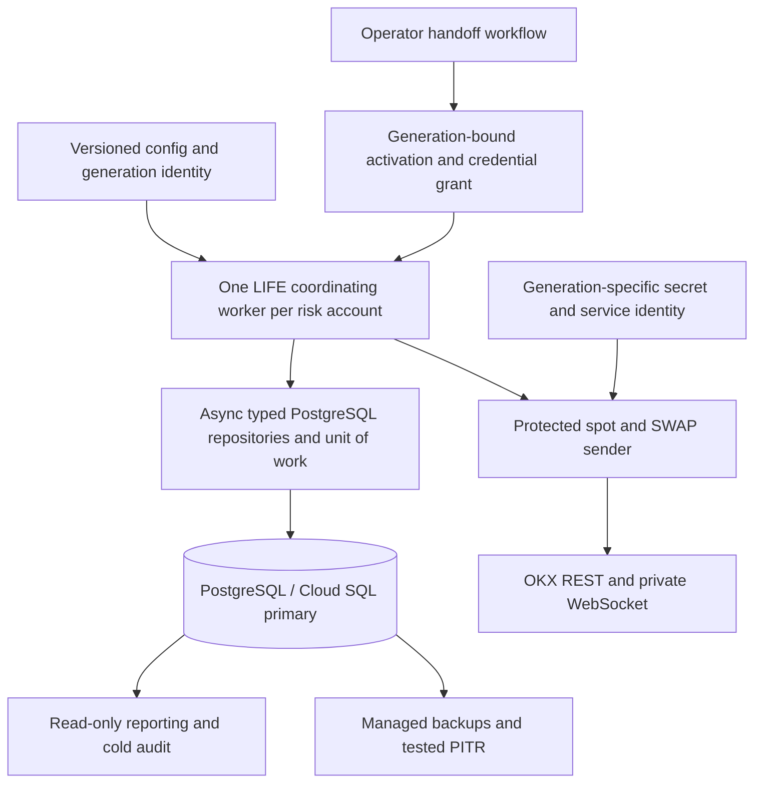

# LIFE: PostgreSQL and Cloud Run Implementation Plan (TDD)

Created: 2026-10-11

Status: **Proposed; implementation and deployment have not started.** All delivery checkboxes below are open. This document authorizes no infrastructure provisioning, credential changes, database migration, or exchange orders. The existing [LIFE implementation plan](LIFE_OKX_IMPLEMENTATION_PLAN_TDD.md) remains the source of trading requirements and O/D/R/C release gates.

Source reviewed: HEAD `e8a2fd427` plus the working-tree changes recorded in the [serialized qualification evidence](LIFE_OKX_O8_SINGLE_SCOPE_EVIDENCE_2026-10-11.md). Freeze exact source/config/schema/image hashes when implementation begins; HEAD alone does not identify this working tree. O.8.4/O.8.7 are still open, and production trading remains disabled.

## 1. Recommendation and decision

**Implement PostgreSQL as a portable storage backend first. Qualify it on a single VM/container before deciding to move the execution worker to Cloud Run.** Cloud Run is a conditional deployment target, not a prerequisite for using PostgreSQL.

PostgreSQL is useful for transactional financial updates, indexed active-state access, central auditability, and managed backup/recovery. It can replace repeated file-history work only after the state model and verification contracts are redesigned. Changing a database URL or moving whole JSON documents into a table will not resolve the current performance gate.

For one LIFE account, Docker on a VM with durable storage is operationally simpler. Cloud Run becomes more attractive when the team needs standardized managed deployments, isolated workers for several accounts, centralized operations, or integration with an existing Google Cloud platform. The first Cloud Run release accepts manual downtime during ownership changes; it does not promise automatic trading failover.

| Option | Benefit | Additional work | Recommendation |
| --- | --- | --- | --- |
| VM + current file backend | Closest to the current single-host model | Existing O.8 work, durable disk, backup and operations | Valid baseline while assessing migration |
| VM + PostgreSQL | Transactional authority and indexed state, independent of compute platform | Storage refactor, import, recorder integration, database operations | First PostgreSQL milestone |
| Cloud Run Worker Pool + PostgreSQL | Managed worker revisions and integration with Google Cloud | All PostgreSQL work, lifecycle handling, credential isolation and proven sender handoff | Conditional second milestone |

### Economic decision gate

Compare total monthly cost and operating effort using the same declared account count, CPU/RAM, history volume, availability and recovery objectives:

`compute + database/HA + disk/backups/PITR + network/NAT + logs/metrics + build/registry + engineering/on-call + expected downtime`

Continuous workers consume resources while running; do not assume request-driven scale-to-zero savings for a continuously quoting bot. Use current regional [Cloud Run pricing](https://cloud.google.com/run/pricing) and [Cloud SQL pricing](https://cloud.google.com/sql/pricing), with dated calculator exports. No price or cost saving is asserted here.

**Proceed with PostgreSQL** if measured correctness, latency, audit/recovery, or operating benefits justify the migration. **Proceed with Cloud Run execution** only if its operating benefit also justifies the handoff protocol, ongoing credential rotation and measured recovery downtime. PostgreSQL on a VM remains an accepted final topology if that second decision is negative.

## 2. Existing code and migration scope

| Current seam | Required change |
| --- | --- |
| [Client DB configuration](../../hummingbot/client/config/client_config_map.py), [SQL connection manager](../../hummingbot/model/sql_connection_manager.py) | SQLite is the default recorder; add and qualify a PostgreSQL driver/configuration, schema lifecycle and connection handling |
| [Legacy DB migrator](../../hummingbot/model/db_migration/migrator.py) | Its local-file copy/replace workflow cannot be treated as a PostgreSQL migration strategy |
| [MarketsRecorder](../../hummingbot/connector/markets_recorder.py), executor orchestrator | Preserve executor, wire-ID, UID and position recovery provenance; qualify PostgreSQL reads/writes and failure handling |
| [LIFE controller](../../controllers/generic/life_liquidity.py) | Replace required JSON paths and path-based install checks with explicit backend/resource bindings; preserve account and policy checks |
| [PolicyState](../../hummingbot/strategy_v2/life_liquidity/policy_state.py), WAL, reservations, sessions, actions, budgets | Introduce typed storage and transaction boundaries; existing file locks/replace/fsync are not SQL transactions |
| [Fill attribution](../../hummingbot/strategy_v2/life_liquidity/fill_attribution.py), spot journal proof, shared capital, joint recovery | Replace file-byte/cache identity with independently qualified database cuts and financial invariants |
| [Account ownership](../../hummingbot/strategy_v2/life_liquidity/account_lock.py) | Keep the file backend's host-local lock; add PostgreSQL ownership and a separate exchange sender-handoff protocol |
| [CLI engine](../../hummingbot/cli/engine.py), [Dockerfile](../../Dockerfile) | Headless foreground worker, structured stdout, bounded signal handling, startup recovery and environment validation |

Migrating the SQL recorder alone leaves LIFE financial authority in files. Scope includes enabled spot, linear SWAP, hedge/carry and inventory paths; an implementation may deliver a declared spot-only slice first, but must explicitly disable and retain open coverage for unsupported paths.

## 3. Target architecture

The worker may run unchanged on a VM or a Cloud Run Worker Pool. Keep one coordinator for both products sharing the same account capital. Initial scope excludes sharding one account across independently sending workers, automatic leader takeover, active-active trading, portfolio margin, and cross-region trading failover.

Cloud Run Worker Pools support continuous background workloads without a load-balanced HTTP endpoint or automatic scaling. They remain subject to instance replacement and shutdown. [Worker Pools](https://docs.cloud.google.com/run/docs/deploy-worker-pools), [runtime contract](https://docs.cloud.google.com/run/docs/container-contract).

### Storage boundaries

- Introduce backend-neutral `StateBinding`, `StateCut`, repository ports, `UnitOfWork`, ownership and send-attempt services. A binding includes environment, exchange, authenticated account UID, risk pool, database lineage, schema version and policy/config hashes. A cut includes the relevant row/event versions; it is never a reusable send permit.
- Use indexed relational current-state rows plus append-only financial/identity events. Keep complete terminal identities and deduplication evidence. History can be partitioned, but pruning requires its own proven retention/recovery contract.
- Use asynchronous database operations on the trading path. Do not block the event loop with a synchronous PostgreSQL facade. Introduce a bounded LIFE dispatch task at the synchronous V2 tick/filter/dispatch boundary: enqueue an immutable, uniquely identified proposal, await database authorization in the protected executor path, and revalidate expiry/stop/config after waits through the actual post-throttler connector boundary. Do not create an unbounded background task per tick or return a precomputed boolean as asynchronous authorization. Late results after stop cannot issue a new request; already attempted requests remain unknown until reconciled.
- Keep database transactions short. Exchange HTTP/WS requests do not run inside retriable financial transactions. A database transaction cannot atomically commit an OKX request.
- Recorder/reporting data is not a second source of spendable capital. Where recorder persistence is separate, use a durable transactionally recorded projection/outbox operation, idempotent application and an explicit recovery-completeness gate. Missing or stale recorder evidence cannot release a hold.

### Proposed schema families

| Family | Required identity/invariants |
| --- | --- |
| Accounts, ownership, activation grants | Account namespace; monotonic owner epoch; unique process/generation UUID; DB lineage; lease based on DB time; unarmed/draining/active state |
| Policies, config versions, sessions | Immutable version/hash; original deadline/timezone semantics; session epoch; no restart-based deadline extension |
| Intents, exact wire payloads, send attempts | Durable intent/attempt/operation IDs; permanent scoped wire-ID tombstones; policy and owner binding; legal transitions including `SEND_UNKNOWN` |
| Reservations, capital claims, balances, positions | Exact units and finite decimal amounts; shared spot/SWAP capital; no over-allocation under concurrent commands |
| Fills, fees, cashflows, bill approvals, attribution | Scoped exchange identities; signed fees; causal ordering; exactly-once financial application by immutable operation identity |
| Loss/subsidy/stress budgets, markout/carry state | Existing accounting semantics; gross spending and unresolved obligations survive restart; no automatic refund on an exception |
| Quote actions, hedge/inventory state, joint receipts | Existing ownership, retry/turnover caps, `APPLYING` recovery and fresh-observation bindings |
| Recorder provenance, events, import runs, audit checkpoints | Executor UID/wire scope; append-only history; source hashes; staged import; independently checked projection totals |

Use PostgreSQL `NUMERIC` with a deliberately selected precision/scale and Python `Decimal`; reject nonfinite values and out-of-range/over-scale input instead of silently rounding an import. PostgreSQL permits special numeric values, so application and database checks must reject them for financial fields. [Numeric types](https://www.postgresql.org/docs/current/datatype-numeric.html).

All authority reads use the writable primary. Read replicas, reporting caches and stale snapshots cannot authorize trading or release reservations.

### Integrity trust model

Current exact-file-byte verification is backend-specific. Do not claim it is preserved by a row version or a checksum stored beside mutable data. Define approved guarantees for stale writers, malformed rows, event/projection divergence, accidental corruption, unauthorized application writes and privileged database tampering.

Require least-privilege roles, immutable event application, version/constraint checks, complete cold replay, and independent audit/checkpoint evidence. If privileged history mutation must be detected before every send, design an independent trusted anchor and prove its latency/availability; an occasional audit or a colocated hash cannot satisfy that contract. PG0 must approve any change from current corruption-detection semantics before PostgreSQL release eligibility. No historical byte-check test may simply be deleted as a performance optimization.

## 4. Non-negotiable financial and sender invariants

1. A durably committed exact intent, reservation/capital hold and armed send-attempt state precede external I/O. Local database success is not an exchange ACK.
2. An ambiguous COMMIT or send outcome remains unknown. Read back by stable operation/attempt identity from the primary; never infer failure, refund a budget, allocate a new wire ID or blindly resend because a connection raised.
3. Financial commands are idempotent by operation ID. Serialization/deadlock retries rerun the complete database command with a bounded policy, never the exchange request. PostgreSQL serializable transactions require retry handling. [Transaction isolation](https://www.postgresql.org/docs/current/transaction-iso.html).
4. All allocating writes validate account, policy/config, current owner epoch, observation freshness and row versions atomically. Lock accounts in a single documented order; test concurrent spot/SWAP allocation.
5. Session expiry, HALT, invalid updates, stale market/account facts, loss limits and financial uncertainty still revoke create/amend authority at the actual connector boundary, including retries and queue/throttler waits.
6. Release requires the existing complete exchange, fill/fee/bill, financial, runner and ownership evidence. A cancellation ACK, database row, or lease expiry alone cannot release a hold.
7. Unknown sends, terminal identities, fee/cashflow deduplication, spent budgets, joint exposure and cold-rearm latches survive migration, crash and backup restore.
8. DB outage or pool exhaustion closes normal trading admission and cannot create unbounded queues. Read-only exchange reconciliation and a separately tested emergency cancellation path remain schedulable. Its identity source is a bounded immutable cancellation manifest of durably committed attempt/ACK identities, bound to account, instrument, exchange `ordId`, permanently scoped client/wire ID, generation and DB lineage. It is not a cached trading permit. Missing/ambiguous identity, including an unknown send without qualified exchange `ordId`, is ineligible for this exception. It cannot create/amend, perform account-wide cancellation/CAA renewal, cancel successor orders, bypass credential revocation, release holds, or grant ownership. Uncertain successor activity denies the action and retains the declared outage exposure. The authoritative unknown attempt/hold remains in PostgreSQL; loss of this disposable manifest cannot erase it.

## 5. Ownership: database fencing and exchange fencing

**A PostgreSQL lease/advisory lock does not fence an OKX request.** An old process can pause after its final epoch check, lose its DB session, then resume network I/O using a still-valid exchange key. PostgreSQL advisory locks are cooperative; session locks end with the session. [Advisory locks](https://www.postgresql.org/docs/current/explicit-locking.html#ADVISORY-LOCKS).

One desired worker instance and revision routing are operating settings, not proof of a single authorized sender. Do not derive exchange ownership from them. Cloud Run service instance limits can briefly be exceeded; worker/revision replacement must also be treated as potentially overlapping execution. [Instance limits](https://docs.cloud.google.com/run/docs/configuring/max-instances), [runtime contract](https://docs.cloud.google.com/run/docs/container-contract).

### Initial supported protocol: manual cold handoff

1. Every process starts with a new process UUID, **read-only/unarmed**. A previously armed revision, secret or restored DB row cannot automatically arm a replacement process. An activation grant binds exactly one process, generation, owner epoch, account, image, config and DB lineage. Only the separate operator/control-plane role can issue/rearm a grant; the runtime role cannot create, relabel or extend its own grant.
2. Mark the current generation `DRAINING`, close normal admission and checkpoint all prepared/unknown attempts. Stop its worker, but do not treat a stop request or lease expiry as termination proof.
3. Revoke the old generation's **exchange write credential**, covering REST and private-WS authority. Removing Secret Manager access or deleting a secret does not revoke an already cached OKX key.
4. Verify revocation effectiveness and the treatment of delayed/in-flight requests using supported exchange behavior. Requests accepted before revocation may still create orders. A control-plane timestamp alone does not prove the drain is complete.
5. Only after old-sender exclusion is established, issue a replacement credential to the new generation in `RECOVERY_ONLY`. This is a process/generation-bound, deny-by-default application grant checked at each actual request boundary for authenticated reads and qualified exact-order cancellation, not an assumed exchange-provided cancel-only key. Create/amend, CAA renewal and rearm remain denied; this grant cannot itself authorize reservation release, which still requires the separate complete financial/reconciliation command. Reconcile account-wide enabled-product orders, accepted/unknown attempts, fills, fees, bills, balances and positions. Cancel only orders with qualified ownership; retain all unresolved holds.
6. Record the handoff evidence and require explicit rearm after matching O/D/R/C gates and fresh financial checks. If old-sender exclusion or reconciliation cannot be proven, the successor remains unarmed, with manual downtime.

Use a **different service identity and secret resource for each trading generation**, with resource-scoped access. An old identity must not fetch the replacement key, impersonate its service identity, or create a new exchange key. Each automatically replaced process still needs its own activation grant; it must not reuse the previous process's grant. The first release therefore requires an operator-controlled new generation after an unexpected trading-worker restart.

Normal create/amend/cancel and CAA updates are generation-bound. The narrow emergency cancel exception in Section 4 must be proven unable to affect successor orders; it is not general permission after owner loss. Expiry headers can limit delayed requests, and exchange cancellation timers can reduce residual risk, but neither establishes ownership. OKX `clOrdId` uniqueness is among pending orders, not permanent exactly-once delivery. Qualify the applicable REST/WS behavior in demo before using it. [OKX API](https://www.okx.com/docs-v5/en/).

Automatic live takeover is outside the first release. A future credential-owning execution gateway is a separate architecture decision and needs its own enforceable takeover; it cannot merely relocate the same lease race.

## 6. Phased implementation and completion checklists

For every checklist: record the failing selector and baseline hash, implement the smallest correction, rerun Green and relevant negative cases, then attach source/schema/config/image hashes and the evidence report. Planned test filenames below do not exist yet. A written design or passing mock is not completion evidence.

### PG0 — Architecture, feasibility, economics and trust decisions

Dependencies: none; can proceed while existing O.8 work continues offline.

- [ ] PG0.1: Freeze declared spot/SWAP/inventory scope, source baseline and open O.8 failures; identify affected A23/A24/A28/A30/A33/A35/A36/A39 contracts.
- [ ] PG0.2: Approve storage/integrity trust model, database transaction/isolation policy, backend-neutral bindings and the manual cold-handoff protocol. Record the external-send fencing limitation explicitly.
- [ ] PG0.3: After the minimum PG0.2/PG0.4 decisions and explicitly synthetic PG0.5 fixture values, spike the actual V2 tick/filter/dispatch → OrderExecutor → awaited database authorization → post-throttler OKX check, plus recorder paths against real PostgreSQL. Prove bounded queue/backpressure, stable action identity, cancellation scheduling, expiry/stop during DB waits and no delayed background sends after stop. The spike is disposable and has no live authority.
- [ ] PG0.4: Select and pin a Cloud SQL-supported PostgreSQL major, migration tool and driver compatible with the existing Python/SQLAlchemy runtime; test dependency resolution and Linux image build.
- [ ] PG0.5: Record numeric test/deployment values and rationale for pool size/overflow, query/lock/transaction timeouts, retry caps, lease/heartbeat, observation age, shutdown budget, DB storage/headroom, RPO/RTO and audit lag. Record units, owner and calibration method; synthetic values are not live defaults.
- [ ] PG0.6: Produce a dated VM-versus-Worker-Pool cost/operations comparison and a go/no-go decision for each milestone. Check documented target-region capabilities, account API-key generation/revocation constraints, fixed-egress needs and demo support; keep empirical environment behavior explicitly open for PG9.

**Done when:** decisions and runnable spike evidence exist, unresolved live inputs are listed, and no implicit live defaults or unsupported fencing claim remains. This does not enable trading.

### PG1 — Backend contracts and asynchronous integration seams

Dependencies: PG0.

- [ ] PG1.1: Add typed storage/UoW/identity/ownership ports and backend selection; file backend remains explicit and behaviorally compatible.
- [ ] PG1.2: Remove direct `Path`/file-byte/internal-cache assumptions from controller installation and financial proof callers; reject backend/account/policy/lineage mismatch instead of fabricating a compatible path.
- [ ] PG1.3: Refactor the synchronous runner scheduling boundary and authority/sender chains to use a bounded async dispatch task; test post-throttler final authorization and every retry for both spot and SWAP, including expiry/stop/config changes while DB work is pending and late task completion after shutdown.
- [ ] PG1.4: Contract-test expiry, stale state, immutable read results, legal transitions, bad config, missing state and independent final-send checks against the file implementation first.

**Red tests:** `test_storage_contracts.py`, `test_async_final_authorization.py`; delayed/failed DB checks must not block cancellation or leave a cached permission valid.

**Done when:** file regressions pass and the ports can express actual financial transactions without synchronous event-loop SQL, path emulation or reduced authorization.

### PG2 — PostgreSQL schema, transactions and runtime access

Dependencies: PG1; recorder groundwork may proceed in parallel once schema decisions are stable.

- [ ] PG2.1: Implement versioned forward migrations and separate migration/runtime/reporting roles; runtime cannot alter schema or rewrite immutable financial history. Prove the chosen permissions with the actual database.
- [ ] PG2.2: Implement the schema families in Section 3 with account/environment-scoped keys, unique operation/wire/event identities, finite decimal checks, transition/version constraints and indexed active-state queries. Include atomic expected-owner/epoch/process/lineage checks and DB-time expiry guards in every financial UoW; PG4 later qualifies grant issuance and handoff.
- [ ] PG2.3: Add async bounded pools and explicit primary/TLS/account/lineage/schema validation. No replica authority, unlimited overflow, session sharing between tasks or long-lived idle transactions.
- [ ] PG2.4: Test two concurrent allocators, conflicting row versions, deadlock/serialization retries, pool exhaustion, statement cancellation, dropped connections and unknown COMMIT outcomes using real PostgreSQL processes.
- [ ] PG2.5: Qualify durability settings and declared failure domain; `synchronous_commit` configuration alone is not a promise of zero loss for every Cloud SQL failure/PITR scenario.

**Red tests:** `test_postgres_schema.py`, `test_postgres_transactions.py`, `test_postgres_pool_safety.py`.

**Done when:** migrations and all constraints work on the pinned version, conflicts cannot double-spend, uncertain commits read back idempotently, and DB failure closes admission without starving safety work.

### PG3 — Financial authority and durable send attempts

Dependencies: PG2.

PG3 tests seed explicitly synthetic ownership/grant rows through test-only setup roles; real transaction guards remain mandatory and have stale-owner negative cases. There is no runtime ownership bypass. PG4 qualifies actual lease/grant lifecycle and external sender handoff; PG3 completion alone establishes no production ownership safety.

- [ ] PG3.1: Port sessions, WAL/intents, reservations, actions and capital claims with atomic command boundaries and durable pre-send attempt state.
- [ ] PG3.2: Port fills, signed fees, bills/cashflow approvals, attribution, loss/subsidy/stress budgets and markout state; retain permanent identity deduplication and current accounting semantics.
- [ ] PG3.3: Port enabled SWAP/hedge/carry/inventory/joint recovery, including causal same-time fills and interrupted `APPLYING` checkpoints. Explicitly disable every unported product/mode.
- [ ] PG3.4: Implement durable recorder/outbox projection operations and completeness checks; an outbox dispatcher never blindly replays an unknown exchange submission.
- [ ] PG3.5: Kill subprocesses before/after intent/hold commit, armed attempt commit, external request, ACK capture, fill/bill application, projection update and terminal release. Restore fresh objects and prove no blind resend, double accounting or premature refund/release.
- [ ] PG3.6: Verify event/projection invariants and corruption detection under the PG0 trust contract, including cold replay and independently anchored evidence where required.

**Red tests:** `test_postgres_financial_commands.py`, `test_postgres_send_crashes.py`, `test_postgres_joint_recovery.py`.

**Done when:** equivalent file/PG replays yield identical units, balances, holds, budgets, identities and decisions for supported scope; database atomicity is never presented as exactly-once exchange delivery.

### PG4 — Ownership, grants and enforceable handoff

Dependencies: PG3; fake exchange and local processes only until the later demo gate.

- [ ] PG4.1: Implement DB-time lease, account-row serialization, monotonic owner epoch, process/generation UUID, lineage and one-use activation grants; stale writers cannot change financial state.
- [ ] PG4.2: Implement startup unarmed, `DRAINING`, `RECOVERY_ONLY` and explicit rearm states; expiry/session loss does not activate a successor.
- [ ] PG4.3: Implement generation-specific credential/service-identity access and manual handoff evidence; model key revocation delay and accepted in-flight requests without assuming instant exclusion.
- [ ] PG4.4: Pause sender A after its final DB check, expire/disconnect A, start B, then resume A. Demonstrate the unfenced lease-only failure as a retained Red reproduction; the supported protocol must keep B unarmed until A's external write authority is excluded.
- [ ] PG4.5: Test simultaneous revisions, same-revision replacement, lost heartbeat, DB failover/clock anomalies, stale activation grants and attempted replacement-secret access by the old identity.
- [ ] PG4.6: Test all write routes including amendments, retries, cancellations and CAA, and the deny-by-default `RECOVERY_ONLY` allowlist. Prove any outage emergency cancel uses the Section 4 durable identity manifest, rejects missing/ambiguous/foreign identities and cannot touch successor activity. Test DB unavailability during/after handoff with an old process attempting cancel: revocation is never bypassed, uncertain successor activity denies, and losing the manifest cannot release DB holds.

**Red tests:** `test_postgres_ownership.py`, `test_sender_generation_handoff.py`, `test_generation_secret_isolation.py`.

**Done when:** local multi-process fault tests pass and automatic live takeover remains disabled. Actual OKX credential exclusion is still a PG9 environment gate; local mocks do not close it.

### PG5 — Hummingbot recorder and operational compatibility

Dependencies: PG2/PG3; can overlap PG4.

- [ ] PG5.1: Configure and qualify PostgreSQL recorder access; replace local-file schema migration assumptions with versioned SQL migrations for the supported tables.
- [ ] PG5.2: Preserve executor config/custom-info, authenticated/configured UID distinction, active and historical wire IDs, positions, trade/fee precision and cold-restart provenance.
- [ ] PG5.3: Make recorder writes/queries bounded and independently scheduled; if a synchronous recorder adapter remains, use a bounded serialized worker with task-local sessions and explicit failure/backpressure behavior. Never pass live sessions or authority objects across threads.
- [ ] PG5.4: Update CLI status/history/trades and recovery queries that assume a local `.sqlite` path; surface backend health and incomplete provenance accurately.
- [ ] PG5.5: Test real orchestrator store/read/restart against PostgreSQL, missing/foreign/legacy rows, commit/read failure and delayed recorder projection; retain claims and executor retry state appropriately.

**Red tests:** `test_postgres_recorder_restart.py`, `test_postgres_cli_history.py` plus existing recorder/orchestrator recovery suites.

**Done when:** actual recorder/runner integration works without a hidden SQLite authority fallback or a false recovery-complete verdict.

### PG6 — Import, backups, restoration and rollback

Dependencies: PG3–PG5.

- [ ] PG6.1: Add offline import for complete legacy and segmented file cuts plus SQLite recorder provenance. Stop the file writer, acquire existing account ownership, validate every source digest/policy/binding and freeze an immutable source manifest.
- [ ] PG6.2: Import into `IMPORTING` staging with resumable batches and stable source operation IDs. Preserve original deadlines/epochs, all terminal tombstones, unresolved sends/holds, fees/cashflows/approvals, spent budgets and interrupted joint/action state.
- [ ] PG6.3: Compare exact financial totals, complete identity sets and recovered decisions; activate the imported lineage atomically and **unarmed**. Missing/corrupt source evidence blocks activation; never initialize empty authority to work around an import failure.
- [ ] PG6.4: Keep the source immutable and non-sending. Before any DB-owned orders, reversal can discard staging. After DB-owned orders, rollback requires reconciled export/cutover and a new fenced generation; toggling the backend flag is prohibited.
- [ ] PG6.5: Exercise backup/PITR restore into an isolated database. Restore is unarmed, has a new controlled lineage, rejects stale grants/epochs, and requires old-credential exclusion plus exchange history reconciliation since the restored cut. No empty history or replayed budget reset.
- [ ] PG6.6: Record measured backup restore, import, reconciliation, retained history and settlement/recovery headroom against PG0 RPO/RTO/capacity decisions. Export schema/versioned audit evidence; do not rely on backup existence alone.

**Red tests:** `test_postgres_import.py`, `test_postgres_restore.py`, `test_postgres_cutover_rollback.py` with killed/resumed importer and fresh processes.

**Done when:** both source formats import exactly, repeated import is idempotent, restorations cannot rearm, and the rollback runbook has a passing rehearsal.

### PG7 — Portable container and Cloud infrastructure definitions

Dependencies: PG0 decisions; worker code depends on PG1–PG5. Definitions can be prepared offline; provisioning belongs to PG9.

- [ ] PG7.1: Build a pinned Linux image from this repository with PostgreSQL dependencies; run foreground, receive signals directly, emit structured stdout/stderr, and keep credentials outside image layers/arguments/logs. Do not use the destructive current `make build` target.
- [ ] PG7.2: Validate startup without TTY/prompts/MQTT dependency, schema/account binding before authority construction, and no auto-bootstrap of missing financial state. Ephemeral local files may hold disposable scratch/config/status only.
- [ ] PG7.3: Add infrastructure definitions for Artifact Registry, Cloud SQL PostgreSQL, backup/PITR settings, VPC, IAM, Secret Manager, monitoring and one desired Worker Pool instance per account namespace. Provision migrations as a separate serialized task, never once per worker start.
- [ ] PG7.4: Define same-region worker/primary DB, private-IP/TLS connectivity with Direct VPC egress and bounded pools; test TLS/authentication handling locally. Document the selected Worker Pool authentication/connection method; its actual connectivity is a PG9.2 gate, not inferred from a Service-only example. [Direct VPC](https://docs.cloud.google.com/run/docs/configuring/vpc-direct-vpc), [Cloud SQL connectivity](https://docs.cloud.google.com/sql/docs/postgres/connect-run).
- [ ] PG7.5: Define fixed egress IP via VPC/NAT if required for exchange allowlisting, including every REST/WS write path and an explicit verification procedure. Actual egress/key restrictions are measured in PG9.2/PG9.4. [Static outbound IP](https://docs.cloud.google.com/run/docs/configuring/static-outbound-ip).
- [ ] PG7.6: Define scoped generation identities/secrets, separate migration/runtime/reporting privileges and no old-to-new impersonation path; pin secret/image/config versions. Validate policy definitions and local negative access fixtures; actual deployed access is mandatory in PG9.2/PG9.4. [Worker Pool secrets](https://docs.cloud.google.com/run/docs/configuring/workerpools/secrets).
- [ ] PG7.7: On SIGTERM close admission first, checkpoint attempted/unknown work, initiate bounded owned cancellations and exit within a configured budget below Cloud Run's 10-second termination window. Forced kill must preserve unknowns; shutdown completion does not imply exchange terminality. [Shutdown contract](https://docs.cloud.google.com/run/docs/container-contract).
- [ ] PG7.8: Add metrics/alerts for trading eligibility, owner generation, DB/query/pool lag, event-loop lag, unknown attempts, unresolved holds, audit freshness, budget usage and backup/recovery health. Probe/liveness success is separate from permission to trade; a healthy unarmed process must not restart-loop because it awaits manual recovery.

**Done when:** image and IaC validate locally, missing secrets/DB fail closed, ephemeral-directory deletion preserves authoritative state, and container signal/forced-kill tests pass. Cloud deployment is still unproven.

### PG8 — Complete PostgreSQL offline acceptance and performance

Dependencies: PG1–PG7 local work; no cloud/OKX credentials required.

- [ ] PG8.1: Run shared backend contract tests and actual V2 runner/executor replays against a real pinned PostgreSQL container, including supported spot/SWAP/inventory scope and a fake exchange.
- [ ] PG8.2: Require PG crash/concurrency/lease/unknown-COMMIT/import/restore/recorder/corruption cases in an executable acceptance map with test selectors, owners, source/schema hashes and explicit unresolved environment proofs.
- [ ] PG8.3: Retain every existing mandatory O.8 variant/outcome and add PostgreSQL at 0/1k/10k complete settled history using the actual sender/watchdog. Keep frozen limits: poll 2,000 ms, proposal/filter/send 1,000 ms, maximum loop lag 500 ms, cancel start 250 ms; budgets SHA-256 `e1be70f238efdaad68086e3ae43fdc8ca4447a4c6da6dc36c03260ca7e6be5c3`.
- [ ] PG8.4: Measure bounded query/row/byte counts, active versus total history, transaction latency, DB CPU/I/O/storage/WAL, worker RSS, connection count and cancellation delay. Run timeouts and pool contention with adverse concurrent work; no hidden full-history materialization on each permission check.
- [ ] PG8.5: Record complete repeated-run results on a declared resource profile, with profiling separate from latency gates and no overlapping measurements. Retain every failed/interrupted sample; do not widen ceilings or select only successful runs.
- [ ] PG8.6: Require constraint/invariant parity, full regression and the existing pinned coverage/completion gates plus new PG gates. Keep old evidence immutable. A new backend does not silently waive a failing mandatory legacy variant; changing supported scope requires a separately reviewed, versioned decision and acceptance map.

**Done when:** the declared product's existing offline gate and the new PostgreSQL gate both close with complete evidence. A passing PG-only suite cannot close O.8.4/O.8.7 by itself. Further cloud network performance remains PG9.

### PG9 — Cloud sandbox, VM comparison and OKX demo

Dependencies: PG8 and the matching existing O gate closed. Requires isolated nonproduction infrastructure/accounts and the applicable demo authorization. PG0 declares `postgres_vm` or `postgres_cloud_run` as the release topology. The VM milestone needs PG9.1–PG9.6 on the VM plus applicable portable/database/IAM/recovery work from PG7; Cloud Run-specific PG7 work and PG9.7 remain explicitly deferred/open if Cloud Run is not selected. Claiming Cloud Run readiness requires those additional items. This is a scope distinction for the new deployment extension, not a waiver of existing O.8 requirements.

- [ ] PG9.1: Provision an isolated VM/database sandbox from reviewed IaC and qualify the PostgreSQL worker there first. Record image/config/data shape, resources, network and actual cost inputs for later comparison.
- [ ] PG9.2: Prove startup, private DB connectivity, fixed egress where needed, IAM/secret isolation, logs/alerts, backup/restore and resource limits in the deployed environment.
- [ ] PG9.3: Exercise real container replacement, overlapping processes, SIGTERM/SIGKILL, DB disconnect/failover and recovery on the selected topology. Every replacement is unarmed until its own qualified generation handoff; one desired instance is not the assertion under test. Cloud Run scope additionally requires overlapping revisions and same-revision replacement.
- [ ] PG9.4: Use isolated OKX demo credentials and supported instruments to qualify send/retry/cancel/WS behavior, key revocation propagation, old-key REST/WS denial, accepted-before-revocation requests and the complete manual handoff. Unsupported demo credential controls remain unresolved, not simulated passes for live eligibility.
- [ ] PG9.5: Repeat the complete 0/1k/10k deployed performance matrix and a calibrated longer session with growing history, loss budgets, fills/fees/bills, carry, expiry and cold restart. Record throughput, latency, memory, storage growth and recovery downtime under the declared configuration.
- [ ] PG9.6: Compare the measured VM/Cloud Run outcome against PG0 economics and operating criteria. Choose the production topology explicitly; keep PostgreSQL-on-VM supported if Cloud Run offers insufficient benefit.
- [ ] PG9.7: For `postgres_cloud_run`, provision the Worker Pool and its Cloud-specific PG7 resources from reviewed IaC, then run PG9.2–PG9.5 on the same image/config/data shape. Require real revision/replacement/credential-isolation proof and a dated VM-versus-Cloud Run comparison before Cloud Run eligibility. If this experiment is deferred, record Cloud Run costs as estimates and outcomes as unmeasured; PG9.6 may select only the qualified VM topology.

**Done when:** deployed environment and demo evidence pass for the declared topology/scope; Cloud Run-specific work remains open for a VM-only milestone. A non-LIFE demo instrument proves its connector/deployment behavior; synthetic LIFE replay and actual LIFE availability remain separate. No production order permission is granted.

### PG10 — Production read-only qualification and canary review

Dependencies: applicable PG9 topology gate plus the existing R/C requirements as reached below. Choosing VM does not bypass them; a VM milestone does not claim Cloud Run deployment completion.

- [ ] PG10.1: Qualify authenticated production account, actual instruments/fees/history, opening balances, bill anchors, reference quality and explicit numeric economic/stress budgets using read-only access first.
- [ ] PG10.2: Freeze source/image/schema/IaC/config/credential-generation bindings; close all PG0 live decisions and qualify production ownership exclusion/handoff prerequisites with provider-qualified REST/private-WS revocation/drain evidence. Revocation timestamps, IAM denial or a read-only authentication probe alone do not prove write exclusion, and demo eligibility does not establish production revocation behavior. If hard-fence proof requires a mutating production probe, specify a separately authorized bounded validation/cleanup step under the existing R/C approval policy before activation; absent that authorization or sufficient non-mutating proof, the gate stays open and trading remains unarmed.
- [ ] PG10.3: Produce a concrete rollback/recovery runbook, current account/order exposure report, handoff evidence and budgeted canary proposal for separate explicit approval under the existing C gate.
- [ ] PG10.4: Only after approval, run the bounded live canary and record actual costs, latency, restart/reconciliation and liquidity KPIs before increasing capital. Remaining unknowns retain holds and stop expansion.

**Done when:** approved canary evidence passes and the operator accepts the measured topology. Deployment success, a DB migration or this plan cannot close the trading release gate.

## 7. Acceptance map and delivery evidence

| Case | Required result | Phases |
| --- | --- | --- |
| PC01 Concurrent spot/SWAP allocation | Exactly one valid allocation outcome per command; no double-counted capital | PG2/PG3 |
| PC02 Ambiguous COMMIT | Stable operation readback; no new ID/refund/blind send | PG2/PG3 |
| PC03 Crash around external send/ACK | Unknown attempt and holds survive; complete reconciliation precedes release | PG3/PG6 |
| PC04 Duplicate/out-of-order fills, fees and bills | Exact financial application once; causal ambiguity blocks | PG3 |
| PC05 Paused stale sender resumes | Successor stays unarmed until external exclusion; lease-only failure retained | PG4/PG9 |
| PC06 Replacement secret/identity access | Old identity cannot obtain replacement write authority | PG4/PG7/PG9 |
| PC07 DB outage/pool saturation | No normal trading; bounded proven cancellation and unresolved holds remain | PG2/PG4/PG8 |
| PC08 Legacy/segmented import | Exact complete identity/financial parity; activation unarmed | PG6 |
| PC09 Backup/PITR restore | New controlled lineage, no stale grant/rearm, history reconciled | PG6/PG9 |
| PC10 Growth to 10k history | Unchanged O.8 budgets pass; complete query/resource evidence | PG8/PG9 |
| PC11 SIGTERM then forced kill | Admission closes, unknown state survives, restart unarmed | PG7/PG9 |
| PC12 Recorder missing/foreign/delayed row | Recovery incomplete; no premature release or dropped executor | PG5 |
| PC13 History corruption/projection mismatch | Denied under the approved PG0 trust contract; independent audit evidence | PG2/PG3/PG8 |
| PC14 Cloud topology economics | Dated comparison and explicit go/no-go, including manual handoff downtime | PG0/PG9 |
| PC15 Actual account/canary | Existing R/C gates remain mandatory | PG10 |

Each phase report must include commands/selectors, Red and Green outcomes, real PostgreSQL version, source/schema/config/image hashes, environment/resource profile, complete failures/skips, and remaining gates. Classify every skip; an unavailable cloud/demo dependency is an open gate. No credential values or secret payloads belong in evidence.

Suggested artifact locations (to be created during implementation):

- `hummingbot/strategy_v2/life_liquidity/storage/`: typed ports, file adapter, PostgreSQL repositories and command/UoW services.
- `test/hummingbot/strategy_v2/life_liquidity/storage/`: shared contracts and real-PostgreSQL integration/fault tests.
- `migrations/life_liquidity/`: versioned financial/recorder schema migrations with explicit compatibility policy.
- `deploy/life_liquidity/`: portable image entrypoint and reviewed VM/Worker Pool infrastructure definitions.
- `docs/plans/evidence/life_pg_cloud_run/`: phase evidence, import manifests, performance results and executable acceptance map.

These are proposed paths, not implemented tools or available CLI commands.

## 8. Suggested execution order

1. Finish the PG0 spike/decisions and define the backend contracts while preserving the current O.8 evidence.
2. Implement PG1–PG6 offline against real local PostgreSQL; prepare PG7 container/IaC without provisioning.
3. Close PG8 and the matching existing offline gate. Keep the declared mandatory legacy requirements unless an explicit scope amendment is approved.
4. Qualify PostgreSQL on a VM, then evaluate Cloud Run in PG9 sandbox/demo using the same worker build.
5. Proceed to PG10 production read-only qualification and the separately approved existing R/C canary on the topology whose applicable PG9 gate has closed. Cloud Run additionally requires PG9.7 ownership/deployment proof and favorable economics. If it is deferred, the qualified VM may proceed through PG10/R/C while Cloud Run-specific items stay open; no production approval is bypassed.

The immediate next task is **PG0: minimal trust/ownership and driver/version decisions plus synthetic pool/timeout fixtures, followed by PG0.3's actual-runner async final-send/recorder spike**. This is a substantial persistence refactor; schedule estimates should follow that measured spike rather than treating it as a Docker deployment change.
