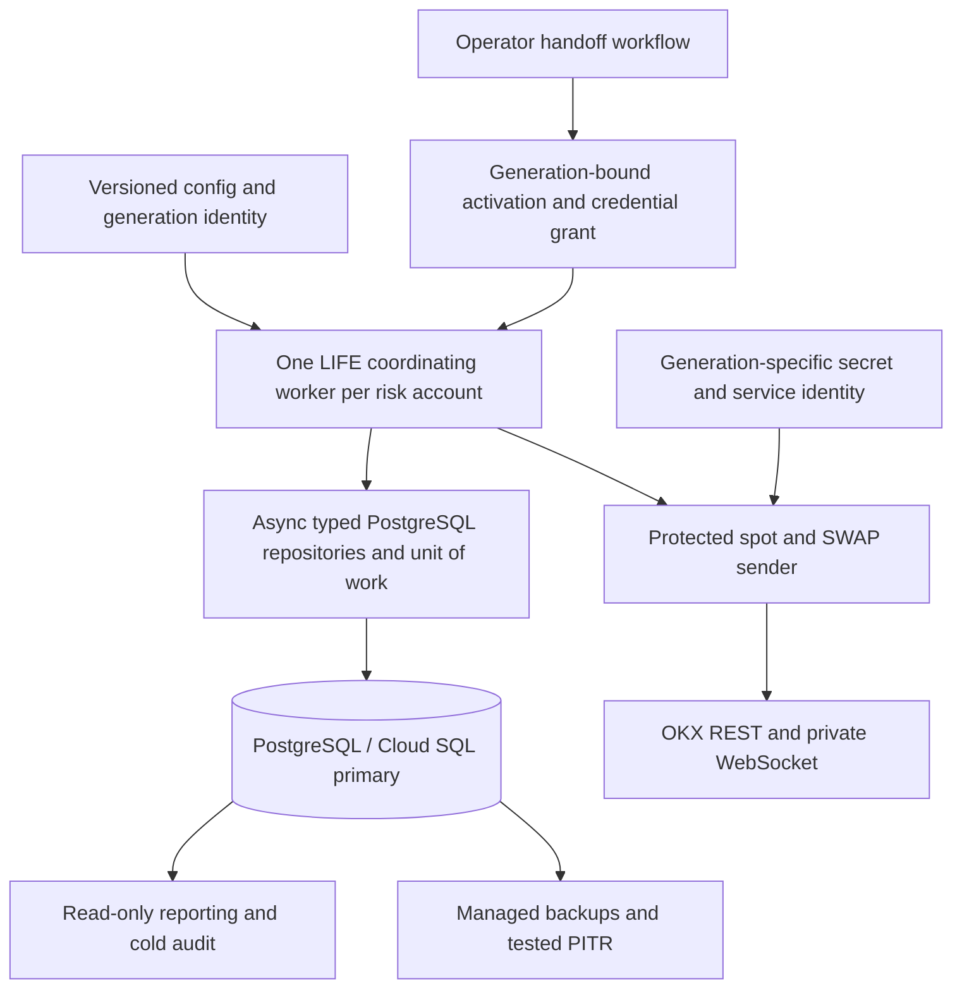

# LIFE: PostgreSQL and Cloud Run Implementation Plan (TDD)

Created: 2026-10-11

**Current PG1 status (2026-10-16, base `e6423fd52` plus C1/C2 work):** PG1-C1, PG1-C2 and PG1.2 are complete for the declared offline file-service scope. PG1 is **not complete**: C3 approved financial configuration/lineage transitions and C4 final file-runtime acceptance remain in the [current closure ledger](#pg1-current-closure-ledger). The final expanded regression passes **2,172 tests**, zero failures/errors/skips. Dated checkpoints below are historical progress, not additional current backlogs. PostgreSQL financial authority and Cloud Run deployment remain unimplemented by these file-backend changes.

**Historical starting status:**

Status (2026-10-12): **Disposable local spot feasibility/assembly measured; central migration infrastructure and offline checkpoint/file adapters implemented; spot preparation, ACK, fill/fee loss/subsidy, approved cashflow/NAV, exact terminal/resume and pending preparation/arm/ACK/fill/cashflow recovery storage slices implemented. Closed spot inventory subsidy settlement, signed lifecycle/cashflow approval/import and bounded async dispatch/final-check seams are also implemented. Full product/recorder ports, legacy controller file-path removal, complete observation/application migration, PostgreSQL financial repositories and deployment remain pending.** Parent delivery checkboxes remain open; checked subitems below describe only their explicit scope. The [spike evidence](LIFE_POSTGRES_SPIKE_EVIDENCE_2026-10-12.md) records real PostgreSQL transactions with synthetic transport, not production migration or exchange proof. The existing [LIFE implementation plan](LIFE_OKX_IMPLEMENTATION_PLAN_TDD.md) remains the source of trading requirements and O/D/R/C release gates.

Source reviewed: HEAD `e8a2fd427` plus the working-tree changes recorded in the [serialized qualification evidence](LIFE_OKX_O8_SINGLE_SCOPE_EVIDENCE_2026-10-11.md). Freeze exact source/config/schema/image hashes when implementation begins; HEAD alone does not identify this working tree. O.8.4/O.8.7 are still open, and production trading remains disabled.

## 1. Recommendation and decision

**Implement PostgreSQL as a portable storage backend first. Qualify it on a single VM/container before deciding to move the execution worker to Cloud Run.** Cloud Run is a conditional deployment target, not a prerequisite for using PostgreSQL.

PostgreSQL is useful for transactional financial updates, indexed active-state access, central auditability, and managed backup/recovery. It can replace repeated file-history work only after the state model and verification contracts are redesigned. Changing a database URL or moving whole JSON documents into a table will not resolve the current performance gate.

For one LIFE account, Docker on a VM with durable storage is operationally simpler. Cloud Run becomes more attractive when the team needs standardized managed deployments, isolated workers for several accounts, centralized operations, or integration with an existing Google Cloud platform. The first Cloud Run release accepts manual downtime during ownership changes; it does not promise automatic trading failover.

| Option | Benefit | Additional work | Recommendation |
| --- | --- | --- | --- |
| VM + current file backend | Closest to the current single-host model | Existing O.8 work, durable disk, backup and operations | Valid baseline while assessing migration |
| VM + PostgreSQL | Transactional authority and indexed state, independent of compute platform | Storage refactor, import, recorder integration, database operations | First PostgreSQL milestone |
| Cloud Run Worker Pool + PostgreSQL | Managed worker revisions and integration with Google Cloud | All PostgreSQL work, lifecycle handling, credential isolation and proven sender handoff | Conditional second milestone |

### Economic decision gate

Compare total monthly cost and operating effort using the same declared account count, CPU/RAM, history volume, availability and recovery objectives:

`compute + database/HA + disk/backups/PITR + network/NAT + logs/metrics + build/registry + engineering/on-call + expected downtime`

Continuous workers consume resources while running; do not assume request-driven scale-to-zero savings for a continuously quoting bot. Use current regional [Cloud Run pricing](https://cloud.google.com/run/pricing) and [Cloud SQL pricing](https://cloud.google.com/sql/pricing), with dated calculator exports. No price or cost saving is asserted here.

**Proceed with PostgreSQL** if measured correctness, latency, audit/recovery, or operating benefits justify the migration. **Proceed with Cloud Run execution** only if its operating benefit also justifies the handoff protocol, ongoing credential rotation and measured recovery downtime. PostgreSQL on a VM remains an accepted final topology if that second decision is negative.

## 2. Existing code and migration scope

| Current seam | Required change |
| --- | --- |
| [Client DB configuration](../../hummingbot/client/config/client_config_map.py), [SQL connection manager](../../hummingbot/model/sql_connection_manager.py) | SQLite is the default recorder; add and qualify a PostgreSQL driver/configuration, schema lifecycle and connection handling |
| [Legacy DB migrator](../../hummingbot/model/db_migration/migrator.py) | Keep its recorder file workflow separate; LIFE PostgreSQL now has a [central migration CLI and SQL directory](../../migrations/life_liquidity/README.md), with full financial/recorder DDL still pending |
| [MarketsRecorder](../../hummingbot/connector/markets_recorder.py), executor orchestrator | Preserve executor, wire-ID, UID and position recovery provenance; qualify PostgreSQL reads/writes and failure handling |
| [LIFE controller](../../controllers/generic/life_liquidity.py) | Replace required JSON paths and path-based install checks with explicit backend/resource bindings; preserve account and policy checks |
| [PolicyState](../../hummingbot/strategy_v2/life_liquidity/policy_state.py), WAL, reservations, sessions, actions, budgets | Introduce typed storage and transaction boundaries; existing file locks/replace/fsync are not SQL transactions |
| [Fill attribution](../../hummingbot/strategy_v2/life_liquidity/fill_attribution.py), spot journal proof, shared capital, joint recovery | Replace file-byte/cache identity with independently qualified database cuts and financial invariants |
| [Account ownership](../../hummingbot/strategy_v2/life_liquidity/account_lock.py) | Keep the file backend's host-local lock; add PostgreSQL ownership and a separate exchange sender-handoff protocol |
| [CLI engine](../../hummingbot/cli/engine.py), [Dockerfile](../../Dockerfile) | Headless foreground worker, structured stdout, bounded signal handling, startup recovery and environment validation |

Migrating the SQL recorder alone leaves LIFE financial authority in files. Scope includes enabled spot, linear SWAP, hedge/carry and inventory paths; an implementation may deliver a declared spot-only slice first, but must explicitly disable and retain open coverage for unsupported paths.

## 3. Target architecture

The worker may run unchanged on a VM or a Cloud Run Worker Pool. Keep one coordinator for both products sharing the same account capital. Initial scope excludes sharding one account across independently sending workers, automatic leader takeover, active-active trading, portfolio margin, and cross-region trading failover.

Cloud Run Worker Pools support continuous background workloads without a load-balanced HTTP endpoint or automatic scaling. They remain subject to instance replacement and shutdown. [Worker Pools](https://docs.cloud.google.com/run/docs/deploy-worker-pools), [runtime contract](https://docs.cloud.google.com/run/docs/container-contract).

### Storage boundaries

- Introduce backend-neutral `StateBinding`, `StateCut`, repository ports, `UnitOfWork`, ownership and send-attempt services. A binding includes environment, exchange, authenticated account UID, risk pool, database lineage, schema version and policy/config hashes. A cut includes the relevant row/event versions; it is never a reusable send permit.
- Use indexed relational current-state rows plus append-only financial/identity events. Keep complete terminal identities and deduplication evidence. History can be partitioned, but pruning requires its own proven retention/recovery contract.
- Use asynchronous database operations on the trading path. Do not block the event loop with a synchronous PostgreSQL facade. Introduce a bounded LIFE dispatch task at the synchronous V2 tick/filter/dispatch boundary: enqueue an immutable, uniquely identified proposal, await database authorization in the protected executor path, and revalidate expiry/stop/config after waits through the actual post-throttler connector boundary. Do not create an unbounded background task per tick or return a precomputed boolean as asynchronous authorization. Late results after stop cannot issue a new request; already attempted requests remain unknown until reconciled.
- Keep database transactions short. Exchange HTTP/WS requests do not run inside retriable financial transactions. A database transaction cannot atomically commit an OKX request.
- Recorder/reporting data is not a second source of spendable capital. Where recorder persistence is separate, use a durable transactionally recorded projection/outbox operation, idempotent application and an explicit recovery-completeness gate. Missing or stale recorder evidence cannot release a hold.

### Proposed schema families

| Family | Required identity/invariants |
| --- | --- |
| Accounts, ownership, activation grants | Account namespace; monotonic owner epoch; unique process/generation UUID; DB lineage; lease based on DB time; unarmed/draining/active state |
| Policies, config versions, sessions | Immutable version/hash; original deadline/timezone semantics; session epoch; no restart-based deadline extension |
| Intents, exact wire payloads, send attempts | Durable intent/attempt/operation IDs; permanent scoped wire-ID tombstones; policy and owner binding; legal transitions including `SEND_UNKNOWN` |
| Reservations, capital claims, balances, positions | Exact units and finite decimal amounts; shared spot/SWAP capital; no over-allocation under concurrent commands |
| Fills, fees, cashflows, bill approvals, attribution | Scoped exchange identities; signed fees; causal ordering; exactly-once financial application by immutable operation identity |
| Loss/subsidy/stress budgets, markout/carry state | Existing accounting semantics; gross spending and unresolved obligations survive restart; no automatic refund on an exception |
| Quote actions, hedge/inventory state, joint receipts | Existing ownership, retry/turnover caps, `APPLYING` recovery and fresh-observation bindings |
| Recorder provenance, events, import runs, audit checkpoints | Executor UID/wire scope; append-only history; source hashes; staged import; independently checked projection totals |

**Table needs checked for the ACK increment (2026-10-12):** production migrations
currently contain lineage metadata only. PG2 needs additional financial tables;
the spike tables are fixtures and must not be adopted by startup migration.
Candidate spot layout, to finalize with remaining PG1 command contracts:

| Proposed table | Purpose / mandatory keys and checks |
| --- | --- |
| `accounts` | Environment/exchange/UID/risk-pool/lineage binding, serialization row, owner generation and current versions |
| `sessions` | Immutable session/epoch/config binding and original deadlines |
| `send_attempts` | Exact payload/intent/wire identity, prepare/arm/ACK state, scoped unique exchange order ID; preserve terminal identities |
| `reservations` | Principal and separate LIFE/USDT fee holds linked to the exact attempt; qualified release only |
| `balances` | Exact asset units, current funds/holds and version guards |
| `budget_buckets` | Session/day/campaign limits, committed/actual subsidy and execution-loss projections |
| `operations` | Permanent scoped command fingerprint/receipt and unknown-COMMIT readback |
| `financial_events` | Immutable ordered observations/application facts, including ACK, fills, signed fees and cashflows; independently deduplicated exchange identities |

An ACK does **not** require a standalone `acknowledgements` SQL table: the intended
account transaction updates `send_attempts` and appends the operation/event.
The file adapter uses coordinator ACK records for its multi-journal saga. Further
fill/fee/cashflow, recorder, ownership/grant and enabled SWAP/shared-capital tables
remain under the schema families above. No financial migration is added in this
increment: complete command semantics, precision/scale, FKs, transition guards,
index scopes and actual PostgreSQL constraints/tests remain PG1/PG2 work.

Use PostgreSQL `NUMERIC` with a deliberately selected precision/scale and Python `Decimal`; reject nonfinite values and out-of-range/over-scale input instead of silently rounding an import. PostgreSQL permits special numeric values, so application and database checks must reject them for financial fields. [Numeric types](https://www.postgresql.org/docs/current/datatype-numeric.html).

All authority reads use the writable primary. Read replicas, reporting caches and stale snapshots cannot authorize trading or release reservations.

### Integrity trust model

Current exact-file-byte verification is backend-specific. Do not claim it is preserved by a row version or a checksum stored beside mutable data. Define approved guarantees for stale writers, malformed rows, event/projection divergence, accidental corruption, unauthorized application writes and privileged database tampering.

Require least-privilege roles, immutable event application, version/constraint checks, complete cold replay, and independent audit/checkpoint evidence. If privileged history mutation must be detected before every send, design an independent trusted anchor and prove its latency/availability; an occasional audit or a colocated hash cannot satisfy that contract. PG0 must approve any change from current corruption-detection semantics before PostgreSQL release eligibility. No historical byte-check test may simply be deleted as a performance optimization.

## 4. Non-negotiable financial and sender invariants

1. A durably committed exact intent, reservation/capital hold and armed send-attempt state precede external I/O. Local database success is not an exchange ACK.
2. An ambiguous COMMIT or send outcome remains unknown. Read back by stable operation/attempt identity from the primary; never infer failure, refund a budget, allocate a new wire ID or blindly resend because a connection raised.
3. Financial commands are idempotent by operation ID. Serialization/deadlock retries rerun the complete database command with a bounded policy, never the exchange request. PostgreSQL serializable transactions require retry handling. [Transaction isolation](https://www.postgresql.org/docs/current/transaction-iso.html).
4. All allocating writes validate account, policy/config, current owner epoch, observation freshness and row versions atomically. Lock accounts in a single documented order; test concurrent spot/SWAP allocation.
5. Session expiry, HALT, invalid updates, stale market/account facts, loss limits and financial uncertainty still revoke create/amend authority at the actual connector boundary, including retries and queue/throttler waits.
6. Release requires the existing complete exchange, fill/fee/bill, financial, runner and ownership evidence. A cancellation ACK, database row, or lease expiry alone cannot release a hold.
7. Unknown sends, terminal identities, fee/cashflow deduplication, spent budgets, joint exposure and cold-rearm latches survive migration, crash and backup restore.
8. DB outage or pool exhaustion closes normal trading admission and cannot create unbounded queues. Read-only exchange reconciliation and a separately tested emergency cancellation path remain schedulable. Its identity source is a bounded immutable cancellation manifest of durably committed attempt/ACK identities, bound to account, instrument, exchange `ordId`, permanently scoped client/wire ID, generation and DB lineage. It is not a cached trading permit. Missing/ambiguous identity, including an unknown send without qualified exchange `ordId`, is ineligible for this exception. It cannot create/amend, perform account-wide cancellation/CAA renewal, cancel successor orders, bypass credential revocation, release holds, or grant ownership. Uncertain successor activity denies the action and retains the declared outage exposure. The authoritative unknown attempt/hold remains in PostgreSQL; loss of this disposable manifest cannot erase it.

## 5. Ownership: database fencing and exchange fencing

**A PostgreSQL lease/advisory lock does not fence an OKX request.** An old process can pause after its final epoch check, lose its DB session, then resume network I/O using a still-valid exchange key. PostgreSQL advisory locks are cooperative; session locks end with the session. [Advisory locks](https://www.postgresql.org/docs/current/explicit-locking.html#ADVISORY-LOCKS).

One desired worker instance and revision routing are operating settings, not proof of a single authorized sender. Do not derive exchange ownership from them. Cloud Run service instance limits can briefly be exceeded; worker/revision replacement must also be treated as potentially overlapping execution. [Instance limits](https://docs.cloud.google.com/run/docs/configuring/max-instances), [runtime contract](https://docs.cloud.google.com/run/docs/container-contract).

### Initial supported protocol: manual cold handoff

1. Every process starts with a new process UUID, **read-only/unarmed**. A previously armed revision, secret or restored DB row cannot automatically arm a replacement process. An activation grant binds exactly one process, generation, owner epoch, account, image, config and DB lineage. Only the separate operator/control-plane role can issue/rearm a grant; the runtime role cannot create, relabel or extend its own grant.
2. Mark the current generation `DRAINING`, close normal admission and checkpoint all prepared/unknown attempts. Stop its worker, but do not treat a stop request or lease expiry as termination proof.
3. Revoke the old generation's **exchange write credential**, covering REST and private-WS authority. Removing Secret Manager access or deleting a secret does not revoke an already cached OKX key.
4. Verify revocation effectiveness and the treatment of delayed/in-flight requests using supported exchange behavior. Requests accepted before revocation may still create orders. A control-plane timestamp alone does not prove the drain is complete.
5. Only after old-sender exclusion is established, issue a replacement credential to the new generation in `RECOVERY_ONLY`. This is a process/generation-bound, deny-by-default application grant checked at each actual request boundary for authenticated reads and qualified exact-order cancellation, not an assumed exchange-provided cancel-only key. Create/amend, CAA renewal and rearm remain denied; this grant cannot itself authorize reservation release, which still requires the separate complete financial/reconciliation command. Reconcile account-wide enabled-product orders, accepted/unknown attempts, fills, fees, bills, balances and positions. Cancel only orders with qualified ownership; retain all unresolved holds.
6. Record the handoff evidence and require explicit rearm after matching O/D/R/C gates and fresh financial checks. If old-sender exclusion or reconciliation cannot be proven, the successor remains unarmed, with manual downtime.

Use a **different service identity and secret resource for each trading generation**, with resource-scoped access. An old identity must not fetch the replacement key, impersonate its service identity, or create a new exchange key. Each automatically replaced process still needs its own activation grant; it must not reuse the previous process's grant. The first release therefore requires an operator-controlled new generation after an unexpected trading-worker restart.

Normal create/amend/cancel and CAA updates are generation-bound. The narrow emergency cancel exception in Section 4 must be proven unable to affect successor orders; it is not general permission after owner loss. Expiry headers can limit delayed requests, and exchange cancellation timers can reduce residual risk, but neither establishes ownership. OKX `clOrdId` uniqueness is among pending orders, not permanent exactly-once delivery. Qualify the applicable REST/WS behavior in demo before using it. [OKX API](https://www.okx.com/docs-v5/en/).

Automatic live takeover is outside the first release. A future credential-owning execution gateway is a separate architecture decision and needs its own enforceable takeover; it cannot merely relocate the same lease race.

## 6. Phased implementation and completion checklists

For every checklist: record the failing selector and baseline hash, implement the smallest correction, rerun Green and relevant negative cases, then record commands/results and source/schema/config/image hashes in this plan. Per the operator request, do not create additional evidence files; keep raw test logs in temporary output directories. Existing evidence stays intact. Planned financial/backend test filenames below do not exist yet; migration tests are implemented as listed at the end of this plan. A written design or passing mock is not completion evidence.

### PG0 — Architecture, feasibility, economics and trust decisions

Dependencies: none; can proceed while existing O.8 work continues offline.

- [ ] PG0.1: Freeze declared spot/SWAP/inventory scope, source baseline and open O.8 failures; identify affected A23/A24/A28/A30/A33/A35/A36/A39 contracts.
- [ ] PG0.2: Approve storage/integrity trust model, database transaction/isolation policy, backend-neutral bindings and the manual cold-handoff protocol. Record the external-send fencing limitation explicitly.
- [ ] PG0.3: After the minimum PG0.2/PG0.4 decisions and explicitly synthetic PG0.5 fixture values, spike the actual V2 tick/filter/dispatch → OrderExecutor → awaited database authorization → post-throttler OKX check, plus recorder paths against real PostgreSQL. Prove bounded queue/backpressure, stable action identity, cancellation scheduling, expiry/stop during DB waits and no delayed background sends after stop. The spike is disposable and has no live authority.
  - [x] **Local spot transaction/index experiment (2026-10-12):** real PostgreSQL account-row serialization, current counters, durable attempt/hold/events, scoped identity uniqueness and partial active index; runtime event-update/delete denial; concurrent allocation, retry conflicts, lost replies/ACKs and retained unknown holds. Actual V2 filter → OrderExecutor hook → synthetic bounded async adapter → RESTConnection is exercised with a fake transport/throttle and a spike watchdog. The [code and reproduction](../../test/hummingbot/strategy_v2/life_liquidity/postgres_spike/README.md) and [evidence](LIFE_POSTGRES_SPIKE_EVIDENCE_2026-10-12.md) record 27 functional + 3 scale passes, constant 18 authority SQL statements/10 returned rows per successful send at 0/1k/10k, and passing frozen latency limits in this reduced workload. No full file/PG financial equivalence or O.8 closure is claimed.
  - [x] **Offline spot runner/connector/recorder mechanism (2026-10-12):** actual tick/queue/listener/filter/orchestrator/executor control, OKX protected scheduling/create/tracking/authentication/throttler and REST boundary now carry an optional awaited final check followed by the synchronous local fence. A transactional `READY` operation, actual SQLite recorder projection, fresh metadata reads and `APPLIED` publication gate arm/send. Bounded admission, stop/create priority, late recorder completion, missing/wrong recorder, unknown ACK/cold objects and cancellation during another DB wait pass in the synthetic coordinator. The [assembly evidence](LIFE_POSTGRES_ASSEMBLY_EVIDENCE_2026-10-12.md) records 282 regressions and 13 functional + three enlarged scale passes, with constant 24 PG statements/14 rows per send and corresponding terminal histories in both stores. This closes the stated mechanism only.
  - [ ] **Remaining PG0.3 release assembly:** approved PG0 trust/ownership/packaging inputs; real LIFE controller and backend-neutral ports with production watchdog/config/session lifecycle; all declared enabled product/retry routes; complete recorder repair/outbox crash/restart proof and financial equivalence. The experimental coordinator, synthetic market/account facts and in-memory HTTP session grant no production authority. The awaited DB gate plus final local fence does not establish an atomic DB/send boundary or exclude an old credential-bearing sender.
- [ ] PG0.4: Select and pin a Cloud SQL-supported PostgreSQL major, migration tool and driver compatible with the existing Python/SQLAlchemy runtime; test dependency resolution and Linux image build.
  - [x] **Local migration foundation (2026-10-12):** central versioned SQL runner using optional `asyncpg==0.31.0`; tested on pinned PostgreSQL 16.15 and the current Python 3.13 environment. The [migration guide](../../migrations/life_liquidity/README.md) records command, role, transaction and retry contracts. It follows the separate command/scripts pattern reviewed in local `life-wallet-backend`; adds a checksum ledger and concurrent-run lock instead of re-executing every file. No full SQLAlchemy dependency/image or Cloud SQL connectivity qualification is claimed.
- [ ] PG0.5: Record numeric test/deployment values and rationale for pool size/overflow, query/lock/transaction timeouts, retry caps, lease/heartbeat, observation age, shutdown budget, DB storage/headroom, RPO/RTO and audit lag. Record units, owner and calibration method; synthetic values are not live defaults.
- [ ] PG0.6: Produce a dated VM-versus-Worker-Pool cost/operations comparison and a go/no-go decision for each milestone. Check documented target-region capabilities, account API-key generation/revocation constraints, fixed-egress needs and demo support; keep empirical environment behavior explicitly open for PG9.

**Done when:** decisions and runnable spike results exist, unresolved live inputs are listed, and no implicit live defaults or unsupported fencing claim remains. This does not enable trading.

### Offline technical decisions for PG1 (2026-10-12)

These are engineering assumptions adopted for offline implementation under the current task authorization. They do not approve a change to the live trust model, grant trading authority, choose a deployed topology or close the PG0 parent. The spot preparation/read slice is now implemented against actual legacy journals. Remaining financial command/product ports will be designed against the complete requirements before their schemas are added.

| ID | Offline decision | Live/remaining gate |
| --- | --- | --- |
| PG-D01 | Contract qualification begins with a synthetic spot/account checkpoint; the full declared spot/SWAP/shared-capital/hedge/carry/inventory scope is retained. HEAD `a5257452802f8ea7c1227f9a9773cbfb7c5694ca` plus the current working tree is the baseline; O.8.4/.7 stay open. | All enabled financial/product routes, recorder repair and existing O.8 acceptance remain mandatory. |
| PG-D02 | Binding includes environment, underlying exchange `okx`, authenticated account UID, risk pool, lineage UUID, schema version and exact policy/config hashes. Synthetic UID/hash values are explicitly test-only. A cut has resource versions, revision/event position and snapshot digest; it never grants send permission. | Authenticated UID, actual policy/config provenance, primary/schema/lineage checks and grant binding are qualified in controller/PG integration. |
| PG-D03 | File adapter atomic scope is one `PolicyState` checkpoint. Its UoW can stage multiple logical resources inside that checkpoint. Existing separate financial files remain separate; the new legacy spot adapter declares a recoverable multi-journal saga with durable coordination/readback barriers. Unsupported PostgreSQL selection fails. | Domain-specific repositories, controller path removal and a real account-wide PostgreSQL UoW are required. No implicit atomicity across legacy files. |
| PG-D04 | Proposed PostgreSQL financial commands use short primary `READ COMMITTED` transactions with account-row locking in deterministic account order, atomic expected-owner/row-version checks and DB-time guards. Exchange requests stay outside transactions; only complete storage commands may have bounded retries. | Constraint/concurrency/serialization tests must prove this policy for all enabled commands in PG2/PG3; migration code does not select financial isolation. Escalation to serializable requires full-command retry qualification. |
| PG-D05 | File tests retain the existing `PolicyState` verification model. Proposed PostgreSQL integrity relies on restricted runtime writes, constraints, append-only financial identities and independently qualified cold replay/audit. A colocated checksum/row version cannot attest privileged historical mutation. | PG0.2 live trust decision and PG3.6 audit/anchor proof stay open. No existing mandatory historical verification test is removed. |
| PG-D06 | Owner facts have process/generation/session UUIDs, epoch, explicit UTC validity and mode. Synthetic ACTIVE fixtures may be created only in `OFFLINE_SIMULATION`; default creation is unarmed. Snapshot/owner data is not an activation grant. | Real account lock/lease/grant issuance, new-process unarmed startup, operator rearm and exchange credential exclusion remain PG1/PG4/PG9 work. |
| PG-D07 | One dedicated file worker owns `PolicyState`. Explicit admission/capacity limits, immutable DTOs and operation readback cover queued/cancelled/ambiguous writes. Synthetic test values: 2 admitted operations, 1 MiB checkpoint, 16 retained operation IDs; engineering-owned fixture capacities, not calibrated live values. | File-lock/disk latency is host-dependent. Production queue/watchdog/shutdown bounds, numeric DB pool/retry values, economics and live calibration remain PG0/PG1.3/PG7/PG8. |

### PG1 — Backend contracts and asynchronous integration seams

Dependencies: PG0.

- [ ] PG1.1: Add typed storage/UoW/identity/ownership ports and backend selection; file backend remains explicit and behaviorally compatible.
  - [x] **Checkpoint contracts/file primitive foundation:** immutable `StateBinding`, `StateCut`, `ResourceVersion`, `OwnerToken`, ownership/snapshot/receipt DTOs; async state/owner-read/UoW protocols; explicit backend selector; `PolicyState` adapter with a single checkpoint atomic scope, permanent operation deduplication, fresh owner/cut checks and bounded dedicated worker admission. PostgreSQL selection rejects without file fallback. The [storage guide](../../hummingbot/strategy_v2/life_liquidity/storage/README.md) describes the implemented scope and limitations.
  - [x] **Spot preparation/read domain slice:** typed session/balance/budget/reservation/send-attempt DTOs and async ports with finite Decimal units, operation/wire/quote-slot identity and explicit LIFE/USDT fee buffers. `LegacySpotStore` binds actual SessionStore/WAL/reservation/subsidy/loss files, holds one account UID lock and uses one bounded worker. It declares recoverable saga scope, records PREPARING/ARMING before multi-file work, verifies complete holds before publication, retains unknown/partial work and starts cold read-only. No generic financial checkpoint writes or implicit file/PG fallback.
  - [x] **Spot ACK observation storage slice:** typed immutable ACK command/receipt and readback port; exact prepare/intent/wire/market/side/session/epoch checks, permanently deduplicated observation operations and scoped exchange-ID conflicts. `LegacySpotStore` persists ACKING → actual WAL ACKED → verified completion, retaining principal/fee/subsidy holds on crash/cancellation. Late same-writer observations survive expiry and DRAINING/RECOVERY_ONLY without rearm; cold restore and replaced/unarmed writers cannot complete work. Authenticity and qualified recovery grants belong to the remaining bridge/service, not this DTO.
  - [x] **Spot complete fill/signed-fee and loss/subsidy storage slice:** explicit immutable cumulative snapshots and bound reference-skew policy; finite LIFE/USDT signed fees, independent fill-time values, exact known trade/fee/value identity and no omitted fills. Native reservation fill+fee checkpoints, per-fill execution loss and cumulative subsidy floor publish behind FILLING → APPLIED. Actual fee debits consume matching fee buffers without refunding rebates; overruns close new-risk admission. Fills before ACK bind its later exchange identity; late/over-budget fills are accounted without terminal release/rearm. Source authenticity, full NAV and controller/recovery integration remain below.
  - [x] **Approved spot cashflow and recorded NAV slice:** immutable opening-capital/time and bill approval policy; exact signed LIFE/USDT transfer, bound independent transfer valuation, permanent bill/operation identity and CASHFLOWING → native transfer → verified APPLIED saga. Existing CapitalLedger causal ordering/formulas verify actual balances, cashflow-adjusted NAV, execution loss and starting inventory attribution. NAV/highwater publish atomically in one coordinator checkpoint and survive cold restart; stale clocks, changed approvals/opening capital, unapproved facts and unfunded causal replay are denied. Financial changes invalidate old measurement fingerprints; transfer amounts do not reset budgets or release holds. Source authentication/history completeness and complete recovery/control-plane remain below.
  - [x] **Qualified spot order terminal/exact-operation resume storage slice:** explicit bound freshness policy and immutable exact order/account/fill/fee/bill/runner qualification facts. WAL observation, reservation release, WAL terminal and verified zero-fill subsidy settlement complete behind TERMINATING → TERMINAL, with durable principal overlay and fee claims retained until the final receipt. Partial/full fills retain economic subsidy floors/reservations and loss spending. Exact pending terminal operations can resume with fresh complete facts and the same bound writer on cold read-only stores; no rearm/ownership transfer/resend or repair of other partial commands. Actual authenticated bridge/history/credential qualification remains below.
  - [x] **Exact pending fill/cashflow financial recovery slice:** bound positive account-fact freshness policy and immutable recovery DTO/ports. Existing command/writer fingerprint and current cut are mandatory; final expected capital and actual native-subset projections must agree with exact trade/fee/bill/order/runner/account facts. Native missing checkpoints complete behind the original FILLING/CASHFLOWING barrier without repeating money, loss or subsidy spending. Recovery facts are persisted separately; original fill-time values and WAL attempt state remain binding. Cold resume never rearms, transfers ownership, upgrades SEND_UNKNOWN, refunds holds or repairs another partial command. Authenticated bridge/source qualification remains below.
  - [x] **Exact pending ACK recovery slice:** original durable ACK command/writer, fresh cut and complete account/order facts must agree with prepared wire/exchange identity, side, quantity, price and already accounted cumulative fills. Verified native capital/fee/loss/subsidy projections gate exact WAL ACK and receipt publication. Fresh recovery facts are separate from original command fingerprints; cold completion remains unarmed. FILLED/CANCELED observations do not terminalize or release holds. Authenticated source/bridge qualification remains open.
  - [x] **Exact pending preparation/arm recovery slice:** original prepare/arm cut and writer fingerprints remain binding; fresh complete account facts and verified native scope gate missing WAL/principal/subsidy checkpoints. Holds deduplicate in their original UTC buckets. Arm completion retains or records SEND_UNKNOWN without transport or ACK inference; cold completion stays unarmed. Older partial formats without original request provenance require qualified import.
  - [x] **Closed spot inventory/exit subsidy settlement:** typed commands/receipts and explicit bound settlement policy; terminal members and immutable accounted fills/fees/independent values must prove physically net-flat LIFE, including LIFE fees. Conservative fill floors remain and additional realized inventory cost belongs to the closing fill. Pending native settlement retains campaign/day/session subsidy overlays until its final receipt. Replay/cold resume does not repeat spending, reset execution-loss budgets or activate a process. Broader exit/hedge/product application remains below.
  - [x] **Typed product repository slice:** shared capital/stress decisions, conservative carry/funding diagnostics, versioned hedge targets and independent NAV/markout read ports use the same bounded file worker. Full namespace, configured/native policy fingerprints and native checkpoint cuts bind commands; capital quantities remain LIFE and margin/fees/funding/stress remain USDT. Permanent operation/intent identities, APPLYING barriers, native postconditions, queue-time owner/session/cut checks, cancellation and cold read-only replay preserve holds. Optional actual-controller runtime binding rejects duplicate native caches and pending product operations. These ports do not issue sends or release shared claims.
  - [x] **Independent SQLite recorder outbox slice:** immutable configuration/recovery provenance binds actual MarketsRecorder projections to account/environment/lineage/config and an explicit file-backed SQLite repository. PROJECTING precedes the independent DB write; readback and APPLIED follow it. Exact same-writer cold repair handles missing/already-written rows without overwriting later reporting status/PnL, granting activation or repeating financial accounting. Conflicting provenance, operation identity and DB aliases are rejected. SQLite floating reporting columns remain non-authoritative.
  - [x] **Ordered executor reporting and coupled spot runner slice:** immutable progress commands, expected sequence, permanent operation/cut/owner identity and PROJECTING/APPLIED outbox state bind actual SQLite updates. Status and filled-volume cannot regress; configuration/namespace are fixed and recovery wire history cannot shrink. Cold exact repair handles missing/already-committed SQL writes; historical repair preserves the latest status/PnL/wire history, including reconstruction of a deleted SQL row from its latest verified progress. `FileRecorderApplication` uses explicit queue/shutdown budgets and the same owning worker. Actual `ExecutorOrchestrator(repository_reporting=...)` consumes asynchronously loaded startup rows, projects before dispatch, records actual child progress, retains children until reporting receipt and provides fresh worker-only history for financial proof. Pending reporting closes new risk and activation; stop does not wait for SQLite. Reporting termination does not terminalize/refund an exchange order. The separate checked position-reporting subitem below adds exact held-position snapshots and SQL outbox recovery. The separately checked raw-event/recorder factory and preassembled V2 constructor subitems below extend this slice. Full configured CLI/service/product assembly remains open; unscoped legacy SQL still fails explicitly.
  - [x] **Coupled file spot quote/observation/cancel slice:** actual OrderExecutor hook, LIFE controller, protected OKX placement and REST/throttler chain share the repository's native session/WAL/reservations. Preparation/arming precede HTTP; asynchronous ACK publication precedes connector completion. A typed account-bill reader and observer compare account-wide fills, approved bills, signed fees, wallet, pending orders/algos and actual runner wire provenance before financial commands or terminal release. Proven-unsent abort and durable cancel-attempt sagas preserve uncertainty, retry timing and money holds across interruption. This opt-in quote assembly is exercised with fake HTTP and explicit isolated release substitutions. It refuses unassembled product routes and the legacy session tick; automatic watchdog/session/recovery/recorder assembly remains open.
  - [x] **Repository session/watchdog and exact pending spot bridge:** native SessionManager decisions publish behind APPLYING/APPLIED with exact original target/cut/writer readback. Pause/resume/expiry preserve funds and deadlines; logical successors require complete fresh account facts, and only a separate non-replayed signed ACTIVATE updates admission deadlines. The actual controller watchdog delegates one bounded asynchronous safety cycle for session/cancel/reconciliation; stop revokes immediately while worker capacity remains owned. Typed pending commands retain original fill/cashflow values and writer provenance; the service can complete an exact pending command from qualified fake HTTP without resend/reprice. A source-bound control snapshot bridges external signatures to the service; replay never grants admission. The separately qualified recovery batch covers newer external activity; complete SWAP/product/recorder application remains below.
  - [x] **Native joint recovery worker ports (2026-10-13):** `storage/joint.py` supplies immutable joint/SWAP position, margin and signed funding views, bounded complete-history capture and async reconcile/cancel ports over the actual native financial saga. All checkpoint, request-budget, terminal and qualified shared-capital release work runs on the existing store worker; collection/cancel transport remains on the event loop. Namespace, original owner/session, full controller configuration and installed native policies are checked. Cold startup and expiry disable native send eligibility; cancellation retains physical worker ownership and prevents late health/rearm. Actual partial/terminal fills, signed funding, incomplete scope, interrupted cash/WAL/capital/completion, deduplication, cold readback and backpressure have tests. This is explicit offline native-journal assembly, not coupled `LegacySpotStore` accounting or a PostgreSQL authority adapter.
  - [x] **Invalid hedge target preflight:** native and repository target updates share read-only version/pending/fault/clock validation. An invalid update is rejected before `APPLYING`, leaving the coordinator and native target unchanged and allowing a later valid update. An unrecorded existing native update requires import; it is not adopted as a new successful command.
  - [x] **Joint settled cash on the spot wallet (2026-10-13):** explicit `couple_cash=True` binds native joint recovery to the actual `LegacySpotStore` wallet/WAL/loss ledger on its single worker. Typed cumulative SWAP PnL/fee and signed funding facts publish original command/cut/writer, source identity and flat native before images before monetary effects. Wallet and execution-loss postconditions precede APPLIED; cold readback repairs wallet/loss/receipt interruptions without fee duplication, resend or activation. Settled cash is internal income/cost, never an external transfer; prior NAV becomes stale and independently observed NAV includes it once. Numeric cash comparison accepts equivalent Decimal scales. Incomplete scope, wrong wallet, rewritten/missing events and reused source identity fail before money. Existing spot recovery/terminal/lifecycle paths reject a pending joint cash saga. Archived formats require qualified import; this mode rejects all SPOT claims before native settlement.
  - [x] **Coupled spot-fill/fee/subsidy and SWAP settlement batch (2026-10-13):** `JointCashSpot.spot_fills` retains independent fill-time values and immutable full fill commands, preserving old cash-only encoding. One native wallet checkpoint applies causally ordered spot fills/LIFE-USDT fees/rebates and settled SWAP cash; loss and subsidy-floor postconditions precede the combined APPLIED projection. Flat original before images verify exact wallet before/after and permitted partial loss/floor changes during cold repair. Explicit `couple_spot=True` uses native complete joint proofs plus bounded immutable `FillSpot` and fresh `SpotFinancialRecoveryFacts`; missing references, account/wire/trade/bill scope, liabilities and changed history fail closed. Recorded references may be reused, never replaced by the current index. The native terminal path delegates to the store's existing terminal saga before shared-capital release, including multiple owned orders and zero fills. Working orders keep SEND_UNKNOWN and holds; no fill receipt invents ACK/rearm. Tests cover causal same-time funding, original-command wallet/loss/floor/receipt/terminal/capital interruptions, cold readback and later activity extending a pending batch without changing old reference values.
  - [x] **Protected SWAP worker/application slice (2026-10-15):** immutable executor/config commands bind original owner, native cut, permanent intent/wire identity and complete installed policy. The shared file worker owns native shared-capital preparation, WAL arming, request-budget charge and asynchronous ACK publication. Interrupted prepare/arm/ACK completes only exact original bookkeeping; cold recovery restores no volatile permit, creates no new ACK command and never resends or releases a claim. Actual executor hooks and the real REST/throttler chain use fake HTTP. Stop/expiry/config/UID/wire/mode/contract changes, stale qualification and revoked joint health prevent transport; async ACK completes before connector return. A durable one-shot boundary and local one-shot final check prevent retries. Timeout/cancellation retains dispatch capacity until original-writer ACK, as well as financial holds. This is explicit offline `open_file_swap` / `FileSwapApplication` assembly; legacy synchronous proposal is rejected once bound. Configured controller/service and hedge integration remain below.
  - [x] **Hedge child/retry worker application (2026-10-15):** immutable bounded market captures and original plan/child identities drive native hedge planning on the same worker as SWAP claims/WAL. PLANNING/child-origin/prepare/ISSUED/PLANNED interruptions recover original bookkeeping without transport, a replacement permit or cost/attempt reset. Partial terminal settlement retains prior trade/cost identities before a smaller retry. Invalid UID/source/cost/scope/stop inputs allocate nothing. New children carry the original explicit exchange-clock timestamp required by runner reporting.
  - [x] **Coupled pending spot families and unsent readback (2026-10-15):** joint source qualification composes original pending ACK, fill/fee/loss/subsidy or approved external cashflow commands with newer SPOT/SWAP activity. Original writer, values and fingerprints remain binding; native subset and final wallet projections must agree. USDT/LIFE deposits and withdrawals retain independent transfer values and remain excluded from profit. A qualified zero-fill unsent proof completes the original abort and shared-claim release without sending or refunding incurred costs. Cold/interrupted repair stays unarmed. This qualifies the tested command families, not arbitrary simultaneous partial operations or unsupported historical formats.
  - [x] **Shared SPOT preparation application (2026-10-15):** an explicit persisted binding couples original PREPARING provenance/risk epoch, shared claim, native WAL, principal/fee and subsidy holds on the existing worker. Combined capital preflight runs before preparation. Six native/receipt cutpoints recover only the exact original hold; changed writer/risk/source-wallet facts fail. Cold recovery never arms or sends. Complete joint unsent proof exclusively releases both reservation families. Configured actual runner/REST ACK retains wallet and both holds. Prepare/arm capture and apply fresh cuts on one worker turn; legacy command JSON stays unchanged when no shared risk epoch is present.
  - [x] **Configured quote and carry applications (2026-10-15):** explicit YAML quote policy constructs the native planner/reference/fee binding on the owning worker, with permanent account-bound quote history and persisted immutable policy. Fresh native own-depth/book/rules/reference/fee proofs, configured minimum edge/uncertainty, native subsidy windows and LIFE/USDT fee-buffer coverage gate admission. Typed detached order configs preserve all subclass fields and explicit UTC timestamps. Bounded immutable dispatch/rejection callbacks publish native action state on the worker. Final qualification validates held permits instead of reusing pre-preparation admission; manually supplied admission terms are rechecked unchanged. Actual runner/REST fixtures cover `profit_mm` and `liquidity_service`, post-throttler book/fee/stop rejection, economic subsidy rather than callback-supplied cost, cold policy/history denial and conservative holds. Optional native carry and product repository use the same capital/worker; stale or incomplete mark/index/funding/terms/account streams stop planning without booking cash or allocating claims. Cold readback stays unarmed.
  - [x] **Original prepared receipt with newer joint money (2026-10-15):** `JointCashSpot.spot_prepared_receipts` records exact original requests when native WAL, principal, shared claim and subsidy were fully published but PREPARING completion was lost. A native qualified unsent order and complete final account projection gate the batch. Namespace-bearing original cuts, writer validity at preparation time, immutable request/risk/slot identity, all existing holds and unchanged prior native money must agree. Joint APPLYING precedes money and receipt publication; wallet/receipt/abort/subsidy/shared-release interruptions repair original effects once. Funding, SWAP fees and an independently valued unrelated SPOT fill retain wallet/loss/subsidy semantics across fresh-object cold replay. The service defers this receipt-only case to joint qualification. Cold unsent runner scope uses the runtime port, original account-bound initial/progress outboxes, matching SQLite projection, original reporting completion before the preparation cut and original native holds on the worker; reporting proves scope only and grants no send/release permission. Actual V2 runner/executor failure before prepared receipt plus cold service recovery is tested, as are missing/corrupted outbox/SQL, wrong original cut/time/writer, incomplete holds and expired-writer observations. Empty new fields preserve legacy command fingerprints. Missing native preparation/arm checkpoints with newer activity, simultaneous other partial families and unadmitted external transfers remain below.
  - [x] **Configured risk and markout application (2026-10-15):** `FileRiskApplication` uses the repository wallet/fills/cashflows and its sole NAV/highwater writer. Independent, causal NAV and horizon observations replace caller-supplied drawdown; real available cash or qualified joint margin caps source margin. Joint NAV retains native SWAP accounting without adding collateral again. Persisted horizon samples use actual fill identities and fixed cohort terms. Policy/source/clock changes, insufficient samples and cold manual-rearm requirements deny admission. Cache-only SPOT/SWAP/runner fences catch adverse or expired inputs after awaited worker/throttler calls; benign timestamp refresh cannot extend an old proof.
  - [x] **Configured bounded inventory and closed-cycle subsidy settlement (2026-10-15):** signed INVENTORY/MM mode commands bind the fixed campaign/policy digest. Actual accounted fills, fees and outstanding children preserve target, participation, impact, benchmark-loss, deadline and retry limits. Children share quote provenance, the existing wallet/WAL/principal/fee/subsidy/loss authority and actual asynchronous runner/REST path. No second attributor or native financial writer is installed. The controller settlement port collects a fresh independent account cut, requires terminal physically net-flat members and delegates to the existing repository settlement saga. Native-before/native-after interruptions require cold reopen; exact resume/replay never credits execution loss, changes balances or activates trading. Unsigned checksum-valid mode changes fail audit.
  - [x] **Original partial preparation/arm bookkeeping with newer joint facts (2026-10-15):** the configured service restores only original admitted shared/WAL/principal/subsidy holds or original SEND_UNKNOWN arm bookkeeping under the installed worker authority. It validates original writer/cut/fingerprint and actually applied native accounting. This conservative step writes no fill/cashflow, completes no prepared receipt and releases nothing; the complete native joint proof must then qualify newer activity and final accounting/release. Configured crash tests cover each original hold checkpoint and missing arm checkpoints. It does not qualify arbitrary other simultaneous partial families or unadmitted external transfers.
  - [x] **Configured signed control entry points (2026-10-15):** independent SPOT/joint snapshots close cached admission before collection; UID, fresh source/cut and exact external signatures gate owner grants, cashflow approvals, the supported original-origin/cashflow imports and inventory mode. Startup consumes an externally signed seed and retains public verification keys only. New same-process activation separately proves native joint quiescence/carry/loss before rearm; historical receipts never rearm and a safety HALT remains latched. This covers these declared commands, not general policy/lineage/archive migration or sender credential exclusion.
  - [x] **Manual HALT and physical exclusion (2026-10-15):** the loop immediately revokes cached SPOT/SWAP/runner admission and coalesces repeated HALT calls into one bounded persistence task. Safety state and cancellation use the owning worker/application ports. Store FIFO cleanup retains the physical account lock until pending financial/reporting work drains; a blocked-worker competing-lock test reproduces and fixes premature controller release.
  - [x] **Configured successor observation and original-decision recovery (2026-10-15):** SPOT and joint watchdogs capture source qualification/cut/publication on the same worker, cancel old scope and require a fresh complete account cut before native successor publication. Pending quote proposals and active SPOT/SWAP claims block the transition. Original pending session before/native/receipt cuts complete before cold product/recorder assembly. A verified, quiescent successor can keep collecting under its expired original parent solely to obtain a new signed grant; native sender/allocation and runtime admission stay disabled. A separate observation deadline preserves the configured successor expiry without extending the old admission deadline. A typed observation-only successor tick checkpoints clock/expiry while prohibiting gate/reference assertions and preserving any existing pause/rollback latch; old command JSON remains unchanged when that option is absent. Waiting for a grant does not create a gate resume or an unresumable pause. Exact replay grants nothing. Native JSON rewrites, stale source cuts, incomplete facts, stop and missing reference deny transition. This is the warm/original-recorded-decision slice; cold initiation of an unrecorded transition remains below.
  - [x] **Configured bounded recovery probes (2026-10-15):** optional explicit `risk.recovery_probe_campaign_base` installs the native read-only `RecoveryProbeGuard` over the repository reservation ledger. Native resume size/stability and service policy must agree; absent opt-in preserves prior risk-policy fingerprints. Only fresh qualified `DEGRADED` SPOT quotes may use the probe allowance, one in-flight child at a time with per-quote and cumulative actual-filled campaign caps. Native reference/book/rules/fee/economic/subsidy/markout checks and final held-permit checks still apply. Cache-only runner scope rejects oversized/foreign/SWAP actions before queueing; SWAP, hedge and inventory retain NORMAL-only permission. Real configured runner/executor/REST fake-HTTP tests cover both `profit_mm` and `liquidity_service`, correctly scaled subsidy holds, ACK and post-throttler book/fee/risk/HALT/journal/state-change denial; actual fill/terminal/replay/cold readback preserves money and campaign consumption. No second financial writer or activation grant is introduced. This is the recovery-probe route; independent markout-bootstrap probes and separate exit budgeting/application remain open.
  - [x] **Configured separate exit budget/application (2026-10-15):** fixed target/child/slippage/freshness policy and an independent native exit-loss budget share the existing wallet, principal/fee reservations, WAL and execution-loss writer. Only the immutable original EXIT command selects that budget; ID prefixes and substituted identical files cannot redirect a quote hold. A complete source-qualified explicit exit request quiesces MM/SWAP and issues bounded post-only SELL children. Final runner/REST checks retain the exact approved price and independently qualify held permits. NORMAL/DEGRADED reduction proof grants no MM permission; HALT remains blocking. Complete terminal fill/fee/value proof settles actual exit cost once, including native-before/native-after cold recovery, while quote inventory-cycle holds retain their original semantics. Explicit quiescent stop restores MM mode without activation. General mixed-family/archive equivalence remains below.
  - [x] **Configured markout-bootstrap probes (2026-10-15):** paired explicit per-quote/campaign LIFE limits install a read-only cohort source and native probe guard over the sole repository fill/reservation stream. Quotes clamp to the smaller applicable recovery/markout limit. Genuine insufficient samples may bootstrap; pending/missing/adverse horizons, changed policy/journal, HALT and oversized/foreign/finally changed actions deny admission. Actual V2 runner/executor/fake REST covers both economic objectives, fresh held-permit checks and correctly scaled quote subsidy. Inventory/SWAP remain NORMAL-only and no probe invents a fill/sample or resets consumed capacity.
  - [x] **Explicit cold successor observation (2026-10-15):** opt-in public-key role `OBSERVE_SESSION` signs the exact primary/session/epoch/original owner, process observation nonce, expiration, account facts and cut. Only complete quiescent expired primary scope qualifies. A new process must obtain a new approval; historical replay installs no volatile observation capability. Bounded recollection follows expiry/NAV cut changes before native successor publication. Read-only independent NAV qualification preserves manual rearm and quote/reduction denial, while drawdown or margin breach may still HALT. Observation expiration is rechecked under the actual checkpoint lock before a new decision/NAV publication; an already recorded interrupted decision can finish cold after expiry without new authority. Native reference/own-depth/fee tests retain explicit synthetic listing inputs; joint orchestration uses its existing synthetic market-anchor port. A separately signed ACTIVATE is still required. No sender, owner expiry, money, loss/subsidy capacity or credential authority is extended.
  - [x] **Repository runner clock entry/owned controller cleanup (2026-10-15):** the file service uses a concrete V2 runner whose controller queue owns planning, avoiding abstract script proposals on ready ticks and UI/MQTT construction on clock start. Clock stop revokes synchronously; service close joins the controller loop and safety/fee/listing tasks before dispatcher/recorder/worker cleanup. Actual native Clock tests qualify this library lifecycle only; the configured process/connector launch and signal lifecycle below remains open.
  - [x] **Explicit file process/connector launch lifecycle (2026-10-15):** `make life-run` / `storage.headless` loads bounded validated service YAML, explicit timing/watchdog settings and a trusted qualified-source factory. The existing auto-migration runner is awaited before factory import/construction; failure prevents startup. Native Clock drives actual joined-shutdown OKX classes and the repository runner. SIGTERM/SIGINT, cancellation, native network-check cleanup and failed/expired shutdown revoke before awaits and join owned work. A blocked physical worker retains account exclusion after host timeout. Reconnect stop tasks do not grow with history. A real subprocess exits on SIGTERM and starts the original state cold without UI/prompt or activation. The nine fake/disconnected-source host cases plus existing service/runner selector pass **34 tests**, six Pydantic warnings in 19.53 seconds. Qualified production source factories, their extra client lifetimes and the separate PG7 total termination budget remain unqualified; this framework does not infer exchange credentials, enable PostgreSQL financial authority or close those gates.
  - [x] **File configuration reporting and declared operational reload (2026-10-15):** immutable configuration-report/state/receipt ports and a permanent sequenced PROJECTING/APPLIED outbox project full bound controller snapshots into the existing native SQLite `Controllers` table on the sole store worker. Original-cut/owner/operation readback repairs a missing or committed-but-lost projection; altered, duplicate or foreign scoped rows fail closed. Startup restores the verified latest configuration and rejection/kill latches without activation; a new startup kill is recorded rather than silently replaced with an older false flag. `service.reload_config`, bounded `reload_yaml`, actual controller update/load-failure hooks and headless SIGHUP share an owned, capacity-limited application. Only the already declared `manual_kill_switch` field is operationally updatable; its audit revision is separate from financial strategy version/hash. Invalid updates retain the prior configuration, record a stable reason and block queued/final sends. A later valid report requires a fresh fact/cut-bound non-replayed ACTIVATE to clear a recorded rejection. Clearing the kill field, replay, reconnect or restart cannot clear the kill latch or native HALT. Pending configuration reports gate preparation, products, reporting and activation; actual SPOT/SWAP final authority rechecks configuration after throttler waits. Caller cancellation retains physical work/account exclusion; close joins owned publication. Killed startup can keep the disabled process alive. No extra SQL table/migration, financial policy change, archive import, PostgreSQL authority or live permission is implied.
  - [ ] **Approved financial configuration transitions:** implement and qualify strategy-version/policy/lineage transitions for nested strategy settings, including configured duration/reference/quote changes and their original-session/deadline/accounting semantics. The operational kill field and rejection audit above do not implement this requirement; unsupported changes remain rejected without changing pinned financial configuration.
  - [x] **New approved transfers alongside original ACK/fill recovery (2026-10-15):** `JointSpotRecoveryInputs` and the bounded `spot_cashflows` repository input supply previously unadmitted, independently valued, already approved LIFE/USDT transfers with complete account facts. Native joint replay qualifies the full account and subtracts external flows from adjusted NAV. Verified native intent and financial saga commands retain immutable transfer identities/values before money, including a crash between those two publications. Only native joint authority or exact original saga resume can create the transfer's financial receipt; a direct DTO is not admission authority. Original ACK or FILLING commands complete with newer SPOT fills and SWAP cash without a fabricated standalone cashflow-start receipt. Native subset verification now checks the combined fill/cashflow projection before cashflow-only checks, and cold resume compares the actually booked transfer subset against the frozen command. APPLIED joint projections audit transfer receipts/history. Actual configured service source wiring and cold replay use the same worker; replays do not reprice, resend, clear holds, extend deadlines or activate. Existing command families outside this qualified composition remain below.
  - [x] **Recovery compositions (PG1-C2, 2026-10-16):** the recovery matrix below extends original hold/arm/prepared-receipt/ACK/fill/cashflow cases to interrupted cancel bookkeeping, terminal release and net-flat inventory settlement with newer independently qualified SPOT fills, SWAP fees/funding and approved LIFE/USDT transfers. Original operation IDs, commands, captured valuations and budget spending survive cold replay and repeated interruption. Admission-only coverage never removes the actual pending principal/subsidy overlays. New unrelated commands remain blocked while recovery is pending.
  - [ ] **Remaining product/accounting acceptance (PG1-C3/C4):** complete full coupled file financial equivalence and supported archived-format/import/policy/lineage transitions. Source callbacks require qualified observation adapters; recovery/reporting receipts cannot substitute for activation or the remaining acceptance gates.
  - [x] **Signed file lifecycle/approval and supported import services:** Ed25519 operator approvals bind the full namespace, role, request, facts and exact cut. Runtime retains public verification keys only after explicitly synthetic bootstrap; signatures and owner/approval projections are audited on read. New-generation activation requires complete verified account state, no outstanding orders, valid session and fresh facts. Drain closes local admission before queue waits; cold replay never activates. Append-only cashflow approvals cannot change prior terms. Signed import supports exact hash-proven prepare provenance and already approved native cashflows without another money write. Unknown formats and missing historical arm provenance fail explicitly; this is not a generic repair capability or external credential fence.
  - [ ] **Remaining control-plane services (PG1-C3):** broader approved policy/lineage changes, supported archived-format/native-mismatch import/repair and grants for those transition types. Existing signed file lifecycle/approval/control contracts are qualified; external credential/sender handoff remains PG4/PG9. No snapshot or recovery receipt grants activation; no arbitrary native state adoption.
  - [x] **Controlled-source observation/controller application (PG1-C1):** scoped ACK/fill/bill/order/runner/valuation/terminal/recovery adapters, asynchronous application and explicit backend rejection are exercised through the actual controller and enabled file final-send routes. Public callbacks use `ControllerApplicationPort`; native installation/proofs live in the worker-only file compatibility adapter. The route matrix below identifies selectors and source limitations. Production-source qualification remains PG9/PG10; full coupled financial equivalence remains PG1-C4. No account-wide SQL atomicity is claimed.
- [x] PG1.2: Remove direct `Path`/file-byte/internal-cache assumptions from controller installation and financial proof callers; reject backend/account/policy/lineage mismatch instead of fabricating a compatible path. Qualified for the configured file-service boundary in PG1-C1; PostgreSQL selection still rejects before file bootstrap until its actual implementation.
  - [x] **Typed runtime installation seam:** explicit controller `storage_backend`/`storage_binding`; immutable complete binding and actual strategy hash are required. Unsupported PostgreSQL selection fails before file bootstrap. Actual controller runtime checks authenticated UID, fresh repository owner, existing complete controller/sender gates, config rejection, local generation/stop state and bounded qualification caches. This new seam has no connection Path emulation.
  - [x] **File-runtime boundary migration (PG1-C1):** public callbacks use the application port; native installation/proof helpers are isolated in `storage/file_controller.py`. Context guards reject event-loop native journal access, including probe/markout proofs and legacy financial telemetry. Planning, observation, reporting, qualification and publication run through owned repository work; callbacks retain immediate local revocation. Standalone fixtures explicitly use the repository worker for native proof checks. No PostgreSQL Path emulation or fallback is introduced.
- [ ] PG1.3: Refactor the synchronous runner scheduling boundary and authority/sender chains to use a bounded async dispatch task; test post-throttler final authorization and every retry for both spot and SWAP, including expiry/stop/config changes while DB work is pending and late task completion after shutdown.
  - [x] **Bounded dispatch/final-check mechanism:** actual V2 tick and action listener opt into explicit create capacity/shutdown budgets; stop actions do not await create authority. Detached payload identity, duplicates/conflicts, post-await local fences, projection hook, cancellation and late replies are checked. Spot and SWAP protected routes await optional authority after the real throttler, followed by the original local check; no sync fallback exists for opted-in async controllers. Actual LIFE controller and runtime are exercised together.
  - [x] **Configured file-service assembly and joint watchdog (2026-10-15):** strict `FileServiceConfig`/bounded YAML startup builds the actual LIFE controller, coupled file repositories, SWAP/hedge application, independent recorder and preassembled V2 runner from explicit policies and injected sources. Fresh bootstrap is offline only; cold startup creates no executor or activation. Recovery is bounded, serialized and admission limited; the joint watchdog owns session/cancel/recovery rather than delegating to an independent SPOT reconciliation. Runtime/stop/dispatch/status callbacks use local fences while financial work stays on the worker. Runner fill/cancel callbacks detach immutable hints into a bounded worker queue; independent joint source qualification gates renewed planning and alone can book money or release claims. Cancellation cannot publish late health or release the physical account lock early. Shutdown serializes position/child reporting at capacity one, keeps uncertain WAL/claims, and repeated/cancelled close joins one cleanup task. Actual runner/executor/REST replays cover successful asynchronous ACK, stop at throttler with zero requests and late original-writer ACK after service stop. Original ACK publication stays observational; it cannot arm/send or restore joint health. Reporting validates early SWAP events against immutable original command/WAL/action/capital provenance, including after stop. Arm and new reporting projection capture/apply their original cut in one worker command so unrelated reporting/financial publications cannot race two awaited calls; sequence/owner/payload checks and original replay cuts remain unchanged. This is an explicit library service. The separately checked quote/shared-preparation/carry follow-up extends it; CLI, inventory/exit, markout/risk, control/import and config lifecycle remain open.
  - [ ] **Remaining full application acceptance (PG1-C4):** complete coupled file financial equivalence, retaining the qualified C1 assembly, C2 recovery matrix and recorder projection/repair routes. Bounded budgets and denial tests are implemented for checked routes; deployed calibration remains PG7/PG9. Route tests do not close the remaining parent.
  - [x] **Coupled spot final-send/cancel cases:** stop, expiry and whole-controller config changes while the actual REST chain waits behind the real throttler prevent HTTP, retaining SEND_UNKNOWN and reservations. Bounded async ACK handling accounts late same-writer responses after local stop. Cancel uses durable command history rather than the current-process issued cache, serializes cycles, persists the attempt before transport and retains principal/budgets after both failed and accepted cancel requests. Retry interval/cycle limits are explicit synthetic config values; PostgreSQL and deployment calibration are not qualified.
  - [x] **Coupled watchdog/control/fill cases:** real controller safety ticks no longer invoke the native session file writer; repeated concurrent ticks share one task. Expiry cancels/reconciles a filled order and retains its deadline/loss/subsidy; stop while the worker waits produces no session/money write. Pending runner fill hints are compared to authenticated-endpoint fixture data before booking and to the actual ledger afterward, removing the previous circular precondition. Signature/cut/source mismatches, replay after local revoke, unrelated native loss mutation and cold recovery without original-price lookup deny unintended authority/accounting.
- [ ] PG1.4: Contract-test expiry, stale state, immutable read results, legal transitions, bad config, missing state and independent final-send checks against the file implementation first.
  - [x] **Settlement/control/runtime/dispatch cases:** net-flat fees, retained fill floors, closing-fill extra cost, immutable members/cycles, stale/incomplete account facts, native no-op/cold resume/budget overlays and real killed settlement processes; signed lifecycle/approvals/import, wrong signatures/roles/facts/cuts/generations, checksum-valid unsigned metadata forgery, queue-time drain, no cold rearm and native cashflow deduplication; actual controller runtime binding/UID/config/stop checks, preflight versus post-qualification fences, bounded cache cleanup, actual V2 tick dispatch and SWAP REST authority wait/failure/cancel/stop cases. Broader product/bridge/file equivalence remains open.
  - [x] **Exact preparation/arm recovery cases:** BUY/SELL at missing WAL/principal/subsidy/final preparation and unknown-send/final arm checkpoints; replay, original owner/cut/command and source-fact denial, expiry/UTC bucket preservation, older partial provenance denial, foreign subsidy scope, native no-ops, cancellation/account exclusion and actual killed subprocesses. Completion preserves PREPARED/SEND_UNKNOWN and unarmed admission.
  - [x] **Exact ACK recovery cases:** interrupted native/final ACK checkpoints; original command/owner/binding/cut conflicts; stale/incomplete/foreign account/order facts; unaccounted fills; BUY/SELL partial/full fill economics; no-op/failure cold readback; unrelated partial-command denial; expiry without rearm; terminal observations without release; cancellation/account exclusion and actual killed processes at native ACK/final receipt. Completeness flags do not authenticate source coverage.
  - [x] **Exact financial recovery cases:** fills/cashflows before or after native checkpoints; unchanged original identity/value/writer and fresh account cut; stale/foreign/incomplete/extra native state denial; native no-op checks; replay and successive interruption without double accounting; unrelated partial-command/policy change denial; expiry and SEND_UNKNOWN retention; cancellation/account exclusion and actual killed processes after resumed native and final receipt stages. Source/credential authentication and general recovery authority stay open.
  - [x] **Qualified terminal/exact-resume cases:** zero/partial/full fills, unknown-before-ACK terminal, exact payload/account/liability/fill/bill/runner/owner/cut/freshness checks, replay/conflicts/permanent wire tombstones, native WAL/reservation/subsidy no-op denial, pending BUY/SELL principal overlay, filled economic hold/loss preservation, late expiry, unrelated partial-operation denial, cancellation/account exclusion and killed processes at principal/subsidy/receipt stages. Exact cold resume completes the pending release without granting normal admission. No actual exchange/history authentication or general recovery closure is claimed.
  - [x] **Spot cashflow/NAV cases:** signed transfers in both currencies; approved amount/time/currency/bill bindings; replay and same-bill deduplication; immutable policy/opening capital; deposits excluded from profit; withdrawal/highwater/starting inventory semantics; existing fill loss and budget preservation; stale/foreign ownership and regressing valuation denial; invalidated previous measurements; interruption/native no-op/cancellation/account exclusion; causal underfunding and real killed processes after transfer/NAV commits. These are storage/accounting cases, not authenticated bill coverage or actual independent oracle proof.
  - [x] **Checkpoint contract cases:** binding/owner mismatch, immutable snapshots/staging, stale cut, competing UoWs, idempotent replay and changed-operation conflict, UTC validity/clock rollback/queue expiry, rollback, unknown/cancelled publication with cold readback, file corruption/symlink/missing-state rejection, explicit unsupported backend, admission and retained-ledger/byte capacities.
  - [x] **Spot prepare/arm contracts:** real-journal capital/subsidy/fee claims and replay, insufficient funds/budget, SELL base holds, competing/stale cuts, namespace/owner/session guards, native quote slot/permanent wire identity, cold readback/rearm denial, cancelled worker/account ownership, killed processes after reservation and WAL arm, budget spending/policy preservation. Unknown attempts block new preparation; holds remain through interruptions.
  - [x] **Spot ACK contract cases:** exact/replayed/conflicting identities, same-order duplicate observations, competing ACKs, stale/account/owner rejection, late expiry and observational owner modes, unchanged financial holds/budgets, ambiguous coordinator completion, cancellation/account-lock retention, cold readback and real killed subprocesses before/after actual WAL ACK publication.
  - [x] **Spot fill/fee contract cases:** BUY/SELL, LIFE/USDT fees, actual rebates, partial/full and progressive snapshots, replay/new operation identities, conflict/omission/future/stale/owner/binding/price/quantity/value-skew denial, fill-before-ACK ordering, fee overrun and loss exhaustion, unchanged terminal/owner state, missing native postconditions, interruption/cancellation/account exclusion, policy restore mismatch and killed subprocesses after wallet and subsidy-floor publication. Actual balances/losses agree with the existing accounting formula; this is not full NAV/cashflow/financial-equivalence proof.
  - [ ] **Remaining domain acceptance (PG1-C3/C4):** finish approved financial configuration/lineage transitions and full file-runtime equivalence. Configured observation, lifecycle and independent post-throttler contracts are qualified in C1; recovery compositions are qualified in C2. Preparation/arming/ACK/reporting receipts do not authorize external I/O.
    - [x] Recover a pending ACK/fill/cashflow when newer qualified fills/transfers arrived after its original observation; preserve original fingerprints and valuation/spending identities across the batch. `SpotRecoveryBatch` verifies the complete final account projection and actually applied native subset before writing; APPLYING gates all admission until wallet/fees/loss/subsidy/WAL and final receipt agree. Interrupted batches retain their original immutable values; a qualified superset can complete their original receipts without replacing them. Exact readback never rearms, resends, terminalizes or releases holds. Actual observer/fake HTTP cold restart covers pending ACK plus later fills and pending FILL plus later independently valued fills. Tests also cover approved later withdrawal, SEND_UNKNOWN retention, changed value/owner/cut/coverage denial, receipt/native interruption, superseding recovery, historical replay and original-command preservation. Storage regression: **512 passed**, 6 existing warnings (2026-10-12); this does not authenticate a real exchange account or close the remaining product/controller/recorder rows.
    - [x] Run native joint position/margin/funding qualification, shared-claim terminal release and durable bounded cancel/retry checkpoints on the owning worker, with typed detached views and namespace/owner/session/configuration fences. Test physical worker cancellation, original native saga cutpoints and cold unarmed readback. This closes the native checkpoint port only.
    - [x] Couple native joint transitions to repository-owned spot financial projections and configure the explicit SWAP/hedge child/retry service with one wallet, shared authority and worker. The shared-SPOT preparation and quote/carry follow-up above adds native combined admission, original-hold recovery and actual post-throttler quote qualification; remaining product/control/import requirements retain their own unchecked rows.
    - [x] Route every declared enabled file-service installation/proof/planning/event path through the application boundary and worker-owned adapters (PG1-C1); remove caller Path/cache assumptions and synchronous financial file/SQL work from the opted-in event loop. Native legacy compatibility remains explicit and worker-guarded. PostgreSQL must implement its real ports, not reuse file objects.
    - [x] Wire executor projection/progress, exact repair, asynchronous startup read and shutdown drain to the actual orchestrator with explicit opt-in. Test actual executor creation, protected spot placement/ACK, confirmed reporting before child removal, fresh worker-only SQL history, blocked SQLite plus immediate stop, failed SQL plus retained child, unknown write replies, stale sequence/cut/config/UID/wire history, nonfinite numbers, missing rows and historical replay. Native recorder/cold-restart and runner-scope regressions remain mandatory.
    - [x] Port held-position reporting through frozen exact aggregate/order-ID snapshots and a sequenced PROJECTING/APPLIED outbox. Namespace-derived SQL IDs, full-set comparison under SQLite BEGIN IMMEDIATE writer exclusion, immutable original operation/cut/writer identity, native postconditions and cold readback handle missing/already committed updates. Historical repairs reconstruct deleted SQL rows from the latest verified head. Six-decimal SQLite summaries remain reporting only; the exact snapshot restores realized PnL, fees, entry/position and wire deduplication without loss of precision. Actual opted-in orchestrator captures without SQL, retains positions until receipt, preserves later exposure, restores asynchronously loaded snapshots and keeps executor children during shutdown until their reporting receipts. Pending position reporting closes new-risk admission/activation. Stale scope/version/cut, lost order history, tampered/unscoped SQL, overflow, competing SQL writers, invalid capture plus revoked admission, blocked SQL plus stop and failed SQL plus retained position are tested. This does not qualify an exchange position or release funds.
    - [x] Port supported OKX order/create/fill/status and linear-SWAP funding reporting through immutable event/source DTOs and a PROJECTING/APPLIED outbox. The worker validates namespace, recorded/native wire identity, original command/cut/writer and complete SQL before/after effects. SQLite BEGIN IMMEDIATE covers the entire projection; cold readback accepts only a complete before or after cut, rejecting mixed/tampered outcomes and changed effects. Permanent trade/event identity prevents duplicate reporting or altered fee/quantity reuse. Actual event forwarders capture on the loop and update connector trade/exchange-ID caches only after receipt. Raw events never book money, settle funding bills, terminalize WAL or release holds. Funding retains OKX millisecond timestamps; order/fill seconds convert once. Unscoped legacy SQL requires qualified import. LP/telemetry routes remain outside the LIFE order/SWAP scope and cannot fall back to synchronous SQL in the opted-in source assembly.
    - [x] Add explicit asynchronous file-recorder bootstrap and a preassembled headless V2 constructor seam. open_file_recorder initializes actual SQLConnectionManager/schema on the owning worker, defers legacy constructor history queries, repairs/readbacks reporting and qualifies connector UID/history before attaching listeners. Startup closes admission; cancellation/revocation cannot create executors. The fixed FIFO cleanup job catches SQL resources registered after an initializer awaiter was cancelled and disposes them before account-lock handoff. StrategyV2Base(repository_reporting=..., dispatch_max_pending=..., dispatch_shutdown_timeout_s=...) reuses the actual bound controllers, common provider/action queue and connector identities, consumes asynchronous startup snapshots and installs bounded dispatch without global SQL/config-file reads. This explicit preassembled mode rejects a separate script config, pending actions, invalid scopes/providers/connectors and missing budgets. No reporting/constructor receipt grants activation or reconstructs executors from SQL.
    - [ ] Complete approved financial configuration/policy/lineage transitions (PG1-C3). Controller callback and bounded source-factory assembly/lifetime contracts are qualified in PG1-C1; production sources remain PG9/PG10. Operational reload and the headless host do not implement nested financial changes or PostgreSQL repositories.
    - [ ] Prove full coupled financial equivalence and actual supported archive/import/policy/lineage transitions across every enabled product.

**Latest qualified PG1 regression (2026-10-13):** **1,341 passed**, zero failures/errors/skips and 24 warnings in 87.36 seconds. Warnings include the existing Pydantic notices and legacy strategy-test AsyncMock/pandas notices. The selector covers all storage contracts plus native session/WAL/reservations/archives/accounting/budgets, protected spot/SWAP execution, shared capital/carry/hedge/joint recovery, actual executor orchestrator, recorder cold restart, runner scope and the native MarketsRecorder/StrategyV2Base regressions. This qualifies the checked recovery-batch, executor/position/raw-event reporting, worker SQL bootstrap/cleanup and preassembled V2 constructor slices. Position SQL writer exclusion has an explicit red/green concurrency test; exact snapshots preserve precision and permanent wire deduplication while SQL remains a reporting projection. The remaining SWAP/product accounting application, controller/file assumptions, configured CLI/service assembly, controller config reporting/hot reload and broader import/policy/lineage rows still block the PG1 parent.

**Joint worker follow-up regression (2026-10-13):** **1,407 passed**, zero failures/errors/skips and 25 warnings in 92.83 seconds. The preceding selector is extended with 28 joint repository cases, one invalid-target red/green case and the existing 37 history-worker tests. Warnings remain Pydantic and legacy mock/pandas notices. Funding payments change the wallet once and preserve the separate collateral observation; NAV does not add collateral a second time. Partial closes keep claims until a complete terminal proof. The file adapter rejects mixed `LegacySpotStore` assembly, mutable facts, changed configuration and unsigned native rearm. This result does **not** close PG1 or any O.8 performance/provider/live gate.

**Joint settled-cash follow-up (2026-10-13):** the expanded selector passed **1,427 tests**, zero failures/errors/skips, 25 existing-category warnings in 98.30 seconds. After final formatting and the explicit native-format guard, the 20 added cash/repository tests passed again (six existing Pydantic warnings). Actual native partial/terminal SWAP proofs, signed funding, repeated/refreshed proofs and fresh-object cold restarts agree with the spot wallet/loss/NAV projections. Wallet, loss, receipt and SWAP WAL interruptions repair without another send or fee. All changed-file hooks pass. This qualifies the checked cash-only slice, not mixed SPOT/SWAP batch application or the PG1 parent.

**Coupled fill-batch follow-up (2026-10-13):** **1,463 passed**, zero failures/errors/skips, 25 existing-category warnings in 98.46 seconds. The same selector includes 36 additional direct/native coupled-batch cases. Red/green cases cover missing batch support and projection readback; negative source/reference/account/debt/scope cases preserve money and claims. LIFE/USDT fees and rebates, causal funding, partial/terminal/zero-fill and multiple spot orders, eight native release/checkpoint cuts, five direct accounting cuts and fresh later activity after a pending batch agree with wallet/loss/subsidy/NAV invariants. Actual SWAP executor transport is invoked once; recovery performs no spot resend. Changed-file hooks pass. This closes the checked mixed accounting/terminal slice, not every product application, PG1, O.8 performance or provider/live gates.

**Red tests:** `test_storage_contracts.py`, `test_async_final_authorization.py`; delayed/failed DB checks must not block cancellation or leave a cached permission valid.

**Done when:** file regressions pass and the ports can express actual financial transactions without synchronous event-loop SQL, path emulation or reduced authorization.

**Protected SWAP follow-up (2026-10-15):** **1,505 passed**, zero failures/errors/skips, 25 existing-category warnings in 116.06 seconds. The prior selector includes 36 new SWAP repository/application cases and six actual REST async-ACK cases. Red/green checks reproduce and fix cold ACK-start replay conflict, expired/revoked final qualification, timeout capacity loss and missing cold unresolved-wire diagnostics. Native claim/WAL/action and request-charge interruptions retain original terms; actual executor and REST callbacks account ACK before completion without retry. Changed-file hooks pass. The adapter still performs native file/history verification, uses explicit synthetic isolated assembly and does not close PG1, O.8, PostgreSQL, deployment or provider/live gates.

**Configured service/hedge/joint recovery regression (2026-10-15):** **1,560 passed**, zero failures/errors/skips, 25 warnings in 115.26 seconds. The prior PG1 selector adds 55 cases across configured YAML/controller/runner startup, bounded recovery/watchdog/hints, fake REST success/stop/late ACK, physical-worker cleanup, hedge planning/partial retry/cold cuts, unsent SPOT release and pending ACK/fill/approved LIFE-USDT cashflow composition with SWAP settlement. Red tests reproduced missing hedge timestamps, synchronous runner journal access, stale cuts between awaited reporting/arm calls, reporting wire provenance before progress, reporting after stop, late ACK rejection and capacity-one shutdown. Actual source-qualified partial SWAP fees book once after runner hints; hints alone change no money. All changed-file hooks pass. The result qualifies the checked slices above, **not the remaining PG1 parent**, complete SPOT/shared preparation/quote/inventory/exit/carry/markout/control/import/config lifecycle, O.8 performance, PostgreSQL financial authority, deployment or exchange/live qualification. No new evidence file, SQL table, configured `.env` database, actual exchange request or deployment was used.

**Shared SPOT/quote/carry qualified regression (2026-10-15):** **1,630 passed**, zero failures/errors/skips, 24 warnings in 120.46 seconds. The prior selector is extended with configured native quote/reference, shared preparation/cold cuts, typed action identity and carry service cases. Red/green tests reproduced missing service assembly, lost subclass order terms, missing dispatch publication, cold policy/history adoption, insufficient positive-fee buffers and changed manual admission after throttler wait. The final selector includes actual runner/REST tests for both economic objectives and all prior session/WAL/financial/recorder/SWAP/hedge/joint regression families. All changed-file hooks passed. No new evidence file, configured `.env` database, actual exchange request or deployment was used. The unchecked closure sequence below remains binding.

**Prepared-receipt joint recovery regression (2026-10-15):** **1,656 passed**, zero failures/errors/skips, 25 warnings in 126.66 seconds. The prior shared SPOT/quote/carry selector includes 26 new receipt-recovery cases covering qualified funding/SWAP fees/unrelated SPOT fills, crash/cold replay, original writer/cut/hold validation and actual configured runner/service reporting provenance. A red test reproduced acceptance of an initial report cut after preparation; original recorder-start/done revisions must now prove reporting completed before the original preparation cut. Changed-file hooks passed. This qualifies the receipt-only case with complete native holds; the unchecked PG1 closure sequence remains binding. No new evidence file, configured database, exchange request or deployment was used.

**Configured risk/inventory/control and partial-preparation follow-up (2026-10-15):** **1,808 passed**, zero failures/errors/skips, 24 warnings in 140.69 seconds. The previous selector adds `storage/test_risk_service.py`, `test_inventory_service.py`, `test_service_control.py`, expanded configured runner/REST tests and original-hold/arm/physical-lock regressions. Red tests reproduced the missing repository settlement route, premature physical-lock release, unbacked margin, changed post-wait risk inputs and unsupported original-hold checkpoints. Native-before/native-after settlement failures lock the original worker; reopening resumes original accounting once and stays unarmed. The selector includes all storage contracts and the existing session/WAL/reservation/accounting/budget/SPOT/SWAP/shared-capital/hedge/carry/joint/recorder/executor/StrategyV2Base families listed above. Changed-file hooks passed. Warnings retain existing Pydantic and legacy AsyncMock/pandas categories. This qualifies the checked application slices only; the explicit closure sequence below remains open. No new evidence file, SQL migration, configured `.env` database, exchange request or deployment was used.

**Successor application follow-up (2026-10-15, base `5a5c51979`):** targeted `storage/test_session_service.py`, `storage/test_session_repository.py`, `storage/test_spot_application.py` and native `test_session.py`: **67 passed**, six existing Pydantic warnings in 17.28 seconds. Red/green cases reproduce joint observation/startup session mismatch, missing joint watchdog transition, outstanding quote proposals, inherited primary monotonic expiry, the grant-wait pause deadlock, missing grant-wait clock checkpoints, leftover primary pause flags, differing configured reconciliation budgets and a stop learned while the physical worker waits. Actual standalone quote/reference/own-depth/fee and fake HTTP collection lead to a separately signed new owner. Joint orchestration uses an explicitly synthetic qualified market-anchor port; it does not establish combined production market/risk qualification. Three cold original-decision cuts, stale/incomplete/stopped/cold/reference failures and native-session rewrite rejection preserve money and original expiry. The first broad run found the worker-stop regression (1,822 passed, one failed); the stop case passes after the added post-source stop check. Final expanded PG1 selector (all storage contracts plus the native financial/session/WAL/budget/SPOT/SWAP/shared/hedge/carry/joint/recorder/executor/StrategyV2Base families listed above): **1,829 passed**, zero failures/errors/skips, 25 existing-category Pydantic/legacy AsyncMock/pandas warnings in 148.03 seconds. Changed-file hooks pass. No evidence file, SQL migration, configured database, exchange request or deployment is used.

**Recovery-probe follow-up (2026-10-15, base `2af514b27`):** the expanded PG1 selector plus native recovery-probe binding cases passed **1,862 tests**, zero failures/errors/skips and 25 existing warning categories in 154.52 seconds. After adding both economic objectives to the actual probe runner/REST cases, the complete probe/quote/inventory/risk selector passed **109 tests**, zero failures/errors/skips and six existing Pydantic warnings in 24.89 seconds. Red/green tests reproduce missing configured probe support and oversized/foreign loop admission. Native size/stability/campaign/journal/policy, one-child concurrency, actual fill/terminal/replay/cold consumption, markout sample requirements, HALT and NORMAL-only inventory/SWAP scope remain binding. These overlapping selectors are not added together and do not qualify full coupled product parity, performance, PostgreSQL or provider/live gates. No new evidence file, SQL table, configured database, exchange request or deployment was used.

**Exit/markout/cold-successor/runner qualification (2026-10-15, base `13ab8e66f`):** the expanded PG1 selector passed **1,984 tests**, zero failures/errors/skips, 23 existing-category warnings in 184.17 seconds. It includes all storage contracts and the native financial/session/WAL/budgets/SPOT/SWAP/shared/hedge/carry/joint/recorder/executor/StrategyV2Base families described above. The native ControllerBase selector separately passed **34 tests**, seven warnings. Red tests reproduce missing exit/markout assembly, actual executor price replacement, foreign budget binding, overlapping-control admission, ready-tick abstract calls, UI-dependent clock start, cold observation denial and a grant expiring immediately before decision publication. After that broad run, a distinct joint/session-versus-financial freshness policy reproduced `SESSION_POLICY_MISMATCH`; the corrected cold/session/repository/risk/runner selector passed **68 tests**, six Pydantic warnings in 21.68 seconds. These overlapping counts are not additive. Source-qualified exit cost, signature audit, independent reference/NAV, separate ACTIVATE, expired-grant denial and original cold decision repair retain a single financial authority. Final changed-file formatting, lint, import-order and secret-detection hooks pass after the freshness-policy fix and headless follow-up. No new evidence artifact, configured `.env` database, actual exchange request, migration or deployment was used. The PG1 parent remains open for the sequence below.

**Configuration application qualification (2026-10-15, base `3cd1d0b2c`):** the expanded PG1 selector (all storage contracts plus the native financial/session/WAL/budgets/SPOT/SWAP/shared/hedge/carry/joint/recorder/executor/StrategyV2Base families above) passed **2,023 tests**, zero failures/errors/skips, 25 existing-category warnings in 226.18 seconds. After the final killed-startup, invalid-candidate identity and cached-status changes, the configured repository/headless/runner/control/quote/startup selector passed **97 tests**, zero failures/errors/skips, six existing Pydantic warnings in 38.22 seconds; it includes SPOT and SWAP config-at-throttler cases. These overlapping runs are not additive. Tests cover old-config preservation, sticky recorded rejection, valid-then-signed reactivation, historical replay after new ownership, kill/clear/cold semantics, missing versus changed SQL, native-before/native-after lost replies, physical-worker/caller cancellation and actual subprocess SIGHUP/SIGTERM. Actual fake REST cases retain SPOT reservations and SWAP claims while issuing no HTTP after configuration failure. Configuration revision is separate from strategy version; nested financial policy changes remain unimplemented. Changed-file formatting, lint, import-order and secret-detection hooks pass. No new evidence file, SQL table/migration, configured `.env` database, actual exchange request or deployment was used. This qualifies the checked operational configuration slice, not the PG1 parent or performance/provider/live gates.

**Approved-transfer recovery composition qualification (2026-10-15, base `e202881c3`):** **46 targeted tests passed**, zero failures/errors/skips, six existing Pydantic warnings in 15.73 seconds. The full expanded PG1 selector subsequently passed **2,074 tests**, zero failures/errors/skips, 23 existing-category Pydantic/legacy AsyncMock/pandas warnings in 237.14 seconds. Counts overlap and are not additive. Red/green cases reproduce missing new-transfer input, cashflow-only validation rejecting an already applied fill subset, and absent cold transfer provenance between native intent and financial start. Deposits/withdrawals in LIFE and USDT compose with original ACK or FILLING recovery, independent SPOT fills and SWAP fees. Wallet-before/after, loss, floor, financial receipt, ACK and native-completion interruptions retain exact values and remaining principal/fee/shared holds without double accounting, resend or rearm. Actual configured service source and fresh-object cold recovery also cover funding plus a new transfer, including failure before financial-start publication. Missing/changed approvals, reference/receipt time, account/bill/runner scope, UID, liabilities, duplicate proposals and later revaluation fail closed. Final proof size includes retained repository observations. Changed-file hooks pass. No new evidence file, SQL table/migration, configured `.env` database, exchange request or deployment was used. This qualifies the checked compositions, not arbitrary simultaneous partial families, PG1 closure, performance, production sources or live gates.

#### PG1 current closure ledger

**Audit date: 2026-10-15; base `e6423fd52` plus the C1 implementation below.** PG1 grew beyond its interface/async foundation into complete file-runtime migration. Its parent rows overlap: one missing application path previously appeared under PG1.1, PG1.2, PG1.3 and PG1.4. They are not four separate implementations. Historical notes also name work completed later. Use this ledger to select current work; retain dated results as traceability.

The foundation, PG1-C1, PG1-C2 and PG1.2 are implemented and qualified. C3/C4 remain open in the original delivery scope. The ledger consolidates existing obligations without introducing new product scope:

| Gate | Existing requirements | Concrete remaining work | Completion check |
| --- | --- | --- | --- |
| [x] PG1-C1 — Controller/backend boundary | PG1.1 observation/application; PG1.2; PG1.3 assembly; PG1.4 route contracts | Public application/runtime ports, explicit worker-only native compatibility and owned source lifetimes are implemented. No controller Path or runtime-internal store/service access; no native rearm/reconcile fallback after runtime installation. | Qualified by the route matrix and final 2,087-test regression below. This closes the declared controlled-source file boundary; PostgreSQL and production sources remain later gates. |
| [x] PG1-C2 — Recovery compositions | PG1.1 product/accounting; PG1.4 recovery/equivalence | Original lifecycle/terminal/settlement interruptions now compose with newer qualified SPOT/SWAP activity and approved transfers, retaining the already qualified hold/arm/prepared-receipt/ACK/fill/cashflow routes. Original commands and captured values remain immutable. | Qualified by the explicit recovery matrix below and final **2,172-test** regression. Cold replay and repeated interruption preserve money, spending, holds and permanent identities without resend or activation. This closes the reachable file-service recovery scope; arbitrary native import/repair and policy/lineage transitions remain C3. |
| [ ] PG1-C3 — Approved configuration and lineage transitions | PG1.1 financial configuration/control; PG1.4 policy/archive/import | Implement the already required nested strategy/duration/reference/quote changes and supported policy/lineage/archive/native-mismatch transitions. Operational kill reload, signed lifecycle commands and supported-origin imports already exist; they are not missing features. | Tests exercise approved transitions and rejection/crash/cold resume, preserve original session deadlines, accounted values, spent budgets, pending holds and permanent identities, and require separate activation. Rejecting every nested update is not successful implementation. File transition contracts belong here; actual PostgreSQL import/cutover remains PG6. |
| [ ] PG1-C4 — File-runtime acceptance | PG1.3 enabled-route failures; PG1.4 coupled file equivalence | After C1–C3, run the complete supported file-service lifecycle and native-versus-repository financial equivalence selector, including failure, expiry, configuration change, cancellation and shutdown. | Every C1 route and C2/C3 case has an executable selector; units, balances, holds, budgets, identities and decisions agree. The full regression passes on the final source revision without ignoring failures. The latest regression qualifies C1/C2; it cannot qualify unfinished C3 transitions or close this parent. File/PostgreSQL differential acceptance remains PG3/PG8. |

**Remaining work order:** C3 → C4. A regression in C1/C2 reopens its named route/case; it does not silently add a new product requirement. New scope requires an explicit decision.

**Separate phase gates, not extra PG1 tasks:** PostgreSQL schema/pools/transactions are PG2; PostgreSQL financial commands and file/PG parity are PG3; real ownership/grants/credential exclusion are PG4; PostgreSQL recorder compatibility is PG5; PostgreSQL import/restore/cutover is PG6; deployment packaging/termination settings are PG7; full offline scale/performance acceptance is PG8; actual cloud/OKX-demo/source qualification is PG9 and production read-only/canary qualification is PG10. PG1 must test adapter contracts with controlled sources, but it does not require a real account or deployment. Synthetic listing/feed releases never qualify production permissions. Existing O.8 gates remain open.

This ledger consolidates the original obligations without waiving them or claiming full file/PostgreSQL parity. PG1.2 is checked; PG1.1/.3/.4 remain unchecked until C3/C4 close. Completing PG1 will not itself enable trading.

#### PG1-C1 route matrix and qualification (2026-10-15)

Selectors below are relative to `test/hummingbot/strategy_v2/life_liquidity/`. Checked routes qualify their declared offline contracts with controlled sources; they do not authenticate a live venue, qualify missing recovery compositions or enable trading.

| Qualified route | Application/adapter and boundary | Executable selectors |
| --- | --- | --- |
| [x] Controller installation/binding | Public `ControllerApplicationPort` and runtime application; `FileControllerCompatibility` isolates native installation/proofs. Namespace/UID/config/owner mismatch denies; PostgreSQL rejects before file bootstrap. | `storage/test_controller_boundary.py`, `storage/test_controller_runtime.py`, `storage/test_service_startup.py` |
| [x] SPOT/shared quotes/final send | `FileQuoteApplication`, `FileSpotApplication`, shared-SPOT repository; typed action capture, worker preparation/arm/proof, async authority after the real throttler and local fence. | `storage/test_quote_service.py`, `storage/test_shared_spot.py`, `storage/test_spot_application.py`, `storage/test_service_startup.py` |
| [x] SWAP/hedge children/retries | `FileSwapApplication`, `FileHedgeApplication`, joint/swap repositories; worker checkpoints, scoped UID, one-shot final authority and observational late ACK. | `storage/test_swap_application.py`, `storage/test_hedge_application.py`, `storage/test_service_startup.py` |
| [x] Carry/joint observation | Native product/joint adapters share one worker; typed independent account/fill/bill/value facts gate accounting. C2 retains unsupported recovery combinations. | `storage/test_carry_service.py`, `storage/test_joint_repository.py`, `storage/test_joint_fill_repository.py`, `storage/test_joint_mixed_recovery.py` |
| [x] Inventory/exit/risk/probes | `FileInventoryApplication`, `FileExitApplication`, `FileRiskApplication`; worker-only financial/markout/probe proofs and independent post-wait admission. Direct loop calls cannot bypass proofs. | `storage/test_inventory_service.py`, `storage/test_exit_service.py`, `storage/test_risk_service.py`, `storage/test_probe_service.py`, `storage/test_markout_probe_service.py`, `storage/test_controller_boundary.py` |
| [x] Runner hints/recorder | Detached hints enqueue bounded work. Event/progress/position/configuration outboxes stay independent of money authority. Legacy telemetry cannot read journals on the loop. | `storage/test_service_startup.py`, `storage/test_recorder_event_application.py`, `storage/test_recorder_progress.py`, `storage/test_recorder_positions.py`, `storage/test_configuration_repository.py`, `storage/test_controller_boundary.py` |
| [x] Session/control/reload/watchdog/stop/status | Public application callbacks, signed control/session adapters, owned reload and local status. Unsigned native rearm and private legacy async reconciliation deny after runtime installation. | `storage/test_session_service.py`, `storage/test_cold_successor_service.py`, `storage/test_service_control.py`, `storage/test_service_runner.py`, `storage/test_controller_boundary.py`, `storage/test_headless_service.py` |
| [x] Source-factory lifetime | `headless.launch` accepts direct/awaited `HeadlessInputs` or an async context manager yielding them. Context exit follows service/worker cleanup. Startup/run/invalid-result failures close acquired contexts; timeout retains one cleanup and keeps clients alive through physical work. Migration still precedes factory construction. | `storage/test_headless_service.py` |

**TDD/results:** Red tests reproduced runtime-internal controller access, unguarded native rearm/proof entry, missing managed-factory cleanup, controller Path assumptions and loop probe/telemetry journal reads. Native helper relocation was checked for AST equality before formatting. The final expanded PG1 selector passed **2,087 tests**, zero failures/errors/skips, **25 warnings in 239.23 seconds**. It includes all storage contracts and the previously recorded native financial/session/WAL/SPOT/SWAP/shared/hedge/carry/joint/recorder/executor/MarketsRecorder/StrategyV2Base families, including the final probe/telemetry guards. The additional native controller/own-depth/telemetry/spot-SWAP/data/fee/final-quote selector passed **74 tests**, six Pydantic warnings, in 4.81 seconds after adapter extraction. Counts overlap and are not additive. Warning categories remain Pydantic, legacy AsyncMock and pandas notices. An earlier 695-test partial run was deliberately interrupted for edits and is not completion evidence; intermediate complete runs passed 2,085 and 2,086 tests. The 2,087-test run qualifies the final source.

The listed storage selectors can be run together with `PYTHONPATH=. conda run --no-capture-output -n hummingbot python -m pytest -q test/hummingbot/strategy_v2/life_liquidity/storage`; the expanded regression additionally includes the native families recorded above. Logs/XML stay in `/tmp`. No new evidence file, migration/table, configured `.env` database, exchange request or deployment was used. O.8 performance, full file-runtime equivalence, PostgreSQL authority and provider/demo/live gates remain open.

#### PG1-C2 recovery matrix and qualification (2026-10-16)

Selectors below are relative to `test/hummingbot/strategy_v2/life_liquidity/`. The matrix covers recovery states reachable through the serialized file service. A new unrelated command cannot create a second partial saga while recovery is pending. An original terminal or inventory settlement can coexist with its admitted joint cash operation; both immutable operations must finish before release qualification. Contradictory or unproven native mutations remain denied. Supported archive/import/policy/lineage transitions are the separate C3 obligation.

| Pending family | Qualified later activity and interruption cuts | Executable selectors |
| --- | --- | --- |
| [x] Original preparation/hold/arm and prepared receipt | Original WAL/principal/subsidy before/after writes and lost receipts; conservative original hold/unknown-send bookkeeping precedes joint account application. New cash, unrelated SPOT fills and SWAP funding retain original captured terms. No second send. | `storage/test_spot_prepare_recovery.py`, `storage/test_joint_prepared_receipts.py` |
| [x] ACK, fill and external cashflow | New cumulative SPOT fills, SWAP cash and newly approved signed LIFE/USDT transfers; admission, wallet, loss, floor and receipt cuts; cold replay can reconstruct admitted values without caller repricing. | `storage/test_joint_fill_repository.py`, `storage/test_joint_cash_repository.py`, `storage/test_joint_mixed_recovery.py` |
| [x] Original abort/cancel bookkeeping | Cancel request/attempt interrupted before/after WAL, reservation and receipt writes, then new SPOT fill, SWAP fee and transfer. Resume under the existing reconciliation mutex/checkpoint/error guard without transport or another cancel attempt. Already aborted unsent history keeps its original abort ID. | `storage/test_joint_lifecycle_composition.py`, `storage/test_joint_terminal_composition.py`, `storage/test_joint_fill_repository.py` |
| [x] Original terminal release | Exchange observation, principal release, WAL terminal and receipt interruptions plus signed LIFE/USDT transfers, unrelated SPOT fills, new SWAP fees or funding. The terminating order's own trade set cannot change. Pending principal remains overlaid until its original terminal receipt completes. | `storage/test_joint_terminal_composition.py` |
| [x] Original net-flat inventory settlement | Before/after native cycle settlement and lost receipt plus signed LIFE/USDT transfers, funding, unrelated SPOT fills or SWAP fees. Original members/proof/actual costs remain fixed; new trading cost stays outside that cycle. Pending economic holds remain overlaid until the original settlement receipt completes; execution-loss spending is never refunded. | `storage/test_joint_settlement_composition.py`, `storage/test_spot_settlement.py` |
| [x] Repeated interruption during combined recovery | Original partial terminal/cycle plus joint wallet or financial receipt interruption, including interruption of the eventual original receipt. Cold replay finishes the captured joint operation, then accounts optionally newer funding without caller reconstruction or duplicate money. | `storage/test_joint_terminal_composition.py`, `storage/test_joint_settlement_composition.py` |
| [x] Denial and serialization | Live/changed terminal source, changed fees/exchange identity, debt, incomplete bill scope, missing transfer valuation, foreign owner, unrelated loss mutation, direct DTO without native authority and new preparation/cancel while terminal recovery is pending. Existing malformed/non-flat/reused-cycle and hold/origin tests remain required. | The three composition selectors above; `storage/test_joint_prepared_receipts.py`, `storage/test_joint_mixed_recovery.py`, `storage/test_spot_terminal_contracts.py`, `storage/test_spot_settlement.py` |

**Implementation:** optional terminal/settlement IDs in `JointCashSpot` identify existing operations only; empty fields are omitted to preserve historical serialization/fingerprints. `joint_pending.py` validates immutable origins and native partial subsets. Its copied resource view permits monetary admission while real receipts and holds remain pending. Qualified money is applied before resuming original terminal/settlement operations against the actual final account facts. Session and execution-loss journals cannot change under terminal/cycle coverage. Independent native mutations are not adopted. Completed projections audit the original operation IDs, including historical writer identity; cold recovery never activates either sender.

**TDD/results:** tests reproduced blocked terminal/cycle recovery with later money and the handling of custom abort IDs. The first expanded run exposed policy-change and revoked-waiter exception regressions; moving original lifecycle completion into the existing reconciliation checkpoint restored both contracts. That interrupted run is not qualification. The final expanded selector passes **2,172 tests**, **zero failures/errors/skips**, **24 warnings in 277.96 seconds**. It includes **85 added composition cases**, all storage contracts and the C1 native financial/session/WAL/SPOT/SWAP/shared/hedge/carry/joint/recorder/executor/MarketsRecorder/StrategyV2Base selector. All changed-file hooks pass. Existing warning categories are Pydantic, legacy AsyncMock and pandas notices. Logs/XML stay in `/tmp`; no evidence file, database/exchange request, migration or deployment is added.

An additional denial case added after that full run verifies that changing an unrelated order's subsidy hold cannot be covered by the pending terminal: it passes independently (one test, six Pydantic warnings, 3.98 seconds), with no further production-code change. Its assertions require unchanged wallet/budget/claims and a still-pending original terminal. It is additional coverage, not part of the 2,172-test count above.

Run the three new selectors with `PYTHONPATH=. conda run --no-capture-output -n hummingbot python -m pytest -q test/hummingbot/strategy_v2/life_liquidity/storage/test_joint_lifecycle_composition.py test/hummingbot/strategy_v2/life_liquidity/storage/test_joint_terminal_composition.py test/hummingbot/strategy_v2/life_liquidity/storage/test_joint_settlement_composition.py`. The final regression additionally includes the existing selectors named above. C3/C4, PostgreSQL authority, O.8 performance and provider/demo/live gates remain open.

### PG2 — PostgreSQL schema, transactions and runtime access

Dependencies: PG1 for financial schema/repositories; generic migration infrastructure can precede PG1. Recorder groundwork may proceed once schema decisions are stable.

- [ ] PG2.1: Implement versioned forward migrations and separate migration/runtime/reporting roles; runtime cannot alter schema or rewrite immutable financial history. Prove the chosen permissions with the actual database.
  - [x] **Migration runner and metadata-only bootstrap:** `make life-migration-status` / `make life-migrate`, ordered immutable SQL, applied `(version,name,SHA-256)` ledger, dedicated primary connection and bounded session advisory lock, one transaction per script plus its ledger row. Repeated `up` skips applied versions; changed/missing/renamed/reordered history fails before pending SQL. Errors/cancellation/timeouts roll back the current script; prior versions remain. Fresh-run history readback handles a committed-but-lost reply. TLS verification is default; local insecure mode is explicit and loopback-only. Auto migration is off by default; the explicit `LIFE_AUTO_MIGRATE=true` startup option uses the same runner before application construction. No automatic downgrade, financial state bootstrap or production role provisioning.
  - [ ] **Financial/recorder schema and production privileges:** deliver PG1/PG2.2 schemas, migration/runtime/reporting grants and startup compatibility checks; qualify immutable financial history permissions, image packaging, SQLAlchemy integration and deployed identity/TLS. Fixture role denial tests do not close these requirements.
- [ ] PG2.2: Implement the schema families in Section 3 with account/environment-scoped keys, unique operation/wire/event identities, finite decimal checks, transition/version constraints and indexed active-state queries. Include atomic expected-owner/epoch/process/lineage checks and DB-time expiry guards in every financial UoW; PG4 later qualifies grant issuance and handoff.
- [ ] PG2.3: Add async bounded pools and explicit primary/TLS/account/lineage/schema validation. No replica authority, unlimited overflow, session sharing between tasks or long-lived idle transactions.
- [ ] PG2.4: Test two concurrent allocators, conflicting row versions, deadlock/serialization retries, pool exhaustion, statement cancellation, dropped connections and unknown COMMIT outcomes using real PostgreSQL processes.
- [ ] PG2.5: Qualify durability settings and declared failure domain; `synchronous_commit` configuration alone is not a promise of zero loss for every Cloud SQL failure/PITR scenario.

**Red tests:** `test_postgres_schema.py`, `test_postgres_transactions.py`, `test_postgres_pool_safety.py`.

**Done when:** migrations and all constraints work on the pinned version, conflicts cannot double-spend, uncertain commits read back idempotently, and DB failure closes admission without starving safety work.

### PG3 — Financial authority and durable send attempts

Dependencies: PG2.

PG3 tests seed explicitly synthetic ownership/grant rows through test-only setup roles; real transaction guards remain mandatory and have stale-owner negative cases. There is no runtime ownership bypass. PG4 qualifies actual lease/grant lifecycle and external sender handoff; PG3 completion alone establishes no production ownership safety.

- [ ] PG3.1: Port sessions, WAL/intents, reservations, actions and capital claims with atomic command boundaries and durable pre-send attempt state.
- [ ] PG3.2: Port fills, signed fees, bills/cashflow approvals, attribution, loss/subsidy/stress budgets and markout state; retain permanent identity deduplication and current accounting semantics.
- [ ] PG3.3: Port enabled SWAP/hedge/carry/inventory/joint recovery, including causal same-time fills and interrupted `APPLYING` checkpoints. Explicitly disable every unported product/mode.
- [ ] PG3.4: Implement durable recorder/outbox projection operations and completeness checks; an outbox dispatcher never blindly replays an unknown exchange submission.
- [ ] PG3.5: Kill subprocesses before/after intent/hold commit, armed attempt commit, external request, ACK capture, fill/bill application, projection update and terminal release. Restore fresh objects and prove no blind resend, double accounting or premature refund/release.
- [ ] PG3.6: Verify event/projection invariants and corruption detection under the PG0 trust contract, including cold replay and independently anchored evidence where required.

**Red tests:** `test_postgres_financial_commands.py`, `test_postgres_send_crashes.py`, `test_postgres_joint_recovery.py`.

**Done when:** equivalent file/PG replays yield identical units, balances, holds, budgets, identities and decisions for supported scope; database atomicity is never presented as exactly-once exchange delivery.

### PG4 — Ownership, grants and enforceable handoff

Dependencies: PG3; fake exchange and local processes only until the later demo gate.

- [ ] PG4.1: Implement DB-time lease, account-row serialization, monotonic owner epoch, process/generation UUID, lineage and one-use activation grants; stale writers cannot change financial state.
- [ ] PG4.2: Implement startup unarmed, `DRAINING`, `RECOVERY_ONLY` and explicit rearm states; expiry/session loss does not activate a successor.
- [ ] PG4.3: Implement generation-specific credential/service-identity access and manual handoff evidence; model key revocation delay and accepted in-flight requests without assuming instant exclusion.
- [ ] PG4.4: Pause sender A after its final DB check, expire/disconnect A, start B, then resume A. Demonstrate the unfenced lease-only failure as a retained Red reproduction; the supported protocol must keep B unarmed until A's external write authority is excluded.
- [ ] PG4.5: Test simultaneous revisions, same-revision replacement, lost heartbeat, DB failover/clock anomalies, stale activation grants and attempted replacement-secret access by the old identity.
- [ ] PG4.6: Test all write routes including amendments, retries, cancellations and CAA, and the deny-by-default `RECOVERY_ONLY` allowlist. Prove any outage emergency cancel uses the Section 4 durable identity manifest, rejects missing/ambiguous/foreign identities and cannot touch successor activity. Test DB unavailability during/after handoff with an old process attempting cancel: revocation is never bypassed, uncertain successor activity denies, and losing the manifest cannot release DB holds.

**Red tests:** `test_postgres_ownership.py`, `test_sender_generation_handoff.py`, `test_generation_secret_isolation.py`.

**Done when:** local multi-process fault tests pass and automatic live takeover remains disabled. Actual OKX credential exclusion is still a PG9 environment gate; local mocks do not close it.

### PG5 — Hummingbot recorder and operational compatibility

Dependencies: PG2/PG3; can overlap PG4.

- [ ] PG5.1: Configure and qualify PostgreSQL recorder access; replace local-file schema migration assumptions with versioned SQL migrations for the supported tables.
- [ ] PG5.2: Preserve executor config/custom-info, authenticated/configured UID distinction, active and historical wire IDs, positions, trade/fee precision and cold-restart provenance.
- [ ] PG5.3: Make recorder writes/queries bounded and independently scheduled; if a synchronous recorder adapter remains, use a bounded serialized worker with task-local sessions and explicit failure/backpressure behavior. Never pass live sessions or authority objects across threads.
- [ ] PG5.4: Update CLI status/history/trades and recovery queries that assume a local `.sqlite` path; surface backend health and incomplete provenance accurately.
- [ ] PG5.5: Test real orchestrator store/read/restart against PostgreSQL, missing/foreign/legacy rows, commit/read failure and delayed recorder projection; retain claims and executor retry state appropriately.

**Red tests:** `test_postgres_recorder_restart.py`, `test_postgres_cli_history.py` plus existing recorder/orchestrator recovery suites.

**Done when:** actual recorder/runner integration works without a hidden SQLite authority fallback or a false recovery-complete verdict.

### PG6 — Import, backups, restoration and rollback

Dependencies: PG3–PG5.

- [ ] PG6.1: Add offline import for complete legacy and segmented file cuts plus SQLite recorder provenance. Stop the file writer, acquire existing account ownership, validate every source digest/policy/binding and freeze an immutable source manifest.
- [ ] PG6.2: Import into `IMPORTING` staging with resumable batches and stable source operation IDs. Preserve original deadlines/epochs, all terminal tombstones, unresolved sends/holds, fees/cashflows/approvals, spent budgets and interrupted joint/action state.
- [ ] PG6.3: Compare exact financial totals, complete identity sets and recovered decisions; activate the imported lineage atomically and **unarmed**. Missing/corrupt source evidence blocks activation; never initialize empty authority to work around an import failure.
- [ ] PG6.4: Keep the source immutable and non-sending. Before any DB-owned orders, reversal can discard staging. After DB-owned orders, rollback requires reconciled export/cutover and a new fenced generation; toggling the backend flag is prohibited.
- [ ] PG6.5: Exercise backup/PITR restore into an isolated database. Restore is unarmed, has a new controlled lineage, rejects stale grants/epochs, and requires old-credential exclusion plus exchange history reconciliation since the restored cut. No empty history or replayed budget reset.
- [ ] PG6.6: Record measured backup restore, import, reconciliation, retained history and settlement/recovery headroom against PG0 RPO/RTO/capacity decisions. Export schema/versioned audit evidence; do not rely on backup existence alone.

**Red tests:** `test_postgres_import.py`, `test_postgres_restore.py`, `test_postgres_cutover_rollback.py` with killed/resumed importer and fresh processes.

**Done when:** both source formats import exactly, repeated import is idempotent, restorations cannot rearm, and the rollback runbook has a passing rehearsal.

### PG7 — Portable container and Cloud infrastructure definitions

Dependencies: PG0 decisions; worker code depends on PG1–PG5. Definitions can be prepared offline; provisioning belongs to PG9.

- [ ] PG7.1: Build a pinned Linux image from this repository with PostgreSQL dependencies; run foreground, receive signals directly, emit structured stdout/stderr, and keep credentials outside image layers/arguments/logs. Do not use the destructive current `make build` target.
- [ ] PG7.2: Validate startup without TTY/prompts/MQTT dependency, schema/account binding before authority construction, and no auto-bootstrap of missing financial state. Ephemeral local files may hold disposable scratch/config/status only.
- [ ] PG7.3: Add infrastructure definitions for Artifact Registry, Cloud SQL PostgreSQL, backup/PITR settings, VPC, IAM, Secret Manager, monitoring and one desired Worker Pool instance per account namespace. **Operator-selected flow: config-enabled startup migration** (`LIFE_AUTO_MIGRATE=true`); package the pinned SQL bundle/driver and await the central runner before application construction, with no manual migration step. Database locking serializes concurrent startup runners; failed migration blocks that startup. Qualify migration/runtime role and secret isolation: removing an inherited DSN does not prevent a colocated process from reading a mounted env file/secret. A separate serialized migration Job is an optional deployment mode (`LIFE_AUTO_MIGRATE=false`), with migration-only identity/secret, one task, parallelism one and automatic retries disabled; await success before worker rollout. Runtime startup validates compatibility and remains unarmed; incompatible schema changes require an explicit drain/upgrade policy in either mode. [Cloud Run Jobs](https://docs.cloud.google.com/run/docs/create-jobs), [job retries](https://docs.cloud.google.com/run/docs/configuring/max-retries).
- [ ] PG7.4: Define same-region worker/primary DB, private-IP/TLS connectivity with Direct VPC egress and bounded pools; test TLS/authentication handling locally. Document the selected Worker Pool authentication/connection method; its actual connectivity is a PG9.2 gate, not inferred from a Service-only example. [Direct VPC](https://docs.cloud.google.com/run/docs/configuring/vpc-direct-vpc), [Cloud SQL connectivity](https://docs.cloud.google.com/sql/docs/postgres/connect-run).
- [ ] PG7.5: Define fixed egress IP via VPC/NAT if required for exchange allowlisting, including every REST/WS write path and an explicit verification procedure. Actual egress/key restrictions are measured in PG9.2/PG9.4. [Static outbound IP](https://docs.cloud.google.com/run/docs/configuring/static-outbound-ip).
- [ ] PG7.6: Define scoped generation identities/secrets, separate migration/runtime/reporting privileges and no old-to-new impersonation path; pin secret/image/config versions. Validate policy definitions and local negative access fixtures; actual deployed access is mandatory in PG9.2/PG9.4. [Worker Pool secrets](https://docs.cloud.google.com/run/docs/configuring/workerpools/secrets).
- [ ] PG7.7: On SIGTERM close admission first, checkpoint attempted/unknown work, initiate bounded owned cancellations and exit within a configured budget below Cloud Run's 10-second termination window. Forced kill must preserve unknowns; shutdown completion does not imply exchange terminality. [Shutdown contract](https://docs.cloud.google.com/run/docs/container-contract).
- [ ] PG7.8: Add metrics/alerts for trading eligibility, owner generation, DB/query/pool lag, event-loop lag, unknown attempts, unresolved holds, audit freshness, budget usage and backup/recovery health. Probe/liveness success is separate from permission to trade; a healthy unarmed process must not restart-loop because it awaits manual recovery.

**Done when:** image and IaC validate locally, missing secrets/DB fail closed, ephemeral-directory deletion preserves authoritative state, and container signal/forced-kill tests pass. Cloud deployment is still unproven.

### PG8 — Complete PostgreSQL offline acceptance and performance

Dependencies: PG1–PG7 local work; no cloud/OKX credentials required.

- [ ] PG8.1: Run shared backend contract tests and actual V2 runner/executor replays against a real pinned PostgreSQL container, including supported spot/SWAP/inventory scope and a fake exchange.
- [ ] PG8.2: Require PG crash/concurrency/lease/unknown-COMMIT/import/restore/recorder/corruption cases in an executable acceptance map with test selectors, owners, source/schema hashes and explicit unresolved environment proofs.
- [ ] PG8.3: Retain every existing mandatory O.8 variant/outcome and add PostgreSQL at 0/1k/10k complete settled history using the actual sender/watchdog. Keep frozen limits: poll 2,000 ms, proposal/filter/send 1,000 ms, maximum loop lag 500 ms, cancel start 250 ms; budgets SHA-256 `e1be70f238efdaad68086e3ae43fdc8ca4447a4c6da6dc36c03260ca7e6be5c3`.
- [ ] PG8.4: Measure bounded query/row/byte counts, active versus total history, transaction latency, DB CPU/I/O/storage/WAL, worker RSS, connection count and cancellation delay. Run timeouts and pool contention with adverse concurrent work; no hidden full-history materialization on each permission check.
- [ ] PG8.5: Record complete repeated-run results on a declared resource profile, with profiling separate from latency gates and no overlapping measurements. Retain every failed/interrupted sample; do not widen ceilings or select only successful runs.
- [ ] PG8.6: Require constraint/invariant parity, full regression and the existing pinned coverage/completion gates plus new PG gates. Keep old evidence immutable. A new backend does not silently waive a failing mandatory legacy variant; changing supported scope requires a separately reviewed, versioned decision and acceptance map.

**Done when:** the declared product's existing offline gate and the new PostgreSQL gate both close with complete evidence. A passing PG-only suite cannot close O.8.4/O.8.7 by itself. Further cloud network performance remains PG9.

### PG9 — Cloud sandbox, VM comparison and OKX demo

Dependencies: PG8 and the matching existing O gate closed. Requires isolated nonproduction infrastructure/accounts and the applicable demo authorization. PG0 declares `postgres_vm` or `postgres_cloud_run` as the release topology. The VM milestone needs PG9.1–PG9.6 on the VM plus applicable portable/database/IAM/recovery work from PG7; Cloud Run-specific PG7 work and PG9.7 remain explicitly deferred/open if Cloud Run is not selected. Claiming Cloud Run readiness requires those additional items. This is a scope distinction for the new deployment extension, not a waiver of existing O.8 requirements.

- [ ] PG9.1: Provision an isolated VM/database sandbox from reviewed IaC and qualify the PostgreSQL worker there first. Record image/config/data shape, resources, network and actual cost inputs for later comparison.
- [ ] PG9.2: Prove startup, private DB connectivity, fixed egress where needed, IAM/secret isolation, logs/alerts, backup/restore and resource limits in the deployed environment.
- [ ] PG9.3: Exercise real container replacement, overlapping processes, SIGTERM/SIGKILL, DB disconnect/failover and recovery on the selected topology. Every replacement is unarmed until its own qualified generation handoff; one desired instance is not the assertion under test. Cloud Run scope additionally requires overlapping revisions and same-revision replacement.
- [ ] PG9.4: Use isolated OKX demo credentials and supported instruments to qualify send/retry/cancel/WS behavior, key revocation propagation, old-key REST/WS denial, accepted-before-revocation requests and the complete manual handoff. Unsupported demo credential controls remain unresolved, not simulated passes for live eligibility.
- [ ] PG9.5: Repeat the complete 0/1k/10k deployed performance matrix and a calibrated longer session with growing history, loss budgets, fills/fees/bills, carry, expiry and cold restart. Record throughput, latency, memory, storage growth and recovery downtime under the declared configuration.
- [ ] PG9.6: Compare the measured VM/Cloud Run outcome against PG0 economics and operating criteria. Choose the production topology explicitly; keep PostgreSQL-on-VM supported if Cloud Run offers insufficient benefit.
- [ ] PG9.7: For `postgres_cloud_run`, provision the Worker Pool and its Cloud-specific PG7 resources from reviewed IaC, then run PG9.2–PG9.5 on the same image/config/data shape. Require real revision/replacement/credential-isolation proof and a dated VM-versus-Cloud Run comparison before Cloud Run eligibility. If this experiment is deferred, record Cloud Run costs as estimates and outcomes as unmeasured; PG9.6 may select only the qualified VM topology.

**Done when:** deployed environment and demo evidence pass for the declared topology/scope; Cloud Run-specific work remains open for a VM-only milestone. A non-LIFE demo instrument proves its connector/deployment behavior; synthetic LIFE replay and actual LIFE availability remain separate. No production order permission is granted.

### PG10 — Production read-only qualification and canary review

Dependencies: applicable PG9 topology gate plus the existing R/C requirements as reached below. Choosing VM does not bypass them; a VM milestone does not claim Cloud Run deployment completion.

- [ ] PG10.1: Qualify authenticated production account, actual instruments/fees/history, opening balances, bill anchors, reference quality and explicit numeric economic/stress budgets using read-only access first.
- [ ] PG10.2: Freeze source/image/schema/IaC/config/credential-generation bindings; close all PG0 live decisions and qualify production ownership exclusion/handoff prerequisites with provider-qualified REST/private-WS revocation/drain evidence. Revocation timestamps, IAM denial or a read-only authentication probe alone do not prove write exclusion, and demo eligibility does not establish production revocation behavior. If hard-fence proof requires a mutating production probe, specify a separately authorized bounded validation/cleanup step under the existing R/C approval policy before activation; absent that authorization or sufficient non-mutating proof, the gate stays open and trading remains unarmed.
- [ ] PG10.3: Produce a concrete rollback/recovery runbook, current account/order exposure report, handoff evidence and budgeted canary proposal for separate explicit approval under the existing C gate.
- [ ] PG10.4: Only after approval, run the bounded live canary and record actual costs, latency, restart/reconciliation and liquidity KPIs before increasing capital. Remaining unknowns retain holds and stop expansion.

**Done when:** approved canary evidence passes and the operator accepts the measured topology. Deployment success, a DB migration or this plan cannot close the trading release gate.

## 7. Acceptance map and delivery evidence

| Case | Required result | Phases |
| --- | --- | --- |
| PC01 Concurrent spot/SWAP allocation | Exactly one valid allocation outcome per command; no double-counted capital | PG2/PG3 |
| PC02 Ambiguous COMMIT | Stable operation readback; no new ID/refund/blind send | PG2/PG3 |
| PC03 Crash around external send/ACK | Unknown attempt and holds survive; complete reconciliation precedes release | PG3/PG6 |
| PC04 Duplicate/out-of-order fills, fees and bills | Exact financial application once; causal ambiguity blocks | PG3 |
| PC05 Paused stale sender resumes | Successor stays unarmed until external exclusion; lease-only failure retained | PG4/PG9 |
| PC06 Replacement secret/identity access | Old identity cannot obtain replacement write authority | PG4/PG7/PG9 |
| PC07 DB outage/pool saturation | No normal trading; bounded proven cancellation and unresolved holds remain | PG2/PG4/PG8 |
| PC08 Legacy/segmented import | Exact complete identity/financial parity; activation unarmed | PG6 |
| PC09 Backup/PITR restore | New controlled lineage, no stale grant/rearm, history reconciled | PG6/PG9 |
| PC10 Growth to 10k history | Unchanged O.8 budgets pass; complete query/resource evidence | PG8/PG9 |
| PC11 SIGTERM then forced kill | Admission closes, unknown state survives, restart unarmed | PG7/PG9 |
| PC12 Recorder missing/foreign/delayed row | Recovery incomplete; no premature release or dropped executor | PG5 |
| PC13 History corruption/projection mismatch | Denied under the approved PG0 trust contract; independent audit evidence | PG2/PG3/PG8 |
| PC14 Cloud topology economics | Dated comparison and explicit go/no-go, including manual handoff downtime | PG0/PG9 |
| PC15 Actual account/canary | Existing R/C gates remain mandatory | PG10 |
| PC16 Migration replay/concurrency/drift | Applied versions skipped, script+ledger atomic, two jobs serialized, role/timeout/drift failures block deployment | PG2/PG7 |

Each phase checkpoint in this plan must include commands/selectors, Red and Green outcomes, real PostgreSQL version, source/schema/config/image hashes, environment/resource profile, complete failures/skips, and remaining gates; no additional evidence file is required. Classify every skip; an unavailable cloud/demo dependency is an open gate. No credential values or secret payloads belong in evidence.

Artifact locations (migration infrastructure exists; other components remain proposed):

- `hummingbot/strategy_v2/life_liquidity/storage/`: migration runner plus checkpoint DTO/protocol/file adapter implemented; spot read/preparation ports and actual legacy saga adapter implemented; remaining financial commands and controller/PostgreSQL account UoW integration pending.
- `test/hummingbot/strategy_v2/life_liquidity/storage/`: migration validation/real-PG and checkpoint contract tests implemented; spot real-journal preparation/crash cases implemented; full financial/product backend contract/fault suites pending.
- `migrations/life_liquidity/`: metadata-only `000001_storage_lineage.sql` and migration guide implemented; financial/recorder migrations and release compatibility policy pending.
- `deploy/life_liquidity/`: portable image entrypoint and reviewed VM/Worker Pool infrastructure definitions.

The migration CLI/Make targets above are available. Other proposed commands/resources must not be assumed implemented. Per the operator request, this migration increment creates no new evidence report/artifact: test summaries are recorded in this plan and raw logs/XML stay in `/tmp`.

### Migration test checkpoint (2026-10-12)

- Red: migration validation initially failed collection because the storage module was absent (`/tmp/life-pg-migrations-red.xml`).
- First Green: 21 validation cases and 16 real PostgreSQL integration cases passed (`/tmp/life-pg-migrations-unit-green.xml`, `/tmp/life-pg-migrations-integration-20261012-first/`). Additional TLS, nested transaction, DDL-lock and caller-transaction negative cases were then added for the final check below.
- Final Green: **26 validation tests + 19 real PostgreSQL integration tests passed**, no skips/failures. Commands: `python -m pytest -q test/hummingbot/strategy_v2/life_liquidity/storage/test_migration_files.py` and `python -m test.hummingbot.strategy_v2.life_liquidity.storage.run_migrations --output /tmp/life-pg-migrations-integration-20261012-final`, run inside the existing `hummingbot` environment with the isolated optional driver on `PYTHONPATH`. Unit XML: `/tmp/life-pg-migrations-unit-final.xml`; integration XML/log/version: the final output directory. Integration includes nested COMMIT rejection, bounded DDL-lock failure and denial of an enclosing caller transaction. Container: PostgreSQL 16.15, image `postgres@sha256:e17e86066e5ef83e0952a9347f5c792b7ece00972e2aa787a6986f471b3dd3d5`, 2 CPUs/1 GiB; Python 3.13.15, asyncpg 0.31.0. The disposable container was removed.
- Final migration bundle SHA-256: `hummingbot/strategy_v2/life_liquidity/storage/postgres/migrations.py`: `3a8ca25bb8bfd49158ff65b914307a9eb0cbe74e53f0f3745edfaf509fc77f1d`; `migrations/life_liquidity/000001_storage_lineage.sql`: `20ddeb99cd6496d28988e3d0f616fff3998c35d53877c3d8293ba467c3db86e3`; `setup/life_postgres_requirements.txt`: `2d3ab3c26147a027196223201940abe98598de500b73178e40952440c4c418a2`. These identify this migration increment; the larger dirty working tree remains outside its qualification scope.
- Formatting/security hooks and `git diff --check` passed. An initial hook run found one unused import, indentation and an image-digest false positive; these were corrected before the final tests. These are migration infrastructure tests, not PG financial correctness or trading eligibility tests.

### Optional startup/env configuration (2026-10-12)

- [x] Versioned scripts remain separate files under `migrations/life_liquidity/`, currently `000001_storage_lineage.sql`; future scripts use the same six-digit increasing prefix. Do not rename an applied file merely to change numbering style.
- [x] Add root `.env.example` and create a private, gitignored `.env` only when absent. Existing local files are preserved. Default `LIFE_AUTO_MIGRATE=false`, empty DSN, TLS verification, explicit numeric migration timeouts. The same loader supports manual CLI and startup, OS-over-file precedence, literal parsing, strict booleans/timeouts, alternate/disabled env file and safe errors.
- [x] Shared application bootstrap (quickstart/detached engine) and the legacy interactive launcher await enabled migrations before creating the application/connectors; failure/cancellation blocks startup. Optional mode creates no financial state and does not select the PostgreSQL runtime backend.
- [x] Final verification: 87 tests passed in the combined migration validation/config/startup + existing runner/engine regression suite (`/tmp/life-pg-auto-migration-regression.xml`). The four-case launcher suite then passed including an additional legacy interactive startup case (`/tmp/life-pg-auto-migration-launchers.xml`; three cases overlap the combined suite). All 21 real PostgreSQL integration cases passed, including disabled/enabled/repeated auto migration and dotenv-only CLI (`/tmp/life-pg-auto-migrations-integration-20261012/`), on the same pinned PostgreSQL 16.15 container; the container was removed. No failures/skips; existing Pydantic deprecation warnings remain. Hooks and `git diff --check` pass. Initial Red was missing config-module collection (`/tmp/life-pg-auto-migration-red.xml`); the first config/file Green had 42 passes (`/tmp/life-pg-auto-migration-unit-green.xml`). Logs stay in `/tmp`; no evidence file is created.

Migration/env startup source SHA-256: `hummingbot/strategy_v2/life_liquidity/storage/postgres/config.py`: `36ff7f669cbd7dee398e0bd37c761214edf0d15a95e046f6467d9456c6c582f6`; `hummingbot/strategy_v2/life_liquidity/storage/postgres/migrations.py`: `f3723da650d26f7cd526ebdc7ba0ffba470507ee0e3ca7808e5999ef0cfb058b`; `hummingbot/client/runner.py`: `55448e4fabc5cb5e5d5a8baac8bc6ef3930bab7afeda51dceab46044a98927d5`; `bin/hummingbot.py`: `c991090c4eb69f8d1dc1cfb9a16731b7695541dbb85eeb5d243b745f30f8e592`; `.env.example`: `1532ef04df8fc961fd8d37831b0fb9850a55147a38b43b78f9d2c9aa9e41a100`. Local `.env` values are excluded from this record.

### PG1 checkpoint test record (2026-10-12)

Initial Red: `/tmp/life-pg1-contract-red.xml` failed collection because contract modules were absent. First implementation: 25 passed / 1 failed (`/tmp/life-pg1-contract-first-green.xml`); the failure exposed incompatibility with the existing immutable list subclass and was fixed by preserving its sequence semantics. The next scoped run passed 34 cases (`/tmp/life-pg1-contract-green.xml`). Expanded regression passed **167 tests**, no failures/errors/skips, with existing Pydantic warnings (`/tmp/life-pg1-file-regression.xml`): checkpoint contracts, migration file/config tests and existing policy/archive/WAL/reservation suites. Raw logs stay in `/tmp`; no evidence file is created. The expanded final gate then passed **173 tests, including 45 checkpoint contract cases**, no failures/errors/skips (`/tmp/life-pg1-file-final.xml`), adding invalid UTC/owner epochs, DRAINING/RECOVERY_ONLY denial and cancelled-close cleanup. Commands: `conda run -n hummingbot python -m pytest -q` with `storage/test_storage_contracts.py`, `storage/test_migration_files.py`, `storage/test_migration_config.py`, `test_policy_state.py`, `test_checkpoint_archive.py`, `test_archived_journals.py`, `test_reservation_persistence.py`, `test_reservations.py` and `test_wal.py` under `test/hummingbot/strategy_v2/life_liquidity/`. No PostgreSQL or account from `.env` is accessed by these suites. Formatting/security hooks and `git diff --check` passed; initial protocol one-line/blank-line style findings were fixed before the final gate. No performance/O.8 or production eligibility conclusion is drawn.

Checkpoint contract source SHA-256: `hummingbot/strategy_v2/life_liquidity/storage/contracts.py`: `029044256d2f88c2fdbfed8be844dfe73e1552232bef755cd130d722c943e4ce`; `hummingbot/strategy_v2/life_liquidity/storage/file.py`: `d5bbdbe5e3d8e3a7d882c85a82c1f7782bc05f0d4f481ff1a56f7ddd760b3c99`; `test/hummingbot/strategy_v2/life_liquidity/storage/test_storage_contracts.py`: `e160f9902452320524dabac2c15e91798485e45fed77e6da5851bf42082a3201`; `hummingbot/strategy_v2/life_liquidity/policy_state.py`: `c3b27543919c2f3d788ecc6b2bf775f861f6a00bcf21e6a2d9b333eb598e635c`. File format is `storage_contract=1` inside the existing `PolicyState` schema 1 envelope; synthetic capacities are recorded in PG-D07.

### PG1 spot financial contract checkpoint (2026-10-12)

- [x] Source slice and limitations recorded in the [storage guide](../../hummingbot/strategy_v2/life_liquidity/storage/README.md). Current HEAD is `a5257452802f8ea7c1227f9a9773cbfb7c5694ca` plus working tree; source hashes follow the final check. No financial SQL migration or controller activation occurs.
- [x] TDD Red: absent financial modules (`/tmp/life-pg1-spot-red.xml`). First scope: 16 passes (`/tmp/life-pg1-spot-first.xml`). Expanded real-journal/kill-process cases: 23 passes (`/tmp/life-pg1-spot-expanded.xml`). Pre-fee-buffer regression: 233 passes with existing Pydantic warnings (`/tmp/life-pg1-spot-regression.xml`). Final fee/encoding/slot additions: 31 passes (`/tmp/life-pg1-spot-fee-final.xml`). No skips/failures in these Green runs; original Red remains in `/tmp`.
- [x] Final combined regression: **234 passed, including 31 new spot financial cases; 0 failures/errors/skips**, with existing Pydantic deprecation warnings (`/tmp/life-pg1-spot-final-regression.xml`). Command: `conda run -n hummingbot python -m pytest -q` over the storage directory and existing WAL/session/reservation/persistence/policy/archive/economics/loss/subsidy suites under `test/hummingbot/strategy_v2/life_liquidity/`. Tests include actual killed subprocesses after reservation and WAL arm, cancelled worker ownership, stable Decimal representation, quote/base fee funding and no implicit cold rearm. Formatting/security hooks and `git diff --check` pass; initial indentation findings were corrected. Financial state/commands remain offline; no exchange requests or configured `.env` DB are accessed. No evidence file is created.

Spot financial contract source SHA-256: `hummingbot/strategy_v2/life_liquidity/storage/contracts.py`: `dac65da2864feb5fe5fb558eb2a53d6c9a7956c11b929963b0a23ab739ea88ff`; `hummingbot/strategy_v2/life_liquidity/storage/financial.py`: `de732b1ae903d3639c2e354b61e9c740c2a4e5302f259e9d8ad4199942061488`; `hummingbot/strategy_v2/life_liquidity/storage/legacy_spot.py`: `05f03a1716fe8be770ffee3a00a2853fcdae6452d8da309580e03a2468bc5104`; `test/hummingbot/strategy_v2/life_liquidity/storage/test_spot_financial_contracts.py`: `720b6bf442ed139f5f7802329dc09f0701dc24637e4e207c0bce38357bb05b92`. The legacy coordinator uses generic checkpoint schema 1 and the bound legacy policy; no SQL schema/driver/image changed. Capacities and balances are synthetic as documented in the storage guide.

### PG1 spot ACK observation checkpoint (2026-10-12)

Baseline: HEAD `58840a29f` plus the uncommitted slice below. Synthetic fixture
bindings/balances/capacities remain those in `test_spot_financial_contracts.py`.
No configured `.env` database, real exchange, SQL migration or deployment is used.

- [x] Red: `test_spot_ack_contracts.py` failed collection because `AckSpot` was absent (`/tmp/life-pg1-ack-red.xml`).
- [x] Initial Green: 23 ACK cases passed (`/tmp/life-pg1-ack-first-green.xml`). Expanded ACK/owner-mode/cancellation/real-process-kill cases plus generic checkpoint contracts passed 74 tests (`/tmp/life-pg1-ack-expanded.xml`).
- [x] Combined regression: **263 passed, including 29 ACK cases; 0 failures/errors/skips**, with six existing Pydantic warnings (`/tmp/life-pg1-ack-final-regression.xml`). Command: `PYTHONPATH=. conda run -n hummingbot python -m pytest -q` over the storage directory and existing WAL/session/reservations/reservation-persistence/policy/archive/economics/loss/subsidy suites, with JUnit output in `/tmp`. Formatting/security hooks passed after correcting fixture imports/indentation; the 29 ACK cases were rerun after formatting (`/tmp/life-pg1-ack-post-format.xml`). No standalone evidence file is created.
- [x] Final ACK postcondition guard: an adapter cannot publish success unless actual WAL state and exchange ID match ACKED. A synthetic native no-op retains SEND_UNKNOWN and the recovery barrier. The same combined command passes **264 tests, including 30 ACK cases; 0 failures/errors/skips**, with existing warnings (`/tmp/life-pg1-ack-complete-regression.xml`); changed-file hooks pass.
- [x] Table needs recorded in Section 3: future account/session/attempt/reservation/balance/budget/operation/event tables. ACK uses attempt + operation/event rows; no standalone ACK SQL table or premature financial migration is required by this storage increment.
- [ ] Remaining PG1 financial commands and authenticated controller/recovery bridge; PG2 financial migrations/constraints and PostgreSQL adapter; O.8/performance/demo/live qualification. The file adapter still verifies retained journal history and no performance gate is closed.

ACK source SHA-256: `storage/financial.py`: `65a471aa2d4756c4c310ab14163b46bfa0c71bb88d66dc0fbedf1374135379eb`; `storage/file.py`: `bd3ed5b9c9a9d74af8c889334b0c6115ad06c41ac8ac056de0d6a8841746594a`; `storage/legacy_spot.py`: `446a3e9030c4efa1156f6e97f16ca658a7a4e2b74338806aec201d4071d6e461` (all under `hummingbot/strategy_v2/life_liquidity/`); `test/hummingbot/strategy_v2/life_liquidity/storage/test_spot_ack_contracts.py`: `45821d3947822801790447512357c148783f5f61ad3e306015ab7b2f66edac9d`. No SQL/driver/image changed.

### PG1 spot fill/fee loss/subsidy checkpoint (2026-10-12)

Baseline: HEAD `58840a29f` plus the previous uncommitted ACK slice and current
changes. Values and UIDs remain explicitly synthetic: `SpotFillPolicy(1000 ms)`,
the existing 5 LIFE/10 USDT balances, nested 10/5/2 USDT budgets and file capacities.
No exchange, configured `.env` database, production schema or image is accessed.

- [x] Red: missing `FillSpot` failed collection (`/tmp/life-pg1-fill-red.xml`). Initial Green passed 28 fill cases (`/tmp/life-pg1-fill-first-green.xml`); expanded fill + ACK suite passed 66 (`/tmp/life-pg1-fill-expanded.xml`).
- [x] Final combined regression: **326 passed, including 38 new fill cases and the existing 24 reconciled-attribution tests; 0 failures/errors/skips**, with six existing Pydantic warnings (`/tmp/life-pg1-fill-final-regression.xml`). Command: `PYTHONPATH=. conda run -n hummingbot python -m pytest -q` over the storage directory plus existing WAL/session/reservations/reservation-persistence/policy/archive/economics/loss/subsidy and `test_reconciled_fill_attribution.py` suites. The 38 fill cases also pass after formatting (`/tmp/life-pg1-fill-post-format.xml`); changed-file hooks and `git diff --check` pass after correcting continuation indentation. No evidence file is created.
- [x] Filled quantities and signed LIFE/USDT fees apply once in the actual native reservation checkpoint; consumed fee buffers do not double-hold money or credit rebates. Per-fill independent execution loss and cumulative subsidy floors retain existing formula/bucket semantics, including over-budget actual observations. Fee overruns close new-risk admission. Full fills remain nonterminal with unresolved fee/subsidy/identity holds.
- [x] Partial publications retain FILLING and proposed facts; cancelled workers retain account exclusion. Fresh subprocesses reopen after real process exits immediately after wallet or subsidy-floor checkpoints without refunding or replaying writes. No power-loss durability or completed cold recovery service is claimed.
- [ ] Remaining cashflow-approved/full NAV/causal attribution and qualified terminal/recovery commands, authenticated bridge/controller wiring, complete financial equivalence and PostgreSQL financial migrations. O.8/performance remains open: the adapter still scans retained file/projection history.

Source SHA-256 (under `hummingbot/strategy_v2/life_liquidity/`): `storage/financial.py`: `f82ac882f6968add350bfa4b3c7b1ca04a329f8c0091f80f36e6918e96cd056e`; `storage/legacy_spot.py`: `e3d44809c887faf3fd4802ee03b130007e5c769ce90256ed7c858da47c2a1cd5`; `storage/file.py`: `4bcd6b6775ce8a2868167276d398dbc911f3b1e051fbaa096adc8e51171d6c7a`; `test/hummingbot/strategy_v2/life_liquidity/storage/test_spot_fill_contracts.py`: `9a117ab05549c063937b9708edc2d46a7bc2f9e268ca01eba11f42bef7684bac`. No SQL/driver/image changed. The optional fill policy is explicitly bound in file coordinator metadata; previous coordinators require a qualified import to adopt it.

### PG1 approved cashflow and recorded NAV checkpoint (2026-10-12)

Previous completed auto-migration/ACK/fill slice committed as `f98ff2e43`
(`feat(life): add replayable spot ACK and fill accounting`); the capital slice
below is a new working-tree change. Opening 5 LIFE/10 USDT at 1 USDT/LIFE,
fixed numeric bill approvals/times and 1000 ms value skew are synthetic fixtures,
not operator approval, authenticated bills, live oracle or calibration defaults.

- [x] Red: absent `storage.capital` failed collection (`/tmp/life-pg1-capital-red.xml`). Initial Green passed 22 cases (`/tmp/life-pg1-capital-first.xml`). Expanded capital/fill suite passed 66 (`/tmp/life-pg1-capital-expanded.xml`); extended capital cases passed 30 (`/tmp/life-pg1-capital-extended.xml`).
- [x] Combined regression: **370 passed, 0 failures/errors/skips**, including the 30 capital cases then present, existing storage/WAL/session/reservations/persistence/policy/archive/economics/loss/subsidy/reconciled-fill/reconciled-cashflow/accounting cases; six existing Pydantic warnings (`/tmp/life-pg1-capital-regression.xml`). Command: `PYTHONPATH=. conda run -n hummingbot python -m pytest -q` over these explicit suites under `test/hummingbot/strategy_v2/life_liquidity/`, with JUnit output in `/tmp`.
- [x] Final capital suite **31 passed**, including the added regressing NAV clock guard (`/tmp/life-pg1-capital-final.xml`); changed-file formatting/security hooks and `git diff --check` pass. This final selector verifies the added guard; the 370-case result is the preceding combined checkpoint. No new evidence file, configured `.env` DB, SQL migration, exchange request or deployment is used.
- [x] Transfers preserve native funds, immutable bill identities and existing budgets. Timestamp-ordered CapitalLedger projection cannot fund earlier withdrawals with later fills. Recorded net-cashflow-adjusted NAV/highwater and starting inventory/loss measurements survive restart. Fixed approvals/opening values cannot be silently changed on restore. Negative spendable funds deny healthy snapshots and leave proposed transfer facts/actual debit/holds for recovery; no automatic balance repair or refund.
- [x] Real subprocess exits after native transfer and committed NAV, plus cancellation/account exclusion and missing native postconditions, retain readback and cold-unarmed mode. NAV `current` compares financial facts only; price freshness/trading permission and complete venue coverage require the pending bridge.
- [ ] Qualified terminal/recovery and approval-update/import services, authenticated account-wide bill/fill/oracle coverage, joint funding/SWAP/recorder/markout, controller ports, PostgreSQL financial transactions and full equivalence remain open. O.8 performance/power-loss durability/live gates remain unchanged.

Source SHA-256: `hummingbot/strategy_v2/life_liquidity/storage/capital.py`: `a605c1847374562c87ae55680fdc5a5f7c6f82699353368a2519ef5694943bc1`; `hummingbot/strategy_v2/life_liquidity/storage/legacy_spot.py`: `114e4646ef39936fdadc3617777782ff2c36fdf69e43f4256992235b9170a8b8`; `test/hummingbot/strategy_v2/life_liquidity/storage/test_spot_capital_contracts.py`: `4c3a7bfda25caa3e9cbaf00c358be34f900090f4e09d94e2f1b532c684cb59e0`. Optional accounting policy is bound to the existing file coordinator policy. No SQL/driver/image changed.

### PG1 qualified terminal and exact-resume checkpoint (2026-10-12)

Baseline: HEAD `8312fe806` (`feat(life): add approved spot cashflows and persistent NAV accounting`)
plus this new working-tree slice. Synthetic fixture freshness is explicitly
`SpotTerminalPolicy(1000 ms)` with the existing capital/fee/budget/account fixtures.
Qualification flags/facts are synthetic assertions; they are not authenticated
OKX history, independently sourced balance/valuation or a live ownership grant.

- [x] Red: terminal fixture setup failed on the absent `terminal_policy` API (27 errors, 8 DTO shape passes; `/tmp/life-pg1-terminal-red.xml`). Initial Green passed 35 cases (`/tmp/life-pg1-terminal-first.xml`). Expanded crash/cancellation cases exposed an incomplete test checkpoint fixture version; the fixture was corrected before Green. Native publication postconditions and complete terminal projection checks remain enforced.
- [x] Final regression **463 passed, including 50 new terminal cases; 0 failures/errors/skips**, with six existing Pydantic warnings (`/tmp/life-pg1-terminal-regression.xml`). Command: `PYTHONPATH=. conda run -n hummingbot python -m pytest -q` over the storage directory and existing WAL/session/reservations/reservation-persistence/policy/archive/economics/loss/subsidy/reconciled-fill/reconciled-cashflow/accounting and `test_order_gateway.py` suites. Changed-file formatting/security hooks and `git diff --check` pass; raw logs remain in `/tmp`, no evidence file is created.
- [x] Native `SubsidyBudgetLedger.matches_settled` verifies actual cost/session rather than treating a missing reserve as successful settlement. Zero-fill terminal refunds unused subsidy; partial/full fills retain economic subsidy floors/reservations and execution loss. Unused order principal and fee claims release only on completed terminal receipt. Quote slots become reusable while permanent intent/wire/exchange identities remain.
- [x] Real killed processes after principal release, zero-fill subsidy settlement and final coordinator receipt restore pending principal overlays or completed readback. Cancelled workers retain account exclusion until physical completion. Fresh exact-operation resume finishes one pending saga without owner transfer, rearm or resend; cold-unarmed admission stays denied. This is single-host storage recovery, not external credential fencing or power-loss durability.
- [ ] General preparation/arm/ACK/fill/cashflow recovery and control-plane grants/approval updates/import; filled inventory/exit economic settlement; authenticated gateway/bill/runner history integration; SWAP/shared-capital/recorder ports; PostgreSQL transactions and full equivalence. Existing O.8/demo/live gates remain open. No configured `.env` database, SQL migration/driver/image change, exchange request or deployment is used.

Source SHA-256 (under `hummingbot/strategy_v2/life_liquidity/`): `storage/terminal.py`: `0fc8e84cb9626168132df6b086c00be5bf92453a08c9a123ebc5756f7c8aa2a9`; `storage/terminal_adapter.py`: `dd768d1e01634fe6b7e35f0df40102673d82fd944211645bd4c3ecf9edaf24f3`; `storage/legacy_spot.py`: `b207a0e5f7c316a902d86647243c848b7dc55e54b45975453ec8039dcb41c097`; `economics.py`: `dd1f4b740a249770ad451b9fb3b1f821cc0847bda496e00a616ecf2c2b041a63`; `test/hummingbot/strategy_v2/life_liquidity/storage/test_spot_terminal_contracts.py`: `88f3fda3db3213ffb328ee1443b178722f6d35f34c93609615d321d759a619d1`. Terminal freshness policy is bound to the existing coordinator policy; old coordinators require qualified import to adopt it.

### PG1 exact pending fill/cashflow recovery checkpoint (2026-10-12)

Previous qualified terminal slice committed as `027267581`
(`feat(life): add qualified spot terminal release and exact recovery`). This new
working-tree slice uses explicitly synthetic `SpotFinancialRecoveryPolicy(1000 ms)`
and the existing opening capital, bill approvals, fee/budget/queue fixtures.
It does not qualify real account sources, exchange credentials, live freshness
thresholds or PostgreSQL ownership/transaction behavior.

- [x] Red: absent `storage.recovery` failed collection (`/tmp/life-pg1-financial-recovery-red.xml`). Initial Green passed 21 cases (`/tmp/life-pg1-financial-recovery-first.xml`); expanded native mismatch/no-op/cancellation/process-exit/model cases passed 36 (`/tmp/life-pg1-financial-recovery-expanded.xml`).
- [x] Final combined regression: **499 passed, including 36 new exact financial recovery cases; 0 failures/errors/skips**, with six existing Pydantic warnings (`/tmp/life-pg1-financial-recovery-regression.xml`). Command: `PYTHONPATH=. conda run -n hummingbot python -m pytest -q` over the storage directory plus the existing WAL/session/reservations/reservation-persistence/policy/archive/economics/loss/subsidy/reconciled-fill/reconciled-cashflow/accounting/gateway suites. Changed-file formatting/security hooks pass after import/continuation formatting corrections; final recovery selector passes 36 after formatting (`/tmp/life-pg1-financial-recovery-final.xml`). `git diff --check` passes. No evidence file is created; logs stay in `/tmp`.
- [x] Native missing or already applied fill/fee/cashflow checkpoints reconcile against both the verified native subset and the expected final CapitalLedger projection. Original command/owner/valuation/bill facts remain immutable; fresh recovery facts are recorded separately. Unapproved/extra native activity, wrong balances/fees/identities, unrelated partial commands and stale/missing source scopes deny writes. Resumed loss/subsidy charges deduplicate without credit/refund; original WAL state, including SEND_UNKNOWN, remains unchanged.
- [x] Four real subprocess exits after resumed native work/final receipts for fills and cashflows preserve pending or completed readback. Cancellation retains the account lock until worker completion. A successive failed resume latches uncertainty and requires another cold readback. Completed operations return historical receipts; cold admission stays unarmed. Underfunded/unrepresentable native states require the future control-plane/import path, not automatic balance repair.
- [ ] Prepare/arm/ACK recovery, approval/owner/grant/import services, filled economic settlement and full-product/recorder ports; actual authenticated account/bill/order/runner/valuation bridge; controller and PostgreSQL financial integration; O.8 performance/durability/demo/live gates. No configured `.env` database, SQL migration, driver/image change, exchange request or deployment is used.

Source SHA-256 (under `hummingbot/strategy_v2/life_liquidity/`): `storage/recovery.py`: `a684c450ca67394d031671e9f47f49e26b7c8e05cb4300b747de245f3a5656a9`; `storage/recovery_adapter.py`: `3b6175a3583600d1bc2accd66f7ad3c4b1935eaf9da683751aba0511549aa65e`; `storage/legacy_spot.py`: `08be0f454da2b792dc73f706a6b11d4faef9e77c6ced02dc49fa558d80fc8591`; `test/hummingbot/strategy_v2/life_liquidity/storage/test_spot_financial_recovery.py`: `34b8c04ff738f0c67cf783887a98a604bc86210723f7d25b1e8eba6644dbf5f0`. The new optional recovery policy is bound to coordinator metadata; original fill WAL state is now stored before application. Older partial formats require qualified import, not guessed recovery state.

### PG1 exact pending ACK recovery checkpoint (2026-10-12)

Previous exact fill/cashflow recovery committed as `b686ebad4`
(`feat(life): recover pending spot fills and approved cashflows`). This new
increment extends the same bound recovery policy and account worker; it adds no
new SQL table or migration, and does not close the PG1 or O.8 parents.

- [x] Red: absent `SpotAckRecoveryFacts` failed collection (`/tmp/life-pg1-ack-recovery-red.xml`). Initial Green passed 31 cases (`/tmp/life-pg1-ack-recovery-first-green.xml`); expanded unrelated-phase/cancellation/real-process-exit coverage passed 35 (`/tmp/life-pg1-ack-recovery-expanded.xml`).
- [x] Final combined regression after source formatting: **537 passed, including 38 new ACK recovery cases; 0 failures/errors/skips**, with six existing Pydantic warnings (`/tmp/life-pg1-ack-recovery-regression.xml`). Command: the previous financial-recovery combined selector (`PYTHONPATH=. conda run -n hummingbot python -m pytest -q` over the storage directory plus WAL/session/reservations/reservation-persistence/policy/archive/economics/loss/subsidy/reconciled-fill/reconciled-cashflow/accounting/gateway suites), with JUnit output in `/tmp`. Changed-file formatting/security hooks pass after isort/continuation corrections; `git diff --check` passes. Logs stay in `/tmp`; no evidence file is created.
- [x] Original ACK command/writer remain immutable. Fresh complete account/order facts match exact wire/exchange ID, side, quantity, price and already accounted cumulative fills. Native balances, fees, trade/bill scope, loss/subsidy and remaining holds verify before publication; unaccounted fills or unrelated partial work deny writes. Missing native ACK completes with a verified postcondition; already written ACK/final receipts deduplicate without accounting changes.
- [x] BUY/SELL partial/full fills retain accounting and fee/subsidy claims. FILLED/CANCELED observations do not terminalize or release reservations. Same-writer expiry requires fresh facts; cold completion stays unarmed. Cancellation keeps account exclusion through physical worker completion. Two real subprocess exits after native ACK and final receipt restore pending/completed readback without another send or financial write.
- [ ] Remaining prepare/arm recovery, filled inventory/exit settlement, approval/grant/import services, authenticated account/order/bill/runner/valuation bridge, full-product/recorder/controller ports and PostgreSQL financial authority. Retained-history scans, power-loss durability, O.8 and deployment/demo/live qualification remain open. No configured `.env` database, exchange request or deployment is used.

Source SHA-256: `hummingbot/strategy_v2/life_liquidity/storage/recovery.py`: `683a1cbdedfacffdb49eccad635801e9a36be31ea69252cc3ce0393b75a70d99`; `hummingbot/strategy_v2/life_liquidity/storage/recovery_adapter.py`: `f06ffd679544271bd04ae61a6b589af5da08ab910e95cb83110af4127b78d090`; `test/hummingbot/strategy_v2/life_liquidity/storage/test_spot_ack_recovery.py`: `f650207170f6be4b6ac3ae8a1f4b893fc5e8f6286b4950d4db8de0fc92226eb4`.

### PG1 exact pending preparation/arm recovery checkpoint (2026-10-12)

Baseline: HEAD `2d8c7f1fe` (`feat(life): recover pending spot acknowledgements`).
This increment completes a file-storage recovery subitem; the PG1 parent remains
open for the settlement/product/control-plane and PG1.2/PG1.3 integration items.

- [x] Red: missing `resume_prepare`/`resume_arm` failed all 17 initial cases (`/tmp/life-pg1-prepare-recovery-red.xml`). Initial Green passed 18 cases (`/tmp/life-pg1-prepare-recovery-first-green.xml`); expanded provenance/foreign scope/no-op/killed-process cases passed 28 (`/tmp/life-pg1-prepare-recovery-expanded.xml`).
- [x] Combined regression: **566 passed, including 29 preparation/arm recovery cases; 0 failures/errors/skips**, with six existing Pydantic warnings (`/tmp/life-pg1-prepare-recovery-regression.xml`). Command: the same previous financial/ACK recovery combined selector over the storage directory plus WAL/session/reservations/reservation-persistence/policy/archive/economics/loss/subsidy/reconciled-fill/reconciled-cashflow/accounting/gateway suites, using `PYTHONPATH=. conda run -n hummingbot python -m pytest -q` and JUnit output in `/tmp`. Source formatting/security hooks pass after import/continuation corrections; all 29 new cases pass after final whitespace-only formatting (`/tmp/life-pg1-prepare-recovery-final.xml`). `git diff --check` passes. No evidence file is created.
- [x] Durable original prepare/arm request cuts and writer fingerprints qualify exact recovery. Fresh complete facts, current cut, exact session/config/identity and verified native scope/accounting reject adoption of foreign or unrelated partial work. Missing principal/fee-backed/subsidy holds complete once, preserving the original UTC budget buckets. Older partial records without request provenance require qualified import.
- [x] Native WAL/principal/subsidy/arm no-ops cannot publish success. PREPARED/SEND_UNKNOWN completion grants no transport or rearm; an accepted wire does not infer ACK. Four real subprocess exits after principal/unknown-send/final receipts and a cancelled owning worker retain holds, readback and account exclusion. Cold or expired completion remains unarmed; no refund or budget reset occurs.
- [ ] PG1 remains open for the explicit remaining settlement/product/control-plane/authenticated-bridge checklist and PG1.2/PG1.3 controller/runner integration. PG2 PostgreSQL financial repositories, existing O.8 performance/durability and deployment/demo/live gates remain open. No SQL migration/driver/image change, configured `.env` database, exchange request or deployment is used.

Source SHA-256: `hummingbot/strategy_v2/life_liquidity/storage/prepare_recovery.py`: `556333aff8fb27825f1d77afa9f4533ff422b14ab17b6e652aa4e54e7ab26bff`; `hummingbot/strategy_v2/life_liquidity/storage/legacy_spot.py`: `144917f9ded7a6fc1334a157bc39bf481a66992961c5ebde63b143d07dbd2cbc`; `hummingbot/strategy_v2/life_liquidity/storage/recovery.py`: `7fbd4b8d454c48e66099a77127d333d560bdcbedb3ae9c6088162eda30014e21`; `hummingbot/strategy_v2/life_liquidity/economics.py`: `cdd8b933b4532f5b7910c3b8c8d0b5bdcfa90fc73982f0805d4f44e01c47c8d2`; `test/hummingbot/strategy_v2/life_liquidity/storage/test_spot_prepare_recovery.py`: `66e049c12a7efa394d5c8ef7eec02b3cd76a0b3168d90a6aa9f3ed70923e016d`.

### PG1 settlement, signed control and asynchronous runtime checkpoint (2026-10-12)

Prepare/arm recovery committed as `35e035fe1`. The subsequent increment below
implements additional offline subitems; **PG1.1/.2/.3/.4 remain open** for their
explicit remaining domain/application/legacy-migration requirements. No declared
requirement was moved to a later phase merely to mark PG1 complete.

- [x] Settlement Red failed collection without `storage.settlement` (`/tmp/life-pg1-settlement-red.xml`); initial Green passed 6 and expanded/final settlement selectors passed 23 (`/tmp/life-pg1-settlement-first-green.xml`, `/tmp/life-pg1-settlement-complete.xml`). Cases include USDT/LIFE fee closure, retained execution-loss spending, closing-fill extra cost, qualified facts, immutable member/cycle identities, no-op rejection, cold resume and actual native/final-receipt process exits with conservative budget overlays.
- [x] Dispatch/control Red failed collection without their ports; awaited SWAP Red failed all 5 delayed-authority cases because its callback did not reach REST (`/tmp/life-pg1-dispatch-red.xml`, `/tmp/life-pg1-control-red.xml`, `/tmp/life-pg1-async-swap-red.xml`). Expanded dispatch passes 8; public-key/signed control/import passes 15; actual controller/runtime/dispatcher passes 4; awaited SWAP/UID selectors pass 10. Logs stay in `/tmp`. Synthetic release substitutions are explicitly labeled and do not enable the actual production release method.
- [x] Final combined regression: **787 passed; 0 failures/errors/skips**, with six existing Pydantic warnings (`/tmp/life-pg1-closure-final-regression.xml`). Command: `PYTHONPATH=. conda run -n hummingbot python -m pytest -q` over the storage directory and the previous WAL/session/reservations/reservation-persistence/policy/archive/economics/loss/subsidy/reconciled-fill/reconciled-cashflow/accounting/gateway suites, plus protected-SWAP/SWAP-executor/runner-scope/controller-config/controller-safety/executor-protected-send/protected-OKX selectors. Formatting/security hooks and `git diff --check` pass. No evidence file is created.
- [x] Runtime retains public Ed25519 verification keys only after explicitly offline bootstrap. Control signatures, seed, roles, full namespace, exact cut/facts/request and derived owner/cashflow-approval projections audit on read. Commit rechecks approval/token expiry, clock rollback and native cut after lock waits. Checksummed but unsigned owner/approval mutations fail. Signed drain closes local admission before queue waits; cold activation readback never rearms.
- [x] Bounded dispatch separates initial preflight from post-qualification fences; actual LIFE controller/dispatcher tests caught and fixed the initial requirement for a qualification before its first await. Qualifications are cleared on rejection/dispatch, capped by declared repository capacity and invalidated before a new authority request. Wrong UID/config/stop/owner facts and late shutdown replies cannot use an old qualification. Spot and SWAP final requests independently await authority after throttling and then retain the original local fence.
- [ ] Remaining PG1: full stress/markout/SWAP/margin/funding/shared-capital/hedge/carry/recorder repository/application parity; broader policy/archived-format/import/handoff services; removal of legacy controller/proof Path/cache assumptions; complete coupled authenticated observation, financial/recorder projection/repair and every enabled lifecycle/retry. The runtime tests include an isolated owner checkpoint seam, not full account-wide financial migration. No configured database, real exchange request, deployment, SQL migration/driver/image change or live authority is used. O.8 and PG2–PG10/D/R/C gates remain unchanged.

Source SHA-256: `hummingbot/strategy_v2/life_liquidity/storage/settlement_adapter.py`: `79dc8660f764788250fa8aed4ad970fef57227017f2896494ec7e41fe63d8daf`; `hummingbot/strategy_v2/life_liquidity/storage/control_plane.py`: `da592b4d7937a8f132be13aa9b2eb71dd51cf3bcf6791a106874d920ebf6740f`; `hummingbot/strategy_v2/life_liquidity/storage/control_adapter.py`: `df043a0e78bd6229c69ca431aeec74b6af7e4ab2991d07bf1372e91ee1161690`; `hummingbot/strategy_v2/life_liquidity/storage/runtime.py`: `54cdb42cc8c8243ee2a0ae710558efc49d476a349259d4faeb665c3e18dd0d6f`; `hummingbot/strategy_v2/life_liquidity/storage/async_dispatch.py`: `c252267816d64cdb11a849aaffc4a08001ebb4eb5ba819f0163b04f518042a2c`; `controllers/generic/life_liquidity.py`: `941e5cbf61a819f694c69bb8f6411b40acb664e1c3f93b4e4018aaf3b9ba7300`; `hummingbot/strategy/strategy_v2_base.py`: `ac6daf9b91bb5547514e90cc2004c149b31a94a4d7d81eb99efb1371f1193301`.

### PG1 product and independent recorder checkpoint (2026-10-12)

Base commit: `3f59d9378`. This closes two bounded adapter slices, **not PG1**.

- TDD Red: the product/recorder modules were absent. Expanded tests exposed a configured-policy mutation beside a valid native policy; both fingerprints now bind the repository. Actual recorder readback also required explicit ORM-to-DTO conversion inside the adapter.
- Broad Green: **1,106 passed, 0 failed/errors/skipped, 6 existing Pydantic warnings, 70.30 seconds**. Command: `PYTHONPATH=. conda run -n hummingbot python -m pytest -q <selectors> --tb=short --junitxml=/tmp/life-pg1-products-recorder.xml`. Selectors under `test/hummingbot/strategy_v2/life_liquidity/`: entire `storage/`; `test_wal.py`, `test_session.py`, `test_reservations.py`, `test_reservation_persistence.py`, `test_policy_state.py`, `test_checkpoint_archive.py`, `test_archived_journals.py`, `test_economics.py`, `test_loss_budget.py`, `test_subsidy_budget.py`, `test_reconciled_fill_attribution.py`, `test_reconciled_cashflow_attribution.py`, `test_accounting.py`, `test_order_gateway.py`, `test_protected_swap_send.py`, `test_swap_executor.py`, `test_runner_order_scope.py`, `test_controller_config_adapter.py`, `test_controller_order_safety.py`, `test_executor_protected_send.py`, `test_protected_okx_send.py`, `test_shared_capital.py`, `test_shared_capital_runner.py`, `test_hedge_coordinator.py`, `test_carry_monitor.py`, `test_joint_recovery.py`, `test_capital_risk_binding.py`, `test_markout_runtime_binding.py`, `test_recorder_cold_restart.py`.
- After replay-time native verification and formatting, the same pytest command with `storage/test_product_repositories.py`, `storage/test_recorder_repository.py`, `storage/test_controller_runtime.py`, `storage/test_control_plane.py` and XML `/tmp/life-pg1-product-recorder-final.xml` passed **37 tests, 0 failed/errors/skipped, 6 existing warnings, 4.01 seconds**. The new modules contain 18 cases: actual capital/margin/funding economics, hedge targets, NAV/markout, namespace/policy/cut/expiry, unknown native adoption, no-op barriers/cold replay, cancellation with retained physical capacity, actual-controller duplicate-cache rejection, actual SQLite projection/conflict/alias/readback/repair and preservation of reporting progress.
- Environment: existing local macOS arm64 Hummingbot conda runtime, Python 3.13.15. Synthetic capacities: 2 admitted calls, 1 MiB checkpoint, 128 permanent coordinator stage IDs. No PostgreSQL server, configured `.env` database, exchange request, deployment or new evidence file is used. Native retained-history scans and host file latency remain; no performance/power-loss/live-calibration gate is closed.
- Source SHA-256 under `hummingbot/strategy_v2/life_liquidity/storage/`: `products.py=047d736a129909b66953799a6209e5e15aba9dec41922b41108c6be4b6e77c4d`; `recorder.py=ce3b23dd5870cfb8c4a034afd9d27e3cdc3505772a18f4a6e342322acfc2da11`; `runtime.py=3de3f29e9a716dbcd2bd701f7140f70e134a3b82471f822a39c48d5ff75292f5`.
- Remaining: full SWAP/joint/hedge release/recovery/child/retry commands; broader approved policy/lineage/import/handoff; authenticated account collection/application; legacy installation/proof migration; complete controller/orchestrator recorder wiring and coupled financial equivalence. These include offline implementation work, not only external qualification.

## 8. Suggested execution order

### PG1 session/watchdog/control and pending observation checkpoint (2026-10-12)

Base commit: `0898d3b7f`. This closes the session/watchdog and exact pending-command service subitems, **not PG1**.

- Red/Green: the missing session module failed collection; an actual successor required a separate signed ACTIVATE but admission still used the old deadline. A pending runner fill prevented its own booking through the old ledger precondition. Signed RECOVER after REVOKE rejected the original audited writer. Each case now has a passing regression; foreign writers, conflicting runner fills and historical activation replay remain denied.
- Session publication tests cover pause/resume/expiry, stale cut/scope/policy/clock, three interrupted native/receipt stages, typed cold command readback, unchanged money/budgets, no cold rearm, unrelated native loss mutation, and complete-fact successor creation followed by separate signed activation.
- Actual controller application tests cover one bounded watchdog task, expiry → cancel → fill accounting, immediate stop during a worker wait, source-versus-runner-event conflicts, cold completion of a fill after native wallet publication without another valuation lookup/resend, and source-bound signed control/replay with public-only runtime keys. Existing preparation/ACK/fill/cashflow/terminal/settlement recovery paths deny unrelated pending session/product/lifecycle operations.
- Final broad Green after formatting: **1,180 passed, 0 failed/errors/skipped**, six existing Pydantic warnings, **78.02 seconds**. Command/selectors match the preceding spot checkpoint, with the new session tests included via `storage/`; XML stays at `/tmp/life-pg1-session-application-final.xml`. No new evidence file, configured database, real HTTP or deployment is used.
- Explicit remaining offline closure blocks are listed under PG1.4: newer-activity recovery batches, full SWAP/shared/hedge/recorder service assembly, controller Path/cache/planning/event migration and supported archive/import/policy/lineage transitions. No requirement is moved or waived by this checkpoint. Existing O.8 and external qualification gates remain open.

### PG1 coupled file spot checkpoint (2026-10-12)

Base commit: `c7aef0477`. This implements the quote/observation/cancel subitems above; PG1.1–PG1.4 remain open.

- TDD Red: missing cancel-attempt command fields failed two new cases; an aborted sibling exposed `SPOT_TERMINAL_NATIVE_HOLD_MISMATCH`. Green now verifies durable retry count/time, immutable interval, exact cold resume without duplicate counting, and independently verified aborted-sibling closure.
- Focused Green: **82 passed**, six existing Pydantic warnings, 14.34 seconds across `storage/test_spot_application.py`, `storage/test_spot_lifecycle_commands.py` and `storage/test_spot_terminal_contracts.py` before formatting. Final broad Green after formatting and recovered-intent hydration: **1,166 passed, 0 failed/errors/skipped**, six existing Pydantic warnings, **78.68 seconds**. The broad command uses the product/recorder selectors recorded above plus `test_account_bills.py` and `test_spot_session_replay.py`; XML stays at `/tmp/life-pg1-spot-application-final.xml`.
- Actual OrderExecutor placement calls the new repository route. Actual OKX protected placement, REST connection and throttler execute against fake HTTP; the fixture replaces `_create_order` with a placement driver, uses a synthetic orchestrator view and explicitly overrides production release gates. It is not full tracker/event/recorder or real-account proof.
- Account-wide fills/bills/wallet/algos/order identity and runner failures cause no financial publication or release. Same-writer late ACK after stop is accounted. Stop/expiry/whole-config changes after throttle admission prevent HTTP and preserve SEND_UNKNOWN/holds. Cancel failure/ACK, two concurrent cancel cycles, cleared issued cache, bounded cycle quota and retry timing preserve balances/budgets. Existing native bill parser regressions pass.
- File worker/storage limits and positive ACK/shutdown/reconciliation/cancel budgets are explicit synthetic fixtures. Native session writes outside the coordinator are denied; the automatic session/watchdog application remains to be implemented. Full cold authenticated recovery, SWAP/joint/hedge, request-budget ports, controller Path/cache migration, retained-history bounds and recorder assembly remain required offline work. No new evidence file, configured database, live HTTP or deployment is used.
- Format, lint, import-order and private-key/security hooks pass, as does `git diff --check`. Existing O.8, PostgreSQL and external qualification gates are unchanged.

1. Use the central migration runner for all new LIFE PostgreSQL DDL. The operator-selected `LIFE_AUTO_MIGRATE=true` service startup and optional manual/Job modes share the same version/checksum/lock contract. Package SQL/driver and qualify deployment secrets before cloud startup automation. Finish the remaining PG0 decisions and define PG1 backend contracts before adding financial schema/authority, while preserving current O.8 results.
2. Implement PG1–PG6 offline against real local PostgreSQL; prepare PG7 container/IaC without provisioning.
3. Close PG8 and the matching existing offline gate. Keep the declared mandatory legacy requirements unless an explicit scope amendment is approved.
4. Qualify PostgreSQL on a VM, then evaluate Cloud Run in PG9 sandbox/demo using the same worker build.
5. Proceed to PG10 production read-only qualification and the separately approved existing R/C canary on the topology whose applicable PG9 gate has closed. Cloud Run additionally requires PG9.7 ownership/deployment proof and favorable economics. If it is deferred, the qualified VM may proceed through PG10/R/C while Cloud Run-specific items stay open; no production approval is bypassed.

The immediate next task is **PG1-C3 in the [current closure ledger](#pg1-current-closure-ledger)**: approved financial configuration/policy/lineage and supported archive/import transitions. C1/C2/PG1.2 are qualified; after C3, run C4 file-runtime acceptance. Exit/markout probes, signed cold successor observation, the declared recovery matrix, operational reload and the headless host are implemented; historical next-task notes must not reopen them. PG0, O.8 and PG2–PG10 retain their separate gates.
