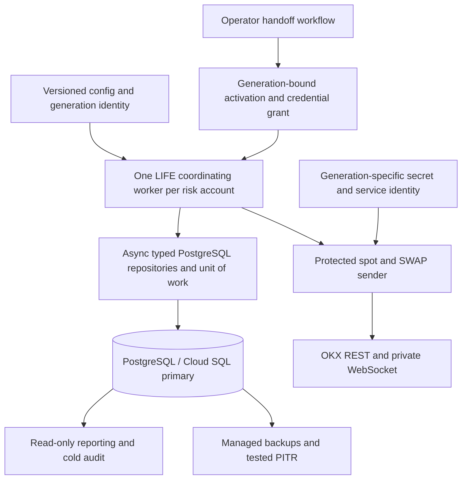

# LIFE: PostgreSQL and Cloud Run Implementation Plan (TDD)

Created: 2026-10-11

**PG3 signed account/policy source checkpoint (2026-10-16, base `994c374e1`):** `PgQuoteAccountSource` binds signed UID collection and order requests to the same pinned credential/endpoint, reads exact imported PostgreSQL age limits, and rechecks identity/freshness immediately before HTTP. Bounded TTL/single-flight UID collection avoids an account read per quote. Migration `000015` detects inconsistent PREPARE receipts at current-state/readback/COMMIT boundaries and preserves existing snapshot ACLs on upgrade. See [account-source qualification](#pg3-signed-account-and-policy-source-qualification-2026-10-16). **PG3 remains open** for complete runner/planner/reference/book/fee provenance and controller/service/recorder/product composition; configured PostgreSQL remains denied.

**PG3 explicit final HTTP boundary checkpoint (2026-10-16, base `340ce99ff`):** an optional immutable post-auth request guard binds PostgreSQL arm to the exact UTF-8 bytes passed to HTTP, followed by a synchronous one-use freshness/revocation check. Redirects and automatic resend are denied; scoped ACKs are awaited in PostgreSQL. Qualification uses the actual OKX/auth/REST chain with fake HTTP and synthetic source/runner facts. See [transport qualification](#pg3-explicit-final-http-boundary-qualification-2026-10-16). **PG3 remains open** for authenticated source/UID/policy composition and complete controller/service/recorder integration; configured PostgreSQL and native runner submit remain denied.

**PG3 captured-request arming checkpoint (2026-10-16, base `269c4d714`):** `ArmQuoteAction`/migration `000014` bind exact captured OKX request JSON and fresh compatible admission to one atomic PREPARED → SEND_UNKNOWN boundary. Current economic cost may use a larger existing subsidy hold without refund; insufficient holds deny. Readback/restart never rearms. The runner journal can record this boundary only after its own successful preparation; its actual submit hook remains denied. See [arming qualification](#pg3-captured-request-arming-qualification-2026-10-16). Authenticated source capture, actual REST/final-byte/ACK assembly and full PG3 remain open.

**PG3 explicit V2 runner-journal checkpoint (2026-10-16, base `08c4a94e9`):** `PgQuoteRunnerJournal` binds bounded captured CreateExecutorActions to the PostgreSQL journal and awaits durable runner acceptance before allowing one financial preparation attempt. Unknown creation/acceptance, cancellation and mutated IDs revoke the original local identity and retain claims for explicit reconciliation. A mandatory submit-denial hook prevents OrderExecutor from falling back to strategy.buy/sell. See [runner qualification](#pg3-explicit-v2-runner-journal-qualification-2026-10-16). Authenticated source/final transport, configured backend selection and full PG3 remain open.

**PG3 unprepared dispatch retirement checkpoint (2026-10-16, base `1393e8e6b`):** `AbandonQuoteAction`/`000013` explicitly retire a DISPATCHED action only with fresh complete post-dispatch runner absence, original-writer qualification and no financial attempt/hold. The account-locked race with prepare has one outcome: accepted finance retains its claim, or retirement permanently blocks old-ID preparation. See [retirement qualification](#pg3-unprepared-dispatch-retirement-qualification-2026-10-16). Standard dispatch rejection stays forbidden; actual runner/source/transport assembly and full PG3 remain open.

**PG3 terminal action reconciliation checkpoint (2026-10-16, base `38b97e942`):** `000012` permits PREPARED → RECONCILED only after proven unsent abort or qualified financial terminal closure, zero remaining order holds and fresh complete post-closure runner absence. Slot reuse retains permanent intent/wire identities and all original monetary spending; no refund occurs. See [reconciliation qualification](#pg3-terminal-action-reconciliation-qualification-2026-10-16). Unprepared dispatch retirement, actual runner/transport, successor/shared products and full PG3 remain open.

**PG3 action-bound financial preparation checkpoint (2026-10-16, base `f78ae4991`):** `000011` adds mandatory imported quote-admission limits and atomically binds a captured DISPATCHED LIMIT_MAKER action to its principal, fees, subsidy and immutable prepare receipt. SQL rechecks payload/rules/book/fees/economics and freshness at COMMIT. Qualified pending actions no longer corrupt late ACK/fill accounting. See [preparation qualification](#pg3-action-bound-preparation-qualification-2026-10-16). Actual runner/final transport, action terminal reconciliation and full PG3 remain open.

**PG3 quote-publication journal checkpoint (2026-10-16, base `a7bc3ee50`):** migration `000010` adds imported action limits, immutable captured descriptors and operation-linked events over the existing typed action rows. Atomic batch claims, exact command readback, dispatch bookkeeping and qualified pre-acceptance rejection preserve permanent identity and unresolved slots. Original-writer, runner-scope/time, owner/session and physical-COMMIT checks apply. See [journal qualification](#pg3-quote-publication-journal-qualification-2026-10-16). The action-to-prepare/runner bridge and reconciliation remain open; this does not select the PostgreSQL backend or enable external execution.

**PG3 order-lifecycle checkpoint (2026-10-16, base `69d585f70`):** standalone SPOT abort, cancel request/retry recording and qualified terminal commands use atomic account transactions. Migration `000009` adds explicit order policy, cancel progress/events and terminal facts. Proven unsent/zero-fill terminal releases preserve money and identity; filled terminal retains subsidy/loss for economic settlement. See [lifecycle qualification](#pg3-spot-order-lifecycle-qualification-2026-10-16). No external cancel/send or backend/deployment/demo/live eligibility is enabled.

**PG3 primary-session checkpoint (2026-10-16, base `08a61f192`):** `000008` adds explicitly imported session policy, durable safety progress and immutable tick events. Pause/resume, absolute expiry, unresolved transition and a persistent clock-rollback latch use atomic account transactions; prepare/arm and deferred COMMIT enforce the session barrier. No successor, activation or send grant is created. See [primary-session qualification](#pg3-primary-session-safety-qualification-2026-10-16). Full PG3 and configured PostgreSQL backend selection remain open.

**PG3 capital checkpoint (2026-10-16, base `2d48d70c8` plus this delivery): standalone approved SPOT cashflows and causal NAV/highwater are implemented offline.** `000007` reuses approved bill/cashflow/event tables and adds immutable capital policy, cashflow provenance/pending facts and NAV observations. Identity deduplication, cashflow-adjusted NAV, retained gross spending/holds, current-generation late observations and physical-COMMIT recovery pass. **155 actual PostgreSQL tests**, **21 migration tests** and **191 focused file/contract tests** pass. This does not qualify provider bill ingestion, signature-verifying approval import, pending resolution, other products, controller/backend selection, scalable history or release; see [capital qualification](#pg3-approved-spot-cashflows-and-capital-qualification-2026-10-16).

**PG2 local checkpoint (2026-10-16, committed `2d48d70c8`): Linux ARM64 artifact and standalone legacy recorder compatibility are qualified.** Migration `000006` installs isolated empty reporting tables; PostgreSQL recorder startup validates them without DDL or SQLite migration/fallback. Actual TLS and connection-cache negative tests pass. **121 real PostgreSQL tests**, **21 migration tests**, **169 SQLite/file regression tests** and **13 recorder tests inside the built Linux image** pass. PG2.1 deployed release/identity qualification and PG2.5 deployment durability remain open; full LIFE recorder integration remains PG5. The recorded artifact predates the new PG3 capital increment. See [local qualification](#pg2-local-recorder-and-linux-qualification-2026-10-16). No configured database, exchange account or deployment was used.

**PG3 observation checkpoint (2026-10-16, committed `e588c8ae3`): standalone SPOT ACK/fill/fee accounting is implemented offline.** Current-owner observation guards permit qualified late facts after HALT/expiry without allocation authority. Fill/fee application, principal consumption, gross loss and subsidy floors commit atomically with permanent source IDs; unsupported negative-wallet observations become durable pending facts with HALT and retained holds. **108 actual PostgreSQL tests**, **21 migration tests** and **160 focused unit/file tests** pass. Full PG3 and backend selection remain open; see [observation qualification](#pg3-spot-observation-and-accounting-qualification-2026-10-16).

**PG3 preparation checkpoint (2026-10-16, committed `ce9eacf9a`): standalone SPOT preparation ports are implemented offline.** `PgSpotRepository` uses the existing typed read/prepare/arm contracts with atomic principal/fee/subsidy holds, permanent identities and durable `SEND_UNKNOWN`. **76 real PostgreSQL tests**, **21 migration tests** and **92 focused unit/file tests** pass. This closes the declared preparation subitem only; full PG3.1–PG3.6 and backend selection remain open. See [PG3 preparation qualification](#pg3-standalone-spot-preparation-qualification-2026-10-16).

**PG2 foundation checkpoint (2026-10-16, committed `deb9b25d8`): the offline PostgreSQL schema/transaction/pool foundation is implemented.** Numbered migrations `000002`/`000003` create empty typed financial tables and guarded transaction functions. Actual disposable PostgreSQL qualification passes **45 tests**; the existing migration suite passes **21 tests**, and expanded file/runtime regression passes **2,358 tests**. PG2.2–PG2.4 are qualified at this infrastructure scope. PG2.1 release image/SQLAlchemy/deployed identity qualification and PG2.5 external failure-domain qualification remain open. The allocation primitive is not a trading repository or send permit; PG3 must port domain commands before selecting PostgreSQL financial authority. No configured database, exchange account or deployment was used. See [PG2 qualification](#pg2-offline-foundation-and-qualification-2026-10-16).

**Current PG1 status (2026-10-16, base `faff89ee3` plus this delivery): PG1 is complete for the declared offline file-service scope.** C1–C4 and PG1.1–PG1.4 are qualified: signed configuration staging, source reservation/retirement, durable target import and actual candidate use, supported exact-source archive/native repair, and final file-runtime acceptance. The final expanded regression passes **2,343 tests**, zero failures/errors/skips, **22 existing-category warnings in 377.64 seconds**. Changed-file hooks and `git diff --check` pass. See the [current closure ledger](#pg1-current-closure-ledger) and [final qualification](#pg1-c3c4-file-closure-and-qualification-2026-10-16). Dated checkpoints below are historical progress, not additional current backlogs. PostgreSQL financial repositories, O.8 performance, Cloud Run, provider/demo and production gates remain separate and open. No new evidence file is added.

**Historical starting status:**

Status (2026-10-12): **Disposable local spot feasibility/assembly measured; central migration infrastructure and offline checkpoint/file adapters implemented; spot preparation, ACK, fill/fee loss/subsidy, approved cashflow/NAV, exact terminal/resume and pending preparation/arm/ACK/fill/cashflow recovery storage slices implemented. Closed spot inventory subsidy settlement, signed lifecycle/cashflow approval/import and bounded async dispatch/final-check seams are also implemented. Full product/recorder ports, legacy controller file-path removal, complete observation/application migration, PostgreSQL financial repositories and deployment remain pending.** Parent delivery checkboxes remain open; checked subitems below describe only their explicit scope. The [spike evidence](LIFE_POSTGRES_SPIKE_EVIDENCE_2026-10-12.md) records real PostgreSQL transactions with synthetic transport, not production migration or exchange proof. The existing [LIFE implementation plan](LIFE_OKX_IMPLEMENTATION_PLAN_TDD.md) remains the source of trading requirements and O/D/R/C release gates.

Source reviewed: HEAD `e8a2fd427` plus the working-tree changes recorded in the [serialized qualification evidence](LIFE_OKX_O8_SINGLE_SCOPE_EVIDENCE_2026-10-11.md). Freeze exact source/config/schema/image hashes when implementation begins; HEAD alone does not identify this working tree. O.8.4/O.8.7 are still open, and production trading remains disabled.

## 1. Recommendation and decision

**Implement PostgreSQL as a portable storage backend first. Qualify it on a single VM/container before deciding to move the execution worker to Cloud Run.** Cloud Run is a conditional deployment target, not a prerequisite for using PostgreSQL.

PostgreSQL is useful for transactional financial updates, indexed active-state access, central auditability, and managed backup/recovery. It can replace repeated file-history work only after the state model and verification contracts are redesigned. Changing a database URL or moving whole JSON documents into a table will not resolve the current performance gate.

For one LIFE account, Docker on a VM with durable storage is operationally simpler. Cloud Run becomes more attractive when the team needs standardized managed deployments, isolated workers for several accounts, centralized operations, or integration with an existing Google Cloud platform. The first Cloud Run release accepts manual downtime during ownership changes; it does not promise automatic trading failover.

| Option | Benefit | Additional work | Recommendation |
| --- | --- | --- | --- |
| VM + current file backend | Closest to the current single-host model | Existing O.8 work, durable disk, backup and operations | Valid baseline while assessing migration |
| VM + PostgreSQL | Transactional authority and indexed state, independent of compute platform | Storage refactor, import, recorder integration, database operations | First PostgreSQL milestone |
| Cloud Run Worker Pool + PostgreSQL | Managed worker revisions and integration with Google Cloud | All PostgreSQL work, lifecycle handling, credential isolation and proven sender handoff | Conditional second milestone |

### Economic decision gate

Compare total monthly cost and operating effort using the same declared account count, CPU/RAM, history volume, availability and recovery objectives:

`compute + database/HA + disk/backups/PITR + network/NAT + logs/metrics + build/registry + engineering/on-call + expected downtime`

Continuous workers consume resources while running; do not assume request-driven scale-to-zero savings for a continuously quoting bot. Use current regional [Cloud Run pricing](https://cloud.google.com/run/pricing) and [Cloud SQL pricing](https://cloud.google.com/sql/pricing), with dated calculator exports. No price or cost saving is asserted here.

**Proceed with PostgreSQL** if measured correctness, latency, audit/recovery, or operating benefits justify the migration. **Proceed with Cloud Run execution** only if its operating benefit also justifies the handoff protocol, ongoing credential rotation and measured recovery downtime. PostgreSQL on a VM remains an accepted final topology if that second decision is negative.

## 2. Existing code and migration scope

| Current seam | Required change |
| --- | --- |
| [Client DB configuration](../../hummingbot/client/config/client_config_map.py), [SQL connection manager](../../hummingbot/model/sql_connection_manager.py) | SQLite is the default recorder; add and qualify a PostgreSQL driver/configuration, schema lifecycle and connection handling |
| [Legacy DB migrator](../../hummingbot/model/db_migration/migrator.py) | Keep its recorder file workflow separate; LIFE PostgreSQL now has a [central migration CLI and SQL directory](../../migrations/life_liquidity/README.md), typed financial/outbox schema and PG2 guards; SQLAlchemy recorder integration remains pending |
| [MarketsRecorder](../../hummingbot/connector/markets_recorder.py), executor orchestrator | Preserve executor, wire-ID, UID and position recovery provenance; qualify PostgreSQL reads/writes and failure handling |
| [LIFE controller](../../controllers/generic/life_liquidity.py) | Replace required JSON paths and path-based install checks with explicit backend/resource bindings; preserve account and policy checks |
| [PolicyState](../../hummingbot/strategy_v2/life_liquidity/policy_state.py), WAL, reservations, sessions, actions, budgets | Introduce typed storage and transaction boundaries; existing file locks/replace/fsync are not SQL transactions |
| [Fill attribution](../../hummingbot/strategy_v2/life_liquidity/fill_attribution.py), spot journal proof, shared capital, joint recovery | Replace file-byte/cache identity with independently qualified database cuts and financial invariants |
| [Account ownership](../../hummingbot/strategy_v2/life_liquidity/account_lock.py) | Keep the file backend's host-local lock; add PostgreSQL ownership and a separate exchange sender-handoff protocol |
| [CLI engine](../../hummingbot/cli/engine.py), [Dockerfile](../../Dockerfile) | Headless foreground worker, structured stdout, bounded signal handling, startup recovery and environment validation |

Migrating the SQL recorder alone leaves LIFE financial authority in files. Scope includes enabled spot, linear SWAP, hedge/carry and inventory paths; an implementation may deliver a declared spot-only slice first, but must explicitly disable and retain open coverage for unsupported paths.

## 3. Target architecture

The worker may run unchanged on a VM or a Cloud Run Worker Pool. Keep one coordinator for both products sharing the same account capital. Initial scope excludes sharding one account across independently sending workers, automatic leader takeover, active-active trading, portfolio margin, and cross-region trading failover.

Cloud Run Worker Pools support continuous background workloads without a load-balanced HTTP endpoint or automatic scaling. They remain subject to instance replacement and shutdown. [Worker Pools](https://docs.cloud.google.com/run/docs/deploy-worker-pools), [runtime contract](https://docs.cloud.google.com/run/docs/container-contract).

### Storage boundaries

- Introduce backend-neutral `StateBinding`, `StateCut`, repository ports, `UnitOfWork`, ownership and send-attempt services. A binding includes environment, exchange, authenticated account UID, risk pool, database lineage, schema version and policy/config hashes. A cut includes the relevant row/event versions; it is never a reusable send permit.
- Use indexed relational current-state rows plus append-only financial/identity events. Keep complete terminal identities and deduplication evidence. History can be partitioned, but pruning requires its own proven retention/recovery contract.
- Use asynchronous database operations on the trading path. Do not block the event loop with a synchronous PostgreSQL facade. Introduce a bounded LIFE dispatch task at the synchronous V2 tick/filter/dispatch boundary: enqueue an immutable, uniquely identified proposal, await database authorization in the protected executor path, and revalidate expiry/stop/config after waits through the actual post-throttler connector boundary. Do not create an unbounded background task per tick or return a precomputed boolean as asynchronous authorization. Late results after stop cannot issue a new request; already attempted requests remain unknown until reconciled.
- Keep database transactions short. Exchange HTTP/WS requests do not run inside retriable financial transactions. A database transaction cannot atomically commit an OKX request.
- Recorder/reporting data is not a second source of spendable capital. Where recorder persistence is separate, use a durable transactionally recorded projection/outbox operation, idempotent application and an explicit recovery-completeness gate. Missing or stale recorder evidence cannot release a hold.

### Proposed schema families

| Family | Required identity/invariants |
| --- | --- |
| Accounts, ownership, activation grants | Account namespace; monotonic owner epoch; unique process/generation UUID; DB lineage; lease based on DB time; unarmed/draining/active state |
| Policies, config versions, sessions | Immutable version/hash; original deadline/timezone semantics; session epoch; no restart-based deadline extension |
| Intents, exact wire payloads, send attempts | Durable intent/attempt/operation IDs; permanent scoped wire-ID tombstones; policy and owner binding; legal transitions including `SEND_UNKNOWN` |
| Reservations, capital claims, balances, positions | Exact units and finite decimal amounts; shared spot/SWAP capital; no over-allocation under concurrent commands |
| Fills, fees, cashflows, bill approvals, attribution | Scoped exchange identities; signed fees; causal ordering; exactly-once financial application by immutable operation identity |
| Loss/subsidy/stress budgets, markout/carry state | Existing accounting semantics; gross spending and unresolved obligations survive restart; no automatic refund on an exception |
| Quote actions, hedge/inventory state, joint receipts | Existing ownership, retry/turnover caps, `APPLYING` recovery and fresh-observation bindings |
| Recorder provenance, events, import runs, audit checkpoints | Executor UID/wire scope; append-only history; source hashes; staged import; independently checked projection totals |

**Historical table needs for the ACK increment (2026-10-12), superseded by the PG2 schema below:** production migrations
at that checkpoint contained lineage metadata only. PG2 required additional financial tables;
the spike tables are fixtures and must not be adopted by startup migration.
Candidate spot layout, to finalize with remaining PG1 command contracts:

| Proposed table | Purpose / mandatory keys and checks |
| --- | --- |
| `accounts` | Environment/exchange/UID/risk-pool/lineage binding, serialization row, owner generation and current versions |
| `sessions` | Immutable session/epoch/config binding and original deadlines |
| `send_attempts` | Exact payload/intent/wire identity, prepare/arm/ACK state, scoped unique exchange order ID; preserve terminal identities |
| `reservations` | Principal and separate LIFE/USDT fee holds linked to the exact attempt; qualified release only |
| `balances` | Exact asset units, current funds/holds and version guards |
| `budget_buckets` | Session/day/campaign limits, committed/actual subsidy and execution-loss projections |
| `operations` | Permanent scoped command fingerprint/receipt and unknown-COMMIT readback |
| `financial_events` | Immutable ordered observations/application facts, including ACK, fills, signed fees and cashflows; independently deduplicated exchange identities |

An ACK does **not** require a standalone `acknowledgements` SQL table: the intended
account transaction updates `send_attempts` and appends the operation/event.
The file adapter uses coordinator ACK records for its multi-journal saga. Further
fill/fee/cashflow, recorder, ownership/grant and enabled SWAP/shared-capital tables
remain under the schema families above. That historical increment added no financial
migration. The PG2 foundation now implements schema families, explicit decimal
bounds, FKs, transition guards and active indexes in `000002`/`000003`; complete
domain commands and file/PostgreSQL financial parity remain PG3 work.

Use PostgreSQL `NUMERIC` with a deliberately selected precision/scale and Python `Decimal`; reject nonfinite values and out-of-range/over-scale input instead of silently rounding an import. PostgreSQL permits special numeric values, so application and database checks must reject them for financial fields. [Numeric types](https://www.postgresql.org/docs/current/datatype-numeric.html).

All authority reads use the writable primary. Read replicas, reporting caches and stale snapshots cannot authorize trading or release reservations.

### Integrity trust model

Current exact-file-byte verification is backend-specific. Do not claim it is preserved by a row version or a checksum stored beside mutable data. Define approved guarantees for stale writers, malformed rows, event/projection divergence, accidental corruption, unauthorized application writes and privileged database tampering.

Require least-privilege roles, immutable event application, version/constraint checks, complete cold replay, and independent audit/checkpoint evidence. If privileged history mutation must be detected before every send, design an independent trusted anchor and prove its latency/availability; an occasional audit or a colocated hash cannot satisfy that contract. PG0 must approve any change from current corruption-detection semantics before PostgreSQL release eligibility. No historical byte-check test may simply be deleted as a performance optimization.

## 4. Non-negotiable financial and sender invariants

1. A durably committed exact intent, reservation/capital hold and armed send-attempt state precede external I/O. Local database success is not an exchange ACK.
2. An ambiguous COMMIT or send outcome remains unknown. Read back by stable operation/attempt identity from the primary; never infer failure, refund a budget, allocate a new wire ID or blindly resend because a connection raised.
3. Financial commands are idempotent by operation ID. Serialization/deadlock retries rerun the complete database command with a bounded policy, never the exchange request. PostgreSQL serializable transactions require retry handling. [Transaction isolation](https://www.postgresql.org/docs/current/transaction-iso.html).
4. All allocating writes validate account, policy/config, current owner epoch, observation freshness and row versions atomically. Lock accounts in a single documented order; test concurrent spot/SWAP allocation.
5. Session expiry, HALT, invalid updates, stale market/account facts, loss limits and financial uncertainty still revoke create/amend authority at the actual connector boundary, including retries and queue/throttler waits.
6. Release requires the existing complete exchange, fill/fee/bill, financial, runner and ownership evidence. A cancellation ACK, database row, or lease expiry alone cannot release a hold.
7. Unknown sends, terminal identities, fee/cashflow deduplication, spent budgets, joint exposure and cold-rearm latches survive migration, crash and backup restore.
8. DB outage or pool exhaustion closes normal trading admission and cannot create unbounded queues. Read-only exchange reconciliation and a separately tested emergency cancellation path remain schedulable. Its identity source is a bounded immutable cancellation manifest of durably committed attempt/ACK identities, bound to account, instrument, exchange `ordId`, permanently scoped client/wire ID, generation and DB lineage. It is not a cached trading permit. Missing/ambiguous identity, including an unknown send without qualified exchange `ordId`, is ineligible for this exception. It cannot create/amend, perform account-wide cancellation/CAA renewal, cancel successor orders, bypass credential revocation, release holds, or grant ownership. Uncertain successor activity denies the action and retains the declared outage exposure. The authoritative unknown attempt/hold remains in PostgreSQL; loss of this disposable manifest cannot erase it.

## 5. Ownership: database fencing and exchange fencing

**A PostgreSQL lease/advisory lock does not fence an OKX request.** An old process can pause after its final epoch check, lose its DB session, then resume network I/O using a still-valid exchange key. PostgreSQL advisory locks are cooperative; session locks end with the session. [Advisory locks](https://www.postgresql.org/docs/current/explicit-locking.html#ADVISORY-LOCKS).

One desired worker instance and revision routing are operating settings, not proof of a single authorized sender. Do not derive exchange ownership from them. Cloud Run service instance limits can briefly be exceeded; worker/revision replacement must also be treated as potentially overlapping execution. [Instance limits](https://docs.cloud.google.com/run/docs/configuring/max-instances), [runtime contract](https://docs.cloud.google.com/run/docs/container-contract).

### Initial supported protocol: manual cold handoff

1. Every process starts with a new process UUID, **read-only/unarmed**. A previously armed revision, secret or restored DB row cannot automatically arm a replacement process. An activation grant binds exactly one process, generation, owner epoch, account, image, config and DB lineage. Only the separate operator/control-plane role can issue/rearm a grant; the runtime role cannot create, relabel or extend its own grant.
2. Mark the current generation `DRAINING`, close normal admission and checkpoint all prepared/unknown attempts. Stop its worker, but do not treat a stop request or lease expiry as termination proof.
3. Revoke the old generation's **exchange write credential**, covering REST and private-WS authority. Removing Secret Manager access or deleting a secret does not revoke an already cached OKX key.
4. Verify revocation effectiveness and the treatment of delayed/in-flight requests using supported exchange behavior. Requests accepted before revocation may still create orders. A control-plane timestamp alone does not prove the drain is complete.
5. Only after old-sender exclusion is established, issue a replacement credential to the new generation in `RECOVERY_ONLY`. This is a process/generation-bound, deny-by-default application grant checked at each actual request boundary for authenticated reads and qualified exact-order cancellation, not an assumed exchange-provided cancel-only key. Create/amend, CAA renewal and rearm remain denied; this grant cannot itself authorize reservation release, which still requires the separate complete financial/reconciliation command. Reconcile account-wide enabled-product orders, accepted/unknown attempts, fills, fees, bills, balances and positions. Cancel only orders with qualified ownership; retain all unresolved holds.
6. Record the handoff evidence and require explicit rearm after matching O/D/R/C gates and fresh financial checks. If old-sender exclusion or reconciliation cannot be proven, the successor remains unarmed, with manual downtime.

Use a **different service identity and secret resource for each trading generation**, with resource-scoped access. An old identity must not fetch the replacement key, impersonate its service identity, or create a new exchange key. Each automatically replaced process still needs its own activation grant; it must not reuse the previous process's grant. The first release therefore requires an operator-controlled new generation after an unexpected trading-worker restart.

Normal create/amend/cancel and CAA updates are generation-bound. The narrow emergency cancel exception in Section 4 must be proven unable to affect successor orders; it is not general permission after owner loss. Expiry headers can limit delayed requests, and exchange cancellation timers can reduce residual risk, but neither establishes ownership. OKX `clOrdId` uniqueness is among pending orders, not permanent exactly-once delivery. Qualify the applicable REST/WS behavior in demo before using it. [OKX API](https://www.okx.com/docs-v5/en/).

Automatic live takeover is outside the first release. A future credential-owning execution gateway is a separate architecture decision and needs its own enforceable takeover; it cannot merely relocate the same lease race.

## 6. Phased implementation and completion checklists

For every checklist: record the failing selector and baseline hash, implement the smallest correction, rerun Green and relevant negative cases, then record commands/results and source/schema/config/image hashes in this plan. Per the operator request, do not create additional evidence files; keep raw test logs in temporary output directories. Existing evidence stays intact. Planned financial/backend test filenames below do not exist yet; migration tests are implemented as listed at the end of this plan. A written design or passing mock is not completion evidence.

### PG0 — Architecture, feasibility, economics and trust decisions

Dependencies: none; can proceed while existing O.8 work continues offline.

- [ ] PG0.1: Freeze declared spot/SWAP/inventory scope, source baseline and open O.8 failures; identify affected A23/A24/A28/A30/A33/A35/A36/A39 contracts.
- [ ] PG0.2: Approve storage/integrity trust model, database transaction/isolation policy, backend-neutral bindings and the manual cold-handoff protocol. Record the external-send fencing limitation explicitly.
- [ ] PG0.3: After the minimum PG0.2/PG0.4 decisions and explicitly synthetic PG0.5 fixture values, spike the actual V2 tick/filter/dispatch → OrderExecutor → awaited database authorization → post-throttler OKX check, plus recorder paths against real PostgreSQL. Prove bounded queue/backpressure, stable action identity, cancellation scheduling, expiry/stop during DB waits and no delayed background sends after stop. The spike is disposable and has no live authority.
  - [x] **Local spot transaction/index experiment (2026-10-12):** real PostgreSQL account-row serialization, current counters, durable attempt/hold/events, scoped identity uniqueness and partial active index; runtime event-update/delete denial; concurrent allocation, retry conflicts, lost replies/ACKs and retained unknown holds. Actual V2 filter → OrderExecutor hook → synthetic bounded async adapter → RESTConnection is exercised with a fake transport/throttle and a spike watchdog. The [code and reproduction](../../test/hummingbot/strategy_v2/life_liquidity/postgres_spike/README.md) and [evidence](LIFE_POSTGRES_SPIKE_EVIDENCE_2026-10-12.md) record 27 functional + 3 scale passes, constant 18 authority SQL statements/10 returned rows per successful send at 0/1k/10k, and passing frozen latency limits in this reduced workload. No full file/PG financial equivalence or O.8 closure is claimed.
  - [x] **Offline spot runner/connector/recorder mechanism (2026-10-12):** actual tick/queue/listener/filter/orchestrator/executor control, OKX protected scheduling/create/tracking/authentication/throttler and REST boundary now carry an optional awaited final check followed by the synchronous local fence. A transactional `READY` operation, actual SQLite recorder projection, fresh metadata reads and `APPLIED` publication gate arm/send. Bounded admission, stop/create priority, late recorder completion, missing/wrong recorder, unknown ACK/cold objects and cancellation during another DB wait pass in the synthetic coordinator. The [assembly evidence](LIFE_POSTGRES_ASSEMBLY_EVIDENCE_2026-10-12.md) records 282 regressions and 13 functional + three enlarged scale passes, with constant 24 PG statements/14 rows per send and corresponding terminal histories in both stores. This closes the stated mechanism only.
  - [ ] **Remaining PG0.3 release assembly:** approved PG0 trust/ownership/packaging inputs; real LIFE controller and backend-neutral ports with production watchdog/config/session lifecycle; all declared enabled product/retry routes; complete recorder repair/outbox crash/restart proof and financial equivalence. The experimental coordinator, synthetic market/account facts and in-memory HTTP session grant no production authority. The awaited DB gate plus final local fence does not establish an atomic DB/send boundary or exclude an old credential-bearing sender.
- [ ] PG0.4: Select and pin a Cloud SQL-supported PostgreSQL major, migration tool and driver compatible with the existing Python/SQLAlchemy runtime; test dependency resolution and Linux image build.
  - [x] **Local migration foundation (2026-10-12):** central versioned SQL runner using optional `asyncpg==0.31.0`; tested on pinned PostgreSQL 16.15 and the current Python 3.13 environment. The [migration guide](../../migrations/life_liquidity/README.md) records command, role, transaction and retry contracts. It follows the separate command/scripts pattern reviewed in local `life-wallet-backend`; adds a checksum ledger and concurrent-run lock instead of re-executing every file. No full SQLAlchemy dependency/image or Cloud SQL connectivity qualification is claimed.
- [ ] PG0.5: Record numeric test/deployment values and rationale for pool size/overflow, query/lock/transaction timeouts, retry caps, lease/heartbeat, observation age, shutdown budget, DB storage/headroom, RPO/RTO and audit lag. Record units, owner and calibration method; synthetic values are not live defaults.
- [ ] PG0.6: Produce a dated VM-versus-Worker-Pool cost/operations comparison and a go/no-go decision for each milestone. Check documented target-region capabilities, account API-key generation/revocation constraints, fixed-egress needs and demo support; keep empirical environment behavior explicitly open for PG9.

**Done when:** decisions and runnable spike results exist, unresolved live inputs are listed, and no implicit live defaults or unsupported fencing claim remains. This does not enable trading.

### Offline technical decisions for PG1 (2026-10-12)

These are engineering assumptions adopted for offline implementation under the current task authorization. They do not approve a change to the live trust model, grant trading authority, choose a deployed topology or close the PG0 parent. The spot preparation/read slice is now implemented against actual legacy journals. Remaining financial command/product ports will be designed against the complete requirements before their schemas are added.

| ID | Offline decision | Live/remaining gate |
| --- | --- | --- |
| PG-D01 | Contract qualification begins with a synthetic spot/account checkpoint; the full declared spot/SWAP/shared-capital/hedge/carry/inventory scope is retained. HEAD `a5257452802f8ea7c1227f9a9773cbfb7c5694ca` plus the current working tree is the baseline; O.8.4/.7 stay open. | All enabled financial/product routes, recorder repair and existing O.8 acceptance remain mandatory. |
| PG-D02 | Binding includes environment, underlying exchange `okx`, authenticated account UID, risk pool, lineage UUID, schema version and exact policy/config hashes. Synthetic UID/hash values are explicitly test-only. A cut has resource versions, revision/event position and snapshot digest; it never grants send permission. | Authenticated UID, actual policy/config provenance, primary/schema/lineage checks and grant binding are qualified in controller/PG integration. |
| PG-D03 | File adapter atomic scope is one `PolicyState` checkpoint. Its UoW can stage multiple logical resources inside that checkpoint. Existing separate financial files remain separate; the new legacy spot adapter declares a recoverable multi-journal saga with durable coordination/readback barriers. Unsupported PostgreSQL selection fails. | Domain-specific repositories, controller path removal and a real account-wide PostgreSQL UoW are required. No implicit atomicity across legacy files. |
| PG-D04 | Proposed PostgreSQL financial commands use short primary `READ COMMITTED` transactions with account-row locking in deterministic account order, atomic expected-owner/row-version checks and DB-time guards. Exchange requests stay outside transactions; only complete storage commands may have bounded retries. | Constraint/concurrency/serialization tests must prove this policy for all enabled commands in PG2/PG3; migration code does not select financial isolation. Escalation to serializable requires full-command retry qualification. |
| PG-D05 | File tests retain the existing `PolicyState` verification model. Proposed PostgreSQL integrity relies on restricted runtime writes, constraints, append-only financial identities and independently qualified cold replay/audit. A colocated checksum/row version cannot attest privileged historical mutation. | PG0.2 live trust decision and PG3.6 audit/anchor proof stay open. No existing mandatory historical verification test is removed. |
| PG-D06 | Owner facts have process/generation/session UUIDs, epoch, explicit UTC validity and mode. Synthetic ACTIVE fixtures may be created only in `OFFLINE_SIMULATION`; default creation is unarmed. Snapshot/owner data is not an activation grant. | Real account lock/lease/grant issuance, new-process unarmed startup, operator rearm and exchange credential exclusion remain PG1/PG4/PG9 work. |
| PG-D07 | One dedicated file worker owns `PolicyState`. Explicit admission/capacity limits, immutable DTOs and operation readback cover queued/cancelled/ambiguous writes. Synthetic test values: 2 admitted operations, 1 MiB checkpoint, 16 retained operation IDs; engineering-owned fixture capacities, not calibrated live values. | File-lock/disk latency is host-dependent. Production queue/watchdog/shutdown bounds, numeric DB pool/retry values, economics and live calibration remain PG0/PG1.3/PG7/PG8. |

### PG1 — Backend contracts and asynchronous integration seams

Dependencies: PG0.

- [x] PG1.1: Add typed storage/UoW/identity/ownership ports and backend selection; file backend remains explicit and behaviorally compatible. Qualified by C1–C4 for the declared file-service scope; PostgreSQL selection remains an explicit rejection until PG2/PG3.
  - [x] **Checkpoint contracts/file primitive foundation:** immutable `StateBinding`, `StateCut`, `ResourceVersion`, `OwnerToken`, ownership/snapshot/receipt DTOs; async state/owner-read/UoW protocols; explicit backend selector; `PolicyState` adapter with a single checkpoint atomic scope, permanent operation deduplication, fresh owner/cut checks and bounded dedicated worker admission. PostgreSQL selection rejects without file fallback. The [storage guide](../../hummingbot/strategy_v2/life_liquidity/storage/README.md) describes the implemented scope and limitations.
  - [x] **Spot preparation/read domain slice:** typed session/balance/budget/reservation/send-attempt DTOs and async ports with finite Decimal units, operation/wire/quote-slot identity and explicit LIFE/USDT fee buffers. `LegacySpotStore` binds actual SessionStore/WAL/reservation/subsidy/loss files, holds one account UID lock and uses one bounded worker. It declares recoverable saga scope, records PREPARING/ARMING before multi-file work, verifies complete holds before publication, retains unknown/partial work and starts cold read-only. No generic financial checkpoint writes or implicit file/PG fallback.
  - [x] **Spot ACK observation storage slice:** typed immutable ACK command/receipt and readback port; exact prepare/intent/wire/market/side/session/epoch checks, permanently deduplicated observation operations and scoped exchange-ID conflicts. `LegacySpotStore` persists ACKING → actual WAL ACKED → verified completion, retaining principal/fee/subsidy holds on crash/cancellation. Late same-writer observations survive expiry and DRAINING/RECOVERY_ONLY without rearm; cold restore and replaced/unarmed writers cannot complete work. Authenticity and qualified recovery grants belong to the remaining bridge/service, not this DTO.
  - [x] **Spot complete fill/signed-fee and loss/subsidy storage slice:** explicit immutable cumulative snapshots and bound reference-skew policy; finite LIFE/USDT signed fees, independent fill-time values, exact known trade/fee/value identity and no omitted fills. Native reservation fill+fee checkpoints, per-fill execution loss and cumulative subsidy floor publish behind FILLING → APPLIED. Actual fee debits consume matching fee buffers without refunding rebates; overruns close new-risk admission. Fills before ACK bind its later exchange identity; late/over-budget fills are accounted without terminal release/rearm. Source authenticity, full NAV and controller/recovery integration remain below.
  - [x] **Approved spot cashflow and recorded NAV slice:** immutable opening-capital/time and bill approval policy; exact signed LIFE/USDT transfer, bound independent transfer valuation, permanent bill/operation identity and CASHFLOWING → native transfer → verified APPLIED saga. Existing CapitalLedger causal ordering/formulas verify actual balances, cashflow-adjusted NAV, execution loss and starting inventory attribution. NAV/highwater publish atomically in one coordinator checkpoint and survive cold restart; stale clocks, changed approvals/opening capital, unapproved facts and unfunded causal replay are denied. Financial changes invalidate old measurement fingerprints; transfer amounts do not reset budgets or release holds. Source authentication/history completeness and complete recovery/control-plane remain below.
  - [x] **Qualified spot order terminal/exact-operation resume storage slice:** explicit bound freshness policy and immutable exact order/account/fill/fee/bill/runner qualification facts. WAL observation, reservation release, WAL terminal and verified zero-fill subsidy settlement complete behind TERMINATING → TERMINAL, with durable principal overlay and fee claims retained until the final receipt. Partial/full fills retain economic subsidy floors/reservations and loss spending. Exact pending terminal operations can resume with fresh complete facts and the same bound writer on cold read-only stores; no rearm/ownership transfer/resend or repair of other partial commands. Actual authenticated bridge/history/credential qualification remains below.
  - [x] **Exact pending fill/cashflow financial recovery slice:** bound positive account-fact freshness policy and immutable recovery DTO/ports. Existing command/writer fingerprint and current cut are mandatory; final expected capital and actual native-subset projections must agree with exact trade/fee/bill/order/runner/account facts. Native missing checkpoints complete behind the original FILLING/CASHFLOWING barrier without repeating money, loss or subsidy spending. Recovery facts are persisted separately; original fill-time values and WAL attempt state remain binding. Cold resume never rearms, transfers ownership, upgrades SEND_UNKNOWN, refunds holds or repairs another partial command. Authenticated bridge/source qualification remains below.
  - [x] **Exact pending ACK recovery slice:** original durable ACK command/writer, fresh cut and complete account/order facts must agree with prepared wire/exchange identity, side, quantity, price and already accounted cumulative fills. Verified native capital/fee/loss/subsidy projections gate exact WAL ACK and receipt publication. Fresh recovery facts are separate from original command fingerprints; cold completion remains unarmed. FILLED/CANCELED observations do not terminalize or release holds. Authenticated source/bridge qualification remains open.
  - [x] **Exact pending preparation/arm recovery slice:** original prepare/arm cut and writer fingerprints remain binding; fresh complete account facts and verified native scope gate missing WAL/principal/subsidy checkpoints. Holds deduplicate in their original UTC buckets. Arm completion retains or records SEND_UNKNOWN without transport or ACK inference; cold completion stays unarmed. Older partial formats without original request provenance require qualified import.
  - [x] **Closed spot inventory/exit subsidy settlement:** typed commands/receipts and explicit bound settlement policy; terminal members and immutable accounted fills/fees/independent values must prove physically net-flat LIFE, including LIFE fees. Conservative fill floors remain and additional realized inventory cost belongs to the closing fill. Pending native settlement retains campaign/day/session subsidy overlays until its final receipt. Replay/cold resume does not repeat spending, reset execution-loss budgets or activate a process. Broader exit/hedge/product application remains below.
  - [x] **Typed product repository slice:** shared capital/stress decisions, conservative carry/funding diagnostics, versioned hedge targets and independent NAV/markout read ports use the same bounded file worker. Full namespace, configured/native policy fingerprints and native checkpoint cuts bind commands; capital quantities remain LIFE and margin/fees/funding/stress remain USDT. Permanent operation/intent identities, APPLYING barriers, native postconditions, queue-time owner/session/cut checks, cancellation and cold read-only replay preserve holds. Optional actual-controller runtime binding rejects duplicate native caches and pending product operations. These ports do not issue sends or release shared claims.
  - [x] **Independent SQLite recorder outbox slice:** immutable configuration/recovery provenance binds actual MarketsRecorder projections to account/environment/lineage/config and an explicit file-backed SQLite repository. PROJECTING precedes the independent DB write; readback and APPLIED follow it. Exact same-writer cold repair handles missing/already-written rows without overwriting later reporting status/PnL, granting activation or repeating financial accounting. Conflicting provenance, operation identity and DB aliases are rejected. SQLite floating reporting columns remain non-authoritative.
  - [x] **Ordered executor reporting and coupled spot runner slice:** immutable progress commands, expected sequence, permanent operation/cut/owner identity and PROJECTING/APPLIED outbox state bind actual SQLite updates. Status and filled-volume cannot regress; configuration/namespace are fixed and recovery wire history cannot shrink. Cold exact repair handles missing/already-committed SQL writes; historical repair preserves the latest status/PnL/wire history, including reconstruction of a deleted SQL row from its latest verified progress. `FileRecorderApplication` uses explicit queue/shutdown budgets and the same owning worker. Actual `ExecutorOrchestrator(repository_reporting=...)` consumes asynchronously loaded startup rows, projects before dispatch, records actual child progress, retains children until reporting receipt and provides fresh worker-only history for financial proof. Pending reporting closes new risk and activation; stop does not wait for SQLite. Reporting termination does not terminalize/refund an exchange order. The separate checked position-reporting subitem below adds exact held-position snapshots and SQL outbox recovery. The separately checked raw-event/recorder factory and preassembled V2 constructor subitems below extend this slice. Full configured CLI/service/product assembly remains open; unscoped legacy SQL still fails explicitly.
  - [x] **Coupled file spot quote/observation/cancel slice:** actual OrderExecutor hook, LIFE controller, protected OKX placement and REST/throttler chain share the repository's native session/WAL/reservations. Preparation/arming precede HTTP; asynchronous ACK publication precedes connector completion. A typed account-bill reader and observer compare account-wide fills, approved bills, signed fees, wallet, pending orders/algos and actual runner wire provenance before financial commands or terminal release. Proven-unsent abort and durable cancel-attempt sagas preserve uncertainty, retry timing and money holds across interruption. This opt-in quote assembly is exercised with fake HTTP and explicit isolated release substitutions. It refuses unassembled product routes and the legacy session tick; automatic watchdog/session/recovery/recorder assembly remains open.
  - [x] **Repository session/watchdog and exact pending spot bridge:** native SessionManager decisions publish behind APPLYING/APPLIED with exact original target/cut/writer readback. Pause/resume/expiry preserve funds and deadlines; logical successors require complete fresh account facts, and only a separate non-replayed signed ACTIVATE updates admission deadlines. The actual controller watchdog delegates one bounded asynchronous safety cycle for session/cancel/reconciliation; stop revokes immediately while worker capacity remains owned. Typed pending commands retain original fill/cashflow values and writer provenance; the service can complete an exact pending command from qualified fake HTTP without resend/reprice. A source-bound control snapshot bridges external signatures to the service; replay never grants admission. The separately qualified recovery batch covers newer external activity; complete SWAP/product/recorder application remains below.
  - [x] **Native joint recovery worker ports (2026-10-13):** `storage/joint.py` supplies immutable joint/SWAP position, margin and signed funding views, bounded complete-history capture and async reconcile/cancel ports over the actual native financial saga. All checkpoint, request-budget, terminal and qualified shared-capital release work runs on the existing store worker; collection/cancel transport remains on the event loop. Namespace, original owner/session, full controller configuration and installed native policies are checked. Cold startup and expiry disable native send eligibility; cancellation retains physical worker ownership and prevents late health/rearm. Actual partial/terminal fills, signed funding, incomplete scope, interrupted cash/WAL/capital/completion, deduplication, cold readback and backpressure have tests. This is explicit offline native-journal assembly, not coupled `LegacySpotStore` accounting or a PostgreSQL authority adapter.
  - [x] **Invalid hedge target preflight:** native and repository target updates share read-only version/pending/fault/clock validation. An invalid update is rejected before `APPLYING`, leaving the coordinator and native target unchanged and allowing a later valid update. An unrecorded existing native update requires import; it is not adopted as a new successful command.
  - [x] **Joint settled cash on the spot wallet (2026-10-13):** explicit `couple_cash=True` binds native joint recovery to the actual `LegacySpotStore` wallet/WAL/loss ledger on its single worker. Typed cumulative SWAP PnL/fee and signed funding facts publish original command/cut/writer, source identity and flat native before images before monetary effects. Wallet and execution-loss postconditions precede APPLIED; cold readback repairs wallet/loss/receipt interruptions without fee duplication, resend or activation. Settled cash is internal income/cost, never an external transfer; prior NAV becomes stale and independently observed NAV includes it once. Numeric cash comparison accepts equivalent Decimal scales. Incomplete scope, wrong wallet, rewritten/missing events and reused source identity fail before money. Existing spot recovery/terminal/lifecycle paths reject a pending joint cash saga. Archived formats require qualified import; this mode rejects all SPOT claims before native settlement.
  - [x] **Coupled spot-fill/fee/subsidy and SWAP settlement batch (2026-10-13):** `JointCashSpot.spot_fills` retains independent fill-time values and immutable full fill commands, preserving old cash-only encoding. One native wallet checkpoint applies causally ordered spot fills/LIFE-USDT fees/rebates and settled SWAP cash; loss and subsidy-floor postconditions precede the combined APPLIED projection. Flat original before images verify exact wallet before/after and permitted partial loss/floor changes during cold repair. Explicit `couple_spot=True` uses native complete joint proofs plus bounded immutable `FillSpot` and fresh `SpotFinancialRecoveryFacts`; missing references, account/wire/trade/bill scope, liabilities and changed history fail closed. Recorded references may be reused, never replaced by the current index. The native terminal path delegates to the store's existing terminal saga before shared-capital release, including multiple owned orders and zero fills. Working orders keep SEND_UNKNOWN and holds; no fill receipt invents ACK/rearm. Tests cover causal same-time funding, original-command wallet/loss/floor/receipt/terminal/capital interruptions, cold readback and later activity extending a pending batch without changing old reference values.
  - [x] **Protected SWAP worker/application slice (2026-10-15):** immutable executor/config commands bind original owner, native cut, permanent intent/wire identity and complete installed policy. The shared file worker owns native shared-capital preparation, WAL arming, request-budget charge and asynchronous ACK publication. Interrupted prepare/arm/ACK completes only exact original bookkeeping; cold recovery restores no volatile permit, creates no new ACK command and never resends or releases a claim. Actual executor hooks and the real REST/throttler chain use fake HTTP. Stop/expiry/config/UID/wire/mode/contract changes, stale qualification and revoked joint health prevent transport; async ACK completes before connector return. A durable one-shot boundary and local one-shot final check prevent retries. Timeout/cancellation retains dispatch capacity until original-writer ACK, as well as financial holds. This is explicit offline `open_file_swap` / `FileSwapApplication` assembly; legacy synchronous proposal is rejected once bound. Configured controller/service and hedge integration remain below.
  - [x] **Hedge child/retry worker application (2026-10-15):** immutable bounded market captures and original plan/child identities drive native hedge planning on the same worker as SWAP claims/WAL. PLANNING/child-origin/prepare/ISSUED/PLANNED interruptions recover original bookkeeping without transport, a replacement permit or cost/attempt reset. Partial terminal settlement retains prior trade/cost identities before a smaller retry. Invalid UID/source/cost/scope/stop inputs allocate nothing. New children carry the original explicit exchange-clock timestamp required by runner reporting.
  - [x] **Coupled pending spot families and unsent readback (2026-10-15):** joint source qualification composes original pending ACK, fill/fee/loss/subsidy or approved external cashflow commands with newer SPOT/SWAP activity. Original writer, values and fingerprints remain binding; native subset and final wallet projections must agree. USDT/LIFE deposits and withdrawals retain independent transfer values and remain excluded from profit. A qualified zero-fill unsent proof completes the original abort and shared-claim release without sending or refunding incurred costs. Cold/interrupted repair stays unarmed. This qualifies the tested command families, not arbitrary simultaneous partial operations or unsupported historical formats.
  - [x] **Shared SPOT preparation application (2026-10-15):** an explicit persisted binding couples original PREPARING provenance/risk epoch, shared claim, native WAL, principal/fee and subsidy holds on the existing worker. Combined capital preflight runs before preparation. Six native/receipt cutpoints recover only the exact original hold; changed writer/risk/source-wallet facts fail. Cold recovery never arms or sends. Complete joint unsent proof exclusively releases both reservation families. Configured actual runner/REST ACK retains wallet and both holds. Prepare/arm capture and apply fresh cuts on one worker turn; legacy command JSON stays unchanged when no shared risk epoch is present.
  - [x] **Configured quote and carry applications (2026-10-15):** explicit YAML quote policy constructs the native planner/reference/fee binding on the owning worker, with permanent account-bound quote history and persisted immutable policy. Fresh native own-depth/book/rules/reference/fee proofs, configured minimum edge/uncertainty, native subsidy windows and LIFE/USDT fee-buffer coverage gate admission. Typed detached order configs preserve all subclass fields and explicit UTC timestamps. Bounded immutable dispatch/rejection callbacks publish native action state on the worker. Final qualification validates held permits instead of reusing pre-preparation admission; manually supplied admission terms are rechecked unchanged. Actual runner/REST fixtures cover `profit_mm` and `liquidity_service`, post-throttler book/fee/stop rejection, economic subsidy rather than callback-supplied cost, cold policy/history denial and conservative holds. Optional native carry and product repository use the same capital/worker; stale or incomplete mark/index/funding/terms/account streams stop planning without booking cash or allocating claims. Cold readback stays unarmed.
  - [x] **Original prepared receipt with newer joint money (2026-10-15):** `JointCashSpot.spot_prepared_receipts` records exact original requests when native WAL, principal, shared claim and subsidy were fully published but PREPARING completion was lost. A native qualified unsent order and complete final account projection gate the batch. Namespace-bearing original cuts, writer validity at preparation time, immutable request/risk/slot identity, all existing holds and unchanged prior native money must agree. Joint APPLYING precedes money and receipt publication; wallet/receipt/abort/subsidy/shared-release interruptions repair original effects once. Funding, SWAP fees and an independently valued unrelated SPOT fill retain wallet/loss/subsidy semantics across fresh-object cold replay. The service defers this receipt-only case to joint qualification. Cold unsent runner scope uses the runtime port, original account-bound initial/progress outboxes, matching SQLite projection, original reporting completion before the preparation cut and original native holds on the worker; reporting proves scope only and grants no send/release permission. Actual V2 runner/executor failure before prepared receipt plus cold service recovery is tested, as are missing/corrupted outbox/SQL, wrong original cut/time/writer, incomplete holds and expired-writer observations. Empty new fields preserve legacy command fingerprints. Missing native preparation/arm checkpoints with newer activity, simultaneous other partial families and unadmitted external transfers remain below.
  - [x] **Configured risk and markout application (2026-10-15):** `FileRiskApplication` uses the repository wallet/fills/cashflows and its sole NAV/highwater writer. Independent, causal NAV and horizon observations replace caller-supplied drawdown; real available cash or qualified joint margin caps source margin. Joint NAV retains native SWAP accounting without adding collateral again. Persisted horizon samples use actual fill identities and fixed cohort terms. Policy/source/clock changes, insufficient samples and cold manual-rearm requirements deny admission. Cache-only SPOT/SWAP/runner fences catch adverse or expired inputs after awaited worker/throttler calls; benign timestamp refresh cannot extend an old proof.
  - [x] **Configured bounded inventory and closed-cycle subsidy settlement (2026-10-15):** signed INVENTORY/MM mode commands bind the fixed campaign/policy digest. Actual accounted fills, fees and outstanding children preserve target, participation, impact, benchmark-loss, deadline and retry limits. Children share quote provenance, the existing wallet/WAL/principal/fee/subsidy/loss authority and actual asynchronous runner/REST path. No second attributor or native financial writer is installed. The controller settlement port collects a fresh independent account cut, requires terminal physically net-flat members and delegates to the existing repository settlement saga. Native-before/native-after interruptions require cold reopen; exact resume/replay never credits execution loss, changes balances or activates trading. Unsigned checksum-valid mode changes fail audit.
  - [x] **Original partial preparation/arm bookkeeping with newer joint facts (2026-10-15):** the configured service restores only original admitted shared/WAL/principal/subsidy holds or original SEND_UNKNOWN arm bookkeeping under the installed worker authority. It validates original writer/cut/fingerprint and actually applied native accounting. This conservative step writes no fill/cashflow, completes no prepared receipt and releases nothing; the complete native joint proof must then qualify newer activity and final accounting/release. Configured crash tests cover each original hold checkpoint and missing arm checkpoints. It does not qualify arbitrary other simultaneous partial families or unadmitted external transfers.
  - [x] **Configured signed control entry points (2026-10-15):** independent SPOT/joint snapshots close cached admission before collection; UID, fresh source/cut and exact external signatures gate owner grants, cashflow approvals, the supported original-origin/cashflow imports and inventory mode. Startup consumes an externally signed seed and retains public verification keys only. New same-process activation separately proves native joint quiescence/carry/loss before rearm; historical receipts never rearm and a safety HALT remains latched. This covers these declared commands, not general policy/lineage/archive migration or sender credential exclusion.
  - [x] **Manual HALT and physical exclusion (2026-10-15):** the loop immediately revokes cached SPOT/SWAP/runner admission and coalesces repeated HALT calls into one bounded persistence task. Safety state and cancellation use the owning worker/application ports. Store FIFO cleanup retains the physical account lock until pending financial/reporting work drains; a blocked-worker competing-lock test reproduces and fixes premature controller release.
  - [x] **Configured successor observation and original-decision recovery (2026-10-15):** SPOT and joint watchdogs capture source qualification/cut/publication on the same worker, cancel old scope and require a fresh complete account cut before native successor publication. Pending quote proposals and active SPOT/SWAP claims block the transition. Original pending session before/native/receipt cuts complete before cold product/recorder assembly. A verified, quiescent successor can keep collecting under its expired original parent solely to obtain a new signed grant; native sender/allocation and runtime admission stay disabled. A separate observation deadline preserves the configured successor expiry without extending the old admission deadline. A typed observation-only successor tick checkpoints clock/expiry while prohibiting gate/reference assertions and preserving any existing pause/rollback latch; old command JSON remains unchanged when that option is absent. Waiting for a grant does not create a gate resume or an unresumable pause. Exact replay grants nothing. Native JSON rewrites, stale source cuts, incomplete facts, stop and missing reference deny transition. This is the warm/original-recorded-decision slice; cold initiation of an unrecorded transition remains below.
  - [x] **Configured bounded recovery probes (2026-10-15):** optional explicit `risk.recovery_probe_campaign_base` installs the native read-only `RecoveryProbeGuard` over the repository reservation ledger. Native resume size/stability and service policy must agree; absent opt-in preserves prior risk-policy fingerprints. Only fresh qualified `DEGRADED` SPOT quotes may use the probe allowance, one in-flight child at a time with per-quote and cumulative actual-filled campaign caps. Native reference/book/rules/fee/economic/subsidy/markout checks and final held-permit checks still apply. Cache-only runner scope rejects oversized/foreign/SWAP actions before queueing; SWAP, hedge and inventory retain NORMAL-only permission. Real configured runner/executor/REST fake-HTTP tests cover both `profit_mm` and `liquidity_service`, correctly scaled subsidy holds, ACK and post-throttler book/fee/risk/HALT/journal/state-change denial; actual fill/terminal/replay/cold readback preserves money and campaign consumption. No second financial writer or activation grant is introduced. This is the recovery-probe route; independent markout-bootstrap probes and separate exit budgeting/application remain open.
  - [x] **Configured separate exit budget/application (2026-10-15):** fixed target/child/slippage/freshness policy and an independent native exit-loss budget share the existing wallet, principal/fee reservations, WAL and execution-loss writer. Only the immutable original EXIT command selects that budget; ID prefixes and substituted identical files cannot redirect a quote hold. A complete source-qualified explicit exit request quiesces MM/SWAP and issues bounded post-only SELL children. Final runner/REST checks retain the exact approved price and independently qualify held permits. NORMAL/DEGRADED reduction proof grants no MM permission; HALT remains blocking. Complete terminal fill/fee/value proof settles actual exit cost once, including native-before/native-after cold recovery, while quote inventory-cycle holds retain their original semantics. Explicit quiescent stop restores MM mode without activation. General mixed-family/archive equivalence remains below.
  - [x] **Configured markout-bootstrap probes (2026-10-15):** paired explicit per-quote/campaign LIFE limits install a read-only cohort source and native probe guard over the sole repository fill/reservation stream. Quotes clamp to the smaller applicable recovery/markout limit. Genuine insufficient samples may bootstrap; pending/missing/adverse horizons, changed policy/journal, HALT and oversized/foreign/finally changed actions deny admission. Actual V2 runner/executor/fake REST covers both economic objectives, fresh held-permit checks and correctly scaled quote subsidy. Inventory/SWAP remain NORMAL-only and no probe invents a fill/sample or resets consumed capacity.
  - [x] **Explicit cold successor observation (2026-10-15):** opt-in public-key role `OBSERVE_SESSION` signs the exact primary/session/epoch/original owner, process observation nonce, expiration, account facts and cut. Only complete quiescent expired primary scope qualifies. A new process must obtain a new approval; historical replay installs no volatile observation capability. Bounded recollection follows expiry/NAV cut changes before native successor publication. Read-only independent NAV qualification preserves manual rearm and quote/reduction denial, while drawdown or margin breach may still HALT. Observation expiration is rechecked under the actual checkpoint lock before a new decision/NAV publication; an already recorded interrupted decision can finish cold after expiry without new authority. Native reference/own-depth/fee tests retain explicit synthetic listing inputs; joint orchestration uses its existing synthetic market-anchor port. A separately signed ACTIVATE is still required. No sender, owner expiry, money, loss/subsidy capacity or credential authority is extended.
  - [x] **Repository runner clock entry/owned controller cleanup (2026-10-15):** the file service uses a concrete V2 runner whose controller queue owns planning, avoiding abstract script proposals on ready ticks and UI/MQTT construction on clock start. Clock stop revokes synchronously; service close joins the controller loop and safety/fee/listing tasks before dispatcher/recorder/worker cleanup. Actual native Clock tests qualify this library lifecycle only; the configured process/connector launch and signal lifecycle below remains open.
  - [x] **Explicit file process/connector launch lifecycle (2026-10-15):** `make life-run` / `storage.headless` loads bounded validated service YAML, explicit timing/watchdog settings and a trusted qualified-source factory. The existing auto-migration runner is awaited before factory import/construction; failure prevents startup. Native Clock drives actual joined-shutdown OKX classes and the repository runner. SIGTERM/SIGINT, cancellation, native network-check cleanup and failed/expired shutdown revoke before awaits and join owned work. A blocked physical worker retains account exclusion after host timeout. Reconnect stop tasks do not grow with history. A real subprocess exits on SIGTERM and starts the original state cold without UI/prompt or activation. The nine fake/disconnected-source host cases plus existing service/runner selector pass **34 tests**, six Pydantic warnings in 19.53 seconds. Qualified production source factories, their extra client lifetimes and the separate PG7 total termination budget remain unqualified; this framework does not infer exchange credentials, enable PostgreSQL financial authority or close those gates.
  - [x] **File configuration reporting and declared operational reload (2026-10-15):** immutable configuration-report/state/receipt ports and a permanent sequenced PROJECTING/APPLIED outbox project full bound controller snapshots into the existing native SQLite `Controllers` table on the sole store worker. Original-cut/owner/operation readback repairs a missing or committed-but-lost projection; altered, duplicate or foreign scoped rows fail closed. Startup restores the verified latest configuration and rejection/kill latches without activation; a new startup kill is recorded rather than silently replaced with an older false flag. `service.reload_config`, bounded `reload_yaml`, actual controller update/load-failure hooks and headless SIGHUP share an owned, capacity-limited application. Only the already declared `manual_kill_switch` field is operationally updatable; its audit revision is separate from financial strategy version/hash. Invalid updates retain the prior configuration, record a stable reason and block queued/final sends. A later valid report requires a fresh fact/cut-bound non-replayed ACTIVATE to clear a recorded rejection. Clearing the kill field, replay, reconnect or restart cannot clear the kill latch or native HALT. Pending configuration reports gate preparation, products, reporting and activation; actual SPOT/SWAP final authority rechecks configuration after throttler waits. Caller cancellation retains physical work/account exclusion; close joins owned publication. Killed startup can keep the disabled process alive. No extra SQL table/migration, financial policy change, archive import, PostgreSQL authority or live permission is implied.
  - [ ] **Approved financial configuration transitions:** implement and qualify strategy-version/policy/lineage transitions for nested strategy settings, including configured duration/reference/quote changes and their original-session/deadline/accounting semantics. The operational kill field and rejection audit above do not implement this requirement; unsupported changes remain rejected without changing pinned financial configuration.
  - [x] **New approved transfers alongside original ACK/fill recovery (2026-10-15):** `JointSpotRecoveryInputs` and the bounded `spot_cashflows` repository input supply previously unadmitted, independently valued, already approved LIFE/USDT transfers with complete account facts. Native joint replay qualifies the full account and subtracts external flows from adjusted NAV. Verified native intent and financial saga commands retain immutable transfer identities/values before money, including a crash between those two publications. Only native joint authority or exact original saga resume can create the transfer's financial receipt; a direct DTO is not admission authority. Original ACK or FILLING commands complete with newer SPOT fills and SWAP cash without a fabricated standalone cashflow-start receipt. Native subset verification now checks the combined fill/cashflow projection before cashflow-only checks, and cold resume compares the actually booked transfer subset against the frozen command. APPLIED joint projections audit transfer receipts/history. Actual configured service source wiring and cold replay use the same worker; replays do not reprice, resend, clear holds, extend deadlines or activate. Existing command families outside this qualified composition remain below.
  - [x] **Recovery compositions (PG1-C2, 2026-10-16):** the recovery matrix below extends original hold/arm/prepared-receipt/ACK/fill/cashflow cases to interrupted cancel bookkeeping, terminal release and net-flat inventory settlement with newer independently qualified SPOT fills, SWAP fees/funding and approved LIFE/USDT transfers. Original operation IDs, commands, captured valuations and budget spending survive cold replay and repeated interruption. Admission-only coverage never removes the actual pending principal/subsidy overlays. New unrelated commands remain blocked while recovery is pending.
  - [x] **Product/accounting acceptance (PG1-C3/C4):** the final selector qualifies coupled file financial equivalence and supported archived-format/import/policy/lineage transitions. Source callbacks retain their declared controlled-source scope; recovery/reporting/import receipts cannot substitute for separate activation or provider qualification.
  - [x] **Signed file lifecycle/approval and supported import services:** Ed25519 operator approvals bind the full namespace, role, request, facts and exact cut. Runtime retains public verification keys only after explicitly synthetic bootstrap; signatures and owner/approval projections are audited on read. New-generation activation requires complete verified account state, no outstanding orders, valid session and fresh facts. Drain closes local admission before queue waits; cold replay never activates. Append-only cashflow approvals cannot change prior terms. Signed import supports exact hash-proven prepare provenance and already approved native cashflows without another money write. Unknown formats and missing historical arm provenance fail explicitly; this is not a generic repair capability or external credential fence.
  - [x] **Approved control-plane transitions (PG1-C3):** distinct CONFIGURE/HANDOFF/IMPORT grants qualify the declared configuration/lineage transition and exact frozen-source archive/native repair. Target imports preserve original financial/reporting ancestry and require a separate ACTIVATE grant. External credential/sender handoff remains PG4/PG9; arbitrary native adoption stays denied.
  - [x] **Controlled-source observation/controller application (PG1-C1):** scoped ACK/fill/bill/order/runner/valuation/terminal/recovery adapters, asynchronous application and explicit backend rejection are exercised through the actual controller and enabled file final-send routes. Public callbacks use `ControllerApplicationPort`; native installation/proofs live in the worker-only file compatibility adapter. The route matrix below identifies selectors and source limitations. Production-source qualification remains PG9/PG10; full coupled financial equivalence remains PG1-C4. No account-wide SQL atomicity is claimed.
- [x] PG1.2: Remove direct `Path`/file-byte/internal-cache assumptions from controller installation and financial proof callers; reject backend/account/policy/lineage mismatch instead of fabricating a compatible path. Qualified for the configured file-service boundary in PG1-C1; PostgreSQL selection still rejects before file bootstrap until its actual implementation.
  - [x] **Typed runtime installation seam:** explicit controller `storage_backend`/`storage_binding`; immutable complete binding and actual strategy hash are required. Unsupported PostgreSQL selection fails before file bootstrap. Actual controller runtime checks authenticated UID, fresh repository owner, existing complete controller/sender gates, config rejection, local generation/stop state and bounded qualification caches. This new seam has no connection Path emulation.
  - [x] **File-runtime boundary migration (PG1-C1):** public callbacks use the application port; native installation/proof helpers are isolated in `storage/file_controller.py`. Context guards reject event-loop native journal access, including probe/markout proofs and legacy financial telemetry. Planning, observation, reporting, qualification and publication run through owned repository work; callbacks retain immediate local revocation. Standalone fixtures explicitly use the repository worker for native proof checks. No PostgreSQL Path emulation or fallback is introduced.
- [x] PG1.3: Refactor the synchronous runner scheduling boundary and authority/sender chains to use a bounded async dispatch task; test post-throttler final authorization and every retry for both spot and SWAP, including expiry/stop/config changes while DB work is pending and late task completion after shutdown. C1–C4 qualify the declared file implementation with actual SQLite and controlled transport; PostgreSQL implementations retain PG3/PG8 acceptance.
  - [x] **Bounded dispatch/final-check mechanism:** actual V2 tick and action listener opt into explicit create capacity/shutdown budgets; stop actions do not await create authority. Detached payload identity, duplicates/conflicts, post-await local fences, projection hook, cancellation and late replies are checked. Spot and SWAP protected routes await optional authority after the real throttler, followed by the original local check; no sync fallback exists for opted-in async controllers. Actual LIFE controller and runtime are exercised together.
  - [x] **Configured file-service assembly and joint watchdog (2026-10-15):** strict `FileServiceConfig`/bounded YAML startup builds the actual LIFE controller, coupled file repositories, SWAP/hedge application, independent recorder and preassembled V2 runner from explicit policies and injected sources. Fresh bootstrap is offline only; cold startup creates no executor or activation. Recovery is bounded, serialized and admission limited; the joint watchdog owns session/cancel/recovery rather than delegating to an independent SPOT reconciliation. Runtime/stop/dispatch/status callbacks use local fences while financial work stays on the worker. Runner fill/cancel callbacks detach immutable hints into a bounded worker queue; independent joint source qualification gates renewed planning and alone can book money or release claims. Cancellation cannot publish late health or release the physical account lock early. Shutdown serializes position/child reporting at capacity one, keeps uncertain WAL/claims, and repeated/cancelled close joins one cleanup task. Actual runner/executor/REST replays cover successful asynchronous ACK, stop at throttler with zero requests and late original-writer ACK after service stop. Original ACK publication stays observational; it cannot arm/send or restore joint health. Reporting validates early SWAP events against immutable original command/WAL/action/capital provenance, including after stop. Arm and new reporting projection capture/apply their original cut in one worker command so unrelated reporting/financial publications cannot race two awaited calls; sequence/owner/payload checks and original replay cuts remain unchanged. This is an explicit library service. The separately checked quote/shared-preparation/carry follow-up extends it; CLI, inventory/exit, markout/risk, control/import and config lifecycle remain open.
  - [x] **Full file application acceptance (PG1-C4):** the final expanded selector includes C1 assembly, C2 recovery, C3 transition/repair and actual recorder/executor/runner routes. Financial values, permanent identities, bounded denial, expiry, cancellation and shutdown checks pass together on the final source. Deployed calibration remains PG7/PG9.
  - [x] **Coupled spot final-send/cancel cases:** stop, expiry and whole-controller config changes while the actual REST chain waits behind the real throttler prevent HTTP, retaining SEND_UNKNOWN and reservations. Bounded async ACK handling accounts late same-writer responses after local stop. Cancel uses durable command history rather than the current-process issued cache, serializes cycles, persists the attempt before transport and retains principal/budgets after both failed and accepted cancel requests. Retry interval/cycle limits are explicit synthetic config values; PostgreSQL and deployment calibration are not qualified.
  - [x] **Coupled watchdog/control/fill cases:** real controller safety ticks no longer invoke the native session file writer; repeated concurrent ticks share one task. Expiry cancels/reconciles a filled order and retains its deadline/loss/subsidy; stop while the worker waits produces no session/money write. Pending runner fill hints are compared to authenticated-endpoint fixture data before booking and to the actual ledger afterward, removing the previous circular precondition. Signature/cut/source mismatches, replay after local revoke, unrelated native loss mutation and cold recovery without original-price lookup deny unintended authority/accounting.
- [x] PG1.4: Contract-test expiry, stale state, immutable read results, legal transitions, bad config, missing state and independent final-send checks against the file implementation first. Qualified by the complete C1–C4 selector below.
  - [x] **Settlement/control/runtime/dispatch cases:** net-flat fees, retained fill floors, closing-fill extra cost, immutable members/cycles, stale/incomplete account facts, native no-op/cold resume/budget overlays and real killed settlement processes; signed lifecycle/approvals/import, wrong signatures/roles/facts/cuts/generations, checksum-valid unsigned metadata forgery, queue-time drain, no cold rearm and native cashflow deduplication; actual controller runtime binding/UID/config/stop checks, preflight versus post-qualification fences, bounded cache cleanup, actual V2 tick dispatch and SWAP REST authority wait/failure/cancel/stop cases. Broader product/bridge/file equivalence remains open.
  - [x] **Exact preparation/arm recovery cases:** BUY/SELL at missing WAL/principal/subsidy/final preparation and unknown-send/final arm checkpoints; replay, original owner/cut/command and source-fact denial, expiry/UTC bucket preservation, older partial provenance denial, foreign subsidy scope, native no-ops, cancellation/account exclusion and actual killed subprocesses. Completion preserves PREPARED/SEND_UNKNOWN and unarmed admission.
  - [x] **Exact ACK recovery cases:** interrupted native/final ACK checkpoints; original command/owner/binding/cut conflicts; stale/incomplete/foreign account/order facts; unaccounted fills; BUY/SELL partial/full fill economics; no-op/failure cold readback; unrelated partial-command denial; expiry without rearm; terminal observations without release; cancellation/account exclusion and actual killed processes at native ACK/final receipt. Completeness flags do not authenticate source coverage.
  - [x] **Exact financial recovery cases:** fills/cashflows before or after native checkpoints; unchanged original identity/value/writer and fresh account cut; stale/foreign/incomplete/extra native state denial; native no-op checks; replay and successive interruption without double accounting; unrelated partial-command/policy change denial; expiry and SEND_UNKNOWN retention; cancellation/account exclusion and actual killed processes after resumed native and final receipt stages. Source/credential authentication and general recovery authority stay open.
  - [x] **Qualified terminal/exact-resume cases:** zero/partial/full fills, unknown-before-ACK terminal, exact payload/account/liability/fill/bill/runner/owner/cut/freshness checks, replay/conflicts/permanent wire tombstones, native WAL/reservation/subsidy no-op denial, pending BUY/SELL principal overlay, filled economic hold/loss preservation, late expiry, unrelated partial-operation denial, cancellation/account exclusion and killed processes at principal/subsidy/receipt stages. Exact cold resume completes the pending release without granting normal admission. No actual exchange/history authentication or general recovery closure is claimed.
  - [x] **Spot cashflow/NAV cases:** signed transfers in both currencies; approved amount/time/currency/bill bindings; replay and same-bill deduplication; immutable policy/opening capital; deposits excluded from profit; withdrawal/highwater/starting inventory semantics; existing fill loss and budget preservation; stale/foreign ownership and regressing valuation denial; invalidated previous measurements; interruption/native no-op/cancellation/account exclusion; causal underfunding and real killed processes after transfer/NAV commits. These are storage/accounting cases, not authenticated bill coverage or actual independent oracle proof.
  - [x] **Checkpoint contract cases:** binding/owner mismatch, immutable snapshots/staging, stale cut, competing UoWs, idempotent replay and changed-operation conflict, UTC validity/clock rollback/queue expiry, rollback, unknown/cancelled publication with cold readback, file corruption/symlink/missing-state rejection, explicit unsupported backend, admission and retained-ledger/byte capacities.
  - [x] **Spot prepare/arm contracts:** real-journal capital/subsidy/fee claims and replay, insufficient funds/budget, SELL base holds, competing/stale cuts, namespace/owner/session guards, native quote slot/permanent wire identity, cold readback/rearm denial, cancelled worker/account ownership, killed processes after reservation and WAL arm, budget spending/policy preservation. Unknown attempts block new preparation; holds remain through interruptions.
  - [x] **Spot ACK contract cases:** exact/replayed/conflicting identities, same-order duplicate observations, competing ACKs, stale/account/owner rejection, late expiry and observational owner modes, unchanged financial holds/budgets, ambiguous coordinator completion, cancellation/account-lock retention, cold readback and real killed subprocesses before/after actual WAL ACK publication.
  - [x] **Spot fill/fee contract cases:** BUY/SELL, LIFE/USDT fees, actual rebates, partial/full and progressive snapshots, replay/new operation identities, conflict/omission/future/stale/owner/binding/price/quantity/value-skew denial, fill-before-ACK ordering, fee overrun and loss exhaustion, unchanged terminal/owner state, missing native postconditions, interruption/cancellation/account exclusion, policy restore mismatch and killed subprocesses after wallet and subsidy-floor publication. Actual balances/losses agree with the existing accounting formula; this is not full NAV/cashflow/financial-equivalence proof.
  - [x] **File domain acceptance (PG1-C3/C4):** approved configuration/lineage transitions, supported exact-source repair and coupled file-runtime equivalence are qualified below. C1 observation/lifecycle/final-send contracts and C2 recovery compositions remain in the final regression. Preparation/arming/ACK/reporting/import receipts do not authorize external I/O.
    - [x] Recover a pending ACK/fill/cashflow when newer qualified fills/transfers arrived after its original observation; preserve original fingerprints and valuation/spending identities across the batch. `SpotRecoveryBatch` verifies the complete final account projection and actually applied native subset before writing; APPLYING gates all admission until wallet/fees/loss/subsidy/WAL and final receipt agree. Interrupted batches retain their original immutable values; a qualified superset can complete their original receipts without replacing them. Exact readback never rearms, resends, terminalizes or releases holds. Actual observer/fake HTTP cold restart covers pending ACK plus later fills and pending FILL plus later independently valued fills. Tests also cover approved later withdrawal, SEND_UNKNOWN retention, changed value/owner/cut/coverage denial, receipt/native interruption, superseding recovery, historical replay and original-command preservation. Storage regression: **512 passed**, 6 existing warnings (2026-10-12); this does not authenticate a real exchange account or close the remaining product/controller/recorder rows.
    - [x] Run native joint position/margin/funding qualification, shared-claim terminal release and durable bounded cancel/retry checkpoints on the owning worker, with typed detached views and namespace/owner/session/configuration fences. Test physical worker cancellation, original native saga cutpoints and cold unarmed readback. This closes the native checkpoint port only.
    - [x] Couple native joint transitions to repository-owned spot financial projections and configure the explicit SWAP/hedge child/retry service with one wallet, shared authority and worker. The shared-SPOT preparation and quote/carry follow-up above adds native combined admission, original-hold recovery and actual post-throttler quote qualification; remaining product/control/import requirements retain their own unchecked rows.
    - [x] Route every declared enabled file-service installation/proof/planning/event path through the application boundary and worker-owned adapters (PG1-C1); remove caller Path/cache assumptions and synchronous financial file/SQL work from the opted-in event loop. Native legacy compatibility remains explicit and worker-guarded. PostgreSQL must implement its real ports, not reuse file objects.
    - [x] Wire executor projection/progress, exact repair, asynchronous startup read and shutdown drain to the actual orchestrator with explicit opt-in. Test actual executor creation, protected spot placement/ACK, confirmed reporting before child removal, fresh worker-only SQL history, blocked SQLite plus immediate stop, failed SQL plus retained child, unknown write replies, stale sequence/cut/config/UID/wire history, nonfinite numbers, missing rows and historical replay. Native recorder/cold-restart and runner-scope regressions remain mandatory.
    - [x] Port held-position reporting through frozen exact aggregate/order-ID snapshots and a sequenced PROJECTING/APPLIED outbox. Namespace-derived SQL IDs, full-set comparison under SQLite BEGIN IMMEDIATE writer exclusion, immutable original operation/cut/writer identity, native postconditions and cold readback handle missing/already committed updates. Historical repairs reconstruct deleted SQL rows from the latest verified head. Six-decimal SQLite summaries remain reporting only; the exact snapshot restores realized PnL, fees, entry/position and wire deduplication without loss of precision. Actual opted-in orchestrator captures without SQL, retains positions until receipt, preserves later exposure, restores asynchronously loaded snapshots and keeps executor children during shutdown until their reporting receipts. Pending position reporting closes new-risk admission/activation. Stale scope/version/cut, lost order history, tampered/unscoped SQL, overflow, competing SQL writers, invalid capture plus revoked admission, blocked SQL plus stop and failed SQL plus retained position are tested. This does not qualify an exchange position or release funds.
    - [x] Port supported OKX order/create/fill/status and linear-SWAP funding reporting through immutable event/source DTOs and a PROJECTING/APPLIED outbox. The worker validates namespace, recorded/native wire identity, original command/cut/writer and complete SQL before/after effects. SQLite BEGIN IMMEDIATE covers the entire projection; cold readback accepts only a complete before or after cut, rejecting mixed/tampered outcomes and changed effects. Permanent trade/event identity prevents duplicate reporting or altered fee/quantity reuse. Actual event forwarders capture on the loop and update connector trade/exchange-ID caches only after receipt. Raw events never book money, settle funding bills, terminalize WAL or release holds. Funding retains OKX millisecond timestamps; order/fill seconds convert once. Unscoped legacy SQL requires qualified import. LP/telemetry routes remain outside the LIFE order/SWAP scope and cannot fall back to synchronous SQL in the opted-in source assembly.
    - [x] Add explicit asynchronous file-recorder bootstrap and a preassembled headless V2 constructor seam. open_file_recorder initializes actual SQLConnectionManager/schema on the owning worker, defers legacy constructor history queries, repairs/readbacks reporting and qualifies connector UID/history before attaching listeners. Startup closes admission; cancellation/revocation cannot create executors. The fixed FIFO cleanup job catches SQL resources registered after an initializer awaiter was cancelled and disposes them before account-lock handoff. StrategyV2Base(repository_reporting=..., dispatch_max_pending=..., dispatch_shutdown_timeout_s=...) reuses the actual bound controllers, common provider/action queue and connector identities, consumes asynchronous startup snapshots and installs bounded dispatch without global SQL/config-file reads. This explicit preassembled mode rejects a separate script config, pending actions, invalid scopes/providers/connectors and missing budgets. No reporting/constructor receipt grants activation or reconstructs executors from SQL.
    - [x] Complete approved financial configuration/policy/lineage transitions (PG1-C3), through the distinct signed staging/handoff/import and maintenance APIs. Controller/source lifetimes remain qualified in C1; production sources remain PG9/PG10. Operational reload remains limited to its existing kill controls.
    - [x] Prove coupled financial equivalence and supported archive/import/policy/lineage transitions across the declared file-service products. Original monetary state/holds/history stay exact; open principal/shared claims/exposure deny handoff without releasing them. The final selector covers SPOT/SWAP/shared/hedge/carry/risk/probes/inventory/exit and reporting.

**Latest qualified PG1 regression (2026-10-13):** **1,341 passed**, zero failures/errors/skips and 24 warnings in 87.36 seconds. Warnings include the existing Pydantic notices and legacy strategy-test AsyncMock/pandas notices. The selector covers all storage contracts plus native session/WAL/reservations/archives/accounting/budgets, protected spot/SWAP execution, shared capital/carry/hedge/joint recovery, actual executor orchestrator, recorder cold restart, runner scope and the native MarketsRecorder/StrategyV2Base regressions. This qualifies the checked recovery-batch, executor/position/raw-event reporting, worker SQL bootstrap/cleanup and preassembled V2 constructor slices. Position SQL writer exclusion has an explicit red/green concurrency test; exact snapshots preserve precision and permanent wire deduplication while SQL remains a reporting projection. The remaining SWAP/product accounting application, controller/file assumptions, configured CLI/service assembly, controller config reporting/hot reload and broader import/policy/lineage rows still block the PG1 parent.

**Joint worker follow-up regression (2026-10-13):** **1,407 passed**, zero failures/errors/skips and 25 warnings in 92.83 seconds. The preceding selector is extended with 28 joint repository cases, one invalid-target red/green case and the existing 37 history-worker tests. Warnings remain Pydantic and legacy mock/pandas notices. Funding payments change the wallet once and preserve the separate collateral observation; NAV does not add collateral a second time. Partial closes keep claims until a complete terminal proof. The file adapter rejects mixed `LegacySpotStore` assembly, mutable facts, changed configuration and unsigned native rearm. This result does **not** close PG1 or any O.8 performance/provider/live gate.

**Joint settled-cash follow-up (2026-10-13):** the expanded selector passed **1,427 tests**, zero failures/errors/skips, 25 existing-category warnings in 98.30 seconds. After final formatting and the explicit native-format guard, the 20 added cash/repository tests passed again (six existing Pydantic warnings). Actual native partial/terminal SWAP proofs, signed funding, repeated/refreshed proofs and fresh-object cold restarts agree with the spot wallet/loss/NAV projections. Wallet, loss, receipt and SWAP WAL interruptions repair without another send or fee. All changed-file hooks pass. This qualifies the checked cash-only slice, not mixed SPOT/SWAP batch application or the PG1 parent.

**Coupled fill-batch follow-up (2026-10-13):** **1,463 passed**, zero failures/errors/skips, 25 existing-category warnings in 98.46 seconds. The same selector includes 36 additional direct/native coupled-batch cases. Red/green cases cover missing batch support and projection readback; negative source/reference/account/debt/scope cases preserve money and claims. LIFE/USDT fees and rebates, causal funding, partial/terminal/zero-fill and multiple spot orders, eight native release/checkpoint cuts, five direct accounting cuts and fresh later activity after a pending batch agree with wallet/loss/subsidy/NAV invariants. Actual SWAP executor transport is invoked once; recovery performs no spot resend. Changed-file hooks pass. This closes the checked mixed accounting/terminal slice, not every product application, PG1, O.8 performance or provider/live gates.

**Red tests:** `test_storage_contracts.py`, `test_async_final_authorization.py`; delayed/failed DB checks must not block cancellation or leave a cached permission valid.

**Done when:** file regressions pass and the ports can express actual financial transactions without synchronous event-loop SQL, path emulation or reduced authorization.

**Protected SWAP follow-up (2026-10-15):** **1,505 passed**, zero failures/errors/skips, 25 existing-category warnings in 116.06 seconds. The prior selector includes 36 new SWAP repository/application cases and six actual REST async-ACK cases. Red/green checks reproduce and fix cold ACK-start replay conflict, expired/revoked final qualification, timeout capacity loss and missing cold unresolved-wire diagnostics. Native claim/WAL/action and request-charge interruptions retain original terms; actual executor and REST callbacks account ACK before completion without retry. Changed-file hooks pass. The adapter still performs native file/history verification, uses explicit synthetic isolated assembly and does not close PG1, O.8, PostgreSQL, deployment or provider/live gates.

**Configured service/hedge/joint recovery regression (2026-10-15):** **1,560 passed**, zero failures/errors/skips, 25 warnings in 115.26 seconds. The prior PG1 selector adds 55 cases across configured YAML/controller/runner startup, bounded recovery/watchdog/hints, fake REST success/stop/late ACK, physical-worker cleanup, hedge planning/partial retry/cold cuts, unsent SPOT release and pending ACK/fill/approved LIFE-USDT cashflow composition with SWAP settlement. Red tests reproduced missing hedge timestamps, synchronous runner journal access, stale cuts between awaited reporting/arm calls, reporting wire provenance before progress, reporting after stop, late ACK rejection and capacity-one shutdown. Actual source-qualified partial SWAP fees book once after runner hints; hints alone change no money. All changed-file hooks pass. The result qualifies the checked slices above, **not the remaining PG1 parent**, complete SPOT/shared preparation/quote/inventory/exit/carry/markout/control/import/config lifecycle, O.8 performance, PostgreSQL financial authority, deployment or exchange/live qualification. No new evidence file, SQL table, configured `.env` database, actual exchange request or deployment was used.

**Shared SPOT/quote/carry qualified regression (2026-10-15):** **1,630 passed**, zero failures/errors/skips, 24 warnings in 120.46 seconds. The prior selector is extended with configured native quote/reference, shared preparation/cold cuts, typed action identity and carry service cases. Red/green tests reproduced missing service assembly, lost subclass order terms, missing dispatch publication, cold policy/history adoption, insufficient positive-fee buffers and changed manual admission after throttler wait. The final selector includes actual runner/REST tests for both economic objectives and all prior session/WAL/financial/recorder/SWAP/hedge/joint regression families. All changed-file hooks passed. No new evidence file, configured `.env` database, actual exchange request or deployment was used. The unchecked closure sequence below remains binding.

**Prepared-receipt joint recovery regression (2026-10-15):** **1,656 passed**, zero failures/errors/skips, 25 warnings in 126.66 seconds. The prior shared SPOT/quote/carry selector includes 26 new receipt-recovery cases covering qualified funding/SWAP fees/unrelated SPOT fills, crash/cold replay, original writer/cut/hold validation and actual configured runner/service reporting provenance. A red test reproduced acceptance of an initial report cut after preparation; original recorder-start/done revisions must now prove reporting completed before the original preparation cut. Changed-file hooks passed. This qualifies the receipt-only case with complete native holds; the unchecked PG1 closure sequence remains binding. No new evidence file, configured database, exchange request or deployment was used.

**Configured risk/inventory/control and partial-preparation follow-up (2026-10-15):** **1,808 passed**, zero failures/errors/skips, 24 warnings in 140.69 seconds. The previous selector adds `storage/test_risk_service.py`, `test_inventory_service.py`, `test_service_control.py`, expanded configured runner/REST tests and original-hold/arm/physical-lock regressions. Red tests reproduced the missing repository settlement route, premature physical-lock release, unbacked margin, changed post-wait risk inputs and unsupported original-hold checkpoints. Native-before/native-after settlement failures lock the original worker; reopening resumes original accounting once and stays unarmed. The selector includes all storage contracts and the existing session/WAL/reservation/accounting/budget/SPOT/SWAP/shared-capital/hedge/carry/joint/recorder/executor/StrategyV2Base families listed above. Changed-file hooks passed. Warnings retain existing Pydantic and legacy AsyncMock/pandas categories. This qualifies the checked application slices only; the explicit closure sequence below remains open. No new evidence file, SQL migration, configured `.env` database, exchange request or deployment was used.

**Successor application follow-up (2026-10-15, base `5a5c51979`):** targeted `storage/test_session_service.py`, `storage/test_session_repository.py`, `storage/test_spot_application.py` and native `test_session.py`: **67 passed**, six existing Pydantic warnings in 17.28 seconds. Red/green cases reproduce joint observation/startup session mismatch, missing joint watchdog transition, outstanding quote proposals, inherited primary monotonic expiry, the grant-wait pause deadlock, missing grant-wait clock checkpoints, leftover primary pause flags, differing configured reconciliation budgets and a stop learned while the physical worker waits. Actual standalone quote/reference/own-depth/fee and fake HTTP collection lead to a separately signed new owner. Joint orchestration uses an explicitly synthetic qualified market-anchor port; it does not establish combined production market/risk qualification. Three cold original-decision cuts, stale/incomplete/stopped/cold/reference failures and native-session rewrite rejection preserve money and original expiry. The first broad run found the worker-stop regression (1,822 passed, one failed); the stop case passes after the added post-source stop check. Final expanded PG1 selector (all storage contracts plus the native financial/session/WAL/budget/SPOT/SWAP/shared/hedge/carry/joint/recorder/executor/StrategyV2Base families listed above): **1,829 passed**, zero failures/errors/skips, 25 existing-category Pydantic/legacy AsyncMock/pandas warnings in 148.03 seconds. Changed-file hooks pass. No evidence file, SQL migration, configured database, exchange request or deployment is used.

**Recovery-probe follow-up (2026-10-15, base `2af514b27`):** the expanded PG1 selector plus native recovery-probe binding cases passed **1,862 tests**, zero failures/errors/skips and 25 existing warning categories in 154.52 seconds. After adding both economic objectives to the actual probe runner/REST cases, the complete probe/quote/inventory/risk selector passed **109 tests**, zero failures/errors/skips and six existing Pydantic warnings in 24.89 seconds. Red/green tests reproduce missing configured probe support and oversized/foreign loop admission. Native size/stability/campaign/journal/policy, one-child concurrency, actual fill/terminal/replay/cold consumption, markout sample requirements, HALT and NORMAL-only inventory/SWAP scope remain binding. These overlapping selectors are not added together and do not qualify full coupled product parity, performance, PostgreSQL or provider/live gates. No new evidence file, SQL table, configured database, exchange request or deployment was used.

**Exit/markout/cold-successor/runner qualification (2026-10-15, base `13ab8e66f`):** the expanded PG1 selector passed **1,984 tests**, zero failures/errors/skips, 23 existing-category warnings in 184.17 seconds. It includes all storage contracts and the native financial/session/WAL/budgets/SPOT/SWAP/shared/hedge/carry/joint/recorder/executor/StrategyV2Base families described above. The native ControllerBase selector separately passed **34 tests**, seven warnings. Red tests reproduce missing exit/markout assembly, actual executor price replacement, foreign budget binding, overlapping-control admission, ready-tick abstract calls, UI-dependent clock start, cold observation denial and a grant expiring immediately before decision publication. After that broad run, a distinct joint/session-versus-financial freshness policy reproduced `SESSION_POLICY_MISMATCH`; the corrected cold/session/repository/risk/runner selector passed **68 tests**, six Pydantic warnings in 21.68 seconds. These overlapping counts are not additive. Source-qualified exit cost, signature audit, independent reference/NAV, separate ACTIVATE, expired-grant denial and original cold decision repair retain a single financial authority. Final changed-file formatting, lint, import-order and secret-detection hooks pass after the freshness-policy fix and headless follow-up. No new evidence artifact, configured `.env` database, actual exchange request, migration or deployment was used. The PG1 parent remains open for the sequence below.

**Configuration application qualification (2026-10-15, base `3cd1d0b2c`):** the expanded PG1 selector (all storage contracts plus the native financial/session/WAL/budgets/SPOT/SWAP/shared/hedge/carry/joint/recorder/executor/StrategyV2Base families above) passed **2,023 tests**, zero failures/errors/skips, 25 existing-category warnings in 226.18 seconds. After the final killed-startup, invalid-candidate identity and cached-status changes, the configured repository/headless/runner/control/quote/startup selector passed **97 tests**, zero failures/errors/skips, six existing Pydantic warnings in 38.22 seconds; it includes SPOT and SWAP config-at-throttler cases. These overlapping runs are not additive. Tests cover old-config preservation, sticky recorded rejection, valid-then-signed reactivation, historical replay after new ownership, kill/clear/cold semantics, missing versus changed SQL, native-before/native-after lost replies, physical-worker/caller cancellation and actual subprocess SIGHUP/SIGTERM. Actual fake REST cases retain SPOT reservations and SWAP claims while issuing no HTTP after configuration failure. Configuration revision is separate from strategy version; nested financial policy changes remain unimplemented. Changed-file formatting, lint, import-order and secret-detection hooks pass. No new evidence file, SQL table/migration, configured `.env` database, actual exchange request or deployment was used. This qualifies the checked operational configuration slice, not the PG1 parent or performance/provider/live gates.

**Approved-transfer recovery composition qualification (2026-10-15, base `e202881c3`):** **46 targeted tests passed**, zero failures/errors/skips, six existing Pydantic warnings in 15.73 seconds. The full expanded PG1 selector subsequently passed **2,074 tests**, zero failures/errors/skips, 23 existing-category Pydantic/legacy AsyncMock/pandas warnings in 237.14 seconds. Counts overlap and are not additive. Red/green cases reproduce missing new-transfer input, cashflow-only validation rejecting an already applied fill subset, and absent cold transfer provenance between native intent and financial start. Deposits/withdrawals in LIFE and USDT compose with original ACK or FILLING recovery, independent SPOT fills and SWAP fees. Wallet-before/after, loss, floor, financial receipt, ACK and native-completion interruptions retain exact values and remaining principal/fee/shared holds without double accounting, resend or rearm. Actual configured service source and fresh-object cold recovery also cover funding plus a new transfer, including failure before financial-start publication. Missing/changed approvals, reference/receipt time, account/bill/runner scope, UID, liabilities, duplicate proposals and later revaluation fail closed. Final proof size includes retained repository observations. Changed-file hooks pass. No new evidence file, SQL table/migration, configured `.env` database, exchange request or deployment was used. This qualifies the checked compositions, not arbitrary simultaneous partial families, PG1 closure, performance, production sources or live gates.

#### PG1 current closure ledger

**Audit date: 2026-10-15; base `e6423fd52` plus the C1 implementation below.** PG1 grew beyond its interface/async foundation into complete file-runtime migration. Its parent rows overlap: one missing application path previously appeared under PG1.1, PG1.2, PG1.3 and PG1.4. They are not four separate implementations. Historical notes also name work completed later. Use this ledger to select current work; retain dated results as traceability.

The foundation, PG1-C1–C4 and PG1.1–PG1.4 are implemented and qualified for the declared offline file-service scope. This ledger consolidates the original obligations; PostgreSQL and provider qualification retain their separate phases:

| Gate | Existing requirements | Concrete remaining work | Completion check |
| --- | --- | --- | --- |
| [x] PG1-C1 — Controller/backend boundary | PG1.1 observation/application; PG1.2; PG1.3 assembly; PG1.4 route contracts | Public application/runtime ports, explicit worker-only native compatibility and owned source lifetimes are implemented. No controller Path or runtime-internal store/service access; no native rearm/reconcile fallback after runtime installation. | Qualified by the route matrix and final 2,087-test regression below. This closes the declared controlled-source file boundary; PostgreSQL and production sources remain later gates. |
| [x] PG1-C2 — Recovery compositions | PG1.1 product/accounting; PG1.4 recovery/equivalence | Original lifecycle/terminal/settlement interruptions now compose with newer qualified SPOT/SWAP activity and approved transfers, retaining the already qualified hold/arm/prepared-receipt/ACK/fill/cashflow routes. Original commands and captured values remain immutable. | Qualified by the explicit recovery matrix below and final **2,172-test** regression. Cold replay and repeated interruption preserve money, spending, holds and permanent identities without resend or activation. This closes the reachable file-service recovery scope; arbitrary native import/repair and policy/lineage transitions remain C3. |
| [x] PG1-C3 — Approved configuration and lineage transitions | PG1.1 financial configuration/control; PG1.4 policy/archive/import | Signed staging/discard, exact target preflight, irreversible source consumption, durable target import, actual approved duration/reference/quote use and supported exact-source archive/native repair are implemented. | Transition/repair selectors preserve original deadlines, monetary history, spent budgets, economic holds and permanent IDs across cold/interrupted publication; separate activation is mandatory. Unsupported/unsealed origins and outstanding principal/exposure deny. Actual PostgreSQL import/cutover remains PG6. |
| [x] PG1-C4 — File-runtime acceptance | PG1.3 enabled-route failures; PG1.4 coupled file equivalence | The complete declared C1–C3 lifecycle and native/repository financial selector passes with failure, expiry, configuration change, cancellation and shutdown cases. | Final source: **2,343 passed**, zero failures/errors/skips, 22 existing warnings in 377.64 seconds; changed-file hooks and diff checks pass. Units, balances, holds, budgets, identities and decisions agree in the controlled-source file scope. File/PostgreSQL differential acceptance remains PG3/PG8. |

**Completed work order:** C3.2 → C3.3 → C4. At PG1 closure the next phase was PG2; current implementation is PG3. A regression reopens its named case; new product scope requires an explicit decision.

**C3 delivery checklist (splits the existing C3 obligation):**

- [x] **C3.1 — Signed next-session revision staging/discard:** validate the declared duration, reference lookback and quote spread/size updates; retain source/candidate versions and exact signed account/cut/owner facts. Atomically persist the candidate and drain admission, preserve current deadlines, balances, spending and holds, and audit/recover the revision through cold restart. Discard is append-only and needs separate activation to resume the old configuration.
- [x] **C3.2 — Apply the approved revision:** qualified file policy/lineage handoff actually uses the candidate in a new session/configuration version. Original deadlines, monetary history, spent budgets, economic holds and permanent IDs are retained. Outstanding principal/shared claims/exposure block handoff and remain held. Fresh independent facts and distinct grants are mandatory; bootstrap/reset cannot substitute for migration.
  - [x] Source inspection: `CORE_SPOT` and configured `FILE_SERVICE_SCOPED` composition/revalidation cover installed ordinary-file product/action/risk/probe origins and scoped SQLite reporting. Original bytes/IDs and source versions remain intact. Archived origins still deny under C3.3.
  - [x] Signed target/session reservation and reversible source freeze: a distinct `HANDOFF` approval binds the exact staged revision, source image, same-account target lineage and successor session. Persist the bounded source artifact before atomic freeze; worker execution fences queued writes. Cold maintenance reads/cancels the freeze without activation or money adoption. The checkpoint below qualifies this prepared state.
  - [x] Source-side consumption/retirement: a fresh HANDOFF command permanently binds the frozen grant to one target-manifest digest and excludes cancellation/another consumer. Cold replay and lost source-root replies retain original money/session/history and cannot activate a sender. This is source retirement only; the target manifest's contents and runtime readiness are not established by a digest.
  - [x] Durable target import and use: typed target manifest/preflight, exact source-consumption verification, original financial/native/reporting ancestry, commit marker published last, refreshed qualification after an interrupted attempt, cold readback and actual candidate use are qualified by `storage/test_target_import.py`. Initial/refreshed signatures and retired source roots remain audited. The target starts RECOVERY_ONLY and unarmed.
- [x] **C3.3 — Supported archive/import/repair transitions:** `open_archive_maintenance` and a distinct IMPORT approval normalize native WAL/reservation partitions and declared PolicyState archives only against an already signed frozen FILE_SERVICE_SCOPED origin. Archive readers verify policy/coverage/segment hashes and exact logical equivalence. A separately explicit plain-image repair restores only the sealed original bytes of a missing/mismatched declared native file. Cold resume/lost replies, freshness at physical replacement, operation conflicts and cancellation/account-lock lifetime are qualified. Unsealed/unknown roots, guessed money/policy and arbitrary native adoption stay denied. Actual PostgreSQL cutover remains PG6.

**Separate phase gates, not extra PG1 tasks:** PostgreSQL schema/pools/transactions are PG2; PostgreSQL financial commands and file/PG parity are PG3; real ownership/grants/credential exclusion are PG4; PostgreSQL recorder compatibility is PG5; PostgreSQL import/restore/cutover is PG6; deployment packaging/termination settings are PG7; full offline scale/performance acceptance is PG8; actual cloud/OKX-demo/source qualification is PG9 and production read-only/canary qualification is PG10. PG1 must test adapter contracts with controlled sources, but it does not require a real account or deployment. Synthetic listing/feed releases never qualify production permissions. Existing O.8 gates remain open.

This ledger closes the original declared offline file obligations without claiming file/PostgreSQL parity. PG1.1–PG1.4 are checked. PG1 completion does not enable trading or close PG0/O.8/PG2–PG10/D/R/C gates.

#### PG1-C1 route matrix and qualification (2026-10-15)

Selectors below are relative to `test/hummingbot/strategy_v2/life_liquidity/`. Checked routes qualify their declared offline contracts with controlled sources; they do not authenticate a live venue, qualify missing recovery compositions or enable trading.

| Qualified route | Application/adapter and boundary | Executable selectors |
| --- | --- | --- |
| [x] Controller installation/binding | Public `ControllerApplicationPort` and runtime application; `FileControllerCompatibility` isolates native installation/proofs. Namespace/UID/config/owner mismatch denies; PostgreSQL rejects before file bootstrap. | `storage/test_controller_boundary.py`, `storage/test_controller_runtime.py`, `storage/test_service_startup.py` |
| [x] SPOT/shared quotes/final send | `FileQuoteApplication`, `FileSpotApplication`, shared-SPOT repository; typed action capture, worker preparation/arm/proof, async authority after the real throttler and local fence. | `storage/test_quote_service.py`, `storage/test_shared_spot.py`, `storage/test_spot_application.py`, `storage/test_service_startup.py` |
| [x] SWAP/hedge children/retries | `FileSwapApplication`, `FileHedgeApplication`, joint/swap repositories; worker checkpoints, scoped UID, one-shot final authority and observational late ACK. | `storage/test_swap_application.py`, `storage/test_hedge_application.py`, `storage/test_service_startup.py` |
| [x] Carry/joint observation | Native product/joint adapters share one worker; typed independent account/fill/bill/value facts gate accounting. C2 retains unsupported recovery combinations. | `storage/test_carry_service.py`, `storage/test_joint_repository.py`, `storage/test_joint_fill_repository.py`, `storage/test_joint_mixed_recovery.py` |
| [x] Inventory/exit/risk/probes | `FileInventoryApplication`, `FileExitApplication`, `FileRiskApplication`; worker-only financial/markout/probe proofs and independent post-wait admission. Direct loop calls cannot bypass proofs. | `storage/test_inventory_service.py`, `storage/test_exit_service.py`, `storage/test_risk_service.py`, `storage/test_probe_service.py`, `storage/test_markout_probe_service.py`, `storage/test_controller_boundary.py` |
| [x] Runner hints/recorder | Detached hints enqueue bounded work. Event/progress/position/configuration outboxes stay independent of money authority. Legacy telemetry cannot read journals on the loop. | `storage/test_service_startup.py`, `storage/test_recorder_event_application.py`, `storage/test_recorder_progress.py`, `storage/test_recorder_positions.py`, `storage/test_configuration_repository.py`, `storage/test_controller_boundary.py` |
| [x] Session/control/reload/watchdog/stop/status | Public application callbacks, signed control/session adapters, owned reload and local status. Unsigned native rearm and private legacy async reconciliation deny after runtime installation. | `storage/test_session_service.py`, `storage/test_cold_successor_service.py`, `storage/test_service_control.py`, `storage/test_service_runner.py`, `storage/test_controller_boundary.py`, `storage/test_headless_service.py` |
| [x] Source-factory lifetime | `headless.launch` accepts direct/awaited `HeadlessInputs` or an async context manager yielding them. Context exit follows service/worker cleanup. Startup/run/invalid-result failures close acquired contexts; timeout retains one cleanup and keeps clients alive through physical work. Migration still precedes factory construction. | `storage/test_headless_service.py` |

**TDD/results:** Red tests reproduced runtime-internal controller access, unguarded native rearm/proof entry, missing managed-factory cleanup, controller Path assumptions and loop probe/telemetry journal reads. Native helper relocation was checked for AST equality before formatting. The final expanded PG1 selector passed **2,087 tests**, zero failures/errors/skips, **25 warnings in 239.23 seconds**. It includes all storage contracts and the previously recorded native financial/session/WAL/SPOT/SWAP/shared/hedge/carry/joint/recorder/executor/MarketsRecorder/StrategyV2Base families, including the final probe/telemetry guards. The additional native controller/own-depth/telemetry/spot-SWAP/data/fee/final-quote selector passed **74 tests**, six Pydantic warnings, in 4.81 seconds after adapter extraction. Counts overlap and are not additive. Warning categories remain Pydantic, legacy AsyncMock and pandas notices. An earlier 695-test partial run was deliberately interrupted for edits and is not completion evidence; intermediate complete runs passed 2,085 and 2,086 tests. The 2,087-test run qualifies the final source.

The listed storage selectors can be run together with `PYTHONPATH=. conda run --no-capture-output -n hummingbot python -m pytest -q test/hummingbot/strategy_v2/life_liquidity/storage`; the expanded regression additionally includes the native families recorded above. Logs/XML stay in `/tmp`. No new evidence file, migration/table, configured `.env` database, exchange request or deployment was used. O.8 performance, full file-runtime equivalence, PostgreSQL authority and provider/demo/live gates remain open.

#### PG1-C2 recovery matrix and qualification (2026-10-16)

Selectors below are relative to `test/hummingbot/strategy_v2/life_liquidity/`. The matrix covers recovery states reachable through the serialized file service. A new unrelated command cannot create a second partial saga while recovery is pending. An original terminal or inventory settlement can coexist with its admitted joint cash operation; both immutable operations must finish before release qualification. Contradictory or unproven native mutations remain denied. Supported archive/import/policy/lineage transitions are the separate C3 obligation.

| Pending family | Qualified later activity and interruption cuts | Executable selectors |
| --- | --- | --- |
| [x] Original preparation/hold/arm and prepared receipt | Original WAL/principal/subsidy before/after writes and lost receipts; conservative original hold/unknown-send bookkeeping precedes joint account application. New cash, unrelated SPOT fills and SWAP funding retain original captured terms. No second send. | `storage/test_spot_prepare_recovery.py`, `storage/test_joint_prepared_receipts.py` |
| [x] ACK, fill and external cashflow | New cumulative SPOT fills, SWAP cash and newly approved signed LIFE/USDT transfers; admission, wallet, loss, floor and receipt cuts; cold replay can reconstruct admitted values without caller repricing. | `storage/test_joint_fill_repository.py`, `storage/test_joint_cash_repository.py`, `storage/test_joint_mixed_recovery.py` |
| [x] Original abort/cancel bookkeeping | Cancel request/attempt interrupted before/after WAL, reservation and receipt writes, then new SPOT fill, SWAP fee and transfer. Resume under the existing reconciliation mutex/checkpoint/error guard without transport or another cancel attempt. Already aborted unsent history keeps its original abort ID. | `storage/test_joint_lifecycle_composition.py`, `storage/test_joint_terminal_composition.py`, `storage/test_joint_fill_repository.py` |
| [x] Original terminal release | Exchange observation, principal release, WAL terminal and receipt interruptions plus signed LIFE/USDT transfers, unrelated SPOT fills, new SWAP fees or funding. The terminating order's own trade set cannot change. Pending principal remains overlaid until its original terminal receipt completes. | `storage/test_joint_terminal_composition.py` |
| [x] Original net-flat inventory settlement | Before/after native cycle settlement and lost receipt plus signed LIFE/USDT transfers, funding, unrelated SPOT fills or SWAP fees. Original members/proof/actual costs remain fixed; new trading cost stays outside that cycle. Pending economic holds remain overlaid until the original settlement receipt completes; execution-loss spending is never refunded. | `storage/test_joint_settlement_composition.py`, `storage/test_spot_settlement.py` |
| [x] Repeated interruption during combined recovery | Original partial terminal/cycle plus joint wallet or financial receipt interruption, including interruption of the eventual original receipt. Cold replay finishes the captured joint operation, then accounts optionally newer funding without caller reconstruction or duplicate money. | `storage/test_joint_terminal_composition.py`, `storage/test_joint_settlement_composition.py` |
| [x] Denial and serialization | Live/changed terminal source, changed fees/exchange identity, debt, incomplete bill scope, missing transfer valuation, foreign owner, unrelated loss mutation, direct DTO without native authority and new preparation/cancel while terminal recovery is pending. Existing malformed/non-flat/reused-cycle and hold/origin tests remain required. | The three composition selectors above; `storage/test_joint_prepared_receipts.py`, `storage/test_joint_mixed_recovery.py`, `storage/test_spot_terminal_contracts.py`, `storage/test_spot_settlement.py` |

**Implementation:** optional terminal/settlement IDs in `JointCashSpot` identify existing operations only; empty fields are omitted to preserve historical serialization/fingerprints. `joint_pending.py` validates immutable origins and native partial subsets. Its copied resource view permits monetary admission while real receipts and holds remain pending. Qualified money is applied before resuming original terminal/settlement operations against the actual final account facts. Session and execution-loss journals cannot change under terminal/cycle coverage. Independent native mutations are not adopted. Completed projections audit the original operation IDs, including historical writer identity; cold recovery never activates either sender.

**TDD/results:** tests reproduced blocked terminal/cycle recovery with later money and the handling of custom abort IDs. The first expanded run exposed policy-change and revoked-waiter exception regressions; moving original lifecycle completion into the existing reconciliation checkpoint restored both contracts. That interrupted run is not qualification. The final expanded selector passes **2,172 tests**, **zero failures/errors/skips**, **24 warnings in 277.96 seconds**. It includes **85 added composition cases**, all storage contracts and the C1 native financial/session/WAL/SPOT/SWAP/shared/hedge/carry/joint/recorder/executor/MarketsRecorder/StrategyV2Base selector. All changed-file hooks pass. Existing warning categories are Pydantic, legacy AsyncMock and pandas notices. Logs/XML stay in `/tmp`; no evidence file, database/exchange request, migration or deployment is added.

An additional denial case added after that full run verifies that changing an unrelated order's subsidy hold cannot be covered by the pending terminal: it passes independently (one test, six Pydantic warnings, 3.98 seconds), with no further production-code change. Its assertions require unchanged wallet/budget/claims and a still-pending original terminal. It is additional coverage, not part of the 2,172-test count above.

Run the three new selectors with `PYTHONPATH=. conda run --no-capture-output -n hummingbot python -m pytest -q test/hummingbot/strategy_v2/life_liquidity/storage/test_joint_lifecycle_composition.py test/hummingbot/strategy_v2/life_liquidity/storage/test_joint_terminal_composition.py test/hummingbot/strategy_v2/life_liquidity/storage/test_joint_settlement_composition.py`. The final regression additionally includes the existing selectors named above. C3/C4, PostgreSQL authority, O.8 performance and provider/demo/live gates remain open.

#### PG1-C3.1 signed configuration staging and qualification (2026-10-16)

`FinancialConfigurationRepository` exposes immutable stage/discard/state/receipt contracts. `CONFIGURE` is a separately configured operator role; existing key ACLs are not broadened automatically. `StageFinancialConfiguration` validates a full immutable source/candidate pair using the existing `apply_update` contract: `session.duration`, `reference.lookback`, `quotes.spreads_bps` and `quotes.sizes_base`, with exactly the next config version. Execution mode, instruments, risk/economic budgets and other policy changes cannot be included under that contract.

`service.control.propose_financial_configuration(changes, operation_id=...)` captures bounded JSON and independently collects the account/cut snapshot for an external signer. `service.control.apply(command, approval=..., snapshot=...)` closes queued/final-send eligibility before worker publication. A single signed checkpoint records the pending revision and changes the current owner to `DRAINING`; no native journal or active controller configuration is rewritten. Current session identity/expiry, balances, paid losses/subsidy costs, reservations and permanent order/fill/bill IDs remain intact. Cold startup loads the original active configuration and displays the retained pending revision. A pending revision blocks ACTIVATE until a qualified handoff or signed discard resolves it.

`DiscardFinancialConfiguration` appends a signed decision referencing the exact pending operation and decision sequence. It preserves the original candidate/audit history and leaves admission drained; a new independent ACTIVATE is required to resume the old configuration. Exact historical replay checks the original approval/signature/cut/facts, cannot replace a later candidate or reapply an old configuration, and never activates a process. Missing/conflicting source versions, signatures, roles, ownership, scope, balances, debts and deadlines fail before durable changes. Session/owner expiry is checked again at physical stage publication. Caller cancellation retains the physical worker and account exclusion; ambiguous replies require cold readback.

**TDD/results:** Red tests exposed the absent CONFIGURE role/revision contracts and missing configured proposal route. **31 new tests** cover accepted duration/lookback/quote revisions, filled/open principal and paid-cost preservation, signed discard, second-draft conflicts, activation denial, malformed/oversized candidates, foreign/stale sources, signature/projection tampering, expiry at commit, lost before/after replies, cancelled waiters and configured/cold service behavior. The new and existing control/config selector passes **75 tests**, six Pydantic warnings, in 10.43 seconds. The final expanded PG1 selector passes **2,204 tests**, **zero failures/errors/skips**, **25 existing-category warnings in 348.04 seconds**; counts overlap and are not additive. Changed-file hooks pass. Logs/XML remain in `/tmp`; no evidence file, SQL migration/table, `.env` database, exchange call or deployment is added.

Executable selectors: `test/hummingbot/strategy_v2/life_liquidity/storage/test_financial_configuration.py`, `test/hummingbot/strategy_v2/life_liquidity/storage/test_financial_configuration_service.py`, plus existing `test_control_plane.py`, `test_service_control.py` and `test_configuration_repository.py` in that directory. **C3 remains open:** an accepted pending revision is not actual policy/lineage handoff. C3.2/C3.3 and C4 retain their original requirements; PostgreSQL authority, O.8 performance and provider/demo/live gates remain separate.

#### PG1-C3.2 core SPOT source capture checkpoint (2026-10-16)

`configuration_handoff.py` captures immutable original coordinator bytes and every journal declared by `LegacySpotFiles`, including an installed exit-subsidy journal. The owning file worker audits signed configuration history, source namespace, exact cut, independent account scope/balances/debts, financial projections, pending sagas and reporting barriers before capture. Each file set retains its configured byte bound; capture/revalidation is an explicit control operation, not a quoting-loop scan. Native session deadlines, reservations, paid losses/subsidies, cashflow-adjusted NAV/highwater and permanent operation/wire/fill/bill identities are copied without rewriting or releasing them. Open intents are reported, not inferred terminal or refunded.

`service.control.financial_configuration_source()` first revokes local sends and independently collects facts, then captures the source on the same bounded worker. It keeps admission closed and changes no financial journal, configuration version, session or owner. JOINT service capture is explicitly unsupported until all product origins are covered. `store.validate_configuration_handoff_source(source, facts=..., cut=...)` re-audits current source/fresh facts and rejects a different cut or different original bytes, including a later discard/revision. A cancelled read retains its physical worker slot and cannot publish money. Content digests exclude separately qualified account facts; a digest or a caller-constructed object never establishes signed provenance or import authority.

**Scope:** `CORE_SPOT` is an inspection image, not a complete service backup or a migration format. It includes coordinator metadata but not ancillary quote-action/product journals or recorder SQL rows. It does not retire the source, authorize a target namespace/session, import state, apply the approved revision or activate a process. A future handoff publisher must fence the source at publication and cover every enabled origin with distinct signed target/session authority and cold recovery. C3.2/C3.3/C4 remain open.

**TDD/results:** Red collection exposed the missing source contracts. **22 added cases** cover filled/open holds and paid losses, original deadlines, cashflow-adjusted capital, aborted permanent wires, cold byte-preserving capture, fresh-fact refresh, missing staging, stale cuts/facts, age at physical completion, bad balance/debt/scope, discarded/replaced drafts, checkpoint/journal/cut substitutions, self-consistent forged hashes, captured-policy mismatch, cancelled readers and configured independent collection/admission closure. The final targeted regression passes **296 tests**, **zero failures/errors/skips**, **six existing Pydantic warnings in 42.20 seconds**. Changed-file hooks and `git diff --check` pass. This is subsequent targeted qualification, not a new full expanded PG1/C4 acceptance run.

Executable new selectors: `storage/test_configuration_handoff_source.py` and `storage/test_financial_configuration_service.py`, relative to `test/hummingbot/strategy_v2/life_liquidity/`. The 296-test selector also includes `test_financial_configuration.py`, `test_control_plane.py`, `test_service_control.py`, `test_configuration_repository.py`, `test_spot_lifecycle_commands.py`, `test_spot_capital_contracts.py`, `test_spot_fill_contracts.py`, `test_spot_terminal_contracts.py`, `test_spot_financial_recovery.py`, `test_session_repository.py` and `test_service_startup.py` in that storage directory. Logs/XML remain in `/tmp`. No new evidence file, migration/table, `.env` read, database, exchange request or deployment is used.

#### PG1-C3.2 configured source composition checkpoint (2026-10-16)

`service.control.financial_configuration_service_source(max_bytes=..., max_rows=...)` composes `FileServiceSource` with `scope='FILE_SERVICE_SCOPED'`. Positive byte/SQL-row capacities are explicit. The control application closes local sends, drains owned reporting and collects independent account facts through the existing snapshot/reconciliation route. One bounded file worker then captures the core source, original service configuration, declared ancillary files and scoped reporting rows. The capture itself publishes no money, native journal, configuration, grant or SQL repair. Existing JOINT snapshot collection may reconcile previously admitted observations before capture; it does not grant new risk.

Declared participants cover quote actions; safety and configured recovery/markout probes; shared capital, request cooldowns/quotas, SWAP WAL/actions and JOINT recovery; and configured hedge/carry journals. Inventory/exit policy, child, budget and settlement histories remain in core metadata/journals, including the separate exit budget. Installed-object, configured-path, policy, memory/disk, uniqueness and missing/symlink checks gate every participant. There is no directory discovery or automatic omission. Ancillary bytes are rechecked after collection; root/fact freshness is checked again at completion. Archived participants are explicitly unsupported in this source format and remain C3.3 work.

`FileRecorderRepository.handoff_source(binding, max_bytes=..., max_rows=...)` audits original applied outbox/progress/position/configuration/event origins and ordered heads. Its explicit SQLite read transaction captures original primary keys and every supported column in scoped `Executors`, `Position`, `Controllers`, `Order`, `OrderStatus`, `TradeFill`, `FundingPayment` and `MarketState` rows, plus column-schema descriptors. It rejects missing/conflicting/unproven rows, unknown supported-table columns, pending origins and exceeded capacities without truncation or repair. Unrelated controller/config namespaces are excluded; ambiguous rows in the service scope deny. Reporting Float/Decimal representation stays reporting only. SQLite WAL is read transactionally; neither the raw database file nor SDK trackers are copied/restored as exchange authority.

The service captures scoped SQL twice to detect drift across file collection. `validate_financial_configuration_service_source(source, max_bytes=..., max_rows=...)` recollects independent current facts and compares the complete content identity, including original config, source cut, every ancillary image and scoped SQL/schema. A legitimate later proposal, changed SQL or other source revision invalidates the old image. Cold capture retains original identities, deadlines, holds, spending and pending configuration while remaining unarmed. Cancelled readers retain their physical worker slot and account exclusion until worker/close completion.

**Qualification:** the two new selectors `storage/test_recorder_handoff_source.py` and `storage/test_service_handoff_source.py` add **29 cases**. They cover actual SQLite origins/IDs/signed fees, progress and exact held-position provenance, WAL-mode read-only transactions/funding, malformed/unknown SQL schema, row/byte limits, foreign/unproven/missing/conflicting rows, optional risk/probe/inventory/exit composition, JOINT+hedge+carry, real archived-participant denial, missing/symlink/corrupt/replaced files, new-proposal invalidation, cold readback and cancelled-reader/physical-close ordering. A final Red case exposed missing quote-engine policy/anchor verification during capture; extraction of the existing quote policy proof now checks the same binding without requiring a new market quote. The final expanded PG1 selector passes **2,255 tests**, **zero failures/errors/skips**, **25 existing-category warnings in 295.07 seconds** after final source formatting. It includes all storage selectors and the native financial/session/WAL/reservation/accounting/budget/SPOT/SWAP/shared/hedge/carry/joint/recorder/executor/MarketsRecorder/StrategyV2Base families recorded in earlier expanded checkpoints. Final changed-file hooks and `git diff --check` pass. This is regression coverage, not closure of the unapplied migration/C4 acceptance gate. Logs/XML stay in `/tmp`; no evidence file, `.env` read, PostgreSQL, real exchange request or deployment is used.

**Remaining at this checkpoint:** this is scoped source inspection, not a complete database backup or an applied migration. Distinct signed target/session authorization, source retirement/fencing, target import, interrupted-publication recovery and actual candidate use remained C3.2; the next checkpoint adds signed reservation and reversible freeze. Archived-format transitions remain C3.3. Source bytes and reporting provenance cannot issue an activation/send grant. C3/C4/PG1 remain open.

#### PG1-C3.2 signed target reservation and source freeze checkpoint (2026-10-16)

`service.control.propose_configuration_handoff(operation_id=..., target_binding=..., target_session_json=..., max_bytes=..., max_rows=...)` captures the full configured source with independently collected facts. Proposal admission and lock waiting are bounded. `AuthorizeConfigurationHandoff` requires a separately configured `HANDOFF` role; CONFIGURE/ACTIVATE permissions do not authorize it. The signed command binds the staged operation, exact source digest/session, candidate hash/version, new same-account lineage, new session UUID and next epoch. The target preserves anchors/model identity and starts no earlier than the original session expiry, with the staged duration. No original deadline is extended.

Before publication the worker revalidates the complete source and requires no unresolved orders, active proposals/children, reserved principal, pending events, shared claims, open derivative positions or funding liability. Existing SPOT inventory, accounted costs and history remain intact; the freeze cannot strand an open futures position while disabling its monitor. A bounded immutable artifact under the configured `state_dir/handoff_sources` is fsynced before the signed root changes. Complete source/fact freshness is checked again after artifact publication. A failed root write may leave an orphan image; that image alone never freezes a source or authorizes a target. Artifacts are runtime state, not repository evidence files.

The signed root records a reversible freeze while the owner remains DRAINING and the old configuration remains active. Every queued callback is checked again at physical worker execution; only narrowly defined signed maintenance/readback methods are allowed after freeze. Normal service startup rejects the frozen source before controller/runner installation. Readback through `open_legacy_spot` exposes `configuration_handoff(binding)` and `frozen_configuration_source(binding)`; the latter is historical source inspection, not a fresh import permission. Missing, replaced, symlinked or tampered artifacts deny readback and leave the freeze intact.

`CancelConfigurationHandoff` requires a new HANDOFF approval and independently collected current facts/cut through the typed maintenance repository. The frozen service's regular account-snapshot flow is intentionally unavailable. Cancellation releases the prepared freeze but retains the pending revision, original money/history/deadline and DRAINING owner; observed external cash differences are not adopted. Signed recovery/discard and separate activation are still required. Exact replay never recreates volatile admission or reverses a later cancellation. Lost root replies and cancelled waiters require cold readback; close retains the account lock until the physical worker joins.

**Qualification:** `storage/test_handoff_authorization.py` adds **25 cases**; the focused run passes **25 tests**, six existing Pydantic warnings, in 14.18 seconds. Cases cover SPOT/flat JOINT+hedge+carry, invalid scope/session/duration/anchors/sequence/digest/role/signature, pending proposals and open derivative denial, cold maintenance, administrative cancellation, missing/tampered/symlinked images, before/after lost root replies, queued writes, cancelled callers/account-lock retention and facts expiring during artifact publication. The initial additional cancellation test expected the wrong exception family; the observed `ACCOUNT_LOCK_HELD_ELSEWHERE` correctly demonstrated exclusion and the assertion now checks that explicit exception. The final expanded PG1 selector passes **2,280 tests**, **zero failures/errors/skips**, **24 existing-category warnings in 313.83 seconds**. It includes all storage contracts and the native financial/session/WAL/reservation/accounting/budget/SPOT/SWAP/shared/hedge/carry/joint/recorder/executor/MarketsRecorder/StrategyV2Base families recorded above. Changed-file hooks and `git diff --check` pass. Logs/XML stay in `/tmp`; no evidence file is added. These results qualify the implemented prepared freeze, not unfinished target import or C4 acceptance.

**Remaining:** this is a reversible prepared source freeze, not final retirement or target import. C3.2 still needs a consumed-grant protocol that excludes cancellation after import, durable target publication/cold resume and actual use of the candidate with original financial/reporting ancestry. C3.3 archive/native repair and C4 acceptance remain open. Local file/account exclusion does not qualify cloud credential fencing (PG4), PostgreSQL authority, O.8, deployment or demo/live release. No new evidence file, SQL migration, `.env` read, configured database or real exchange request is used.

#### PG1-C3.2 source-consumption checkpoint (2026-10-16)

`ConsumeConfigurationHandoff` and `store.consume_configuration_handoff(command, approval=..., facts=..., cut=...)` add irreversible source-side grant consumption. A new HANDOFF signature binds the original freeze ID, owner, exact sequence and one target-manifest digest. The owning worker verifies the current signed head, original bounded artifact and unchanged native component hashes. Fresh complete account facts must still agree with recorded balances/cashflows, with no accepted/runner wires or debt. Both operator approval and target-session expiry are rechecked at physical root publication. A failed precondition changes no source head, money or budgets.

The signed head retains the original freeze and appends `consumed_operation_id`. Once consumed, cancellation and a second consumer are denied; exact historical replay does not change the source or restore admission. Concurrent consumers/cancellation serialize on the worker. A lost root reply requires cold readback of the original operation; retry before publication consumes once, while retry after publication returns the original receipt. Source-native money, session, costs and history are unchanged, and the retained source image stays readable. Missing/malformed artifact descriptors fail closed without releasing the source.

`storage/test_handoff_consumption.py` adds **16 cases** exercising successful retirement, cold/exact replay, bad cash/debt/scope/orders/role/signature/sequence/artifacts, expired targets/approvals, expiry during physical commit, conflicting manifests, competing consumers, cancellation races and before/after lost root replies. The preceding focused selector passed 15 cases in 12.74 seconds. The final expanded PG1 selector, including the added cancellation-race case and all storage plus the native financial/session/WAL/reservation/accounting/budget/SPOT/SWAP/shared/hedge/carry/joint/recorder/executor/MarketsRecorder/StrategyV2Base families listed above, passes **2,296 tests**, **zero failures/errors/skips**, **24 existing-category warnings in 322.06 seconds**. Changed-file hooks and `git diff --check` pass. Logs/XML remain in `/tmp`. This qualifies the source-side consumption route, not an executable target or C4 closure.

**PG1 closure is still not established.** This API pins an opaque signed manifest digest; it neither builds/validates the manifest's contents nor creates an executable target. Concrete remaining C3.2 dependencies are inherited signed-control/configuration ancestry, the new session/config version without deadline/budget reset, native SWAP/JOINT/hedge/carry policy/path provenance and scoped recorder history under the target namespace, with fresh coupled account qualification and interrupted target publication. Existing code deliberately pins those proofs to the source namespace; relaxing equality guards or starting fresh journals would not implement import. C3.3 authenticated archive/native repair and C4 actual transitioned-runtime equivalence remain required. No requirement is moved to a later phase to close PG1. No evidence file, SQL migration/table, `.env` read, configured database, exchange request or deployment is added.

#### PG1-C3/C4 file closure and qualification (2026-10-16)

This checkpoint supersedes the earlier source-only remaining lists. **C3.2, C3.3, C4 and PG1.1–PG1.4 are closed for the declared offline file-service scope.** No requirement is moved to a later phase merely to close PG1.

**Actual target application:** `TargetImportManifest` validates the exact staged strategy, reserved namespace/session, detached target service configuration and disjoint state directory. Only the approved strategy/configuration version, reserved owner/binding and declared native policy paths may change. Risk/accounting/fee/subsidy/loss/inventory/exit/product policies, recorder database and operator verification policy stay bound to the original service. `ImportConfigurationTarget` requires source consumption of that exact manifest and a separate target-scoped IMPORT signature over the current source cut and fresh complete account facts. It verifies original money/trades/cashflows and zero debt/outstanding wires before publication. Normal files and immutable signed ancestry precede `binding.json`, the final commit marker. Approval/fact/session expiry and source-root bytes are checked after marker-file fsync immediately before its link.

Original accounting records, operation deduplication, trade/wire IDs, NAV/high-water, paid losses, economic holds and native product state remain intact. The new session has the reserved absolute start/expiry; old session/approval/configuration records remain in sealed ancestry. Native policy path/strategy/binding changes never rewrite monetary state. Active control/session/configuration projections begin in the target namespace from the verified import origin, not an unsigned bootstrap. Cold startup audits the original and any refreshed publication signatures, exact retired source roots and immutable financial rows; it starts **RECOVERY_ONLY/unarmed**. A separate fresh ACTIVATE is required. The actual native quote test uses the approved 2h duration, 30m lookback, 200bps spread and size 2 after activation. These are explicitly synthetic test terms, not live defaults.

**Reporting continuation:** the same SQLite database retains original scoped schemas, executor/order/trade/status/funding history and original namespaces. Sealed source SQL rows/PKs remain in ancestry. Position is a mutable reporting head: the sequenced outbox proves its exact before/after sets, and a whole-set SQL CAS removes superseded physical IDs on lineage change without duplicating exposure. Original exact position snapshots/IDs remain in ancestry. MarketState is a mutable SDK diagnostic snapshot; its original bytes/PK remain in ancestry and it cannot provide monetary or activation evidence. New target reporting never silently relabels old executor payloads. A restored position can be persisted during shutdown before the first clock tick using the explicitly configured service UTC clock as a reporting timestamp.

**Supported archive/native repair:** a cold `open_archive_maintenance(config, clock=...)` worker acquires the same account lock and installs no controller, sender or activation route. `ArchiveRepair` binds an original signed frozen source, current coordinator root/cut, declared component, exact current hash (or explicitly missing file), IMPORT approval and fresh complete account facts equal to the sealed financial origin. Supported archived native forms are WAL/SWAP-WAL partitions, reservation partitions and declared PolicyState component archives. Native readers verify policy, coverage, bounded segment bytes/counts and hashes; decoded logical content must equal the sealed original exactly. Separate explicit plain-image repair restores only the known sealed original bytes of a missing/mismatched native file. Neither mode repairs/bootstraps an unknown coordinator, guesses money, reprices history, changes policy or grants activation. First authorization bytes remain under `state_dir/source_repairs`; conflicting ID reuse is denied. Fsync/CAS/requalification immediately precede replacement. Lost replies and cancelled callers require cold readback; the account lock remains held until physical work and cleanup finish.

**Scope and retention:** target handoff requires quiescence; unresolved principal/shared claims/exposure reject the transition without releasing them. Economic holds and prior spending survive a successful transition. Archive normalization requires an already sealed signed FILE_SERVICE_SCOPED origin and an ordinary verified coordinator; unsealed/unknown roots remain deliberately unsupported. Missing/corrupt archive provenance denies normalization; explicit known-image restore needs its own signed command. This is a host-local file contract: retain retired source roots, their signed ancestry/artifacts and the shared recorder database. Ancestry is bounded to 16 generations and configured file/operation/row capacities. Portable PostgreSQL import/restore remains PG6; external credential fencing remains PG4/PG9. Existing O.8 performance acceptance is not closed by this functional suite.

**TDD and final acceptance:** the two new selectors, `storage/test_target_import.py` and `storage/test_archive_maintenance.py`, add **47 cases**. Red/green failures exposed missing policy relocation for markout probes, duplicate SQL position heads across lineage and shutdown timestamps before the first tick. Tests exercise actual paid fill/fee/loss/economic-hold/NAV/reporting history, all configured product families, actual candidate use, bad signatures/roles/scope/cash/source/policies, missing/corrupt/symlink archive segments, missing native files, conflicting operation IDs, interrupted/expired publication, before/after lost replies, cold resume, physical cancellation and account-lock exclusion.

Final command: `PYTHONPATH=. conda run --no-capture-output -n hummingbot python -m pytest -q <selectors> --junitxml=/tmp/life-pg1-bounded-regression.xml`. The complete storage directory includes the 47 new cases and all C1/C2/C3 route/recovery selectors. Native selectors under `test/hummingbot/strategy_v2/life_liquidity/` are the `test_*.py` files for: WAL, session, reservations/persistence, policy state, checkpoint/archive journals, economics/loss/subsidy, reconciled fill/cashflow attribution, accounting/account bills, order gateway, protected SWAP/SWAP executor, runner scope, controller config/safety, protected executor/OKX send, shared capital/runner, hedge/carry/joint recovery, capital/markout bindings, recorder cold restart, spot session replay, history worker, quote actions/reference, inventory runner/execution/settlement, markout/safety/watchdog/recovery probe and protected exit. The selector also includes `strategy_v2/executors/test_executor_orchestrator.py`, `strategy_v2/executors/order_executor/test_order_executor.py`, `connector/test_markets_recorder.py` and `strategy/test_strategy_v2_base.py` under `test/hummingbot/`.

**Final result: 2,343 passed; zero failures/errors/skips; 22 existing-category warnings; 377.64 seconds.** Changed-file formatting/lint/security hooks and `git diff --check` pass after final source formatting. Logs/XML remain in `/tmp`. No new evidence file, SQL table/migration/driver/image, `.env` read, configured PostgreSQL connection, real exchange request or deployment is used. At this historical PG1 checkpoint the next phase was PG2; current work is PG3. PG0/O.8 and PG2–PG10/D/R/C retain their existing gates.

### PG2 — PostgreSQL schema, transactions and runtime access

Dependencies: PG1 for financial schema/repositories; generic migration infrastructure can precede PG1. Recorder groundwork may proceed once schema decisions are stable.

- [ ] PG2.1: Implement versioned forward migrations and separate migration/runtime/reporting roles; runtime cannot alter schema or rewrite immutable financial history. Prove the chosen permissions with the actual database.
  - [x] **Migration runner and metadata-only bootstrap:** `make life-migration-status` / `make life-migrate`, ordered immutable SQL, applied `(version,name,SHA-256)` ledger, dedicated primary connection and bounded session advisory lock, one transaction per script plus its ledger row. Repeated `up` skips applied versions; changed/missing/renamed/reordered history fails before pending SQL. Errors/cancellation/timeouts roll back the current script; prior versions remain. Fresh-run history readback handles a committed-but-lost reply. TLS verification is default; local insecure mode is explicit and loopback-only. Auto migration is off by default; the explicit `LIFE_AUTO_MIGRATE=true` startup option uses the same runner before application construction. No automatic downgrade, financial state bootstrap or production role provisioning.
  - [x] **Typed schema and local access proof:** `000002_financial_schema.sql` / `000003_guarded_transactions.sql`, existing-role migration-owner provisioning, account-scoped runtime/reporting access, immutable history, startup/borrow compatibility checks and real TLS/role denial tests. Docker source packaging includes migrations and an opt-in pinned driver. No account, capital, owner or activation grant is automatically created.
  - [x] **Local Linux artifact:** build the full repository on Linux ARM64 with a digest-pinned base, Python/SQLAlchemy/PG driver versions, bounded compilation and isolated migration source. Verify compiled Linux modules and eleven source/migration hashes; run the recorder suite inside the actual image. Dependency manifests are captured inside the artifact; a fully locked transitive rebuild and the selected deployment architecture remain release qualifications.
  - [x] **Local SQLAlchemy recorder compatibility:** numbered reporting schema, explicit namespace, schema/version/constraint/index admission without runtime DDL or metadata stamping, actual TLS verification, fill-before-ACK, order/position/executor cold reads, unchanged financial FKs and no cached SQLite fallback. This proves the legacy reporting seam only; full LIFE outbox/provenance/scheduling/precision work remains mandatory in PG5.
  - [ ] **Deployed release and identity:** qualify the chosen release architecture/dependency policy, deployed migration/runtime/recorder identities and TLS. Complete PG5 recorder integration before worker release. Local ARM64 compatibility tests do not close these requirements; no original release condition is waived.
- [x] PG2.2: Implement the schema families in Section 3 with account/environment-scoped keys, unique operation/wire/event identities, finite decimal checks, transition/version constraints and indexed active-state queries. Include atomic expected-owner/epoch/process/lineage checks and DB-time expiry guards in every financial UoW; PG4 later qualifies grant issuance and handoff. Qualified for the PG2 allocation UoW; PG3 must use these guards in every new domain command and prove full financial parity.
- [x] PG2.3: Add async bounded pools and explicit primary/TLS/account/lineage/schema validation. No replica authority, unlimited overflow, session sharing between tasks or long-lived idle transactions. Qualified on the pinned local primary/TLS profile; deployed credential/connector qualification remains PG2.1/PG9.
- [x] PG2.4: Test two concurrent allocators, conflicting row versions, deadlock/serialization retries, pool exhaustion, statement cancellation, dropped connections and unknown COMMIT outcomes using real PostgreSQL processes.
- [ ] PG2.5: Qualify durability settings and declared failure domain; `synchronous_commit` configuration alone is not a promise of zero loss for every Cloud SQL failure/PITR scenario.
  - [x] **Local process failure:** actual SIGKILL/same-volume PostgreSQL restart retains a committed operation/hold and exact replay; unsafe `fsync` startup is denied. Runtime and COMMIT guards require primary/read-write, `synchronous_commit=on`, `fsync=on` and `full_page_writes=on`.
  - [ ] **Selected deployment failure domain:** disk/host loss, managed failover, backup/PITR and recovery objectives on the chosen VM/Cloud SQL topology. No zero-loss or HA claim follows from the local restart test.

**Red tests:** `test_postgres_schema.py`, `test_postgres_transactions.py`, `test_postgres_pool_safety.py`, `test_postgres_faults.py`, `test_postgres_tls.py`, `test_zz_durability.py`.

**Done when:** migrations and all constraints work on the pinned version, conflicts cannot double-spend, uncertain commits read back idempotently, and DB failure closes admission without starving safety work.

### PG2 local recorder and Linux qualification (2026-10-16)

Base: `e588c8ae3` plus this delivery. PG2 local schema/transaction/process-failure work and the explicitly scoped artifact/recorder checks above are complete. **PG2 as a deployment phase remains open.** PG2.1 still needs the selected release/identity proofs; PG2.5 still needs the selected failure-domain rehearsal. PG3 domain work, PG5 integration, PG7 deployment packaging and PG8/O.8 acceptance remain mandatory. The PostgreSQL LIFE backend selector still fails closed.

- **Migration and recorder:** immutable `000006_recorder_projection.sql` creates thirteen empty legacy reporting tables in `life_recorder`, with a metadata version marker and no financial/account/owner bootstrap. Projection FKs are deliberately omitted because fills/status can precede order ACK; financial FKs remain intact. The central startup runner automatically includes this script when the existing `LIFE_AUTO_MIGRATE=true` setting is enabled. It does not provision recorder credentials or grants.
- **Admission:** `SQLConnectionManager` selects `postgresql+psycopg`, defaults to TLS `verify-full`, maps ORM tables to the explicit reporting namespace and requires the migrated schema/version, types, nullability, primary/unique constraints and indexes. Missing/stale/future/incompatible schema, schema-CREATE privilege and writable version metadata are denied without automatic repair, stamping or local-file migration. Its legacy synchronous pool has two slots, zero overflow and bounded connect/acquire/statement/lock waits; these compatibility bounds are not a calibrated production financial profile. Cache identity includes the normalized DB URL, so a changed backend/database/credential/TLS configuration cannot reuse the old SQLite connection.
- **Artifact:** digest-pinned Miniconda base `sha256:4a2425c3ca891633e5a27280120f3fb6d5960a0f509b7594632cdd5bb8cbaea8`; Python **3.13.15**, SQLAlchemy **2.1.1**, asyncpg **0.31.0**, psycopg **3.2.9**. Dependencies install before application source and remain cached across source edits. `HUMMINGBOT_BUILD_JOBS=2` bounds Cython/compiler parallelism. Host extensions/bytecode and env files are excluded. The release copies only the built environment, source and migrations; `conda-explicit.txt` / `pip-freeze.txt` describe its resolved packages. This is not a transitive dependency lock. Final Linux ARM64 image: `sha256:c55ddf8aa64f086107827d8677760984ee0302a42bacacaca0c4d9215e8d7459`, **3,881,592,504 bytes**. No AMD64, default interactive command, foreground worker/signal, Cloud Run or production qualification is inferred.
- **Red → Green:** eight added recorder cases initially failed against the absent projection schema while 108 existing PG cases passed. A schema type comparison exposed PostgreSQL's `FLOAT`/`DOUBLE PRECISION` spelling difference and was corrected. The actual singleton reuse case then reproduced a cached SQLite connection under a PostgreSQL configuration; URL-sensitive selection fixes it. A test fixture was corrected to supply executor config, and the image smoke was corrected to classify the existing Python event forwarder as Python rather than a compiled extension. No failing behavior was waived. Earlier logs remain under `/tmp/life-pg2-recorder-*` and `/tmp/life-pg2-linux-*`.
- **Actual PostgreSQL:** `python -m test.hummingbot.strategy_v2.life_liquidity.storage.run_postgres --output /tmp/life-pg2-sealed-final` → **121 passed, zero failures/errors/skips**, six existing Pydantic-category warnings, **199.88 s**. Includes actual psycopg TLS: absent CA and wrong peer denied, trusted peer proven encrypted. Database image/version/resources remain the pinned PostgreSQL 16.15 / two CPU / 1 GiB disposable profile. No live DSN or `.env` is consumed.
- **Migration:** `python -m test.hummingbot.strategy_v2.life_liquidity.storage.run_migrations --output /tmp/life-pg2-sealed-migrations-r1` → **21 passed, zero failures/errors/skips, 21.96 s**. An earlier launch rejected an already-existing output directory before database work; it was rerun in a fresh directory.
- **SQLite/file regression:** `python -m pytest -q test/hummingbot/connector/test_markets_recorder.py test/hummingbot/model test/hummingbot/strategy_v2/life_liquidity/storage/test_recorder*.py test/hummingbot/strategy_v2/life_liquidity/storage/test_migration*.py test/hummingbot/strategy_v2/life_liquidity/storage/test_postgres_runtime_config.py --junitxml=/tmp/life-pg2-sealed-regression.xml` → **169 passed, zero failures/errors/skips**, seven existing-category warnings, **25.31 s**. Console log: `/tmp/life-pg2-sealed-regression.log`.
- **Actual artifact:** `docker build --platform linux/arm64 --build-arg LIFE_POSTGRES=true --progress plain -t life-pg2-linux:local .` succeeds; sealed build log `/tmp/life-pg2-linux-build-sealed.log`. `python -m test.hummingbot.strategy_v2.life_liquidity.storage.run_postgres --suite recorder --linux-image sha256:c55ddf8aa64f086107827d8677760984ee0302a42bacacaca0c4d9215e8d7459 --output /tmp/life-pg2-linux-sealed-r1` verifies imports/eleven hashes and runs **13 passed, zero failures/errors/skips**, six existing Pydantic-category warnings, **9.35 s**, inside the actual artifact at two CPU / 2 GiB, against the disposable primary. Only test code and temporary results are mounted; application source/extensions/migrations come from the image. These are functional checks; overlapping build/regression work is not a performance measurement or PG8 gate.
- **Scope limits:** no financial backend activation, financial-to-recorder outbox, account/UID/generation provenance proof, multi-account reporting, asynchronous recorder scheduling, import, repair, PITR, release signals or deployed privileges. Legacy reporting retains existing six-decimal integer and float representations; exact financial authority remains the separate checked `NUMERIC` schema. PG5 must qualify reporting precision and full recovery before release. No new evidence file is added.

| Qualified source | SHA-256 |
| --- | --- |
| `Dockerfile` | `9ab2140c3dd38670eedc88f82ea3204462b614503537108706cbeb7d8362c757` |
| `setup/life_postgres_requirements.txt` | `d59e8875996cfb704d3edfb81556d92cd8e360b9558fa2d865f0236b7183f991` |
| `hummingbot/model/sql_connection_manager.py` | `0e47c089f8db35e00d8c64b2b0ffcbe442f8f649c47cc851f3a9581610b803a5` |
| `hummingbot/model/postgres_recorder.py` | `6f32dd295c1c324ddafef985d861c95129476cc106ff216957f8d659ec4b745a` |
| `000006_recorder_projection.sql` | `0f1ddd30b51c7a7c8650ccbdcf94ba8ee0587dda9d6aa62526d78761b43cfc6c` |

### PG2 offline foundation and qualification (2026-10-16)

Base: `4e2bdcdf2`. The existing file backend remains selected; `Backend.POSTGRES` still fails closed until PG3 implements the actual financial ports. `PgRuntime.allocate()` is an infrastructure hold command only: it creates no intent, activation, exchange request, terminal release or refund. Every receipt explicitly carries `trading_permission=false`.

- **Schema:** 31 empty relational tables cover account/policy/config/session/grant identity, permanent operations/wire attempts, balances/reservations/shared capital/positions, fills/fees/bills/cashflows/markout attribution, loss/subsidy/stress budgets, quote/hedge/inventory/joint/carry state, projection outbox/receipts and import/audit/access metadata. `000001` is unchanged. Amount domains use exact unconstrained `NUMERIC` with `abs(value)<10^38`, at most 18 fractional digits and explicit finite/sign checks; inputs are rejected instead of silently rounded. Incurred losses remain recordable above budget limits; admitting new domain risk is PG3's responsibility.
- **Access:** provision only pre-existing ordinary LOGIN roles and approved accounts through the schema owner. `session_user` plus account mappings/RLS scopes runtime/reporting reads; runtime gets whitelisted function execution and no direct financial DML/DDL/history rewrite. This is not a Cloud IAM provisioning/authentication implementation. Migration/bootstrap never seeds capital, accounts, owners or grants.
- **Transactions:** READ COMMITTED, account-before-balance row locks, expected row version, full binding and owner generation/epoch/process/session/time checks after lock waits, plus deferred checks at physical COMMIT. Operation fingerprint/receipt, balance hold, reservation and account version publish together. Only definite PostgreSQL deadlock/serialization aborts retry the unchanged DB command, within explicit bounds. No exchange HTTP/WS runs inside a transaction. Lost COMMIT replies, including shutdown SQLSTATE `57P01`, latch admission unhealthy and require the original operation ID's primary readback; no new ID or inferred release is created.
- **Capacity:** independently bounded command and safety/readback pools; admitted work includes queue/acquire/physical execution. Waiter cancellation retains task/capacity until physical completion and latches new-risk admission off. Pool release cannot hide commit uncertainty. Explicit acquire/statement/transaction/idle/shutdown/retry budgets have no implicit live values. Primary/TLS/server/binding/lineage/migration/role checks run at startup and on every borrow. `load_runtime_config()` reads only documented `LIFE_PG_*` keys with literal dotenv parsing; the current file service does not consume this new backend config.
- **Red → Green:** missing typed schema failed eight actual-DB cases; missing runtime initially failed transaction collection. Fault tests exposed COMMIT uncertainty being masked by pool cleanup, and Docker's random published port changing after SIGKILL; both are fixed. Shutdown COMMIT tests additionally cover a typed server exception before/after commit. Two final negative tests reproduced cross-product attachment of SWAP fills/claims to a SPOT attempt; composite product FKs now reject both, while original-product inserts succeed. Actual deadlock and serialization conflicts, expiry at COMMIT/after row waits, timeout/cancel/backpressure, foreign scope, immutable counters/identities, TLS trust/hostname and crash recovery all pass.
- **Final qualification:** `make life-postgres-test LIFE_PG_TEST_ARGS="--output /tmp/life-pg2-product-final"` (equivalent module command used) → **45 passed, zero failures/errors/skips, 20.74 seconds**. Existing `python -m test.hummingbot.strategy_v2.life_liquidity.storage.run_migrations --output /tmp/life-pg2-migrations-product-final` → **21 passed, zero failures/errors/skips, 8.18 seconds**. `python -m pytest -q` with `storage/test_migration_files.py`, `storage/test_migration_config.py`, `storage/test_migration_startup.py`, `storage/test_postgres_runtime_config.py` → **61 passed**, six existing Pydantic warnings, 4.92 seconds. Expanded PG1 file/runtime regression → **2,358 passed, zero failures/errors/skips**, 26 warnings in 369.21 seconds; this explicitly excludes the separately qualified opt-in `storage/postgres/` directory. It includes `storage/` plus the product/recorder/runner selectors used for the PG1 closure, with the 15 new runtime-config cases. Raw logs/XML are temporary `/tmp` output, not new repository evidence files.
- **Environment:** Python 3.13.15, asyncpg 0.31.0; actual PostgreSQL **16.15**, Debian aarch64, disposable Docker **2 CPUs / 1 GiB**, pinned image `postgres@sha256:e17e86066e5ef83e0952a9347f5c792b7ece00972e2aa787a6986f471b3dd3d5`. Synthetic test balances, 30-second owner lease and pool/time settings are fixture values, not approved live defaults. The runner supplies its own disposable DSN, never loads the user's `.env`, and removes the container afterward.
- **Remaining gates:** full Linux image/SQLAlchemy/deployed identity/TLS (PG2.1), chosen host/disk/HA/PITR durability (PG2.5), actual financial/outbox/recovery ports and parity (PG3), grant/handoff lifecycle (PG4), recorder integration/reconciliation (PG5), and later import/performance/deployment/demo/live gates. The typed schema is a foundation, not proof that enabled trading modes have been ported. No O.8 or external gate closes here.

Qualified SHA-256 identities (paths relative to the repository root):

| Artifact | SHA-256 |
| --- | --- |
| `storage/postgres/runtime.py` under `hummingbot/strategy_v2/life_liquidity/` | `f9a17ace0cc2e8f612b552eeae0a98976ab150b206e2144566cff0dc1334001a` |
| `storage/postgres/runtime_config.py` under the same root | `e1e80f0a97f45d8019cc6b8831222d4ff93bf51718046a06f4f7fa3638b6fb79` |
| `storage/postgres/access.py` under the same root | `0b5db5aa401426d6c7cfd6f89600fb272808163b80e09447838fa8751c4a20a6` |
| `migrations/life_liquidity/000001_storage_lineage.sql` (unchanged) | `20ddeb99cd6496d28988e3d0f616fff3998c35d53877c3d8293ba467c3db86e3` |
| `migrations/life_liquidity/000002_financial_schema.sql` | `da052eb44bab546ea8566b41525a5ea1193d3889c65f96cd9194991f7657dbca` |
| `migrations/life_liquidity/000003_guarded_transactions.sql` | `bda2c3f5470b4a71caeb784689c26b2f580032e89a4bede582a91034e0b74bc7` |
| `.env.example` (synthetic bounds, no credentials) | `b4b9ba9f40de3854310cd0375bf1483305fe3c28428a689d8f6f42f40a398507` |
| `Dockerfile` (source only, worker image unqualified) | `237ddb10e83dac2ef5a87a1b4254f1b6fab9858a199c2c1067268a85828f6b29` |
| `test/hummingbot/strategy_v2/life_liquidity/storage/postgres/helpers.py` (synthetic fixture settings) | `34dec4afcd3498bd1231c6c3c3b641bffdadff944ffa9217a9325c3ca05d9b9f` |

### PG3 — Financial authority and durable send attempts

Dependencies: PG2 schema/local transaction gates for offline implementation. All PG2 release qualification remains mandatory before deployment eligibility; beginning PG3 does not close PG2.1 or PG2.5.

PG3 tests seed explicitly synthetic ownership/grant rows through test-only setup roles; real transaction guards remain mandatory and have stale-owner negative cases. There is no runtime ownership bypass. PG4 qualifies actual lease/grant lifecycle and external sender handoff; PG3 completion alone establishes no production ownership safety.

- [ ] PG3.1: Port sessions, WAL/intents, reservations, actions and capital claims with atomic command boundaries and durable pre-send attempt state.
  - [x] **Standalone unfilled SPOT preparation:** session metadata, balance/fee/budget views, intent/reservation/original-operation reads; atomic principal, LIFE/USDT fees and session/day/campaign subsidy holds; current-owner/version/cut guards, exact prepare replay and irreversible pre-send `SEND_UNKNOWN`. BUY/SELL monetary/state parity and local commit fault/process-exit cases pass. Receipts grant no send permission.
  - [x] **Standalone primary-session safety:** atomic pause/resume/expiry, durable clock-rollback latch and original-operation readback. Preparation and arm enforce verified ACTIVE session state at entry and COMMIT. Late safety observations retain holds; enabling readiness requires current unexpired ownership. Expiry may revoke into unresolved TRANSITIONING but cannot create/activate a successor.
  - [x] **Standalone SPOT abort/cancel/terminal storage lifecycle:** proven unarmed abort; durable cancel intent/counter with retained holds; terminal reconciles original order/fills/account scopes and opening capital. Order holds/zero-fill subsidy release atomically; filled subsidy/loss remains. Freshness, original writer/cut, immutable identity and deferred COMMIT guards apply. No external cancellation/send is qualified.
  - [x] **Standalone quote-publication journal:** atomic batch claim, immutable captured identity/payload, permanent operation readback, dispatch bookkeeping and qualified original-writer rejection before acceptance. Pending/unknown dispatch claims survive restart; no executor, send attempt or financial hold is created. Existing financial barriers remain enforced.
  - [x] **Standalone action-bound financial preparation:** exact captured LIMIT_MAKER configuration, fresh caller-qualified reference/independent exit value/book/fees, imported rules/economic policy and conservative subsidy/fee buffers gate an atomic action/intent/principal/fee/subsidy/receipt commit. Direct generic preparation cannot adopt a claimed ID/slot. Pending publication is separated from financial corruption so late ACK/fill observations remain available; unknown sends and all other recovery barriers remain enforced.
  - [x] **Standalone terminal action reconciliation:** only a financial abort/terminal tombstone with all holds closed and complete fresh post-closure runner absence releases the action slot. Monetary holds/budgets/loss and permanent intent/wire identities are unchanged; current original-writer cleanup after HALT/expiry never activates trading.
  - [x] **Standalone unprepared dispatch retirement:** a distinct fixed-reason command requires fresh complete post-dispatch original-runner absence and zero financial attempt/hold. Account locking serializes retirement against prepare in both orders; only the slot is freed and its old identity can never prepare afterward. Ordinary DISPATCHED → REJECTED remains forbidden. Actual runner retirement/fencing/authentication still belongs to the integration gate below.
  - [ ] **Actual runner/transport integration:**
    - [x] **Explicit offline V2 runner-journal assembly:** bounded publication, exact captured config/owner, awaited dispatcher acceptance and a process-local one-shot preparation gate. Pre-creation rejection may reconcile complete absence; any creation invocation, failed/missing acceptance reply or cancellation retains its claim until explicit reconciliation. Callback mutation revokes the original identity. Actual orchestrator/OrderExecutor registration and submit-denial tests pass; no native buy/sell fallback is available through this adapter.
    - [x] **Captured request arming (storage boundary):** exact original action/owner/preparation, seven-field OKX cash post-only body, fresh compatible reference/book/independent exit value/fees and existing hold coverage commit with SEND_UNKNOWN and immutable wire/request checksums. Concurrent/repeated/unknown arm never grants replay. The runner journal requires its own successful preparation and one physical arm attempt; native submit still raises. This qualifies captured JSON at storage, not bytes through the actual REST/auth/throttle chain.
    - [x] **Explicit final HTTP transport boundary:** an immutable post-auth/throttle snapshot supplies exact UTF-8 body bytes to both PostgreSQL arm and HTTP. A synchronous one-use source/capture freshness and local-revocation fence follows the final await; redirects/retries deny. Exact scoped ACKs are awaited through the original observation port. This uses an explicit offline assembly with synthetic sources, not the configured controller or qualified live identity.
    - [x] **Explicit signed account/DB-policy source:** actual OKX UID GET and order snapshots must match pinned key/passphrase/HMAC/endpoint/environment and explicit auth age. UID TTL, monotonic/wall-clock checks, single-flight/backpressure/timeout and final revocation gates apply. Local quote ages derive from the exact immutable DB policy and are rechecked before arm; bare caller limits are not used by this factory. Tests use fake HTTP, not live-account eligibility.
    - [x] **Explicit signed SWAP HTTP/received-ACK composition:** exact post-auth/throttle contract bytes and native arm publish atomically under original owner/session/capture/carry/funding/hedge deadlines. The derivative connector carries an immutable one-use request guard and strict ACK callback through the real REST/auth chain. Signed UID/HMAC/environment/age checks and sticky local stop apply. Received responses persist before financial application; cold original-response delivery never sends or refunds. This qualifies the explicit fake-HTTP assembly; configured runner membership, market/account provenance and actual service installation remain in the integration gate below. See [qualification](#pg3-explicit-swap-request-and-ack-qualification-2026-10-17).
    - [ ] **Complete source/final-send integration:** compose the signed account/DB-policy source with complete runner scope and qualified planner/reference/book/fee provenance, then the full controller/service/recorder and safety/observation gates. The configured sender must require the qualified source factory; a bare transport guard is not an account-source fallback. The runner-journal adapter has no external sender and cannot be selected as a configured PostgreSQL financial service. Caller-qualified DTOs and local acceptance are not authentication or send grants.
  - [x] **Standalone native shared SPOT/SWAP allocation:** imported immutable model/capacity, whole-account observations, typed permanent claims and original operation receipts use one account transaction. SQL stresses independent SPOT/long/short endpoints, actual/tiered IM/MM, fees, funding, basis and directional loss without financing from prospective proceeds. Native SPOT prepare/arm requires its original exact claim, current config/risk epoch and fee coverage. Original receipt readback, finite units, bounds, scope/corruption checks and actual process/backend COMMIT failures qualify this slice; no claim release, SWAP sender/accounting or configured source/service is inferred. See [qualification](#pg3-native-shared-capital-qualification-2026-10-17).
  - [ ] **Remaining lifecycle/shared-capital ports:** qualified successor reconciliation/observation and signed activation, full shared SPOT/SWAP allocation/source/settlement composition and final transport payload/authorization integration. Configured EXIT/shared-risk send routes and unported financial activity remain denied.
- [ ] PG3.2: Port fills, signed fees, bills/cashflow approvals, attribution, loss/subsidy/stress budgets and markout state; retain permanent identity deduplication and current accounting semantics.
  - [x] **Standalone SPOT ACK/cumulative fills/fees:** immutable original identity and valuation facts, complete snapshots, fill-before-ACK, exact replay/readback, LIFE/USDT debits/rebates, consumed principal/fee buffers, gross execution-loss windows and conservative subsidy floors. Qualified late observations use a distinct current-generation guard and reserved capacity; no allocation, terminal release or rearm follows.
  - [x] **Standalone approved SPOT cashflows/capital:** current-owner bill-term matching against privileged preverified approval imports, immutable economic identity, atomic wallet/event/application receipts, cashflow-adjusted NAV/highwater and starting-inventory attribution. Economic-time replay orders cashflows before fills at equal times; later funding cannot finance an earlier fill. Underfunded holds remain reserved with derived deficit/HALT; impossible or replay-bound cashflows retain raw pending facts/reasons without implicit clearance. Four actual file/PG economic parity cases and cold commit faults pass.
  - [x] **Durable received SPOT ACK ingress:** capture the accepted response before financial application, even after HALT/expiry or unrelated financial inconsistency. Untrusted captures change no money or grant and block new risk until exact original financial ACK/request-hash delivery proof commits. Explicit bounded cold readback and one-use transport/receive-epoch fences never resend or release holds. FILL/BILL ingress remains open.
  - [x] **Durable received SWAP ACK intake/delivery:** original wire, owner, binding, exchange ID and temporal order must agree before native ACK can commit. Raw diagnostics survive failed financial application; exact delivery is separate and pending responses gate new risk. Original raw/financial/delivery records survive actual process/backend losses. UID/order provider qualification and complete shared-product collection remain separate assembly requirements.
  - [x] **Privileged signed cashflow approval import:** separate migration-owner connection and externally supplied registered OperatorVerifier public-key policy, exact account/cut/fact/request signature, atomic bill approval/audit and physical-COMMIT context/expiry checks. Replay is original historical readback, not approval renewal. Runtime cannot import/forge approvals; import never credits balances, resets budgets or grants send permission. Existing privileged baseline imports remain under the declared PG0 trust/import contract.
  - [x] **Coherent SPOT provider-input context:** one primary statement returns bounded original commands, permanent fill/fee values, applied cashflows, imported opening/approval/fill policy and pending received ACKs with the same cut. Exact Decimal strings, explicit row/byte limits, UTC and reverse retired-origin checks apply. Known unresolved financial fills/cashflows deny instead of vanishing from scope. This read does not collect/authenticate provider data or resolve pending commands.
  - [x] **Original FILL/CASHFLOW command intake:** untrusted typed capture precedes accounting, preserving original values and scope through failure. Monotone diagnostic progress detects missing ACK/fill intake rows. APPLIED delivery requires native financial facts; a covering cumulative receipt retains every original fee/reference value and never repeats a wallet delta. Typed pending context, scoped bounded reads, first-value preservation and physical fault recovery are qualified at this explicit handoff scope. Raw provider authentication/collection and approved pending resolution remain open.
  - [x] **Explicit authenticated standalone SPOT financial collection:** fixed signed OKX private GET routes/queries use the pinned account credential/endpoint/environment. Forced UID reads bracket bounded collection. Original order terms, account-wide and per-order fill history, anchored bills, signed fees, approvals, pending regular/algo orders, zero liabilities and exact causal wallet projection must agree before typed capture/accounting. All chosen commands persist before the first monetary application; restart repairs original values/delivery without resending, releasing holds or restoring readiness. Pending valuations require the same independently supplied historical value, never implicit repricing. This is an explicit collector, not configured service, SDK scope, shared-product or durable raw-response-journal qualification.
  - [x] **Observation-only signed recovery identity:** `PgObservationAccountSource` admits bounded signed private GET collection after a current primary owner/binding check, even when financial pending state makes quote policy unavailable. The reader rechecks primary identity at both collection edges. Its distinct exact type, denied guard/capture/age APIs and false final check cannot become a quote source. Native pending/HALT, money, holds and approval requirements remain unchanged; approved resolution and configured service composition remain open.
  - [x] **Explicit SPOT provider response diagnostics:** the signed reader must commit each admitted decoded GET response before returning it to a parser. Immutable per-collection sequence/hash chains retain error responses and changed-local-context replies without treating them as financial facts. Indexed bounded cold discovery/readback, exact replay, role/scope guards and actual process/backend COMMIT failures are covered. Credentials/headers/arbitrary request routes are excluded. These are decoded JSON diagnostics, not HTTP wire bytes, a completeness grant or pending resolution; configured ingress/service composition remains open.
  - [x] **Standalone SPOT inventory/subsidy settlement:** SQL computes closed terminal cycle costs from permanent exact fill/fee facts, requires net-flat LIFE including fee asset effects, spends at least original gross execution loss plus any uncovered realized cycle cost, and releases only prior subsidy holds into actual incurred spend. Original session/day/campaign buckets and identities remain; wallets and execution-loss counters never change. Replay/cold readback, corruption/role denials, complete original facts and physical COMMIT checks apply. All 37 cases and the 903-case full PostgreSQL gate pass; configured and shared-product composition remains open.
  - [x] **Standalone SPOT horizon markout storage/readback:** immutable independent horizon observations bind permanent accounted fills and exact BUY/SELL arithmetic. SQL validates explicit imported horizon/cohort policy and original wire types; bounded coherent reads distinguish missing, pending, insufficient and adverse cohorts. Replay retains original prices, while current proof rejects missing or inconsistent facts/receipts/attribution. Reads and writes grant no trading permission and change no wallet/budget. Configured risk/probe/stress and authenticated market source composition remain open.
  - [ ] **Remaining accounting:** configured provider ingress/listeners and durable raw-response diagnostic composition, configured markout/probe/stress, configured inventory/subsidy settlement, all enabled product/portfolio composition and approved resolution of durable pending observations. No unsupported liability model or implicit pending-fact clearance. Standalone capital/approval increments do not close full causal portfolio accounting or PG3.2.
- [ ] PG3.3: Port enabled SWAP/hedge/carry/inventory/joint recovery, including causal same-time fills and interrupted `APPLYING` checkpoints. Explicitly disable every unported product/mode.
  - [x] **Standalone native hedge coordination and settlement:** versioned targets and original-cut decisions; actual-position/depth/fee/funding planning; atomic shared claim → carry → SWAP preparation; permanent retry/cost/identity retention; native partial/terminal settlement and cost-breach HALT. Installed-policy SPOT/SWAP gates and physical source/market checks are implemented. The 43-case current-source native suite passes; see [qualification](#pg3-native-hedge-qualification-2026-10-17). Configured cancellation/source/runner/final-send composition remains open.
  - [x] **Signed source-only joint pending repair:** privileged Ed25519 RECOVER approval binds the exact pending parent, replacement, current cut and complete account/product/bill facts. Only fresh account/funding sources may change; original fills, fees and cashflows stay immutable. One account transaction applies the accepted replacement, records its resolution link and preserves the original pending receipt, HALT, held claims and gross spending. Other pending parents and direct native pending families remain blocking; duplicate equivalent parents need separate signatures. No activation or configured collector is installed. See [qualification](#pg3-signed-joint-source-repair-qualification-2026-10-17).
  - [x] **Late account/capital facts without activation:** original current-owner OBSERVE uses the safety queue after HALT/DRAINING/RECOVERY_ONLY or actual expiry while retaining complete source/money/leg, generation and physical-COMMIT proofs. Budgets, claims, deadlines, HALT and local revocation remain intact; a fresh runtime cannot allocate. Actual budget-HALT → account/carry → NAV → terminal/release cleanup passes. See [qualification](#pg3-late-capital-observation-qualification-2026-10-17).
  - [x] **Native coupled financial batch and cold settlement replay:** original SPOT/SWAP fills, approved cashflows and paid funding stage privately, then one causal wallet/leg replay checks the unchanged final source before publication. Failure retains the whole original batch/pending/HALT with zero provisional money; permanent member receipts and gross budgets survive cold COMMIT loss. Source/NAV/terminal/claim retirement compose in an explicit cold replay. Signed pending repair, actual collateral reconciliation, legacy interrupted import, hedge/control and configured assembly remain open. See [qualification](#pg3-native-joint-financial-batch-qualification-2026-10-17).
  - [x] **Standalone native shared claim retirement:** consume the original SPOT/SWAP terminal and fresh complete portfolio/account proof once. Preserve permanent claim IDs/capacity, all wallet/exposure and spent gross budgets; invalidate current carry until explicit refresh. Actual cold COMMIT loss, concurrent duplicates, pending/corrupt sources and physical expiry/owner checks are qualified. Approved pending resolution, actual collateral reconciliation and interrupted legacy recovery remain open. See [qualification](#pg3-native-shared-claim-retirement-qualification-2026-10-17).
  - [x] **Standalone native SWAP terminal bookkeeping:** original ACK/order, complete cumulative fill identities and a matching original financial/NAV/account cut commit with the terminal state. Invalid, incomplete, still-pending or cancel-ACK-only evidence retains original command, ACKED state, HALT and all money/claims. New observations after terminal become permanent pending; historical original retries do not reapply money. Source/owner expiry at physical COMMIT and process/backend reply loss are qualified. This does not release shared capital or install an authenticated joint source. See [qualification](#pg3-native-swap-terminal-qualification-2026-10-17).
  - [x] **Standalone cut-bound native portfolio NAV:** replay settled SPOT/SWAP/funding cash and original leg basis as of each measurement version; bind complete native carry/account/mark/index evidence and approved external-flow valuations. Preserve decimal28 high-water/drawdown and historical receipts, exclude collateral from cash, latch drawdown HALT and refuse stale sources at physical COMMIT. Storage receipts grant no sends, release or automatic activation. Actual collateral reconciliation and complete joint pending/legacy recovery composition remain required. See [qualification](#pg3-native-portfolio-qualification-2026-10-17).
  - [x] **Standalone native carry/funding evidence:** imported immutable carry policy, independent monotone account/mark/index/funding/fee-tier streams, permanent signed settled funding bills, dynamic cadence/horizon forecast, conservative gross exposure and native shared-capital evaluation. Failed feeds persist a denial and primary clock advance; qualified but uneconomic newer evidence remains retained. Native SPOT prepare/arm requires current complete carry evidence when this policy is installed, while late ACK/accounting retains observation-only access. Exact original readback, bounded roles/corruption and real process/backend COMMIT recovery qualify this slice; funding evidence never credits a wallet or proves provider authentication. Configured SWAP/hedge/carry/source and joint financial settlement remain open. See [qualification](#pg3-native-carry-qualification-2026-10-17).
  - [x] **Standalone native paid funding cash:** complete carried account/mark/index/fee/funding evidence binds permanent numeric paid-bill IDs and full history. Native wallet replay applies only settled payments at/after the explicit opening cut, preserves earlier paid-cost evidence without debiting it twice, and tracks gross funding debits without netting later receipts. Pending/missing/changed/unpayable source facts retain HALT and unchanged money; actual funding cost exhaustion retains truth and HALT. Current account/carry evidence must cover each accounted bill, including zero payments, before new risk. Explicit record/byte/read bounds, original readback, actual process/backend failures, role/corruption and File cash-writer parity qualify storage only. This does not install a source, native joint batch/portfolio NAV/terminal/release, hedge or configured backend.
  - [x] **Standalone native SWAP fill accounting:** complete cumulative original fills bind original preparation/wire/owner/order, exact LIFE/contract lots, independent reference and collector sequence. One transaction retains permanent fill/fee/cash/loss facts, recomputes long/short basis and PnL, updates only actual USDT cash, and charges gross execution loss. Invalid/incomplete/conflicting or unpayable facts retain pending/HALT with every provisional monetary write rolled back. Partial fills, fill-before-ACK, exact late ACK, stale zero-fee position snapshots, role/read/work bounds and actual process/backend COMMIT loss qualify this slice. Claims stay held; standalone SPOT NAV cannot become portfolio NAV. Coupled native joint settlement/release, hedge, pending resolution, source/controller assembly and full PG3 remain required. See [qualification](#pg3-native-swap-fill-qualification-2026-10-17).
  - [x] **Private native SWAP position replay:** strict bounded complete trade/payment inputs; permanent identities and qualified same-millisecond sequence; long/short weighted entries, reported close PnL, signed fees and distinct paid-funding events. Integer-remainder decimal28 half-even matches the existing File arithmetic, whose caller-context dependency is fixed. This private arithmetic kernel has no runtime EXECUTE grant and publishes no wallet or release; native causal financial application/joint settlement remains open.
  - [x] **Standalone native SWAP intent lifecycle:** imported contract/capture/controller policy, exact captured executor config and original shared claim/current carry gate one atomic PREPARED publication. Contract counts and LIFE amounts are distinct. ARM atomically passes through ARMED to irreversible SEND_UNKNOWN; late exact ACK retains exposure after HALT/expiry. Native SPOT and SWAP attempts coexist under the common verified cut. Original readback, immutable events/units, budget/age/generation/corruption and real process/backend COMMIT failures qualify storage only. The storage-only slice grants no HTTP authority. Subsequent explicit HTTP/ACK, fill/funding, hedge, terminal and joint increments are qualified separately; configured source/service and the closure workstreams below remain required. See [qualification](#pg3-native-swap-intent-qualification-2026-10-17).
- [ ] PG3.4: Implement durable recorder/outbox projection operations and completeness checks; an outbox dispatcher never blindly replays an unknown exchange submission.
  - [x] **Standalone SPOT executor reporting:** immutable initial/progress outbox commands, original captured-config/account/wire provenance, sequenced delivery and atomic legacy executor projection plus application receipt. Cold readback/retry cannot regress a later report or resend an exchange request. Verified pending reporting blocks new risk while late ACK/fill accounting stays available. Read results require explicit row and byte budgets; corruption and incomplete delivery deny. This does not install the actual recorder application.
  - [x] **Standalone configuration audit:** registered PostgreSQL controller body, ordered immutable configuration reports, atomic append-only SQL delivery, current-owner/cut/sequence checks and scoped bounded history reads. Rejections/startup/manual kills latch financial HALT; reports and replay never clear HALT or activate trading. Backend-neutral DTOs retain explicit file-adapter/backend isolation.
  - [x] **Standalone connector event projections:** registered-source, original-wire order/status/trade/funding diagnostics and tracking snapshots, atomic multi-table application with immutable effects/heads, exact native/economic IDs, bounded typed reads and cold repair. Financial accounting and SDK dedup restoration remain separate; reporting never credits a fill/funding payment.
  - [x] **Standalone held-position reporting:** ordered immutable exact signed-leg/wire snapshots, registered controller provenance, atomic native projection/receipt/head updates, coherent primary cut reads and bounded full audit history. Existing file sequence/time/wire retention rules remain enforced; reporting never proves exchange positions or releases financial claims.
  - [x] **Explicit offline reporting application/orchestrator callbacks:** bounded serialized executor/position/event/configuration delivery, original pending repair and awaited current reporting reads. Actual V2 OrderExecutor/ExecutorOrchestrator tests retain children until COMMIT and retain changed exposure/late child observations for another report. Repeated unchanged executor reports reuse the verified application receipt. Configuration rejection/kill revokes synchronously and remains revoked after cold reporting recovery. This explicit assembly has no connector event listener/cache restoration or configured financial sender.
  - [x] **Explicit financial receipt qualification before SPOT SDK dedup recovery:** only exact APPLIED native ACK/fill values plus delivered original reporting rows can populate the pinned connector's trade/exchange ID caches. Financial/report cuts must agree; pending/unverified facts, changed credentials/context/queue state and unknown existing cache deny. Actual `PgRecorderApplication` exposes an idle-only awaited path; callback races block publication. Tracking JSON is never restored, partial synchronous SDK publication rolls back to the prior cache, and no financial amount/hold/readiness changes. Configured mandatory source/listener installation remains open below.
  - [x] **Explicit SPOT connector/collector/recorder composition:** actual OKX listeners attach before awaited startup qualification. Untrusted callbacks revoke old local captures and enter bounded reporting; monetary application comes only from the pinned signed whole-account collector, followed by mandatory native financial/report-qualified SDK dedup. Coalesced observation retains local risk capacity; changed context, malformed callbacks, queue overflow and a known legacy/second event writer deny. Stop/timeout/cancel do not cancel owned financial work, restore an order tracker or publish SDK IDs after stop. This explicit assembly does not install the configured LIFE controller/service or qualify planner/market provenance.
  - [ ] **Remaining reporting composition:** actual configured LIFE controller/service/source installation, authenticated connector callback ingress, and mandatory composition of the qualified SDK history path. Full PG3.4 remains open.
- [ ] PG3.5: Kill subprocesses before/after intent/hold commit, armed attempt commit, external request, ACK capture, fill/bill application, projection update and terminal release. Restore fresh objects and prove no blind resend, double accounting or premature refund/release.
  - [x] **Captured request arm COMMIT boundaries:** two real subprocess exits and two asserted backend terminations before/after COMMIT preserve exact wire identity and holds. Generation mutation and source expiry at physical COMMIT roll back the boundary; fresh-object readback never restores arm/send permission. External submission/ACK ingress remains in the unchecked integration boundaries below.
  - [x] **Preparation/arm COMMIT boundaries:** four actual Python process exits and four actual backend-termination/lost-reply cases before/after COMMIT; cold original-identity readback, retained funds and denied repeated arm. No external request runs.
  - [x] **Received SPOT ACK/fill COMMIT boundaries:** four actual subprocess exits and four actual backend-termination/lost-reply cases before/after COMMIT, cold primary lookup/exact retry, and generation change at COMMIT. Monetary application does not duplicate or release terminal holds.
  - [x] **Approved cashflow/NAV COMMIT boundaries:** four actual subprocess exits and four actual backend-termination/lost-reply cases before/after cashflow or NAV COMMIT, fresh runtime/original-command retry and two current-generation changes at physical COMMIT. Money/highwater neither duplicate nor reset; pending/underfunded observations retain holds and deny new risk.
  - [x] **Standalone configuration outbox COMMIT boundaries:** four real process exits and four asserted backend terminations around stage/apply, two generation changes at physical COMMIT, cold original-command repair, and typed same-account executor/configuration coexistence. No financial amount changes or exchange submission follow.
  - [x] **Standalone executor outbox COMMIT boundaries:** four real subprocess exits and four asserted backend terminations before/after stage/apply COMMIT, plus two physical generation rejections and two lost committed replies. Fresh repositories repair only original reports; money and exchange submission counts remain unchanged.
  - [x] **Standalone event outbox COMMIT boundaries:** four real process exits and four asserted backend terminations around stage/apply, two generation changes at physical COMMIT and rollback between native table writes. Original commands recover without financial changes or external resend.
  - [x] **Standalone position outbox COMMIT boundaries:** four real process exits and four asserted backend terminations around stage/apply, two generation changes at physical COMMIT and rollback between multiple native row writes. Cold original-command repair retains financial balances and never sends.
  - [x] **Received ACK capture/delivery COMMIT boundaries:** four real subprocess exits and four asserted backend terminations before/after capture or delivery COMMIT, after one accepted fake HTTP request. Cold original-response accounting/delivery repair retains reservations and never resends. Before raw capture commits, actual recovery still requires provider reconciliation; a test response is not a live source.
  - [x] **Typed FILL/CASHFLOW intake COMMIT boundaries:** 12 real subprocess exits and 12 asserted backend terminations before/after capture, monetary application or delivery. Fresh repositories recover the original command once, preserve chosen valuation/holds and retain the original covering receipt. No external sender is installed by this handoff.
  - [x] **Explicit provider diagnostic COMMIT boundaries:** two real process exits and two asserted backend terminations around page COMMIT, plus two actual lost-backend cases after one signed fake HTTP GET. Unknown COMMIT returns no data to the parser, cold original-identity readback retains absence/commit correctly, and retry never repeats money or implicitly retries HTTP. No real account or configured sender is qualified.
  - [x] **Explicit SPOT callback/collector financial COMMIT loss:** two actual backend terminations before/after the second fill's monetary COMMIT leave diagnostic reporting and typed intake recoverable. A fresh observation-only signed reader/collector repairs the original cumulative fill and delivery once; wallet/holds remain correct, SDK caches are not poisoned, and the one original fake HTTP order is never resent. Configured, shared-product and remaining terminal boundaries stay open.
  - [x] **Standalone inventory settlement COMMIT boundaries:** two real process exits and two asserted backend terminations before/after the one atomic settlement COMMIT; original absent/committed readback, fresh facts only after definite absence, one actual spend and unchanged wallet/gross execution loss. Physical generation change and unchanged 1,000 ms fact-age expiry roll back all member/cycle/budget publication. Configured/product boundaries remain open.
  - [x] **Signed approval import COMMIT boundaries:** two real process exits and two asserted backend terminations before/after COMMIT, changed account context and operator expiry at physical COMMIT. Original signature/cut/facts recover one approval/audit pair without crediting money or renewing the approval.
  - [x] **Explicit SWAP wire/received-response boundaries:** eight actual process exits and eight asserted backend terminations before/after wire arm, raw ACK capture, native ACK application and delivery. Cold native readback repairs only a committed original response; an absent capture remains unknown and needs provider reconciliation. No send/rearm/claim release follows recovery. This does not qualify the configured product runner.
  - [ ] **Remaining boundaries:** actual provider capture/ingress and external submission, approval ingestion, projections, integrated/product terminal release, product composition and qualified pending resolution. Keep full PG3.5 open.
  - [x] **Standalone native SWAP intent COMMIT boundaries:** six actual process exits and six asserted backend terminations around prepare/arm/ACK; fresh original-operation lookup retains one intent, original claim and unchanged money. Repeated arm and final transport stay denied. Four current-generation/original-age failures roll back physical COMMIT. These tests do not qualify an external SWAP request, fill/funding settlement or joint release.
  - [x] **Primary-session COMMIT boundaries:** two actual subprocess exits, four backend-termination/lost-reply cases, two generation changes and expired-resume rejection. State, event and receipt publish together or roll back; retry retains original identity and grants no activation.
  - [x] **Order-lifecycle COMMIT boundaries:** six subprocess exits and six asserted backend terminations before/after abort/cancel/terminal COMMIT; three physical-COMMIT generation rejections and stale terminal rejection. Cold original-command retry neither duplicates refunds/counters nor rearms.
  - [x] **Quote-publication journal COMMIT boundaries:** six actual subprocess exits and six asserted backend terminations before/after claim, dispatch bookkeeping and pre-acceptance rejection COMMIT. Cold original-command readback retains identities/slots without creating an executor or refund. Three physical generation changes and two fact-age expiries at COMMIT roll back the entire action/event/receipt.
- [ ] PG3.6: Verify event/projection invariants and corruption detection under the PG0 trust contract, including cold replay and independently anchored evidence where required.

#### PG3 delivery rule

PG3 replaces the financial authority and composes the native runtime. Closure
requires configured service acceptance for the full financial workflow. Use the five closure
workstreams below as the fixed scope: complete their existing requirements and
integration acceptance; do not count additional standalone checkpoints as phase
closure or move unfinished PG3 requirements into later phases. The immediately
preceding native hedge increment is committed as `0ee397b84`.

#### Remaining PG3 closure work

These are implementation requirements within PG3, not demo/live dependencies or work moved to PG4–PG10. Checked standalone slices above do not discharge these larger contracts.

1. **Causal SWAP and portfolio accounting / joint recovery:** standalone native fills/fees, basis/realized PNL and paid funding cash are qualified above; standalone cut-bound portfolio NAV is also qualified; standalone native terminal and original-claim retirement are also qualified; the native coupled financial batch and explicit cold NAV/terminal/claim-retirement chain are also qualified; remaining actual collateral reconciliation and interrupted legacy/pending recovery must compose those facts; independent permanent identities, same-time causality and capital/liability reconciliation. Port the existing File joint financial/settlement semantics. Terminal/shared claim release must consume complete original evidence once; interrupted legacy `APPLYING` and ambiguous native COMMIT retain unknowns. Pass coupled File/native replays with identical balances, holds, gross budgets and identities before exposing release.
2. **Hedge execution and settlement composition:** the standalone native coordinator and settlement increment is qualified below. Complete configured cancellation of existing SPOT makers, qualified market/account capture, native application/runner dispatch and configured final SWAP send composition remain required. The explicit signed HTTP/received-ACK adapter is qualified separately below; it does not install that runtime. Preserve versioned targets, permanent child identity/retry/cost, actual-position sizing and native shared/carry/terminal proofs throughout that assembly. Pending hedge proceeds cannot finance another leg or count as completed hedge inventory.
3. **Pending/control/session/risk services:** current-owner observation-only account refresh after HALT/expiry is implemented and qualified above; remaining signed recovery beyond the declared profiles below, including interrupted legacy `APPLYING` import; qualified successor observation/reconciliation and signed activation; native risk/markout/probe/stress/inventory/EXIT state and gateways. No unresolved observation disappears and no readback, denial or replay implicitly resets money, budget, HALT or permission.
4. **Complete configured source and execution assembly:** qualify the planner/reference/book/fee and complete runner/account scope, then compose the signed source, actual final captured SPOT/SWAP request bytes, one-use post-auth/throttle freshness, durable ingress, collector, recorder and mandatory qualified SDK history. Install the actual controller/service only when every selected route has its native financial gate. Preserve the explicit PostgreSQL backend rejection until that assembly is complete.
5. **Whole-product acceptance:** all supported File/native cases and full runner/executor replays, original-ID cold restart, loss/corruption/role cases and actual process/backend failures around final submission/ACK/terminal release/pending repair. Apply the PG0 trust/anchor contract explicitly. Qualify current source; report frozen older regressions by their own commit. Demo/live account proof, release/deployment durability and PG8/O.8 scalability retain their separate gates.

#### Fixed PG3 exit checklist (2026-10-17)

The five workstreams above are the closure scope. A new helper, repository or
standalone test pass updates the relevant row; it does not add a sixth workstream
or close the row. Any newly found defect belongs to its existing row. Keep a
failing integration result visible until the same current-source workflow passes.

- [ ] **R1 — accounting/recovery:** complete collateral and zero-liability source reconciliation; signed resolution of direct SPOT fill/cashflow, SWAP fill, funding and terminal pending facts; interrupted legacy `APPLYING` import. Exit replay: original observations/IDs survive crash, exact cash/positions/gross budgets agree with File, and no terminal/shared release occurs while another fact is unresolved. Native collateral upper-bound checks alone do not satisfy provider reconciliation or every File collateral model.
- [ ] **R2 — hedge composition:** qualified source → cancel existing makers → native hedge plan/child → guarded final SWAP request → durable ACK/fills → settlement. Exit replay: partial fills, stop during await and retry exhaustion retain the original cost/claims; unknown proceeds never finance a sibling.
- [ ] **R3 — control/risk/session:** signed pending repair and successor reconciliation/activation; persistent native markout/probe/stress/inventory/EXIT gates. Exit replay: restart and late observations retain HALT, budgets and approvals; each enabled risk mode reaches its native financial gate.
- [ ] **R4 — configured assembly:** install planner/reference/book/fee, complete runner/account scope, SPOT/SWAP final request guards, ingress/collectors and recorder/SDK history in the actual controller/service. Exit replay: start the configured PostgreSQL service with fake exchange; both products complete the selected workflow; a missing route fails startup without File fallback. PostgreSQL selection remains rejected until this passes.
- [ ] **R5 — current-source acceptance:** all supported File/native decisions and units agree; whole-runner restart/corruption/role tests and process/backend faults pass at capture, send, ACK, settlement, release and signed repair. Resolve the observed SQL statement timeout, then run the complete affected workflow on one frozen source revision. PG0 trust/anchor requirements remain explicit; neither local tests nor a database receipt prove exactly-once exchange delivery.

**Execution order:** R1 → R3 → R2/R4 → R5. Existing standalone gates remain
regression inputs. Use `run_postgres --suite joint_recovery` for the existing
coupled batch/repair/NAV/terminal/release/late-observation paths plus collateral,
ordinary SWAP fill/arithmetic, funding and direct funding/SWAP repair
checks; it is a focused R1 regression, not the R5 whole-service acceptance gate.

**Earlier R1 increment — native collateral bound (2026-10-17, base `1fb9f32b6`):** migration 43 binds joint publication/history, portfolio basis and terminal/shared release to the dedicated mode-2, non-borrowing USDT cash/UPL model. With portfolio policy installed, shared/carry new-risk admission and physical COMMIT also require the bound and zero native liabilities. Weighted entry prices retain decimal28 precision; collateral capacity uses a conservative ceiling that cannot round upward into additional funds. Funding liability remains a separate shared-risk deduction. Invalid batches retain original pending/HALT/claims with no provisional money. Portfolio source failure revokes the original local runtime; a cold runtime also rejects the same invalid source. Runtime/reporting roles cannot execute the new private helpers.

**Current qualification:** **167 native recovery tests pass** (435.04 s, `/tmp/life-pg3-collateral-final-integrated`), including the 34 new collateral/admission/COMMIT/funding cases; **43 hedge regressions pass** (114.26 s, `/tmp/life-pg3-collateral-hedge-regression`); **49 actual migration cases pass** (32.24 s, `/tmp/life-pg3-collateral-final-migrations`), including 42→43 OID/ACL preservation and repeat startup without bootstrap; **133 focused File/contract cases pass** (5.42 s, `/tmp/life-pg3-collateral-final-contracts.xml`). These are distinct selectors; the 34 cases are included in the 167, not additional. Final gates have no failures/errors/skips. Existing Pydantic warning categories remain.

The three initial Red cases (`/tmp/life-pg3-collateral-red`) reproduced acceptance of overstated collateral in batch, signed repair and NAV. An intermediate integration run (`/tmp/life-pg3-collateral-frozen-recovery`, 105 passed/1 failed) exposed misuse of a current-cash check in pre-application funding accounting. The final implementation uses a separate admission helper, leaves the existing pre-application `swap_snapshot_current` contract intact, and includes an explicit actual-funding → fresh account/carry → NAV regression. Earlier development/aborted runs in `/tmp/life-pg3-collateral-*` are diagnostic iterations, not final qualification. No source-age, SQL timeout, monetary or risk threshold was widened.

**R1 and PG3 remain open:** a source-label/upper-bound check is not provider authentication or complete collateral/liability reconciliation. File collateral-model decisions, direct native pending resolution, interrupted legacy import and the remaining R2–R5 contracts still require their exit workflows. Configured PostgreSQL selection remains rejected. This increment uses disposable local PostgreSQL and synthetic sources; it adds no evidence file or deployed/live eligibility.

**Earlier R1 increment — single direct funding pending (2026-10-17, base `a75184175`):** migration 44 extends the existing signed RECOVER importer/repository to an original standalone `PAID_FUNDING` pending operation. Complete fresh account/funding/mark/index/terms sources must retain every original bill ID, signed amount and settlement time. Existing native causal cash/position, collateral and zero-liability gates apply. The accepted transaction appends a resolution link and one applied child; it never fabricates a pending joint parent or changes the original pending row/receipt. Current unresolved flags use committed resolution links; historical terminal/release proofs use the link's committed version. Explicit fresh account/carry/NAV and terminal/release commands remain necessary. HALT, claims and gross costs are not reset.

The private transaction capability binds the exact approval/repair ID and pending ID, as well as replacement JSON. A second approval sharing that JSON cannot widen the selected repair. Another direct pending observation still blocks publication; multi-observation funding cohorts, direct SPOT fill/cashflow, SWAP fill and terminal repair remain R1 work alongside legacy `APPLYING` import. The first Red test reproduced `PG_JOINT_REPAIR_IMPORT_PROFILE_INVALID` for a legitimate direct funding pending operation (`/tmp/life-pg3-direct-funding-red`). A second Red test reproduced a replacement-alias capability widening (`/tmp/life-pg3-direct-funding-capability-red`, 8 passed/1 failed); the staging ID binding addresses it. Final current-source qualification passes **206 native recovery cases** (565.78 s, `/tmp/life-pg3-direct-funding-final-recovery`), including all 16 new direct-funding cases and the existing ordinary funding/joint/collateral/NAV/terminal/release/late-observation selectors. **50 migration cases pass** (41.40 s, `/tmp/life-pg3-direct-funding-final-migrations`), including actual 43→44 upgrade, unchanged OIDs/ACLs, private helpers and repeat startup. **133 focused File/contract cases pass** (7.02 s, `/tmp/life-pg3-direct-funding-final-contracts.xml`). All three final gates have zero failures/errors/skips; existing Pydantic warning categories remain. The new cases are included in the 206, not additional. Qualification uses PostgreSQL 16.15 on the pinned disposable local ARM image (2 CPU/1 GiB), synthetic keys/facts, unchanged SQL/transaction/source-age limits and no configured `.env`, account, exchange request or new repository evidence file. Earlier development runs qualify their earlier source only; the two Red failures are fixed in the final combined workflow. No R1–R5 box or PG8/O.8 performance gate is closed by this increment.

**Earlier R1 increment — signed funding cohorts (2026-10-18, base `5f414e985`):** migration 45 adds optional `additional_pending_operation_ids` to `ResolveJointSources`. The original single-parent signed payload/receipt is unchanged when this field is absent. Every selected origin must be a direct funding pending operation; its original bill IDs, signed amounts and settlement times must appear unchanged in the final complete source. The exact selected group and each original source hash are bound to the approval. Additional immutable membership links consume those IDs permanently across primary/secondary positions. An unlisted direct pending observation still blocks the entire transaction. Imported joint-batch member count and total repair byte capacity include the group/membership data; no capacity, capital or live financial default is seeded.

**Final current-source qualification:** `storage.run_postgres --suite joint_recovery --fail-fast` passes **223 cases**, zero failures/errors/skips, one existing warning category, **606.33 s**, `/tmp/life-pg3-funding-cohort-final-recovery`. This includes the existing 206-case selection, 16 cohort cases and the additional cohort NAV/terminal/release workflow. The focused cohort run passes all 16 cases (53.41 s, `/tmp/life-pg3-funding-cohort-final-focused`); these cases are included in the 223, not added. They cover 2/4-origin groups at explicit member limits, overlapping/distinct bills, gross debit retention despite credits, rejection of later-credit financing, unlisted/conflicting/unsigned/consumed origins, damaged secondary source/link detection and actual process exits before/after COMMIT with cold original-ID recovery. **51 migration cases pass** (35.48 s, `/tmp/life-pg3-funding-cohort-final-migrations`), including 44→45 OID/ACL preservation, private helpers/membership, zero financial bootstrap and repeat startup. **145 focused File/contract cases pass** (7.12 s, `/tmp/life-pg3-funding-cohort-final-contracts.xml`), including canonical cohort identity/decoding and unchanged single-parent signed shape. Both latter gates have zero failures/errors/skips; existing Pydantic warnings remain. The earlier 206/50/133 gates above qualify migration-44 source only and are not additional coverage of migration 45.

The initial Red case (`/tmp/life-pg3-funding-cohort-red`) reproduced the missing cohort command field. An intermediate implementation (`/tmp/life-pg3-funding-cohort-green-1`) rejected a valid profile because a nested SQL `value` reference resolved to the wrong function row; explicit outer aliases fix that failure. Final gates use one frozen migration-45 financial source on the pinned disposable local PostgreSQL 16.15 ARM image (2 CPU/1 GiB), synthetic keys/sources and unchanged source-age/SQL/transaction limits. No configured `.env`/DB/account, real exchange, deployment or new repository evidence file is used. Funding source/cohort recovery is implemented; direct SPOT fill/cashflow, SWAP fill and terminal repair, legacy `APPLYING` import, complete collateral/provider reconciliation and R2–R5 still prevent R1/PG3 closure. No requirement is moved to another phase and configured PostgreSQL remains rejected. Whole-service and PG8/O.8 performance gates remain separate and open.

**Earlier R1 increment — exact direct SWAP pending repair (2026-10-18, base `5eac298af`):** migration 46 extends the existing signed RECOVER command/importer to retained direct SWAP fill observations, alone or selected with direct funding observations. Each original financial snapshot must match exactly except its new application operation ID. Duplicate identical retained snapshots may share one application; changed fees/PnL/prices/times/trades/wires, missing or extra snapshots are refused. Original pending facts and receipts remain immutable; complete signed account/order/trade/bill/runner scopes, imported capacities, source hashes and physical COMMIT guards still apply. Only the exact selected transaction may bypass its selected pending monetary barriers. Native causal replay rejects later-credit financing and retains original gross-loss/funding identity. Repair leaves HALT and claims held; fresh account/carry/NAV, terminal and release remain independent commands.

The new terminal integration Red test (`/tmp/life-pg3-swap-repair-terminal-native-red`, 1 passed/1 failed) reproduced terminal acceptance despite a different unresolved joint financial batch. Migration 46 checks unresolved joint parents at the original terminal/release version; later pending activity does not invalidate an earlier verified terminal. The new direct SWAP Red test (`/tmp/life-pg3-swap-repair-native-red`) reproduced rejection of a valid signed original SWAP pending operation. Development fixture/SQL alias/expected-NAV failures are diagnostic iterations, not qualification. The focused current-source SWAP repair selector passes **26 cases** (88.18 s, `/tmp/life-pg3-swap-repair-final-focused`); **52 actual migration cases pass** (39.60 s, `/tmp/life-pg3-swap-repair-final-migrations`), including actual 45→46 OID/ACL preservation, private helpers, zero bootstrap and repeat startup; **145 focused File/contracts pass** (7.49 s, `/tmp/life-pg3-swap-repair-final-contracts.xml`). These gates have zero failures/errors/skips. The expanded frozen-source `joint_recovery --fail-fast` regression passes **310 cases**, zero failures/errors/skips, one existing warning category, **802.12 s**, `/tmp/life-pg3-swap-repair-final-recovery`. This includes the previous 223-case selection, 61 ordinary SWAP fill/arithmetic cases and the 26 new recovery cases; the focused 26 are included, not additional. The same frozen migration-46 financial source passes all gates on the pinned disposable local PostgreSQL 16.15 ARM image (2 CPU/1 GiB), with synthetic keys/sources and unchanged SQL/transaction/source-age limits. No configured `.env`/DB/account or exchange request is used. The earlier migration-45 gates above qualify their earlier source only.

Direct SPOT fill/cashflow and terminal pending repair, interrupted legacy `APPLYING` import, full provider/collateral/liability reconciliation and the existing R2–R5 exit workflows remain required. Exact direct SWAP fill and funding recovery do not discharge whole-service acceptance; configured PostgreSQL selection remains rejected. No new workstream, evidence file or deployment/live permission is introduced.

**Earlier R1 increment — exact direct SPOT pending repair (2026-10-18, base `cee311e31`):** migration 47 extends the same signed RECOVER command to original SPOT fill pending observations, including selected SPOT/SWAP/funding groups with any family as primary. Every original fill field except its new application ID is preserved. Existing native monetary kernels apply principal, LIFE/USDT fees, remaining order holds, gross execution loss and conservative subsidy floors once. Real underfunding and fee overruns remain observable denials after repair; they cannot be hidden by releasing holds or granting readiness. New private proof checks original pending commands/hashes/receipts, historical loss totals and orphan rows. Committed links clear only resolved barriers; raw pending facts/receipts and HALT remain. The bounded SPOT observation reader can return booked original fills after explicit repair.

The initial direct-SPOT Red case reproduced `PG_JOINT_REPAIR_IMPORT_PROFILE_INVALID` (`/tmp/life-pg3-spot-repair-red`). The native terminal Red replay reproduced SPOT terminal acceptance while a different joint financial batch was pending (`/tmp/life-pg3-spot-repair-terminal-native-red`, 1 passed/1 failed). The new account-wide barrier applies to fresh terminal qualification; safety cancellation remains available. Pending groups, source ordering, native NAV/File parity, independent SPOT terminal/shared retirement, duplicate observations, corrupted originals/receipts/orphans, expiring physical COMMIT and real process exits are covered in the 31-case new selector. The expanded development selector passes all 31 (126.27 s, `/tmp/life-pg3-spot-repair-expanded`); after adding reader/duplicate/File/cancellation assertions, the five changed workflow cases also pass (28.25 s, `/tmp/life-pg3-spot-repair-final-seams`). These overlap the final combined selector, not additional coverage.

Current-source **53 migration cases pass** (37.31 s, `/tmp/life-pg3-spot-repair-final-migrations`), including actual 46→47 upgrade, original OIDs/ACLs, private proof helpers, zero bootstrap and repeated startup. **145 focused File/contracts pass** (8.20 s, `/tmp/life-pg3-spot-repair-final-contracts.xml`). Both have zero failures/errors/skips. The affected ordinary SPOT path selector passes **219 native cases** (445.93 s, `/tmp/life-pg3-spot-repair-final-spot-paths`), zero failures/errors/skips and six existing Pydantic warnings. It covers ordinary SPOT fill/fee and File parity, lifecycle, bounded observation context, inventory settlement, typed financial ingress and financial commands. The frozen-source combined `joint_recovery --fail-fast` selector passes **341 native cases** (928.07 s, `/tmp/life-pg3-spot-repair-final-recovery`), zero failures/errors/skips and one existing warning category. Its previous 310 cases plus the 31 new SPOT cases all pass. The two native selectors have **560 distinct test IDs and no overlap**; this is two affected financial regressions on the same frozen source, not the R5 configured-service acceptance gate. The five changed workflow seam cases are included in 341, not additional. Earlier migration-46 results above qualify their earlier source only. No existing numbered migration, source-age/SQL/transaction limit, capacity or live default is changed. Qualification uses only the pinned disposable loopback PostgreSQL and synthetic keys/facts, with no `.env`, external exchange/account, deployment or new repository evidence file.

Cashflow and terminal pending repair, legacy `APPLYING` import, complete provider/collateral/liability reconciliation and the fixed R2–R5 workflows remain required. Exact funding/SPOT/SWAP recovery is implemented for this declared profile; configured PostgreSQL remains rejected until actual service acceptance. No R1–R5 box is closed or moved to a later phase by this increment.

**Current R1 increment — exact direct cashflow pending repair (2026-10-18, base `413b17632`):** migration 48 preserves each original pending external bill and appends one immutable native application per account/bill through signed `ResolveJointSources`. Currency, amount, bill identity, economic/reference/observation times, valuation and scope remain exact; only the application operation ID changes. Selected SPOT/SWAP/funding/cashflow observations compose in one account transaction. Original pending commands/receipts, holds, gross costs and HALT remain. Effective accounting/context and historical money/NAV readers count one application. An unused approval with identical replacement content cannot substitute for the actual executed recovery root.

Deferred proof runs on raw-bill/application/cashflow-operation inserts, rather than every account update. APPLIED publication proves provenance, cashbook, event and final balance at physical COMMIT. Pending capacity denials retain evidence without an out-of-bound monetary replay. Valid retained pending now returns `PG_SPOT_CONTEXT_PENDING_RESOLUTION_REQUIRED`; corrupt provenance still returns `PG_SPOT_CONTEXT_UNVERIFIED`. The updated context test also checks unchanged cash, retained pending and no booked external flow. Ordinary monetary routes cannot bypass unresolved external bills.

**TDD diagnostics:** `/tmp/life-pg3-cashflow-focused-red` reproduced valid pending capture rejected at funding COMMIT; `/tmp/life-pg3-cashflow-root-red` reproduced unused-approval substitution; `/tmp/life-pg3-cashflow-publication-red` reproduced a missing cash event escaping COMMIT. The pre-final ordinary capital run `/tmp/life-pg3-cashflow-scoped-final-capital` caught rejection of pending replay-capacity evidence (32 passed/1 failed). All were corrected without changing existing numbered migrations, SQL/source-age/transaction limits, capacity or JIT settings.

**Final financial source qualification:**

| Gate | Result | Local log/XML |
| --- | --- | --- |
| Exact cashflow profile, including LIFE/USDT, four-family groups, causal funding, duplicates, corruption/orphans, real process exits, expiry, File NAV parity and terminal/release | 35 passed, 112.79 s | `/tmp/life-pg3-cashflow-release-profile` |
| Ordinary native capital, including retained pending at replay capacity | 34 passed, 59.83 s | `/tmp/life-pg3-cashflow-release-capital` |
| Bounded context, explicit pending denial and corrupt-source denial | 13 passed, 24.70 s | `/tmp/life-pg3-cashflow-release-context` |
| Actual SWAP process exits and SPOT terminal/shared-release follow-up | 4 passed, 372 deselected, 23.08 s | `/tmp/life-pg3-cashflow-release-late-followup` |
| Actual 47→48 upgrade, preserved OIDs/ACLs, private application table/helpers and repeated startup | 54 passed, 36.51 s | `/tmp/life-pg3-cashflow-release-migrations` |
| Focused File/contracts | 145 passed, 5.38 s | `/tmp/life-pg3-cashflow-release-contracts.xml` |

These clean selectors have zero failures/errors/skips and **86 distinct native case IDs**; the four native selectors do not overlap. They do not constitute a clean 376-case combined recovery or 219-case ordinary SPOT run. All use the same frozen final financial SQL, pinned disposable loopback PostgreSQL 16.15 ARM image (2 CPU/1 GiB), synthetic keys/facts, unchanged limits, and no configured `.env`/DB/account, external exchange, deployment or new repository evidence file.

**Wider gates remain red:** `/tmp/life-pg3-cashflow-release-joint_recovery` stopped at **228 passed/1 failed**, with a canceled shared-capital setup query in the SWAP process-exit test (`PG_DATABASE_UNAVAILABLE`). `/tmp/life-pg3-cashflow-release-remaining` stopped at **47 passed/1 failed**, with `PG_COMMIT_UNKNOWN` while capturing a different pending batch in the SPOT terminal test. The final four-case follow-up passes; it does not identify or discharge the broader latency failure. `/tmp/life-pg3-cashflow-release-spot` stopped at **89 passed/1 failed** because the context test expected the old UNVERIFIED code for valid pending; the revised complete 13-case context selector passes. A complete 219-case rerun is not claimed.

Earlier pre-final broad diagnostics also remain retained: `/tmp/life-pg3-cashflow-final-spot-paths` (1 passed/1 failed, 1000-ms `spot_prepare` timeout), `/tmp/life-pg3-cashflow-final-recovery` (90 passed/1 failed, clock-before-capture `PG_COMMIT_UNKNOWN`) and `/tmp/life-pg3-cashflow-final-spot-paths-replay` (76 passed/1 failed, 1000-ms `spot_arm` timeout). The short `/tmp/life-pg3-cashflow-qualified-joint_recovery` was deliberately interrupted before final publication-proof hardening and is not qualification. Do not sum partial or overlapping runs or relabel them as whole-service acceptance.

At this cashflow checkpoint, terminal pending recovery was the next R1 increment; the migration-49 profile below supersedes that cursor. Interrupted legacy `APPLYING` import, complete collateral/liability/provider reconciliation and the fixed R2–R5 workflows remain required. The observed latency/COMMIT-uncertainty failures remain an explicit R5 blocker. Configured PostgreSQL selection remains rejected until actual service acceptance. The R1–R5 checklist remains unchanged and open.

### PG3 R1 signed terminal reconciliation (2026-10-18)

Base revision: `15fd21e3a`.

Migration 49 adds a separately bounded `ResolveSwapTerminals` observation workflow. A privileged importer verifies the configured RECOVER public key, complete zero-liability account/trade/cashflow/funding/order/runner facts and the exact current cut. One root can select 1–256 retained terminal pending IDs with one fresh terminal observation per original preparation. Corrected observations must qualify against the original ACK/order, complete native fills, current account/carry/NAV and complete coverage; an unrelated unresolved monetary or terminal fact still blocks the root.

`RECONCILED` means the diagnostics have been reconciled. It does not execute a replacement terminal operation. Original pending rows, reasons, commands, receipts and IDs stay immutable and return their original `RECOVERY_REQUIRED` result. Append-only root/member links clear current barriers only after COMMIT; historical cuts before that root still see the original pending. An unused signed approval cannot clear anything. Root application leaves balances, positions, gross spending, HALT, ACKED order state and shared claims unchanged. A separate fresh native terminal and separate original shared-claim retirement remain necessary.

A retained terminal denial previously blocked the OBSERVE/NAV refresh needed to repair it. Those observation routes now allow a verified terminal-only recovery cut. The lower financial-blocker flag is composed once into the internal view instead of recursively rebuilding its full history. No monetary pending, corrupt history, RESERVE or send receives the exception. Approval expiry, source freshness and original owner generation are rechecked at physical COMMIT. No deadline/capacity, SQL/transaction limit, old numbered migration or trading grant is relaxed.

Native SPOT invalid terminal confirmation is rejected rather than recorded in the SWAP terminal-pending table. This profile resolves the existing durable native SWAP facts; it neither fabricates SPOT terminal pending nor substitutes for the independent SPOT lifecycle/unknown-send reconciliation. Source labels and complete flags remain explicit caller assertions until provider and configured-service qualification.

**Qualification on frozen migration-49 SQL/ports:**

| Gate | Result | Local log/XML |
| --- | --- | --- |
| Complete terminal profile: signed filled/canceled/cohort recovery, immutable receipts, approval/owner/cut/roles/corruption, process exits, expiry and independent release | 32 passed / 1 fixture-query timeout, 144.48 s | `/tmp/life-pg3-terminal-release-profile2` |
| Historical pending cohort and rejection of another pending monetary fill | 2 passed, 31 deselected, 11.85 s | `/tmp/life-pg3-terminal-boundary-check3` |
| Existing native SWAP terminal/shared-release regression | 39 passed / 1 SPOT arm query timeout, 367 deselected, 149.25 s | `/tmp/life-pg3-terminal-release-regression` |
| SPOT terminal with retained SWAP exposure, duplicate release race, release capacity/roles | 3 passed, 17 deselected, 13.76 s | `/tmp/life-pg3-terminal-release-followup` |
| Actual 48→49 upgrade, old gate OIDs/ACLs, private helpers/tables and repeated startup | 55 passed, 42.47 s | `/tmp/life-pg3-terminal-release-migrations` |
| Focused File/DTO/terminal/release/repair/portfolio contracts | 125 passed, 10.17 s | `/tmp/life-pg3-terminal-release-contracts.xml` |

The two native selectors provide passing coverage for **33 distinct feature IDs**, with one overlapping cohort ID. They are not a clean complete invocation: the full profile stopped in `test_terminal_only_refresh_exception_cannot_bypass_pending_fill` while its fixture captured the **original terminal denial**, before the negative repair assertion. PostgreSQL canceled its 1000-ms `swap_terminal_command` while `spot_state` replayed `portfolio_verified → carry_verified → carry_bundle_reason → shared_snapshot_valid`, surfaced as `PG_DATABASE_UNAVAILABLE`. The same final negative case passes in the focused selector. This remains an R5 latency failure; no root-cause fix or passing full-profile gate is claimed. The earlier wider cashflow failures also remain open.

The existing regression selector also remains red: `test_native_spot_terminal_can_retire_its_shared_claim_without_touching_remaining_swap_exposure` timed out in `spot_arm` during the same nested portfolio/carry/account-source validation, before terminal/release. Its three-case follow-up passes. Across these exact four native selectors, **75 distinct IDs** have passing coverage (33 feature + 42 existing terminal/release); this is not a clean 75-case invocation or full 409-case combined recovery run. The two failed invocations remain recorded as R5 blockers. Changed-file hooks and diff checks are required before the local commit.

The source-expiry boundary uses an explicit **narrower synthetic 1000-ms portfolio source age**, with the existing 5000-ms recovery-facts bound; the ordinary fixture keeps its existing 5000-ms source age. No live defaults, SQL timeout, transaction deadline or capacity are widened. All DB tests use the pinned disposable loopback PostgreSQL image with 2 CPU/1 GiB and synthetic keys/facts; no configured `.env`, DB, exchange account, deployment or repository evidence file is used.

**Remaining fixed work:** R1 still needs interrupted legacy `APPLYING` import and complete collateral/liability/provider reconciliation. R3, R2/R4 and R5 retain their original order and exits. The configured PostgreSQL backend remains rejected; no R1–R5 checkbox or deployment/live gate is closed by this profile. No repository evidence file is added.

**Red tests:** `test_postgres_financial_commands.py`, `test_postgres_spot_observations.py`, `test_postgres_swap.py`, `test_postgres_carry.py`; remaining planned `test_postgres_send_crashes.py` / `test_postgres_joint_recovery.py`.

**Done when:** equivalent file/PG replays yield identical units, balances, holds, budgets, identities and decisions for supported scope; database atomicity is never presented as exactly-once exchange delivery.

### PG3 R1 interrupted File source retirement (2026-10-18)

Base revision: `393dd9f12`. This increment completes the **core File source capture/retirement** prerequisite; it does **not** complete interrupted legacy import or close R1/PG3.

- [x] Validate the actual partial `JointCashSpot` wallet/loss/subsidy images using the existing resume projection, stopping before its first write. Capture original coordinator/native bytes, permanent trade/bill IDs, original command/cut/writer and the pre-application images without completing the saga or changing balances, holds or gross budgets.
- [x] Require DRAINING/RECOVERY_ONLY, independently supplied complete fresh zero-liability facts, a distinct externally configured `IMPORT` signature, exact source digest and an explicit same-account target namespace/database lineage. Atomically publish irreversible retirement after durable bounded capsule publication; recheck facts/signature/native cut at physical publication. An orphan capsule alone never retires a source.
- [x] Cold readback audits the signature, full original coordinator ancestry, exact retired coordinator projection and unchanged native bytes. Retirement blocks queued/later financial/control work, including resume; exact original-ID retries only read the same receipt and cannot reactivate a writer. Changed/missing/symlinked capsules, changed native/coordinator state and expired publication facts deny.
- [x] Capture the bound flat-format `JointRecovery` financial participants for outer `APPLYING`, including before core cash starts and after core cash is APPLIED but WAL/claims remain interrupted. Explicit `joint=original_repository` pins the real owner/policies and complete shared-capital, SWAP-action/WAL and request journals, plus each configured hedge/carry journal. The core-only call still refuses a bound repository. Archives and recorder/control-plane backup are not implicitly adopted; distributed source fencing remains separate.
- [ ] Import a retired source into native typed PostgreSQL history against a separately qualified original baseline/order skeleton; resolve exact missing primitives through native accounting with fresh complete sources, original-ID cold COMMIT readback and no premature terminal/shared release. A capsule, target namespace or `RETIRED` receipt supplies no target money or activation authority. Complete File/native parity remains required.

Implementation: `storage/legacy_applying.py`, the File control audit/worker barriers and a private read-only stop in the existing joint-cash resume projection. `legacy_applying_source(...)` returns immutable source evidence; `retire_legacy_applying(...)` requires the signed exact capsule; `frozen_legacy_applying_source(...)` reads the sealed original after restart. Capsules live under the source's bounded `legacy_applying_sources/` directory, published without overwriting an earlier image. They are runtime artifacts, not repository evidence files. No source is retired automatically by startup/configuration.

Qualification: initial Red collection failed because the new API did not exist (`/tmp/life-legacy-applying-red.xml`). Actual interrupted wallet, loss, subsidy-floor and completion-receipt tests, signed negative cases, before/after retirement reply loss, corruption and physical-publication freshness are covered by `test_legacy_applying.py`. **277 scoped File/recovery/handoff/target-import cases pass** (93.82 s, `/tmp/life-legacy-applying-final.xml`), including the 28 new cases. After final source-policy hardening and expired-approval replay coverage, the **28-case source profile passes** (5.58 s, `/tmp/life-legacy-applying-final-source.xml`); it overlaps the 277 rather than adding 28 distinct cases. Both final invocations have zero failures/errors/skips and existing warning categories only. Changed-file hooks and `git diff --check` pass. Injected reply loss is not process-kill or power-loss qualification. SQL, migrations, PostgreSQL roles and all existing statement/transaction/source-age/capacity limits are unchanged. Tests use synthetic local File fixtures; no `.env`, configured account/DB, exchange request or new repository evidence file is used.

**Bound joint capture follow-up (base `8436f0659`):** format-2 capsules seal the exact original participant paths and bytes; original format-1 core capsules keep their serialization/digests. Capture invokes read-only validation, not account/carry `check` or reconciliation callbacks that can publish clocks or money. It handles outer interruption before cash starts, wallet/loss/receipt failure, after cash completes, after WAL terminal and after shared settlement. It preserves the actual remaining or already settled claims without deciding release. Full original evidence is checked again under the physical retirement publication, and cold readback rejects drift in any participant. Source parsing uses explicit decimal28 context. No SQL/migration, money/budget, source-age or timeout change is made.

**Current qualification:** 298 File/joint/control/handoff/target-import cases pass (89.79 s, `/tmp/life-pg3-joint-applying-regression.xml`), including all 21 new outer-joint cases and the prior 28 core cases; zero failures/errors/skips, six existing warning categories. The configured File service with actual hedge/carry captures all seven financial journals, retires and closes successfully. The physical-publication Red test (`/tmp/life-pg3-joint-applying-physical-red.xml`) reproduced a source fence published after ancillary drift; physical revalidation now rejects before coordinator publication. Earlier Red API collection and reason-code iterations are retained under `/tmp/life-pg3-joint-applying-*`. These are local File/fake-source tests, not native import or distributed/deployment qualification. No new repository evidence file is added.

**Closure:** native typed import/parity above and collateral/liability/provider reconciliation stay in R1. The fixed R3 → R2/R4 → R5 follow-up and all recorded native latency/COMMIT-uncertainty failures remain open. Configured PostgreSQL financial selection remains rejected.

### PG3 native hedge qualification (2026-10-17)

Base `be18f304f`. Migration 41 and `PgHedgeRepository` add explicitly imported hedge policy/count/byte limits, permanent target versions, original-cut plans and native partial/terminal settlement. Actual SPOT/long/short inventory sizes one bounded maker child, with close-first behavior, exact contract lots, executable depth, basis, gross fee/funding, edge, exposure-age, retry and permanent cost-hold limits. Shared allocation, fresh carry qualification and original captured SWAP preparation publish atomically. Refusal rolls all child effects back but retains the attempt, conservative cost and retired IDs across operation kinds. Native fill accounting remains the only source of actual money; hedge observations cannot debit it twice or release a claim. Actual hedge-cost breach preserves truth and HALT.

Installed policy blocks generic SWAP allocation/prepare bypass and unbalanced or unowned-provider-pending SPOT risk. Physical COMMIT rechecks original owner, hedge market freshness and independent account/carry/funding validity. A Red test reproduced a plan crossing a funding settlement date while the account snapshot remained fresh; the new complete-source check rejects and rolls it back. Historical plans and settlements recheck their original versions rather than current positions. The old PG2 `hedge_plans` table is a verified projection. Source labels are caller-qualified facts, not provider authentication; receipts grant no send or activation.

The earlier **38-case native checkpoint passes**, zero failures/errors/skips, one existing warning category, **116.57 s**, `/tmp/life-pg3-hedge-full-qualification`. They cover duplicate/concurrent planning, actual inventory/partial fills, zero-fill terminal retries through exhaustion, permanent refused IDs and cost holds, native/File coordinator cost parity over identical depth/fee/funding vectors, SPOT/SWAP bypass denials, role/capacity/corruption checks, physical owner/market/funding revocation, late HALT observations, and eight actual process/backend failures before/after planning and settlement COMMIT with fresh-object original-ID readback. **11 strict DTO tests pass**, 2.20 s, `/tmp/life-pg3-hedge-contracts.xml`. **47 migration tests pass**, 29.81 s, `/tmp/life-pg3-hedge-migrations`, including actual 40→41 upgrade, unchanged existing public/private proof OIDs and reader ACLs, denied private staging/helpers, and repeated startup without money/account bootstrap. Affected-domain qualification is pending at this checkpoint; this is not full-current-source acceptance or a performance qualification.

Earlier failed runs remain diagnostic results: `/tmp/life-pg3-hedge-retry-first` (14 passed/1 failed, test-only funding date crossed); `/tmp/life-pg3-hedge-identities-proof-first` (13 passed/1 failed, SQL child variable shadowed by the history column); `/tmp/life-pg3-hedge-new-guards-second` (9 passed/1 failed, SPOT fixture fee hold exceeded its imported capital rate); `/tmp/life-pg3-hedge-parity-crash-second` (12 passed/1 failed, expected reason-code typo); and `/tmp/life-pg3-hedge-independent-carry-red` (one intentional failing funding-COMMIT test). The complete current 38-case pass includes these corrected cases. No source-age, transaction or cost limits were widened. Multi-child tests use an explicit future synthetic funding schedule instead of crossing an unrelated ten-second fixture date.

Follow-up Red tests reproduce failed-market reuse in both SPOT and SWAP (`/tmp/life-pg3-hedge-market-failure-red`, two failures) and local-revocation bypass through the observation queue (`/tmp/life-pg3-hedge-local-revocation-red`, one failure). Current SQL requires a new explicit qualified market plan after a failed capture. A plan containing a financial child uses active admission; only diagnostic plans and settlements use observation admission. The first broad regression was deliberately interrupted after 33 passes/992 deselections, 69.81 s, `/tmp/life-pg3-hedge-domain-regression`, to address these findings; it is not a passing full regression.

`/tmp/life-pg3-hedge-qualified-market-gate` stopped after 13 passes/one failure: the three-child retry flow hit the unchanged 1,000 ms SQL timeout inside repeated prior-history verification. The coordinator now reuses its fully verified immutable prefix only inside its private account-locked, same-transaction, three-command child context. It deletes that context before root publication. Full entry/final/physical-COMMIT proofs remain; final history proof is checked at the last account version while EACH original operation retains its own deadline check. No proof cache survives COMMIT and runtime cannot forge one. The added fault cases require rollback for a dangling private context or history corrupted immediately before COMMIT. Their first run (`/tmp/life-pg3-hedge-admission-prefix-proof`, five passed/one failed) attempted test-only ALTER TABLE after scheduling deferred FK events; the seam is now installed before the command so the intended corruption guard is actually reached. **Final combined native qualification passes all 43 tests**, zero failures/errors/skips, one existing warning category, **115.51 s**, `/tmp/life-pg3-hedge-final-admission-proof`. The earlier 38/47 passes qualify their earlier source only; counts overlap and are not added. **47 final migration tests pass**, 37.41 s, `/tmp/life-pg3-hedge-final-migrations`; **212 focused File/DTO/migration-file tests pass**, zero failures/errors/skips, six existing warnings, 28.52 s, `/tmp/life-pg3-hedge-final-file-contracts.xml`. **173 native backward-compatibility tests pass**, zero failures/errors/skips, 1,313 deselected, six existing warnings, **388.79 s**, `/tmp/life-pg3-hedge-backward-compatibility` (carry, ordinary SWAP without hedge policy, quote-arm and signed joint repair). These overlapping functional selections do not close full PG3 or PG8/O.8 performance acceptance.

Configured maker cancellation, market/account source capture, native application/runner dispatch and final SWAP transport are still required; full PG3 remains open alongside the other listed accounting/pending/control/assembly requirements. Configured PostgreSQL selection stays denied. No `.env`, configured DB/account, real exchange request, deployment or new evidence artifact is used.

### PG3 signed joint source repair qualification (2026-10-17)

Base `4ea0b596c`. Migration 40 adds explicitly imported approval/count/byte/freshness policies, immutable signed grants, resolution links and a private transaction capability. The separate schema-owner importer verifies Ed25519 with public keys pinned to the registered configuration and the existing RECOVER role. It obtains the exact primary cut through the original scoped runtime connection while holding the account lock; it grants the schema owner no runtime access mapping. Approval import changes no financial cut, wallet or permission. SQL checks retained consistency under the existing trusted-owner contract; source labels and complete flags do not authenticate provider responses.

The narrow source-only profile permits a new root/funding operation and fresh final account/funding bundle. Original SPOT/SWAP fill/fee commands and cashflows stay identical; existing signed funding bills cannot be removed or changed. Complete namespaced trade IDs, paid bill IDs, known accepted wires, zero liabilities, wallet values and opening-to-current coverage must agree. Existing native causal wallet/position, approval, gross-loss/funding and source checks still decide whether money can be published. A signed but economically wrong replacement rolls back every new child and leaves its old pending parent and approval unchanged. Original unused member IDs remain retired across all operation kinds.

An accepted repair appends a link rather than rewriting its original RECOVERY_REQUIRED command/receipt. It never resets HALT, mode, owner/deadline, local revocation, gross costs or held claims. Other unresolved parents stay pending; an equivalent duplicate requires a separate exact signature and applies no money twice. Direct native pending families cannot use the private joint bypass. Grant/source expiry and ownership remain checked at physical COMMIT; original historical readback is not renewal. This does not implement arbitrary monetary restatement, direct native pending resolution, interrupted legacy import, authenticated joint collection, hedge/control or configured assembly. PG3 remains open.

The initial native happy-path test failed before implementation, then exposed a role-name mismatch and incorrect migration-owner use of a scoped runtime read. Those integration errors were corrected without granting the owner a runtime access mapping. The expanded source-only suite first passed **19 cases**, **50.09 s**, `/tmp/life-pg3-joint-repair-expanded`. The affected-domain selector then passed **105 cases**, zero failures/errors/skips, six existing warning categories, **290.74 s**, `/tmp/life-pg3-joint-repair-domain` (joint batch/repair, late capital, shared release and funding). This selector precedes the subsequent clock guard and expanded crash/context cases; it is not full-current-source acceptance. Two new Red cases demonstrated that a clock before an already retained approval capture was not refused. Admission and physical COMMIT now both require time at/after that capture, without renewing TTL. The resulting **29-case native suite passed**, **78.89 s**, `/tmp/life-pg3-joint-repair-qualified`, including the four actual process/backend before/after-COMMIT failures. **50 contract/migration-file cases pass**, **1.32 s**, `/tmp/life-pg3-joint-repair-final-contracts.xml`. The final migration bundle passes **46 cases**, **31.75 s**, `/tmp/life-pg3-joint-repair-final-migrations`, including actual 39→40 upgrade, original public function OIDs/ACLs, private capability exclusion and repeated startup without account/money bootstrap. These counts overlap and do not close PG3, deployed migration/durability or PG8/O.8. No configured DB/account, `.env`, exchange request, deployment or new evidence file is used.

The next expanded run `/tmp/life-pg3-joint-repair-final` records **31 passed / 1 failed**, **92.00 s**. The failed before-COMMIT backend termination case passed original-ID cold monetary/pending readback but its old severed connection exceeded the unchanged 2 s shutdown budget and explicitly returned `PG_SHUTDOWN_READBACK_REQUIRED`. That is a conservative runtime outcome, not clean shutdown. The crash test now checks this exact outcome only after a deliberate backend termination: admission stays revoked, physical task/count ownership is drained, all pools are terminated, and a further primary read verifies the original committed-or-absent state. All other shutdown errors still fail. No production shutdown behavior, timeout or financial guard was changed. The four actual crash cases pass, **17.30 s**, `/tmp/life-pg3-joint-repair-crash-shutdown`; the original failed invocation is retained. Expanded tests also cover physical owner change, changed local binding after a committed repair and approval retention bounds.

The serial rerun `/tmp/life-pg3-joint-repair-closure` records **31 passed / 1 failed**, **100.95 s**: the `funding_bill` profile case failed during initial capital bootstrap with `PG_CAPITAL_FACTS_STALE_AT_COMMIT`, before its intended signed-profile assertion. The synthetic helper now optionally captures its initial account response inside the first observation callback after policy setup and uses that same response time for the initial carry bundle. Only the new repair fixture opts in. Existing default helpers, source/capture ages, transaction and shutdown budgets, approval TTL and production guards are unchanged. This corrects the fixture's capture timing; it does not establish why the original invocation exceeded its age budget. The original failed run remains recorded.

**Final current-source native suite: 32 passed, zero failures/errors/skips, one existing warning category, 86.65 s**, `/tmp/life-pg3-joint-repair-fresh-fixture`. This is one complete passing invocation of the source-only repair suite, including all actual process/backend crashes, physical approval expiry/clock/owner fences, changed receipt context, exact original replay, independent pending parents, roles, corrupted history, monetary rejection and approval retention bounds. Together with the 46-case current migration and 50-case contract selections above, it qualifies this increment only. Changed-file hooks and diff checks pass. Full-product native/File parity, direct pending/legacy/collateral/hedge/control and configured source/controller/runner/recorder/final-send work still prevent PG3 closure.

### PG3 late capital observation qualification (2026-10-17)

Base `007bcd0a5`. Migration 39 lets only current-original-owner `SHARED_CAPITAL/OBSERVE` use the observation guard and safety queue after HALT, DRAINING, RECOVERY_ONLY or actual owner/session expiry. RESERVE, prepare/arm and final sends retain ACTIVE/expiry/session checks. Complete fresh matching native money/leg/source scope, monotone source identity, original binding/generation, bounds, historical proofs and physical-COMMIT source freshness remain mandatory. Observation changes no money, claim, gross budget, owner, session deadline, mode, HALT or local revocation. An economically allowed capital decision is not trading permission.

Red fails under the previous ACTIVE-only guard. **11 native cases pass**, zero failures/errors/skips, six existing warning categories, **37.37 s**, `/tmp/life-pg3-late-capital-qualified`: four stopped/expired modes with independent fresh-runtime new-allocation denial; five foreign/partial/wallet/stale/generation refusals; physical owner change rollback; and actual funding-budget exhaustion followed by fresh account/carry observation, NAV, terminal and original-claim retirement. Carry stays economically denied, funding spending stays exhausted, actual derivative exposure remains and HALT never clears. **45 migration cases pass**, **41.91 s**, `/tmp/life-pg3-late-capital-migrations`, including actual 38→39 upgrade, unchanged command/owner/proof OIDs and provisioned runtime/reporter ACLs, repeated startup and no account/money bootstrap. Changed-file hooks pass. No configured DB/account, `.env`, exchange request, deployment or new evidence file is used. Signed pending repair, legacy recovery/import, actual collateral reconciliation, hedge/control/risk and complete configured assembly remain open; the earlier 373-ID product coverage describes pre-39 financial source.

The subsequent regression on the separately frozen `4ea0b596c` source, `/tmp/life-pg3-late-capital-frozen-regression`, records **142 passed / 1 failed**, **251.62 s**. Its committed-process shared-claim case raised `PG_OWNER_OR_BINDING_INVALID` before reaching the intended COMMIT fault. All four process/backend before/after cases then passed on the unchanged frozen source, **11.39 s**, `/tmp/life-pg3-shared-process-frozen-recheck`. The failed invocation remains recorded; this rerun does not establish its cause, a single full passing invocation or qualification of the later repair source. No owner/source timeout or production guard was widened to obtain the rerun.

### PG3 product receipt context correction (2026-10-17)

Base `7da9d27ef`. Red tests reproduce an accepted capital/carry/SWAP result after a local binding/owner change immediately after COMMIT. A second Red catches a changed runtime account ID even when the binding is unchanged. `PgSharedCapitalRepository` now pins its original financial/runtime/binding/owner/full runtime configuration; capital, carry and SWAP receipt parsing rechecks that origin. A committed command with changed local context returns `CommitUnknown`, revokes local admission and requires original primary readback through fresh correctly bound objects. Money, permanent IDs, original receipts and claims remain unchanged; a readback is never permission renewal. **15 native cases pass**, zero failures/errors/skips, six existing warning categories, **31.18 s**, `/tmp/life-pg3-product-receipt-context-qualified`: three context substitutions across SWAP prepare/arm/ACK and capital/carry, with original readback and unchanged wallet/claims. Changed-file hooks pass. No migration, account, money, source authority or configured backend is added.

The pre-correction broad product run `/tmp/life-pg3-joint-batch-domain` stopped at **102 passed / 1 failed**, **222.23 s**: an existing SWAP-arm setup raised `PG_DATABASE_UNAVAILABLE` before the zero-fee/funding batch was invoked. Its functional 6 s outer/1 s statement safety budgets are unchanged; the 28-case serial batch suite independently passed. This failed run is not full-current-source acceptance. The serial current-product run on financial source `da807d801`, `/tmp/life-pg3-joint-products-qualified`, finishes **372 passed / 1 failed**, zero errors/skips, six existing warning categories, **755.45 s**. The remaining failure is `test_swap_physical_commit_rechecks_scope_and_original_capture_age[arm-expiry]`: its synthetic 1 s snapshot expires during initial capital setup (`PG_CAPITAL_FACTS_STALE_AT_COMMIT`), before the intended arm fault. The corrected fixture explicitly imports a 2 s synthetic age and asserts an accepted PREPARED/SEND_UNKNOWN receipt before waiting to the actual earliest source deadline at COMMIT. It changes no production guard or implicit live threshold. All four prepare/arm × owner/expiry cases pass, **11.47 s**, `/tmp/life-pg3-swap-commit-boundary-qualified`. JUnit identity comparison against the collected selector yields **373 unique passing IDs**, three overlapping IDs, **zero missing/extra IDs**, across the 372-case partition and corrected four-case boundary partition. Preserve the original failed invocation; this is **not a single passing 373-case run**, nor the complete 1,400-case PostgreSQL profile. The source/code and all other selected case inputs were unchanged between these partitions. Full PG3 still requires the remaining signed pending repair, legacy interrupted import, collateral, hedge/control/risk and configured assembly.

### PG3 native joint financial batch qualification (2026-10-17)

Base `5d0d51dcd`. Migration 38 and `PgJointBatchRepository` apply complete original SPOT/SWAP cumulative fills, approved LIFE/USDT cashflows and paid funding in one account transaction. Private transaction-scoped stage kernels retain original validation, permanent IDs, fees, reservation progress and gross budgets; they defer only complete-wallet/position replay and monetary publication. The original final `CarryBundle` stays unchanged. No intermediate provider account or prospective credit is invented. Economic replay accepts an actual earlier funding receipt but rejects financing an earlier debit with a later receipt. The runtime cannot execute stage kernels, read/write their capability table or commit an unfinished stage. Public standalone guards remain intact.

A financial rejection rolls back every staged member and monetary/budget write, then retains the entire original batch with a reason and HALT. Existing financial pending facts cannot be silently cleared or bypassed by new operation IDs. Original already-applied members are linked with their immutable receipts and never recredited. Ambiguous COMMIT needs original primary readback. Complete parent row retention bounds include member requests/receipts and both money cuts; overflow rejects all effects and revokes local admission. Source freshness and original ownership are rechecked at physical COMMIT. Batch application grants no send, release or activation; later terminal/claim retirement still require explicit matching fresh source and NAV.

**28 native cases pass**, zero failures/errors/skips, one existing warning category, **75.23 s**, `/tmp/life-pg3-joint-batch-closure`: all four families on one cut; original-time financing in both directions; four source/PnL failures with zero partial money; existing-member readback; four actual process/backend before/after-COMMIT failures; pending bypass denial; source/member/money corruption; roles/work bounds including full retained envelopes; physical owner/source changes; receipt-context changes; uncommittable stage capabilities; three actual File cash-writer parity cases; and the batch → explicit account/carry refresh → NAV → terminal → shared release → fresh-object cold replay chain. **44 migration cases pass**, **25.76 s**, `/tmp/life-pg3-joint-batch-migrations`, including actual 37→38 upgrade, unchanged existing proof OIDs/ACLs, private stage isolation and repeated startup with zero account/money bootstrap. The final migration rerun after the retained-envelope correction also passes **44 cases**, **28.22 s**, `/tmp/life-pg3-joint-batch-closure-migrations`. **11 DTO cases pass**, **1.38 s**, `/tmp/life-pg3-joint-batch-contracts.xml`. These overlapping selections are not full-current-source acceptance.

This implements the native account transaction/reply-loss path. It does not import an interrupted legacy File `APPLYING` checkpoint, qualify provider collateral/liability reconciliation, approve pending repairs, install hedge/risk/control services or compose the configured controller/runner/source/recorder/final SWAP sender. Those remain PG3 implementation, not external-test-only gates. Configured PostgreSQL still refuses selection. No configured DB, `.env`, external exchange request, deployment or new evidence file is used.

### PG3 native shared claim retirement qualification (2026-10-17)

Base `82cc6a928`. Migration 37 and `PgSharedReleaseRepository` consume an original native SPOT/SWAP terminal receipt once, against complete matching version-bound portfolio/account evidence and zero unresolved financial observations. Physical COMMIT rechecks original ownership and source freshness. Retirement frees only the active risk allocation: original claims, permanent identity capacity, historical carry/allocation decisions, balances, exposure and gross loss/subsidy spending remain intact. The retired ID cannot be allocated or prepared again. A new allocation needs fresh account/carry qualification; release/readback never grants send or activation.

**20 native release cases pass**, zero failures/errors/skips, one existing warning category, **77.43 s**, `/tmp/life-pg3-shared-release-qualified`. Coverage includes SPOT and SWAP, duplicate/concurrent release, retained permanent-capacity limits, pending/incomplete evidence, current carry invalidation, corruption, role/work bounds, physical expiry/owner change, changed receipt context and four actual process/backend before/after-COMMIT failures with cold readback. **43 migration cases pass**, **27.74 s**, `/tmp/life-pg3-shared-release-migrations`, including actual 36→37 upgrade, repeated startup without bootstrap, and existing proof OIDs/ACLs. **10 DTO/receipt cases pass**, **1.60 s**, `/tmp/life-pg3-shared-release-contracts.xml`. The affected-domain run `/tmp/life-pg3-shared-release-domain` stopped at **308 passed / 1 failed** (569.84 s): the terminal-expiry test could receive a pending receipt before reaching its intended COMMIT fault. Its corrected test checks an accepted staged terminal before delaying to the explicit source deadline; source-age and transaction safety gates remain intact. Corrected case: **1 passed**, 5.71 s, `/tmp/life-pg3-shared-release-terminal-expiry-final`. An earlier combined run retained a SPOT test operation-ID collision; the corrected current 20-case suite above passes. Coupled batch accounting, collateral reconciliation, legacy interrupted recovery, hedge, signed pending repair and configured source/controller/runner composition remain PG3 work. No configured DB, `.env`, exchange request, deployment or new evidence artifact is used.

### PG3 native SWAP terminal qualification (2026-10-17)

Base `2326eee9e`. Migration 36 and `PgSwapTerminalRepository` add terminal **bookkeeping** against the original native ACK/order, complete native trade IDs/cumulative quantity, explicit coverage and current version-bound portfolio/account/mark/index cut. A source label does not authenticate an exchange response. Complete configured joint collection, native batch accounting, actual collateral reconciliation, shared claim release and interrupted recovery remain required before enabling the backend. This increment retains claims in every outcome; no release or automatic reactivation grant exists.

**21 native cases pass**, zero failures/errors/skips, one existing warning category, **66.86 s**, `/tmp/life-pg3-swap-terminal-closure`: filled/canceled original receipt and no monetary delta; six retained invalid-source cases; a still-pending order; late financial observation retained as pending/HALT; source/owner expiry during physical COMMIT; receipt-context mutation; source/receipt/state corruption; scoped role/work bounds; and four actual process/backend before/after-COMMIT failures with fresh-object readback. Source failures retain ACKED and original money. Confirmed terminal never consumes a shared claim. **42 migration cases pass**, **26.65 s**, `/tmp/life-pg3-swap-terminal-migrations`, including actual upgrade 35→36, preserved original proof OIDs/ACLs and repeated startup with no account/money/release bootstrap. **29 focused portfolio/terminal DTO cases pass**, **1.78 s**, `/tmp/life-pg3-swap-terminal-contracts.xml` (overlapping counts). **The current affected domain regression passes 300 cases**, zero failures/errors/skips, six existing warning categories, **559.33 s**, `/tmp/life-pg3-swap-terminal-domain-regression` (SWAP/position/fill/terminal, carry, funding, portfolio, quote transport and financial observer). A final additional case waits for **actual original-owner/session expiry**, then confirms terminal after HALT while proving a new shared claim is denied: **1 passed**, **6.15 s**, `/tmp/life-pg3-swap-terminal-late-qualified`. Thus 22 unique terminal cases have passing coverage, including the original 21-case suite. Counts overlap the 300-case selection; none is full-current-source acceptance.

The earlier immutable `c1c323acb` regression now has passing coverage for all **1,278 IDs** across two partitions, while retaining its initial stale-capture failure; see the portfolio checkpoint below. PostgreSQL controller selection and final SWAP transport remain explicitly refused. No configured `.env`/DB/account, exchange request, deployment or new evidence file is used.

### PG3 native portfolio qualification (2026-10-17)

Base `c1c323acb`. Migrations 34–35 add private decimal28 NAV arithmetic and account-atomic measurements over permanent economics. Each measurement replays **its original committed-version cut**, qualified source IDs and original opening basis. Later fills/funding/transfers invalidate current status without rewriting older receipts. Independent mark/index and cash/leg snapshots must match the replay and cover all accounted economic timestamps. Approved deposits/withdrawals adjust external flows; funding/fees/PnL remain trading economics. Collateral is retained as a source risk constraint and is never added to NAV cash. This slice does **not** reconcile a provider collateral liability model or apply a coupled financial batch.

The first test fails without the command/SQL kernel. Final native selection: **37 passed** (20 observation/recovery cases and 17 arithmetic cases), zero failures/errors/skips, six existing warning categories, **84.32 s**, `/tmp/life-pg3-portfolio-closure-first`. Coverage includes actual File joint financial projection parity over the identical anchor/trade/account cut, permanent historical basis, funding and four signed LIFE/USDT external-flow cases, drawdown HALT, stale positions, source/measurement/receipt corruption, explicit work/role bounds, physical source/owner changes and four real process/backend before/after-COMMIT failures. Claims remain held and wallets are unchanged by measurement. **41 migration cases pass**, **33.23 s**, `/tmp/life-pg3-portfolio-migrations`, including actual upgrades 33→34→35, repeated startup, unchanged common proof OIDs/ACLs and zero source/account/money bootstrap. **50 focused contract/migration-file/startup cases pass**, **5.13 s**, `/tmp/life-pg3-portfolio-contracts.xml`. These counts overlap other qualification and are not full-current-source acceptance.

The separately frozen `c1c323acb` full regression stopped at **510 passed / 1 failed**, **801.55 s**, `/tmp/life-pg3-funding-frozen-full`: a financial-observer fixture hit `PG_QUOTE_CAPTURE_STALE` while preparing its initial order, before its bill-conflict assertion. The source-age safety gate was retained. The same immutable source suffix then passes **768 cases**, zero failures/errors/skips, six existing warning categories, **1,239.26 s**, `/tmp/life-pg3-funding-frozen-suffix`. XML identity comparison gives **1,278 unique passing IDs**, no overlap or missing IDs, across those two partitions (`/tmp/life-pg3-funding-partition-coverage.json`); the original stopped run remains a recorded failure. This is not a single full passing invocation, and it does not qualify this newer portfolio/terminal source or close PG3. No live default, configured DB/account, `.env` read, external exchange request, deployment or new evidence file is used.

### PG3 native paid funding qualification (2026-10-17)

Base: `ba7168374`. Migration 33 adds explicitly imported payment/observation/total-byte budgets, immutable complete funding observations, permanent settled cash identities and private proofs. Complete independently sequenced account/mark/index/funding/fee-tier evidence must cover the opening wallet anchor and retain both prior native funding and prior qualified carry history. SQL compares current replayed leg positions and the exact post-payment wallet. Only new settled payments at/after the opening cut change money; older payments remain cost evidence already included in opening cash. Expected funding, rate direction and future receivables cannot finance an order.

Funding debits are a separate cumulative gross cost under the explicit carry budget. Later actual receipts cannot reset or net down that cost. Exhaustion records actual cash and latches HALT. Funding never becomes a deposit/withdrawal or execution-loss event, and never releases a claim. Bad/missing/mutated/incomplete or unpayable facts retain their original source bundle and static pending reason with HALT after atomic rollback. Old carry readiness must cover permanent paid bills, including zero payments; receipt/readback never restores source eligibility. Explicit total retained-bundle bytes and record/read bounds deny and revoke local admission when full. Source strings/DTOs are caller-qualified facts, not provider authentication.

**22 focused native cases pass**, zero failures/errors/skips, one existing warning category, **51.50 s** (`/tmp/life-pg3-funding-final`): actual process exits and asserted backend terminations before/after COMMIT, exact cold original replay, positive/negative/zero payments, complete/changed/missing bill scopes, opening-cut treatment, funding budget exhaustion without netting, role/read/work limits, account/carry refresh, corruption, physical owner-generation rejection and two actual File `ReservationLedger.record_joint_cash` parity cases. **39 disposable migration cases pass**, **22.37 s** (`/tmp/life-pg3-funding-migrations`), including actual 32→33 upgrade, preserved function OIDs/ACLs, repeated startup, denied new functions/DML and zero financial/account bootstrap. **123 focused File/DTO/carry/migration-file cases pass**, six existing warning categories, **7.09 s** (XML `/tmp/life-pg3-funding-contracts.xml`).

A final receipt-context check was then added to the native fill and funding parsers: namespace changes after confirmed COMMIT cannot publish a mislabeled receipt, and cold readback retains the original fee/bill once. **Both new cases pass**, **8.00 s** (`/tmp/life-pg3-financial-receipt-context`). **The final affected fill/funding suite passes all 51 cases** (23 funding / 28 fill), zero failures/errors/skips, six existing warning categories, **122.85 s** (`/tmp/life-pg3-funding-receipt-final`). **The broader domain selector passes 347 cases**, zero failures/errors/skips, six existing warning categories, **575.96 s** (`/tmp/life-pg3-funding-domain-regression`): capital, carry, funding, lifecycle, account source, SPOT observations and SWAP/position/fill families. That run collected before the two receipt-context and two final File-parity cases; the 51-case final run supplies those current additions. Counts overlap and are not summed as unique tests. Neither run is a full-current-source suite. These are standalone financial ports. Coupled joint application/portfolio NAV/terminal/release, pending repair, hedge/risk/control/session and configured authenticated controller/source/execution assembly remain PG3 requirements.

### PG3 functional I/O qualification limits (2026-10-17)

The earlier affected-domain run on the migration-32 working source stopped at **162 passes and one SPOT terminal failure** (`/tmp/life-pg3-swap-fills-domain-regression`, **277.77 s**); all four actual File/native terminal parity variants then passed alone (**6.85 s**, `/tmp/life-pg3-swap-spotsell-terminal-recheck`). This is not a full regression pass.

An instrumented frozen tree at `ba7168374` with 61 existing native extensions stopped at **447 passes and one failure**, **752.15 s** (`/tmp/life-pg3-swap-fills-frozen-full`). The failure happened during initial SPOT action preparation COMMIT, before the fee-dedup assertion. The callback reported `CommitUnknown` after **1056.104 ms**; the runtime traceback reaches its cancellation/base-exception COMMIT path. This is consistent with exhaustion of the synthetic **3 s outer** budget, which also includes pool acquisition and uncached connection/role/schema validation. It does not establish an economic mismatch or a performance pass. The operation remains unknown for original primary readback, as required.

The disposable functional profile now explicitly budgets **6 s overall**, retaining its **1 s individual statement** limit. Dedicated timeout tests continue to use their own **200 ms statement / 2 s total** profile; ownership/fact-age thresholds remain independently enforced. The four fee debit/rebate variants plus statement-timeout/physical-expiry checks pass (**six cases**, **15.75 s**, `/tmp/life-pg3-functional-io-boundaries`). These synthetic test values are not live defaults or PG8/O.8 SLO acceptance. Current full regression and scalability remain required; the two stopped runs are retained as failures rather than counted as full passes.

### PG3 native SWAP fill qualification (2026-10-17)

Base: `d5e9a2910`. Migration 32 installs explicit immutable derivative opening/coverage/bounds policy, permanent fill and pending facts, exact accounting progress, typed command/readback and private independent proof. Preparation, arm and ACK retain their previous contracts. Complete cumulative fills publish fees/realized PnL, common causal wallet and three original gross-loss budget windows in one account transaction. The derivative principal never spends SPOT LIFE/USDT. Original fill IDs, signed fees, close PnL, units, independent values and same-millisecond causal sequence cannot change. No expected funding income is credited.

A bad/ambiguous/unpayable financial command rolls back **all** provisional fills, fees, money and budget effects, then retains its original command and static pending reason with durable HALT. Prior pending facts cannot be cleared or overwritten by a later successful-looking fill. Fill-before-ACK records truth without advancing the send attempt; later exact ACK cannot change its exchange order ID. Original process/generation/session checks are repeated at physical COMMIT. New/cold operation readback cannot reapply fees. Claims are never released by these operations.

After a zero-fee open, stale account snapshots cannot erase the new leg: new shared allocation, carry readiness and the attempt boundary demand the replayed current long/short position and a covering observation time. A rejected source revokes the local runtime; diagnostic refresh does not heal it. Explicit observation/read/work bounds deny; exhausted observation capacity also revokes local new-risk admission. This is caller-qualified observation plumbing, not authenticated provider/service installation. Standalone SPOT NAV omits derivative unrealized PnL, so enabled SWAP accounting blocks new SPOT NAV and marks old SPOT valuations non-current; native joint portfolio NAV remains required.

**27 focused native cases pass**, zero failures/errors/skips, one existing warning category, **59.99 s** (`/tmp/life-pg3-swap-fills-closure`). These include actual process exits and asserted backend termination on both sides of COMMIT, partial/duplicate/incomplete cumulative fills, original fee identity, profitable short close with gross paid fees, fill-before-ACK and wrong late ACK, HALT observation, durable refusals, zero-fee stale position revocation/recovery, original generation at COMMIT, role isolation and work/read limits. Previous **22 cases passed in 62.19 s** before the final close/ACK/NAV/bounds additions; the 27-case run supersedes that narrow result. Existing common SPOT/approval/action/recorder/ingress wrappers and their OIDs/ACLs remain; broad domain and final migration qualification are tracked below when complete.

**48 focused DTO/migration-file/runtime-config tests pass**, zero failures/errors/skips, one existing warning category, **4.01 s** (XML `/tmp/life-pg3-swap-fill-contracts.xml`). **38 real disposable migration cases pass**, zero failures/errors/skips, **25.54 s** (`/tmp/life-pg3-swap-fills-migrations-final`), including actual 31→32 upgrade, repeated startup, preserved entrypoint OIDs/ACLs, denied new functions/DML and zero money/account bootstrap. The broad affected-domain native regression is still running at this checkpoint; it is not counted as a pass.

Remaining PG3 includes native paid funding/portfolio NAV/terminal/release and interrupted joint recovery, hedge planning, approved pending resolution, risk/control/session services and configured authenticated source/controller/runner/recorder/final-send integration. No item is moved out of PG3, and configured PostgreSQL/SWAP transport remain explicitly refused. No configured `.env`/DB, provider HTTP/account, deployment or new evidence file is used.

### PG3 causal SWAP arithmetic qualification (2026-10-17)

Base: `99cfcb704`. Migration 31 installs private arithmetic only; the remaining PG3 joint financial application is unchanged. The first new test fails because the native replay does not exist. **33 focused native cases pass**, with zero failures/errors/skips, six existing warning categories, **27.91 s** (`/tmp/life-pg3-swap-accounting-fourth`). They cover long/short partial close, gross loss plus fees, paid funding separately, exact close-PnL refusal, invalid units/coverage/IDs, ONEWAY reversal, qualified shared-timestamp chronology and explicit work limits. Two hundred deterministic signed/scaled ratios additionally compare integer-remainder SQL rounding to Python decimal28 half-even; a case compares actual File joint cash events and nonterminating weighted basis. There are no money writes or send/release grants.

The File reproduction fails under caller precision 6 and 80; `_financial_replay` now owns an isolated decimal28 half-even context, preserving the previously normal/default arithmetic and restoring the caller. This does **not** invent a live exchange PnL rounding tolerance or establish venue settlement rules. **242 focused File joint/recovery/migration-file cases pass** (six existing warning categories, **49.68 s**, XML `/tmp/life-pg3-joint-precision-green-final.xml`), and **37 disposable migration cases pass** (**18.41 s**, `/tmp/life-pg3-swap-position-migrations`). Runtime cannot call the private SQL kernels. Native durable financial facts, joint wallet/position publication, original unknown-COMMIT recovery and release remain required; existing configured PostgreSQL and SWAP transport refusals remain. No new evidence file, configured database, provider request or deployment is used.

### PG3 current offline qualification coverage (2026-10-17)

Current implementation checkpoint `aa6be95fc` (including `c6eb833bd`, `6eeb2d97b`, `b38cf60ba`, `2d7c840ac`). **All 1,194 currently collected native PostgreSQL test IDs have passing coverage across the recorded partitions/checkpoints; this is not one frozen full-HEAD invocation.** The collected-ID comparison reports zero missing IDs (`/tmp/life-pg3-native-coverage-union.json`). No new repository evidence file is added.

- The interrupted frozen `6eeb2d97b` run passed **858 cases** before `test_final_local_source_gate_rechecks_after_arm_commit[clock]` rejected an aged capture before its intended local post-COMMIT mutation (`/tmp/life-pg3-swap-frozen-regression`, 1,334.25 s). Its three target scenarios now use an explicit synthetic 5,000 ms setup/UID/auth allowance, expire UID by six seconds and assert that the irreversible arm actually completed before local refusal. Default fixture values and production thresholds are unchanged. The dedicated corrected source suite passes **34 cases**, six existing warnings, 45.61 s (`/tmp/life-pg3-source-boundary-regression`).
- The **14 remaining native modules pass all 356 cases**, zero failures/errors/skips, six existing warnings, 484.78 s (`/tmp/life-pg3-native-remaining-final`, on `aa6be95fc`). This includes the corrected source scenarios, quote arm/transport, recorder/application, actual runner, schema/session, shared capital, SPOT/SWAP observations, TLS, transactions and crash/restart durability. Earlier passed module IDs were not silently omitted: compare them with the complete current collected-ID set.
- Current affected-product/source qualification adds **172 cases** (`/tmp/life-pg3-product-source-green`), **nine final source guards** (`/tmp/life-pg3-product-source-final`) and **two precision cases** (`/tmp/life-pg3-carry-precision-final`). These overlap the native partitions and must not be summed as unique tests. The final File financial/product subset passes **215 cases**, six existing warnings, 10.45 s (XML `/tmp/life-pg3-carry-precision-file-final.xml`); native migrations pass **37 cases** (`/tmp/life-pg3-swap-migrations`). Changed-file hooks and diff checks pass.

These results qualify the implemented standalone/explicit offline slices. **PG3 remains open** for the [remaining closure work](#remaining-pg3-closure-work); `LifeLiquidityController` still rejects configured PostgreSQL and native SWAP final transport still explicitly denies. This test coverage does not supply missing products, authenticated source/service composition, independent trust decisions, scalable retained history, deployment durability, demo or live authorization.

### PG3 carry precision qualification (2026-10-17)

Base `b38cf60ba`. A native/File comparison reproduced caller-dependent funding arithmetic in File `CarryMonitor.check`: long decimal mark/position/rate products were rounded by the caller's Decimal context before reaching shared capital's already fixed precision. The public check now evaluates in its own 512-digit local context, matching the existing shared-capital financial scope and native SQL's exact legal-unit products. Caller context is restored. Policies, permanent bills, wallet deltas and original identities are unchanged.

- Red: one actual PostgreSQL/File high-precision comparison failed (`/tmp/life-pg3-carry-precision-red`). Green: **two native parity cases** pass with caller precision 6 and 28, six existing warnings, 8.94 s (`/tmp/life-pg3-carry-precision-final`). They compare the complete carry/capital decision and retain the original wallet.
- **215 File carry/shared-capital/joint-recovery/protected-SWAP/product cases pass**, six existing warnings, 10.45 s (XML `/tmp/life-pg3-carry-precision-file-final.xml`). The new fast File test independently compares funding-per-base and total reserve with exact rational arithmetic, without requiring PostgreSQL, and proves no precision leaks to its caller.
- This correction qualifies financial arithmetic parity. It neither credits funding nor closes SWAP financial settlement, configured sources, full PG3, PG8/O.8 performance or release eligibility. The frozen complete native regression is recorded separately by its own commit.

### PG3 product-source revocation qualification (2026-10-17)

Base `6eeb2d97b`. An additional audit reproduced seven failures: cancelled capital/carry refresh and failed/malformed/rejected new account snapshots left the local runtime healthy while the previous stored decision was still fresh. This could admit a later new-risk command on old evidence. The adapters now revoke that original runtime before propagating source cancellation/exception, unsupported serialization or fixed native account-evidence rejection. No financial row, original claim, approval or receipt is cleared or rewritten.

Diagnostic reads remain available. After local revocation, a capital OBSERVE may use the safety lane to record qualified diagnostic evidence; its existing SQL ACTIVE-owner/session/expiry/durability checks still apply and the runtime remains revoked. RESERVE still uses the new-risk lane and is rejected. Original readback remains diagnostic, without refreshing a source or granting transport. An ordinary carry feed failure still records a durable denied carry check; cancellation before that command now revokes the local runtime. This does not implement PG4 ownership handoff or automatically select a configured source/service.

- Initial Red: **seven reproductions failed** (`/tmp/life-pg3-product-source-red`). The affected native capital/carry/SWAP selector then passed **172 cases**, six existing warnings, 285.44 s (`/tmp/life-pg3-product-source-green`). A final extra malformed-wire and diagnostic-no-heal check qualifies **nine source cases**, six existing warnings, 16.29 s (`/tmp/life-pg3-product-source-final`). Serialization/fingerprint failures are included in the revocation boundary. No thresholds, schema or money change.
- The full native financial regression remains frozen on `6eeb2d97b`; record its final outcome separately from this source-error-path increment. Current PostgreSQL controller/backend selection, final SWAP transport, full financial portfolios/pending/control/source composition and full PG3 remain open.

### PG3 native SWAP intent qualification (2026-10-17)

Base `c6eb833bd`. Migration `000030` and `PgSwapRepository` port captured SWAP intent preparation, durable arm and late ACK bookkeeping. **This closes the standalone intent slice, not PG3.3 or the configured sender.**

- An immutable privileged policy imports the actual controller, tick/minimum contracts, quote-level count and capture age. Shared capital supplies the approved contract value/lot, leverage and position mode. Preparation requires the original same-owner SWAP claim and current complete carry evidence; there is no implicit reservation, collateral bootstrap or missing-carry fallback. Wallets, budgets and shared claims are unchanged by the intent commands. Account budget exhaustion denies new SWAP risk.
- Every original executor field is retained. SQL validates exact enum/integer types, finite decimal strings, tick/lot/minimum size, current session/config/risk scope and original capture age. The stored permit reproduces the existing File sender calculation: LIFE quantity and contract count stay separate in HEDGE/ONEWAY and OPEN/CLOSE modes. A pending CLOSE never lowers the carry forecast's actual gross exposure.
- ARM atomically performs PREPARED → ARMED → SEND_UNKNOWN; no intermediate state can escape the transaction. It cannot be replayed as permission, even after a lost COMMIT reply or cold restart. ACK has one immutable exchange identity, may arrive after HALT/session/lease expiry, and does not release or credit anything. Receipts and original-operation lookup always have false trading permission. The initial storage checkpoint rejected `authorize_boundary`; migration 42 now implements exact-byte diagnostic arming plus the separately qualified one-use HTTP/received-ACK adapter. Configured source/service integration remains open.
- The original private SPOT base view now recognizes only the fully verified native SWAP intent family. All prior SPOT wallet, ledger, fill, cashflow, reservation, pending, budget, recorder and ingress guards remain. SWAP verification is computed once per base view, not once per working SWAP row. Snapshot OID/ACL and private-function isolation are retained; new native intent/event metadata participates in the common digest. Financial SWAP fills/positions/funding remain rejected until their causal ports exist.
- **50 native SWAP cases pass**, one existing warning, 95.47 s (`/tmp/life-pg3-swap-hoisted-final`), before the common-view correction below. **160 File SWAP/application/recovery cases pass**, six existing warnings, 13.01 s (XML `/tmp/life-pg3-swap-file.xml`). **37 migration cases pass** in 25.23 s (`/tmp/life-pg3-swap-migrations`), including a real 29→30 upgrade, retained snapshot ACL/OID and repeated migration without financial bootstrap. New cases include File permit parity, simultaneous native SPOT/SWAP, expired-owner late ACK, account budgets, supported close modes, exact numeric wire types, corruption/role/bounds, six real process exits and six asserted backend terminations around prepare/arm/ACK COMMIT. Four generation/age failures at physical COMMIT reject publication without losing the original shared claim. Full native financial regression is a separate gate; the preceding carry run is frozen on its own commit.
- **Integration Red/fix:** the initial all-native run rejected its first actual SPOT runner/ACK setup because the SWAP increment copied an obsolete base view. The forward migration now retains the latest `000016` publication/reporting separation and action proof while adding verified SWAP recognition. The existing native ACK suite passes **22 cases**, six existing warnings, 38.42 s (`/tmp/life-pg3-swap-existing-ack-regression`). The quote-arm suite passes **37 cases**, one existing warning, 53.60 s (`/tmp/life-pg3-swap-quote-arm-regression`). Its physical-age test now uses an explicit synthetic 1,000 ms setup allowance and a 1.05 s delay; it asserts the one armed boundary was reached before actual COMMIT rejects expired facts. The original 100 ms fixture failed initial setup under load, before installing its target hook. No production threshold changes. The separate frozen carry regression stopped at **878 passed / one setup timing failure** on that older fixture, and is not claimed as a complete gate. A complete current-source native regression remains required.
- Remaining PG3 work retains its original scope: exact SWAP final payload/transport/authenticated source; causal SWAP fills/fees/PNL/funding/collateral and hedge planning/settlement; joint claim release and interrupted recovery; approved pending/control/risk/probe/EXIT services; complete configured controller/source/service/recorder integration and full parity/corruption/failure acceptance. No item is moved to a later phase to claim PG3 closure. This storage increment enables no configured backend, demo or live trading.

### PG3 native carry qualification (2026-10-17)

Base `6961e4a2b`. Migration `000029` and `PgCarryRepository` port the carry evidence and evaluation slice onto PostgreSQL. No source callback label, decision or receipt grants transport permission. Full PG3.3 and configured PostgreSQL remain open.

- The privileged imported policy explicitly defines the horizon, age/skew, coverage anchor, schedule gap, rate stress, funding budget, basis limit and permanent payment capacity. There are no new live defaults, balances, leases or activation grants. Each admitted bundle must match the exact shared-capital snapshot and native SPOT wallet; independent stream sequences/timestamps cannot regress or mutate at equal sequence. New shared claims/observations revoke the previous carry readiness until rechecked.
- SQL computes the funding event count from the observed settlement interval. Gross current/potential OPEN long and short exposure consumes a future reserve at stressed worst account/order price; prospective CLOSE orders do not lower it. Known unpaid liability and future forecast are added once. Settled signed bills are retained as attribution evidence already included in collateral; neither settled receipts nor expected income credit a wallet. Dynamic fee rates and margin tiers use the native shared evaluator and final margin ceiling.
- Invalid/missing feeds retain the last qualified streams/payments, record a denied decision and advance the primary clock. A qualified financial refusal retains the newer cost evidence. Exact original operation replay/readback does not recapture a source, renew age, credit funding or restore send permission. All writes are fixed functions under account locking; runtime/reporting roles have no direct DML or access to private evaluators. Snapshot OID/ACL and all earlier ingress/accounting guards are preserved.
- The explicit native SPOT prepare/arm path checks current carry readiness when a carry policy is installed, including the physical COMMIT age boundary. Recovery/late observation can record facts after carry denial without making new risk eligible. Policies without a carry installation keep their prior behavior. This is a storage/risk gate, not configured LIFE service/source or SWAP transport integration.
- Red first reproduced the missing native repository; adversarial cases additionally reproduced malformed sequence serialization and were fixed without numeric coercion. **52 actual PostgreSQL cases pass**, one existing warning, 70.00 s (`/tmp/life-pg3-carry-qualified`), including two real process exits, two asserted backend terminations and generation/age rejection at physical COMMIT. **36 migration cases pass** in 18.06 s (`/tmp/life-pg3-carry-migrations`), including preserved snapshot OID/ACL and repeated startup without seeding accounts/funding. **157 File carry/shared-capital and migration-validation tests pass**, six existing warnings, 6.81 s (XML `/tmp/life-pg3-carry-file.xml`). These results qualify the carry slice; the full native regression is a separate required run. Whole-product parity, SWAP/funding cash accounting, claim release/joint recovery, configured sources and scalable retained-history performance remain open. Current carry verification replays retained checks; its correctness result does not close PG8/O.8 performance gates or the PG0 trust/independent-anchor decision.

### PG3 native shared capital qualification (2026-10-17)

Base `2e71fe8e5`. Migration `000028` and `PgSharedCapitalRepository` add native account-atomic capital allocation. Immutable imported model plus explicit claim capacity, monotone observations/heads and typed permanent claims bind original operations. Cash, collateral, independent fill endpoints, current-account/tiered margin, funding, fees, basis and directional stress are calculated in SQL. Native SPOT prepare/arm requires the original shared identity/units/config/risk epoch and adequate modeled fee coverage. A proven unsent order abort releases only its native order holds; the shared claim remains retained. There is no release API, SWAP preparation/accounting, funding credit, joint settlement or configured backend installation here. Snapshot callbacks remain explicitly caller-qualified; their source labels are not authentication. `check_capital` is an original-active-owner operation; bounded frame/receipt reads remain diagnostic and grant no trading permission.

Behavioral Red cases exposed ambiguous SQL aliases, exponent-form decimal identity mismatch, unverified historical denied-receipt readback and capacity outside the imported model hash. The fixed read path actually executes native current and original-operation proofs; decimal spellings compare numerically only for money fields, while permanent operation replay retains exact original identity/cut/values and never requests fresh source data. Native model/capacity and pending/history bounds are explicit imports, never live defaults.

File and native risk evaluation now retain exact rational margin until the final combined account/stress requirement, rounded upward to the native **10^-18 USDT** unit. Rounding actual/future margins separately could understate the increment; PostgreSQL division result-scale rounding could also discard fine stress amounts. Exact integer div/mod and decimal multiplication remove those cases. File evaluation uses a fixed 512-digit local context for the bounded native numeric domain rather than inheriting the caller's Decimal precision. This changes modeled margin rounding, not wallets, executed prices, fees, spent budgets or retained claims.

A subsequent economic Red case exposed a separate hard-limit gap: pricing fees in USDT did not cover a possible LIFE fee debit in a SELL's physical inventory/delta endpoint. File and native now use `sold * (1 + fee_rate)` for the lower SPOT endpoint and reject unsupported inventory borrowing. BUY base fees cannot make its net base negative with the validated fee rate at most one. This is conservative when the fee asset is unknown; it changes allocation eligibility, not executed money or source history. Both backends reproduced the unsafe approvals before the fix. **63 final native cases pass**, six existing warnings, **79.09 s** (`/tmp/life-pg3-shared-capital-fees-final`). The added counterexamples cover exact delta 5.99499 against a 5.99 limit and a full-inventory sale with an additional LIFE fee. This final SQL change is confined to the shared evaluator; the other 1,018 native tests do not install/use the shared model. **833 final File product/recovery cases pass**, six existing warnings, **129.13 s** (`/tmp/life-pg3-shared-file-fees.xml`); **35 final migration cases pass**, **16.80 s** (`/tmp/life-pg3-shared-capital-fees-migrations-final`). The migration gate covers actual 27→28/repeat, snapshot/private-core OID/ACL preservation and no financial bootstrap. Changed-file hooks pass. This does not qualify whole-history latency/capacity or close PG8.

Before that last SELL-fee correction, the frozen complete PostgreSQL regression passed **1,079 tests**, zero failures/errors/skips, six existing warnings, **1,487.53 s** (`/tmp/life-pg3-shared-capital-regression-final`). The exact pre-correction shared evaluator/File/test source hashes and copies remain under that temporary run's `pre_fee_source/`; this is a historical baseline, not a claim of a new complete run after the correction. The earlier File product gate passed 831 tests and the migration gate passed 35. Native coverage includes File/native decision/metric parity, units, permanent IDs, pending scope, fee/config/risk matching, concurrency, corruption/roles/bounds, two actual process exits and two asserted backend losses at COMMIT. Physical generation and unchanged 1,000 ms expiry roll back claim/observation/head/receipt publication. Full PG3 remains open for original shared-product, pending/control/risk and configured source/service requirements. No live account or new evidence file is used.

### PG3 explicit SPOT connector ingress qualification (2026-10-17)

Base `616d1a266`. `PgRecorderApplication.install_spot_events(observer)` composes the actual OKX PubSub listeners, native event outbox, signed whole-account financial observer, decoded page journal and native financial/report-qualified SDK dedup path. Listeners attach before the first startup await. Each callback is untrusted: it synchronously invalidates prior local captures, queues detached reporting and keeps observation capacity occupied until owned work finishes. The collector serializes against reporting updates; callback bursts coalesce into bounded observation passes. Callback amounts/IDs never directly enter monetary accounting or SDK caches. Registered source/controller/owner/repository/runtime and pinned credentials must remain original. This does not prove full runner/market provenance, lease exclusivity or configured service installation.

A behavioral Red case showed that a genuine bound legacy `MarketsRecorder` listener could coexist and startup still succeeded. Installation/current-context checks now deny that known second SQL/SDK writer and another copy of this event application. This is an explicit assembly check under the trusted application-code contract, not a fence against arbitrary code mutating the connector. Stop detaches listeners and denies local financial admission. Awaited close shields owned observation; a shutdown timeout/cancel retains its task/capacity and holds, and completion after stop never publishes SDK IDs.

**22 new native cases** cover actual callback dispatch, account-only monetary accounting, qualified SDK recovery, amount/trade/wire/UID/wallet/credential denials, eight context/capacity substitutions, startup listener cleanup, idempotent stop, timeout/cancel and the legacy-listener denial. Two asserted backend terminations around a second cumulative fill COMMIT verify fresh observation-only account repair, exact once accounting/delivery and retained holds without SDK poisoning or another order submission. The final callback/recorder/SDK/collector/provider selector passes **105 actual PostgreSQL tests**, six existing warnings, **173.85 s** (`/tmp/life-pg3-event-application-final`). Changed-file hooks pass; the unchanged migration bundle remains at the 34-case gate recorded below. No real account, configured PostgreSQL sender or new evidence file is used. Full PG3 remains open for its original remaining criteria.

### PG3 decoded provider diagnostics qualification (2026-10-17)

Base `621313817`. Migration `000027` adds empty immutable page history and monotone collection heads. `PgProviderJournal` captures detached original JSON, primary timestamps and a sequence/hash chain under account serialization. Its fixed native GET route/query allowlist excludes headers/credentials and arbitrary URLs. A collection is bounded to 512 pages and 16 MiB including metadata; coherent reads check count/bytes/sequence/hash links and the retained tip before returning pages. Cold discovery uses indexed account/collection cursors. Listing metadata and colocated hashes are not independent anchors or account completeness proofs under the PG0 trusted-owner contract.

`PgSpotAccountReader` now requires this append before returning an admitted parseable response, including an OKX error or a reply followed by local credential rejection. Capture failure/unknown COMMIT never returns parser data and never retries HTTP. Non-JSON or over-budget responses remain denied rather than forcing unbounded storage; this journal stores decoded JSON, not raw HTTP bytes or UID response bodies. Concurrent reads/collection replacement cannot move an original reply to another page. Diagnostic rows never change a financial cut, money, spending, holds, native pending state, SDK caches or readiness. Native financial intake/accounting and mandatory configured startup reconciliation remain separate requirements.

The new integrated cases verify that all 12 provider pages persist before the collector's first monetary application, retain original error/credential-change replies, discover collections after cold restart, reject four corruption cases, and enforce native scope/roles/routes/bounds. Two actual process exits, two direct backend losses and two backend losses after signed fake HTTP cover COMMIT before/after boundaries. The final source/observer/SDK/admission/journal selector passes **173 actual PostgreSQL tests**, six existing warnings, **218.04 s** (`/tmp/life-pg3-provider-journal-final`); this is a selected regression, not a new full-suite claim. **34 migration tests pass**, **15.23 s**, including actual 26→27 upgrade/repeat, old snapshot OID/ACL preservation, private functions and no financial bootstrap. Changed-file hooks pass. No new evidence file or configured account is used. Full PG3 remains open for the unchanged configured source/service, financial pending/risk and shared-product criteria.

### PG3 recovery source and admission qualification (2026-10-17)

Base `559874d50`. The observation-only source separates signed GET recovery from quote eligibility. Eleven actual PostgreSQL/real REST-chain cases cover a native impossible cashflow remaining pending, current expired original owner, invalid owner/binding/UID, closing and replaced runtime context, factory qualification, reporter denial and composition with the financially qualified idle SDK dedup path. HTTP is fake; actual account/market/runner qualification and configured installation are unchanged open gates.

A native statement-count Red case measured **nine statements** per connection admission. Validation now reads bounded migration history, primary/durability/TLS, namespace/schema and actual actor privileges in **one statement**, checked again on every admission. No cached success or wider age is used. Three adversarial Red cases demonstrated TEMP `pg_tables`/`pg_roles` hiding real DML/BYPASSRLS privileges, and changed session search path being accepted. Catalog functions/views/operators/types are now explicitly pinned; pool connections pin and validate `search_path=pg_catalog`. Those attacks deny on the native server.

Migration `000026` preserves the existing private admission guard and every amount/time threshold while distinguishing capture `STALE`, `FUTURE` and payload `MISMATCH`. Two native Red/Green cases verify unchanged rollback/absence with precise reasons. The core/source/quote/recorder selector passed **295 tests**, six existing warnings, **369.65 s**, before catalog hardening; the final catalog/source/admission selector passed **19 tests**, six warnings, **25.04 s**. **33 frozen migration cases pass**, **15.53 s**. The frozen full PostgreSQL gate on `effa2b63c` passes **972 tests**, zero failures/errors/skips, six existing warnings, **1191.08 s** (`/tmp/life-pg3-recovery-admission-regression-final`). Changed-file hooks/diff checks pass. These are functional/read-count results, not a PG8 latency gate.

The first markout full run was stopped after visible failures without retained test details. Its unchanged fail-fast retry stopped after **626 passes** at recorder fixture preparation with `PG_QUOTE_CAPTURE_MISMATCH`, before the recorder assertion (`/tmp/life-pg3-markout-regression-diagnostic`). Exact failed capture age/condition was not retained, so its root cause is not claimed. The metadata batching and distinct native time reasons address concrete round-trip/diagnostic shortcomings without relabeling the failed run as a pass or relaxing freshness. Full PG3 remains open for configured source/controller/service and risk/probe/stress/pending, successor/EXIT and shared SPOT/SWAP/hedge/carry composition.

### PG3 standalone markout qualification (2026-10-17)

Base `df1aa6f54`. Migration `000025` and `PgSpotMarkoutRepository` persist original independent horizon observations over already-accounted SPOT fills. Exact signed markout is `side × (horizon price − actual fill price) × quantity`; fees remain in original financial accounting. Explicit imported policy rejects duplicate/null horizons, malformed/duplicate cohorts and windows too short for the selected horizons. Native command types, canonical request fingerprint, original identity, qualified horizon time and physical COMMIT generation/fact age are checked. Current snapshots use one markout proof per read; an account/time index supports window selection, without claiming bounded whole-history verification.

The first module collection was Red. The final focused selector passes **50 tests**, **60.99 s**, including four actual process/backend faults around COMMIT, changed/absent original prices, BUY/SELL sign arithmetic, shared tracker parity, concurrent replay, scope/private-helper/DML denials, corruption/missing records, explicit row/byte bounds and aged/pending/missing/insufficient/adverse cohorts. **32 migration cases pass**, **14.05 s**, including actual 24→25 upgrade, preserved snapshot OID/ACL, unchanged UNARMED account/money, no financial bootstrap and repeated startup. The later frozen 972-case gate includes this port. Logs remain under `/tmp/life-pg3-markout-final`; no new evidence artifact is created.

`evaluate()` is a diagnostic cohort decision with `trading_permission=false`. It does not implement durable risk activation/stability/probe authority, authenticate a market source, install the configured service or qualify shared products. The later 972-case frozen gate on `effa2b63c` includes all 50 markout cases and migrations 000025/000026; the 903-case/31-migration gate remains historical settlement qualification. Full PG3 remains open for its existing configured/source, stress/probe/pending, successor/EXIT and shared SPOT/SWAP/hedge/carry requirements.

### PG3 standalone inventory settlement qualification (2026-10-17)

Base `8562b08a0`. Migration `000024` and `PgInventorySettlementRepository` add an explicit standalone SPOT settlement port. There is no caller-supplied release amount. Original terminal/preparation/fill/fee facts determine the exact net LIFE delta, per-intent execution-loss floor and remaining realized USDT cycle cost. Only physically flat cycles can settle. All members/cycle identities are permanent and exclusive. One account transaction moves original committed subsidy holds into incurred actual spend in their original UTC session/day/campaign buckets. Wallet balances, gross execution-loss spend, holds of other orders and owner/session mode remain unchanged. Over-budget truth is recorded, not clipped or refunded.

Canonical fixed-domain JSON proof is computed from native original identities/observations. Current snapshots and physical COMMIT check both directions between settlements, member facts, immutable operations/receipts and budget RELEASE/SPEND entries, under the existing trusted database-owner contract. Filled terminal facts remain original historical receipts; a verified settlement overlay closes their subsidy hold. The earlier lifecycle proof and all existing physical owner guards are retained in forward replacements. New policy/record tables have scoped SELECT RLS and immutable rows; runtime receives only the fixed settlement command, not private helpers or DML. The member-operation lookup has an explicit index and selected fills use the existing account/intent index. Global proofs still traverse retained history; no PG8 latency gate is claimed.

Missing-module collection was Red. Native execution exposed PL/pgSQL record/SQL alias collisions; disposable diagnostic runs surfaced the errors and the aliases were corrected. Production proof helpers remain fail-closed, and final qualification uses no diagnostic plugin. **35 focused cases pass**, six existing warnings, **69.31 s** (`/tmp/life-pg3-inventory-settlement-r8`), including actual file/PG USDT/LIFE-fee economics parity, realized cycle cost despite favorable references, positive rebates without loss refunds, concurrency, incomplete facts, one-time identities, scoped read-only/private/DML checks, row/receipt/missing-record corruption, late HALT, four real process/backend COMMIT faults and physical generation/expiry denials. Both additional terminal/stale-entry cases pass in the final full gate: **37 settlement cases** total. Ordinary fact policy is 1,000 ms; process-start fixtures explicitly import 10,000 ms. These are synthetic inputs, not live defaults.

**31 migration cases pass**, **15.50 s** (`/tmp/life-pg3-inventory-settlement-migrations-r2`), including actual 23→24 with existing UNARMED account/money, preserved snapshot OID/ACL, no new runtime/private grants, no policy/session/settlement bootstrap and repeated startup. The first upgrade fixture failed its existing origin FK because its import was not transactional; the fixture now imports original policy/configuration/account together, preserving the production FK. **Frozen full PostgreSQL regression: 903 passed**, zero failures/errors/skips, six existing warnings, **1,291.99 s** (`/tmp/life-pg3-inventory-settlement-regression-final`). This includes all 37 settlement cases, the earlier source/SDK/recorder paths and existing role/transaction guards. Changed-file hooks/diff checks pass. The preceding 866-case gate remains a historical SDK checkpoint.

Configured source/service installation, remaining markout/stress and approved pending resolution, successor/EXIT and all enabled SPOT/SWAP/hedge/carry/inventory/shared recovery ports remain open. This port grants no sender or activation and does not close full PG3. No `.env`, configured DB, exchange account, deployment or new evidence file is used.

### PG3 financial receipt-qualified SPOT SDK history (2026-10-17)

Base `823cc4aaa`. `PgSpotDedupRecovery` and `PgRecorderApplication.restore_spot_dedup` qualify reporting IDs before the actual pinned `OkxExchange` cache methods are called. Bounded primary financial context, delivered reporting rows and their cut must agree. Original preparation/ACK/order identity, exact fill amount/price and signed native flat fee/fee-quote value must match APPLIED financial facts. SDK report timestamps remain diagnostic observation times; they are not substituted for exchange execution times. Only qualified reporting IDs are restored; financial-only facts without reports are not silently added. Tracking JSON never restores an order tracker.

UID checks bracket collection. After the final primary await, the original repository/runtime/binding/owner, credentials and literal idle fence are checked again. Actual recorder queue/callback races deny before cache publication. Pending financial intake, unapplied reporting, a changed cut or unknown existing SDK IDs cannot be blessed or erased. A failure between the two synchronous native cache calls restores the original cache and latches local unhealthy state. Cold/local unarmed state remains unchanged; cache recovery sends no request other than authenticated GETs and changes no SQL balance, hold, budget or grant.

Missing-module collection was Red. The first 12 standalone cases pass. Two actual recorder tests then exposed a mistaken test assumption: ReportingQueue.ready is diagnostic reporting readiness, not trading admission. Assertions now check actual before_dispatch and the cold runner fence; production readiness was not changed. **85 integration cases pass**, six existing warnings, **123.09 s** (`/tmp/life-pg3-financial-dedup-complete`), combining 19 SDK cases, 14 recorder application cases and 52 authenticated collector cases. **Frozen full PostgreSQL regression: 866 passed**, zero failures/errors/skips, six existing warnings, **1,035.10 s** (`/tmp/life-pg3-financial-dedup-regression-final`), including all 22 SDK cases and the final original-context checks. Final changed-file hooks and diff checks pass.

This explicit standalone/application path does not install authenticated SDK listeners or the configured LIFE financial service, qualify market/runner provenance, complete remaining accounting/shared-product ports or close full PG3. There is no new SQL migration, credential/env access, deployment, evidence file or performance claim.

### PG3 authenticated SPOT financial collection qualification (2026-10-17)

Base `88b530a94`. `PgSpotAccountReader` limits private requests to fixed GET routes and complete exact query shapes; the same post-authentication HMAC check now includes OKX's encoded query in its signature. Default order/UID guards still require empty queries. Each collection forces signed UID reads before and after, pins its original repository/runtime/binding/owner, checks credentials after awaits and compares wall/monotonic time across UID responses and the whole collection. Explicit request/decoded-byte/time budgets fail closed; the decoded-byte bound is not an HTTP streaming-response size cap.

`PgSpotFinancialObserver` composes the coherent PostgreSQL context, authenticated reader and original typed intake. A pure `SpotFinancialParser` is shared with the file observer. Account-wide/per-order fills, original order terms, anchored approved bills, signed fee/principal totals, regular/algo order scope and exact cash wallet projection must agree. Provider monetary fields must be strings. The independent historical value provider is supplied explicitly; this increment does not qualify its live market provenance. Previously pending untrusted valuation choices must equal that provider's original historical value and cannot be silently adopted or replaced. Every generated command is captured before any monetary application, then cashflows/fills apply in causal order. Original covering/native receipts repair delivery after interruption. SEND_UNKNOWN ACK recovery, native unresolved financial facts and unsupported liabilities remain explicit denials.

Local observation counts block new-risk admission and final quote checks while collection/accounting runs, including a command held at connection validation. Safety reads and original observations remain available. Observation completion only removes its temporary in-flight count; failure/cancellation retains unhealthy state. No observation activates a cold journal, terminalizes an order, releases a hold, restores SDK deduplication or installs a configured sender.

The initial missing module was Red. The integrated fixture then exposed its incorrect approval-table name; this was corrected without weakening assertions. A subsequent Red case reproduced an incomplete native snapshot when an earlier exchange fill arrives after a later fill was already booked. Commands now retain every native fill in each affected snapshot; newly authenticated complete receipts may mark older received subsets only through the existing exact SQL covering proof. Uncovered pending intake remains an explicit denial. **52 collector cases pass**, six existing warnings, **63.55 s** (`/tmp/life-pg3-financial-collection-complete`). The source/transport/intake selector previously passed 166 cases with one test incorrectly expecting StorageError instead of the HTTP layer's PermissionError; the corrected exact authorization-denial case passes in the final collector gate. No guard was relaxed. Shared file parser/application/recovery/control regression passed **47 cases**, six existing warnings, **11.95 s** (`/tmp/life-pg3-financial-parser-file-regression.log`). Changed-file hooks/diff checks pass.

The first full run stopped after **271 passes and one setup failure**, `PG_QUOTE_CAPTURE_MISMATCH` in the existing event tracking negative case (`/tmp/life-pg3-financial-collection-regression-final`). That exact case passes unchanged separately, **4.59 s** (`/tmp/life-pg3-financial-collection-capture-diagnostic`). The variable capture-age condition is consistent with the failure; no exact elapsed-age measurement was retained and this is not presented as a proven performance diagnosis. No fact/capture age or timeout was widened. The later final 866-case gate in the SDK qualification section includes this final late-fill source, without widened thresholds or a diagnostic plugin. Earlier 792-case PostgreSQL and 30-case migration gates remain historical qualification of `88b530a94`; no SQL migration changed in this collector/SDK increment.

Full PG3 remains open for configured complete runner/planner/reference/book/fee/controller/service/recorder composition, durable raw provider diagnostics/listeners, qualified settlement/pending resolution, successor/EXIT and all enabled shared SPOT/SWAP/hedge/carry/inventory ports and their fault/parity gates. No `.env`, configured DB, real account, deployment, new evidence file or latency gate is involved.

### PG3 original financial intake qualification (2026-10-17)

Base `c42421175`. Migration `000023` and `PgFinancialIngress` capture original typed FILL/CASHFLOW commands before monetary application, with immutable owner/binding/value provenance and a monotone capture sequence. Capture and delivery are explicitly money-neutral, on a narrowly allowlisted safety transaction route. They cannot activate, arm, refund or release a hold. Pending rows block new risk. Diagnostic progress counts ACK/financial capture and delivery; missing pending records invalidate current state instead of disappearing from recovery. The upgrade establishes only those counters from the verified prior ACK baseline and changes no financial account/amount/grant. Record hashes bind primary capture epoch and sequence, independently of auditor connection timezone, under the existing trusted database-owner contract.

The awaited handoff serializes on the account runtime and requires explicit read bounds. Earlier pending values cannot be replaced by a new independent reference choice. A newer cumulative APPLIED receipt can cover an older received fill snapshot only with exact original scope, fee/valuation facts and checked native cumulative quantity/loss; replay retains that covering operation and performs no new wallet delta. Cashflow stable identity/reference values remain fixed. Financial pending/unsupported negative-wallet outcomes retain the original command and local revocation without inventing liability or marking delivery. Coherent context now includes typed pending FILL/CASHFLOW commands and rejects an untrusted different original binding.

Module collection and context/provenance cases were Red. Native tests exposed ambiguous JSON operator precedence in fill containment and a dictionary/config mistake in the real child-process fixture; both were corrected. **52 focused cases pass**, six existing warnings, **73.13 s** (`/tmp/life-pg3-financial-ingress-final`), including 24 physical process/backend COMMIT faults, BUY/SELL × fee asset × signed debit/rebate, original value conflicts, covering-receipt replay, read-only/foreign/private-helper denials, explicit bounds, raw/delivery/time/sequence corruption, missing ACK/financial intake and financially pending outcomes. **30 migration cases pass**, **12.08 s** (`/tmp/life-pg3-financial-ingress-migrations-r1`), including actual 22→23 with an existing ACK baseline, preserved ACLs, repeat startup, unchanged UNARMED account and no financial bootstrap. **Frozen full PostgreSQL regression: 792 passed**, zero failures/errors/skips, six existing warnings, **914.55 s** (`/tmp/life-pg3-financial-ingress-regression-final`). Changed-file hooks and diff checks pass.

This journal accepts caller-qualified typed financial commands. It does not authenticate/collect raw provider responses, install SDK listeners/dedup restoration, resolve disputed/pending observations, complete configured source/controller/service assembly or port the remaining shared products. Those unchanged full PG3 requirements remain open. No configured DB/`.env`, exchange account, deployment, new evidence file or performance gate is involved.

### PG3 provider-input context qualification (2026-10-17)

Base `bd92f4c59`. `000022` and `PgSpotObservationReader.observation_context(binding)` add the shared provider-input read contract. A single stable primary statement checks bounded identity/size metadata before payload aggregation, enforces final encoded size, and returns the original financial context with its cut. Monetary JSON stays decimal strings; snapshot arithmetic uses explicit local Decimal precision. A concurrent-cashflow test holds the reader inside its SQL statement, commits on another runtime, and proves the held read retains the complete old context while the next read sees the complete new one. Read-only roles can inspect their own scope; foreign/corrupt/partial contexts deny. Known unresolved financial fills/cashflows remain explicit resolution gates, not empty complete lists. Pending received ACKs retain the original owner and primary timestamp.

Two Red cases reproduced inherited non-UTC role settings breaking UTC DTOs and connection timezone drift being accepted. Runtime connections now pin UTC and validate it before every admission. A further Red case reproduced a deleted retired preparation disappearing from the returned context despite retained attempt/receipt identities. The preparation proof now checks both directions; current snapshots and new preparation deny that missing origin. Existing applied migration bytes remain unchanged; this is a forward migration under the existing trusted database-owner contract, not a privileged-tampering anchor.

**13 focused cases pass**, six existing warnings, **15.14 s** (`/tmp/life-pg3-observation-context-final-r2`). **29 migration cases pass**, **12.24 s** (`/tmp/life-pg3-observation-context-migrations-final`), including actual 21→22 upgrade, preserved current snapshot/private proof ACLs, stable/security-definer read semantics, repeat startup and no financial bootstrap. **Frozen full PostgreSQL regression: 740 passed**, zero failures/errors/skips, six existing warnings, **914.09 s** (`/tmp/life-pg3-observation-context-regression-final-r2`). Changed-file hooks and diff checks pass.

The first full run was stopped after two failures/507 passes: an old terminal observation expired around cold COMMIT, and a reporting fixture's quote capture expired during setup. Both original selectors passed separately, unchanged. Disposable `auto_explain` diagnostic runs recorded no JIT and a maximum observed SQL execution of 42.6 ms; this did not establish the full-run latency cause or a performance gate. The cold terminal fixture now recollects complete fresh facts only after definite original absence and a `RECOVERY_NOT_STARTED` denial, asserting that only observation time changes. Committed historical replay and all stale/physical-expiry cases remain unchanged. No age/timeout threshold was widened. The final 740-case gate ran without that diagnostic plugin.

This context grants no trading permission and authenticates no provider/runner. Actual FILL/BILL capture/collection, complete configured source/controller/service, approved pending resolution, remaining settlement/shared-product ports and full PG3 remain open. No configured DB/`.env`, exchange account, deployment or new evidence file is used.

### PG3 received ACK ingress qualification (2026-10-17)

Base `4d0938c31`. Migration `000021` and `PgAckIngress` persist received ACKs before financial application. Capture is explicitly untrusted and money-neutral: it survives HALT/owner expiry and unrelated financial inconsistency, changes no account version and cannot arm, activate, spend or release a hold. The narrowly allowlisted safety transaction exception accepts only capture and delivery-marking SQL. Ordinary financial ACK application retains its own original owner/binding/cut/invariant checks. Immutable delivery requires its exact financial ACK plus original captured wire hash. Pending ingress blocks even generic allocation; snapshot digests include append/delivery counts, so a new capture invalidates a cut even if the account version and pending flag are unchanged. The local receive epoch also invalidates earlier final-send captures before storage awaits.

Missing-module collection was Red; subsequent native tests exposed an ambiguous SQL field reference and lost static reason codes on diagnostic reads, both corrected. **22 focused cases pass**, six existing warnings, **34.89 s** (`/tmp/life-pg3-ack-ingress-fault-r6`), including eight real process/backend COMMIT faults, cold original readback/repair, bounded reads, reader/write ACL separation, financial-query bypass denial, identity conflicts, receive-epoch races, and raw/delivery/request-hash corruption. **Frozen full PostgreSQL regression: 727 passed**, zero failures/errors/skips, six existing warnings, **834.32 s** (`/tmp/life-pg3-ack-ingress-regression-final`). **Migrations: 28 passed**, **11.37 s** (`/tmp/life-pg3-ack-ingress-migrations-final`), including actual 20→21 upgrade, preserved scoped snapshot ACLs, private/command denial, empty financial tables and repeated startup. Changed-file hooks and diff checks pass.

Cold repair uses original response identity and primary capture time; it never reconstructs a send grant. A crash before capture COMMIT leaves exchange uncertainty and requires qualified provider reconciliation. Capture/delivery hashes operate under the existing trusted database-owner contract, not an independent privileged-tamper anchor. FILL/BILL ingress, configured complete source/controller/service, approved pending resolution, remaining accounting/shared products and full PG3 remain open. No configured DB/`.env`, real exchange request, deployment or new evidence file is used.

### PG3 original-runtime send fence correction (2026-10-17)

Base `2ec9db9ba`. Final authorization and the last synchronous HTTP check now require the captured original PostgreSQL runtime to remain healthy and open. The guard also pins repository/runtime object identity, binding and original owner; reconnect/replacement cannot revive an already captured capability. Accepted late ACKs use that original repository/binding/owner observation path and do not depend on send readiness. No SQL migration, activation, refund, resend or policy default is added.

Four Red tests reproduced HTTP escaping after unhealthy/shutdown latches at arm return or the final check. Two further Red tests reproduced a replacement healthy repository reviving that capability. Final transport selector: **31 passed**, six existing warnings, **34.82 s** (`/tmp/life-pg3-runtime-fence-final`); signed account/policy source regression: **34 passed**, six existing warnings, **36.81 s** (`/tmp/life-pg3-runtime-fence-source-final`). The preceding 699-case full PostgreSQL gate qualifies the source before this focused correction; it is not relabeled as a full run of the correction. Hooks/diff checks pass. This local fence does not prove external old-key exclusion or atomic DB/HTTP delivery; configured source/controller, durable ingress, product and full PG3 gates remain open.

### PG3 signed approval import qualification (2026-10-17)

Base `dc3ef41be`. `000020` and `PgCashflowApprovalImporter` add an explicit privileged control/import operation. The trading runtime cannot insert approvals, call private proof helpers, create keys/policies or use this importer with its own role. The importer requires a separate connection authenticated as the migration owner, matching DB lineage/durability, externally supplied `OperatorVerifier` public keys pinned to the immutable registered `configurations.body.operator_verifier`, and an explicit fact-age limit. It locks the account and compares an awaited primary cut before verifying the exact signed operator command/facts. A bill must belong after the imported opening/anchor and no later than capture. Provider execution/authentication remains a separate unfinished collection gate.

Bill approval and immutable operator audit publish in one transaction. Physical COMMIT rechecks the captured account row, signature expiry and fact age. A failure/cancellation around COMMIT requires original-operation readback, never a new bill or operation ID. Historical replay verifies the original signature at its recorded capture time and cannot renew an expired approval. Successful import changes no wallet, reservation, budget, owner/grant or account version. A separate qualified cashflow command is still required to credit/debit the wallet. Approval lookup uses the supplied external public keys; SQL checks relational/hash/metadata consistency under the existing trusted database-owner contract, not Ed25519 verification or an independent privileged-tampering anchor. Existing privileged preverified baseline imports remain subject to PG0/PG6 qualification; this does not silently authenticate legacy imports.

Missing-module collection was Red. **18 focused cases pass**, 17.29 s (`/tmp/life-pg3-approval-import-final-r4`): signature/key/role/cut/fact failures with explicit reason codes, runtime denial, two real process exits and two asserted backend terminations around COMMIT, physical context/expiry rejection, audit/signature corruption, exact money-domain precision rejection, and separate cashflow application followed by expired-approval historical replay. Test public/private signing keys are explicitly synthetic. Ordinary fact age is 1,000 ms; process-fault fixtures use an explicit 10,000 ms allowance for child startup. Expiry tests use a 400 ms signature and 450 ms withheld COMMIT. These are fixture inputs, not live defaults.

**Frozen full PostgreSQL regression: 699 passed**, zero failures/errors/skips, six existing warnings, **753.22 s** (`/tmp/life-pg3-approval-regression-final`). **Migrations: 27 passed**, 11.05 s (`/tmp/life-pg3-approval-migrations-final`), including actual 19→20 upgrade, repeat startup, empty financial state and preserved reader/private-helper ACLs. Hooks/diff checks pass. No external request, configured DB/`.env`, deployment, new evidence file or performance claim is involved. Full PG3 remains open for the unchanged remaining accounting, pending/source, configured integration and shared-product requirements.

Qualified SHA-256 identities:

| Source | SHA-256 |
| --- | --- |
| `migrations/life_liquidity/000020_spot_operator_approvals.sql` | `2f8f73fe3b360548d680d185a9f726f7c9176de628931c31f06303017c56e99d` |
| `storage/postgres/approval_import.py` under `hummingbot/strategy_v2/life_liquidity/` | `5df2ecf2dc05fd578ef789ea77010c5b9fb975573869749ce9ac7115fdbfb1fd` |
| `storage/postgres/test_postgres_approval_import.py` under `test/hummingbot/strategy_v2/life_liquidity/` | `08a1466f5f7b371db7453c3a162e9fbe79b58a97fc012c19b235eede9c8c5b5f` |

### PG3 explicit recorder application qualification (2026-10-16)

Base `7ce0d763f`. `PgRecorderApplication` composes the existing typed PostgreSQL executor/configuration/event/position repositories for explicit offline V2 assembly. It verifies the exact registered source list, repairs only immutable original pending reports before startup views, and serializes report stage/apply pairs across applications sharing the account runtime. Constructors require explicit queue, callback, shutdown and history budgets and at least two safety pool slots. Reporting uses one serialized slot; an actual primary read remains available during a withheld physical COMMIT. These fixture bounds are not approved live defaults.

Actual ExecutorOrchestrator callbacks wait for delivery receipts before releasing child/position references. A Red test exposed late child observations arriving during the database wait: the shared callback now compares the current immutable executor snapshot before caching PnL or removing the child. Changed children remain for a new report. Existing position callbacks similarly preserve changed exposure. The new awaited stored-executor API reads PostgreSQL asynchronously and the file adapter on its owning worker; a PostgreSQL synchronous read raises instead of falling back to cached/global SQL state.

Report queue and duplicate callback counts are bounded. Cancellation/unknown replies/failures revoke local dispatch and retain durable pending commands for original readback. Another Red test showed unchanged executor notifications appending redundant history; they now reuse the original verified applied receipt. Event retries retain the original tracking capture and reject changed economic payloads. Diagnostic event history never restores connector trade IDs or tracking state. Configuration rejection/manual kill revokes synchronously at capture, before SQL, and the imported financial HALT plus local latch survives cold reporting recovery. No report can activate a sender.

The missing application was Red; subsequent Red cases exposed progress sequence translation, unchanged-report growth, stale child removal and missing configuration capture. Final application selector: **14 passed**, zero failures/errors/skips, six existing warnings, **24.48 s** (`/tmp/life-pg3-reporting-app-complete-r6`). Event-origin regression: **40 passed**, 63.61 s (`/tmp/life-pg3-reporting-event-origin-final`). Actual file reporting/ExecutorOrchestrator regression: **47 passed**, 6.49 s (`/tmp/life-pg3-reporting-orchestrator-final.xml`), including the awaited file worker read. The earlier 667-case full PostgreSQL gate qualifies the preceding reporting repository/migration source; it is not relabeled as a full run of this application increment. No SQL migration or dependency changes are introduced here. Hooks/diff checks pass.

Full configured controller/service/source composition, authenticated connector ingress, financial application receipt qualification, remaining accounting/pending/shared-product ports, PG3.6 and full PG3 remain open. The tests use actual V2 classes with their autonomous order loop withheld and a synthetic controller registration; they do not qualify a configured LIFE controller or live sender. No new evidence file, configured DB/`.env`, real exchange request, deployment or performance claim is involved.

### PG3 standalone held-position qualification (2026-10-16)

Base `d3bf6ac08`. `000019` and `PgPositionRepository` reuse relational reporting effects/heads and the existing legacy Position table. Original immutable commands retain exact signed legs, prices, fees and wire IDs. Imported registered-controller provenance, current original owner/cut, sequence, timestamp and permanent wire-retention rules are enforced in SQL and typed reads. Historical replay never overwrites a newer snapshot. Current cut and returned snapshots share one primary statement snapshot. Extra/changed/missing legacy rows and corrupt effects/heads deny; no native row is inferred to be a financial position or release proof.

The increment also corrects SDK `ConnectorHistory` tuple order to `(market, trade_id, symbol)` and `(exchange_order_id, wire_id)`, matching the unchanged file adapter. Exchange mappings require a projected create row. A real SDK contract test first failed with the previous tuple order. Report history remains diagnostic, with financial application receipt qualification still required before restoring SDK dedup caches.

Two Red tests exposed ambient Decimal rounding across the six-decimal truncation boundary for positive and negative reporting amounts. `recorder_positions.sql_value` and held-position summary arithmetic now use enough local precision for the declared DTO encoding range. SQL position projections truncate the intermediate numeric product directly, independently of the financial domain's 18-decimal input limit. Financial domains use unconstrained NUMERIC plus checks, which reject excess precision rather than silently rounding. The older script 19 comment mentions a typmod imprecisely; its applied bytes remain unchanged. Exact original values remain separate from legacy six-decimal columns.

Focused position coverage first passed **31 cases** (44.99 s); the final full suite additionally includes mixed event/position streams, coherent current cuts, history limits and read-only role checks. **All PostgreSQL tests pass: 667**, zero failures/errors/skips, six existing warnings, **716.66 s** (`/tmp/life-pg3-reporting-regression-final`). Migrations pass **26 cases**, 9.90 s (`/tmp/life-pg3-positions-migrations-final`), including actual 18→19 upgrade, repeated execution and private-helper/command ACL denial. The thirteen file reporting/configuration/dispatcher selectors pass **181 cases**, six existing warnings, 15.15 s (`/tmp/life-pg3-reporting-file-final.xml`). Hooks/diff checks pass; no freshness limit was widened. These are functional gates; PG8 performance, actual recorder/service/source composition, remaining financial/SWAP ports and full PG3 stay open. No new evidence file or configured DB/`.env`/exchange/deployment is used.

### PG3 standalone event reporting qualification (2026-10-16)

Base `eea29df7e`. `000018` and `PgEventRepository` add immutable relational effects and delivery heads for order/status/trade/funding/market-state reporting. Registered source and original captured SPOT wire are required. PostgreSQL derives native rows and predecessor links; global target locks also serialize legacy tables without natural unique indexes. Exact native event IDs include Unicode/UTF-16 escaping; changed economic identities cannot create a second trade. Unknown native rows are not adopted. The existing migration runner applies scripts once by version/checksum; no money, owner or baseline is bootstrapped.

Stage and multi-table apply are separate atomic commands. Pending delivery blocks new risk while consistent late accounting remains available. Original readback cannot regress a newer order or regain send permission. Full original report history requires explicit row and byte bounds. Financial precision remains separate from legacy reporting precision: a real SDK fee of `-0.0000009` retains that original value while the existing six-decimal reporting column truncates to zero. Diagnostic `connector_history` must not restore SDK trade dedup before a corresponding financial application receipt is qualified.

Missing-module tests were Red. Subsequent faults reproduced an ambiguous SQL identifier and the independent host/primary ACK-clock defect, both corrected before Green. The event selector passes **39 cases**, six existing warnings, 62.52 s (`/tmp/life-pg3-events-identity-r2`): atomicity, file-effect parity, replay/order, eight before/after COMMIT process/backend faults, generation changes, six corruptions, raw SQL substitutions, scope, least privilege, capacities and Unicode IDs. Formatting after that run changes no semantics. Migrations pass **25 cases**, 10.05 s (`/tmp/life-pg3-events-migrations-final`), including actual 17→18 upgrade, repeated startup and unchanged reader ACL/private-helper denial. Source hooks and diff checks pass. These functional results do not qualify whole-history performance, the configured recorder/service, SWAP order events, external ingress or full PG3.

### PG3 ACK clock-domain correction (2026-10-16)

`PgQuoteRequestGuard.acknowledge` now uses `PgSpotRepository.observation_cut`: one primary statement supplies the exact account cut and the database capture timestamp. The previous local-host timestamp could reject an accepted ACK when host and primary clocks differed. SQL causality, original-owner, future-time and rollback checks remain enforced; readback grants no send permission. Two tests first reproduced both local clock offsets after the fake HTTP acceptance, then passed with the correction. The complete transport selector passes **25 cases**, six existing warnings, 28.77 s (`/tmp/life-pg3-ack-clock-green`). The concurrent working tree includes the event migration under qualification; this is a focused functional result, not a frozen full-regression or deployment claim. Full PG3 remains open.

### PG3 standalone configuration audit qualification (2026-10-16)

Base `402dddcba`. This closes the configuration audit storage subitem; actual recorder application and full PG3 remain open.

- `000017_recorder_configuration.sql` reuses the existing outbox, operation, application-receipt and legacy Controllers tables. Configuration reports must match the immutable registered `configurations.body.controller` for their namespace, with only operative kill changes. No registration/account/capital/activation bootstrap is introduced. Shared `ConfigurationReport` validates both backend types; the file adapter separately rejects PostgreSQL reports at publication and history audit.
- Initial/revision/sequence/outcome/reason/time rules, exact original replay, source hashes, delivery completeness, duplicate/foreign legacy rows and deferred original-generation guards apply. Initial reports cannot silently discard an imported startup kill. Rejection/kill staging latches account HALT immediately; neither a later false flag, unchanged report nor historical replay clears it. Qualified control/activation remains a separate unfinished port.
- Configuration and executor streams share account versions and global reporting barriers. Consistent pending reports deny new risk while late received ACK/fill accounting remains available. Read selectors include fixed report subtypes, controller scope and explicit byte/row limits; audit histories are not silently truncated. Reporting identities use an account-derived PostgreSQL cache namespace; financial intent/wire identities remain unchanged.
- Initial Red: missing configuration port. Final configuration selector `/tmp/life-pg3-config-typed-reads-final` passes **34 cases**, six existing warnings, **46.42 s**. Final shared-reader executor regression `/tmp/life-pg3-config-typed-executor-final` passes **39 cases**, six existing warnings, **52.09 s**. File/configuration/recorder contract regression passes **66 cases**, six existing warnings, **9.80 s**, XML `/tmp/life-pg3-config-file-final.xml`. Migrations pass **24 cases** in **9.30 s**, `/tmp/life-pg3-config-migrations-final`, including real 16→17 upgrade, preserved reader ACLs and repeat startup without bootstrap. Four real subprocess exits, four asserted backend terminations and two generation rejections are included. Full PG3 acceptance/regression is still required after remaining composition; the preceding 554-case result predates this source and is not claimed as current qualification.
- All tests use the existing disposable pinned local PostgreSQL profile and explicitly synthetic fixtures. Integrity still traverses retained history; no PG8/O.8 performance acceptance is inferred. No configured DB, `.env`, exchange traffic, deployment or new evidence file is used.

### PG3 standalone executor outbox qualification (2026-10-16)

Base `f9a02e711`. The standalone executor reporting subitem closes; **PG3.4 and PG3 remain open**.

- **Storage:** `000016_recorder_executor_outbox.sql` reuses the empty `recorder_outbox`, `projection_receipts`, `operations` and legacy `Executors` tables. Fixed SECURITY DEFINER commands stage an exact initial/progress report, then publish the reporting row and immutable application receipt in one account transaction. No financial aggregate or exchange operation is derived from legacy Float columns. Scripts 1–15 stay immutable; automatic migration preserves current snapshot ACLs, keeps old/private functions unavailable, and creates no role/account/owner/capital. New command rights require the existing approved access provisioning routine; read-only roles receive only scoped reads.
- **Identity and delivery:** reports bind to the original captured OrderExecutorConfig, controller, namespace and permanent SPOT intent/wire identities. Initial reports cannot adopt an existing globally keyed legacy row. Progress fixes identity/config/provenance, grows known wires and never decreases status or filled reporting volume. Sequence gaps, changed original commands and out-of-order application deny. Historical replay returns its original receipt without overwriting a later projection. All receipts retain `trading_permission=false`; `project` repairs reporting only.
- **Financial barriers:** consistent pending delivery sets recovery barriers for new risk, without being classified as corrupted accounting. Late ACK/fill observations remain possible through the original-generation observation guard. Inconsistent outbox/hash/operation/receipt/legacy state diagnoses unverified state and rejects subsequent account commits. Same-owner reporting after HALT does not reactivate trading. Proofs are diagnostic under the trusted database-owner contract, not independently anchored attestations.
- **Read limits:** `PgRecorderRepository` requires explicit `max_rows` and `max_read_bytes`, without live defaults. A single primary statement snapshot covers proof, pending state and selected rows. Only IDs and byte lengths materialize until both budgets pass; oversized results deny before JSON aggregation/transfer. Tests use explicitly synthetic 1 MiB and 8-byte limits. Prefix completeness is checked once per stream rather than once per retained receipt. Full integrity still traverses retained history; this does not close PG8/O.8 or establish a latency/memory benchmark.
- **TDD and gates:** initial missing-port Red and two byte-capacity Red cases preceded implementation. Full PostgreSQL regression `/tmp/life-pg3-outbox-pg-final` passes **554 cases**, six existing warnings, **587.67 s**, including the first 37 outbox cases. The final byte-bounded adapter passes **39 outbox cases** in **53.86 s**, `/tmp/life-pg3-outbox-bounded-final`; 37 repeat the regression, two are additional. Migrations pass **23 cases** in **9.09 s**, `/tmp/life-pg3-outbox-migrations-final`, including actual 15→16 upgrade and repeated startup. Four real process exits, four backend terminations, two generation changes, two lost replies, raw SQL negatives, corruption, read-only permissions and capacity checks are covered. Same disposable pinned PostgreSQL 16.15 profile as prior qualification; no configured DB, `.env`, exchange traffic, deployment or new evidence file is used.
- **Scope retained:** configured PostgreSQL and the runner submit hook remain denied. Full source/runner/controller/recorder assembly, other reporting streams, approvals/provider capture, settlement, pending resolution, successor/shared products, integrity parity and remaining fault boundaries still require implementation and their original acceptance tests. No unchecked requirement is moved to a later phase to claim closure.

### PG3 signed account and policy source qualification (2026-10-16)

Base `994c374e1`. The explicit account/DB-policy source subitem closes; **PG3.1 and PG3 remain open**.

- **Account identity:** `PgQuoteAccountSource.create` pins the actual OKX connector credential and registration endpoint. An actual guarded UID GET must consume its request hook; returning a configured UID without transport qualification denies. Both UID and order snapshots independently match pinned key/passphrase, HMAC over their actual path/body, timestamp and environment. Credential/domain/UID changes revoke the source. Auth headers alone are not a remote identity proof; tests exercise actual connector/auth/REST code with fake HTTP. DEMO requires its simulated-trading header, consistent with the [OKX API guide](https://www.okx.com/docs-v5#overview-demo-trading-services); deployed credential/environment behavior remains a later gate.
- **Policy/clock:** `QuoteAdmissionPolicy`/`QuotePolicySnapshot` and `PgSpotRepository.quote_admission_policy` return exact relational Decimal values with a compact verified primary cut. No policy numbers round through JSON floats. The source derives all four local quote-age limits from this imported policy and rejects later policy drift. Explicit local/DB clock skew, monotonic/wall-clock agreement, UID/auth ages, pending capacity and collection timeout are required; synthetic 1000 ms TTL/auth/collection and 100 ms skew fixtures are not live defaults. No `.env` defaults or financial/owner state are created.
- **Bounded collection/final fence:** fresh UID observations are cached only for the pinned credential and explicit deadline; simultaneous readers coalesce one UID HTTP read while recollecting admission. Cancellation/timeout/overflow never arm. The optional account-source path in `PgQuoteRequestGuard` rechecks credential/signature/UID/clock freshness after arm COMMIT and before the first HTTP await. Existing bare transport guards remain an explicit transport-only test assembly, not a configured account-source fallback. Market/planner/reference/book/fee provenance still needs complete application composition.
- **Receipt defect/fix:** an adversarial test found that changing a PREPARE receipt intent did not mark the old snapshot unverified. Migration `000015` adds a private canonical receipt proof for both generic and action-bound preparations, composes it into current cuts and adds a deferred COMMIT guard. `lookup_prepare` independently rejects inconsistent target receipts. Eight receipt substitutions, source denial, original-operation readback and an injected physical-COMMIT corruption/rollback case pass. No money, budget, owner or new table is added. This diagnoses inconsistency under database-owner trust; it is not an independent historical anchor and does not close PG3.6/PG0.
- **Automatic upgrade:** the upgrade test first reproduced loss of previously granted snapshot EXECUTE rights. The final migration preserves only those existing non-PUBLIC current-snapshot rights, revokes the old entrypoint and leaves proof helpers private. Real 14→15 migration and repeat startup need no reprovisioning step; no role or account mapping is created. Earlier migrations remain unchanged.
- **TDD/gates:** initial module collection was Red. Intermediate failures exposed the test helper's old-guard ACK wiring, the receipt-proof gap, omitted UID-hook acceptance and the upgrade ACL loss; logs remain in `/tmp`. Full `storage.run_postgres --output /tmp/life-pg3-account-source-pg-final-r1` passes **517 tests**, zero failures/errors/skips, six existing warnings, **506.46 s**. The 26 selected file/config/REST/OKX/protected-send/application suites pass **542 tests**, zero failures/errors/skips, six existing warnings, **48.70 s**; XML `/tmp/life-pg3-account-source-file-final-r1.xml`. After the final ACL-preservation-only SQL change, `storage.run_migrations --output /tmp/life-pg3-account-source-migrations-final` passes **22 tests**, zero failures/errors/skips, **8.76 s**, and `storage.run_postgres --suite quote_source --output /tmp/life-pg3-account-source-focused-final` passes all **34 account/receipt cases**, zero failures/errors/skips, six existing warnings, **36.57 s**. Domain/Python behavior is unchanged after the full gate; the final focused/migration gates qualify the final SQL bundle and upgrade path. Do not add the repeated 34 cases to the full-PG count. Hooks/diff checks and XML counts pass; no evidence file is created.
- **Remaining:** complete runner/planner/reference/book/fee provenance; full controller/service/recorder/safety/observation integration; provider approval/ingress, remaining accounting/settlement/pending/outbox and shared products; PG4 exclusion/handoff; PG0/PG8/O.8/release/demo/live. SQL still performs retained-state audits; this source does not establish history/CPU/latency budgets. The runner submit hook and configured PostgreSQL backend remain denied. No configured DB, real exchange request, image build or deployment is used.

### PG3 explicit final HTTP boundary qualification (2026-10-16)

Base `340ce99ff`. The explicit offline HTTP-boundary subitem closes; **PG3.1 and PG3 remain open**.

- **Actual request:** optional `RESTRequestSendGuard` flows through the actual OKX connector, `ExchangePyBase`, `RESTAssistant` and `RESTConnection`. The connection freezes method, URL, params, serialized body, signed headers and local auth flag after preprocessing/authentication/throttling. Both gates see the same immutable snapshot. HTTP receives its UTF-8 body bytes and copied immutable metadata, without redirect following. Ambiguous headers/non-string fields deny. Secret headers/body are omitted from snapshot repr; only bounded order JSON goes to the DB.
- **Explicit PG adapter:** `PgQuoteRequestGuard` consumes the original accepted/prepared process-local journal context. Fresh admission is collected at this boundary, then the existing migration `000014` arm command binds the actual body/hash. The final synchronous fence checks original request identity, local stop/ownership and explicit fact/reference/exit/fee/captured-config ages after the last await. A denied final check cannot revive. Arm replies/receipts/cold state cannot recreate send permission; PostgreSQL receipts retain `trading_permission=false`. No new SQL migration/table, backend selection or native executor submit is added.
- **ACK/uncertainty:** guarded OKX success requires one response row, top-level success, the original client ID and a numeric exchange ID. The async ACK callback is awaited through the original generation-bound observation port, including after local stop. Source/DB failure, cancelled/lost arm reply, final expiry/revocation, HTTP timeout, invalid ACK and lost ACK commit reply retain the appropriate PREPARED/SEND_UNKNOWN/ACKED state and holds. The ordinary clock-error retry cannot send a second request; explicit recovery is required.
- **TDD and final gates:** initial missing-module collection was Red for both new modules; encoding/header ambiguity tests then reproduced three failures before the final fix. `storage.run_postgres --suite quote_transport --output /tmp/life-pg3-transport-final-r1` passes **23 actual PostgreSQL tests**, zero failures/errors/skips, six existing warnings, **25.07 s**. The 10 selected REST/OKX/protected SPOT/SWAP/final-send/application/dispatcher suites pass **162 tests**, zero failures/errors/skips, six existing warnings, **13.63 s**; XML `/tmp/life-pg3-transport-regression-final-r2.xml`. This includes **19 new core/request cases**. Test phases ran sequentially after formatting; hooks and diff checks pass. These are focused functional gates, not a new full-PG/history/performance gate. Logs/XML remain in `/tmp`; no evidence file is added.
- **Scope/next:** actual serializer/authentication/throttle/connector code is exercised against an in-process fake HTTP session. Runner registration and source/clock/age inputs are explicit synthetic fixtures; local auth headers are not remote UID proof. Next bind authenticated account/runner/planner/reference/book/fee sources, endpoint/credential identity and local age limits no looser than imported DB policy, then complete controller/service/recorder composition. Real HTTP/TLS/provider behavior, process death around external ingress, PG4 exclusion/handoff, shared products, remaining accounting/outbox and PG0/PG8/O.8/release/demo/live stay open. Configured PostgreSQL selection and `PgQuoteRunnerJournal.submit_executor_spot_order` remain denied. No `.env` read, configured DB, real exchange request, image build or deployment is used.

### PG3 captured-request arming qualification (2026-10-16)

Base `269c4d714`. The captured-request storage boundary closes; **PG3.1 and PG3 remain open**.

- **Storage command:** `storage/quote_send.py` defines strict immutable `ArmQuoteAction`, informational `QuoteArmReceipt` and typed ports. The command preserves exact bounded UTF-8 JSON bytes, rejects duplicate/extra/non-string fields and binds its original action/preparation plus explicit admission. `PgSpotRepository.arm_quote_action` records `SPOT_QUOTE_ARM` in the existing permanent `arm:<prepare>` operation while atomically transitioning PREPARED → SEND_UNKNOWN. It makes no wallet, reservation, subsidy or loss change. A generic bookkeeping arm cannot be adopted as a captured-request boundary. Every receipt fixes `trading_permission=false`.
- **Admission/economics:** migration `000014` shares admission arithmetic between original preparation (exact required subsidy) and final arm (existing held subsidy must cover the current requirement). Imported rules/fees/uncertainty, profit_mm minimum edge, fee buffers, post-only book and source/capture age are rechecked, including at physical COMMIT. An improved exit value uses the original conservative hold without refund/reallocation; a larger cost denies. Reference rebasing and new claims remain forbidden. Final facts must follow the original preparation; original owner/session/configuration/action and current financial integrity/recovery gates remain mandatory.
- **Exact body/one-shot boundary:** SQL independently rejects duplicate keys, extra/null/numeric wire fields and changed wire ID/instrument/side/order type/mode/price/size. Seven-field cash/post-only JSON, its SHA-256 and the immutable request are retained. Account locking/CAS yields one result; repeated arm, lost replies and restart cannot return a reusable arm success. `lookup_quote_arm` is historical readback only, including after late ACK. No HTTP or connector dispatch occurs here.
- **History/access:** no new table, account, policy default, money or owner is added. A partial index selects arm operations; current snapshots verify their original preparation/action/owner, retained state and wire/request consistency. Diagnostic checksums catch inconsistent metadata and are not independent anchors against a privileged writer who changes matching records. PG0/PG3.6 remain open. Runtime receives only the new fixed command through `provision_access`; shared helpers and the renamed old snapshot entrypoint remain private, reporting cannot write, and unmapped account proofs deny. Earlier migrations are unchanged; the existing version/checksum migration runner applies `000014` once.
- **Runner assembly:** the explicit journal retains a successful nonreplayed preparation in process-local state, then allows one `arm_quote_action` attempt against that exact command. Revocation, changed capture, missing/lost preparation or a second arm deny. `submit_executor_spot_order` continues to raise `PG_RUNNER_TRANSPORT_ASSEMBLY_REQUIRED`; arming does not enable a controller, sender or native buy/sell fallback.
- **TDD/coverage:** missing-module collection was Red; two improved-economics cases were Red before conservative hold coverage was implemented. **37 new actual PostgreSQL cases** cover BUY/SELL atomicity, exact bytes, seven wire substitutions, five final-admission/causality cases, concurrency, generic-arm denial, physical-COMMIT generation/freshness faults, raw SQL bypasses, four metadata corruptions, least privilege/account scope, two actual backend terminations, late ACK and two actual subprocess exits. One additional actual runner-journal case covers preparation → arm and persistent submit denial; eight driver-free contracts cover invalid/duplicate JSON and exact roundtrip.
- **Final gates:** `storage.run_postgres --output /tmp/life-pg3-quote-arm-final-r1` → **460 passed, zero failures/errors/skips**, six existing Pydantic-category warnings, **465.88 s**. The 18 selected file/config/contract/dispatcher/application suites → **432 passed**, zero failures/errors/skips, six existing warnings, **58.56 s**; XML `/tmp/life-pg3-quote-arm-file-final-r1.xml`. `storage.run_migrations --output /tmp/life-pg3-quote-arm-migrations-final-r2` → **21 passed**, zero failures/errors/skips, **8.23 s**. XML counts and source hooks/diff checks pass. PostgreSQL ran separately from the other gates; no freshness threshold was widened. These are functional gates, not latency/scale qualification.
- **Scope/next:** authenticated account/runner/planner/reference/book/fee capture and the actual final REST/auth/throttle bytes, one-shot local send fence, ACK ingress and recorder/service integration remain next. Configured PostgreSQL selection, ownership/successor handoff, shared products, remaining accounting/settlement/pending/outbox and PG0/PG8/O.8/release/demo/live gates remain open. The previous Linux artifact predates this source. No evidence file, `.env` read, configured DB, exchange request, image build or deployment is used.

### PG3 explicit V2 runner-journal qualification (2026-10-16)

Base `08c4a94e9`. The explicit offline runner-journal subitem closes; **PG3.1 and PG3 remain open**.

- **Implementation:** `storage/postgres/runner_journal.py` captures actual `CreateExecutorAction` / `OrderExecutorConfig` bytes and binds them to the original owner/session/configuration. `publish` atomically claims a bounded batch; duplicate/replayed publication cannot restore process-local permission. Source/time/config mutation, capacity exhaustion and local revocation deny admission without a fresh claim or implicit retry. No new table, migration, policy default, activation or runtime grant is added; migrations `000010`–`000013` are reused unchanged.
- **Actual dispatcher boundary:** `AsyncActionDispatcher` optionally awaits `async_on_runner_create_action_dispatched` and holds dispatch capacity through that checkpoint. Before creation it can await qualified rejection. Once creation is invoked, an error/false reply/stop/cancellation uses synchronous uncertainty revocation and cannot trigger automatic pre-acceptance rejection. Frozen original action bytes identify every revocation even when a callback mutates the working action ID. Existing synchronous lifecycle callbacks remain compatible.
- **Preparation/recovery:** only this process's nonreplayed durable acceptance can enter one financial preparation attempt with the exact captured action. Failed/ambiguous prepare requires operation readback, not a new ID or automatic retry. Explicit reconciliation selects pre-acceptance rejection, unprepared retirement or proven financial closure from durable state and fresh complete runner facts. Live executors/holds retain their claim. Restart, historical readback and local cleanup confer no acceptance, arm or send permission.
- **Transport denial:** the adapter supplies `submit_executor_spot_order` solely to reject with `PG_RUNNER_TRANSPORT_ASSEMBLY_REQUIRED`. Tests construct/register an actual OrderExecutor through ExecutorOrchestrator, hold its autonomous loop, use a fake connector and call its actual `place_open_order` both before and after preparation. Neither strategy.buy/sell nor an order is reached. This does not qualify a running connector, exchange request or final authorization chain.
- **TDD and negative coverage:** initial missing-module collection was Red; two callback-ID mutation tests were Red before the original-action revocation fix; the actual executor submit test was Red before the fallback-denial hook. **24 new actual PostgreSQL cases** cover delayed/lost acceptance, stop on both sides of creation, cancelled bookkeeping, cold replay denial, exact payload mutation, unqualified/stale/missing runner scope, one-shot lost prepare reply, creation exception after registration, capacity and same-batch stop, revocation during claim commit, invalid mutable config fields and retained financial holds until proven closure. Five awaited-hook tests and two original-ID mutation cases extend the file/dispatcher regression.
- **Final frozen gates:** `storage.run_postgres --output /tmp/life-pg3-runner-final-r3` → **422 passed, zero failures/errors/skips**, six existing Pydantic-category warnings, **431.92 s**. The 17 selected file/config/contract/dispatcher/spot-application suites → **424 passed, zero failures/errors/skips**, six existing warnings, **50.30 s**; XML `/tmp/life-pg3-runner-file-final-r2.xml`. XML counts were verified. Source hooks/diff checks pass. An earlier concurrent run hit `QUOTE_CAPTURE_MISMATCH` in an existing fee-buffer negative case and was interrupted for diagnosis; final PostgreSQL ran separately with unchanged freshness limits. Interrupted runs are not acceptance evidence. No latency/scale claim is made.
- **Scope:** runner/source facts and local policy are explicitly supplied and still require authenticated production assembly. Configured PostgreSQL selection, final wire/send permission, signed successor/ownership handoff, shared products, remaining accounting/settlement/pending/outbox, independent trust/history and PG0/PG8/O.8/release/demo/live gates remain open. The previous Linux artifact predates this source. Logs/XML stay under `/tmp`; no evidence file, `.env` read, configured DB, exchange request, image build or deployment is used.

### PG3 unprepared dispatch retirement qualification (2026-10-16)

Base `1393e8e6b`. The standalone unprepared-retirement subitem closes; **PG3.1 and PG3 remain open**.

- **Explicit mode:** `AbandonQuoteAction` and `PgSpotRepository.abandon_quote_action` use a distinct SPOT_ACTION_ABANDON operation and fixed RUNNER_RETIRED_BEFORE_PREPARATION reason. `000013_spot_action_abandonment.sql` extends existing command/proof/COMMIT functions without a new table, policy default or runtime privilege; scripts 1–12 remain unchanged. Ordinary TransitionQuoteAction(DISPATCHED, REJECTED), TIMEOUT reasons and raw SQL substitutions stay denied.
- **Proof and race:** exact captured action, current original writer, complete current controller/binding runner scope with its executor absent, and observations after the recorded dispatch are mandatory. No attempt or reservation may exist for the intent. Under the account lock, financial prepare winning prevents retirement; retirement winning leaves a permanent REJECTED tombstone which rejects every later bound/generic preparation of that ID. The quote slot may be reused with a fresh identity. No wallet/fee/subsidy/loss entry is changed, and no missing-receipt or elapsed-time inference acts as proof.
- **Recovery:** action/event/receipt/account version commit together. Physical generation/freshness checks, original-operation readback and exact retry retain the correct DISPATCHED/REJECTED outcome without creating an executor, attempt, hold or refund. Current original-writer late cleanup after HALT/expiry creates no readiness. Fresh caller facts still require actual runner authentication/retirement/fencing integration; database serialization is not proof of external delivery or old-sender exclusion.
- **TDD:** four initial cases were Red on the absent port. **20 actual PostgreSQL retirement cases** cover accepted/unknown denial, permanent identity/new-slot reuse, post-dispatch completeness/runner scope, explicit-mode/raw SQL rejection, both account-locked prepare/retire race orders, late cleanup, one physical generation mutation and one fact expiry at COMMIT. Two actual subprocess exits and two asserted backend terminations before/after COMMIT prove cold original readback and unchanged money.
- **Final gates:** same interpreter runs `...storage.run_postgres --output /tmp/life-pg3-action-abandon-final-r1` → **398 passed, zero failures/errors/skips**, six existing warnings, **371.69 s**. `...storage.run_migrations --output /tmp/life-pg3-action-abandon-migrations-r1` → **21 passed, zero failures/errors/skips, 10.11 s**. The fifteen file/config/quote/financial selectors → **372 passed, zero failures/errors/skips**, six existing warnings, **45.80 s**; XML `/tmp/life-pg3-action-abandon-file-r1.xml`. Same pinned PostgreSQL 16.15 Debian aarch64 two CPU/1 GiB profile as prior gates. Formatting/import/security hooks and diff checks pass; all test containers are cleaned up. No latency/scale acceptance is claimed.
- **Next and scope:** the next integration gate must bind actual runner admission/acceptance/rejection/retirement, source qualification and final transport payload/authorization to these storage commands. Configured PostgreSQL backend selection, signed successor handoff/shared products, remaining accounting/settlement/outbox and PG0/PG8/O.8/release/demo/live gates remain open. Local logs/XML stay in `/tmp`; no new evidence file, configured DB/`.env` read, exchange request, image build or deployment is used.

### PG3 terminal action reconciliation qualification (2026-10-16)

Base `38b97e942`. The standalone terminal action subitem closes; **PG3.1 and PG3 remain open**.

- **Migration and proof:** `000012_spot_action_reconciliation.sql` adds private per-intent closing-time/hold proofs and extends existing action commands/verification, with no new table, policy default, money import or runtime permission. Scripts 1–11 remain unchanged. PREPARED action linkage must retain its exact original financial prepare provenance. Only proven ABORTED_BEFORE_SEND/TERMINAL state, immutable closing provenance and zero remaining principal/fee holds qualify. Account-wide lifecycle verification stays at the command/read boundary, rather than being repeated inside every retained action's per-intent proof. Indexed intent/order/history lookups do not close whole-history PG8/O.8 acceptance.
- **Runner and identity:** complete fresh original-controller/binding facts must exclude the original executor and be captured after the persisted financial closing operation. Current original-writer identity remains mandatory; a new process/generation cannot retire the old writer's claim without the future qualified handoff. Known unclosed/unknown attempts, live executors, old snapshots and corrupt/unproven monetary/metadata states retain the slot. RECONCILED frees the active-slot index only; old intent/wire/operation tombstones remain permanent.
- **Economics and recovery:** action/event/receipt/account version publish atomically, with no write to wallet, holds, fees, subsidy or execution-loss ledgers. Filled terminal subsidy/loss stays retained for later settlement. Exact original retry/cold lookup cannot double-close or refund; changed commands conflict. Same-writer late safety cleanup after HALT/expiry creates no readiness. Fact-age and generation checks repeat at physical COMMIT. `QuoteAdmissionFacts.exit_source_kind` is now mandatory in Python as it already was in SQL/serialized commands; no implicit label certifies independent valuation. This still does not authenticate sources or runners.
- **TDD:** nine initial cases were Red on unsupported PREPARED reconciliation. **22 actual PostgreSQL reconciliation cases** cover BUY/SELL abort/zero/filled closure, slot reuse with new identities, retained spending, live/unknown financial or runner state, pre-closure snapshots, writer changes, late cleanup, corruption and concurrent original-operation retry. Two subprocess exits and two asserted backend terminations before/after COMMIT, one physical generation fault and one COMMIT fact expiry retain the correct slot/tombstone and unchanged money across fresh runtimes.
- **Final gates:** same interpreter runs `...storage.run_postgres --output /tmp/life-pg3-action-reconcile-final-r1` → **378 passed, zero failures/errors/skips**, six existing warnings, **344.52 s**. `...storage.run_migrations --output /tmp/life-pg3-action-reconcile-migrations-r1` → **21 passed, zero failures/errors/skips, 10.18 s**. The preceding fifteen file/config/quote/financial selectors → **368 passed, zero failures/errors/skips**, six existing warnings, **45.80 s**; XML `/tmp/life-pg3-action-reconcile-file-r1.xml`. Same pinned PostgreSQL 16.15 Debian aarch64 two CPU/1 GiB profile as prior qualification; source/import/security hooks and diff checks pass. No performance acceptance is inferred.
- **Scope retained:** DISPATCHED actions without a financial attempt still need an explicit retirement command; no TTL or missing-receipt inference releases them. Actual source/runner/transport assembly, backend selection, successor/shared products, pending resolution/settlement/outbox and all release/external gates remain open. Logs/XML stay in `/tmp`, no evidence file or configured DB/`.env`/exchange/deployment is used.

### PG3 action-bound preparation qualification (2026-10-16)

Base `f78ae4991`. This closes the standalone action-bound financial subitem; **PG3.1 and PG3 remain open**.

- **Schema/ports:** `000011_spot_action_preparation.sql` adds one empty immutable RLS-scoped admission-policy table with objective, minimum edge, uncertainty, tick/lot/minimum size and separately explicit observation/reference/fee/capture age limits. The existing migration switch/registry applies it; scripts 1–10 remain unchanged. `PrepareQuoteAction`/`QuoteAdmissionFacts` and `PgSpotRepository.prepare_quote_action` return the existing ACCOUNT-scoped financial receipt. No policy, source, owner, capital or activation is seeded; new private helpers/kernel are unavailable to runtime roles.
- **Candidate economics:** the exact stored 17-field OrderExecutorConfig capture must be OKX LIFE-USDT LIMIT_MAKER, leverage 1, OPEN, with matching ID/controller/side/level/quantity/price and valid captured timing. The command binds session/epoch/config and the original writer/lease. Imported tick/lot/minimum size, post-only book and both potential fee currencies are rechecked. Conservative maker/exit costs exclude potential rebates; impact/carry/inventory risk and uncertainty enter the net edge. `profit_mm` enforces minimum edge; `liquidity_service` requires the exact derived nonnegative subsidy, followed by unchanged session/day/campaign budget guards. Exact NUMERIC arithmetic uses multiplication by 0.0001 for bps, avoiding division-scale padding or silent monetary rounding. Caller-labeled independent valuation/reference/fee/book facts still need the future authenticated source bridge.
- **Atomic publication:** one account transaction publishes action PREPARED, the original canonical financial attempt, principal/fee/subsidy holds, action event and permanent financial operation receipt. Generic preparation cannot adopt any claimed intent ID or active slot. Exact retry does not hold twice; changed payload/wire/facts under the original operation ID conflict. PG PREPARED refines the native journal's DISPATCHED state with a durable financial link; it grants no external authority.
- **Accounting barrier:** `financial_recovery_required` preserves the full accounting, pending, debt, funding-deficit, owner/session, unknown-send and unsupported-product checks. A verified PROPOSED/DISPATCHED sibling retains the publication/new-risk barrier without being classified as corrupted money; late ACK/fill/fee application continues. Atomic claim-bound preparation may resolve its own qualified pending action through an explicit private kernel context; no caller-controlled GUC or generic bypass exists. ARM still uses its existing readiness barrier. Fabricated/unlinked action or financial state remains denied.
- **TDD/faults:** nine initial cases were Red. **63 action-preparation cases** cover BUY/SELL, 24 existing-engine/SQL economics comparisons, two actual file/PG monetary parity cases, scope/payload/source/fee/subsidy denial, stale observations, raw SQL NULL/type attempts, private-helper/policy permissions, concurrent exact retries and pending-sibling late fills. Two actual subprocess exits and two asserted backend terminations before/after COMMIT prove cold identity/hold readback. Actual generation mutation and admission expiry at physical COMMIT roll back the entire action/event/money/receipt. Freshness limits are explicit synthetic test inputs, not live defaults.
- **Final qualification:** same interpreter runs `...storage.run_postgres --output /tmp/life-pg3-action-prepare-final-r1` → **356 passed, zero failures/errors/skips**, six existing warnings, **333.96 s**. `...storage.run_migrations --output /tmp/life-pg3-action-prepare-migrations-r1` → **21 passed, zero failures/errors/skips, 10.49 s**. Prior fourteen file/config/quote selectors plus `test_action_preparation_contracts.py` → **364 passed, zero failures/errors/skips**, six existing warnings, **45.99 s**; XML `/tmp/life-pg3-action-prepare-file-r1.xml`. Same pinned PostgreSQL 16.15 Debian aarch64 two CPU/1 GiB profile and Python/driver versions as the journal qualification. Formatting/import/security hooks and diff checks pass; these are functional results, not latency acceptance.
- **Scope retained:** source feeds/approvals remain caller-qualified; no actual runner dispatch, final send permission, transport payload equivalence or configured PostgreSQL backend selection is introduced. Qualified terminal action reconciliation is next. Shared/successor/product/settlement/outbox and PG0/PG8/O.8/deployment/demo/live gates remain open. History proofs still traverse retained rows. Logs/XML remain under `/tmp`, with no new evidence file, configured DB, `.env` read, exchange traffic or deployment.

### PG3 quote-publication journal qualification (2026-10-16)

Base `a7bc3ee50`. Only the standalone publication-journal subitem closes; **PG3.1 and PG3 remain open**.

- **Schema and access:** `000010_spot_quote_actions.sql` adds three empty RLS-scoped tables: imported controller/batch/payload/fact-age policy, immutable descriptors and immutable versioned events. It reuses `quote_actions`, `operations`, account versions and the existing session/owner guards. An active-slot unique index spans the whole account, including unresolved old-session rows. Scripts 1–9 remain unchanged. The existing automatic migration runner applies the version; approved access provisioning grants the fixed read/command entrypoints without runtime DML/DDL or policy bootstrap.
- **Publication and identity:** a bounded nonempty batch claims all slots and publishes its operation/event/receipt atomically. The descriptor binds controller, session, epoch, config version, LIFE-USDT, side, level and the exact captured UTF-8 JSON payload string. This payload is opaque bookkeeping; it does not certify a candidate price, fee, reference or executor configuration. Duplicate slots/used intent IDs, mismatched scope, missing imports, stale cuts or incomplete financial state deny the whole batch. Permanent operation lookup/replay returns the historical result with no execution authority.
- **Dispatch and rejection:** dispatch only records caller-qualified complete runner evidence that the exact issued action has an executor; it never creates or retries an executor. Rejection requires PROPOSED, exact captured payload, complete fresh runner scope with that ID absent, and no WAL attempt or reservation for the intent. Facts predating the recorded claim or from another controller/binding deny transition. Unknown/dispatched actions retain their slots; no TTL or cold-open cleanup applies. Another process/generation cannot inherit dispatch or rejection authority; dispatch also retains the original lease terms. Qualified same-writer late rejection may remove an unaccepted slot after HALT/expiry without activation or a financial refund.
- **COMMIT and integrity:** account owner/session, action event/projection and runner-fact freshness are checked at physical COMMIT. Action state, immutable event and permanent operation receipt publish together or roll back. A fabricated closed projection blocks financial admission; runtime/reporting roles cannot modify the underlying journal or call private helpers. Native file-journal claim/reject/dispatch state and active-slot identity parity passes. These are database-owner trust checks, not independent signed history or authenticated runner/provider proof.
- **Integration deliberately remains pending:** the existing snapshot barrier for pending actions is retained. Claims therefore deny while any existing order/hold is live, preventing this standalone increment from blocking late fill accounting on an existing order. Pending actions also deny preparation/arm; no new attempt or hold is created. RECONCILED remains explicitly unsupported until an atomic action-to-prepare and qualified terminal/runner bridge exists. Backend selection, final transport, successor handoff, shared products and all deployment/demo/live gates remain open.
- **Performance limitation:** statement/pool admission and command/payload sizes are bounded, but journal reads, snapshot construction and event verification still traverse retained account history. This slice does not qualify bounded history access, PG8 or O.8; active-state pagination/verification/retention and independent anchors need their own acceptance evidence.
- **TDD:** seven initial cases were Red on the missing schema; six later Red cases exposed inherited-writer/lease and pre-claim-snapshot admission. Intermediate SQL field/operator errors were corrected before final qualification. The action suite contains 53 cases, including concurrency, exact bytes, whole-batch rollback, raw SQL NULL/type/boundary attempts, missing policy, accepted tombstones, stale/future runner scope, permissions, late rejection, native parity, six subprocess exits, six actual backend terminations, three physical generation faults and two fact-age failures at COMMIT.
- **Final actual PostgreSQL:** `PYTHONPATH=. conda run --no-capture-output -n hummingbot python -m test.hummingbot.strategy_v2.life_liquidity.storage.run_postgres --output /tmp/life-pg3-actions-final-r3` → **293 passed, zero failures/errors/skips**, six existing Pydantic-category warnings, **286.09 s**. This includes all 53 action cases and the preceding accounting/session/lifecycle/recorder/transaction regression. Pinned PostgreSQL 16.15 Debian aarch64 image `postgres@sha256:e17e86066e5ef83e0952a9347f5c792b7ece00972e2aa787a6986f471b3dd3d5`, disposable two CPU/1 GiB profile, Python 3.13.15/asyncpg 0.31.0. Functional qualification only; no latency acceptance is inferred.
- **Migration/file gates:** the same interpreter runs `...storage.run_migrations --output /tmp/life-pg3-actions-migrations-r3` → **21 passed, zero failures/errors/skips, 12.98 s**. The preceding twelve lifecycle file/config/contract selectors plus `test_quote_action_contracts.py` and `test_quote_service.py` → **345 passed, zero failures/errors/skips**, six existing warnings, **59.09 s**; XML `/tmp/life-pg3-actions-file-r2.xml`. Formatting/import/security hooks and `git diff --check` pass. Intermediate failed/interrupted runs do not qualify this source.
- **Scope retained:** raw logs/XML stay in `/tmp/life-pg3-actions-*`; disposable containers are cleaned up. No new evidence file, `.env` read, configured DB, exchange request, image build or deployment is used. The previous Linux artifact predates this source. Full PG3, backend selection, performance and release/external gates remain open.

| Qualified source | SHA-256 |
| --- | --- |
| `000010_spot_quote_actions.sql` | `7aa1ada3402ff128b1082fbd6cc0c0db965716edac2d7f439ae3524e9911bba3` |
| `storage/actions.py` | `124ca4bb12cc5f3feadd76c11d6358c6ad57bcfb178565cfc3647e63226d554a` |
| `postgres/spot.py` | `6e749587135f3aa5ec0dfbcab7ca5abe03286106182bcd6a52d93160aeca18ad` |
| `postgres/runtime.py` | `c59e3b7eaa9e983bfc36fc431e46c4d311ad6081d5ce2123e305006696a612c2` |

### PG3 SPOT order lifecycle qualification (2026-10-16)

Base `69d585f70`. This closes the standalone order-lifecycle subitem; **PG3.1 and PG3 remain open**.

- **Schema/startup:** `000009_spot_order_lifecycle.sql` creates four empty RLS-scoped tables: imported order policy, versioned cancel progress, immutable lifecycle events and immutable terminal facts. Explicit positive fact-age/retry limits are required; terminal also requires an imported opening-capital anchor. No policy, money or owner is seeded. The existing auto-migration runner applies it; approved provisioning grants one command function without direct DML. Account/family/scope/window and account/intent indexes support budget verification and reservation release.
- **Abort/cancel:** abort requires PREPARED with no arm operation/exchange/fill evidence, original writer and verified account/cut. Permanent identity closes; only that intent's principal/fees and unused subsidy in its original day/session/campaign windows release. Cancel records intent/counter while retaining wire state, money, holds and spending. Counter CAS, imported interval, bounded observation age and persisted DB receipt time prevent duplicate/early retries using backdated timestamps. ACK/fill accounting continues while cancel is pending. No provider HTTP request runs.
- **Terminal:** CANCELED/FILLED facts must match original IDs/payload, exact booked cumulative fills/fees/valuations, complete account trade/cashflow sets, opening-history wallet totals and zero liabilities. Unknown sibling sends, untracked pending/runner IDs, pending accounting, stale/future/mismatched facts or unverified state deny release. Principal/fees close atomically; zero-fill subsidy releases, while filled quote subsidy floors and gross losses remain for later economic settlement. Original wire/operation tombstones persist; only the quote slot is reusable with a new wire. HALT never clears itself.
- **Recovery/COMMIT:** state/reservations/balances/budget events/counters/provenance/receipt publish together. Cold lookup/exact retry resolves uncertain COMMIT without a partial saga. `resume_terminal` only reads an existing original economic core; fresh observation metadata cannot change its outcome. If no commit exists, a newly qualified `confirm_terminal` is required. Current-generation late closure after HALT/expiry creates no activation. Physical COMMIT rechecks generation and fact freshness.
- **Integrity/performance:** cancellation progress must match its latest immutable event/operation; closed attempts require closing provenance and zero remaining order holds. Bucket/event arithmetic and retained live/filled-terminal subsidy floors verify before new risk. A fabricated release event cannot refund filled subsidy. This is under migration-owner trust; indexed lookups do not close PG8/O.8. Whole-account accounting/capital/lifecycle checks still traverse retained history. Independent anchors, retention, liabilities, products, settlement, provider authentication/ingress and transport integration remain open.
- **TDD:** 13 initial missing-port cases were Red. Expanded cases cover BUY/SELL zero/partial/full terminals, actual file parity, retry timing/policy/counter, late ownership, replay/core conflicts, siblings, arm-versus-abort concurrency, SQL NULL modes, absent imports and corruption. Six actual process exits and six asserted backend terminations cover before/after each command COMMIT; three injected generation changes require the deferred guard error. Stale-at-COMMIT terminal facts roll back all release. Numeric/clock/policy guards are not bypassed or widened.
- **Final actual PostgreSQL:** `PYTHONPATH=. conda run --no-capture-output -n hummingbot python -m test.hummingbot.strategy_v2.life_liquidity.storage.run_postgres --output /tmp/life-pg3-orders-final-r2` → **240 passed, zero failures/errors/skips**, six existing Pydantic-category warnings, **206.63 s**. Includes **54 lifecycle cases**, four actual file/PG BUY/SELL zero/partial-fill terminal parity scenarios, six subprocess exits, six asserted backend terminations and three physical generation faults. Same pinned PostgreSQL 16.15 Debian aarch64 image, disposable two CPU/1 GiB profile, Python 3.13.15/asyncpg 0.31.0. These are functional results, not latency acceptance.
- **Migration/file gates:** same interpreter runs `...storage.run_migrations --output /tmp/life-pg3-orders-migrations-final-r2` → **21 passed, zero failures/errors/skips, 7.55 s**. The previous ten session-focused file/config/contract selectors plus `test_spot_lifecycle_commands.py` and `test_spot_terminal_contracts.py` → **279 passed, zero failures/errors/skips**, six existing warnings, **36.13 s**; XML `/tmp/life-pg3-orders-file-r1.xml`. Formatting/import/security hooks and `git diff --check` pass.
- **Scope retained:** raw logs/XML stay under `/tmp/life-pg3-orders-*`; no evidence file, configured DB, credentials, exchange traffic, image build or deployment is used. Previous frozen Linux image predates this source. Backend selection and all performance/release/external gates remain open.

| Qualified source | SHA-256 |
| --- | --- |
| `000009_spot_order_lifecycle.sql` | `abb219ef1000de8ddb30f730a84a0e1f10eb3043c31812ea30a26c61ba5bfbc0` |
| `postgres/spot.py` | `2c713bc749a58912d31cb6ee1afe11446bbd4f8ffd9e7be852844de547479e47` |
| `postgres/runtime.py` | `57f5a34aa6a99e64d3a98449c783958c5ada8a2b63395d09cf5a6d78d789abc4` |

### PG3 primary-session safety qualification (2026-10-16)

Base `08a61f192`. This closes the primary-session safety subitem; **PG3.1 and PG3 remain open**.

- **Schema/startup:** `000008_spot_sessions.sql` adds three empty RLS-scoped tables: immutable per-session policy/import watermark, versioned safety progress and immutable tick events. The existing `.env` switch and central version/checksum runner apply it automatically. Missing imports deny ticks/preparation; no owner, grant, money or enabled session is seeded. Immutable deadlines/configuration are retained. An actual 1–7 upgrade checks inherited old-entrypoint grants are revoked and reapplication is empty; approved access provisioning grants the new entrypoints.
- **Decisions:** existing `SessionTick`/`SessionTickReceipt` contracts use ACCOUNT atomicity. Account locking and exact cut/scope/policy/owner checks prevent concurrent/stale overwrites. Pause preserves balances, principal/fee/subsidy holds and spending. Current-generation late ticks can pause/expire after HALT/lease expiry; enabling readiness requires ACTIVE, unhalted, unexpired ownership again at COMMIT. Unknown send/recovery prevents resume. DB time below the persisted watermark latches CLOCK_ROLLBACK without lowering it; clock catch-up/restart cannot clear it. Prepare and arm require verified ACTIVE session state and DB time at entry and COMMIT.
- **Expiry/scope:** absolute primary expiry becomes EXPIRED or unresolved TRANSITIONING per imported policy. It cannot extend ownership, create/activate a successor, consume grants, cancel/release orders or send. Reconciliation, successor/observation-grant and market-anchor inputs are explicitly unsupported. Abort/cancel/terminal/quote actions, qualified successor reconciliation/activation and shared products remain subsequent work. The watermark detects observed DB-time rollback; independent timer/ownership fencing and unobserved/deployed clock faults remain PG4/PG8/PG9 obligations.
- **Recovery/integrity/performance:** progress/event/receipt/account version commit together. Cold lookup/exact original-command retry resolves lost COMMIT without a saga phase or duplicate event. Unmatched progress blocks tick/preparation instead of being repaired silently. Latest-state verification uses the account/session/version index and operation primary key under migration-owner trust, not an independent signed-history anchor. Existing capital/history scans and full scale acceptance remain unqualified.
- **TDD/fixture correction:** ten initial Red cases failed on missing API/schema. Expanded tests cover file/PG pause/resume parity, expiry, retained holds, rollback after clock catch-up/restart, raw SQL NULL fields, absent imports, conflict/concurrency and process/COMMIT faults. Earlier observation/capital generation tests hit UPDATE permission denial before changing generation; a disposable test-only definer fault now actually changes it inside the locked transaction and requires the deferred guard reason. Earlier capital lost-reply tests hit terminate permission denial; they now use the disposable superuser and assert termination. Historical claims of these particular fault mechanisms are superseded here. NAV process tests value after interpreter/driver startup and retain the exact command for retry; the synthetic 1,000 ms freshness limit stays unchanged.
- **Final actual PostgreSQL:** `PYTHONPATH=. conda run --no-capture-output -n hummingbot python -m test.hummingbot.strategy_v2.life_liquidity.storage.run_postgres --output /tmp/life-pg3-session-final-r2` → **186 passed, zero failures/errors/skips**, six existing Pydantic-category warnings, **135.39 s**. Includes **31 session cases**, the actual 1–7 migration upgrade and corrected older generation/termination faults. Same pinned PostgreSQL 16.15 Debian aarch64, disposable two CPU/1 GiB profile, Python 3.13.15/asyncpg 0.31.0. This is functional qualification, not a latency acceptance claim.
- **Other gates:** the same interpreter runs `...storage.run_migrations --output /tmp/life-pg3-session-migrations-r1` → **21 passed, zero failures/errors/skips, 11.29 s**. The preceding eight capital-focused file/config/contract selectors plus `test_session_repository.py` and `test_session_service.py` → **218 passed, zero failures/errors/skips**, six existing warnings, **39.40 s**; XML `/tmp/life-pg3-session-file-r1.xml`. Changed-file formatting/import/security hooks and `git diff --check` pass.
- **Scope retained:** logs/XML stay under `/tmp/life-pg3-session-*`. No evidence file, configured DB, credentials, exchange traffic, image build or deployment is used. The prior frozen Linux artifact predates this source. Backend selection, O.8, PG4–PG10 and demo/live gates remain open.

| Qualified source | SHA-256 |
| --- | --- |
| `000008_spot_sessions.sql` | `12ec8f0cbd274652aba549568adc8690e6f3765304a9c4bdc50fa62c027ef68a` |
| `postgres/spot.py` | `65165fa2b1a7f215c6e023a9a9297096fc2c9a9a0a1fd218a917ca4fc1360dde` |
| `postgres/runtime.py` | `0c328dae3af82654621c516d50b45a77d417beefec89d917edb5a25b20d02b25` |

### PG3 standalone SPOT preparation qualification (2026-10-16)

Base: `deb9b25d8`. First domain repository increment only; the file service and unsupported PostgreSQL backend selector are unchanged. No configured `.env`/database, real exchange, deployment or new evidence file is used.

- **Port/schema:** `postgres/spot.py` implements standalone unfilled `SpotPreparationRepository` reads, prepare/arm and close. Migration `000004` adds immutable `spot_policies` and `spot_preparations` (33 financial tables total), RLS and guarded functions. Scripts `000001`–`000003` are unchanged. Privileged import/setup must provide an approved policy/account and explicitly provision existing least-privilege runtime/reporting access; neither migration nor runtime seeds those facts. Session reads retain original identity/config/deadline/anchors. Full lifecycle and persistent observation/rollback checkpoints remain unported; derived session status and a session-start last-seen baseline do not assert current connector observation.
- **Atomic preparation:** account-row serialization, current-owner checks even on replay, exact primary cut/session/config, permanent operation/intent/wire IDs and bounded occupied quote slots. Persisted min/max inventory, gross/net exposure, principal plus both fee buffers, loss exhaustion and all three subsidy windows are enforced. Holds, budget events/buckets, intent/preparation and receipt publish together; any denial or expiry at COMMIT rolls everything back.
- **Arm/recovery:** `PREPARED → ARMED → SEND_UNKNOWN` commits atomically with all holds retained. Repeated arm, prepare replay after arm and expired-writer replay are denied; primary receipt lookup remains available. Unknown/unported attempts, old owner/session/config, shared claims, fills/cashflows/events/projection gaps and inconsistent holds close new-risk admission. Reservation reads fail on missing principal. Cold readback creates no grant, refund, new wire ID or automatic resend. Stored payload bytes currently encode the canonical preparation intent; actual post-throttler REST byte equivalence and protected sender integration remain release requirements.
- **Precision/trust:** one stable primary statement snapshot supplies a cut hash for stale-cut checks, not independent privileged-tamper detection. Monetary JSON uses decimal strings and a local 120-digit Python context, preserving the schema's 38-integer/18-fractional range. PG0 trust/integrity and full financial parity remain open.
- **TDD:** initial nine domain cases failed for the missing module. Later Red cases caught replay after arm, understated subsidy, ambient Decimal rounding, missing-principal reads and expired replay admission. All are Green. BUY/SELL file/PG replays match balances, fee buffers, subsidy/loss views and arm states; this is preparation parity only. Real lost-reply/process-exit cases preserve original identities/holds before and after prepare/arm COMMIT. Synthetic policies/owners retain real DB guards.
- **Final results:** `make life-postgres-test LIFE_PG_TEST_ARGS="--output /tmp/life-pg3-preparation-final"` (equivalent module command used) → **76 passed**, no failures/errors/skips, one existing Pydantic warning, **42.07 seconds**. `python -m test.hummingbot.strategy_v2.life_liquidity.storage.run_migrations --output /tmp/life-pg3-preparation-migrations-final` → **21 passed**, no failures/errors/skips, **8.39 seconds**. `python -m pytest -q` with `test/hummingbot/strategy_v2/life_liquidity/storage/{test_migration_files.py,test_migration_config.py,test_migration_startup.py,test_postgres_runtime_config.py,test_spot_financial_contracts.py}` → **92 passed**, six existing Pydantic warnings, **8.65 seconds**. Raw logs/XML stay in `/tmp`; the earlier 2,358-test PG2 file regression is historical, not a new run here.
- **Environment:** pinned PostgreSQL 16.15 Debian aarch64 image `postgres@sha256:e17e86066e5ef83e0952a9347f5c792b7ece00972e2aa787a6986f471b3dd3d5`, disposable Docker 2 CPUs/1 GiB, Python 3.13.15, asyncpg 0.31.0. Policy limits, owner lease and pool settings are synthetic fixtures, not live defaults. No worker image/Cloud identity qualification is implied.
- **Next:** original-identity ACK/fill/fee observation/accounting, including qualified late observations after stop/expiry. Do not reuse the preparation-only ACTIVE/unexpired precommit check for late accounting. Complete lifecycle/actions/shared capital, other products, outbox, qualified release, cold replay and integrity parity before closing PG3/selecting the backend. PG2.1/PG2.5, PG4+, O.8 and demo/live gates remain open.

Qualified SHA-256 (production paths under `hummingbot/strategy_v2/life_liquidity/`):

| Artifact | SHA-256 |
| --- | --- |
| `migrations/life_liquidity/000004_spot_preparation.sql` (repository root) | `cfa7eec7bf8dc2e463195e30c19f3d14ad11c1861fa8677ba196dddbb2b2f88d` |
| `storage/postgres/spot.py` | `7892a4f15ea10bbd6e7bd35c38f7464352084ffdd412ec952526a3ebb02d1dbe` |
| `storage/postgres/runtime.py` | `82f42bb06ba712f86ef07997bfa8598a466bced2add086ce7f9a9b89ea7e9548` |
| `storage/postgres/access.py` | `a4dd13a8dce71cf102070ed468e1848d8e10fbd5fc5d8b886942a7f41053fdde` |
| `test/hummingbot/strategy_v2/life_liquidity/storage/postgres/test_postgres_financial_commands.py` (repository root, includes synthetic policy/config fixtures) | `10903ab0d3e4b064627693a933df1de5aabb23fc016820b27c034ff3d77fd042` |

### PG3 approved SPOT cashflows and capital qualification (2026-10-16)

Base: `2d48d70c8` plus this delivery. Standalone `CashflowSpot` / `ObserveSpotNAV` / `SpotCapitalView` ports now use real PostgreSQL transactions. Existing file authority and unsupported PostgreSQL backend selection remain unchanged. No configured `.env`/database, exchange account, provider HTTP or deployment was used; no new evidence file is created.

- **Schema and authority:** forward migration `000007_spot_capital.sql`; versions `000001`–`000006` are unchanged. Existing `bill_approvals`, `cashflows` and `financial_events` are reused. Three additional immutable RLS-scoped tables hold the imported opening-capital policy, cashflow source/pending facts and NAV measurements/highwater. There are now 40 financial tables; the 13 recorder projection tables remain separate. Migration creates no policy, account, capital, approval or owner. Only privileged preverified imports may supply approvals/opening facts; nonempty signature bytes are retained, not cryptographically verified by this runtime. Actual approval verification/import and provider authentication remain mandatory later work. Existing principals need the approved provisioning stage to grant the new read/write entry points; no new role or direct financial DML is automatically granted.
- **Cashflow identity and valuation:** approved account/bill/currency/signed amount/transfer time and opening bill anchor must match. LIFE uses independently valued asset transfers; USDT uses the exact quote unit. Future/skewed values, unsupported sources, malformed modes (including a NULL SQL kind), stale cuts/owners and overscale monetary input are denied without rounding or partial application. Original-operation replay and the same bill under another operation never book money twice; altered economic facts conflict. A current-generation observation may record approved facts after HALT/expiry, without allocation, rearm or send authority.
- **Causal replay:** order by economic milliseconds, cashflows before fills at equal time, then lexical ID within kind, matching the file contract. Reconstruct opening LIFE/USDT, signed fees, gross execution loss, net external contributions and remaining/realized starting inventory. Actual wallet totals must match the replay. Cashflow receipt, typed event, provenance, wallet delta/deficit and account version commit atomically. Existing reservations and spent budgets are retained. A withdrawal that encroaches holds books its nonnegative wallet truth and HALT/deficit; an impossible causal history or declared replay-bound failure retains immutable raw facts with a reason and `RECOVERY_REQUIRED`, leaves the prior booked wallet unchanged and halts. Later deposits do not implicitly clear these pending facts or model a debt. Provider capture/retention while application is blocked and approved resolution remain unqualified.
- **NAV semantics:** persist independently valued NAV, net-cashflow-adjusted NAV, monotonic observed highwater, drawdown, gross loss and starting-inventory PnL. Deposits/withdrawals neither manufacture performance nor refund spent budgets. Changed financial facts invalidate the recorded view; a new measurement retains prior highwater. `current` concerns the verified financial fact set/recovery state, not live price freshness or permission to trade. The existing 28-significant-digit half-even drawdown contract is preserved, with explicit midpoint tests. Unsupported signed observation grants and all unported modes remain denied.
- **Bounds/performance:** `max_replay_events` is a required privileged policy input (synthetic tests use 4,096 and a one-event negative profile), never an implicit live calibration. Replay/digest publication refuses to materialize histories beyond that policy bound. Current verification still scans retained account facts and performs causal replay; indexes and a finite bound do not establish constant work or PG8/O.8 latency eligibility. Incremental independently verified history/portfolio composition, live calibration and scale qualification remain mandatory. The prior PG2 ARM64 artifact predates this increment; no updated image/Cloud proof is claimed.
- **Red → Green:** all 15 initial capital cases failed on the missing schema/ports. Real PostgreSQL then exposed a PL/pgSQL CASE/IF parsing ambiguity; the expression is parenthesized. One fill fixture used a timestamp preceding its actual prepared attempt and was corrected. Expanded negatives cover impossible histories, underfunded holds, late approved facts, stale cuts/prices/owners, precision rejection, permanent pending reasons, replay limits, generation change at COMMIT and an unclassified NULL SQL kind. Earlier failed/intermediate logs remain under `/tmp/life-pg3-capital-*`; no gate or budget was widened.
- **Final actual-PG qualification:** `python -m test.hummingbot.strategy_v2.life_liquidity.storage.run_postgres --output /tmp/life-pg3-capital-final-r2` → **155 passed, zero failures/errors/skips**, six existing Pydantic-category warnings, **110.82 s**. This includes 34 capital cases, four USDT/LIFE deposit/withdrawal parity scenarios against actual file journals, four actual subprocess exits, four actual backend termination/lost replies and two physical-COMMIT generation changes. Same pinned PostgreSQL 16.15 / two CPU / 1 GiB disposable profile; native Python 3.13.15 and asyncpg 0.31.0. These are functional checks, not a performance gate.
- **Migration qualification:** `python -m test.hummingbot.strategy_v2.life_liquidity.storage.run_migrations --output /tmp/life-pg3-capital-migrations-final-r2` → **21 passed, zero failures/errors/skips, 7.82 s**.
- **Focused file/contract regression:** `python -m pytest -q` over `storage/test_migration_files.py`, `test_migration_config.py`, `test_migration_startup.py`, `test_postgres_runtime_config.py`, `test_spot_financial_contracts.py`, `test_spot_ack_contracts.py`, `test_spot_fill_contracts.py`, `test_spot_capital_contracts.py` → **191 passed, zero failures/errors/skips**, six existing Pydantic-category warnings, **27.85 s**. XML `/tmp/life-pg3-capital-unit-r1.xml`, console `/tmp/life-pg3-capital-unit-r1.log`. Formatting/import/security hooks and diff checks pass. Full PG3, PG5, PG8/O.8 and all deployment/demo/live gates remain open.

| Qualified source | SHA-256 |
| --- | --- |
| `000007_spot_capital.sql` | `40082d2f415d5c9cfde45b8ddad8304de53c6d84dafc2f91375108c0b55eb9ec` |
| `postgres/spot.py` | `a84403a602883c8e879c53e3b1cd3d7717a4ae5594a3da92d5c359b548d3c2e5` |
| `postgres/runtime.py` | `2fd2f0f6f604c8e4370393455df5d53f2b708129e0f7bd5ebaa610ae4f7c6b1b` |
| `postgres/access.py` | `20347d04aef8a1883a04005d5250a98efb7c0e20055915604c3a2687878b2cc9` |
| `test_postgres_capital.py` | `3038c0beff6582c50d7d670c3d9fb4380e9a3497e64aa07d2d483a9270b7a4fa` |

### PG3 SPOT observation and accounting qualification (2026-10-16)

Base: `ce9eacf9a`. This extends preparation with the standalone `SpotFillRepository` observation ports; full PG3 is not closed. PostgreSQL backend selection remains unsupported. No configured `.env`/database, real HTTP/account, deployment or new evidence file is used.

- **Schema/ports:** forward migration `000005_spot_observations.sql`; scripts `000001`–`000004` remain unchanged. Four new account-scoped tables store an explicit approved fill policy, immutable fill facts, monotonic accounting progress and immutable pending facts (37 financial tables total). `acknowledge/apply_fills/lookup_ack/lookup_fill` share bounded PG infrastructure. Runtime/reporting grants and startup profile checks cover the new whitelist without direct financial DML. Skew and snapshot-size limits must be explicitly imported; no live values are inferred.
- **Observation boundary:** serialize on the account and verify full binding/current process/generation/epoch/session/lease identity, original preparation/wire/side/order, source times, row version and exact new-operation cut. ACTIVE, DRAINING and RECOVERY_ONLY may record qualified original facts after expiry/HALT. Deferred COMMIT classification reads the immutable whitelisted operation kind, not a caller-controlled GUC; stale generation/binding still rolls back. Preparation/allocation retain their strict ACTIVE/unexpired/HALT checks. Observation transactions use reserved safety capacity and never restore new-risk health.
- **Accounting:** complete cumulative fill sets retain every known trade and immutable fee/value provenance. Independent value/skew, original quantity/limit and permanent trade/order/operation identities are enforced. New facts, signed LIFE/USDT cash deltas, consumed principal/fee buffers, progress, all gross-loss windows, original-window subsidy floor and receipt publish atomically. Rebates credit actual assets but refund neither gross fee consumption nor prior loss. Fills before ACK retain SEND_UNKNOWN; full quantity alone never marks TERMINAL or releases unused fee/subsidy claims. Gross incurred cost may exceed policy limits; subsequent allocation is denied. Remaining exposure uses unfilled quantity rather than counting completed fills twice.
- **Overruns/pending:** a funding deficit equals `max(0,reserved-total)` and is not spendable capital. Fee overrun/deficit books truth, preserves other orders' holds and latches account HALT. An otherwise qualified observation that would require a negative spot wallet rolls back provisional financial writes in a subtransaction, persists raw facts plus RECOVERY_REQUIRED and HALT in the outer transaction, and retains all prior money/holds. Cold replay stays pending; compatible later cumulative facts can also be retained, while conflicting source identities are denied. ACK cannot clear this barrier. Liability representation, pending resolution and HALT clearance require later qualified commands; none is guessed here.
- **Verification/parity:** progressive quantities, gross debit/cost counters, permanent event/fill/fee identities and held amounts are cross-checked; source-owner checks still run at physical COMMIT. Four BUY/SELL × LIFE/USDT fee replays match the existing file backend's balances, budgets and order/reservation states. This is received standalone SPOT observation parity, not complete provider/NAV/joint/terminal equivalence or independent privileged-tamper detection. The current verifier traverses retained facts; no PG8/O.8 history-scale latency gate closes.
- **TDD/faults:** initial three tests failed for missing observation schema/ports. A negative-wallet Red case exposed a clean rollback that would otherwise lose the unresolved observation barrier; durable pending/HALT is now Green. Invalid later rows roll back earlier provisional fill/fee/budget writes. An additional Red test caught an unmapped role waiting on a foreign account lock; scope is now checked before the lock and rechecked after it. Other cases cover cumulative progression, fee/value conflicts, foreign identity, late facts, exhausted budgets, deficit, reserved capacity, generation change, real subprocess exits, lost COMMIT replies and cold exactly-once accounting/readback.
- **Final qualification:** `make life-postgres-test LIFE_PG_TEST_ARGS="--output /tmp/life-pg3-observations-scoped-final"` (equivalent module command used) → **108 passed**, no failures/errors/skips, one existing Pydantic warning, **67.59 seconds**. `python -m test.hummingbot.strategy_v2.life_liquidity.storage.run_migrations --output /tmp/life-pg3-observations-scoped-migrations-final` → **21 passed**, no failures/errors/skips, **9.05 seconds**. `python -m pytest -q` over `test/hummingbot/strategy_v2/life_liquidity/storage/{test_migration_files.py,test_migration_config.py,test_migration_startup.py,test_postgres_runtime_config.py,test_spot_financial_contracts.py,test_spot_ack_contracts.py,test_spot_fill_contracts.py}` → **160 passed**, six existing Pydantic warnings, **17.36 seconds**. Logs/XML remain in `/tmp`; earlier broad file-suite results are historical, not a new full run.
- **Environment/next:** pinned PostgreSQL 16.15 Debian aarch64 image `postgres@sha256:e17e86066e5ef83e0952a9347f5c792b7ece00972e2aa787a6986f471b3dd3d5`, disposable Docker 2 CPUs/1 GiB, Python 3.13.15, asyncpg 0.31.0. Fixture skew=1000 ms and max snapshot=4096 are synthetic, not live defaults. Next port approved bills/cashflows/causal NAV and their recovery. Lifecycle/actions/shared capital, SWAP/products, outbox/provider integration, qualified terminal/pending resolution, full trust/replay and PG2 release/deployment/O.8/demo/live gates remain open.

Qualified SHA-256 (production module paths under `hummingbot/strategy_v2/life_liquidity/`):

| Artifact | SHA-256 |
| --- | --- |
| `migrations/life_liquidity/000005_spot_observations.sql` (repository root) | `c5feb1e1eff87b50636f0b244df39c60bbd2c028fdae9fd7519a8de52cdd31a7` |
| `storage/postgres/spot.py` | `697e60bc8610e063df7cc65961ecf92ea287874abbb419a3c09f1ded57a55a54` |
| `storage/postgres/runtime.py` | `571d0d09304cab273cf2ddd99f9191563efaa82893fd6c6fe87e9ceadb3c34be` |
| `storage/postgres/access.py` | `772a83604e4fd5957c564e5c99b26eedfc48dd4d59afcfd39bd621e1ff063d22` |
| `test/hummingbot/strategy_v2/life_liquidity/storage/postgres/test_postgres_spot_observations.py` (repository root, synthetic fixtures) | `a73e85ffe83f4db4bf18de0b33cefe55a1b2f8c1f72d184544ef1abbc1b9a1c6` |

### PG4 — Ownership, grants and enforceable handoff

Dependencies: PG3; fake exchange and local processes only until the later demo gate.

- [ ] PG4.1: Implement DB-time lease, account-row serialization, monotonic owner epoch, process/generation UUID, lineage and one-use activation grants; stale writers cannot change financial state.
- [ ] PG4.2: Implement startup unarmed, `DRAINING`, `RECOVERY_ONLY` and explicit rearm states; expiry/session loss does not activate a successor.
- [ ] PG4.3: Implement generation-specific credential/service-identity access and manual handoff evidence; model key revocation delay and accepted in-flight requests without assuming instant exclusion.
- [ ] PG4.4: Pause sender A after its final DB check, expire/disconnect A, start B, then resume A. Demonstrate the unfenced lease-only failure as a retained Red reproduction; the supported protocol must keep B unarmed until A's external write authority is excluded.
- [ ] PG4.5: Test simultaneous revisions, same-revision replacement, lost heartbeat, DB failover/clock anomalies, stale activation grants and attempted replacement-secret access by the old identity.
- [ ] PG4.6: Test all write routes including amendments, retries, cancellations and CAA, and the deny-by-default `RECOVERY_ONLY` allowlist. Prove any outage emergency cancel uses the Section 4 durable identity manifest, rejects missing/ambiguous/foreign identities and cannot touch successor activity. Test DB unavailability during/after handoff with an old process attempting cancel: revocation is never bypassed, uncertain successor activity denies, and losing the manifest cannot release DB holds.

**Red tests:** `test_postgres_ownership.py`, `test_sender_generation_handoff.py`, `test_generation_secret_isolation.py`.

**Done when:** local multi-process fault tests pass and automatic live takeover remains disabled. Actual OKX credential exclusion is still a PG9 environment gate; local mocks do not close it.

### PG5 — Hummingbot recorder and operational compatibility

Dependencies: PG2/PG3; can overlap PG4.

- [ ] PG5.1: Configure and qualify PostgreSQL recorder access; replace local-file schema migration assumptions with versioned SQL migrations for the supported tables.
  - [x] Standalone legacy SQLAlchemy/MarketsRecorder compatibility on the actual primary and Linux ARM64 artifact; versioned empty reporting schema and runtime admission are qualified in the [PG2 local checkpoint](#pg2-local-recorder-and-linux-qualification-2026-10-16). Full LIFE outbox/recovery integration, scoped credentials and operational configuration remain open in this phase.
- [ ] PG5.2: Preserve executor config/custom-info, authenticated/configured UID distinction, active and historical wire IDs, positions, trade/fee precision and cold-restart provenance.
- [ ] PG5.3: Make recorder writes/queries bounded and independently scheduled; if a synchronous recorder adapter remains, use a bounded serialized worker with task-local sessions and explicit failure/backpressure behavior. Never pass live sessions or authority objects across threads.
- [ ] PG5.4: Update CLI status/history/trades and recovery queries that assume a local `.sqlite` path; surface backend health and incomplete provenance accurately.
- [ ] PG5.5: Test real orchestrator store/read/restart against PostgreSQL, missing/foreign/legacy rows, commit/read failure and delayed recorder projection; retain claims and executor retry state appropriately.

**Red tests:** `test_postgres_recorder_restart.py`, `test_postgres_cli_history.py` plus existing recorder/orchestrator recovery suites.

**Done when:** actual recorder/runner integration works without a hidden SQLite authority fallback or a false recovery-complete verdict.

### PG6 — Import, backups, restoration and rollback

Dependencies: PG3–PG5.

- [ ] PG6.1: Add offline import for complete legacy and segmented file cuts plus SQLite recorder provenance. Stop the file writer, acquire existing account ownership, validate every source digest/policy/binding and freeze an immutable source manifest.
- [ ] PG6.2: Import into `IMPORTING` staging with resumable batches and stable source operation IDs. Preserve original deadlines/epochs, all terminal tombstones, unresolved sends/holds, fees/cashflows/approvals, spent budgets and interrupted joint/action state.
- [ ] PG6.3: Compare exact financial totals, complete identity sets and recovered decisions; activate the imported lineage atomically and **unarmed**. Missing/corrupt source evidence blocks activation; never initialize empty authority to work around an import failure.
- [ ] PG6.4: Keep the source immutable and non-sending. Before any DB-owned orders, reversal can discard staging. After DB-owned orders, rollback requires reconciled export/cutover and a new fenced generation; toggling the backend flag is prohibited.
- [ ] PG6.5: Exercise backup/PITR restore into an isolated database. Restore is unarmed, has a new controlled lineage, rejects stale grants/epochs, and requires old-credential exclusion plus exchange history reconciliation since the restored cut. No empty history or replayed budget reset.
- [ ] PG6.6: Record measured backup restore, import, reconciliation, retained history and settlement/recovery headroom against PG0 RPO/RTO/capacity decisions. Export schema/versioned audit evidence; do not rely on backup existence alone.

**Red tests:** `test_postgres_import.py`, `test_postgres_restore.py`, `test_postgres_cutover_rollback.py` with killed/resumed importer and fresh processes.

**Done when:** both source formats import exactly, repeated import is idempotent, restorations cannot rearm, and the rollback runbook has a passing rehearsal.

### PG7 — Portable container and Cloud infrastructure definitions

Dependencies: PG0 decisions; worker code depends on PG1–PG5. Definitions can be prepared offline; provisioning belongs to PG9.

- [ ] PG7.1: Build a pinned Linux image from this repository with PostgreSQL dependencies; run foreground, receive signals directly, emit structured stdout/stderr, and keep credentials outside image layers/arguments/logs. Do not use the destructive current `make build` target.
  - [x] Full Linux ARM64 artifact built and source/import/recorder compatibility tested in PG2. Release architecture, complete dependency locking, foreground/default-command and signal behavior remain open; the compatibility image is not a deployed worker qualification.
- [ ] PG7.2: Validate startup without TTY/prompts/MQTT dependency, schema/account binding before authority construction, and no auto-bootstrap of missing financial state. Ephemeral local files may hold disposable scratch/config/status only.
- [ ] PG7.3: Add infrastructure definitions for Artifact Registry, Cloud SQL PostgreSQL, backup/PITR settings, VPC, IAM, Secret Manager, monitoring and one desired Worker Pool instance per account namespace. **Operator-selected flow: config-enabled startup migration** (`LIFE_AUTO_MIGRATE=true`); package the pinned SQL bundle/driver and await the central runner before application construction, with no manual migration step. Database locking serializes concurrent startup runners; failed migration blocks that startup. Qualify migration/runtime role and secret isolation: removing an inherited DSN does not prevent a colocated process from reading a mounted env file/secret. A separate serialized migration Job is an optional deployment mode (`LIFE_AUTO_MIGRATE=false`), with migration-only identity/secret, one task, parallelism one and automatic retries disabled; await success before worker rollout. Runtime startup validates compatibility and remains unarmed; incompatible schema changes require an explicit drain/upgrade policy in either mode. [Cloud Run Jobs](https://docs.cloud.google.com/run/docs/create-jobs), [job retries](https://docs.cloud.google.com/run/docs/configuring/max-retries).
- [ ] PG7.4: Define same-region worker/primary DB, private-IP/TLS connectivity with Direct VPC egress and bounded pools; test TLS/authentication handling locally. Document the selected Worker Pool authentication/connection method; its actual connectivity is a PG9.2 gate, not inferred from a Service-only example. [Direct VPC](https://docs.cloud.google.com/run/docs/configuring/vpc-direct-vpc), [Cloud SQL connectivity](https://docs.cloud.google.com/sql/docs/postgres/connect-run).
- [ ] PG7.5: Define fixed egress IP via VPC/NAT if required for exchange allowlisting, including every REST/WS write path and an explicit verification procedure. Actual egress/key restrictions are measured in PG9.2/PG9.4. [Static outbound IP](https://docs.cloud.google.com/run/docs/configuring/static-outbound-ip).
- [ ] PG7.6: Define scoped generation identities/secrets, separate migration/runtime/reporting privileges and no old-to-new impersonation path; pin secret/image/config versions. Validate policy definitions and local negative access fixtures; actual deployed access is mandatory in PG9.2/PG9.4. [Worker Pool secrets](https://docs.cloud.google.com/run/docs/configuring/workerpools/secrets).
- [ ] PG7.7: On SIGTERM close admission first, checkpoint attempted/unknown work, initiate bounded owned cancellations and exit within a configured budget below Cloud Run's 10-second termination window. Forced kill must preserve unknowns; shutdown completion does not imply exchange terminality. [Shutdown contract](https://docs.cloud.google.com/run/docs/container-contract).
- [ ] PG7.8: Add metrics/alerts for trading eligibility, owner generation, DB/query/pool lag, event-loop lag, unknown attempts, unresolved holds, audit freshness, budget usage and backup/recovery health. Probe/liveness success is separate from permission to trade; a healthy unarmed process must not restart-loop because it awaits manual recovery.

**Done when:** image and IaC validate locally, missing secrets/DB fail closed, ephemeral-directory deletion preserves authoritative state, and container signal/forced-kill tests pass. Cloud deployment is still unproven.

### PG8 — Complete PostgreSQL offline acceptance and performance

Dependencies: PG1–PG7 local work; no cloud/OKX credentials required.

- [ ] PG8.1: Run shared backend contract tests and actual V2 runner/executor replays against a real pinned PostgreSQL container, including supported spot/SWAP/inventory scope and a fake exchange.
- [ ] PG8.2: Require PG crash/concurrency/lease/unknown-COMMIT/import/restore/recorder/corruption cases in an executable acceptance map with test selectors, owners, source/schema hashes and explicit unresolved environment proofs.
- [ ] PG8.3: Retain every existing mandatory O.8 variant/outcome and add PostgreSQL at 0/1k/10k complete settled history using the actual sender/watchdog. Keep frozen limits: poll 2,000 ms, proposal/filter/send 1,000 ms, maximum loop lag 500 ms, cancel start 250 ms; budgets SHA-256 `e1be70f238efdaad68086e3ae43fdc8ca4447a4c6da6dc36c03260ca7e6be5c3`.
- [ ] PG8.4: Measure bounded query/row/byte counts, active versus total history, transaction latency, DB CPU/I/O/storage/WAL, worker RSS, connection count and cancellation delay. Run timeouts and pool contention with adverse concurrent work; no hidden full-history materialization on each permission check.
- [ ] PG8.5: Record complete repeated-run results on a declared resource profile, with profiling separate from latency gates and no overlapping measurements. Retain every failed/interrupted sample; do not widen ceilings or select only successful runs.
- [ ] PG8.6: Require constraint/invariant parity, full regression and the existing pinned coverage/completion gates plus new PG gates. Keep old evidence immutable. A new backend does not silently waive a failing mandatory legacy variant; changing supported scope requires a separately reviewed, versioned decision and acceptance map.

**Done when:** the declared product's existing offline gate and the new PostgreSQL gate both close with complete evidence. A passing PG-only suite cannot close O.8.4/O.8.7 by itself. Further cloud network performance remains PG9.

### PG9 — Cloud sandbox, VM comparison and OKX demo

Dependencies: PG8 and the matching existing O gate closed. Requires isolated nonproduction infrastructure/accounts and the applicable demo authorization. PG0 declares `postgres_vm` or `postgres_cloud_run` as the release topology. The VM milestone needs PG9.1–PG9.6 on the VM plus applicable portable/database/IAM/recovery work from PG7; Cloud Run-specific PG7 work and PG9.7 remain explicitly deferred/open if Cloud Run is not selected. Claiming Cloud Run readiness requires those additional items. This is a scope distinction for the new deployment extension, not a waiver of existing O.8 requirements.

- [ ] PG9.1: Provision an isolated VM/database sandbox from reviewed IaC and qualify the PostgreSQL worker there first. Record image/config/data shape, resources, network and actual cost inputs for later comparison.
- [ ] PG9.2: Prove startup, private DB connectivity, fixed egress where needed, IAM/secret isolation, logs/alerts, backup/restore and resource limits in the deployed environment.
- [ ] PG9.3: Exercise real container replacement, overlapping processes, SIGTERM/SIGKILL, DB disconnect/failover and recovery on the selected topology. Every replacement is unarmed until its own qualified generation handoff; one desired instance is not the assertion under test. Cloud Run scope additionally requires overlapping revisions and same-revision replacement.
- [ ] PG9.4: Use isolated OKX demo credentials and supported instruments to qualify send/retry/cancel/WS behavior, key revocation propagation, old-key REST/WS denial, accepted-before-revocation requests and the complete manual handoff. Unsupported demo credential controls remain unresolved, not simulated passes for live eligibility.
- [ ] PG9.5: Repeat the complete 0/1k/10k deployed performance matrix and a calibrated longer session with growing history, loss budgets, fills/fees/bills, carry, expiry and cold restart. Record throughput, latency, memory, storage growth and recovery downtime under the declared configuration.
- [ ] PG9.6: Compare the measured VM/Cloud Run outcome against PG0 economics and operating criteria. Choose the production topology explicitly; keep PostgreSQL-on-VM supported if Cloud Run offers insufficient benefit.
- [ ] PG9.7: For `postgres_cloud_run`, provision the Worker Pool and its Cloud-specific PG7 resources from reviewed IaC, then run PG9.2–PG9.5 on the same image/config/data shape. Require real revision/replacement/credential-isolation proof and a dated VM-versus-Cloud Run comparison before Cloud Run eligibility. If this experiment is deferred, record Cloud Run costs as estimates and outcomes as unmeasured; PG9.6 may select only the qualified VM topology.

**Done when:** deployed environment and demo evidence pass for the declared topology/scope; Cloud Run-specific work remains open for a VM-only milestone. A non-LIFE demo instrument proves its connector/deployment behavior; synthetic LIFE replay and actual LIFE availability remain separate. No production order permission is granted.

### PG10 — Production read-only qualification and canary review

Dependencies: applicable PG9 topology gate plus the existing R/C requirements as reached below. Choosing VM does not bypass them; a VM milestone does not claim Cloud Run deployment completion.

- [ ] PG10.1: Qualify authenticated production account, actual instruments/fees/history, opening balances, bill anchors, reference quality and explicit numeric economic/stress budgets using read-only access first.
- [ ] PG10.2: Freeze source/image/schema/IaC/config/credential-generation bindings; close all PG0 live decisions and qualify production ownership exclusion/handoff prerequisites with provider-qualified REST/private-WS revocation/drain evidence. Revocation timestamps, IAM denial or a read-only authentication probe alone do not prove write exclusion, and demo eligibility does not establish production revocation behavior. If hard-fence proof requires a mutating production probe, specify a separately authorized bounded validation/cleanup step under the existing R/C approval policy before activation; absent that authorization or sufficient non-mutating proof, the gate stays open and trading remains unarmed.
- [ ] PG10.3: Produce a concrete rollback/recovery runbook, current account/order exposure report, handoff evidence and budgeted canary proposal for separate explicit approval under the existing C gate.
- [ ] PG10.4: Only after approval, run the bounded live canary and record actual costs, latency, restart/reconciliation and liquidity KPIs before increasing capital. Remaining unknowns retain holds and stop expansion.

**Done when:** approved canary evidence passes and the operator accepts the measured topology. Deployment success, a DB migration or this plan cannot close the trading release gate.

## 7. Acceptance map and delivery evidence

| Case | Required result | Phases |
| --- | --- | --- |
| PC01 Concurrent spot/SWAP allocation | Exactly one valid allocation outcome per command; no double-counted capital | PG2/PG3 |
| PC02 Ambiguous COMMIT | Stable operation readback; no new ID/refund/blind send | PG2/PG3 |
| PC03 Crash around external send/ACK | Unknown attempt and holds survive; complete reconciliation precedes release | PG3/PG6 |
| PC04 Duplicate/out-of-order fills, fees and bills | Exact financial application once; causal ambiguity blocks | PG3 |
| PC05 Paused stale sender resumes | Successor stays unarmed until external exclusion; lease-only failure retained | PG4/PG9 |
| PC06 Replacement secret/identity access | Old identity cannot obtain replacement write authority | PG4/PG7/PG9 |
| PC07 DB outage/pool saturation | No normal trading; bounded proven cancellation and unresolved holds remain | PG2/PG4/PG8 |
| PC08 Legacy/segmented import | Exact complete identity/financial parity; activation unarmed | PG6 |
| PC09 Backup/PITR restore | New controlled lineage, no stale grant/rearm, history reconciled | PG6/PG9 |
| PC10 Growth to 10k history | Unchanged O.8 budgets pass; complete query/resource evidence | PG8/PG9 |
| PC11 SIGTERM then forced kill | Admission closes, unknown state survives, restart unarmed | PG7/PG9 |
| PC12 Recorder missing/foreign/delayed row | Recovery incomplete; no premature release or dropped executor | PG5 |
| PC13 History corruption/projection mismatch | Denied under the approved PG0 trust contract; independent audit evidence | PG2/PG3/PG8 |
| PC14 Cloud topology economics | Dated comparison and explicit go/no-go, including manual handoff downtime | PG0/PG9 |
| PC15 Actual account/canary | Existing R/C gates remain mandatory | PG10 |
| PC16 Migration replay/concurrency/drift | Applied versions skipped, script+ledger atomic, two jobs serialized, role/timeout/drift failures block deployment | PG2/PG7 |

Each phase checkpoint in this plan must include commands/selectors, Red and Green outcomes, real PostgreSQL version, source/schema/config/image hashes, environment/resource profile, complete failures/skips, and remaining gates; no additional evidence file is required. Classify every skip; an unavailable cloud/demo dependency is an open gate. No credential values or secret payloads belong in evidence.

Artifact locations (current implementation versus proposed deployment):

- `hummingbot/strategy_v2/life_liquidity/storage/`: PG1 file-service contracts/assembly qualified; PG2 schema/access/config/bounded async runtime foundation implemented. PostgreSQL domain ports and controller/recorder financial integration remain PG3/PG5 work.
- `test/hummingbot/strategy_v2/life_liquidity/storage/`: file contract/runner/crash parity plus real-PG migration/schema/role/TLS/transaction/pool/fault tests implemented; PostgreSQL full domain parity remains pending.
- `migrations/life_liquidity/`: immutable `000001` lineage plus `000002` typed financial schema and `000003` guarded transactions implemented; full recorder integration and release/deployed compatibility qualification pending.
- `deploy/life_liquidity/` (proposed): portable image entrypoint and reviewed VM/Worker Pool infrastructure definitions.

The migration CLI/Make targets above are available. Other proposed commands/resources must not be assumed implemented. Per the operator request, this migration increment creates no new evidence report/artifact: test summaries are recorded in this plan and raw logs/XML stay in `/tmp`.

### Migration test checkpoint (2026-10-12)

- Red: migration validation initially failed collection because the storage module was absent (`/tmp/life-pg-migrations-red.xml`).
- First Green: 21 validation cases and 16 real PostgreSQL integration cases passed (`/tmp/life-pg-migrations-unit-green.xml`, `/tmp/life-pg-migrations-integration-20261012-first/`). Additional TLS, nested transaction, DDL-lock and caller-transaction negative cases were then added for the final check below.
- Final Green: **26 validation tests + 19 real PostgreSQL integration tests passed**, no skips/failures. Commands: `python -m pytest -q test/hummingbot/strategy_v2/life_liquidity/storage/test_migration_files.py` and `python -m test.hummingbot.strategy_v2.life_liquidity.storage.run_migrations --output /tmp/life-pg-migrations-integration-20261012-final`, run inside the existing `hummingbot` environment with the isolated optional driver on `PYTHONPATH`. Unit XML: `/tmp/life-pg-migrations-unit-final.xml`; integration XML/log/version: the final output directory. Integration includes nested COMMIT rejection, bounded DDL-lock failure and denial of an enclosing caller transaction. Container: PostgreSQL 16.15, image `postgres@sha256:e17e86066e5ef83e0952a9347f5c792b7ece00972e2aa787a6986f471b3dd3d5`, 2 CPUs/1 GiB; Python 3.13.15, asyncpg 0.31.0. The disposable container was removed.
- Final migration bundle SHA-256: `hummingbot/strategy_v2/life_liquidity/storage/postgres/migrations.py`: `3a8ca25bb8bfd49158ff65b914307a9eb0cbe74e53f0f3745edfaf509fc77f1d`; `migrations/life_liquidity/000001_storage_lineage.sql`: `20ddeb99cd6496d28988e3d0f616fff3998c35d53877c3d8293ba467c3db86e3`; `setup/life_postgres_requirements.txt`: `2d3ab3c26147a027196223201940abe98598de500b73178e40952440c4c418a2`. These identify this migration increment; the larger dirty working tree remains outside its qualification scope.
- Formatting/security hooks and `git diff --check` passed. An initial hook run found one unused import, indentation and an image-digest false positive; these were corrected before the final tests. These are migration infrastructure tests, not PG financial correctness or trading eligibility tests.

### Optional startup/env configuration (2026-10-12)

- [x] Versioned scripts remain separate files under `migrations/life_liquidity/`, currently `000001_storage_lineage.sql`; future scripts use the same six-digit increasing prefix. Do not rename an applied file merely to change numbering style.
- [x] Add root `.env.example` and create a private, gitignored `.env` only when absent. Existing local files are preserved. Default `LIFE_AUTO_MIGRATE=false`, empty DSN, TLS verification, explicit numeric migration timeouts. The same loader supports manual CLI and startup, OS-over-file precedence, literal parsing, strict booleans/timeouts, alternate/disabled env file and safe errors.
- [x] Shared application bootstrap (quickstart/detached engine) and the legacy interactive launcher await enabled migrations before creating the application/connectors; failure/cancellation blocks startup. Optional mode creates no financial state and does not select the PostgreSQL runtime backend.
- [x] Final verification: 87 tests passed in the combined migration validation/config/startup + existing runner/engine regression suite (`/tmp/life-pg-auto-migration-regression.xml`). The four-case launcher suite then passed including an additional legacy interactive startup case (`/tmp/life-pg-auto-migration-launchers.xml`; three cases overlap the combined suite). All 21 real PostgreSQL integration cases passed, including disabled/enabled/repeated auto migration and dotenv-only CLI (`/tmp/life-pg-auto-migrations-integration-20261012/`), on the same pinned PostgreSQL 16.15 container; the container was removed. No failures/skips; existing Pydantic deprecation warnings remain. Hooks and `git diff --check` pass. Initial Red was missing config-module collection (`/tmp/life-pg-auto-migration-red.xml`); the first config/file Green had 42 passes (`/tmp/life-pg-auto-migration-unit-green.xml`). Logs stay in `/tmp`; no evidence file is created.

Migration/env startup source SHA-256: `hummingbot/strategy_v2/life_liquidity/storage/postgres/config.py`: `36ff7f669cbd7dee398e0bd37c761214edf0d15a95e046f6467d9456c6c582f6`; `hummingbot/strategy_v2/life_liquidity/storage/postgres/migrations.py`: `f3723da650d26f7cd526ebdc7ba0ffba470507ee0e3ca7808e5999ef0cfb058b`; `hummingbot/client/runner.py`: `55448e4fabc5cb5e5d5a8baac8bc6ef3930bab7afeda51dceab46044a98927d5`; `bin/hummingbot.py`: `c991090c4eb69f8d1dc1cfb9a16731b7695541dbb85eeb5d243b745f30f8e592`; `.env.example`: `1532ef04df8fc961fd8d37831b0fb9850a55147a38b43b78f9d2c9aa9e41a100`. Local `.env` values are excluded from this record.

### PG1 checkpoint test record (2026-10-12)

Initial Red: `/tmp/life-pg1-contract-red.xml` failed collection because contract modules were absent. First implementation: 25 passed / 1 failed (`/tmp/life-pg1-contract-first-green.xml`); the failure exposed incompatibility with the existing immutable list subclass and was fixed by preserving its sequence semantics. The next scoped run passed 34 cases (`/tmp/life-pg1-contract-green.xml`). Expanded regression passed **167 tests**, no failures/errors/skips, with existing Pydantic warnings (`/tmp/life-pg1-file-regression.xml`): checkpoint contracts, migration file/config tests and existing policy/archive/WAL/reservation suites. Raw logs stay in `/tmp`; no evidence file is created. The expanded final gate then passed **173 tests, including 45 checkpoint contract cases**, no failures/errors/skips (`/tmp/life-pg1-file-final.xml`), adding invalid UTC/owner epochs, DRAINING/RECOVERY_ONLY denial and cancelled-close cleanup. Commands: `conda run -n hummingbot python -m pytest -q` with `storage/test_storage_contracts.py`, `storage/test_migration_files.py`, `storage/test_migration_config.py`, `test_policy_state.py`, `test_checkpoint_archive.py`, `test_archived_journals.py`, `test_reservation_persistence.py`, `test_reservations.py` and `test_wal.py` under `test/hummingbot/strategy_v2/life_liquidity/`. No PostgreSQL or account from `.env` is accessed by these suites. Formatting/security hooks and `git diff --check` passed; initial protocol one-line/blank-line style findings were fixed before the final gate. No performance/O.8 or production eligibility conclusion is drawn.

Checkpoint contract source SHA-256: `hummingbot/strategy_v2/life_liquidity/storage/contracts.py`: `029044256d2f88c2fdbfed8be844dfe73e1552232bef755cd130d722c943e4ce`; `hummingbot/strategy_v2/life_liquidity/storage/file.py`: `d5bbdbe5e3d8e3a7d882c85a82c1f7782bc05f0d4f481ff1a56f7ddd760b3c99`; `test/hummingbot/strategy_v2/life_liquidity/storage/test_storage_contracts.py`: `e160f9902452320524dabac2c15e91798485e45fed77e6da5851bf42082a3201`; `hummingbot/strategy_v2/life_liquidity/policy_state.py`: `c3b27543919c2f3d788ecc6b2bf775f861f6a00bcf21e6a2d9b333eb598e635c`. File format is `storage_contract=1` inside the existing `PolicyState` schema 1 envelope; synthetic capacities are recorded in PG-D07.

### PG1 spot financial contract checkpoint (2026-10-12)

- [x] Source slice and limitations recorded in the [storage guide](../../hummingbot/strategy_v2/life_liquidity/storage/README.md). Current HEAD is `a5257452802f8ea7c1227f9a9773cbfb7c5694ca` plus working tree; source hashes follow the final check. No financial SQL migration or controller activation occurs.
- [x] TDD Red: absent financial modules (`/tmp/life-pg1-spot-red.xml`). First scope: 16 passes (`/tmp/life-pg1-spot-first.xml`). Expanded real-journal/kill-process cases: 23 passes (`/tmp/life-pg1-spot-expanded.xml`). Pre-fee-buffer regression: 233 passes with existing Pydantic warnings (`/tmp/life-pg1-spot-regression.xml`). Final fee/encoding/slot additions: 31 passes (`/tmp/life-pg1-spot-fee-final.xml`). No skips/failures in these Green runs; original Red remains in `/tmp`.
- [x] Final combined regression: **234 passed, including 31 new spot financial cases; 0 failures/errors/skips**, with existing Pydantic deprecation warnings (`/tmp/life-pg1-spot-final-regression.xml`). Command: `conda run -n hummingbot python -m pytest -q` over the storage directory and existing WAL/session/reservation/persistence/policy/archive/economics/loss/subsidy suites under `test/hummingbot/strategy_v2/life_liquidity/`. Tests include actual killed subprocesses after reservation and WAL arm, cancelled worker ownership, stable Decimal representation, quote/base fee funding and no implicit cold rearm. Formatting/security hooks and `git diff --check` pass; initial indentation findings were corrected. Financial state/commands remain offline; no exchange requests or configured `.env` DB are accessed. No evidence file is created.

Spot financial contract source SHA-256: `hummingbot/strategy_v2/life_liquidity/storage/contracts.py`: `dac65da2864feb5fe5fb558eb2a53d6c9a7956c11b929963b0a23ab739ea88ff`; `hummingbot/strategy_v2/life_liquidity/storage/financial.py`: `de732b1ae903d3639c2e354b61e9c740c2a4e5302f259e9d8ad4199942061488`; `hummingbot/strategy_v2/life_liquidity/storage/legacy_spot.py`: `05f03a1716fe8be770ffee3a00a2853fcdae6452d8da309580e03a2468bc5104`; `test/hummingbot/strategy_v2/life_liquidity/storage/test_spot_financial_contracts.py`: `720b6bf442ed139f5f7802329dc09f0701dc24637e4e207c0bce38357bb05b92`. The legacy coordinator uses generic checkpoint schema 1 and the bound legacy policy; no SQL schema/driver/image changed. Capacities and balances are synthetic as documented in the storage guide.

### PG1 spot ACK observation checkpoint (2026-10-12)

Baseline: HEAD `58840a29f` plus the uncommitted slice below. Synthetic fixture
bindings/balances/capacities remain those in `test_spot_financial_contracts.py`.
No configured `.env` database, real exchange, SQL migration or deployment is used.

- [x] Red: `test_spot_ack_contracts.py` failed collection because `AckSpot` was absent (`/tmp/life-pg1-ack-red.xml`).
- [x] Initial Green: 23 ACK cases passed (`/tmp/life-pg1-ack-first-green.xml`). Expanded ACK/owner-mode/cancellation/real-process-kill cases plus generic checkpoint contracts passed 74 tests (`/tmp/life-pg1-ack-expanded.xml`).
- [x] Combined regression: **263 passed, including 29 ACK cases; 0 failures/errors/skips**, with six existing Pydantic warnings (`/tmp/life-pg1-ack-final-regression.xml`). Command: `PYTHONPATH=. conda run -n hummingbot python -m pytest -q` over the storage directory and existing WAL/session/reservations/reservation-persistence/policy/archive/economics/loss/subsidy suites, with JUnit output in `/tmp`. Formatting/security hooks passed after correcting fixture imports/indentation; the 29 ACK cases were rerun after formatting (`/tmp/life-pg1-ack-post-format.xml`). No standalone evidence file is created.
- [x] Final ACK postcondition guard: an adapter cannot publish success unless actual WAL state and exchange ID match ACKED. A synthetic native no-op retains SEND_UNKNOWN and the recovery barrier. The same combined command passes **264 tests, including 30 ACK cases; 0 failures/errors/skips**, with existing warnings (`/tmp/life-pg1-ack-complete-regression.xml`); changed-file hooks pass.
- [x] Table needs recorded in Section 3: future account/session/attempt/reservation/balance/budget/operation/event tables. ACK uses attempt + operation/event rows; no standalone ACK SQL table or premature financial migration is required by this storage increment.
- [ ] Remaining PG1 financial commands and authenticated controller/recovery bridge; PG2 financial migrations/constraints and PostgreSQL adapter; O.8/performance/demo/live qualification. The file adapter still verifies retained journal history and no performance gate is closed.

ACK source SHA-256: `storage/financial.py`: `65a471aa2d4756c4c310ab14163b46bfa0c71bb88d66dc0fbedf1374135379eb`; `storage/file.py`: `bd3ed5b9c9a9d74af8c889334b0c6115ad06c41ac8ac056de0d6a8841746594a`; `storage/legacy_spot.py`: `446a3e9030c4efa1156f6e97f16ca658a7a4e2b74338806aec201d4071d6e461` (all under `hummingbot/strategy_v2/life_liquidity/`); `test/hummingbot/strategy_v2/life_liquidity/storage/test_spot_ack_contracts.py`: `45821d3947822801790447512357c148783f5f61ad3e306015ab7b2f66edac9d`. No SQL/driver/image changed.

### PG1 spot fill/fee loss/subsidy checkpoint (2026-10-12)

Baseline: HEAD `58840a29f` plus the previous uncommitted ACK slice and current
changes. Values and UIDs remain explicitly synthetic: `SpotFillPolicy(1000 ms)`,
the existing 5 LIFE/10 USDT balances, nested 10/5/2 USDT budgets and file capacities.
No exchange, configured `.env` database, production schema or image is accessed.

- [x] Red: missing `FillSpot` failed collection (`/tmp/life-pg1-fill-red.xml`). Initial Green passed 28 fill cases (`/tmp/life-pg1-fill-first-green.xml`); expanded fill + ACK suite passed 66 (`/tmp/life-pg1-fill-expanded.xml`).
- [x] Final combined regression: **326 passed, including 38 new fill cases and the existing 24 reconciled-attribution tests; 0 failures/errors/skips**, with six existing Pydantic warnings (`/tmp/life-pg1-fill-final-regression.xml`). Command: `PYTHONPATH=. conda run -n hummingbot python -m pytest -q` over the storage directory plus existing WAL/session/reservations/reservation-persistence/policy/archive/economics/loss/subsidy and `test_reconciled_fill_attribution.py` suites. The 38 fill cases also pass after formatting (`/tmp/life-pg1-fill-post-format.xml`); changed-file hooks and `git diff --check` pass after correcting continuation indentation. No evidence file is created.
- [x] Filled quantities and signed LIFE/USDT fees apply once in the actual native reservation checkpoint; consumed fee buffers do not double-hold money or credit rebates. Per-fill independent execution loss and cumulative subsidy floors retain existing formula/bucket semantics, including over-budget actual observations. Fee overruns close new-risk admission. Full fills remain nonterminal with unresolved fee/subsidy/identity holds.
- [x] Partial publications retain FILLING and proposed facts; cancelled workers retain account exclusion. Fresh subprocesses reopen after real process exits immediately after wallet or subsidy-floor checkpoints without refunding or replaying writes. No power-loss durability or completed cold recovery service is claimed.
- [ ] Remaining cashflow-approved/full NAV/causal attribution and qualified terminal/recovery commands, authenticated bridge/controller wiring, complete financial equivalence and PostgreSQL financial migrations. O.8/performance remains open: the adapter still scans retained file/projection history.

Source SHA-256 (under `hummingbot/strategy_v2/life_liquidity/`): `storage/financial.py`: `f82ac882f6968add350bfa4b3c7b1ca04a329f8c0091f80f36e6918e96cd056e`; `storage/legacy_spot.py`: `e3d44809c887faf3fd4802ee03b130007e5c769ce90256ed7c858da47c2a1cd5`; `storage/file.py`: `4bcd6b6775ce8a2868167276d398dbc911f3b1e051fbaa096adc8e51171d6c7a`; `test/hummingbot/strategy_v2/life_liquidity/storage/test_spot_fill_contracts.py`: `9a117ab05549c063937b9708edc2d46a7bc2f9e268ca01eba11f42bef7684bac`. No SQL/driver/image changed. The optional fill policy is explicitly bound in file coordinator metadata; previous coordinators require a qualified import to adopt it.

### PG1 approved cashflow and recorded NAV checkpoint (2026-10-12)

Previous completed auto-migration/ACK/fill slice committed as `f98ff2e43`
(`feat(life): add replayable spot ACK and fill accounting`); the capital slice
below is a new working-tree change. Opening 5 LIFE/10 USDT at 1 USDT/LIFE,
fixed numeric bill approvals/times and 1000 ms value skew are synthetic fixtures,
not operator approval, authenticated bills, live oracle or calibration defaults.

- [x] Red: absent `storage.capital` failed collection (`/tmp/life-pg1-capital-red.xml`). Initial Green passed 22 cases (`/tmp/life-pg1-capital-first.xml`). Expanded capital/fill suite passed 66 (`/tmp/life-pg1-capital-expanded.xml`); extended capital cases passed 30 (`/tmp/life-pg1-capital-extended.xml`).
- [x] Combined regression: **370 passed, 0 failures/errors/skips**, including the 30 capital cases then present, existing storage/WAL/session/reservations/persistence/policy/archive/economics/loss/subsidy/reconciled-fill/reconciled-cashflow/accounting cases; six existing Pydantic warnings (`/tmp/life-pg1-capital-regression.xml`). Command: `PYTHONPATH=. conda run -n hummingbot python -m pytest -q` over these explicit suites under `test/hummingbot/strategy_v2/life_liquidity/`, with JUnit output in `/tmp`.
- [x] Final capital suite **31 passed**, including the added regressing NAV clock guard (`/tmp/life-pg1-capital-final.xml`); changed-file formatting/security hooks and `git diff --check` pass. This final selector verifies the added guard; the 370-case result is the preceding combined checkpoint. No new evidence file, configured `.env` DB, SQL migration, exchange request or deployment is used.
- [x] Transfers preserve native funds, immutable bill identities and existing budgets. Timestamp-ordered CapitalLedger projection cannot fund earlier withdrawals with later fills. Recorded net-cashflow-adjusted NAV/highwater and starting inventory/loss measurements survive restart. Fixed approvals/opening values cannot be silently changed on restore. Negative spendable funds deny healthy snapshots and leave proposed transfer facts/actual debit/holds for recovery; no automatic balance repair or refund.
- [x] Real subprocess exits after native transfer and committed NAV, plus cancellation/account exclusion and missing native postconditions, retain readback and cold-unarmed mode. NAV `current` compares financial facts only; price freshness/trading permission and complete venue coverage require the pending bridge.
- [ ] Qualified terminal/recovery and approval-update/import services, authenticated account-wide bill/fill/oracle coverage, joint funding/SWAP/recorder/markout, controller ports, PostgreSQL financial transactions and full equivalence remain open. O.8 performance/power-loss durability/live gates remain unchanged.

Source SHA-256: `hummingbot/strategy_v2/life_liquidity/storage/capital.py`: `a605c1847374562c87ae55680fdc5a5f7c6f82699353368a2519ef5694943bc1`; `hummingbot/strategy_v2/life_liquidity/storage/legacy_spot.py`: `114e4646ef39936fdadc3617777782ff2c36fdf69e43f4256992235b9170a8b8`; `test/hummingbot/strategy_v2/life_liquidity/storage/test_spot_capital_contracts.py`: `4c3a7bfda25caa3e9cbaf00c358be34f900090f4e09d94e2f1b532c684cb59e0`. Optional accounting policy is bound to the existing file coordinator policy. No SQL/driver/image changed.

### PG1 qualified terminal and exact-resume checkpoint (2026-10-12)

Baseline: HEAD `8312fe806` (`feat(life): add approved spot cashflows and persistent NAV accounting`)
plus this new working-tree slice. Synthetic fixture freshness is explicitly
`SpotTerminalPolicy(1000 ms)` with the existing capital/fee/budget/account fixtures.
Qualification flags/facts are synthetic assertions; they are not authenticated
OKX history, independently sourced balance/valuation or a live ownership grant.

- [x] Red: terminal fixture setup failed on the absent `terminal_policy` API (27 errors, 8 DTO shape passes; `/tmp/life-pg1-terminal-red.xml`). Initial Green passed 35 cases (`/tmp/life-pg1-terminal-first.xml`). Expanded crash/cancellation cases exposed an incomplete test checkpoint fixture version; the fixture was corrected before Green. Native publication postconditions and complete terminal projection checks remain enforced.
- [x] Final regression **463 passed, including 50 new terminal cases; 0 failures/errors/skips**, with six existing Pydantic warnings (`/tmp/life-pg1-terminal-regression.xml`). Command: `PYTHONPATH=. conda run -n hummingbot python -m pytest -q` over the storage directory and existing WAL/session/reservations/reservation-persistence/policy/archive/economics/loss/subsidy/reconciled-fill/reconciled-cashflow/accounting and `test_order_gateway.py` suites. Changed-file formatting/security hooks and `git diff --check` pass; raw logs remain in `/tmp`, no evidence file is created.
- [x] Native `SubsidyBudgetLedger.matches_settled` verifies actual cost/session rather than treating a missing reserve as successful settlement. Zero-fill terminal refunds unused subsidy; partial/full fills retain economic subsidy floors/reservations and execution loss. Unused order principal and fee claims release only on completed terminal receipt. Quote slots become reusable while permanent intent/wire/exchange identities remain.
- [x] Real killed processes after principal release, zero-fill subsidy settlement and final coordinator receipt restore pending principal overlays or completed readback. Cancelled workers retain account exclusion until physical completion. Fresh exact-operation resume finishes one pending saga without owner transfer, rearm or resend; cold-unarmed admission stays denied. This is single-host storage recovery, not external credential fencing or power-loss durability.
- [ ] General preparation/arm/ACK/fill/cashflow recovery and control-plane grants/approval updates/import; filled inventory/exit economic settlement; authenticated gateway/bill/runner history integration; SWAP/shared-capital/recorder ports; PostgreSQL transactions and full equivalence. Existing O.8/demo/live gates remain open. No configured `.env` database, SQL migration/driver/image change, exchange request or deployment is used.

Source SHA-256 (under `hummingbot/strategy_v2/life_liquidity/`): `storage/terminal.py`: `0fc8e84cb9626168132df6b086c00be5bf92453a08c9a123ebc5756f7c8aa2a9`; `storage/terminal_adapter.py`: `dd768d1e01634fe6b7e35f0df40102673d82fd944211645bd4c3ecf9edaf24f3`; `storage/legacy_spot.py`: `b207a0e5f7c316a902d86647243c848b7dc55e54b45975453ec8039dcb41c097`; `economics.py`: `dd1f4b740a249770ad451b9fb3b1f821cc0847bda496e00a616ecf2c2b041a63`; `test/hummingbot/strategy_v2/life_liquidity/storage/test_spot_terminal_contracts.py`: `88f3fda3db3213ffb328ee1443b178722f6d35f34c93609615d321d759a619d1`. Terminal freshness policy is bound to the existing coordinator policy; old coordinators require qualified import to adopt it.

### PG1 exact pending fill/cashflow recovery checkpoint (2026-10-12)

Previous qualified terminal slice committed as `027267581`
(`feat(life): add qualified spot terminal release and exact recovery`). This new
working-tree slice uses explicitly synthetic `SpotFinancialRecoveryPolicy(1000 ms)`
and the existing opening capital, bill approvals, fee/budget/queue fixtures.
It does not qualify real account sources, exchange credentials, live freshness
thresholds or PostgreSQL ownership/transaction behavior.

- [x] Red: absent `storage.recovery` failed collection (`/tmp/life-pg1-financial-recovery-red.xml`). Initial Green passed 21 cases (`/tmp/life-pg1-financial-recovery-first.xml`); expanded native mismatch/no-op/cancellation/process-exit/model cases passed 36 (`/tmp/life-pg1-financial-recovery-expanded.xml`).
- [x] Final combined regression: **499 passed, including 36 new exact financial recovery cases; 0 failures/errors/skips**, with six existing Pydantic warnings (`/tmp/life-pg1-financial-recovery-regression.xml`). Command: `PYTHONPATH=. conda run -n hummingbot python -m pytest -q` over the storage directory plus the existing WAL/session/reservations/reservation-persistence/policy/archive/economics/loss/subsidy/reconciled-fill/reconciled-cashflow/accounting/gateway suites. Changed-file formatting/security hooks pass after import/continuation formatting corrections; final recovery selector passes 36 after formatting (`/tmp/life-pg1-financial-recovery-final.xml`). `git diff --check` passes. No evidence file is created; logs stay in `/tmp`.
- [x] Native missing or already applied fill/fee/cashflow checkpoints reconcile against both the verified native subset and the expected final CapitalLedger projection. Original command/owner/valuation/bill facts remain immutable; fresh recovery facts are recorded separately. Unapproved/extra native activity, wrong balances/fees/identities, unrelated partial commands and stale/missing source scopes deny writes. Resumed loss/subsidy charges deduplicate without credit/refund; original WAL state, including SEND_UNKNOWN, remains unchanged.
- [x] Four real subprocess exits after resumed native work/final receipts for fills and cashflows preserve pending or completed readback. Cancellation retains the account lock until worker completion. A successive failed resume latches uncertainty and requires another cold readback. Completed operations return historical receipts; cold admission stays unarmed. Underfunded/unrepresentable native states require the future control-plane/import path, not automatic balance repair.
- [ ] Prepare/arm/ACK recovery, approval/owner/grant/import services, filled economic settlement and full-product/recorder ports; actual authenticated account/bill/order/runner/valuation bridge; controller and PostgreSQL financial integration; O.8 performance/durability/demo/live gates. No configured `.env` database, SQL migration, driver/image change, exchange request or deployment is used.

Source SHA-256 (under `hummingbot/strategy_v2/life_liquidity/`): `storage/recovery.py`: `a684c450ca67394d031671e9f47f49e26b7c8e05cb4300b747de245f3a5656a9`; `storage/recovery_adapter.py`: `3b6175a3583600d1bc2accd66f7ad3c4b1935eaf9da683751aba0511549aa65e`; `storage/legacy_spot.py`: `08be0f454da2b792dc73f706a6b11d4faef9e77c6ced02dc49fa558d80fc8591`; `test/hummingbot/strategy_v2/life_liquidity/storage/test_spot_financial_recovery.py`: `34b8c04ff738f0c67cf783887a98a604bc86210723f7d25b1e8eba6644dbf5f0`. The new optional recovery policy is bound to coordinator metadata; original fill WAL state is now stored before application. Older partial formats require qualified import, not guessed recovery state.

### PG1 exact pending ACK recovery checkpoint (2026-10-12)

Previous exact fill/cashflow recovery committed as `b686ebad4`
(`feat(life): recover pending spot fills and approved cashflows`). This new
increment extends the same bound recovery policy and account worker; it adds no
new SQL table or migration, and does not close the PG1 or O.8 parents.

- [x] Red: absent `SpotAckRecoveryFacts` failed collection (`/tmp/life-pg1-ack-recovery-red.xml`). Initial Green passed 31 cases (`/tmp/life-pg1-ack-recovery-first-green.xml`); expanded unrelated-phase/cancellation/real-process-exit coverage passed 35 (`/tmp/life-pg1-ack-recovery-expanded.xml`).
- [x] Final combined regression after source formatting: **537 passed, including 38 new ACK recovery cases; 0 failures/errors/skips**, with six existing Pydantic warnings (`/tmp/life-pg1-ack-recovery-regression.xml`). Command: the previous financial-recovery combined selector (`PYTHONPATH=. conda run -n hummingbot python -m pytest -q` over the storage directory plus WAL/session/reservations/reservation-persistence/policy/archive/economics/loss/subsidy/reconciled-fill/reconciled-cashflow/accounting/gateway suites), with JUnit output in `/tmp`. Changed-file formatting/security hooks pass after isort/continuation corrections; `git diff --check` passes. Logs stay in `/tmp`; no evidence file is created.
- [x] Original ACK command/writer remain immutable. Fresh complete account/order facts match exact wire/exchange ID, side, quantity, price and already accounted cumulative fills. Native balances, fees, trade/bill scope, loss/subsidy and remaining holds verify before publication; unaccounted fills or unrelated partial work deny writes. Missing native ACK completes with a verified postcondition; already written ACK/final receipts deduplicate without accounting changes.
- [x] BUY/SELL partial/full fills retain accounting and fee/subsidy claims. FILLED/CANCELED observations do not terminalize or release reservations. Same-writer expiry requires fresh facts; cold completion stays unarmed. Cancellation keeps account exclusion through physical worker completion. Two real subprocess exits after native ACK and final receipt restore pending/completed readback without another send or financial write.
- [ ] Remaining prepare/arm recovery, filled inventory/exit settlement, approval/grant/import services, authenticated account/order/bill/runner/valuation bridge, full-product/recorder/controller ports and PostgreSQL financial authority. Retained-history scans, power-loss durability, O.8 and deployment/demo/live qualification remain open. No configured `.env` database, exchange request or deployment is used.

Source SHA-256: `hummingbot/strategy_v2/life_liquidity/storage/recovery.py`: `683a1cbdedfacffdb49eccad635801e9a36be31ea69252cc3ce0393b75a70d99`; `hummingbot/strategy_v2/life_liquidity/storage/recovery_adapter.py`: `f06ffd679544271bd04ae61a6b589af5da08ab910e95cb83110af4127b78d090`; `test/hummingbot/strategy_v2/life_liquidity/storage/test_spot_ack_recovery.py`: `f650207170f6be4b6ac3ae8a1f4b893fc5e8f6286b4950d4db8de0fc92226eb4`.

### PG1 exact pending preparation/arm recovery checkpoint (2026-10-12)

Baseline: HEAD `2d8c7f1fe` (`feat(life): recover pending spot acknowledgements`).
This increment completes a file-storage recovery subitem; the PG1 parent remains
open for the settlement/product/control-plane and PG1.2/PG1.3 integration items.

- [x] Red: missing `resume_prepare`/`resume_arm` failed all 17 initial cases (`/tmp/life-pg1-prepare-recovery-red.xml`). Initial Green passed 18 cases (`/tmp/life-pg1-prepare-recovery-first-green.xml`); expanded provenance/foreign scope/no-op/killed-process cases passed 28 (`/tmp/life-pg1-prepare-recovery-expanded.xml`).
- [x] Combined regression: **566 passed, including 29 preparation/arm recovery cases; 0 failures/errors/skips**, with six existing Pydantic warnings (`/tmp/life-pg1-prepare-recovery-regression.xml`). Command: the same previous financial/ACK recovery combined selector over the storage directory plus WAL/session/reservations/reservation-persistence/policy/archive/economics/loss/subsidy/reconciled-fill/reconciled-cashflow/accounting/gateway suites, using `PYTHONPATH=. conda run -n hummingbot python -m pytest -q` and JUnit output in `/tmp`. Source formatting/security hooks pass after import/continuation corrections; all 29 new cases pass after final whitespace-only formatting (`/tmp/life-pg1-prepare-recovery-final.xml`). `git diff --check` passes. No evidence file is created.
- [x] Durable original prepare/arm request cuts and writer fingerprints qualify exact recovery. Fresh complete facts, current cut, exact session/config/identity and verified native scope/accounting reject adoption of foreign or unrelated partial work. Missing principal/fee-backed/subsidy holds complete once, preserving the original UTC budget buckets. Older partial records without request provenance require qualified import.
- [x] Native WAL/principal/subsidy/arm no-ops cannot publish success. PREPARED/SEND_UNKNOWN completion grants no transport or rearm; an accepted wire does not infer ACK. Four real subprocess exits after principal/unknown-send/final receipts and a cancelled owning worker retain holds, readback and account exclusion. Cold or expired completion remains unarmed; no refund or budget reset occurs.
- [ ] PG1 remains open for the explicit remaining settlement/product/control-plane/authenticated-bridge checklist and PG1.2/PG1.3 controller/runner integration. PG2 PostgreSQL financial repositories, existing O.8 performance/durability and deployment/demo/live gates remain open. No SQL migration/driver/image change, configured `.env` database, exchange request or deployment is used.

Source SHA-256: `hummingbot/strategy_v2/life_liquidity/storage/prepare_recovery.py`: `556333aff8fb27825f1d77afa9f4533ff422b14ab17b6e652aa4e54e7ab26bff`; `hummingbot/strategy_v2/life_liquidity/storage/legacy_spot.py`: `144917f9ded7a6fc1334a157bc39bf481a66992961c5ebde63b143d07dbd2cbc`; `hummingbot/strategy_v2/life_liquidity/storage/recovery.py`: `7fbd4b8d454c48e66099a77127d333d560bdcbedb3ae9c6088162eda30014e21`; `hummingbot/strategy_v2/life_liquidity/economics.py`: `cdd8b933b4532f5b7910c3b8c8d0b5bdcfa90fc73982f0805d4f44e01c47c8d2`; `test/hummingbot/strategy_v2/life_liquidity/storage/test_spot_prepare_recovery.py`: `66e049c12a7efa394d5c8ef7eec02b3cd76a0b3168d90a6aa9f3ed70923e016d`.

### PG1 settlement, signed control and asynchronous runtime checkpoint (2026-10-12)

Prepare/arm recovery committed as `35e035fe1`. The subsequent increment below
implements additional offline subitems; **PG1.1/.2/.3/.4 remain open** for their
explicit remaining domain/application/legacy-migration requirements. No declared
requirement was moved to a later phase merely to mark PG1 complete.

- [x] Settlement Red failed collection without `storage.settlement` (`/tmp/life-pg1-settlement-red.xml`); initial Green passed 6 and expanded/final settlement selectors passed 23 (`/tmp/life-pg1-settlement-first-green.xml`, `/tmp/life-pg1-settlement-complete.xml`). Cases include USDT/LIFE fee closure, retained execution-loss spending, closing-fill extra cost, qualified facts, immutable member/cycle identities, no-op rejection, cold resume and actual native/final-receipt process exits with conservative budget overlays.
- [x] Dispatch/control Red failed collection without their ports; awaited SWAP Red failed all 5 delayed-authority cases because its callback did not reach REST (`/tmp/life-pg1-dispatch-red.xml`, `/tmp/life-pg1-control-red.xml`, `/tmp/life-pg1-async-swap-red.xml`). Expanded dispatch passes 8; public-key/signed control/import passes 15; actual controller/runtime/dispatcher passes 4; awaited SWAP/UID selectors pass 10. Logs stay in `/tmp`. Synthetic release substitutions are explicitly labeled and do not enable the actual production release method.
- [x] Final combined regression: **787 passed; 0 failures/errors/skips**, with six existing Pydantic warnings (`/tmp/life-pg1-closure-final-regression.xml`). Command: `PYTHONPATH=. conda run -n hummingbot python -m pytest -q` over the storage directory and the previous WAL/session/reservations/reservation-persistence/policy/archive/economics/loss/subsidy/reconciled-fill/reconciled-cashflow/accounting/gateway suites, plus protected-SWAP/SWAP-executor/runner-scope/controller-config/controller-safety/executor-protected-send/protected-OKX selectors. Formatting/security hooks and `git diff --check` pass. No evidence file is created.
- [x] Runtime retains public Ed25519 verification keys only after explicitly offline bootstrap. Control signatures, seed, roles, full namespace, exact cut/facts/request and derived owner/cashflow-approval projections audit on read. Commit rechecks approval/token expiry, clock rollback and native cut after lock waits. Checksummed but unsigned owner/approval mutations fail. Signed drain closes local admission before queue waits; cold activation readback never rearms.
- [x] Bounded dispatch separates initial preflight from post-qualification fences; actual LIFE controller/dispatcher tests caught and fixed the initial requirement for a qualification before its first await. Qualifications are cleared on rejection/dispatch, capped by declared repository capacity and invalidated before a new authority request. Wrong UID/config/stop/owner facts and late shutdown replies cannot use an old qualification. Spot and SWAP final requests independently await authority after throttling and then retain the original local fence.
- [ ] Remaining PG1: full stress/markout/SWAP/margin/funding/shared-capital/hedge/carry/recorder repository/application parity; broader policy/archived-format/import/handoff services; removal of legacy controller/proof Path/cache assumptions; complete coupled authenticated observation, financial/recorder projection/repair and every enabled lifecycle/retry. The runtime tests include an isolated owner checkpoint seam, not full account-wide financial migration. No configured database, real exchange request, deployment, SQL migration/driver/image change or live authority is used. O.8 and PG2–PG10/D/R/C gates remain unchanged.

Source SHA-256: `hummingbot/strategy_v2/life_liquidity/storage/settlement_adapter.py`: `79dc8660f764788250fa8aed4ad970fef57227017f2896494ec7e41fe63d8daf`; `hummingbot/strategy_v2/life_liquidity/storage/control_plane.py`: `da592b4d7937a8f132be13aa9b2eb71dd51cf3bcf6791a106874d920ebf6740f`; `hummingbot/strategy_v2/life_liquidity/storage/control_adapter.py`: `df043a0e78bd6229c69ca431aeec74b6af7e4ab2991d07bf1372e91ee1161690`; `hummingbot/strategy_v2/life_liquidity/storage/runtime.py`: `54cdb42cc8c8243ee2a0ae710558efc49d476a349259d4faeb665c3e18dd0d6f`; `hummingbot/strategy_v2/life_liquidity/storage/async_dispatch.py`: `c252267816d64cdb11a849aaffc4a08001ebb4eb5ba819f0163b04f518042a2c`; `controllers/generic/life_liquidity.py`: `941e5cbf61a819f694c69bb8f6411b40acb664e1c3f93b4e4018aaf3b9ba7300`; `hummingbot/strategy/strategy_v2_base.py`: `ac6daf9b91bb5547514e90cc2004c149b31a94a4d7d81eb99efb1371f1193301`.

### PG1 product and independent recorder checkpoint (2026-10-12)

Base commit: `3f59d9378`. This closes two bounded adapter slices, **not PG1**.

- TDD Red: the product/recorder modules were absent. Expanded tests exposed a configured-policy mutation beside a valid native policy; both fingerprints now bind the repository. Actual recorder readback also required explicit ORM-to-DTO conversion inside the adapter.
- Broad Green: **1,106 passed, 0 failed/errors/skipped, 6 existing Pydantic warnings, 70.30 seconds**. Command: `PYTHONPATH=. conda run -n hummingbot python -m pytest -q <selectors> --tb=short --junitxml=/tmp/life-pg1-products-recorder.xml`. Selectors under `test/hummingbot/strategy_v2/life_liquidity/`: entire `storage/`; `test_wal.py`, `test_session.py`, `test_reservations.py`, `test_reservation_persistence.py`, `test_policy_state.py`, `test_checkpoint_archive.py`, `test_archived_journals.py`, `test_economics.py`, `test_loss_budget.py`, `test_subsidy_budget.py`, `test_reconciled_fill_attribution.py`, `test_reconciled_cashflow_attribution.py`, `test_accounting.py`, `test_order_gateway.py`, `test_protected_swap_send.py`, `test_swap_executor.py`, `test_runner_order_scope.py`, `test_controller_config_adapter.py`, `test_controller_order_safety.py`, `test_executor_protected_send.py`, `test_protected_okx_send.py`, `test_shared_capital.py`, `test_shared_capital_runner.py`, `test_hedge_coordinator.py`, `test_carry_monitor.py`, `test_joint_recovery.py`, `test_capital_risk_binding.py`, `test_markout_runtime_binding.py`, `test_recorder_cold_restart.py`.
- After replay-time native verification and formatting, the same pytest command with `storage/test_product_repositories.py`, `storage/test_recorder_repository.py`, `storage/test_controller_runtime.py`, `storage/test_control_plane.py` and XML `/tmp/life-pg1-product-recorder-final.xml` passed **37 tests, 0 failed/errors/skipped, 6 existing warnings, 4.01 seconds**. The new modules contain 18 cases: actual capital/margin/funding economics, hedge targets, NAV/markout, namespace/policy/cut/expiry, unknown native adoption, no-op barriers/cold replay, cancellation with retained physical capacity, actual-controller duplicate-cache rejection, actual SQLite projection/conflict/alias/readback/repair and preservation of reporting progress.
- Environment: existing local macOS arm64 Hummingbot conda runtime, Python 3.13.15. Synthetic capacities: 2 admitted calls, 1 MiB checkpoint, 128 permanent coordinator stage IDs. No PostgreSQL server, configured `.env` database, exchange request, deployment or new evidence file is used. Native retained-history scans and host file latency remain; no performance/power-loss/live-calibration gate is closed.
- Source SHA-256 under `hummingbot/strategy_v2/life_liquidity/storage/`: `products.py=047d736a129909b66953799a6209e5e15aba9dec41922b41108c6be4b6e77c4d`; `recorder.py=ce3b23dd5870cfb8c4a034afd9d27e3cdc3505772a18f4a6e342322acfc2da11`; `runtime.py=3de3f29e9a716dbcd2bd701f7140f70e134a3b82471f822a39c48d5ff75292f5`.
- Remaining: full SWAP/joint/hedge release/recovery/child/retry commands; broader approved policy/lineage/import/handoff; authenticated account collection/application; legacy installation/proof migration; complete controller/orchestrator recorder wiring and coupled financial equivalence. These include offline implementation work, not only external qualification.

## 8. Suggested execution order

### PG1 session/watchdog/control and pending observation checkpoint (2026-10-12)

Base commit: `0898d3b7f`. This closes the session/watchdog and exact pending-command service subitems, **not PG1**.

- Red/Green: the missing session module failed collection; an actual successor required a separate signed ACTIVATE but admission still used the old deadline. A pending runner fill prevented its own booking through the old ledger precondition. Signed RECOVER after REVOKE rejected the original audited writer. Each case now has a passing regression; foreign writers, conflicting runner fills and historical activation replay remain denied.
- Session publication tests cover pause/resume/expiry, stale cut/scope/policy/clock, three interrupted native/receipt stages, typed cold command readback, unchanged money/budgets, no cold rearm, unrelated native loss mutation, and complete-fact successor creation followed by separate signed activation.
- Actual controller application tests cover one bounded watchdog task, expiry → cancel → fill accounting, immediate stop during a worker wait, source-versus-runner-event conflicts, cold completion of a fill after native wallet publication without another valuation lookup/resend, and source-bound signed control/replay with public-only runtime keys. Existing preparation/ACK/fill/cashflow/terminal/settlement recovery paths deny unrelated pending session/product/lifecycle operations.
- Final broad Green after formatting: **1,180 passed, 0 failed/errors/skipped**, six existing Pydantic warnings, **78.02 seconds**. Command/selectors match the preceding spot checkpoint, with the new session tests included via `storage/`; XML stays at `/tmp/life-pg1-session-application-final.xml`. No new evidence file, configured database, real HTTP or deployment is used.
- Explicit remaining offline closure blocks are listed under PG1.4: newer-activity recovery batches, full SWAP/shared/hedge/recorder service assembly, controller Path/cache/planning/event migration and supported archive/import/policy/lineage transitions. No requirement is moved or waived by this checkpoint. Existing O.8 and external qualification gates remain open.

### PG1 coupled file spot checkpoint (2026-10-12)

Base commit: `c7aef0477`. This implements the quote/observation/cancel subitems above; PG1.1–PG1.4 remain open.

- TDD Red: missing cancel-attempt command fields failed two new cases; an aborted sibling exposed `SPOT_TERMINAL_NATIVE_HOLD_MISMATCH`. Green now verifies durable retry count/time, immutable interval, exact cold resume without duplicate counting, and independently verified aborted-sibling closure.
- Focused Green: **82 passed**, six existing Pydantic warnings, 14.34 seconds across `storage/test_spot_application.py`, `storage/test_spot_lifecycle_commands.py` and `storage/test_spot_terminal_contracts.py` before formatting. Final broad Green after formatting and recovered-intent hydration: **1,166 passed, 0 failed/errors/skipped**, six existing Pydantic warnings, **78.68 seconds**. The broad command uses the product/recorder selectors recorded above plus `test_account_bills.py` and `test_spot_session_replay.py`; XML stays at `/tmp/life-pg1-spot-application-final.xml`.
- Actual OrderExecutor placement calls the new repository route. Actual OKX protected placement, REST connection and throttler execute against fake HTTP; the fixture replaces `_create_order` with a placement driver, uses a synthetic orchestrator view and explicitly overrides production release gates. It is not full tracker/event/recorder or real-account proof.
- Account-wide fills/bills/wallet/algos/order identity and runner failures cause no financial publication or release. Same-writer late ACK after stop is accounted. Stop/expiry/whole-config changes after throttle admission prevent HTTP and preserve SEND_UNKNOWN/holds. Cancel failure/ACK, two concurrent cancel cycles, cleared issued cache, bounded cycle quota and retry timing preserve balances/budgets. Existing native bill parser regressions pass.
- File worker/storage limits and positive ACK/shutdown/reconciliation/cancel budgets are explicit synthetic fixtures. Native session writes outside the coordinator are denied; the automatic session/watchdog application remains to be implemented. Full cold authenticated recovery, SWAP/joint/hedge, request-budget ports, controller Path/cache migration, retained-history bounds and recorder assembly remain required offline work. No new evidence file, configured database, live HTTP or deployment is used.
- Format, lint, import-order and private-key/security hooks pass, as does `git diff --check`. Existing O.8, PostgreSQL and external qualification gates are unchanged.

1. Use the central migration runner for all new LIFE PostgreSQL DDL. The operator-selected `LIFE_AUTO_MIGRATE=true` service startup and optional manual/Job modes share the same version/checksum/lock contract. PG1 file contracts and PG2 typed schema/local transactions are implemented. Qualify the full SQL/driver image, deployed identity and selected durability profile before deployment; preserve remaining PG0/O.8 gates while implementing PG3 domain ports.
2. Implement PG1–PG6 offline against real local PostgreSQL; prepare PG7 container/IaC without provisioning.
3. Close PG8 and the matching existing offline gate. Keep the declared mandatory legacy requirements unless an explicit scope amendment is approved.
4. Qualify PostgreSQL on a VM, then evaluate Cloud Run in PG9 sandbox/demo using the same worker build.
5. Proceed to PG10 production read-only qualification and the separately approved existing R/C canary on the topology whose applicable PG9 gate has closed. Cloud Run additionally requires PG9.7 ownership/deployment proof and favorable economics. If it is deferred, the qualified VM may proceed through PG10/R/C while Cloud Run-specific items stay open; no production approval is bypassed.

The next financial implementation task is **interrupted legacy `APPLYING` import**, with actual collateral/liability reconciliation, hedge planning/settlement, pending/control/risk/session services and the complete configured source/controller/runner/recorder/final-send assembly still required. Native coupled batches, signed single/cohort funding and exact SPOT/SWAP fill repair, portfolio NAV, terminal and original shared-claim retirement are implemented; this does not close the remaining recovery or service requirements. Use the [remaining PG3 closure work](#remaining-pg3-closure-work) as the implementation backlog. Standalone typed storage and explicit fake-HTTP callbacks do not discharge those contracts or select the PostgreSQL backend. PG1 remains closed for its declared offline File scope; PG2 release/identity/durability, PG0/O.8 and PG4–PG10 retain their separate gates. No unresolved PG3 work is moved to another phase to claim closure.

### PG3 explicit SWAP request and ACK qualification (2026-10-17)

Base `0ee397b84`. Migration 42 and `postgres.swap_send`, `swap_transport` and
`swap_ack` compose native SWAP storage with the actual derivative REST/auth/
throttle chain and fake HTTP. Exact original post-only contract JSON, immutable
wire checksum and native SEND_UNKNOWN arm publish in one account transaction.
The original earliest write, owner, session, config capture, account/carry,
funding settlement and hedge market deadlines apply at physical COMMIT. A final
one-use synchronous check covers the exact signed snapshot, pinned UID/credential/
endpoint/environment, original runtime and conservative UTC/monotonic age. A
local stop permanently revokes that source; a new guard or boolean flip cannot
restore it. SQL readback remains diagnostic.

A strict accepted ACK is retained before native financial application and a
separate exact delivery receipt. Raw pending responses block allocation while
observation remains available after HALT/expiry. Native ACK publication must
already match retained wire/owner/binding/exchange identity, before a delivery
marker is attempted. Primary ACK time cannot precede raw capture; application/
delivery COMMIT cannot cross a rollback before that capture. Cold repair keeps
claims, budgets, HALT and local revocation. If capture never committed, provider
reconciliation is still required. Secrets/auth headers never enter SQL.

One immutable mutating-entrypoint registry now drives both privilege provisioning
and every uncached primary role check, including the new SWAP routes and the
previously omitted native product routes. Missing writer grants and surplus
reporter grants revoke admission. Private helpers and direct table writes remain
ungranted. Existing public OIDs/ACLs and checksum-based repeated startup survive
41→42 upgrade; no account/policy/money/activation bootstrap is added.

**Final explicit sender/recovery suite: 59 passed**, zero failures/errors/skips,
four existing warnings, **119.50 s**,
`/tmp/life-pg3-swap-final-transport-and-recovery`. This includes eight real process
exits and eight asserted backend terminations around arm/capture/application/
delivery, strict malformed response and payload refusal, same-intent contention,
retention bounds, corrupt history, source/stop/clock fences and role drift.
**Final migration suite: 48 passed**, **29.86 s**,
`/tmp/life-pg3-swap-final-clock-migrations`. **190 connector/core/File/contract tests
pass**, **9.90 s**, `/tmp/life-pg3-swap-sdk-file-contracts.xml`; that code selection
is unchanged by the later native source/clock/admission corrections. The final
current-source admission/schema/SWAP-fill/terminal selector additionally passes
**73 cases**, **176.60 s**, `/tmp/life-pg3-swap-final-admission-and-settlement`,
including the earlier failed receipt-corruption setup. These scoped invocations
do not establish full-product acceptance.

Retain the failed broad invocations: `/tmp/life-pg3-swap-boundary-product-regression`
stopped at **36 passed / 1 failed**, **98.04 s**, with a 1 s SQL timeout during
carry proof in the third hedge cycle. Its unchanged isolated serial case passed
in **14.56 s**. `/tmp/life-pg3-swap-boundary-serial-products` then stopped at
**314 passed / 1 failed**, **669.49 s**, with another 1 s timeout during snapshot
function startup before the intended SWAP corruption fault. These predate the
final local-stop/clock/admission corrections and are not clean full regressions.
A disposable four-cold-connection JIT on/off comparison measured **91.93–100.96 ms**;
it did not identify the intermittent timeout's cause. No JIT setting, timeout,
source age or financial guard was relaxed. Broad latency reliability and current
whole-product acceptance remain open. No configured account/DB, `.env`, real
exchange request, deployment or new evidence file is used.

The explicit adapter still requires qualified application market/account sources
and complete runner scope. Configured PostgreSQL remains refused. The five fixed
PG3 closure workstreams above retain their pending/control/session/risk,
collateral/legacy recovery, full source/hedge/service and product acceptance work;
PG3 is not closed by this increment.
