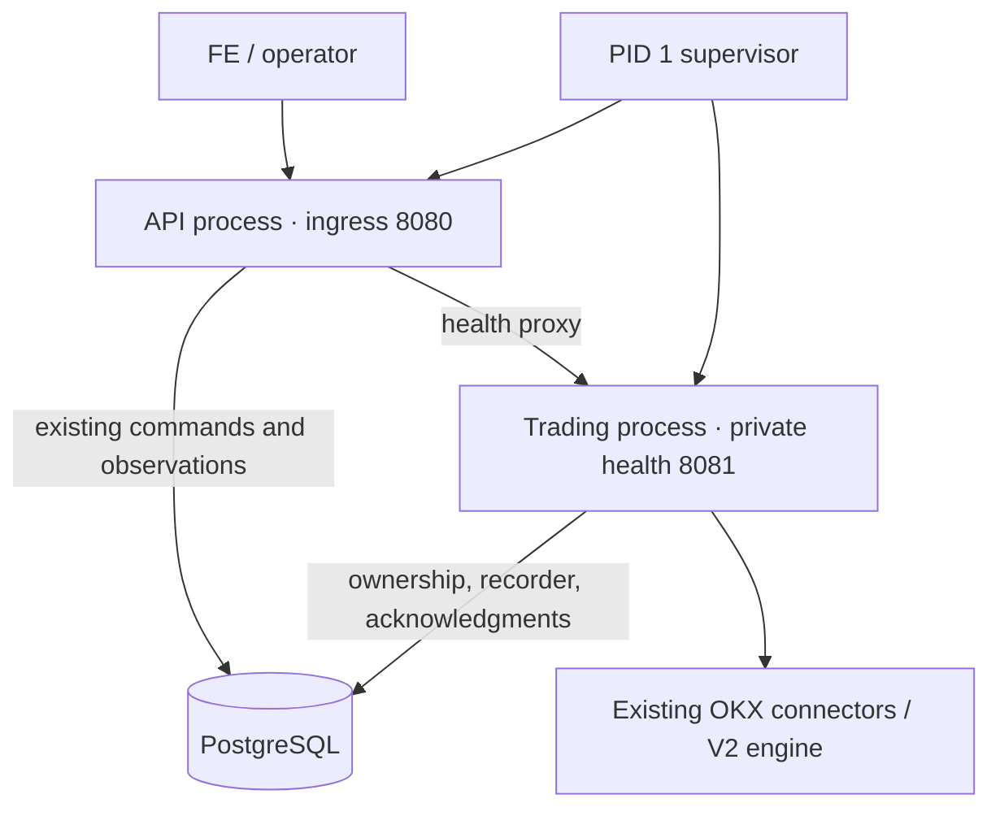

# Single-service API/engine process isolation experiment

The experiment retains one Cloud Run service, one container and one image.
Separate Python API/engine processes demonstrably isolate a blocked engine loop,
but do **not** establish healthy p99 acceptance. Keep the production entrypoint
unchanged. The daily fee SQL timeout and historical p99 attribution remain open.

[Portable evidence](mm-process-isolation-evidence.json) includes samples,
per-route summaries, fixture hashes, resource limits and verification scope.
The [implementation plan](../docs/plans/MM_REPORTING_LATENCY_TDD_PLAN.md) separates
this R1A diagnostic from R2/R3 and final-image release verification.

## Tested shape



The API reuses `AdminAPI`, `AdminStore` and `BotStateStore`; it acquires no trading
ownership and does not migrate or create the bot state. Engine startup/migration
must finish before API startup succeeds. The engine retains exchange keys,
connectors, quote/risk decisions, funding observation and recorder. Commands
already travel through PostgreSQL, so this experiment adds no message broker,
new trading engine, ledger, Redis, IPC command protocol or API/YAML override.

Both layouts share the same total CPU/RAM limits, internal fake exchange,
100k-fill history and five total database pool slots. Split uses engine pool
three / API pool two, deliberately overriding settings **inside the test wrapper**;
that partition is not currently a supported production configuration. The
immutable amd64 image runs emulated on an arm64 Mac. The real Demo was untouched.

## Healthy workload

Each row includes 20 main + 5 auxiliary reads/s, 100 book updates/s and one
fill/s, existing profile controls and independent fill/position comparison.
All measured healthy requests completed with HTTP 200, but latency failures
remain failures. One paired trial per setting is insufficient for causal or
statistical attribution. The 1-CPU and 2-CPU durations differ; compare layouts
within each setting, not CPU settings as a scaling benchmark.

| CPU / duration | Layout | p95 ms | p99 ms | HTTP errors | Whole-container peak MiB | Healthy latency gate |
|---|---|---:|---:|---:|---:|---|
| 1 / 90s | single | 1181.66 | 1875.12 | 0 | 361.3 | FAIL |
| 1 / 90s | split | 342.94 | 1170.88 | 0 | 602.1 | FAIL |
| 2 / 180s | single | 1216.16 | 2242.73 | 0 | 352.6 | FAIL |
| 2 / 180s | split | 1472.45 | 2554.77 | 0 | 597.0 | FAIL |
| 2 / 30s | single | 71.15 | 281.05 | 0 | 356.8 | short diagnostic only |
| 2 / 30s | split | 118.97 | 411.11 | 0 | 596.0 | short diagnostic only |

Memory is `cgroup memory.peak`, including page cache and all subprocesses; it is
not a measured RSS series. Split adds about 241 MiB in the 1-CPU pair. Its
2-CPU pair used about 0.73 cores on average versus 0.50 for combined; respective
cgroup throttled time was 1.99s / 0.30s over each roughly 180s window. These
aggregate counters cannot assign individual request outliers.

No 300s warmup, 900s mixed window, ninety-second burst or continuous hour was
completed for this new architecture. The passing 30s diagnostics do not close
the failed longer diagnostics or replace historical image-specific acceptance.

## Controlled stall and lifecycle

A test-only endpoint schedules a 2.5s synchronous engine-loop sleep. One hundred
status reads are offered at 20/s. This proves behavior under that injected
failure; it does not reproduce or identify the historical unplanned spike.

| CPU | Combined p99 / HTTP errors | Split p99 / HTTP errors |
|---|---:|---:|
| 1 | 2610.25 ms / 39 | 96.62 ms / 0 |
| 2 | 2656.49 ms / 40 | 101.69 ms / 0 |

The combined failures were bounded reporting-admission 503s after requests
accumulated during the stall; split served all 100. The original owner generation
and running engine survived each stall. API child environments contain no
`HBOT_OKX*` keys; this verifies credential delivery, not an OS security boundary.

Killing the stopped engine child caused the whole container to exit nonzero in
1.70s (1 CPU) / 1.84s (2 CPU), without OOM or a surviving healthy API. The promoted
runner additionally restarted from the acknowledged stopped state, began a new
session, killed the API child and verified whole-container exit, owner release,
quote cancellation and preserved exchange positions. The final active-session API-death rerun
exited in 1.75s with quotes cancelled, positions preserved and ownership released;
engine-death exit was 1.55s. Its 30s diagnostic p99 was 392.00ms (not full
acceptance). The executed child source hashes and effective profile match the
promoted files and paired fixture, respectively. These short runs are recorded
separately from the paired measurements.

Cloud Run requires ingress on `0.0.0.0:$PORT` and allows ten seconds between
SIGTERM and forced termination; the prototype's fixed ports and 8.5s parent
cleanup budget need full production lifecycle/port tests before adoption.
See the [official container contract](https://docs.cloud.google.com/run/docs/container-contract).
The current template already keeps CPU allocated outside HTTP requests; adding
processes does not create additional CPU or remove platform restarts.

## Reproduction and decision

```sh
make test-mm-process-isolation MM_PROCESS_CPUS=1 MM_PROCESS_SECONDS=90
make test-mm-process-isolation MM_PROCESS_CPUS=2 MM_PROCESS_SECONDS=180
# Isolate the lifecycle experiment after changing its test wrappers:
python scripts/test_mm_process_isolation.py --cpus 2 --duration 30 --mode split
```

[Runner](../scripts/test_mm_process_isolation.py) and
[test-only wrappers](../test/e2e/offline/process_isolation/) are excluded from the
production application artifact. The promoted runner returns nonzero for healthy budget violations even
when controlled-fault checks succeed; a native regression test verifies this.
Initial exploratory helpers returned completion status; their explicit latency
violations are retained as failures, never accepted gates.
Eleven selected native tests, including packaging, pass. An existing control-priority test was made
deterministic: freeing both workers cannot guarantee completion order across OS
threads, so the test now frees exactly one before checking control dispatch.
No production queue, worker count or priority policy changed.

Retain process isolation as a candidate availability improvement, not a blanket
p99 fix. Before promotion: define API-only restart versus whole-container failure
policy; test signals/startup interruption and all ports; validate total pool
partitioning; preserve health/ownership and deployment revision semantics; and
repeat full final-image E2E/mixed/hour/fault gates. Investigate worker admission,
DB execution and client scheduling separately. Process isolation leaves the
confirmed expensive original-fee aggregate unchanged; R2 bounded reporting
fallback and R3 queue diagnostics remain separate work.
