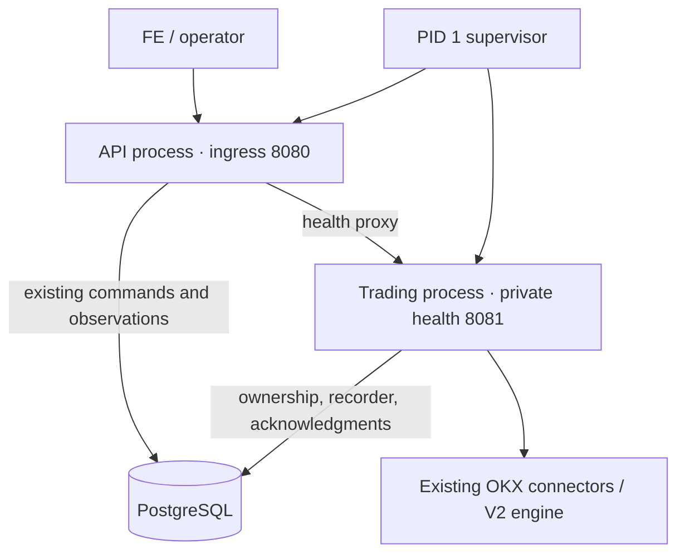

# Single-service API/engine process isolation experiment

Historical diagnostic results below keep their original scope. Native runtime
integration and local final-image/lifecycle/load/hour/control acceptance completed
on 2026-10-30; see [current verification](mm-service-supervision.md). Earlier
passing probes do not certify the selected image by themselves.

The experiment retains one Cloud Run service, one container and one image.
Separate Python API/engine processes demonstrably isolate a blocked engine loop,
but did **not** establish final architecture/load acceptance at that stage. The
baseline decision was to keep the production entrypoint unchanged until later
integration and verification. The daily fee SQL scalability limit and historical
p99 attribution remain unresolved.

[Portable evidence](mm-process-isolation-evidence.json) includes samples,
per-route summaries, fixture hashes, resource limits and verification scope.
The [implementation plan](../docs/plans/MM_REPORTING_LATENCY_TDD_PLAN.md) separates
this R1A diagnostic from R2/R3 and final-image release verification.

The R5 controlled repeat retains the same 300s warmup / 900s healthy workload.
Its test-only API probe correlates request IDs with physical worker admission,
pool checkout, SQL and response-model timing using the existing bounded tracing
helpers. Both client windows keep their own trace summaries, and executed
prototype sources are retained automatically. Two Red cases first fail for the
unsupported traced warmup and missing probe; 31 selected regression tests pass
after implementation, including real HTTP/SQL success/error and hook cleanup.
No runtime fix or latency improvement is inferred from this instrumentation.

## R5: longer request-correlated diagnostic

The matched **300s warmup / 900s healthy** traced repeat completes on image
`58356746…`, prototype commit `989c640e2`, two application CPUs / 2 GiB and
five pool slots, with the existing five-second daily cache. Raw evidence:
`build/mm-process-isolation/20261029-200153-f4e2f7/result.json`. Both latency
gates fail, and the runner exits one after successful recovery faults:

| Window | p95 ms | p99 ms | Main / auxiliary completed | HTTP/semantic errors |
|---|---:|---:|---:|---:|
| 300s warmup | 898.37 | 1861.62 | 6000 / 1500 | 0 |
| 900s healthy | 695.14 | 2266.57 | 18000 / 4500 | 0 |

This reproduces a longer latency failure with valid measurements. It does not
uniquely explain the older 7.4s p99 run. The slowest selected healthy request is
a 5632.65ms daily read: **3121.33ms client queue**, 9.73ms from dispatch to
handler, **2498.92ms handler**, 2.67ms after handler. Inside that handler, worker
admission waits 516.50ms and the two aggregates take 1067.91ms / 786.28ms.
Same-backend PostgreSQL samples during both aggregates show active execution
without a recorded wait event. Sampling every 250ms cannot exclude intervening
waits or establish CPU-only execution. Another daily request spends 1631.78ms
inside its handler without SQL, consistent with awaiting the existing shared
refresh/loop; that timing alone does not identify which await dominates.

Retained slow-root maxima distinguish worker admission **1854.44ms** from pool
queue **6.64ms**. Largest SQL span is 1129.78ms; response validation reaches
881.44ms, and recorded generation-two GC reaches 1333.41ms. GC overlap is partial;
the slowest selected request has only short GC overlaps. These maxima come from
slow retained traces, not unbiased whole-window percentiles. SQL, application
scheduling and client backlog all contribute; an across-the-board pool increase
is not supported. The app uses about 0.53 cores on average and accumulates
6.17s quota-throttled time over 901.50s, without assigning individual outliers.

The warmup/healthy client sinks report zero dropped records and one/five PG
sampler errors, respectively. Errors are preserved as diagnostic coverage gaps.
The initial API is killed by the mandatory fault suite, so it has no final sink
summary; zero dropped child spans in retained roots does not certify zero API
sink loss. API traces/heartbeat/GC instrumentation and one extra diagnostic DB
connection distinguish this repeat from the preceding untraced experiment.

Twenty memory samples show final-five versus samples 6..10 median RSS changes:
supervisor 0, engine +2.38 MiB, API +6.88 MiB. API RSS levels off in the last five
samples. Threads remain 1/10/14, and later descriptors remain 5..6/31/23. This is
a twenty-minute diagnostic with trace overhead, not a continuous-hour leak gate.
API crashes recover in 8.23/7.98s, its hang in 29.45s; active engine crash recovers
in 18.56s and HALTed hang in 29.69s. The same identity, session, order, position
and retained-HALT checks pass. Parent shutdown takes 1.82s and releases ownership.

Two further Red cases cover the supervised analyzer layout and explicit cache
comparison policy; **35 selected tests pass** after implementation. The analyzer
separates client delay, server work, physical worker waiting, SQL and GC overlap.
The existing cache was then compared at fifteen seconds, preserving the
application default of five seconds:

| Policy / window | p95 ms | p99 ms | Errors | Latency result |
|---|---:|---:|---:|---|
| 15s / separate 300s probe | 54.82 | 220.63 | 0 | PASS |
| 15s / matched 300s warmup | 58.45 | 631.47 | 0 | PASS |
| 15s / matched 900s healthy | 57.36 | 206.92 | 0 | PASS |

The short probe is `build/mm-process-isolation/20261029-202759-30b43d`; its full
fault suite passes, but it lacks the minute memory sampler used by the original
five-second warmup. The matched longer repeat restores that sampler and retains
all other workload/resource settings:
`build/mm-process-isolation/20261029-203657-985599`. Its 900s window completes
18000 main / 4500 auxiliary reads, zero HTTP/semantic errors, and all latency
budgets pass. Selected slow-root maxima: worker wait 982.18ms, pool queue 0.54ms,
SQL 418.10ms. These are observed sequential trials, not a statistical speedup
guarantee or unique attribution of the historical p99. Observed aggregate refreshes
in retained slow traces fall from 51 to 19 across the respective first 300s
windows; this is not a complete loss-certified SQL counter.

Twenty-one memory samples span about twenty minutes. Median last-five versus
samples 6..10 RSS changes are +0.38/+2.88/+1.75 MiB for supervisor/engine/API;
thread counts remain 1/10/14, and late API RSS largely plateaus. The healthy
client sink reports zero dropped records and one PG sampler error. This remains
bounded-window evidence with diagnostic overhead, not an hour-long leak gate.

### Fault-check failure and bounded refresh retest

**The longer TTL15 run still exits one overall.** Its third API fault hits the
normal sixty-second executor refresh: orders created at 13:58:28 UTC are cancelled
at 13:59:28..31 UTC, exactly when the probe immediately asserts a live order.
That assertion cannot distinguish the ordinary cancellation/replacement gap from
permanent order loss. Cleanup ends the observation, so the failed run is retained;
its later engine faults were not executed and are not certified by its passing
latency windows.

Two Red tests cover a refresh gap followed by partially filled working orders,
and permanent loss that must still fail. The corrected test waits at most thirty
seconds for working quotes, then rechecks the original engine PID, owner,
generation, session and positions. It explicitly exercises the ordinary refresh
cancellation boundary after the API-hang fault. Controller decisions, refresh
times and load latency budgets are unchanged. **59 selected native tests pass.**

A separate real-container retest at
`build/mm-process-isolation/20261029-210516-4f66fe` passes the forced boundary,
both API crashes/hang, both engine faults and parent shutdown. Its 30s healthy
p99 is 247.32ms; it is a focused lifecycle retest, not a substitute for a complete
long final-artifact sequence. Engine identity/session survive API replacement;
engine restart preserves HALT/positions and produces no additional orders.
Reported recovery durations include the deliberately awaited refresh and
verification; they are not an API-readiness SLA. Continuous uninterrupted
quote coverage is not claimed.

The public Demo environment example now explicitly uses fifteen seconds for
daily charts; current balances, positions, controls and trading use separate
paths. The shared default stays five seconds, and the private/running Demo is
unchanged. Keep independent supervision test-only. Cold million-fill SQL cost,
production lifecycle/ports/pool integration, ordinary-entrypoint verification
and the final continuous-hour/load gates remain open. No new runtime defect is
claimed from this latency investigation; the refresh assertion was a test defect.

## Tested shape



The API reuses `AdminAPI`, `AdminStore` and `BotStateStore`; it acquires no trading
ownership and does not migrate or create the bot state. Engine startup/migration
must finish before API startup succeeds. The engine retains exchange keys,
connectors, quote/risk decisions, funding observation and recorder. Commands
already travel through PostgreSQL, so this experiment adds no message broker,
new trading engine, ledger, Redis, IPC command protocol or API/YAML override.

Both layouts share the same total CPU/RAM limits, internal fake exchange,
100k-fill history and five total database pool slots. Split uses engine pool
three / API pool two, deliberately overriding settings **inside the test wrapper**;
that partition is not currently a supported production configuration. The
immutable amd64 image runs emulated on an arm64 Mac. The real Demo was untouched.

## Healthy workload

Each row includes 20 main + 5 auxiliary reads/s, 100 book updates/s and one
fill/s, existing profile controls and independent fill/position comparison.
All measured healthy requests completed with HTTP 200, but latency failures
remain failures. One paired trial per setting is insufficient for causal or
statistical attribution. The 1-CPU and 2-CPU durations differ; compare layouts
within each setting, not CPU settings as a scaling benchmark.

| CPU / duration | Layout | p95 ms | p99 ms | HTTP errors | Whole-container peak MiB | Healthy latency gate |
|---|---|---:|---:|---:|---:|---|
| 1 / 90s | single | 1181.66 | 1875.12 | 0 | 361.3 | FAIL |
| 1 / 90s | split | 342.94 | 1170.88 | 0 | 602.1 | FAIL |
| 2 / 180s | single | 1216.16 | 2242.73 | 0 | 352.6 | FAIL |
| 2 / 180s | split | 1472.45 | 2554.77 | 0 | 597.0 | FAIL |
| 2 / 30s | single | 71.15 | 281.05 | 0 | 356.8 | short diagnostic only |
| 2 / 30s | split | 118.97 | 411.11 | 0 | 596.0 | short diagnostic only |

Memory is `cgroup memory.peak`, including page cache and all subprocesses; it is
not a measured RSS series. Split adds about 241 MiB in the 1-CPU pair. Additional RAM is acceptable under
the operator's clarified priorities; this measurement is not a rejection criterion. Its
2-CPU pair used about 0.73 cores on average versus 0.50 for combined; respective
cgroup throttled time was 1.99s / 0.30s over each roughly 180s window. These
aggregate counters cannot assign individual request outliers.

No 300s warmup, 900s mixed window, ninety-second burst or continuous hour was
completed for this new architecture. The passing 30s diagnostics do not close
the failed longer diagnostics or replace historical image-specific acceptance.

## Controlled stall and lifecycle

A test-only endpoint schedules a 2.5s synchronous engine-loop sleep. One hundred
status reads are offered at 20/s. This proves behavior under that injected
failure; it does not reproduce or identify the historical unplanned spike.

| CPU | Combined p99 / HTTP errors | Split p99 / HTTP errors |
|---|---:|---:|
| 1 | 2610.25 ms / 39 | 96.62 ms / 0 |
| 2 | 2656.49 ms / 40 | 101.69 ms / 0 |

The combined failures were bounded reporting-admission 503s after requests
accumulated during the stall; split served all 100. The original owner generation
and running engine survived each stall. API child environments contain no
`HBOT_OKX*` keys; this verifies credential delivery, not an OS security boundary.

Killing the stopped engine child caused the whole container to exit nonzero in
1.70s (1 CPU) / 1.84s (2 CPU), without OOM or a surviving healthy API. The promoted
runner additionally restarted from the acknowledged stopped state, began a new
session, killed the API child and verified whole-container exit, owner release,
quote cancellation and preserved exchange positions. The final active-session API-death rerun
exited in 1.75s with quotes cancelled, positions preserved and ownership released;
engine-death exit was 1.55s. Its 30s diagnostic p99 was 392.00ms (not full
acceptance). The executed child source hashes and effective profile match the
promoted files and paired fixture, respectively. These short runs are recorded
separately from the paired measurements.

Cloud Run requires ingress on `0.0.0.0:$PORT` and allows ten seconds between
SIGTERM and forced termination; the prototype's fixed ports and 8.5s parent
cleanup budget need full production lifecycle/port tests before adoption.
See the [official container contract](https://docs.cloud.google.com/run/docs/container-contract).
The current template already keeps CPU allocated outside HTTP requests; adding
processes does not create additional CPU or remove platform restarts.

## Reproduction and decision

```sh
make test-mm-process-isolation MM_PROCESS_CPUS=1 MM_PROCESS_SECONDS=90
make test-mm-process-isolation MM_PROCESS_CPUS=2 MM_PROCESS_SECONDS=180
# Isolate the lifecycle experiment after changing its test wrappers:
python scripts/test_mm_process_isolation.py --cpus 2 --duration 30 --mode split
```

[Runner](../scripts/test_mm_process_isolation.py) and
[test-only wrappers](../test/e2e/offline/process_isolation/) are excluded from the
production application artifact. The promoted runner returns nonzero for healthy budget violations even
when controlled-fault checks succeed; a native regression test verifies this.
Initial exploratory helpers returned completion status; their explicit latency
violations are retained as failures, never accepted gates.
Eleven selected native tests, including packaging, pass. An existing control-priority test was made
deterministic: freeing both workers cannot guarantee completion order across OS
threads, so the test now frees exactly one before checking control dispatch.
No production queue, worker count or priority policy changed.

Retain process isolation as a candidate availability improvement, not a blanket
p99 fix. Before promotion: define API-only restart versus whole-container failure
policy; test signals/startup interruption and all ports; validate total pool
partitioning; preserve health/ownership and deployment revision semantics; and
repeat full final-image E2E/mixed/hour/fault gates. Investigate worker admission,
DB execution and client scheduling separately. Process isolation leaves the
confirmed expensive original-fee aggregate unchanged; R2 bounded reporting
fallback and R3 queue diagnostics remain separate work.

## Follow-up: independent restart prototype

The operator prioritizes responsiveness, bounded memory and automatic recovery
over additional RAM. The earlier whole-container-failure prototype remains a
reference; its healthy p99 failures are still failures. Production is unchanged
while independent child supervision is tested.

Red/Green: missing lifecycle/watchdog modules first fail collection; the new
policy, real child reaping and existing load-result guard pass eleven selected
tests. A separate Red test confirms a failed warmup could be discarded by the
new diagnostic path; the runner now retains failure from either window. Sixteen
selected lifecycle/runner/packaging tests pass. State is bounded to two roles,
restarts have capped backoff, and shutdown disables further launches. A child
must physically exit and be reaped before replacement. A watchdog allows initial
bootstrap, then requires sustained failed liveness probes before termination.
A healthy guard wait/HALT is not itself a process-restart signal.

The first real-container diagnostic, 2 CPU / 2 GiB total / five total pool slots,
passes 30s healthy load (p95 64.35ms, p99 348.70ms, zero errors/violations). During
a 2.5s engine-loop stall, API p99 is 107.08ms, 100 reads and zero errors. These
short windows are not final performance acceptance. Raw evidence:
`build/mm-process-isolation/20261029-182535-2a6361/result.json`.

| Injected failure | Recovery seconds | Verified behavior |
|---|---:|---|
| API SIGKILL | 8.81 | Engine PID, owner, session and positions preserved; working quotes remain |
| API repeated SIGKILL | 8.15 | Same invariants; no whole-container restart |
| API SIGSTOP | 28.93 | Watchdog replaces API; engine and session preserved |
| Active engine SIGKILL | 9.17 | API stays alive; old process absent; new owner generation retains HALT; no additional orders |
| HALTed engine SIGSTOP | 28.79 | Watchdog replaces engine; API preserved; HALT and positions remain; no additional orders |

Parent SIGTERM exits zero, without OOM, and releases ownership within the
existing harness deadline. The first runner did not capture its numeric duration
(the helper returns None); that recording is corrected for the next run. It is
not reported as a measured zero-second shutdown. No HALT reset or recovery API
is added. API `/live` describes its own loop in this mode; `/startup` and `/ready`
still check the engine. The supervisor independently probes the engine so an
engine restart does not cascade into an API/container restart.

A 300s warmup plus 900s healthy window with per-role RSS/thread/descriptor samples
is in progress. Long-running memory and final-image release verification remain
open; source-role bounds and short crash tests alone do not prove absence of leaks.

## Warmed supervision diagnostic: latency still fails

The 300s/900s supervised pair completes with zero HTTP errors, but both latency
gates fail. Warmup p95/p99 **6239.67/7427.94ms**; healthy **762.03/1754.99ms**.
The runner exits nonzero and preserves both failures. No memory allowance or
successful fault test changes that result. Raw evidence:
`build/mm-process-isolation/20261029-183141-ef2533/result.json`. Five exact
executed prototype files were retained beside it; the subsequent shutdown-race
regression fix and trace probe are separate source revisions.

Warmup's broad queue-delay cluster occurs around minutes one to three. The
healthy window also has later slow periods, so a cold-start-only explanation is
not supported. A small native smoke ran in the last warmup minute, after the
first cluster; no native/build/E2E job ran during the 900s healthy window. No
causal attribution is made from this temporal comparison. The application used
0.63 cores on average and accumulated 3.27s quota-throttled time across 904.21s;
these aggregate counts do not explain individual outliers.

Twenty per-role memory samples span 1155.96s. Comparing the median of samples
6..10 with the last five, API RSS increases **0.25 MiB**, engine **1.38 MiB**,
supervisor **0 MiB**. Thread counts remain 11/11/1. Steady descriptor ranges are
11..22 / 28..29 / 5..6, respectively, without sustained later growth. Whole
cgroup memory grows from 618,803,200 to 626,753,536 bytes; summing RSS would
double-count shared mappings. This is encouraging bounded-window evidence, not
a completed one-hour leak gate.

Real fault recovery repeats successfully, with more variable times: API crashes
9.69/11.53s, API hang 53.31s; active engine crash 23.93s, HALTed engine hang
29.72s. Engine/API identities, ownership/session and position invariants match
the earlier scope; engine restart retains HALT and creates no additional orders.
Parent shutdown is now numerically recorded: **1.52s**, exit zero, ownership
released. Do not promise the shorter first-run timings as a recovery SLA.

A further Red test reproduces stop arriving during a child launch; subsequent
roles must not start once stop is requested. The policy now rechecks shutdown
between roles and before launch. Twenty-eight selected lifecycle/probe/trace/
queue/packaging tests pass. The optional API probe reuses the bounded trace sink,
records loop/GC timing and frame summaries without locals, and removes its
callback/task/thread on cleanup. A new traced diagnostic is next; it does not
replace these failed untraced windows or production release gates.

Reproduce the supervised diagnostics:

```sh
python scripts/test_mm_process_isolation.py --image hummingbot-cloudrun:reporting-final --mode split --supervision restart --cpus 2 --duration 30
python scripts/test_mm_process_isolation.py --image hummingbot-cloudrun:reporting-final --mode split --supervision restart --cpus 2 --warmup-seconds 300 --duration 900
python scripts/test_mm_process_isolation.py --image hummingbot-cloudrun:reporting-final --mode split --supervision restart --cpus 2 --duration 300 --trace
```

## First traced follow-up and measurement correction

The next 300s traced window passes p95/p99 **98.33/433.70ms**, zero errors;
all crash/hang checks also pass. This does not erase the preceding 300s/900s
latency failures. The long cluster was not reproduced in this short window.
The optional existing client/DB sampler uses one additional diagnostic DB
connection; this is not an unchanged no-trace resource comparison.

API generation-2 collections take roughly **286..529ms**. The slowest selected
request, a 1443.22ms daily read, overlaps 524.38ms of API GC; other selected
daily reads overlap none. Temporal overlap alone does not assign the remaining
latency or establish GC as the cause of the original multi-second cluster.
No GC threshold/freeze/disable policy is changed.

The new probe itself had a heartbeat snapshot race: the loop could update its
beat after the threshold check and before event serialization, producing a
negative lag. Those loop-lag samples are invalidated. A deterministic Red test
delays stack sampling to reproduce it; Green snapshots one beat timestamp for
the whole sample. Twenty-eight selected tests pass. Independent client timing
and GC duration records remain usable; the faulty loop-lag values are not used
for attribution. Raw run:
`build/mm-process-isolation/20261029-190101-6f0c99/result.json`.

The corrected-probe 300s rerun passes **54.11/358.09ms p95/p99**, zero errors,
and repeats all crash/hang checks successfully. Seven initial API loop-stall
samples are valid (none below the 200ms threshold), maximum **470.91ms**. Raw:
`build/mm-process-isolation/20261029-191235-e686fd/result.json`. Production
adoption, stable healthy latency and a continuous-hour memory/final-image gate
remain open. Recovery
requires an operator for unresolved exchange effects; this phase does not add
a HALT-reset endpoint or promise automatic trading resumption after a crash.

## Decision after this phase

Keep the production entrypoint unchanged for now. The supervised two-process
prototype meets the tested failure-containment/restart invariants and shows no
sustained retention growth in the twenty-sample diagnostic. Extra memory is
acceptable. It is **healthy latency variability**, not RAM, that prevents
promotion: the unchanged 300s/900s windows still fail, despite two passing
shorter traced follow-ups. The historical p99 trigger and the million-fill SQL
cost are not declared fixed.

Before adoption, finish stable healthy latency and continuous-hour retention
checks, production port/pool configuration and structured child-boundary errors,
startup interruption and final-image lifecycle/E2E/load gates. Do not copy the
test-only fixed-port wrappers into deployment as-is. The current operator flow
still requires technical review for unresolved-effect HALT; restarting a child
or issuing observational reconciliation does not grant trading authority.
