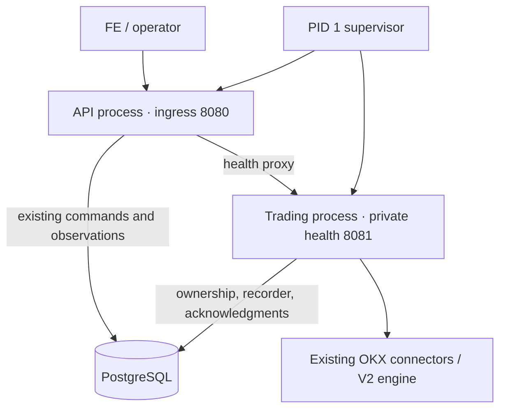

# Single-service API/engine process isolation experiment

The experiment retains one Cloud Run service, one container and one image.
Separate Python API/engine processes demonstrably isolate a blocked engine loop,
but do **not** establish healthy p99 acceptance. Keep the production entrypoint
unchanged. The daily fee SQL timeout and historical p99 attribution remain open.

[Portable evidence](mm-process-isolation-evidence.json) includes samples,
per-route summaries, fixture hashes, resource limits and verification scope.
The [implementation plan](../docs/plans/MM_REPORTING_LATENCY_TDD_PLAN.md) separates
this R1A diagnostic from R2/R3 and final-image release verification.

## Tested shape



The API reuses `AdminAPI`, `AdminStore` and `BotStateStore`; it acquires no trading
ownership and does not migrate or create the bot state. Engine startup/migration
must finish before API startup succeeds. The engine retains exchange keys,
connectors, quote/risk decisions, funding observation and recorder. Commands
already travel through PostgreSQL, so this experiment adds no message broker,
new trading engine, ledger, Redis, IPC command protocol or API/YAML override.

Both layouts share the same total CPU/RAM limits, internal fake exchange,
100k-fill history and five total database pool slots. Split uses engine pool
three / API pool two, deliberately overriding settings **inside the test wrapper**;
that partition is not currently a supported production configuration. The
immutable amd64 image runs emulated on an arm64 Mac. The real Demo was untouched.

## Healthy workload

Each row includes 20 main + 5 auxiliary reads/s, 100 book updates/s and one
fill/s, existing profile controls and independent fill/position comparison.
All measured healthy requests completed with HTTP 200, but latency failures
remain failures. One paired trial per setting is insufficient for causal or
statistical attribution. The 1-CPU and 2-CPU durations differ; compare layouts
within each setting, not CPU settings as a scaling benchmark.

| CPU / duration | Layout | p95 ms | p99 ms | HTTP errors | Whole-container peak MiB | Healthy latency gate |
|---|---|---:|---:|---:|---:|---|
| 1 / 90s | single | 1181.66 | 1875.12 | 0 | 361.3 | FAIL |
| 1 / 90s | split | 342.94 | 1170.88 | 0 | 602.1 | FAIL |
| 2 / 180s | single | 1216.16 | 2242.73 | 0 | 352.6 | FAIL |
| 2 / 180s | split | 1472.45 | 2554.77 | 0 | 597.0 | FAIL |
| 2 / 30s | single | 71.15 | 281.05 | 0 | 356.8 | short diagnostic only |
| 2 / 30s | split | 118.97 | 411.11 | 0 | 596.0 | short diagnostic only |

Memory is `cgroup memory.peak`, including page cache and all subprocesses; it is
not a measured RSS series. Split adds about 241 MiB in the 1-CPU pair. Additional RAM is acceptable under
the operator's clarified priorities; this measurement is not a rejection criterion. Its
2-CPU pair used about 0.73 cores on average versus 0.50 for combined; respective
cgroup throttled time was 1.99s / 0.30s over each roughly 180s window. These
aggregate counters cannot assign individual request outliers.

No 300s warmup, 900s mixed window, ninety-second burst or continuous hour was
completed for this new architecture. The passing 30s diagnostics do not close
the failed longer diagnostics or replace historical image-specific acceptance.

## Controlled stall and lifecycle

A test-only endpoint schedules a 2.5s synchronous engine-loop sleep. One hundred
status reads are offered at 20/s. This proves behavior under that injected
failure; it does not reproduce or identify the historical unplanned spike.

| CPU | Combined p99 / HTTP errors | Split p99 / HTTP errors |
|---|---:|---:|
| 1 | 2610.25 ms / 39 | 96.62 ms / 0 |
| 2 | 2656.49 ms / 40 | 101.69 ms / 0 |

The combined failures were bounded reporting-admission 503s after requests
accumulated during the stall; split served all 100. The original owner generation
and running engine survived each stall. API child environments contain no
`HBOT_OKX*` keys; this verifies credential delivery, not an OS security boundary.

Killing the stopped engine child caused the whole container to exit nonzero in
1.70s (1 CPU) / 1.84s (2 CPU), without OOM or a surviving healthy API. The promoted
runner additionally restarted from the acknowledged stopped state, began a new
session, killed the API child and verified whole-container exit, owner release,
quote cancellation and preserved exchange positions. The final active-session API-death rerun
exited in 1.75s with quotes cancelled, positions preserved and ownership released;
engine-death exit was 1.55s. Its 30s diagnostic p99 was 392.00ms (not full
acceptance). The executed child source hashes and effective profile match the
promoted files and paired fixture, respectively. These short runs are recorded
separately from the paired measurements.

Cloud Run requires ingress on `0.0.0.0:$PORT` and allows ten seconds between
SIGTERM and forced termination; the prototype's fixed ports and 8.5s parent
cleanup budget need full production lifecycle/port tests before adoption.
See the [official container contract](https://docs.cloud.google.com/run/docs/container-contract).
The current template already keeps CPU allocated outside HTTP requests; adding
processes does not create additional CPU or remove platform restarts.

## Reproduction and decision

```sh
make test-mm-process-isolation MM_PROCESS_CPUS=1 MM_PROCESS_SECONDS=90
make test-mm-process-isolation MM_PROCESS_CPUS=2 MM_PROCESS_SECONDS=180
# Isolate the lifecycle experiment after changing its test wrappers:
python scripts/test_mm_process_isolation.py --cpus 2 --duration 30 --mode split
```

[Runner](../scripts/test_mm_process_isolation.py) and
[test-only wrappers](../test/e2e/offline/process_isolation/) are excluded from the
production application artifact. The promoted runner returns nonzero for healthy budget violations even
when controlled-fault checks succeed; a native regression test verifies this.
Initial exploratory helpers returned completion status; their explicit latency
violations are retained as failures, never accepted gates.
Eleven selected native tests, including packaging, pass. An existing control-priority test was made
deterministic: freeing both workers cannot guarantee completion order across OS
threads, so the test now frees exactly one before checking control dispatch.
No production queue, worker count or priority policy changed.

Retain process isolation as a candidate availability improvement, not a blanket
p99 fix. Before promotion: define API-only restart versus whole-container failure
policy; test signals/startup interruption and all ports; validate total pool
partitioning; preserve health/ownership and deployment revision semantics; and
repeat full final-image E2E/mixed/hour/fault gates. Investigate worker admission,
DB execution and client scheduling separately. Process isolation leaves the
confirmed expensive original-fee aggregate unchanged; R2 bounded reporting
fallback and R3 queue diagnostics remain separate work.

## Follow-up: independent restart prototype

The operator prioritizes responsiveness, bounded memory and automatic recovery
over additional RAM. The earlier whole-container-failure prototype remains a
reference; its healthy p99 failures are still failures. Production is unchanged
while independent child supervision is tested.

Red/Green: missing lifecycle/watchdog modules first fail collection; the new
policy, real child reaping and existing load-result guard pass eleven selected
tests. A separate Red test confirms a failed warmup could be discarded by the
new diagnostic path; the runner now retains failure from either window. Sixteen
selected lifecycle/runner/packaging tests pass. State is bounded to two roles,
restarts have capped backoff, and shutdown disables further launches. A child
must physically exit and be reaped before replacement. A watchdog allows initial
bootstrap, then requires sustained failed liveness probes before termination.
A healthy guard wait/HALT is not itself a process-restart signal.

The first real-container diagnostic, 2 CPU / 2 GiB total / five total pool slots,
passes 30s healthy load (p95 64.35ms, p99 348.70ms, zero errors/violations). During
a 2.5s engine-loop stall, API p99 is 107.08ms, 100 reads and zero errors. These
short windows are not final performance acceptance. Raw evidence:
`build/mm-process-isolation/20261029-182535-2a6361/result.json`.

| Injected failure | Recovery seconds | Verified behavior |
|---|---:|---|
| API SIGKILL | 8.81 | Engine PID, owner, session and positions preserved; working quotes remain |
| API repeated SIGKILL | 8.15 | Same invariants; no whole-container restart |
| API SIGSTOP | 28.93 | Watchdog replaces API; engine and session preserved |
| Active engine SIGKILL | 9.17 | API stays alive; old process absent; new owner generation retains HALT; no additional orders |
| HALTed engine SIGSTOP | 28.79 | Watchdog replaces engine; API preserved; HALT and positions remain; no additional orders |

Parent SIGTERM exits zero, without OOM, and releases ownership within the
existing harness deadline. The first runner did not capture its numeric duration
(the helper returns None); that recording is corrected for the next run. It is
not reported as a measured zero-second shutdown. No HALT reset or recovery API
is added. API `/live` describes its own loop in this mode; `/startup` and `/ready`
still check the engine. The supervisor independently probes the engine so an
engine restart does not cascade into an API/container restart.

A 300s warmup plus 900s healthy window with per-role RSS/thread/descriptor samples
is in progress. Long-running memory and final-image release verification remain
open; source-role bounds and short crash tests alone do not prove absence of leaks.

## Warmed supervision diagnostic: latency still fails

The 300s/900s supervised pair completes with zero HTTP errors, but both latency
gates fail. Warmup p95/p99 **6239.67/7427.94ms**; healthy **762.03/1754.99ms**.
The runner exits nonzero and preserves both failures. No memory allowance or
successful fault test changes that result. Raw evidence:
`build/mm-process-isolation/20261029-183141-ef2533/result.json`. Five exact
executed prototype files were retained beside it; the subsequent shutdown-race
regression fix and trace probe are separate source revisions.

Warmup's broad queue-delay cluster occurs around minutes one to three. The
healthy window also has later slow periods, so a cold-start-only explanation is
not supported. A small native smoke ran in the last warmup minute, after the
first cluster; no native/build/E2E job ran during the 900s healthy window. No
causal attribution is made from this temporal comparison. The application used
0.63 cores on average and accumulated 3.27s quota-throttled time across 904.21s;
these aggregate counts do not explain individual outliers.

Twenty per-role memory samples span 1155.96s. Comparing the median of samples
6..10 with the last five, API RSS increases **0.25 MiB**, engine **1.38 MiB**,
supervisor **0 MiB**. Thread counts remain 11/11/1. Steady descriptor ranges are
11..22 / 28..29 / 5..6, respectively, without sustained later growth. Whole
cgroup memory grows from 618,803,200 to 626,753,536 bytes; summing RSS would
double-count shared mappings. This is encouraging bounded-window evidence, not
a completed one-hour leak gate.

Real fault recovery repeats successfully, with more variable times: API crashes
9.69/11.53s, API hang 53.31s; active engine crash 23.93s, HALTed engine hang
29.72s. Engine/API identities, ownership/session and position invariants match
the earlier scope; engine restart retains HALT and creates no additional orders.
Parent shutdown is now numerically recorded: **1.52s**, exit zero, ownership
released. Do not promise the shorter first-run timings as a recovery SLA.

A further Red test reproduces stop arriving during a child launch; subsequent
roles must not start once stop is requested. The policy now rechecks shutdown
between roles and before launch. Twenty-eight selected lifecycle/probe/trace/
queue/packaging tests pass. The optional API probe reuses the bounded trace sink,
records loop/GC timing and frame summaries without locals, and removes its
callback/task/thread on cleanup. A new traced diagnostic is next; it does not
replace these failed untraced windows or production release gates.

Reproduce the supervised diagnostics:

```sh
python scripts/test_mm_process_isolation.py --image hummingbot-cloudrun:reporting-final --mode split --supervision restart --cpus 2 --duration 30
python scripts/test_mm_process_isolation.py --image hummingbot-cloudrun:reporting-final --mode split --supervision restart --cpus 2 --warmup-seconds 300 --duration 900
python scripts/test_mm_process_isolation.py --image hummingbot-cloudrun:reporting-final --mode split --supervision restart --cpus 2 --duration 300 --trace
```
